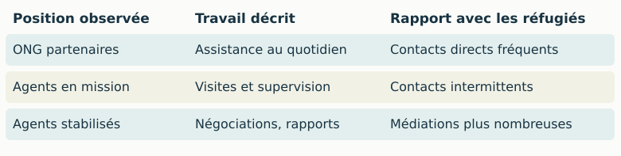

# ENS-PSL · Sélection internationale Lettres · Sociologie — Fresia et les fonctionnaires du HCR (oral) 2017 — Corrigé brut

*Corrigé rédigé par IA, non officiel. Signalez toute erreur.*

**Rédaction** · GPT-6.2 Astra Ultra · vitesse non renseignée

Les pages 1 et 2 du livret demandent de commenter l’extrait de Marion Fresia et d’expliquer l’intérêt d’étudier la question des réfugiés à partir des fonctionnaires du HCR. L’index de l’ENS classe le livret en sociologie. Une mention de candidature en études politiques figure au bas de la deuxième page. Le rapprochement avec un projet de recherche est facultatif. La piste proposée ici illustre ce rapprochement.

## Pourquoi partir des agents du HCR ?

Un agent peut regretter le temps où il travaillait dans un camp tout en cherchant une affectation au siège. C’est cette apparente contradiction que permet de comprendre l’extrait de Marion Fresia. Prendre pour objet les fonctionnaires internationaux du Haut-Commissariat des Nations unies pour les réfugiés fait voir les critères qui définissent une bonne intervention et ceux qui font une bonne carrière. Ces critères ne coïncident pas toujours. Leur articulation a des effets sur le travail que l’organisation délègue, sur ce qu’elle mesure et sur ce qu’elle sait de la vie des réfugiés.

## Un mot qui change de sens avec l’échelle

Dans les récits des agents, le terrain condense l’action, la solidarité et la proximité. Une infrastructure livrée peut attester que l’on a agi. Sa visibilité immédiate facilite sa présentation comme réussite, même quand on connaît mal les effets à long terme pour les habitants. On comprend ainsi comment une certaine définition de l’efficacité se forme au sein d’un milieu professionnel. L’autrice rapporte l’image distinctive que les agents donnent de leur institution lorsqu’ils la comparent à d’autres agences de l’ONU. Elle ne prétend pas avoir établi que le HCR serait la seule organisation à intervenir dans des zones difficiles.

L’opposition a ensuite deux sens internes. Pour un agent qui regarde l’organisation depuis son siège, une affectation dans un pays d’intervention relève du terrain. Mais dans ce pays même, le bureau de la capitale devient le pôle auquel s’opposent les antennes proches des camps. Le déplacement de la frontière du mot est instructif. Si la géographie suffisait à le définir, il n’y aurait pas à changer de définition avec l’interlocuteur. Par ce mot, on situe aussi une personne dans une hiérarchie de prestige.

## Qui travaille effectivement au contact des réfugiés ?

L’observation oblige à recomposer la chaîne de travail. Dans les situations décrites, des ONG partenaires assurent l’assistance au quotidien, l’enregistrement et les premiers signalements d’atteintes aux droits. Les agents du HCR effectuent notamment des visites de supervision. Le passage parle d’une à trois visites hebdomadaires et précise que les missions sur place reviennent souvent à des agents nationaux ou à de jeunes expatriés sous contrat temporaire. Les fonctionnaires internationaux stabilisés passent davantage de temps à négocier avec des autorités, à coordonner des organisations et à rédiger des rapports. Ces tâches conditionnent l’aide. Elles ne donnent pourtant pas accès de la même manière à l’expérience de ceux qui la reçoivent.

D’où une question sociologique sur la représentation des réfugiés. Une difficulté repérée par un partenaire local doit être transmise, puis entrer dans un rapport avant de devenir visible pour certains décideurs. La catégorie d’agent choisie comme point de départ change donc ce que l’enquête peut connaître. Cela ne permet ni de juger de la qualité de toutes les interventions du HCR ni de faire parler les réfugiés par l’intermédiaire de ceux qui s’occupent d’eux.

## Pourquoi rechercher un poste que l’on déprécie ?

Des affectations difficiles constituent une initiation reconnue. Avec l’ancienneté interviennent aussi l’usure, le souhait de vivre en famille, la rareté des postes au siège et la possibilité de se faire connaître des responsables. La même organisation récompense symboliquement le passage par le terrain et rend avantageuse une proximité ultérieure avec le centre. La nostalgie de l’action directe peut être sincère. Elle présente aussi l’agent sous un jour honorable dans un univers où le travail administratif est dévalorisé. Fresia restitue ici des épreuves de carrière et des normes collectives, sans avoir à distribuer des brevets de dévouement.

Pour prolonger cette approche dans un projet de recherche, on pourrait suivre un même problème depuis son signalement jusqu’à son inscription dans un rapport et confronter les récits des agents à ceux des associations et des personnes concernées. Ce serait une manière d’étudier ce que chaque position permet de voir. L’apport de l’extrait est de montrer comment l’action envers les réfugiés se construit aussi dans ces divisions institutionnelles du travail.

Le rapport de jury propre à ce sujet n’a pas été retrouvé. [Archives ENS-PSL de 2017](https://www.ens.psl.eu/sujets-et-rapports-du-concours-2017-lettres-0)

[Feuillet officiel](https://www.ens.psl.eu/sites/default/files/sociologie-oralsi2017.pdf#page=1)
