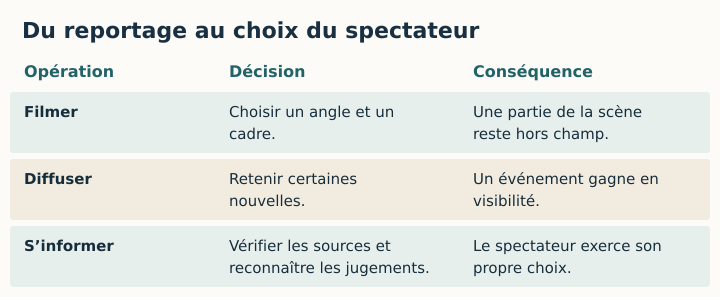

# ENS Rennes · D1 · Allemand 2017 — Corrigé guidé

*Corrigé rédigé par IA, non officiel. Signalez toute erreur.*

**Rédaction** · GPT-6.2 Astra Ultra · vitesse non renseignée

Épreuve écrite de l’École normale supérieure de Rennes. Johanna Seebacher, Politik & Unterricht, numéro 1, 2002.

## Version française

Faisons une expérience. Prenez une caméra vidéo aussi grosse et lourde que possible, ainsi qu’un micro. Promenez-vous dans une localité, filmez à droite et à gauche et adressez-vous à la caméra d’un air grave. Vous êtes sûr de retenir l’attention des personnes présentes. Nombre d’entre elles accepteront de répondre sur-le-champ à vos questions, sans demander qui est vraiment en train de filmer, dans quel but, ni à quoi serviront leur image et leurs propos. Autre scène que l’on peut observer régulièrement : interrogés, par exemple, sur une catastrophe, des passants expriment leur effroi avec le sourire, tant la fierté de passer à la télévision l’emporte sur leur effroi. Nous avons appris notre leçon : la vraie vie se déroule là où se trouve une caméra ; ce qui n’est ni filmé ni diffusé n’a pas eu lieu ; les reportages télévisés sont la réalité.

Mais les reportages télévisés ne donnent jamais à voir qu’une image bien précise de la réalité, un fragment, un point de vue particulier. Il en va de même des autres médias. Le monde de l’actualité est fait de ce que les médias choisissent de présenter comme une information. Prendre conscience de ce choix, comprendre comment les médias se fabriquent, comment ils fonctionnent et quels effets ils produisent, c’est apprendre à en faire un usage éclairé.

Cette maîtrise des médias importe aussi parce que la quantité d’informations a augmenté à vive allure. Il est d’autant plus nécessaire d’opérer un tri dans ce flot. La remarque vaut en particulier pour ce nouveau média qu’est Internet, où chacun peut publier des informations. Souvent, il n’y a ni éditeur ni rédaction pour faire le tri. Il est d’autant plus indispensable de définir des critères de sélection, de vérifier les sources, d’évaluer les faits et de reconnaître les opinions pour ce qu’elles sont. C’est à cette condition seulement qu’un téléspectateur mal informé peut devenir un téléspectateur bien informé.

## Expression en allemand

Dire si le flot d’informations caractéristique des sociétés modernes est plutôt une malédiction ou une bénédiction. 100 mots, à 10 % près.

Für mich ist die Fülle an Informationen eher ein Segen, sofern ich Zeit habe, unterschiedliche Quellen miteinander zu vergleichen. Wenn eine Stadt zum Beispiel eine Straße für den Verkehr sperren will, kann ich den Beschluss lesen und zugleich erfahren, wie Anwohner darüber denken. Früher hätte ich vielleicht nur eine kurze Meldung darüber gefunden. Schwierig wird es, wenn zehn Webseiten dieselbe Behauptung voneinander übernehmen. Dann sieht eine einzige Stimme wie eine Mehrheit aus. Deshalb frage ich zuerst, wer etwas selbst beobachtet hat und wo die ursprüngliche Aussage steht. Mehr Informationen helfen mir, wenn ich auch weniger davon auswählen darf.

*98 mots, comptés par espaces.*

## Comment construire la réponse

**Faire fonctionner l’expérience en français.** *Man nehme* emploie un subjonctif que l’on rencontre dans une recette. L’impératif permet de conserver l’invitation à tenter l’expérience. Les passants ne prennent aucune précaution avant de se prêter à l’entretien. Dans l’exemple de la catastrophe, le motif donné est la fierté de passer à la télévision. Le sourire prend alors tout son sens.

**Entendre la reprise critique.** « Les reportages sont la réalité » énonce une équation apprise. Le *aber* qui ouvre le mouvement suivant introduit la critique de cette équation. Dans le dernier paragraphe, les formes passives produisent une série d’opérations que le lecteur doit pouvoir accomplir. La traduction leur conserve leurs verbes distincts.

**Fonder un choix.** La question demande de choisir vers quel côté penche la balance. L’exemple municipal met à l’épreuve l’avantage de la pluralité : un texte officiel et un témoignage répondent à deux questions différentes, tandis que dix sites qui se recopient ne fournissent qu’une source. Le rapport de 2017 note la version sur 14 et l’expression sur 6.

[Feuillet original, p. 2](https://www.ens-rennes.fr/medias/fichier/sujet-lv-d1-2017_1513242514196-pdf#page=2) · [Rapport du jury, partie écrite](https://www.ens-rennes.fr/medias/fichier/rapport-allemand-e-crit-d1-2017_1515597621635-pdf#page=1)
