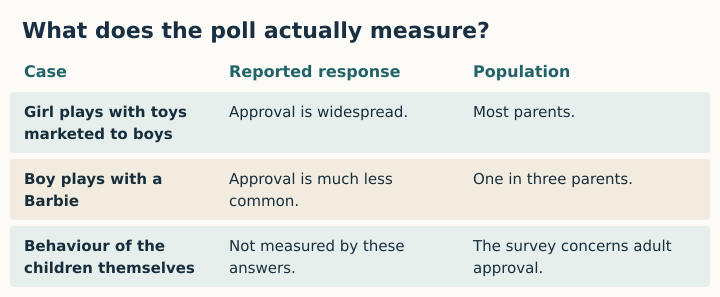

# ENS Rennes · D1 · Anglais 2017 — Corrigé guidé

*Corrigé rédigé par IA, non officiel. Signalez toute erreur.*

**Rédaction** · GPT-6.2 Astra Ultra · vitesse non renseignée

Épreuve écrite de l’École normale supérieure de Rennes. Adapté du New Statesman, 9 décembre 2016.

## Version française

À l’approche de Noël, le marketing qui distingue filles et garçons est partout. Il s’exprime en particulier dans la prédominance du rose parmi les jouets destinés aux filles. Il suffit de regarder sur Amazon la page « Jouets pour filles 2016 » : un chariot de marchande de glaces rose, une tablette lumineuse rose, des briques de construction roses, des bracelets d’amitié roses et violets, et ainsi de suite.

Plusieurs collectifs se mobilisent contre cette déferlante de rose au rayon des jouets pour enfants. Parmi eux, Let Toys Be Toys, qui s’adresse aux grandes surfaces dans le but de réduire le recours, pour les produits destinés aux enfants, à des stratégies commerciales qui distinguent les sexes. Le groupe a ainsi fait campagne pour que les distributeurs retirent de leurs magasins les panneaux « jouets pour filles » et « jouets pour garçons ».

Ce message enferme terriblement les enfants : il leur laisse bien peu de latitude pour sortir de l’alternative entre le rose et le bleu. Et les effets sont durables. D’après un sondage récent, la plupart des parents voient d’un bon œil qu’une fille joue avec des jouets commercialisés à l’intention des garçons, tandis que seule une minorité d’adultes approuve l’inverse. À peine un tiers des parents jugent bon qu’un garçon joue à la Barbie.

Il est question de jouets en apparence, mais, au fond, il s’agit des stéréotypes de genre qui façonnent le monde de nos enfants. Ce que nous faisons, c’est leur donner des instructions très précises sur la manière d’être un homme ou une femme.

## Expression en anglais

To what extent does society as a whole encourage gender differentiation? 100 mots, à 10 % près.

Society encourages gender differentiation long before children can name it. A boy choosing a doll may find the shelf labelled for girls, then hear an adult praise his sister for being caring and praise him for being brave. Each remark seems small, yet together they make trying another role feel like breaking a rule. The pressure continues at school if children see only men repairing machines or only women caring for patients in their textbooks. It can also change there. Showing different people doing the same skilled work gives pupils a reason to question the pattern they encounter elsewhere.

*99 mots, comptés par espaces.*

## Comment construire la réponse

**Conserver la progression visible.** Le texte part d’une liste de marchandises. Répéter « rose » fait sentir l’uniformité que l’auteur a observée. *Targets large supermarkets* désigne les interlocuteurs de la campagne. *For signs … to be removed* explicite la mesure demandée par le collectif.

**Lire le sondage dans le bon sens.** La plupart des parents approuvent le choix d’une fille attirée par un jouet vendu aux garçons. Le tiers concerne les parents qui approuvent qu’un garçon joue à la Barbie. Aucun de ces chiffres ne mesure la proportion d’enfants qui jouent effectivement avec ces objets. Dans l’expression, *a third of parents approve* garde le verbe au pluriel.

**Élargir à la société.** Partir du rayon des jouets, puis passer aux compliments des adultes et aux illustrations des manuels. Chaque exemple indique un mécanisme par lequel une convention est apprise, ou par lequel elle peut être interrogée. *To what extent* appelle une appréciation de la force de cette pression et une indication de ses limites.

[Feuillet original, p. 3](https://www.ens-rennes.fr/medias/fichier/sujet-lv-d1-2017_1513242514196-pdf#page=3) · [Rapport du jury, partie écrite](https://www.ens-rennes.fr/medias/fichier/rapport-anglais-e-crit-d1-2017_1515597563898-pdf#page=1)
