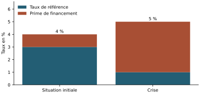
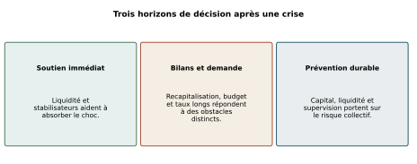

# ENS Rennes D1 — Composition d’ordre économique 2017 · Corrigé guidé

*Corrigé rédigé par IA, non officiel.*

**Rédaction** · GPT-6.2 Astra Ultra · vitesse non renseignée

## Dans quelle mesure 10 années de crise financière ont-elles affecté la conduite de la politique économique ?

### Introduction

> [!INDICATION]
> Délimiter la période à 2007–2017 et distinguer les crises bancaire et souveraine.

Une banque centrale peut abaisser son taux alors que le crédit accordé aux entreprises se renchérit. Cette dissociation, devenue manifeste à partir des tensions financières de 2007, explique une partie des changements de politique économique de la décennie étudiée. Le choc américain des prêts immobiliers, la crise bancaire mondiale puis la crise des dettes souveraines de la zone euro ne sont pas un événement uniforme. Ils ont successivement révélé les limites de la stabilisation par le taux court, la dépendance entre banques et États et les coûts d’un ajustement budgétaire non coordonné. Jusqu’en 2017, comment ces révélations ont-elles modifié instruments, répartition des tâches et règles durables ?

### I. La crise a obligé les autorités à rétablir une transmission qui ne pouvait plus être supposée acquise

#### A. Le crédit et les bilans ont mis en défaut l’arbitrage monétaire habituel

> [!INDICATION]
> Décomposer le taux payé par l’entreprise en taux de référence et prime.

Pendant la « grande modération », l’inflation faible et une activité relativement stable nourrissaient l’idée qu’une politique monétaire prévisible pouvait régler l’essentiel des fluctuations. Le taux directeur agissait sur taux de marché, investissement et consommation, tandis que le budget conservait ses stabilisateurs automatiques. Cette représentation laissait insuffisamment de place aux bilans bancaires et aux engagements hors bilan. Des prix stables pour les biens de consommation étaient compatibles avec une forte hausse des dettes et des actifs.

Lorsque les pertes sur actifs immobiliers rendent les contreparties suspectes, les banques réduisent les prêts et cherchent des liquidités. Une chute du prix des garanties limite encore la capacité d’emprunter. Des taux sans risque plus bas peuvent être dépassés par la hausse des primes imposées aux emprunteurs. Par exemple, passer d’un taux de référence de 3 % à 1 % tandis que la prime passe de 1 à 4 points renchérit le financement de 4 à 5 %. Le problème n’est plus seulement de stimuler la demande à transmission constante : il faut rétablir les canaux de financement.

#### B. Les instruments de crise ont élargi la boîte à outils monétaire

> [!INDICATION]
> Associer refinancement, achats de titres et indications sur les taux à leurs canaux spécifiques.

Les banques centrales ont abaissé leurs taux, fourni des liquidités sur des maturités plus longues et élargi, selon les cadres institutionnels, les contreparties ou garanties admises. Près du plancher des taux nominaux, une nouvelle baisse de faible ampleur peut mal répondre à un besoin de soutien élevé. Les achats d’actifs visent à réduire les primes de terme et à modifier les portefeuilles. Les indications sur les taux futurs influencent les anticipations à plus longue échéance. Une inflation anticipée qui tombe peut toutefois relever le coût réel malgré un taux nominal inchangé.

Dans la zone euro, la fragmentation du financement entre États membres menace l’unicité de la politique. L’annonce de l’instrument OMT en 2012 répond à des perturbations de transmission sous conditions ; son importance tient aussi à l’annonce crédible, sans achat effectué dans ce cadre pendant la période. Les achats élargis engagés en 2015 répondent à un contexte différent de faible inflation. Ces politiques posent des questions de liquidité, de prix d’actifs, de répartition des risques et de sortie éventuelle. Elles conservent la stabilité des prix comme finalité tout en transformant les moyens de la poursuivre.

### II. Le soutien budgétaire et la prévention du risque collectif recomposent la répartition des responsabilités

#### A. Les budgets doivent concilier stabilisation immédiate et contraintes de financement

> [!INDICATION]
> Comparer effets budgétaires immédiats, garanties et effets du PIB sur le ratio de dette.

De 2008 à 2009, les recettes fiscales se replient et les dépenses sociales augmentent, avant même les mesures discrétionnaires. Les plans de relance soutiennent la demande, les recapitalisations restaurent des bilans et les garanties rassurent les créanciers. Une garantie engagée ne constitue pas immédiatement une dépense de même montant. Ses effets sur la dette dépendent des pertes effectives et des règles comptables. Un programme d’infrastructure agit plus lentement qu’un transfert aux ménages contraints, mais peut préserver la capacité productive.

La crise des dettes souveraines a ensuite conduit certains pays à resserrer leurs budgets en récession. L’effet sur le ratio de dette dépend aussi du recul du PIB. Lorsque de nombreux partenaires contractent ensemble leur dépense et que la politique monétaire est proche de sa borne, les débouchés extérieurs compensent peu. À l’inverse, une dette courte, une prime élevée et le risque de perdre l’accès au financement peuvent rendre la stabilisation difficile. Le débat s’est donc déplacé vers le calendrier, la composition et la coordination de l’ajustement. Un taux directeur commun ne compense pas automatiquement les écarts nationaux.

#### B. Une architecture macroprudentielle durable complète les interventions d’exception

> [!INDICATION]
> Expliquer pourquoi des banques individuellement prudentes peuvent ensemble accroître le risque.

Ce qui est prudent pour une banque isolée peut être déstabilisant pour toutes : vendre simultanément des actifs fait baisser leur prix et dégrade les garanties de banques voisines. Les dispositifs de capital et de liquidité de Bâle III, les instruments macroprudentiels et la supervision commune dans l’union bancaire européenne répondent à cette externalité. Un coussin de capital constitué en phase d’expansion, puis mobilisable dans la contraction, vise un autre canal qu’une hausse générale des taux.

La crise a aussi révélé la difficulté d’une union monétaire sans budget fédéral comparable à celui d’un État. Supervision et résolution communes visent à limiter la contagion bancaire, tandis que l’orientation budgétaire agrégée et le partage des pertes restent politiquement contestés en 2017. L’action discrétionnaire d’urgence peut s’éteindre alors que les mandats prudentiels, la connaissance des multiplicateurs ou les procédures de coordination persistent. Évaluer cette transformation exige de distinguer l’annonce d’une règle, sa mise en œuvre et sa capacité réelle à résister au prochain choc.

### Conclusion

> [!INDICATION]
> Séparer les mesures temporaires et les changements institutionnels durables.

La décennie 2007–2017 n’a pas effacé objectifs de stabilité nominale et soutenabilité budgétaire. Elle a montré qu’ils dépendaient de canaux financiers que la politique doit pouvoir réparer et surveiller avant même la crise. Les outils non conventionnels, la coordination budgétaire et la prévention macroprudentielle prolongent cette leçon, avec des effets et un degré d’institutionnalisation différents selon les pays.

[Sujet distribué](https://www.ens-rennes.fr/medias/fichier/economie-sujet-d1-2017_1513242479007-pdf) · [Rapport du jury](https://www.ens-rennes.fr/medias/fichier/rapport-e-crit-economie-d1-2017_1515597489541-pdf)

[Annonce des opérations monétaires sur titres, 6 septembre 2012](https://www.ecb.europa.eu/press/pr/date/2012/html/pr120906_1.en.html) · [Programme d’achats élargi, 22 janvier 2015](https://www.ecb.europa.eu/press/pr/date/2015/html/pr150122_1.en.html)
