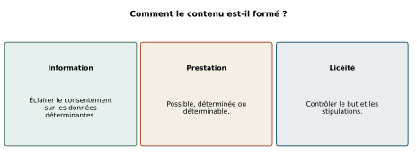
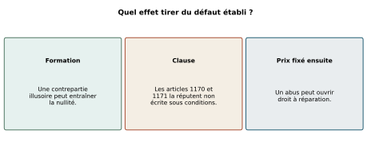

# ENS Rennes D1 — Droit civil 2017 · Corrigé brut

*Corrigé rédigé par IA, non officiel.*

**Rédaction** · GPT-6.2 Astra Ultra · vitesse non renseignée

## Le contenu du contrat

### Introduction

Un prestataire promet une intervention essentielle mais une clause lui permettrait de manquer à sa promesse sans conséquence réelle. Le prix et la prestation semblent convenus. Reste à savoir si le droit peut tenir cette clause pour efficace. Depuis le 1er octobre 2016, l’article 1128 du Code civil exige, pour la validité d’un contrat, le consentement, la capacité et un contenu licite et certain. La réforme ne range plus l’objet et la cause parmi les rubriques autonomes de l’ancien article 1108, mais les fonctions qu’ils assuraient réapparaissent dans des règles précises. Comment le droit laisse-t-il aux parties le choix de leur échange tout en contrôlant sa substance ? Le raisonnement porte sur la version de l’ordonnance en vigueur à la session 2017.

### I. Le contenu naît de la liberté des parties, encadrée dès la formation

#### A. Les engagements doivent être connaissables, possibles et licites

Le contrat est une opération juridique, distincte du document qui en conserve la trace. Les parties sont libres de déterminer son contenu dans les limites fixées par la loi (art. 1102). La bonne foi gouverne négociation, formation et exécution (art. 1104). L’article 1112-1 impose à celui qui connaît une information déterminante d’en informer son partenaire si ce dernier l’ignore légitimement ou lui fait confiance. Le lien direct et nécessaire avec le contenu ou la qualité des parties et l’exclusion de l’estimation de la valeur de la prestation délimitent le devoir. Une information omise et un prix que l’on juge rétrospectivement peu avantageux ne constituent donc pas la même difficulté.

La prestation peut être présente ou future, mais elle doit être possible et déterminée ou déterminable (art. 1163). Le contrat, les usages ou les relations antérieures peuvent fournir des éléments objectifs sans nouvel accord. La livraison d’un volume mesuré selon une méthode déjà convenue en fournit un exemple. La licéité va au-delà des mots employés : l’article 1162 interdit de déroger à l’ordre public par les stipulations ou le but, que ce dernier ait été connu ou non de toutes les parties. Cette règle conserve une fonction précédemment assurée par le contrôle de la cause.

#### B. L’élaboration d’un contenu peut être incomplète ou asymétrique

Dans le contrat-cadre, l’article 1164 autorise les parties à convenir qu’une partie fixera unilatéralement le prix. Elle devra motiver le montant en cas de contestation. Dans les prestations de service, en l’absence d’accord avant exécution, le créancier dispose de la faculté définie par l’article 1165. Ces mécanismes évitent de déclarer invalide toute relation durable au seul motif que chaque prix n’était pas chiffré à l’origine. Ils n’éliminent pas les règles spéciales de contrats tels que la vente. Si la qualité de la prestation n’est pas déterminable, l’article 1166 renvoie aux attentes légitimes au regard de la nature de la prestation, des usages et de la contrepartie.

La négociation peut aussi être unilatérale en fait. Dans la rédaction de 2017, est d’adhésion le contrat dont les conditions générales, soustraites à la négociation, sont déterminées à l’avance par l’une des parties (art. 1110). Cette qualification intervient à l’interprétation et au contrôle de certaines clauses. Le principe demeure le consensualisme, sous réserve des formes requises pour certains contrats (art. 1172). Une clause écrite pour satisfaire une obligation d’information, une forme exigée pour la validité et un écrit exigé pour prouver l’acte ont des fonctions différentes.

### II. Le juge rétablit l’efficacité de l’engagement dans les limites de contrôles distincts

#### A. La loi exige une contrepartie réelle sans garantir l’égalité des valeurs

Dans un contrat synallagmatique, le défaut d’équivalence des prestations n’est pas en principe une cause de nullité, sauf disposition contraire (art. 1168). La rescision pour lésion du vendeur d’immeuble, dans le champ de l’article 1674, illustre une exception strictement définie. À distinguer de l’article 1169 : un contrat à titre onéreux est nul si, au moment de sa formation, la contrepartie convenue au profit de celui qui s’engage est illusoire ou dérisoire. Le simple mauvais marché répond à un autre critère.

La stipulation qui prive de sa substance l’obligation essentielle est réputée non écrite (art. 1170). Les arrêts Chronopost et Faurecia éclairent le passage d’un contrôle autrefois formulé par la cause à un examen de l’effet réel de la clause. Une limitation de responsabilité portant sur une prestation centrale ne doit pas être automatiquement écartée. Il faut montrer qu’elle vide l’engagement de sa substance. Une fois la clause retirée, la convention peut continuer à produire ses effets conformément à l’article 1184.

#### B. Le contrôle de certaines stipulations distingue déséquilibre, abus et interprétation

En 2017, l’article 1171 vise, dans le contrat d’adhésion, toute clause qui crée un déséquilibre significatif entre les droits et obligations des parties. Elle est réputée non écrite. L’appréciation ne porte ni sur l’objet principal ni sur l’adéquation du prix à la prestation. Ce régime se distingue de l’article 1170, applicable d’après l’effet sur une obligation essentielle. Dans le doute, le contrat d’adhésion s’interprète contre celui qui l’a proposé (art. 1190), après recherche de la commune intention selon l’article 1188. Interpréter un texte ambigu et neutraliser une clause déséquilibrée sont deux opérations distinctes.

La sanction doit aussi être rapportée au texte et à la date. Sous l’article 1164, l’abus dans la fixation du prix d’un contrat-cadre peut conduire à des dommages-intérêts et, le cas échéant, à la résolution. Dans la rédaction de l’article 1165 en vigueur en avril 2017, le texte propre à l’abus du prestataire vise les dommages-intérêts. La modification ultérieure du texte ne doit pas être anticipée. La nullité sanctionne au contraire un défaut de validité, tandis qu’une clause réputée non écrite est écartée. Cette diversité montre que le contrôle porte tantôt sur la formation de l’opération, tantôt sur son contenu particulier ou sa mise en œuvre.

### Conclusion

Le contenu du contrat relie liberté d’engagement, détermination des prestations et contrôle de leur licéité et de leur réalité. Le juge n’a pas reçu une mission générale de rééquilibrage économique. Il vérifie des normes distinctes et en tire, selon le manquement, la nullité, la neutralisation d’une clause, une réparation ou la résolution.

[Sujet distribué](https://www.ens-rennes.fr/medias/fichier/droit-civil-sujet-d1-2017_1513242490806-pdf) · [Rapport du jury](https://www.ens-rennes.fr/medias/fichier/rapport-droit-civil-2017_1515597502522-pdf)

[Code civil au 1er avril de la session](https://www.legifrance.gouv.fr/codes/texte_lc/LEGITEXT000006070721/2017-04-01/)
