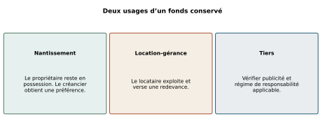

# ENS Rennes D1 — Droit commercial 2017 · Corrigé brut

*Corrigé rédigé par IA, non officiel.*

**Rédaction** · GPT-6.2 Astra Ultra · vitesse non renseignée

## Les enjeux des opérations sur fonds de commerce

### Introduction

Un commerçant qui cesse d’exploiter son magasin peut vendre son fonds et percevoir un prix, ou rester propriétaire et recevoir les redevances d’un locataire-gérant. S’il veut poursuivre lui-même, il peut encore affecter son fonds en garantie d’un financement. Ces choix portent sur un ensemble de biens mobiliers organisé pour attirer et conserver une clientèle. Clientèle, nom commercial, droit au bail, matériel et certains droits incorporels peuvent y concourir. Les murs de la boutique restent des immeubles distincts et les dettes du commerçant ne sont pas par principe des éléments du fonds. Qui conserve la propriété, qui exploite, qui dispose d’une garantie et qui supporte le risque lorsque l’on choisit entre ces opérations ?

### I. La cession réalise la valeur du fonds et exige de sécuriser l’acquéreur et les créanciers du vendeur

#### A. Céder une clientèle suppose de transmettre les moyens d’une exploitation effective

La vente du fonds porte sur l’organisation commerciale transférée. Sans clientèle réellement attachée à l’exploitation, la qualification devient incertaine. Selon l’activité, la situation du bail, le signe distinctif ou les équipements peuvent être indispensables à sa conservation. Inventorier les éléments transmis, les marques ou droits de propriété industrielle effectivement détenus et les marchandises valorisées séparément. Il n’existe pas d’automaticité générale pour tous les contrats, créances et dettes. Les textes particuliers, notamment sur les contrats de travail lors du transfert d’une entité conservant son identité, doivent être examinés.

Dans la cession des titres d’une société propriétaire, la société continue de détenir le fonds et reste débitrice. Dans la cession du fonds, l’acheteur acquiert directement les éléments convenus et la clientèle. La valeur économique dépend du revenu durablement envisageable, de l’état du matériel et de la possibilité de maintenir la clientèle. Une obligation de délivrance et la garantie d’éviction protègent l’acquéreur. Une restriction de rétablissement du vendeur doit être justifiée et proportionnée afin de concilier la transmission de la clientèle et la liberté du commerce.

#### B. La circulation du prix doit préserver le gage des créanciers

En 2017, l’article L. 141-1 du Code de commerce prévoit des énonciations particulières à la vente, notamment sur l’origine du fonds, les privilèges et nantissements ainsi que certaines données d’exploitation et le bail. L’omission expose l’acte aux conséquences prévues par les textes alors applicables. Pour l’acheteur, ces informations aident à déceler une valeur apparente que les charges et l’expérience d’exploitation démentent. La vente peut donner au vendeur payé à terme un privilège soumis à ses conditions de constitution et d’inscription.

La publicité de la cession permet aux créanciers du vendeur de faire opposition au paiement du prix dans le délai légal, en principe dix jours à compter de la dernière en date des publications prévues. Leur opposition régulière rend le prix indisponible, sans leur donner par elle-même un rang préférentiel ni annuler la vente. L’acquéreur qui paie sans respecter la protection légale risque de ne pas être libéré envers les tiers. Le séquestre usuel du prix répond à ce risque. Une même vente procure donc de la liquidité au vendeur tout en empêchant que cette liquidité disparaisse avant que les créanciers aient pu exercer leurs droits.

### II. La conservation du fonds permet de financer ou de déléguer l’exploitation, au prix de risques propres

#### A. Le nantissement mobilise la valeur du fonds sans dessaisir son propriétaire

L’exploitant peut offrir au prêteur une sûreté portant sur le fonds plutôt que vendre son outil de travail. Le nantissement obéit au régime spécial des articles L. 142-1 et suivants. Les éléments incorporels indispensables figurent au cœur de son assiette. L’acte doit désigner ce que les parties incluent dans les limites légales. Les marchandises destinées à tourner dans le commerce ne font pas partie de l’assiette de ce nantissement. La formalité d’inscription constitue un enjeu décisif pour l’efficacité et le rang de la garantie au regard des règles de 2017.

Le commerçant reste propriétaire et conserve l’exploitation. Le créancier nanti ne devient ni gérant ni acquéreur du fonds. Il obtient, selon les conditions légales, un droit de préférence sur le produit de réalisation et un droit de suite en cas de transmission. Si les recettes s’effondrent et que la clientèle disparaît, la sûreté peut perdre une grande partie de sa valeur. Le montant prêté doit donc tenir compte d’un scénario de réalisation, des inscriptions antérieures et des frais, pas seulement du chiffre d’affaires normal de l’exploitation.

#### B. La location-gérance sépare propriété et risque d’exploitation

Le propriétaire peut confier la gérance du fonds à un locataire qui l’exploite à ses risques et périls et acquiert la qualité de commerçant. Le loueur perçoit une redevance et conserve le fonds. Celui qui travaille sous la direction du propriétaire pour son compte relève d’une autre figure. En 2017 la condition de principe de deux années d’exploitation par le loueur, ses exceptions et les possibilités de dispense doivent être examinées. La location-gérance peut préparer une cession future ou permettre à un exploitant d’entrer dans l’activité sans avancer immédiatement le prix du fonds.

Le locataire-gérant doit conserver la substance de l’outil confié, tandis que le loueur supporte la perte de valeur liée à une mauvaise exploitation ou au défaut de paiement. Les tiers ont besoin de savoir qui exploite désormais. Dans la version de l’article L. 144-7 applicable au printemps 2017, issue de la loi du 9 décembre 2016, le loueur reste solidairement tenu avec le locataire-gérant des dettes d’exploitation contractées par ce dernier jusqu’à la publication du contrat. Le mécanisme antérieur qui se prolongeait six mois après publication ne doit pas être repris. La fin de la location pose enfin la question de la restitution du fonds et de l’exigibilité des dettes d’exploitation du locataire.

### Conclusion

La vente échange la propriété du fonds contre un prix protégé par des mécanismes d’information et d’opposition. Le nantissement utilise sa valeur de garantie, tandis que la location-gérance en sépare l’exploitation et la propriété. Pour chacune, raisonner sur la clientèle, l’information des tiers, le moment de la publicité et le patrimoine qui supportera la perte permet d’en préciser l’enjeu économique et juridique.

[Sujet distribué](https://www.ens-rennes.fr/medias/fichier/sujets-options-d1-2017_1513242503958-pdf#page=2) · [Rapport du jury](https://www.ens-rennes.fr/medias/fichier/rapport-droit-commercial-2017_1515597519479-pdf)

[Code civil au 1er avril de la session](https://www.legifrance.gouv.fr/codes/texte_lc/LEGITEXT000006070721/2017-04-01/) · [Code de commerce au 1er avril de la session](https://www.legifrance.gouv.fr/codes/texte_lc/LEGITEXT000005634379/2017-04-01/)
