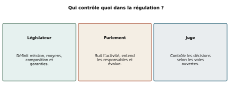
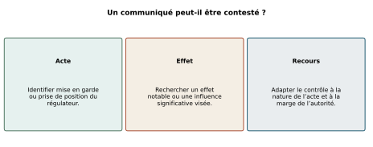

# ENS Rennes D1 — Droit public 2017 · Corrigé guidé

*Corrigé rédigé par IA, non officiel.*

**Rédaction** · GPT-6.2 Astra Ultra · vitesse non renseignée

## Le contrôle des autorités administratives indépendantes et des autorités publiques indépendantes

### Introduction

> [!INDICATION]
> Distinguer l’indépendance dans la décision et l’absence d’un contrôle hiérarchique.

Un régulateur peut publier une mise en garde qui détourne immédiatement une partie de la clientèle d’une entreprise, alors qu’aucune interdiction ne lui est adressée. Si l’autorité échappe au pouvoir hiérarchique d’un ministre, qui peut contrôler une telle intervention ? Les autorités administratives indépendantes (AAI) et autorités publiques indépendantes (API) exercent des fonctions publiques de protection des droits, d’expertise ou de régulation. Les API disposent de la personnalité morale, selon l’article 2 de la loi du 20 janvier 2017. L’ensemble est caractérisé par des garanties d’indépendance dans l’exercice des attributions confiées. Le contrôle désigne tant la responsabilité institutionnelle que l’examen de la légalité des actes. Comment en assurer l’effectivité sans restaurer la tutelle que la loi a précisément écartée ?

### I. L’indépendance fonctionnelle se construit dans un cadre institutionnel qui organise la responsabilité

#### A. Le législateur fixe des missions et des pouvoirs limités

> [!INDICATION]
> Identifier qui fixe mission, pouvoirs et mandat des membres.

La CNIL, dès 1978, illustre la volonté de soustraire certaines décisions sensibles à l’instruction ministérielle. La diversité des autorités a ensuite rendu moins lisibles leur dénomination, leurs moyens et les responsabilités. Les lois organique et ordinaire du 20 janvier 2017 ordonnent le statut et définissent une liste légale. Une API peut agir en son propre nom grâce à sa personnalité morale. Une AAI dépourvue de cette personnalité n’en est pas moins dotée de compétences propres. Dans les deux cas, la loi d’attribution, les mandats et les incompatibilités déterminent les conditions de l’action.

Le législateur ne peut transférer un pouvoir réglementaire général qui appartiendrait au Premier ministre selon l’article 21 de la Constitution. La décision 88-248 DC du 17 janvier 1989 admet l’attribution à une autorité distincte d’un pouvoir réglementaire de portée limitée tant par son champ que par son contenu. Des garanties entourent également les pouvoirs de sanction, dont droits de la défense, légalité et proportionnalité. Le Conseil constitutionnel contrôle ainsi la construction du pouvoir confié à l’autorité avant même que le juge ordinaire soit saisi d’une décision particulière.

#### B. Transparence, budget et contrôle parlementaire rendent compte de l’usage du mandat

> [!INDICATION]
> Séparer pouvoir d’investigation du Parlement et jugement d’une affaire individuelle.

Le statut général de 2017 organise des exigences de déontologie, de prévention des conflits d’intérêts et de reddition de comptes. Un rapport annuel, la publicité des décisions et les auditions parlementaires exposent les objectifs poursuivis, les ressources employées et les résultats. Des rapports du Sénat en 2014 et 2015 illustrent l’examen des coûts, de la prolifération et de la cohérence du paysage institutionnel. Le contrôle budgétaire tient compte de la personnalité et du mode de financement de chaque autorité. Il peut éclairer une insuffisance de moyens autant qu’une dépense injustifiée.

Ces procédures répondent à des questions distinctes d’une instruction individuelle. Un parlementaire peut interroger un régulateur sur les critères d’ouverture d’enquêtes et sur la durée moyenne des procédures. Ordonner de sanctionner une entreprise dans une instance pendante compromettrait l’indépendance et l’impartialité. L’évaluation doit donc porter sur règles, priorités et résultats agrégés, en préservant les secrets et les droits prévus par les textes. La stabilité des mandats renforce la protection contre les pressions, sans conférer ni irresponsabilité ni immunité juridictionnelle.

### II. L’extension du contrôle juridictionnel tient compte des effets réels et des exigences d’impartialité

#### A. Les actes de régulation peuvent être contrôlés jusque dans certaines formes de droit souple

> [!INDICATION]
> Qualifier un acte avant de choisir le recours et le juge compétent.

Le juge administratif connaît en principe des actes pris dans l’exercice de prérogatives publiques, sous réserve des textes de compétence. Certaines décisions de l’autorité chargée de la concurrence relèvent du juge judiciaire. Dans la décision 86-224 DC du 23 janvier 1987, le Conseil constitutionnel admet, pour la bonne administration de la justice, l’unification par le législateur de contentieux dans un ordre principalement intéressé. La qualification de l’autorité ne suffit donc pas à désigner le juge ni à déterminer s’il statue en excès de pouvoir ou en plein contentieux.

Les arrêts d’Assemblée Fairvesta et NC Numericable du 21 mars 2016 prennent au sérieux l’action d’une mise en garde ou d’une prise de position. Au-delà des dispositions impératives ou prescriptions susceptibles d’être sanctionnées, certains actes de régulation peuvent faire l’objet d’un recours du requérant ayant un intérêt direct et certain lorsqu’ils produisent des effets notables, notamment économiques, ou visent à influencer de manière significative les comportements. Il faut étudier la teneur du communiqué et son audience. Toute prise de parole ne devient pas attaquable. Le juge adapte son examen à la nature de l’acte et à la marge de l’autorité.

#### B. Le contrôle des sanctions associe garantie procédurale et examen de la mesure

> [!INDICATION]
> Examiner les garanties d’impartialité dans une procédure de sanction.

L’indépendance à l’égard du gouvernement n’assure pas nécessairement l’impartialité entre les parties. Lorsqu’une autorité instruit et sanctionne, examiner rôles des personnes, séparation des fonctions, conditions d’accès au dossier, contradictoire et motivation. La nature de la sanction peut faire entrer la procédure dans la matière pénale au sens autonome de l’article 6 de la Convention européenne des droits de l’homme. Le droit interne de la répression administrative et les voies de recours doivent permettre une contestation effective et proportionnée.

L’arrêt d’Assemblée Didier du 3 décembre 1999, la décision de l’assemblée plénière de la Cour de cassation COB c. Oury du 5 février 1999 et l’arrêt Dubus SA c. France du 11 juin 2009 illustrent, dans des configurations institutionnelles différentes, le contrôle des garanties d’impartialité. Une autorité ne saurait justifier une procédure inéquitable par la seule technicité des questions traitées. Réciproquement, l’examen de la légalité, des faits, de la procédure et, selon l’office du juge, de la proportion de la sanction ne fait pas du tribunal le nouveau régulateur chargé de concevoir au quotidien la politique du secteur.

### Conclusion

> [!INDICATION]
> Présenter un exemple où l’indépendance et la responsabilité se renforcent mutuellement.

Les autorités indépendantes tirent leur légitimité de missions définies par la loi, de garanties contre les pressions et d’un contrôle effectif de leurs actes. Le Parlement suit et redéfinit le mandat dans le respect des compétences. Le juge protège les personnes contre l’illégalité et les atteintes au procès équitable. La reconnaissance d’effets contestables du droit souple montre comment ce contrôle peut suivre les formes réelles du pouvoir de régulation.

[Sujet distribué](https://www.ens-rennes.fr/medias/fichier/sujets-options-d1-2017_1513242503958-pdf#page=2) · [Rapport du jury](https://www.ens-rennes.fr/medias/fichier/rapport-droit-public-2017_1515597534415-pdf)

[Constitution à la session](https://www.legifrance.gouv.fr/loda/id/JORFTEXT000000571356/2017-04-01/)

[Loi n° 2017-55](https://www.legifrance.gouv.fr/jorf/id/JORFTEXT000033897475/) · [Fairvesta](https://www.conseil-etat.fr/fr/arianeweb/CE/decision/2016-03-21/368082) · [NC Numericable](https://www.conseil-etat.fr/fr/arianeweb/CE/decision/2016-03-21/390023)
