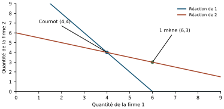
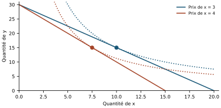
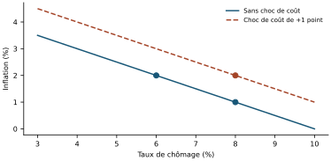

# ENS Rennes D1 — Économie (oral) 2017 · Corrigé brut

*Corrigé rédigé par IA, non officiel.*

**Rédaction** · GPT-6.2 Astra Ultra · vitesse non renseignée

Le jury donne 10 exemples de sujets tirés à la page 2 de son rapport. La feuille exhaustive des tirages manque. Les numéros ci-dessous suivent l’ordre des puces imprimées. Après trente minutes de préparation, le jury a observé 10 à 12 minutes d’exposé, puis 10 à 15 minutes de questions.

## Exemple 1 — Choix économiques et comportements stratégiques

**I. Le gain d’un décideur dépend parfois de ce que feront les autres.** Deux firmes choisissent chacune l’un de deux standards incompatibles. Si elles choisissent le même, leur marché commun rapporte 3 à chacune avec le standard A, 2 à chacune avec B. Une incompatibilité rapporte 0 aux deux. On obtient deux équilibres de Nash en stratégies pures : à chacune des deux coordinations, aucune firme ne veut dévier seule. L’efficacité du standard A ne suffit pas à le sélectionner. Les anticipations sur le choix du partenaire ont une valeur économique.

**II. L’information et la chronologie transforment les incitations.** Un engagement initial crédible, une norme publiée ou l’observation d’une base installée peuvent coordonner les attentes. Si la première firme choisit publiquement et irréversiblement, la seconde préfère la suivre et la première choisit A. Ce raisonnement repose sur les gains spécifiés. Dans un dilemme du prisonnier, la difficulté est différente : les incitations individuelles empêchent l’issue mutuellement préférée. Une politique de coordination et une politique modifiant les incitations répondent ainsi à deux diagnostics distincts.

**Relance.** Le premier standard choisi sera-t-il toujours le plus efficace ?

Dans notre petit jeu, les intérêts sont alignés et l’engagement est observé, donc A est sélectionné. Des coûts de conversion, une base installée ou des intérêts opposés peuvent maintenir un standard inférieur en surplus total.

## Exemple 2 — Les duopoles

**I. En concurrence par les quantités, les décisions sont interdépendantes.** Deux producteurs de coût marginal nul choisissent simultanément des quantités non négatives, avec $p=12-q_1-q_2$. La recette de 1 est $(12-q_1-q_2)q_1$. Sa meilleure réponse intérieure est $q_1=(12-q_2)/2$, et réciproquement. Leur intersection donne 4 unités par entreprise et un prix de 4. Une collusion sans coût de mise en œuvre maximiserait le profit total à 6 unités ; la concurrence au coût marginal atteindrait 12 unités.

**II. Un autre instrument stratégique modifie le résultat.** En prix, deux entreprises avec coûts identiques, bien homogène et capacité suffisante ont intérêt à sous-enchérir tant que le prix excède le coût marginal : c’est la solution de Bertrand. Dans le jeu en quantités précédent, si 1 s’engage d’abord, il choisit 6 en tenant compte de la réponse de 2, qui vaut 3 ; le prix devient 3. Donc « deux vendeurs » ne prédit à lui seul ni la marge, ni le partage du marché. Différenciation, capacités, calendrier et répétition sont des hypothèses à défendre.

**Relance.** Pourquoi une firme ne s’en tient-elle pas spontanément à la moitié de la quantité collusive ?

Si l’autre produit 3, sa meilleure réponse est 4,5. La firme gagne alors davantage qu’en produisant 3. Une quantité maximisant le profit collectif n’est pas automatiquement une meilleure réponse individuelle.

## Exemple 3 — Les défaillances de marché

**I. Une défaillance identifie une raison précise d’inefficacité.** En présence de pouvoir de marché, un vendeur restreint les quantités ; avec une pollution sans compensation, un producteur peut les accroître au-delà de l’optimum social. Pour un bien non rival et difficilement excluable, une contribution volontaire peut manquer. En information asymétrique, un prix moyen peut faire sortir les meilleurs produits. Dans chaque cas il faut spécifier la transaction qui manque ou la condition marginale qui n’est plus satisfaite, y compris le marché qui demeure possible.

**II. L’instrument se juge par son ajustement au mécanisme.** Une taxe sur le dommage marginal peut internaliser une nuisance mesurable. Un paiement public peut financer le bien non excluable, une garantie crédible peut révéler la qualité et une régulation des réseaux peut encadrer les marges. Une intervention exige elle-même information, financement et contrôle. Une distribution jugée inéquitable peut survenir même sur un marché efficace au sens de Pareto : elle conduit à une autre question de politique économique, celle de la redistribution.

**Relance.** Un péage d’une route résout-il toujours la même défaillance ?

Un péage de congestion tarife le temps supplémentaire imposé aux autres véhicules ; un péage de financement cherche à couvrir les coûts du réseau. Dans une route peu fréquentée, un tarif élevé peut décourager un trajet dont le coût marginal est très faible.

## Exemple 4 — Les anticipations

**I. Les anticipations influencent les décisions présentes.** Un ménage compare la consommation présente et future ; une entreprise évalue sa demande avant d’investir. Des anticipations adaptatives corrigent progressivement une prévision à partir d’erreurs observées. Dans un modèle à anticipations rationnelles, la prévision exploite l’information disponible et la loi économique supposée ; elle peut être fausse après un choc inédit. L’erreur ne doit pas pouvoir être prédite systématiquement à partir de cette même information.

**II. Les règles anticipées et les croyances collectives agissent sur l’équilibre.** Une hausse annoncée et crédible des prix futurs réduit le taux d’intérêt réel attendu à taux nominal donné. Une modification durable de la règle monétaire peut changer le comportement estimé sur des données anciennes, au cœur de la critique de Lucas. Des anticipations de retraits peuvent aussi déclencher une ruée si une banque doit liquider des actifs longs. L’information, la crédibilité et les institutions déterminent alors si une croyance suffit à déplacer le comportement.

**Relance.** Deux prévisions différentes prouvent-elles qu’au moins un prévisionniste est irrationnel ?

Ils peuvent disposer de signaux différents, ou travailler avec des modèles dont la validité est incertaine. Pour évaluer l’hypothèse, il faut fixer ensemble d’information, horizon, grandeur prévue et régularité des erreurs.

## Exemple 5 — Les choix intertemporels de consommation

**I. Le taux réel est le prix relatif des deux dates.** Avec une dotation de 100 aujourd’hui et 100 demain, un taux de 5 % donne la contrainte $c_2=205-1,05c_1$. Épargner 20 autorise 121 demain pour 80 aujourd’hui ; emprunter 20 ramène la consommation future à 79 pour 120 aujourd’hui. Une tangence intérieure égalise le taux marginal de substitution intertemporelle et 1,05. Une hausse du taux déplace les possibilités autour de la dotation et rend plus coûteux le transfert de consommation vers le présent.

**II. Le modèle prédit des réactions différentes selon l’accès au crédit.** À revenu futur élevé, une personne pourrait souhaiter lisser mais se heurter à une limite d’emprunt. Une hausse temporaire du revenu présent aura alors un effet plus marqué. Pour un épargnant, rendement et enrichissement peuvent exercer deux effets différents sur la consommation d’aujourd’hui ; pour un emprunteur le coût futur de sa dette pèse davantage. Introduction de l’incertitude et de la prudence permet aussi d’expliquer une épargne de précaution.

**Relance.** Pourquoi une promesse de revenu à la retraite n’est-elle pas toujours consommable aujourd’hui ?

Elle peut accroître la richesse actualisée, mais ne sert pas nécessairement de garantie aux prêteurs. Le ménage ne peut convertir cette promesse en ressources présentes dans la même mesure qu’un titre liquide.

## Exemple 6 — Les cycles économiques

**I. Définir la fluctuation avant d’en attribuer la cause.** L’activité peut progresser moins vite que sa tendance sans reculer en niveau. L’écart de production dépend d’un potentiel estimé et révisable. Un choc de demande négatif réduit typiquement activité et pression sur les prix ; un choc de coût défavorable peut réduire l’activité tout en relevant les prix. Une variation observée ne révèle donc pas à elle seule le mécanisme. Production, emploi, inflation, crédit et utilisation des capacités fournissent des indices complémentaires.

**II. La propagation peut rendre un choc temporaire persistant.** Des commandes en baisse freinent investissement et emploi ; la contraction des revenus réduit ensuite la consommation. Avec des bilans fragiles, la baisse du prix des garanties et la hausse des primes aggravent le recul du crédit. Au contraire, stocks, assurance chômage et stabilisateurs automatiques amortissent certaines fluctuations. Dans un modèle de cycle réel, des chocs de productivité et des arbitrages intertemporels jouent un rôle distinct. La stabilisation appropriée dépend de l’origine du choc, des rigidités et des délais d’action.

**Relance.** Un cycle doit-il revenir après un nombre fixe d’années ?

Les fluctuations macroéconomiques montrent des phases d’expansion et de ralentissement, mais ne suivent pas nécessairement un calendrier périodique. Une succession de chocs irréguliers et de mécanismes de propagation peut produire ces phases.

## Exemple 7 — L’équilibre du consommateur en microéconomie

**I. Le choix est une comparaison de paniers sous contrainte.** Prenons deux biens, un budget de 60, des prix de 3 et 2 et une utilité $x^{1/2}y^{1/2}$. La tangence impose $y/x=3/2$ et le budget $3x+2y=60$, d’où $(10,15)$. Le sacrifice d’une unité de x libère trois euros, soit 1,5 unité de y. Au meilleur panier intérieur, ce taux d’échange marchand correspond à la disposition marginale subjective à échanger. Le budget, la préférence et la non-négativité sont trois conditions distinctes.

**II. Les prix changent les possibilités et le pouvoir d’achat.** Quand le premier prix passe de 3 à 4, le même consommateur achète 7,5 unités de x et 15 de y. La constance de y résulte ici de parts budgétaires fixes. Dans un autre système de préférences elle disparaîtrait. Une compensation maintenant l’utilité isole la substitution ; la différence avec l’effet marshallien mesure l’effet revenu. Si les biens sont des compléments parfaits, l’optimum peut se trouver au coude sans tangence.

**Relance.** Peut-on interpréter le quotient des utilités marginales comme une mesure monétaire absolue de satisfaction ?

C’est un taux d’échange local entre deux biens. Une transformation strictement croissante de l’indice d’utilité conserve les classements et ce taux marginal, sans préserver les niveaux numériques de satisfaction.

## Exemple 8 — Les différentes situations de concurrence imparfaite

**I. La nature de la barrière importe autant que le nombre de vendeurs.** Un monopole protégé par un brevet, un réseau dont le coût moyen décroît et une marque différenciée ont tous une demande résiduelle mais des sources de marge distinctes. La règle du monopole intérieur $Rm=Cm$ porte sur la recette marginale et le coût marginal ; elle autorise un prix supérieur au coût marginal lorsque la demande est décroissante. Le résultat dépend de son élasticité et de l’existence de substituts proches.

**II. La concurrence reste possible par plusieurs marges.** Quelques entreprises peuvent rivaliser par les quantités, les prix ou l’innovation. Dans un marché différencié à libre entrée, l’entrée peut annuler le profit économique sans égaliser le prix au coût marginal. Une réglementation du tarif au coût marginal d’un réseau à coûts fixes peut, de son côté, laisser un déficit de financement. Pour un même taux de marge, il faut donc examiner contestabilité, coûts fixes, différenciation et comportement stratégique avant de conclure sur une intervention.

**Relance.** Deux entreprises qui facturent le même prix se sont-elles nécessairement entendues ?

Des coûts et demandes symétriques peuvent donner un équilibre non coopératif à prix identiques. Démontrer une entente suppose d’autres éléments ; le constat d’un prix commun isolé ne suffit pas.

## Exemple 9 — Les instruments conventionnels et non-conventionnels de la politique monétaire

**I. Les instruments ordinaires agissent par les taux et leur transmission.** Une banque centrale fixe certaines rémunérations et prête contre garanties. Les conditions de la liquidité et les anticipations transmettent ses décisions aux taux de marché puis aux conditions de crédit. La règle de Taylor est une représentation de réaction à l’inflation et à l’écart de production, pas la formule obligatoire de l’institution. Une réaction nominale plus que proportionnelle à une hausse persistante de l’inflation peut relever le taux réel, à anticipations données par le mécanisme spécifié.

**II. Les instruments de bilan et la communication complètent cette action.** Les achats de titres peuvent réduire la prime de terme ou modifier les portefeuilles ; le refinancement ciblé vise les conditions d’offre de crédit. Des indications crédibles sur les taux futurs affectent la courbe des rendements. En 2017, ces canaux éclairent la politique de la zone euro face à des taux déjà faibles. Leur efficacité dépend de la situation des banques, des anticipations d’inflation et de la demande de prêts ; un bilan central plus grand ne garantit aucune accélération proportionnelle du PIB.

**Relance.** Comment une annonce peut-elle faire baisser un taux long avant tout achat ?

Le prix d’un titre dépend de ses paiements futurs et du taux requis. L’annonce crédible d’un sentier de taux courts plus bas peut diminuer le rendement exigé dès aujourd’hui, même si la prime de terme et le risque demeurent inchangés.

## Exemple 10 — La courbe de Phillips depuis les années 1950

**I. Relier le marché du travail aux salaires, puis aux prix.** La relation de Phillips d’origine porte sur le chômage et la variation des salaires nominaux. Une relation portant sur les prix doit ajouter productivité et transmission des coûts. Dans l’expression $\pi=\pi^e-0,5(u-u^*)+z$, pour $\pi^e=2$, $u^*=6$, $z=0$ et $u=8$, l’inflation vaut 1 %, les taux étant en points. Si le chômage revient à 6 %, elle vaut 2 %. Ce déplacement se fait ici à paramètres constants.

**II. L’arbitrage est conditionnel à l’horizon et aux chocs.** La prise en compte des anticipations explique pourquoi une expansion répétée ne garantit pas un chômage durablement plus bas. Un renchérissement de l’énergie ou une hausse des anticipations déplace l’ordonnée à chômage donné. Les modèles néo-keynésiens relient notamment les décisions de prix à des coûts marginaux et des anticipations futures lorsqu’une partie des prix n’est pas ajustée immédiatement. Une pente faible dans des données agrégées peut aussi refléter une politique stabilisatrice ou une mauvaise mesure des tensions.

**Relance.** Dans l’exemple initial, une inflation de 2 % permet-elle de retrouver le chômage sans autre information ?

Avec $z=0$ et les autres paramètres fixés, oui, il vaut 6 %. Avec un choc $z=1$, une inflation de 2 % est également compatible avec 8 % de chômage. Il faut identifier le choc pour inverser la relation.

[Rapport officiel du jury](https://www.ens-rennes.fr/medias/fichier/rapport-oral-e-conomie-d1-2017_1515597631710-pdf)
