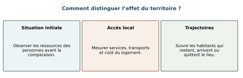
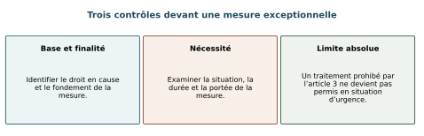

# ENS Rennes D1 — Entretien (oral) 2017 · Corrigé brut

*Corrigé rédigé par IA, non officiel.*

**Rédaction** · GPT-6.2 Astra Ultra · vitesse non renseignée

Les 27 supports sont repris dans leur ordre de lecture. Chaque repère thématique a été attribué à partir du passage reproduit. Le lien ouvre sa page dans le fascicule institutionnel. Le rapport demande une réflexion personnelle étayée à partir du texte et un échange sur les motivations pour intégrer le département droit-économie-management. Un point de départ concret pour cet échange est une question rencontrée en cours ou dans une lecture, la méthode avec laquelle elle pourrait être étudiée et la formation dont on aurait besoin pour le faire.

## Texte 1 — Les juristes et la lisibilité des lois

[Fascicule 1, page 2](https://www.ens-rennes.fr/medias/fichier/textes-entretien-oral-d1-2017-1_1513244539130-pdf#page=2)

Les deux injonctions « faites moins » et « faites mieux » ne sont pas interchangeables. La première vise la multiplication des sources ; la seconde l’hétérogénéité d’une loi. La loi du 27 janvier 2017 relative à l’égalité et à la citoyenneté sert d’exemple : l’intitulé général ne permet guère au lecteur de prévoir que le texte touche notamment au logement, à la formation et à l’information des entreprises.

Le nombre de « lois nouvelles » avancé pour 2016 appelle une vérification de l’unité comptée : lois promulguées, articles, textes publiés et décrets sont des objets différents. Reprendre un numéro de promulgation ou de fin d’année comme décompte des seules lois serait erroné. L’accessibilité s’apprécie aussi par la stabilité, les renvois, les consolidations et les capacités des justiciables à trouver la règle applicable. Un texte unique peut être long et illisible, plusieurs textes très lisibles.

**Relance.** Une loi qui modifie plusieurs codes manque-t-elle nécessairement de cohérence ?

Une même réforme peut nécessiter des modifications coordonnées dans plusieurs codes. Il faut examiner le lien entre dispositions, leurs destinataires et l’intelligibilité de l’ensemble avant de conclure.

## Texte 2 — Le sens politique du libéralisme aux États-Unis

[Fascicule 1, page 3](https://www.ens-rennes.fr/medias/fichier/textes-entretien-oral-d1-2017-1_1513244539130-pdf#page=3)

Le passage critique le sens américain de *liberal* et accuse une partie de la gauche de promouvoir des droits individuels sans interroger les structures économiques. Il oppose des avancées d’inclusion à la persistance des rapports de pouvoir, puis suggère que des carrières institutionnelles peuvent bénéficier du capital politique acquis par les luttes de minorités.

Le déplacement de vocabulaire entre États-Unis et France demande d’abord de préciser pays, époque et enjeu : libéralisme politique, libéralisation économique et étiquette partisane n’ont pas les mêmes contours. Présenter droits civiques et redistribution comme concurrents par nature est également contestable. Une discrimination d’accès à l’emploi peut influer simultanément sur la reconnaissance politique et le revenu. L’argument doit alors être éprouvé sur des programmes et des politiques délimités, plutôt que sur une identité collective supposée.

**Relance.** Une politique contre les discriminations ne change-t-elle que les représentations ?

Elle peut aussi modifier les chances d’embauche ou de logement, donc des ressources matérielles. Il faut étudier le mécanisme, l’application et les effets observables.

## Texte 3 — Donald Trump et l’avenir des échanges internationaux

[Fascicule 1, page 4](https://www.ens-rennes.fr/medias/fichier/textes-entretien-oral-d1-2017-1_1513244539130-pdf#page=4)

Au lendemain de l’élection de Donald Trump, le texte ouvre explicitement deux scénarios : mise en œuvre du programme ou adaptation pragmatique. Il présente protectionnisme, isolationnisme et nationalisme comme des ruptures possibles avec l’ordre international construit après 1945. Le rapprochement avec le Royaume-Uni et le rappel de 1989 proposent une périodisation, non un résultat déjà assuré.

Il importe de séparer commerce, alliances et politique intérieure. Une hausse de droits de douane affecte des secteurs de manière différente et peut entraîner des réponses des partenaires ; elle n’implique pas l’abandon instantané de toute coopération diplomatique. Présenter des alternatives renforce l’analyse : poids du Congrès, engagements existants et interdépendance des producteurs peuvent contraindre le passage du programme aux décisions.

**Relance.** Pourquoi un déficit commercial ne prouve-t-il pas à lui seul que l’ouverture lèse un pays ?

Il dépend aussi de l’épargne, de l’investissement et du financement extérieur. Les effets sur les prix, l’emploi et les revenus varient selon les groupes et les périodes.

## Texte 4 — Renouveau politique et idéal de performance individuelle

[Fascicule 1, page 5](https://www.ens-rennes.fr/medias/fichier/textes-entretien-oral-d1-2017-1_1513244539130-pdf#page=5)

Le chroniqueur reconnaît une demande de renouvellement des partis, puis critique la métaphore du cent mètres avec Usain Bolt. L’exemple sportif affirme que la réussite d’un autre n’enlève rien par elle-même. Le texte objecte que les règles de la compétition, les conditions de départ et les solidarités peuvent influencer la possibilité même de concourir.

Une analogie n’est valable que sur les dimensions pertinentes. En sport, une réglementation antidopage peut protéger la compétition ; en économie, la fiscalité, l’éducation ou les droits sociaux poursuivent des objectifs distincts et imposent des coûts différents. On peut donc défendre responsabilité personnelle et égalité des possibilités sans confondre égalisation de tous les résultats et application de règles communes. La nouveauté d’un discours doit enfin être testée sur ses propositions.

**Relance.** Établir des règles communes revient-il nécessairement à ralentir la personne la plus performante ?

Certaines règles préviennent un avantage indu et rendent la comparaison possible ; d’autres redistribuent explicitement des ressources. Il faut définir l’objet de la règle et comparer ses effets avant de conclure.

## Texte 5 — Nuit debout et la participation politique

[Fascicule 1, page 6](https://www.ens-rennes.fr/medias/fichier/textes-entretien-oral-d1-2017-1_1513244539130-pdf#page=6)

Stéphane, cuisinier et sans logement au moment raconté, participe à la cantine de la place de la République sans être défini par sa situation résidentielle. Le détail illustre un mécanisme de reconnaissance par la contribution. La première personne du pluriel et les références communes montrent comment Nuit debout se décrit comme une expérience de fabrication du politique.

Le registre du manifeste fait entendre la voix des participants. Il ne suffit pas à prouver que tous les publics se sentent représentés ou que toute décision interne est égalitaire. Les horaires, les prises de parole et la répartition des tâches influent sur qui peut rester et peser. Suivre une décision ou une proposition de la place à son éventuelle mise en œuvre aiderait à distinguer expérience d’appartenance, apprentissage démocratique et effet institutionnel.

**Relance.** Une mobilisation qui n’énonce pas une revendication unique échoue-t-elle nécessairement ?

Si son objectif est aussi de créer des liens et de nouvelles pratiques, on peut en examiner les effets autrement que par l’adoption d’une mesure. Préciser les objectifs empêche toutefois de déclarer chaque résultat automatiquement satisfaisant.

## Texte 6 — Religion, spiritualité et discours républicain

[Fascicule 1, page 7](https://www.ens-rennes.fr/medias/fichier/textes-entretien-oral-d1-2017-1_1513244539130-pdf#page=7)

Le propos distingue la laïcité de l’État et la liberté spirituelle de la société. Trois missions sont attribuées à la puissance publique : protéger l’autonomie des personnes croyantes ou non, garantir la cohabitation et répondre aux projets de domination politique. Leur enchaînement montre que la neutralité publique n’équivaut pas à l’effacement de toute expression religieuse individuelle.

Le « besoin d’absolu » attribué aux êtres humains est une thèse philosophique que l’on peut discuter sans limiter la liberté de conscience. La garantie des libertés demande des critères applicables indépendamment de la religion ou de l’absence de religion. Une opinion simplement impopulaire et une conduite portant atteinte aux droits d’autrui n’appellent pas automatiquement la même réponse. La discussion politique et la décision juridique n’ont pas les mêmes conditions.

**Relance.** Une institution neutre peut-elle organiser matériellement l’exercice de libertés ?

Oui, par exemple en garantissant des règles d’accès identiques et en prévenant les contraintes sur les personnes. Cette organisation doit rester rattachée aux droits de chacun et à la loi.

## Texte 7 — Emmanuel Macron, la République et les religions

[Fascicule 1, page 8](https://www.ens-rennes.fr/medias/fichier/textes-entretien-oral-d1-2017-1_1513244539130-pdf#page=8)

La page cite une définition de la République et du rôle des religions prêtée à Emmanuel Macron puis en tire une critique du progrès, de la consommation et de la mondialisation. La citation attribuée à Orwell sert à proposer un autre test : demander quelle expérience humaine une innovation rend possible. Le ton et les images, comme celle du coucou, signalent une chronique engagée.

Il ne faut pas confondre les paroles rapportées et toutes les conséquences que le commentateur en déduit. Protéger l’autonomie peut justifier le pluralisme sans imposer un idéal de consommation. Inversement, une innovation qui élargit certaines libertés peut accroître les dépendances à une plateforme. Comparer des décisions concrètes et les groupes qu’elles affectent permet de discuter le jugement porté sur les anciens clivages politiques.

**Relance.** Pourquoi le mot « révolution » prête-t-il ici à un double sens ?

La chronique joue sur une promesse de rupture et sur le mouvement qui ramène au point de départ. Ce jeu de mots exprime une accusation de continuité ; il ne la démontre pas à lui seul.

## Texte 8 — La fonction symbolique du président de la République

[Fascicule 1, page 9](https://www.ens-rennes.fr/medias/fichier/textes-entretien-oral-d1-2017-1_1513244539130-pdf#page=9)

La thèse du « siège vide » décrit une attente d’incarnation que la procédure électorale laisserait insatisfaite. Les références au roi, à Napoléon et à de Gaulle construisent une généalogie symbolique de la présidence. L’auteur oppose ainsi un système de règles et l’adhésion imaginaire à une figure politique, puis rattache certaines mobilisations au manque d’identification commune.

L’explication demeure une interprétation historique. Parler d’un peuple qui n’aurait pas voulu la mort du roi attribue une intention unique à des populations et des époques diverses. Pour la tester, il faudrait comparer discours, pratiques de commémoration et attentes exprimées dans des contextes différents. Une fonction peut incarner une continuité à travers ses institutions sans que le pouvoir doive se concentrer entre les mains d’une personne.

**Relance.** La préférence pour une présidence plus discrète témoigne-t-elle nécessairement d’un affaiblissement démocratique ?

Elle peut traduire une attente de collégialité ou de responsabilité parlementaire. La qualité démocratique se juge également aux contre-pouvoirs, à la participation et aux droits.

## Texte 9 — Inégalités de revenus et répartition géographique

[Fascicule 1, page 10](https://www.ens-rennes.fr/medias/fichier/textes-entretien-oral-d1-2017-1_1513244539130-pdf#page=10)

Le passage juxtapose réduction récente de certains écarts entre pays et augmentation des écarts internes. Ces évolutions peuvent coexister dès lors que moyennes nationales et distributions individuelles ne mesurent pas le même objet. Il distingue ensuite géographie physique et géographie façonnée par les institutions, les réseaux et la spécialisation. Une personne bénéficie de ressources différentes selon qu’elle peut effectivement atteindre un emploi, un service public ou une école.

Les lumières nocturnes offrent un indicateur indirect de densité et d’activité, sans mesurer tout le bien-être ni la pauvreté interne d’une ville lumineuse. Distinguer causalité du lieu et sélection des habitants est essentiel : des personnes disposant de ressources initiales différentes peuvent choisir ou subir des localisations différentes. Une amélioration de transport peut augmenter les possibilités accessibles tout en relevant les loyers. Étudier les personnes qui restent et celles qui déménagent complète l’étude des lieux.

**Relance.** Une politique aidant un quartier profite-t-elle automatiquement à ses habitants d’origine ?

Si les nouveaux services se traduisent par des loyers plus élevés, une partie des habitants peut être déplacée. Suivre les trajectoires résidentielles et les coûts permet d’apprécier la distribution des gains.

## Texte 10 — L’évolution des stéréotypes de genre

[Fascicule 1, page 11](https://www.ens-rennes.fr/medias/fichier/textes-entretien-oral-d1-2017-1_1513244539130-pdf#page=11)

La page mesure une évolution des réponses déclarées. La part estimant que les femmes devraient idéalement rester au foyer a baissé de vingt points depuis 2002, tandis que le chiffre moyen indiqué est de 26 % et atteint 38 % chez les personnes âgées de 60 ans et plus. Des réponses plus égalitaires sur les capacités scientifiques coexistent avec une répartition encore très inégale des attentes domestiques.

Les enquêtes d’opinion et les enquêtes d’emploi du temps n’observent pas la même chose. On peut adhérer à une règle égalitaire tout en vivant sous des contraintes de salaire, de garde ou d’horaires qui perpétuent une division des tâches. L’écart entre âges à une date peut aussi combiner génération, vieillissement et effet de période. Des enquêtes répétées avec formulations comparables évitent de conclure trop vite à un recul linéaire et irréversible.

**Relance.** Une baisse de vingt points correspond-elle à une baisse de vingt pour cent ?

Non. À titre de calcul, passer de 46 % à 26 % représente vingt points mais une baisse relative de 20/46, soit environ 43 %. Le dénominateur doit être précisé.

## Texte 11 — Libertés et sécurité face au terrorisme

[Fascicule 1, page 12](https://www.ens-rennes.fr/medias/fichier/textes-entretien-oral-d1-2017-1_1513244539130-pdf#page=12)

La page distingue les restrictions ordinaires à certaines libertés et la dérogation exceptionnelle prévue par l’article 15 de la Convention européenne des droits de l’homme. La vie privée protégée par l’article 8 peut faire l’objet d’une ingérence ayant une base légale, poursuivant un but légitime et nécessaire dans une société démocratique. L’état d’urgence ne dispense pas d’examiner les circonstances, la durée des mesures et les voies de recours.

L’interdiction de la torture et des traitements inhumains ou dégradants relève d’une autre logique : elle ne peut être écartée par une pondération ordinaire des intérêts. Le risque réel d’un tel traitement dans le pays de destination peut faire obstacle à un éloignement. Il faut toutefois distinguer la discussion normative de la page sur la déchéance de nationalité de la liste juridique précise des droits non susceptibles de dérogation dans la Convention.

**Relance.** Une déclaration de dérogation au Conseil de l’Europe suffit-elle à valider chaque mesure individuelle ?

Elle informe de la mise en œuvre du dispositif exceptionnel. La mesure demeure soumise aux conditions de nécessité dans la situation, aux autres obligations applicables et aux contrôles pertinents.

## Texte 12 — L’automatisation du commerce et la place du travail

[Fascicule 1, page 13](https://www.ens-rennes.fr/medias/fichier/textes-entretien-oral-d1-2017-1_1513244539130-pdf#page=13)

L’ouverture annoncée de supérettes sans passage en caisse sert à la chronique d’image d’une disparition future du travail. La page mêle description d’un dispositif, intention prêtée à l’entreprise et projections chiffrées sur les emplois. Ces trois énoncés n’ont pas le même statut probatoire. Un projet de deux mille magasins, même relayé dans la presse, n’est pas un décompte d’établissements réellement ouverts.

Supprimer une tâche de caisse change la répartition du travail entre clients, salariés et prestataires. Approvisionnement, assistance, traitement des erreurs et entretien subsistent. Il faut en outre examiner accessibilité pour les personnes sans smartphone et protection des données. Des trajectoires comparées d’établissements, en tenant compte de leur taille et de leur clientèle, permettraient d’estimer heures de travail, prix, qualité de service et effets sur l’emploi local.

**Relance.** Un magasin sans caisse visible est-il nécessairement sans salariés ?

D’autres tâches de manutention, de service et de maintenance peuvent se poursuivre sur place ou à distance. La visibilité et le volume total du travail sont deux observations distinctes.

## Texte 13 — Le risque de déléguer les décisions aux machines

[Fascicule 1, page 14](https://www.ens-rennes.fr/medias/fichier/textes-entretien-oral-d1-2017-1_1513244539130-pdf#page=14)

L’auteur considère qu’une décision grave ne perd pas sa dimension politique lorsqu’une machine y participe. Les premières lignes dénoncent l’effacement des distinctions entre guerre et paix, puis le texte élargit l’argument à une administration gouvernée par des règles automatiques. La référence à Tocqueville transforme un débat technique en interrogation sur l’autonomie et la responsabilité humaines.

On peut éprouver le raisonnement sur un exemple civil, telle une décision d’accès à une prestation. Un score peut faciliter le traitement mais ne doit pas empêcher de connaître les motifs, corriger des informations inexactes et saisir un décideur habilité. Un humain qui entérine systématiquement le résultat n’assure qu’un contrôle nominal. Les effets dépendent de l’organisation du recours et de la personne responsable de la décision, pas de la seule vitesse de calcul.

**Relance.** Que devrait pouvoir faire une personne qui relève une erreur dans une décision automatisée d’allocation ?

Elle doit pouvoir identifier le dossier en cause, demander la correction des faits et obtenir un examen effectif de sa situation dans un délai utile. Le résultat de cet examen doit pouvoir être motivé et contesté.

## Texte 14 — La Grèce, la démocratie et les pouvoirs transnationaux

[Fascicule 1, page 15](https://www.ens-rennes.fr/medias/fichier/textes-entretien-oral-d1-2017-1_1513244539130-pdf#page=15)

La page part des négociations grecques sous Alexis Tsipras pour affirmer que le vote national ne commande plus seul les décisions économiques. Elle rapproche ensuite Mésopotamie antique et conflits contemporains en Irak et en Syrie, avant de décrire les États comme des « hologrammes ». La correspondance géographique et les citations de Brecht donnent au réquisitoire une force littéraire ; elles ne sont pas une chaîne explicative continue sur plusieurs millénaires.

Une analyse peut distinguer contrainte financière, engagements internationaux et décisions encore laissées au gouvernement. Des créanciers peuvent imposer des conditions sans faire disparaître toutes les institutions nationales. Il convient aussi de séparer la situation de la Grèce, celle de sociétés en conflit et l’histoire de la naissance des États. Une comparaison solide définirait une capacité publique observable, par exemple lever un impôt ou faire respecter un droit, et son évolution dans chaque cas.

**Relance.** La tenue d’une élection assure-t-elle que le programme choisi sera intégralement réalisable ?

Les ressources, les règles constitutionnelles, les engagements existants et les décisions d’autres acteurs délimitent les possibilités. L’enjeu démocratique est alors aussi de rendre ces contraintes visibles, négociables quand elles peuvent l’être, et imputables.

## Texte 15 — Citoyenneté mondiale et droit d’initiative

[Fascicule 1, page 16](https://www.ens-rennes.fr/medias/fichier/textes-entretien-oral-d1-2017-1_1513244539130-pdf#page=16)

Le passage fait d’un droit d’initiative transnational une piste pour transformer des citoyens déjà capables de s’organiser en acteurs de la norme. Son inventaire distingue participation aux conférences sur le climat, alerte, observations devant des juridictions et décision finale. Le « Serment de Paris » de 2015 est l’exemple d’un engagement civique, et non la création par traité d’une nouvelle citoyenneté.

L’initiative citoyenne européenne donne à des citoyens remplissant les conditions le pouvoir d’inviter la Commission à agir dans ses compétences. Elle ne fait pas adopter automatiquement une loi. De même, être entendu comme ami de la cour ne revient pas à décider de l’issue d’un procès. Une réflexion sur une éventuelle extension mondiale doit traiter représentativité, financement, droit de réponse et accès des groupes moins dotés en moyens techniques.

**Relance.** Une ONG fréquemment présente aux conférences peut-elle parler au nom de tous les habitants de la planète ?

Sa compétence et son expérience peuvent justifier qu’on l’entende. Son mandat, ses méthodes de consultation et la diversité des voix présentes déterminent ce que sa prise de parole représente.

## Texte 16 — Croissance, inégalités et courbe de Kuznets

[Fascicule 1, page 17](https://www.ens-rennes.fr/medias/fichier/textes-entretien-oral-d1-2017-1_1513244539130-pdf#page=17)

La croissance du PIB moyen peut masquer un accroissement des écarts entre ménages. Le texte critique l’idée qu’un développement plus avancé corrigerait automatiquement la répartition. La note présente l’hypothèse de Kuznets comme une courbe en cloche entre niveau de développement et inégalité, et non comme une loi comptable ni comme une évolution garantie dans chaque pays.

La page associe les inégalités à des mécanismes multiples, dont l’éducation et la mobilité. Pour en tester un, il faut distinguer revenu annuel, patrimoine accumulé et situation initiale, puis identifier une évolution qui ne soit pas simplement corrélée à la croissance. La critique de Piketty porte aussi sur le sens du capital : patrimoine marchand, capacités humaines et écosystèmes ne s’additionnent pas spontanément dans une seule unité. Définir les indicateurs rend le débat réfutable.

**Relance.** Si le revenu de tous augmente de 10 %, l’inégalité recule-t-elle ?

Les rapports entre revenus restent identiques, tandis que les écarts absolus en euros augmentent. La réponse dépend de l’indicateur choisi et ne découle pas du seul taux de croissance.

## Texte 17 — Le port du foulard à l’université

[Fascicule 1, page 18](https://www.ens-rennes.fr/medias/fichier/textes-entretien-oral-d1-2017-1_1513244539130-pdf#page=18)

La page demande de distinguer le port d’un signe par une étudiante majeure et une conduite troublant un enseignement ou portant atteinte aux autres personnes. Elle attire l’attention sur les effets d’un débat formulé exclusivement autour d’un groupe et sur le risque d’écarter de la formation des personnes souhaitant obtenir un diplôme. Les comportements dénoncés sont énumérés à titre de situations à traiter individuellement.

À l’université française, le statut d’usager du service public se distingue de celui de l’agent tenu à la neutralité, et du régime propre aux écoles, collèges et lycées publics. Des exigences particulières de sécurité, d’identification ou de bon fonctionnement doivent être examinées dans leur contexte. Une décision fondée sur un fait précis peut être motivée et contestée ; attribuer à un signe toute une série d’intentions rendrait cette discussion impossible.

**Relance.** Un incident avéré dans une salle suffit-il à fonder une conclusion sur toutes les étudiantes partageant un signe religieux ?

Il justifie d’examiner l’incident, les personnes concernées et la règle pertinente. L’extension à un groupe entier nécessite une justification distincte et risque de traiter des situations dissemblables comme identiques.

## Texte 18 — La place du stationnement automobile dans la ville

[Fascicule 1, page 19](https://www.ens-rennes.fr/medias/fichier/textes-entretien-oral-d1-2017-1_1513244539130-pdf#page=19)

L’auteur part du temps pendant lequel une voiture reste immobile pour interroger l’usage du sol urbain. À prix très bas, l’espace peut être occupé longtemps et d’autres conducteurs circuler à la recherche d’une place. Le test de Fribourg cité concerne les véhicules observés dans une situation particulière. Le cas du siège d’Apple compare les surfaces vouées aux bureaux et aux parkings et donne une autre façon de rendre visible le coût d’opportunité.

Augmenter le prix peut réduire la recherche et libérer des places, mais l’effet dépend des transports collectifs, des besoins des personnes à mobilité réduite et des horaires de travail. Construire des parkings supplémentaires mobilise du sol et peut encourager de nouveaux déplacements. Les véhicules autonomes sont présentés comme une perspective : leurs trajets à vide pourraient aussi peser sur la circulation. Un pilote local devrait suivre occupation, trafic, accès et répartition des coûts.

**Relance.** Un emplacement résidentiel presque gratuit est-il sans coût pour la collectivité ?

Il occupe une surface qui pourrait servir à un autre usage et peut exiger entretien ou surveillance. La redevance payée et le coût collectif de l’espace ne sont pas identiques.

## Texte 19 — Socrate, les sophistes et l’argumentation judiciaire

[Fascicule 1, page 20](https://www.ens-rennes.fr/medias/fichier/textes-entretien-oral-d1-2017-1_1513244539130-pdf#page=20)

L’extrait oppose la réputation des sophistes, capables de soutenir deux thèses, à une figure de Socrate qui construit par questions et réponses des prémisses partagées. Il transpose cette comparaison au débat sur la « post-vérité » et à l’attente de cohésion placée dans le juge. La procédure contradictoire permet aux parties de présenter leurs raisons, les avocats participant à la construction du dossier.

Une décision dotée d’autorité met fin à une question litigieuse dans des conditions de droit ; elle ne transforme pas tout énoncé historique ou scientifique en vérité intangible. Preuves admises, charge de la preuve et motivation encadrent l’office du juge. Discuter ces limites n’affaiblit pas la justice : c’est précisément ce qui permet de corriger certaines erreurs par un recours et de différencier enquête scientifique, délibération publique et jugement.

**Relance.** Le fait que deux parties soient entendues garantit-il la vérité de leurs récits ?

Le contradictoire permet de discuter une affirmation et ses pièces. Il ne garantit ni la disponibilité de toutes les preuves ni la même capacité à les apporter. C’est pourquoi motivation et moyens d’accès à la défense sont importants.

## Texte 20 — La vente du plasma sanguin aux États-Unis

[Fascicule 1, page 21](https://www.ens-rennes.fr/medias/fichier/textes-entretien-oral-d1-2017-1_1513244539130-pdf#page=21)

La page part d’un documentaire sur la rémunération de la collecte de plasma aux États-Unis et d’un volume rapporté passant de 15 millions de litres en 2007 à 32 millions en 2014. Son enjeu est social et éthique : quels choix sont réellement accessibles à une personne dépendant du paiement ? Il faut distinguer plasma et sang total, ainsi que la quantité globale recueillie, le nombre de personnes et leur situation économique. Un total national ne donne pas une mesure de leur liberté de choix.

La deuxième moitié rapproche ce marché des contrats à impact social, où des investisseurs peuvent être remboursés selon des résultats convenus. Le lien est une critique de la marchandisation, mais ni l’objet échangé ni les risques ne sont identiques. Pour juger un contrat, il faudrait examiner indicateur choisi, risque financier véritable, protection des bénéficiaires et comparaison avec une action directement financée par la collectivité. Une image polémique ne fournit pas cette évaluation.

**Relance.** Le fait qu’une personne soit rémunérée prouve-t-il à lui seul qu’elle a été contrainte ?

Le paiement ne tranche pas. Il faut étudier information, alternatives réelles, protections, pouvoir de refuser et distribution des risques. Le débat éthique porte notamment sur les conditions de cette décision.

## Texte 21 — Le débat sur la méthode scientifique en économie

[Fascicule 1, page 22](https://www.ens-rennes.fr/medias/fichier/textes-entretien-oral-d1-2017-1_1513244539130-pdf#page=22)

La controverse autour de Cahuc et Zylberberg oppose moins une science à toute critique que plusieurs manières d’établir et de communiquer une preuve. Le passage signale à la fois les dangers de l’argument d’autorité médiatique et la violence des étiquettes appliquées aux personnes. Tirage d’un livre, notoriété d’un économiste et qualité d’une stratégie d’identification ne mesurent pas la même chose.

Une question limitée, par exemple l’effet d’un dispositif de formation sur l’emploi, permet de sortir des invectives. Il faut définir population, groupe de comparaison, hypothèses, incertitude et possibilités de réplication. Une expérience locale bien conduite ne décide pas seule si un pays doit étendre le dispositif, car les effets d’échelle et les objectifs distributifs comptent. Désaccord sur une estimation et désaccord sur une politique méritent alors deux examens différents.

**Relance.** Est-il incohérent que deux économistes acceptent le même résultat et recommandent des décisions différentes ?

Ils peuvent attribuer des poids différents aux coûts, aux bénéficiaires ou aux risques, ou juger différemment la transposition à un autre contexte. Ils doivent rendre ces hypothèses supplémentaires explicites.

## Texte 22 — Langage, genre et égalité

[Fascicule 1, page 23](https://www.ens-rennes.fr/medias/fichier/textes-entretien-oral-d1-2017-1_1513244539130-pdf#page=23)

Le texte met en regard deux jugements opposés portés sur une même prise de parole lorsqu’elle vient d’un homme ou d’une femme. Il relie les attentes apprises dès l’enfance au vocabulaire, aux tours de parole, aux carrières et aux rémunérations. L’écriture inclusive et la féminisation des métiers sont avancées comme des moyens de rendre visibles des personnes auparavant moins nommées.

Le passage défend un programme ; l’efficacité de chaque mesure doit être établie. Une formulation peut modifier la représentation mentale d’un métier sans suffire à modifier le recrutement, les salaires ni la répartition du temps domestique. On peut comparer compréhension, représentation et accessibilité de plusieurs formulations auprès de publics variés. Étudier ensemble langage et organisation du travail évite de demander au seul vocabulaire de corriger toute inégalité sociale.

**Relance.** Comment étudier un effet du nom d’un métier sur les représentations ?

Présenter à des groupes comparables des descriptions identiques dont seul l’intitulé varie, puis mesurer les profils imaginés. On distinguerait ce résultat d’une observation ultérieure sur les candidatures ou les embauches.

## Texte 23 — Les technologies civiques et la participation au débat public

[Fascicule 1, page 24](https://www.ens-rennes.fr/medias/fichier/textes-entretien-oral-d1-2017-1_1513244539130-pdf#page=24)

Le terme « Civic Tech » recouvre sur cette page des objets très différents : données ouvertes, signalement local, pétition, budget participatif ou contribution à un texte de loi. L’institution qui offre l’outil, les personnes pouvant participer et la force donnée au résultat comptent davantage pour son effet démocratique que la seule présence d’une application.

Une consultation peut donner accès à des informations et faire émerger une difficulté ignorée. Elle peut aussi être dominée par des personnes disponibles et bien équipées, puis rester sans suite. Pour l’évaluer, on devrait documenter la composition des participants, les alternatives hors ligne, le retour motivé fait aux propositions et les décisions effectivement modifiées. La représentation et la participation directe peuvent alors s’articuler au lieu de s’exclure.

**Relance.** Pourquoi le nombre de clics ne suffit-il pas à mesurer le pouvoir donné aux citoyens ?

Un même nombre peut correspondre à un simple avis ou à un vote doté d’un budget à engager. La règle de décision et le suivi des propositions déterminent la portée effective de la participation.

## Texte 24 — Fiction juridique et destitution des gouvernants

[Fascicule 1, page 25](https://www.ens-rennes.fr/medias/fichier/textes-entretien-oral-d1-2017-1_1513244539130-pdf#page=25)

Le cas fictif attribué à Huguccio pose un problème de compétence : qui peut juger celui qui revendique le pouvoir suprême de juger ? Dans la première solution médiévale décrite, l’aveu et la perte de la qualité requise rendent possible le jugement. Une seconde tradition déplace le contrôle vers une assemblée. Les développements conciliaristes donnent alors une histoire à la limitation d’une charge tenue pour suprême.

Il serait réducteur de tirer une ligne directe du droit canonique à toutes les constitutions. Les fondements de l’autorité, les institutions compétentes et les motifs de destitution ont changé. L’intérêt du parallèle tient à une question commune : comment prévoir une responsabilité au sommet sans donner à l’accusateur un pouvoir arbitraire ? Procédure, droit d’être entendu, majorité requise et effets de la décision permettent de comparer les régimes.

**Relance.** Destituer un responsable revient-il à le condamner pénalement ?

La destitution porte d’abord sur la poursuite des fonctions selon les règles du régime. Une responsabilité pénale relève de qualifications, de juridictions et de sanctions distinctes.

## Texte 25 — Pooper et les promesses des jeunes entreprises numériques

[Fascicule 1, page 26](https://www.ens-rennes.fr/medias/fichier/textes-entretien-oral-d1-2017-1_1513244539130-pdf#page=26)

Pooper est un canular, fait essentiel dès le début du commentaire. Le projet mime l’esthétique et les promesses des plateformes pour proposer la délégation d’une tâche peu valorisée. Le discours de liberté horaire et de revenu supplémentaire montre comment une présentation séduisante peut dissimuler le partage du risque et la différence de pouvoir entre la personne qui commande et celle qui exécute.

Les inscriptions revendiquées et les articles de presse signalent la vraisemblance sociale du récit, sans démontrer la viabilité économique d’une entreprise inexistante. Une analyse du travail de plateforme demanderait rémunération après frais, temps d’attente, liberté de refuser et protection sociale. La seconde cible de la satire est médiatique : une mise en page conforme aux codes de l’innovation peut faire passer une promesse pour une activité vérifiée.

**Relance.** Le nombre d’inscriptions à un site fictif mesure-t-il la demande solvable pour son service ?

Il peut mesurer la curiosité, la recherche d’un revenu ou l’effet médiatique. Un achat effectif à un prix donné et une prestation réalisable constituent d’autres étapes.

## Texte 26 — Régimes politiques et croissance économique

[Fascicule 1, page 27](https://www.ens-rennes.fr/medias/fichier/textes-entretien-oral-d1-2017-1_1513244539130-pdf#page=27)

La page fait remarquer qu’une forte croissance a pu se produire dans un régime autoritaire et que des électeurs peuvent préférer certaines protections à la déréglementation. Ces deux constats mettent en défaut une relation mécanique entre démocratie, satisfaction immédiate des investisseurs et croissance. Ils ne démontrent pas pour autant qu’une restriction des libertés produirait durablement plus de richesse.

Un cas de rattrapage rapide doit être replacé dans sa situation initiale, ses ressources et l’économie mondiale. Prévisibilité du droit, possibilité de signaler des erreurs publiques et qualité des services collectifs peuvent influer à long terme. La stabilité affichée à court terme n’est pas le même objet que la résistance d’institutions à une crise. De plus, les libertés politiques ont une valeur propre qui ne se réduit pas au PIB.

**Relance.** Comparer le taux de croissance d’un pays riche à celui d’un pays en rattrapage permet-il d’isoler l’effet du régime ?

Les niveaux initiaux et les potentiels de rattrapage diffèrent. Il faudrait des comparaisons crédibles, sur des périodes suffisamment longues, et des résultats dépassant la seule croissance moyenne.

## Texte 27 — L’Europe face à l’élection de Donald Trump

[Fascicule 1, page 28](https://www.ens-rennes.fr/medias/fichier/textes-entretien-oral-d1-2017-1_1513244539130-pdf#page=28)

L’article présente l’Europe comme particulièrement exposée à une présidence américaine favorable au protectionnisme et au Brexit. Il distingue implicitement deux canaux : effets sur les échanges et effets politiques du soutien apporté à certains mouvements. Le rapprochement avec Kennedy, King et Obama indique aussi le poids symbolique du modèle américain pour l’auteur.

L’Europe n’est pas un acteur économique homogène. Une restriction commerciale affecte différemment entreprises exportatrices, acheteurs d’intrants importés et consommateurs ; les relations bilatérales ne se déduisent pas directement du seul solde agrégé. De même, une proximité politique affichée ne garantit pas une victoire électorale européenne. L’ouverture conditionnelle du texte demande de distinguer positions de campagne, décisions effectivement adoptées et conséquences encore incertaines à la date du concours.

**Relance.** L’abandon d’une négociation commerciale équivaut-il mécaniquement à une guerre commerciale ?

Renoncer à de nouvelles concessions laisse subsister les règles existantes ; une escalade supposerait des mesures restrictives et des réponses supplémentaires. Le passage formule une crainte que cette distinction aide à examiner.

[Rapport officiel du jury](https://www.ens-rennes.fr/medias/fichier/rapport-oral-entretien-d1-2017_1515597644578-pdf)
