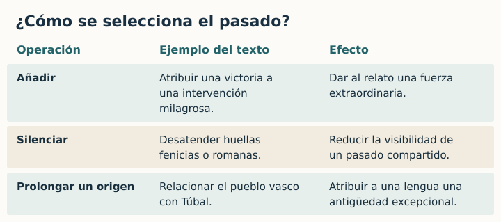

# ENS Rennes · D1 · Espagnol 2017 — Corrigé guidé

*Corrigé rédigé par IA, non officiel. Signalez toute erreur.*

**Rédaction** · GPT-6.2 Astra Ultra · vitesse non renseignée

Épreuve écrite de l’École normale supérieure de Rennes. Luis Goytisolo, El País, 10 octobre 2015.

## Version française

**Des fictions pour se distinguer**

**Les mythes qu’un pays entretient affectent son histoire.**

Le phénomène n’a rien de propre à l’Espagne. Pratiquement tous les pays, à commencer par les plus proches, la France, l’Angleterre, le Portugal et l’Italie, connaissent des difficultés semblables. […] En Espagne, les légendes proprement nationales coïncident généralement avec celles de la tradition castillano-léonaise. Il suffit de songer aux victoires militaires spectaculaires qu’aurait permises l’intervention directe de la Vierge de Covadonga ou de saint Jacques, à qui l’on attribue la mort de 300 000 Maures. Par ailleurs, de même que certains faits du passé s’enrichissent de récits imaginaires, d’autres peuvent être niés, passés sous silence ou tout simplement laissés de côté. En témoigne, dans toute la péninsule, le désintérêt pour tout ce qui touche à la présence des Phéniciens […] ou aux riches vestiges de la présence romaine, comme si la Bétique n’avait pas fait partie de la métropole et que des empereurs tels que Trajan, Hadrien et Marc Aurèle n’en avaient pas été originaires. […]

C’est, en toute logique, dans les communautés autonomes dont la singularité historique est la plus marquée, à savoir la Catalogne, le Pays basque et la Galice, que ces manières d’envisager et de remanier le passé acquièrent une vigueur particulière. Il s’agit de mythes, d’attitudes et de croyances portant aussi bien sur les origines de ces communautés que sur différentes péripéties survenues au fil du temps. Des trois, c’est la Galice qui pose le moins de difficultés, tant est indiscutable sa composante celtique, à laquelle on rattache la plupart de ses particularités et de ses traditions. L’imagination la plus ambitieuse est assurément celle qui s’est exercée à propos des origines du peuple basque. Selon la tradition, son ascendance ne remonterait à nul autre que Tubal, petit-fils de Noé. Sa langue serait donc antérieure à la confusion linguistique provoquée par l’échec de la construction de la tour de Babel.

## Expression en espagnol

Expliquer la vigueur particulière des récits et remaniements du passé dans les communautés dites historiques. 100 mots, à 10 % près.

En las comunidades históricas, el pasado sirve para explicar por qué una lengua o unas instituciones propias siguen importando en el presente. Cuando esa singularidad se discute, un relato de orígenes remotos puede ofrecer una respuesta fácil de recordar y difícil de comprobar. La tradición que vincula al pueblo vasco con Túbal ilustra ese atractivo: convierte la antigüedad de una lengua en una historia familiar. También se seleccionan silencios. Una herencia compartida con los vecinos resulta menos útil para marcar distancias que una costumbre singular. A mi juicio, conviene estudiar quién transmite cada relato y qué circunstancias favorecen su aceptación.

*100 mots, comptés par espaces.*

## Comment construire la réponse

**Distinguer récit et adhésion.** Le chiffre des 300 000 relève de l’exemple de victoire légendaire que cite Goytisolo. Le conditionnel français aide à entendre son recul. Rendre *como si* par « comme si » conserve la critique de l’oubli. La version restitue les assertions de l’extrait sur la Bétique et sur la Galice dans le cadre de son argument.

**Traduire les mots qui organisent la comparaison.** *Planteamientos* désigne ici des manières d’envisager le passé. *Avatares* renvoie aux péripéties historiques et *nada menos que* met en relief l’ambition de la généalogie. La tradition rapportée à la fin conduit à un conditionnel, *sería*. Garder les coupes signalées sur le feuillet.

**Expliquer la vigueur du phénomène.** Dire seulement que ces communautés sont différentes répéterait la question. L’exemple de Tubal montre comment un récit généalogique transforme une revendication d’ancienneté en histoire aisée à transmettre. L’oubli d’héritages communs donne le mouvement complémentaire. Le texte nomme la Catalogne sans y développer un récit d’origine particulier.

[Feuillet original, p. 4](https://www.ens-rennes.fr/medias/fichier/sujet-lv-d1-2017_1513242514196-pdf#page=4) · [Rapport du jury, partie écrite](https://www.ens-rennes.fr/medias/fichier/rapport-espagnol-e-crit-d1-2017_1515597587849-pdf#page=1)
