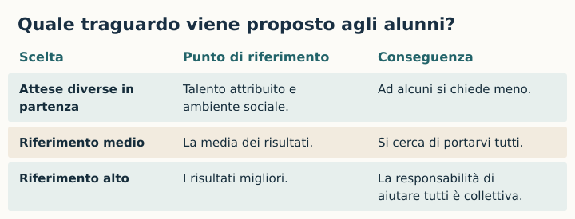

# ENS Rennes · D1 · Italien 2017 — Corrigé brut

*Corrigé rédigé par IA, non officiel. Signalez toute erreur.*

**Rédaction** · GPT-6.2 Astra Ultra · vitesse non renseignée

Épreuve écrite de l’École normale supérieure de Rennes. D’après Carola Traverso Saibante, « 7 falsi miti sulla scuola », Espresso, 25 avril 2015.

## Version française

**La réussite n’est pas une question de talent**

Quel est le véritable secret de la réussite scolaire ?

Bien des élèves occidentaux pensent que, pour réussir un examen, la chance compte davantage que le travail. Et bien des enseignants ont tendance à se sentir coupables lorsqu’ils se montrent plus exigeants avec les élèves jugés moins doués. Ils s’attendent en outre à de moins bons résultats de la part de ceux qui viennent de milieux défavorisés. Or, selon une analyse publiée par la BBC, tous les élèves peuvent en réalité atteindre un niveau très élevé. Le secret tient à une conviction que partagent les élèves, les parents et les enseignants : ils en sont capables.

Croire au potentiel de ses élèves, avoir la ferme volonté politique de miser sur eux, pouvoir mobiliser toutes les parties concernées autour d’un effort concerté et durable pour progresser : voilà ce qui caractérise les pays où les élèves réussissent, comme le Japon ou la Finlande. Dans ces pays, on ne croit pas que la réussite soit une question de talent ; on estime possible d’atteindre l’excellence grâce à l’aide et à la confiance d’enseignants compétents. Dans ces systèmes scolaires, le niveau de référence que l’on cherche à faire atteindre à tous n’est pas celui des résultats moyens. On prend pour référence les meilleurs résultats, ceux que l’on attendait auparavant de la seule élite des élèves. Il appartiendra à tous, collectivement, de permettre à chacun d’y parvenir.

## Expression en italien

Da cosa dipende, secondo te, il successo scolastico di un alunno? 100 mots, à 10 % près.

Secondo me, il successo scolastico dipende anche dal modo in cui un alunno può correggere i propri errori. Se riceve soltanto un voto basso, potrebbe pensare di non essere portato per la materia. Se invece un insegnante gli mostra quale passaggio ha frainteso e gli propone un nuovo esercizio, il miglioramento diventa concreto. La fiducia serve proprio a rendere possibile un secondo tentativo. Tuttavia, chiedere a tutti lo stesso impegno presuppone condizioni materiali adeguate: uno spazio tranquillo, tempo e accesso ai libri. La scuola può ridurre queste differenze offrendo occasioni di studio assistito, senza abbassare le aspettative.

*97 mots, comptés par espaces.*

[Feuillet original, p. 5](https://www.ens-rennes.fr/medias/fichier/sujet-lv-d1-2017_1513242514196-pdf#page=5)
