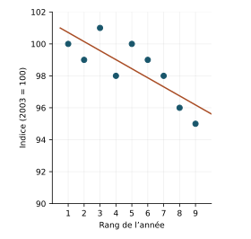
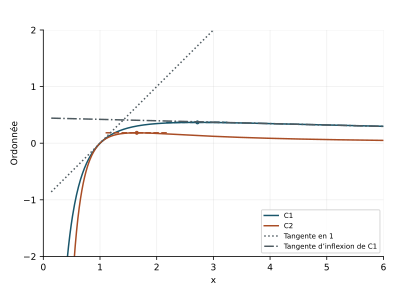
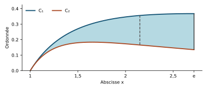

# ENS Rennes D1 — Mathématiques appliquées et statistiques 2017 · Corrigé brut

*Corrigé rédigé par IA, non officiel. Signalez toute erreur.*

**Rédaction** · GPT-6.2 Astra Ultra · vitesse non renseignée

**Révision (tour 1)** · GPT-6.2 Astra Ultra · vitesse non renseignée · 26 novembre 2026

Les trois exercices étudient des dépenses de santé, des modèles probabilistes et une famille de courbes logarithmiques. Le calcul d’un quantile d’incubation et celui d’une probabilité après contact font appel à des informations différentes.

## Exercice 1. Emploi dans l’optique et dépenses de santé

### Question 1.A.1

Aux abscisses entières de 1 à 9, placer successivement les valeurs $100,99,101,98,100,99,98,96,95$. Le repère demandé porte 1 cm par unité sur chaque axe. La droite figurée en plus des points est calculée en 1.A.3.

### Question 1.A.2

Les rangs ont pour moyenne $5$ et variance $6{,}666667$. Les indices ont pour moyenne $98{,}444444$ et variance $3{,}358025$. La covariance $C_{xy}=\frac19\sum(x_i-\bar x)(y_i-\bar y)=-3{,}777778$, donc $r=C_{xy}/\sqrt{V_xV_y}\simeq-0{,}798$. Un ajustement affine décrit la tendance décroissante, avec une dispersion visible. Il explique $r^2=0{,}6375$, soit $63{,}75\,\%$ de la variance observée.

### Question 1.A.3

L’ajustement de $y$ en $x$ a pente $a=C_{xy}/V_x=-17/30$ et ordonnée à l’origine $b=\bar y-a\bar x=1823/18$. Ainsi $\widehat y=-0{,}566667x+101{,}277778$. On peut tracer la droite avec le point moyen et l’ordonnée prévue au rang 1.

### Question 1.A.4

L’année 2016 correspond au rang $14$, d’où $\widehat y(14)=93{,}344$. En 2011 la valeur observée valait 95. Le taux de variation est donc $100(93{,}344444-95)/95=-1{,}743\,\%$. La prévision donne une baisse.

### Question 1.A.5

Une baisse de $10\,\%$ depuis la base 100 correspond à $\widehat y\le90$. La résolution donne $x\ge19{,}902$, donc le premier rang entier est 20, soit **2022**. Cette extrapolation se situe onze ans après la dernière donnée et le nuage est dispersé. Aucun niveau de confiance chiffré n’est justifié par ce seul ajustement.

### Question 1.B.1

Série statistique quantitative continue à un caractère. Chaque observation est une dépense de santé en pourcentage du PIB national, arrondie au dixième, pour l’un des 24 pays.

### Question 1.B.2

En ordre croissant, les valeurs de rangs 12 et 13 valent toutes deux $9{,}3$. La médiane vaut $9{,}300\,\%$. Selon la convention des quartiles de rang supérieur, $Q_1=x_{(6)}=7{,}900$ et $Q_3=x_{(18)}=10{,}800$. L’écart interquartile est donc $2{,}900$ points de PIB.

### Question 1.B.3

La somme des pourcentages est $231{,}2$. La moyenne vaut $231{,}2/24=9{,}633\,\%$ du PIB. Il s’agit de la moyenne des pourcentages nationaux.

### Question 1.B.4

La somme des carrés vaut $2353{,}4$. L’écart type descriptif est $\sqrt{2353{,}4/24-(231{,}2/24)^2}\simeq2{,}293$ points.

### Question 1.B.5.a

Avec $Z=(X-9{,}4)/2{,}2\sim\mathcal N(0,1)$, $P(X<6{,}1)=P(Z<-1{,}5)=1-\Phi(1{,}5)\simeq0{,}067$.

### Question 1.B.5.b

La symétrie donne $2\Phi(a/2{,}2)-1=0{,}99$. Donc $a=2{,}2\Phi^{-1}(0{,}995)=5{,}667$ points environ. Une table arrondie permet d’interpoler entre $2{,}57$ et $2{,}58$.

### Question 1.B.5.c

L’intervalle va de $3{,}733$ à $15{,}067$. Les États-Unis, à $17{,}7\,\%$, sont au-dessus. Ils sont hors de l’intervalle central défini par le modèle du sujet.

## Exercice 2. Probabilités

### Question 2.I.1

Le texte donne $P(C)=0{,}020$, $P(T\mid C)=0{,}950$ et $P(T\mid\bar C)=1-0{,}950=0{,}050$.

### Question 2.I.2

$P(\bar T\cap C)=P(C)P(\bar T\mid C)=0{,}02\times0{,}05=0{,}001$.

### Question 2.I.3

$P(T\cap\bar C)=0{,}98\times0{,}05=0{,}049$.

### Question 2.I.4

$E=(\bar T\cap C)\cup(T\cap\bar C)$. Les deux événements sont disjoints car ils imposent des états de contamination opposés. Donc $P(E)=0{,}001+0{,}049=0{,}050$.

### Question 2.I.5

La partition $C,\bar C$ donne $P(T)=0{,}02(0{,}95)+0{,}049=0{,}068$. D’où $P(\bar C\mid T)=0{,}049/0{,}068\simeq0{,}721$.

### Question 2.II.1

Pour $X\sim\mathcal P(2)$, $P(X\le2)=e^{-2}(1+2+2^2/2)=5e^{-2}\simeq0{,}677$.

### Question 2.II.2

$Y=520+80X$ en euros. Comme $\mathbb E X=\operatorname{Var}X=2$, on obtient $\mathbb E Y=680$ euros et $\operatorname{Var}Y=80^2\times2=12\,800$ euros carrés.

### Question 2.II.3

$Y\ge700$ équivaut à $X\ge(700-520)/80=2{,}25$, donc à $X\ge3$. La probabilité est $1-5e^{-2}\simeq0{,}323$.

### Question 2.III.1

Quarante essais indépendants de même probabilité de positivité $0{,}02$ donnent pour leur nombre de succès $Z\sim\mathcal B(40,0{,}02)$.

### Question 2.III.2

$\mathbb E Z=40(0{,}02)=0{,}800$ et $\operatorname{Var}Z=40(0{,}02)(0{,}98)=0{,}784$.

### Question 2.III.3

$P(Z=8)=\binom{40}{8}0{,}02^8\,0{,}98^{32}\simeq1{,}0314\times10^{-6}$. À $10^{-3}$ près cela s’arrondit à $0{,}000$, mais la probabilité exacte est positive.

### Question 2.IV.1

Sous la lecture littérale $\mathbb EN=5$ et $\operatorname{Var}N=2$, posons $\log N\sim\mathcal N(\mu,s^2)$. Les moments log-normaux donnent $s^2=\log(1+2/25)$ et $\mu=\log5-s^2/2$. Alors $F(15)=\Phi((\log15-\mu)/s)\simeq0{,}999979$, soit $1{,}000$ au millième. Si « moyenne 5 et variance 2 » désigne les paramètres de $\log N$, on trouve au contraire $\Phi((\log15-5)/\sqrt2)\simeq0{,}053$.

### Question 2.IV.2

Parmi les personnes contaminées, le temps auquel $99\,\%$ ont déclaré leurs symptômes est le quantile $q=\exp(\mu+s\Phi^{-1}(0{,}99))\simeq9{,}174$ jours. Pour une réponse en jours entiers, cela donne **10 jours**. Sous la convention alternative $\log N\sim\mathcal N(5,2)$, le quantile serait $3983{,}646$ jours, soit 3984 jours entiers.

L’énoncé demande aussi d’inverser le conditionnement pour une personne exposée. Le risque initial $p=P(C\mid\text{contact})$ est nécessaire. Si les non-contaminés restent sans ces symptômes et si $F$ est la fonction de répartition de l’incubation chez les contaminés, alors $P(\bar C\mid\text{aucun symptôme à }t)=(1-p)/[(1-p)+p(1-F(t))]$. Cette probabilité est au moins $0{,}99$ quand $p(1-F(t))\le(1-p)/99$. Le texte ne fixe pas le risque après ce contact. Le quantile d’incubation seul ne détermine donc pas cette probabilité inverse.

Le rôle du risque initial peut être vérifié numériquement. À titre d’exemple, en ajoutant l’hypothèse $p=0{,}02$ après le contact, on obtient $F(t)\ge 1-0{,}98/(99\times0{,}02)\simeq0{,}50505$. Sous la lecture littérale des moments, le seuil correspondant vaut $\exp(\mu+s\Phi^{-1}(0{,}50505))\simeq4{,}828$ jours, donc cinq jours entiers. Si $p=1/2$, le même calcul exige $F(t)\ge98/99$. La prévalence donnée pour la population de la partie I ne fixe pas $p$ pour la personne exposée en partie IV.

## Exercice 3. Fonctions logarithmiques et tangentes

### Question 3.I.1

$1-n\ln x=0$ équivaut à $x=\alpha_n=e^{1/n}$. Comme $\ln$ croît strictement sur $]0,+\infty[$, le signe est positif avant $\alpha_n$, nul en $\alpha_n$ et négatif ensuite.

### Question 3.I.2

Pour $x>0$ ces deux fonctions sont dérivables. On a $f'_n(x)=x^{-n-1}-n(\ln x)x^{-n-1}=(1-n\ln x)/x^{n+1}$.

### Question 3.I.3

De $0^+$ à $\alpha_n$, $f_n$ croît strictement de $-\infty$ à $1/(ne)$. De $\alpha_n$ à $+\infty$, elle décroît strictement vers zéro, d’après les limites admises.

| $x$ | $0^+$ |  | $e^{1/n}$ |  | $+\infty$ |
| --- | --- | --- | --- | --- | --- |
| $f_n'(x)$ |  | $+$ | $0$ | $-$ |  |
| $f_n(x)$ | $-\infty$ | $\nearrow$ | $1/(ne)$ | $\searrow$ | $0$ |

### Question 3.I.4

Le maximum global est $f_n(\alpha_n)=(1/n)/e=1/(ne)$, uniquement en $x=e^{1/n}$.

### Question 3.I.5

$f_{n+1}-f_n=x^{-n-1}(1-x)\ln x$. Pour $0<x<1$ et pour $x>1$, le produit est négatif. Ainsi $C_{n+1}$ est strictement en dessous de $C_n$ sauf en $(1,0)$ où elles sont égales.

### Question 3.II.1

$f'_n=(1-n\ln x)x^{-n-1}$ est dérivable. On obtient $f''_n=x^{-n-2}[-n-(n+1)(1-n\ln x)]=[n(n+1)\ln x-(2n+1)]/x^{n+2}$.

### Question 3.II.2

Le numérateur s’annule en $\beta_n=\exp((2n+1)/(n(n+1)))$. Comme le dénominateur est positif, $f''_n$ est négative avant $\beta_n$ et positive après. La courbe admet un point d’inflexion à cette abscisse.

### Question 3.II.3

$0<1/n<(2n+1)/(n(n+1))$ car la différence des deux derniers membres est $1/(n+1)>0$. L’exponentielle donne $1<\alpha_n<\beta_n$.

### Question 3.II.4

$\beta_1=e^{3/2}$, $f_1(\beta_1)=3e^{-3/2}/2$ et $f'_1(\beta_1)=-e^{-3}/2$. Ainsi $\Delta_1$ a pour équation $y=-e^{-3}x/2+2e^{-3/2}$.

### Question 3.II.5

La tangence impose $\varphi_n(\beta_n)=\varphi'_n(\beta_n)=0$. La soustraction d’une fonction affine donne $\varphi_n''=f_n''$. Donc $\varphi'_n$ décroît strictement jusqu’à $\beta_n$ puis croît strictement, avec minimum zéro. Elle est positive ailleurs. Ainsi $\varphi_n$ croît strictement sur tout le domaine, est négative avant $\beta_n$ et positive après. $C_n$ est en dessous de sa tangente d’inflexion avant le contact et au-dessus après.

### Question 3.III.1

Les deux courbes traversent $(1,0)$ avec $f'_n(1)=1$, donc leur tangente commune est $y=x-1$. Aux maxima $(e,1/e)$ et $(\sqrt e,1/(2e))$, les tangentes sont horizontales. Ajouter la droite $\Delta_1$ de 3.II.4. L’axe horizontal va de 0 à 6 et l’axe vertical de $-2$ à 2 dans le repère orthonormé de 4 cm par unité.

### Question 3.III.2

Pour $n\ge2$, $f'_{n-1}(x)=x^{-n}-(n-1)f_n(x)$. On isole $f_n=(x^{-n}-f'_{n-1})/(n-1)$.

### Question 3.III.3

Une primitive sur $]0,+\infty[$ est $F_n(x)=-x^{1-n}/(n-1)^2-f_{n-1}(x)/(n-1)=-x^{1-n}[1+(n-1)\ln x]/(n-1)^2$.

### Question 3.III.4

$F_n(1)=-1/(n-1)^2$ et $F_n(e)=-ne^{1-n}/(n-1)^2$. Donc $\int_1^ef_n=(1-ne^{1-n})/(n-1)^2$. Comme $f_n\ge0$ sur ce segment, cette intégrale est l’aire en unités d’aire. Sur le graphique de 4 cm par unité, il faut multiplier par 16 pour les cm².

### Question 3.III.5

$\int_1^e(\ln x)/x\,dx=[(\ln x)^2/2]_1^e=1/2$.

### Question 3.III.6

Sur $[1,e]$ on a $f_1\ge f_2$. L’aire entre les courbes est $1/2-(1-2/e)=2/e-1/2\simeq0{,}236$ unité d’aire, soit $16(2/e-1/2)\simeq3{,}772$ cm² à l’échelle du dessin.

La largeur d’une tranche verticale est $dx$ et sa hauteur est $f_1(x)-f_2(x)=(x-1)\ln(x)/x^2$. Ce terme s’annule au bord gauche. Au bord droit, la verticale $x=e$ ferme la région entre les deux ordonnées $1/e$ et $1/e^2$.

