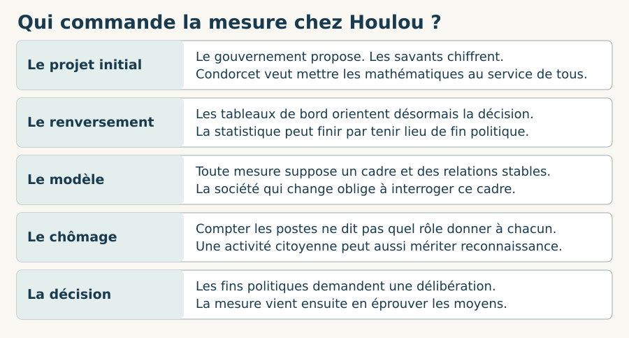
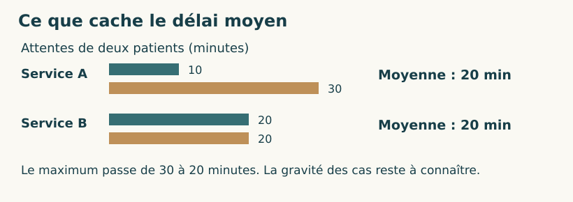

# ENS · Cycle master mathématiques — Français et culture générale 2017 · Corrigé guidé

*Corrigé rédigé par IA, non officiel. Signalez toute erreur.*

**Rédaction** · GPT-6.2 Astra Ultra · vitesse non renseignée

**Autocontrôle** · GPT-6.2 Astra Ultra · vitesse non renseignée

**Révision (tour 1)** · GPT-6.2 Astra Ultra · vitesse non renseignée · 26 novembre 2026

## Sujet et consignes

La garde 2C7123 porte les noms de l’École normale supérieure Paris-Saclay et de l’École normale supérieure de Rennes. Durée de l’épreuve, trois heures.

Antoine Houlou, « Du chiffrage de la politique à la politique du chiffre », Le Débat, 2015/2, n° 184, p. 118–123.

Résumer le texte en 380 mots (avec une marge de tolérance de + ou – 10%). Le nombre exact de mots utilisés sera indiqué en fin de résumé. Le résumé vaut dix points. La marge autorisée va de 342 à 418 mots.

La question 2 vaut dix points. Les deux réflexions sont reproduites et traitées sous leurs lettres respectives.

Sous forme d’un développement construit, commenter, au choix, l’une des deux réflexions suivantes de l’auteur :

- Option a — « Car le travail n’est plus une fin en soi ni un accomplissement personnel, mais un moyen de profiter du temps de non-travail. »
- Option b — « Si la pensée continue de se dissoudre dans le chiffre, la folie du court terme achèvera de tuer la construction sereine de l’avenir. »

## Préparer le résumé

Le rapport insiste sur la place de Condorcet. Gardez deux questions au brouillon. Dans quel ordre décide-t-on et mesure-t-on à la fin du XVIIIe siècle ? Dans quel ordre le fait-on quand le tableau de bord dicte la décision ? La réponse forme la charnière du premier paragraphe. Le second doit exposer la thèse de Houlou sur la conservation des rapports. Le résumé restitue son interprétation de la géométrie. Le commentaire peut ensuite examiner sa solidité. Distinguez aussi l’emploi rémunéré, la contribution sociale et les formes de reconnaissance. Cette distinction explique pourquoi le chômage occupe tant de place dans un texte sur les chiffres.

Pour éviter de consacrer la moitié du résumé aux seules propositions sur le travail, réservez un paragraphe à la fin de l’article. Houlou y passe de l’indicateur de croissance au bien commun et à l’horizon de la décision. Les illustrations sur les secteurs d’emploi peuvent être abrégées sans perdre cette progression.

## Construire l’un des deux développements

Pour le choix a, imaginez une journée libre à la suite d’un congé payé et une journée libre après une perte d’emploi. Elles durent autant. Qu’est-ce que le revenu, la reconnaissance et la maîtrise du calendrier changent à leur valeur ? Le contre-exemple oblige à se prononcer sur « accomplissement » et sur « moyen ».

Pour le choix b, prenez un service public dont la qualité peut s’améliorer de plusieurs façons. Suivez un seul indicateur jusqu’au point où une décision correcte selon cet indicateur serait mauvaise pour un usager. Cherchez ensuite le cas inverse, celui où une série longue rend enfin visible une situation injuste. Le rapport valorise les copies qui tirent une position personnelle de ces confrontations.

Le rapport de 2017, p. 2, demande que l’inversion entre les deux usages du chiffre reste intelligible dès le résumé. Dans l’essai a, demandez ensuite ce que prouve réellement la note 3 sur les étudiants. Dans l’essai b, vérifiez pourquoi deux listes d’attentes peuvent produire la même moyenne.

## 1. Résumé

Sous la monarchie, les savants évaluaient les décisions du gouvernement. Associé aux réformes de Turgot, Condorcet voulut ensuite mettre les mathématiques au service du bien public. Son projet de science sociale annonçait la statistique moderne. Désormais, le mouvement se renverse. Les responsables publics attendent de leurs services statistiques une image chiffrée du pays qui les guide et les légitime. Le débat électoral en vient à opposer des résultats chiffrés au lieu de discuter des fins poursuivies. La communication serait pourtant le moindre mal. Une prétention autrement grave fait passer la mesure pour une pensée capable de gouverner.

Le problème dépasse le choix intéressé des résultats ou leur manipulation. Tout modèle mathématique dérive de présupposés intellectuels et moraux. La proportion géométrique répond à un idéal grec de mesure et de conservation des rapports. Préserver des propriétés rend possible le progrès théorique. Transportée sans examen dans la société, cette disposition conduit à prendre pour immuable le cadre où se produisent les phénomènes mesurés. Relever une température ne suggère encore aucun remède.

Ainsi, vouloir simplement réduire le chômage masque le temps partiel subi et suppose que chacun pourra retrouver un poste. Face à un chômage durable, donnons plutôt à chacun un rôle reconnu. Des activités associatives rémunérées par une allocation universelle permettraient de contribuer au bien commun. Le loisir autrefois réservé aux privilégiés est devenu une aspiration largement partagée. Repensons ensemble la formation, le travail et le temps disponible au cours de toute une existence. Un crédit de temps libre et la possibilité de partager une semaine entre deux métiers favoriseraient les échanges entre milieux professionnels. Deux expériences feraient circuler les savoirs entre économie marchande et services publics.

Tenir le plein emploi et la croissance pour des normes éternelles revient à prolonger artificiellement une conjoncture historique exceptionnelle. La richesse peut croître en même temps que les inégalités. Une variation trimestrielle ne dit donc pas comment vivent les citoyens. Se cramponner aux anciennes réponses expose précisément les plus vulnérables aux conséquences du changement. Pour préparer un avenir à la fois juste et efficace, commençons par choisir la société que nous voulons. Les nombres retrouveront leur sens au service de ce projet. Leur abandonner la décision même ferait perdre le souci de la justice, du bien commun et du temps long indispensable à la République.

**380 mots.**

## 2a. Le travail comme moyen de profiter du temps de non-travail

« Car le travail n’est plus une fin en soi ni un accomplissement personnel, mais un moyen de profiter du temps de non-travail. »

Le salarié qui choisit de travailler quatre jours par semaine pour conserver le mercredi auprès de ses enfants sacrifie une part de revenu à un usage du temps auquel il tient. Pour lui, un calcul qui ne compterait que les heures rémunérées manquerait une partie de la richesse vécue. Houlou prête à cette préférence une valeur historique et collective. Le travail aurait cessé d’être une fin pour devenir le moyen de poursuivre des fins placées ailleurs. Houlou écrit « le travail n’est plus une fin en soi ni un accomplissement personnel ». La liberté de choisir son temps suffit-elle à rendre compte de ce que nous attendons encore d’un travail ? La conquête du temps libre éclaire cette formule, mais l’examen d’un métier aidera à préciser les conditions de cette liberté.

Le salariat sépare assez nettement ce que l’on fait pendant des heures réglées par un employeur de ce qu’on décide soi-même du salaire reçu. Économiser pour partir en vacances peut ainsi donner au travail une finalité qui lui est extérieure. Les congés payés illustrent la portée politique de cette aspiration. Leur conquête confère à la fois des jours disponibles et le maintien des ressources nécessaires pour en disposer. Encore faut-il distinguer le temps soustrait au contrat et la faculté réelle de s’en servir. Deux personnes libérées à la même heure n’ont pas le même loisir si une seule assure les courses, les soins et la garde des enfants. Une réduction du temps de travail qui abandonnerait cette répartition à elle-même laisserait subsister une inégalité majeure.

Pourtant, la rémunération ne suffit pas à épuiser la valeur d’un métier. Une aide-soignante peut tenir au travail bien fait et au lien avec les personnes qu’elle accompagne, tout en demandant davantage de temps entre deux interventions et un salaire supérieur. Prendre son engagement pour une raison de moins la payer reviendrait à retourner contre elle le sens qu’elle donne à ses gestes. L’exemple permet aussi de préciser ce que signifie la perte d’un emploi. Une personne qui dispose désormais de journées entières peut souffrir de l’isolement, de la disparition des collègues et du sentiment de ne plus compter. La possession du temps ne remplace pas mécaniquement la reconnaissance sociale.

La note 3 du feuillet éclaire la portée du « plus » chez Houlou. Parmi les étudiants interrogés, 63 % disent qu’un emploi permet de gagner sa vie et moins d’un quart y voient une source d’épanouissement. La préférence déclarée pour un motif ne prouve ni que le second soit absent, ni que tous les travailleurs jugent leur activité comme ces étudiants. L’argument saisit une aspiration à disposer de son temps. Pour en faire un renversement historique, il faudrait aussi comparer des générations et des situations de travail.

On peut alors déplacer la question vers la capacité de participer aux règles qui organisent les deux temps. La proposition de Houlou de partager sa semaine entre deux activités donnerait à certains la possibilité de transmettre ailleurs un savoir acquis dans un premier métier. Elle rendrait à d’autres leurs horaires plus difficiles à coordonner. Sa valeur dépend de la liberté d’y entrer, des revenus, des transports et de la possibilité d’en sortir. Le travail devient plus libre lorsqu’il laisse choisir ce qu’on fait hors de lui et lorsque son organisation permet aussi d’adhérer à ce qu’on y accomplit. La distinction des temps est un gain politique. Leur opposition absolue rendrait invisibles des sources très différentes d’autonomie.

## 2b. La pensée peut-elle se dissoudre dans le chiffre ?

« Si la pensée continue de se dissoudre dans le chiffre, la folie du court terme achèvera de tuer la construction sereine de l’avenir. »

Un service hospitalier qui réduit le délai moyen d’attente a mesuré quelque chose qui compte pour ses patients. Il pourrait pourtant mieux classer son service en faisant d’abord passer les cas les plus rapides, sans améliorer la prise en charge de ceux qui ont le plus besoin de lui. Le chiffre n’a changé ni de définition ni de vérité arithmétique. C’est le but poursuivi à travers lui qui a changé. Houlou redoute que « la folie du court terme » finisse par « tuer la construction sereine de l’avenir ». Comment porter un jugement de long terme quand les effets visibles à brève échéance sont aussi les plus aisément récompensés ? L’examen des effets d’un indicateur permettra de préciser à quelles conditions la mesure peut aussi éclairer une décision durable.

La mesure favorise ce qui peut être observé plusieurs fois selon une règle identique. À l’école, les résultats d’une épreuve donnent rapidement une information sur des compétences définies. La capacité acquise par une classe à discuter une idée difficile sans exclure ceux qui hésitent sera moins immédiatement visible. Si le premier résultat détermine seul les moyens ou la réputation d’un établissement, les enseignants peuvent être encouragés à consacrer davantage de temps au format examiné. L’indicateur modifie l’activité dont il devait rendre compte. Le court terme l’emporte quand le calendrier de la récompense est plus bref que celui de la formation.

Imaginons deux patients dont les attentes sont de dix et trente minutes. Le délai moyen est de vingt minutes. Si chacun attend vingt minutes, la moyenne demeure identique alors que le maximum baisse et que l’un des patients attend désormais plus longtemps. Pour savoir quelle organisation mérite d’être reconduite, il faudrait connaître la gravité des cas et ce que l’on cherche à protéger. La discussion de la fin poursuivie détermine quelle série suivre dans la durée.

Mais un horizon long a lui aussi besoin de nombres. Un budget carbone cumule des émissions à travers les années et rend perceptible une contrainte qu’une suite de photographies instantanées masquerait. Une série de mortalité évitable portant sur plusieurs décennies permet de repérer les résultats d’une politique de prévention dont le succès, pour chacun, consiste justement en un événement qui n’a pas eu lieu. Le choix de l’unité, de la durée et du périmètre est déjà une opération intellectuelle. Que la géométrie conserve certaines relations ne suffit pas à donner aux nombres une orientation politique conservatrice. Une série cohérente peut faire découvrir une inégalité longtemps tenue pour négligeable.

Le problème devient donc institutionnel. Qui choisit ce qu’on publie, selon quel rythme, avec quelle possibilité de réviser la mesure ? Un service de transport peut annoncer à la fois un délai moyen et la part des habitants pour lesquels aucun trajet n’est possible. Le témoignage des usagers empêchés aide ensuite à interpréter cette seconde grandeur. La discussion des fins peut ainsi transformer l’appareil de mesure, qui révélera à son tour de nouveaux besoins. Préparer sereinement l’avenir suppose de maintenir ouverte cette circulation entre jugement et vérification. C’est dans la prescription automatique qui suivrait un indicateur unique que la pensée risquerait effectivement de se dissoudre.

Le portail de Saclay classe le rapport 2017 dans une rubrique d’oral. Le rapport porte expressément sur le résumé de Houlou et les deux questions de cet écrit.

[Sujet officiel](https://ens-paris-saclay.fr/sites/default/files/CONCOURS/ANNALES_2C/2C_Math/2017_SE_2C_Math_FrancaisV2.pdf) · [Rapport du jury](https://ens-paris-saclay.fr/sites/default/files/CONCOURS/ANNALES_2C/2C_Math/2017_RO_2C_Math_Francais.pdf)
