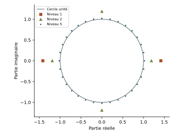
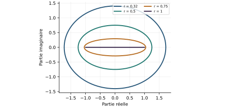

# ENS Paris-Saclay et ENS de Rennes — Cycle master, Mathématiques 1, 2017 · Corrigé brut

*Corrigé rédigé par IA, non officiel. Signalez toute erreur.*

**Rédaction** · GPT-6.2 Astra Ultra · vitesse non renseignée

**Révision** · GPT-6.2 Astra Ultra · vitesse non renseignée · 26 novembre 2026

On note $P^n$ l’itérée par composition. Les trois parties étudient les applications propres du disque, des exemples dynamiques et la topologie du bassin de l’infini.

## I. Applications holomorphes propres du disque

### Question 1.a

Puisque $f(0)=0$, sa série commence par $f'(0)z$. Diviser par $z$ donne une série entière au voisinage de zéro, de valeur $f'(0)$ en zéro. Elle prolonge le quotient, déjà holomorphe ailleurs dans le disque.

### Question 1.b

Sur $|z|=r$, $|g(z)|=|f(z)|/r\le1/r$. La fonction prolongée est holomorphe sur un voisinage du disque fermé de rayon $r$ ; le principe du maximum donne la borne sur tout ce disque.

### Question 1.c

Pour tout $z$ du disque, prendre $|z|<r<1$ puis faire tendre $r$ vers un dans 1.b. Ainsi $|g(z)|\le1$, donc $|f(z)|\le|z|$ en multipliant par $|z|$.

### Question 1.d

Alors $|g(z_0)|=1$ est un maximum intérieur. La fonction $g$ est constante sur le disque connexe, de valeur $e^{i\theta}$ pour un réel $\theta$. Ainsi $f(z)=e^{i\theta}z$.

### Question 2.a

Pour $|a|<1$, $1-\bar az$ ne s’annule pas sur le disque fermé. Le quotient $\phi_a$ y est continu et holomorphe au voisinage. L’identité $|1-\bar az|^2-|z-a|^2=(1-|a|^2)(1-|z|^2)$ donne le module un sur le cercle, et un module strictement inférieur à un à l’intérieur.

### Question 2.b

De $w=(z-a)/(1-\bar az)$ on tire $z=(w+a)/(1+\bar aw)=\phi_{-a}(w)$. Par 2.a les deux fonctions préservent le disque, et ces formules sont inverses. Pour $a=0$ c’est l’identité.

### Question 3

Si $|f(x_n)|\le r<1$, la suite entière appartient au compact $f^{-1}(\overline D(0,r))$ du disque ouvert. Toute limite dans le plan appartient donc au disque ouvert. Si $|f(z)|$ ne tendait pas vers un lorsque $|z|\to1$, il existerait $r<1$ et des $z_n$ s’approchant du bord avec $|f(z_n)|\le r$, impossible dans ce compact.

### Question 4

Si $f(x_n)\to y$ dans le disque, l’ensemble des $f(x_n)$ et de $y$ est compact à l’intérieur. Son image réciproque est compacte, donc une sous-suite de $x_n$ converge vers $x$ dans le disque et $f(x)=y$. L’image est fermée relativement au disque. L’application ne peut être constante car la fibre de sa valeur serait le disque entier, non compact. L’application ouverte donne une image ouverte et non vide, donc tout le disque par connexité.

### Question 5

La fibre de zéro est non vide par surjectivité et compacte par propreté. Les zéros d’une holomorphe non identiquement nulle sont isolés ; une infinité de zéros dans cette fibre compacte donnerait un point d’accumulation intérieur. Ils sont donc en nombre fini et chaque série de Taylor définit un ordre fini $n_j\ge1$, avec $f(z)=(z-z_j)^{n_j}h_j(z)$, $h_j(z_j)\ne0$. Leur somme donne le degré de la fibre.

### Question 6.a

Soit $B(z)=\prod_j\phi_{z_j}(z)^{n_j}$. Les zéros de $B$ et de $f$ ont même ordre ; $g=f/B$ se prolonge holomorphiquement à chacun par simplification locale. Le module de $B$ tend uniformément vers un au bord par continuité sur le disque fermé, et celui de $f$ par 3. Donc $|g|\to1$ au bord. Le principe du maximum sur des disques de rayon tendant vers un donne $|g|\le1$.

### Question 6.b

Le quotient prolongé a une valeur non nulle en chaque $z_j$ car les ordres sont exacts, et ailleurs ni $f$ ni $B$ ne s’annulent. Alors $1/g$ est holomorphe et son module tend aussi vers un au bord. Le même principe du maximum donne $|1/g|\le1$, soit $|g|\ge1$.

### Question 6.c

De $|g|=1$ dans tout le disque, le principe du maximum donne $g=e^{i\theta}$. Ainsi $f(z)=e^{i\theta}\prod_j[(z-z_j)/(1-\bar z_jz)]^{n_j}$, produit de Blaschke fini.

## II. Puissances et polynômes de Tchebychev

### Question 7

Pour $P_0(z)=z^d$, une récurrence donne $P_0^n(z)=z^{d^n}$. Le module tend vers l’infini exactement pour $|z|>1$, d’où $A_{P_0}(\infty)=\{|z|>1\}$.

### Question 8

Par définition, $K_{P_0}=\{|z|\le1\}$ et $J_{P_0}=\{|z|=1\}=S^1$.

### Question 9

Les solutions de $z^{d^n}=z$ sont zéro et les racines $(d^n-1)$-ièmes de l’unité. L’union sur $n\ge1$ donne les points périodiques, autrement dit zéro et les racines de l’unité dont l’ordre est premier à $d$ (pour un tel ordre $m$, une puissance de $d$ vaut un modulo $m$). Zéro est fixe avec dérivée nulle. Si $z\ne0$ a période $n$, $(P_0^n)'(z)=d^nz^{d^n-1}=d^n>1$, donc il est répulsif.

### Question 10

Pour $z=\rho e^{it}\ne0$, les racines de niveau $n$ sont les $d^n$ points de rayon $\rho^{1/d^n}$ et d’angles $(t+2\pi k)/d^n$, $0\le k<d^n$. Le rayon tend vers un et l’espacement des angles vers zéro, donc tout point de $S^1$ appartient à l’adhérence de leur union. L’égalité avec cette adhérence a lieu exactement pour $\rho=1$ : sinon les préimages du premier niveau sont déjà hors du cercle.

### Question 11.a

La préimage de $S^1$ étant $S^1$, aucune composante ouverte de son complémentaire ne peut traverser le cercle sous $P$. Sur le disque, $|P|<1$ par maximum et non-constance puisque $|P|=1$ au bord. L’extérieur est connexe et contient des points envoyés aussi loin que voulu ; il est donc envoyé à l’extérieur. La surjectivité globale de $P$ et la séparation des trois ensembles (intérieur, cercle, extérieur) donnent les égalités pour images et préimages.

### Question 11.b

La restriction de $P$ au disque est propre : la préimage d’un compact intérieur est compacte dans le plan car $|P(z)|\to\infty$ à l’infini, et contenue dans le disque par 11.a. La formule 6.c s’applique. Un zéro non nul $a$ donnerait un pôle rationnel en $1/\bar a$ à l’extérieur, impossible pour un polynôme ; aucun numérateur du produit ne l’annule puisque tous ses zéros sont intérieurs. L’identité rationnelle suit en multipliant les dénominateurs. Tous les zéros sont donc zéro, et le degré et le coefficient dominant donnent $P(z)=z^d$ sur le disque.

### Question 11.c

Le polynôme $P-z^d$ s’annule dans le disque, donc partout par identité. Ainsi $P=P_0$.

### Question 12

Posons $T_0=1$, $T_1=X$, $T_{n+1}=2XT_n-T_{n-1}$. La formule d’addition, valable pour le cosinus complexe par ses exponentielles, donne par récurrence $T_n(\cos z)=\cos(nz)$. Pour $n\ge1$, son degré est $n$ et son coefficient dominant est $2^{n-1}$. L’unicité découle de l’égalité sur l’infinité des valeurs $\cos t$, $t$ réel.

### Question 13

Pour $|z|=1$, $\varphi(z)=(z+\bar z)/2\in[-1,1]$. Réciproquement si $\varphi(z)=\cos t$ pour $t$ réel, $z^2-2\cos(t)z+1=0$ dont les racines sont $e^{it},e^{-it}$. Elles sont toutes deux de module un.

### Question 14

Pour $w\notin[-1,1]$, les racines de $z^2-2wz+1$ sont distinctes, de produit un et n’ont pas module un par 13. Il en existe exactement une de module strictement inférieur à un. Cela donne la bijection de $D(0,1)\setminus\{0\}$ sur le plan fendu. Elle est holomorphe, de dérivée $(1-1/z^2)/2$ non nulle sur ce domaine ; l’inverse est holomorphe par inversion locale.

Pour lire la géométrie de la bijection, écrire $z=re^{it}$. Alors $\varphi(z)=\tfrac12(r+r^{-1})\cos t+\tfrac i2(r-r^{-1})\sin t$. Pour $0<r<1$, les deux demi-axes de cette ellipse sont $(r+r^{-1})/2$ et $(r^{-1}-r)/2$. Ce dernier tend vers zéro lorsque $r$ tend vers un.

### Question 15

Pour $z=e^{it}$, $T_d(\varphi(z))=T_d(\cos t)=\cos(dt)=\varphi(z^d)$. Les deux fonctions sont holomorphes sur $\mathbb C^*$ connexe et coïncident sur le cercle, qui a des points d’accumulation dans ce domaine. L’identité vaut partout.

### Question 16

À partir de $T_d\circ\varphi=\varphi\circ P_0$, on obtient $T_d^{n+1}\circ\varphi=T_d\circ\varphi\circ P_0^n=\varphi\circ P_0^{n+1}$ par récurrence. Ici $T_d^n$ désigne une itérée de composition.

### Question 17

Si $w\in[-1,1]$, écrire $w=\varphi(e^{it})$ donne des itérées dans le segment. Si $w$ est hors du segment, écrire $w=\varphi(z)$ avec $0<|z|<1$ ; alors $z^{d^n}\to0$ et $|\varphi(z^{d^n})|\to\infty$. Le bassin est donc $\mathbb C\setminus[-1,1]$. Son complément est $K_{T_d}=[-1,1]$, d’intérieur vide dans le plan, donc égal à $J_{T_d}$.

### Question 18.a

Sous l’invariance totale du segment, $P$ envoie son complémentaire dans lui-même. Donc $G=\varphi^{-1}\circ P\circ\varphi$ est holomorphe à valeurs dans le disque pointé. Elle est bornée près de zéro, donc s’y prolonge. Comme $\varphi(z)\sim1/(2z)$, $P(\varphi(z))\to\infty$ lorsque $z\to0$. L’inverse de $\varphi$ à valeurs dans le disque vérifie $\varphi^{-1}(w)\sim1/(2w)$ à l’infini, d’après $2wz=1+z^2$ et $z\to0$. Ainsi $G(0)=0$.

Pour justifier la limite de la branche inverse, considérons $w_j\to\infty$ et $u_j=\varphi^{-1}(w_j)$ de module inférieur à un. La relation $2w_ju_j=1+u_j^2$ donne $|u_j|\le1/|w_j|$, donc $u_j\to0$ et $2w_ju_j\to1$.

### Question 18.b

L’hypothèse « unitaire » du sujet rend ce cas impossible pour $d\ge2$. Plus généralement, si $c$ est le coefficient dominant de $P$, la question précédente donne $G(z)\sim (2^{d-1}/c)z^d$. Par ailleurs, quand $|z|\to1$, les valeurs d’adhérence de $P(\varphi(z))$ sont dans le segment. Une limite intérieure de $G(z)$ est impossible : zéro entraînerait une image infinie, et tout autre point intérieur aurait son image par $\varphi$ hors du segment. Ainsi $|G(z)|\to1$, et $G$ est propre (les préimages de compacts intérieurs sont fermées et restent loin du bord). Son seul zéro est zéro, d’ordre $d$ ; 6.c donne $G(z)=\lambda z^d$ avec $|\lambda|=1$. Nécessairement $c\lambda=2^{d-1}$. Pour $c=1$ cela contredit $|\lambda|=1$. Avec la normalisation corrigée $c=2^{d-1}$ on obtient bien $G=P_0$.

### Question 18.c

Avec la normalisation corrigée $c=2^{d-1}$, les questions 15 et 18.b donnent $P\circ\varphi=\varphi\circ P_0=T_d\circ\varphi$ sur le disque pointé. Comme son image est un ouvert, $P=T_d$ partout. Au sens littéral, aucun polynôme unitaire de degré $d\ge2$ n’a le segment pour ensemble totalement invariant. Plus généralement, $P(\varphi(z))=(\lambda z^d+\lambda^{-1}z^{-d})/2$ se prolonge sur $\mathbb C^*$ et est invariant par $z\mapsto1/z$. Comparer les coefficients donne $\lambda=\lambda^{-1}$, donc les seuls candidats sans normalisation sont $P=\pm T_d$ ; tous deux conviennent par 13 et 15.

## III. Géométrie du bassin de l’infini et de l’ensemble de Julia

### Question 19

Posons $S=\sum_{j<d}|a_j|$, $R_0=1+S$. Pour $r=|z|>R_0$, $|P(z)|\ge r^{d-1}(r-S)\ge r(r-S)$. Le facteur $r-S>1$ devient une minoration fixe de l’expansion pendant toute l’orbite, par récurrence sur les modules croissants. Ainsi $|P^n(z)|\ge r(r-S)^n\to\infty$. L’extérieur ouvert du disque fermé de rayon $R_0$ est inclus dans le bassin.

### Question 20

Une orbite qui tend vers l’infini finit par entrer dans $U_0=\{|z|>R_0\}$. Toute orbite y entrant s’échappe par 19. D’où $A_P(\infty)=\bigcup_{n\ge1}(P^n)^{-1}(U_0)$, ouvert par continuité des itérées et non vide puisqu’il contient $U_0$.

### Question 21

Une orbite est bornée si elle ne franchit jamais $R_0$, et toute orbite non bornée franchit ce rayon puis tend vers l’infini. Ainsi $K_P$ est exactement l’ensemble des orbites bornées. Fermé comme complément du bassin, contenu dans le disque fermé de rayon $R_0$, il est compact ; sa frontière $J_P$, fermée et incluse dans $K_P$, l’est aussi.

### Question 22

Le polynôme $P(z)-z$ de degré $d$ a une racine, point fixe donc dans $K_P$. Ce compact non vide est propre car $A_P(\infty)$ est non vide. Si sa frontière était vide, il serait ouvert et fermé dans le plan connexe. Enfin une boule ouverte contenue dans $J_P\subset K_P$ serait contenue dans l’intérieur de $K_P$, disjoint de $J_P$. Donc $J_P$ est non vide et d’intérieur vide.

### Question 23.a

La surjectivité donne $f(f^{-1}(A))=A$. Avec $f^{-1}(A)=A$, on obtient $f(A)=A$.

### Question 23.b

Si $f(x)\in\partial A$, l’image d’un voisinage ouvert $U$ de $x$ est un voisinage ouvert de $f(x)$, donc rencontre $A$ et son complément. Comme $f^{-1}(A)=A$, $U$ rencontre également ces deux ensembles. Ainsi $x\in\partial A$.

### Question 23.c

Pour $x\in\partial A$ et tout voisinage ouvert $V$ de $f(x)$, $f^{-1}(V)$ est un voisinage de $x$ et rencontre $A$ et son complément. L’équivalence $z\in A\Leftrightarrow f(z)\in A$ donne des points des deux ensembles dans $V$. Donc $f(x)\in\partial A$.

### Question 24

Enlever le premier terme ne change pas la fuite, donc $P^{-1}(A_P(\infty))=A_P(\infty)$ et par complément $P^{-1}(K_P)=K_P$. Comme $P$ est continu et ouvert, 23.b–c donnent $P^{-1}(J_P)=J_P$. Par différence, $K_P^\circ=K_P\setminus J_P$ est aussi invariant par préimage. La surjectivité et 23.a donnent les quatre égalités pour les images directes.

### Question 25

Une orbite bornée pour $P$ l’est pour $P^n$. Réciproquement, si les $P^{nk}(z)$ restent dans un compact $C$, toute l’orbite est contenue dans l’union finie des compacts $P^j(C)$, $0\le j<n$. Ainsi $K_{P^n}=K_P$ et leurs frontières sont égales.

### Question 26

L’extérieur $U_0$ est connexe et contenu dans une composante du bassin. Toute autre composante $\Omega$ serait bornée, et $\partial\Omega\subset K_P$ : un point du bassin a une boule connexe dans sa propre composante. Pour chaque $n$, on a donc $|P^n|\le R_0$ sur $\partial\Omega$. Par le principe du maximum sur $\Omega$ borné, $|P^n|\le R_0$ partout dans $\Omega$, en contradiction avec la fuite de chacun de ses points. Le bassin est connexe.

### Question 27

Soit $U$ une composante de $K_P^\circ$ ; elle est ouverte (les petites boules sont connexes), connexe et bornée. Si elle n’était pas simplement connexe, le critère de Jordan pour les domaines plans fournirait une courbe fermée simple polygonale $\gamma\subset U$ dont l’intérieur borné $B$ contient un point hors de $U$. Si $B\subset K_P$, alors $B$ ouvert est dans $K_P^\circ$. De plus $B$ rencontre le voisinage intérieur de $\gamma$ contenu dans $U$, donc $B\subset U$ par connexité, contradiction. Ainsi $B$ rencontre le bassin. Toute composante $V$ de l’ouvert $B\cap A_P(\infty)$ est ouverte, bornée et a sa frontière dans $K_P$ : les points-frontière sur $\gamma$ sont dans $U$, et tout point intérieur à $B$ appartenant au bassin possède une petite boule connexe dans l’intersection. Les ensembles $V$ et $A_P(\infty)\setminus V$ sont alors deux ouverts relatifs disjoints non vides du bassin (le second contient des points assez éloignés), contrairement à 26. Chaque $U$ est donc simplement connexe.
