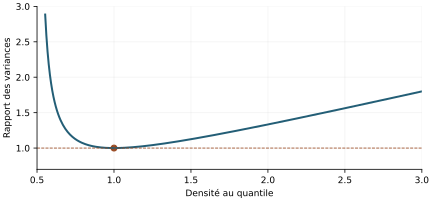
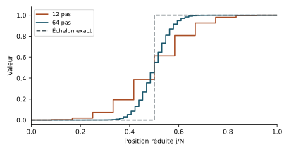

# ENS Paris-Saclay et ENS de Rennes — Cycle master, Mathématiques 2, 2017 · Corrigé brut

*Corrigé rédigé par IA, non officiel. Signalez toute erreur.*

**Rédaction** · GPT-6.2 Astra Ultra · vitesse non renseignée

**Révision** · GPT-6.2 Astra Ultra · vitesse non renseignée · 26 novembre 2026

Les candidats choisissaient entre deux options. Les réponses P portent sur l’estimation des quantiles et les réponses N sur l’équation de transport et ses schémas numériques.

## Probabilités. Quantiles empiriques

### Question P.1.1.a

On a $\{X_{(k,n)}\le x\}=\{S_n(x)\ge k\}$ et, par complément, $\{X_{(k,n)}>x\}=\{S_n(x)< k\}$. Ces identités n’exigent pas l’absence d’ex æquo.

### Question P.1.1.b

Pour $x$ fixé, $S_n(x)/n\to F(x)$ presque sûrement par la loi forte. Comme $k(n)/n\to p>0$, le quotient $S_n(x)/k(n)$ tend vers $F(x)/p$.

### Question P.1.1.c

Pour chaque entier $m\ge1$, l’unicité donne $F(\theta_p-1/m)<p<F(\theta_p+1/m)$. Presque sûrement les nombres d’observations sous ces deux seuils sont respectivement inférieur et supérieur à $k(n)=\lfloor np\rfloor+1$ pour tout $n$ assez grand, par P.1.1.b. Les statistiques d’ordre sont donc entre ces seuils. Intersecter les événements sur les $m$ donne la convergence presque sûre vers $\theta_p$.

### Question P.1.2

Soit $b=\inf\{x:F(x)=1\}$. Pour tout rationnel $q<b$, $1-F(q)>0$ ; par la loi forte il y a presque sûrement une infinité de dépassements de $q$, et le maximum croissant finit par dépasser $q$. Simultanément pour ces rationnels, sa limite est au moins $b$, y compris $b=+\infty$. Si $b$ est fini, $F(b)=1$ et toutes les observations sont $\le b$ presque sûrement. La limite vaut donc $b$. Par symétrie, ou en appliquant le même argument à $-X_i$, le minimum décroît vers $\sup\{x:F(x)=0\}$, éventuellement $-\infty$.

### Question P.1.3.a

La continuité locale de $f$ en $\theta_p$ assure $F(\theta_p+h)=p+hf(\theta_p)+o(|h|)$ par intégration de la densité. Pour $h=x/\sqrt n$, $p_n-p=xf(\theta_p)/\sqrt n+o(n^{-1/2})$.

### Question P.1.3.b

Au seuil $y_n=\theta_p+x/\sqrt n$, la condition est $S_n(y_n)\ge k$. En soustrayant $np_n$ et divisant par $\sqrt n$, elle devient $V_n\ge\sqrt n(k/n-p_n)$, avec $V_n=(S_n(y_n)-np_n)/\sqrt n$.

### Question P.1.3.c

La fonction caractéristique est $\phi_n(t)=e^{-it\sqrt n\,p_n}[1+p_n(e^{it/\sqrt n}-1)]^n$. Pour $t$ fixé, le développement du logarithme au voisinage de un donne $\log\phi_n(t)=-t^2p_n(1-p_n)/2+O(n^{-1/2})$ en choisissant le logarithme du facteur proche de un avant multiplication par $n$. Comme $p_n\to p$, le théorème de continuité de Lévy donne $V_n\Rightarrow\mathcal N(0,p(1-p))$.

### Question P.1.3.d

Pour $k=\lfloor np\rfloor+1$, ou tout $k=np+o(\sqrt n)$, $\sqrt n(k/n-p_n)\to-x f(\theta_p)$. La probabilité de P.1.3.b tend donc vers $\mathbb P(V\ge-x f(\theta_p))=\Phi(xf(\theta_p)/\sqrt{p(1-p)})$. La limite de $\sqrt n(X_{(k,n)}-\theta_p)$ est centrée normale de variance $p(1-p)/f(\theta_p)^2$.

### Question P.1.4

La continuité de $F$ donne $\mathbb P(\exists i\le n:X_i=\theta_p)=0$, donc chaque statistique d’ordre diffère de $\theta_p$ presque sûrement. L’événement de couverture est alors $i_n\le S_n(\theta_p)<j_n$, avec $S_n(\theta_p)\sim\operatorname{Bin}(n,p)$. Une fois centré de $np$ et divisé par $\sqrt{np(1-p)}$, ses bornes tendent vers $-a_\alpha,a_\alpha$ ; troncatures et arrondis sont sans effet asymptotique. Le TCL binomial donne la limite $\Phi(a_\alpha)-\Phi(-a_\alpha)=1-\alpha$.

### Question P.1.5.a

$\mathbb P(X_{(n,n)}\le x)=F(x)^n$ et $\mathbb P(X_{(1,n)}\le x)=1-(1-F(x))^n$ pour tout réel $x$.

### Question P.1.5.b

Pour $x\ge0$, $\mathbb P(nX_{(1,n)}>x)=(e^{-x/n})^n=e^{-x}$ : $\beta=1$ donne déjà exactement la loi exponentielle de paramètre un. Avec $b_n=\log n$, $\mathbb P(X_{(n,n)}-\log n\le x)=(1-e^{-x}/n)^n\to e^{-e^{-x}}$ pour $x$ fixé et $n$ assez grand. La limite de Gumbel a pour densité $e^{-x}e^{-e^{-x}}$.

## Probabilités. Algorithme récursif et extrémité de support

### Question P.2.1

Écrivons $I_{n+1}=\mathbf1_{\{X_{n+1}\le\widehat\theta_n\}}$. La récurrence donne $T_{n+1}=T_n-\gamma_n(I_{n+1}-p)$. Conditionnellement à $\mathcal F_n$, $I_{n+1}$ est une Bernoulli de paramètre $F(\widehat\theta_n)$ par indépendance. D’où $\mathbb E(T_{n+1}^2\mid\mathcal F_n)=T_n^2-2\gamma_n T_n(F(\widehat\theta_n)-p)+\gamma_n^2\mathbb E[(I_{n+1}-p)^2\mid\mathcal F_n]$.

### Question P.2.2.a

Avec $b_n=\mathbb E[(I_{n+1}-p)^2\mid\mathcal F_n]\le1$, le processus imprimé vaut $Z_n=T_n^2+\sum_{k\ge0}\gamma_k^2-\sum_{k<n}\gamma_k^2b_k\ge0$. Il est adapté et intégrable à chaque date car $|T_n|\le|T_0|+\sum_{k<n}\gamma_k$ déterministe. P.2.1 donne $\mathbb E(Z_{n+1}\mid\mathcal F_n)=Z_n-2\gamma_nT_n(F(\widehat\theta_n)-p)\le Z_n$ par monotonie de $F$.

### Question P.2.2.b

Doob donne la convergence presque sûre de $Z_n$ vers une limite finie. La somme partielle des $\gamma_k^2 b_k$ est croissante et majorée par $\sum\gamma_k^2<\infty$. Ainsi $T_n^2$ puis $|T_n|$ convergent presque sûrement.

### Question P.2.3.a

Par P.2.2.a, $2\sum_{k<n}\mathbb E[\gamma_k T_k(F(\widehat\theta_k)-p)]=\mathbb E Z_0-\mathbb E Z_n\le\mathbb E Z_0$. La série est à termes positifs ou nuls. La convergence monotone donne une espérance finie de sa somme, donc une somme finie presque sûrement.

### Question P.2.3.b

La fonction continue $h(t)=t(F(\theta_p+t)-p)$ est strictement positive pour $t\ne0$ par l’unicité. Sur $\delta<\lim|T_n|<1/\delta$, la suite est finalement dans la couronne $\delta\le |t|\le1/\delta$, où $h$ a un minimum strictement positif (si elle est vide, rien à prouver). La divergence de $\sum\gamma_n$ contredit alors P.2.3.a. L’événement est donc négligeable.

### Question P.2.3.c

Par P.2.2.b la limite de $|T_n|$ est finie presque sûrement. En appliquant P.2.3.b pour $\delta=1/m$, $m\ge2$, on exclut toutes ses valeurs strictement positives. Donc $\widehat\theta_n\to\theta_p$ presque sûrement.

### Question P.2.4.a

Pour $p=1$, $\widehat\theta_n$ croît, avec accroissement $\gamma_n\mathbf1_{\{X_{n+1}>\widehat\theta_n\}}$. Avant $U^K$, on a $\widehat\theta_n\le K$. L’accroissement arrêté vaut cet accroissement multiplié par $\mathbf1_{\{U^K>n\}}$ ; conditionnellement au passé son espérance est au moins $\gamma_n(1-F(K))\mathbf1_{\{U^K>n\}}$. Prendre l’espérance donne l’inégalité.

### Question P.2.4.b

Le processus arrêté est majoré par $K+\sup_n\gamma_n<\infty$. Si $\mathbb P(U^K=\infty)>0$ pour $0\le K<x_F$, la somme des bornes de P.2.4.a divergerait car $F(K)<1$ et $\sum\gamma_n=\infty$. Ainsi $U^K<\infty$ presque sûrement.

### Question P.2.4.c

Si $x_F=+\infty$, les $U^K$ sont presque sûrement finis simultanément pour tous les entiers $K\ge0$. La suite étant croissante, elle tend presque sûrement vers l’infini.

### Question P.2.4.d

Pour $x_F<\infty$, les franchissements de tous les niveaux rationnels $0<K<x_F$ donnent $\liminf\widehat\theta_n\ge x_F$. Une fois à $x_F$ ou au-dessus, la suite se fige presque sûrement, car $X_{n+1}\le x_F$ pour tout $n$. Donc elle converge et $x_F\le\widehat\theta_\infty\le x_F+\sup_k\gamma_k$.

La stricte positivité de la probabilité de dépassement réclamée est fausse sous les hypothèses données. Prenons la loi uniforme sur $[-1,1]$ et, dans le bloc $k\ge0$, le pas $2^{-k}$ répété $2^k$ fois. La somme des pas diverge et celle de leurs carrés vaut $\sum_{k\ge0}2^{-k}<\infty$. À l’entrée et pendant chaque bloc, les itérés appartiennent à la grille $2^{-k}\mathbb Z$, car les grilles sont emboîtées. Le point $1$ est un nœud de chaque grille. Un saut depuis un nœud strictement inférieur ne peut le dépasser, et depuis $1$ aucun saut n’est possible. Par le minorant déjà prouvé, $\widehat\theta_\infty=1=x_F$ presque sûrement.

## Probabilités. Loi limite de l’estimateur récursif

### Question P.3.1

Posons $\tau=f(\theta_p)$, $\beta_{-1}=1$ et $w_k=[(k+n_0)\beta_k]^{-1}$. L’erreur vérifie $T_{k+1}=\alpha_kT_k-(Y_{k+1}+\delta_k)/(k+n_0)$, avec $\alpha_k>0$. Diviser par $\beta_k=\alpha_k\beta_{k-1}$ et sommer donne $T_n=\beta_{n-1}(T_0-M_n-R_{n-1})$ où $M_n=\sum_{k<n}w_kY_{k+1}$ et $R_n=\sum_{k=0}^n w_k\delta_k$.

### Question P.3.2

Les accroissements $w_kY_{k+1}$ sont adaptés, conditionnellement centrés et de carré intégrable, car les poids sont déterministes et le bruit borné. D’où la martingale et $\langle M\rangle_n=\sum_{k<n}w_k^2 F(\widehat\theta_k)(1-F(\widehat\theta_k))$.

### Question P.3.3

$\log\alpha_k=-\tau/(k+n_0)+O((k+n_0)^{-2})$. Les restes sont absolument sommables et $\sum_{k=0}^n1/(k+n_0)-\log n$ a une limite finie par comparaison de sa différence avec la somme harmonique. Donc $\log\beta_n+\tau\log n$ converge vers un réel et $n^\tau\beta_n\to c>0$.

### Question P.3.4.a

Pour $r<1$, l’intégrale de $t^{-r}$ de un à $n$ vaut $(n^{1-r}-1)/(1-r)$. La comparaison somme-intégrale pour cette fonction monotone donne $\sum_{k=1}^n k^{-r}\sim n^{1-r}/(1-r)$, aussi pour $r\le0$ où l’erreur est $O(1+n^{-r})$.

### Question P.3.4.b

Les facteurs de variance tendent vers $p(1-p)>0$ par P.2.3.c. Comme $w_k\sim k^{\tau-1}/c$, les termes sont équivalents presque sûrement à $p(1-p)k^{2\tau-2}/c^2$. Puisque $2\tau-2>-1$, la somme diverge et P.3.4.a donne $\langle M\rangle_n\sim p(1-p)n^{2\tau-1}/[c^2(2\tau-1)]$.

### Question P.3.4.c

Comme $|Y_{k+1}|\le1$, la somme des moments conditionnels d’ordre $2+\delta$ est au plus $\sum_{k<n}w_k^{2+\delta}$. Choisir $\delta>0$ assez petit pour garder $(2+\delta)(\tau-1)>-1$, possible car $\tau>1/2$. P.3.4.a donne alors $O(n^{2\tau-1-\delta(1-\tau)})$.

### Question P.3.4.d

Avec $a_n=n^{2\tau-1}$, le crochet normalisé converge par P.3.4.b. La seconde condition du TCL suit de P.3.4.c car le quotient par $a_n^{1+\delta/2}$ est $O(n^{-\delta/2})$. Donc $M_n/n^{\tau-1/2}$ converge vers une normale centrée de variance $p(1-p)/[c^2(2\tau-1)]$. Multiplier par $n^\tau\beta_{n-1}\to c$ donne la loi de $\sqrt n\beta_{n-1}M_n$ avec variance $p(1-p)/(2\tau-1)$.

### Question P.3.5.a

Fixons $0<\eta<2\tau-1$. Pour $|t|\le\varepsilon$ assez petit, $2t(F(\theta_p+t)-p)\ge(2\tau-\eta)t^2$ par différentiabilité. Sur $\{U^{j,\varepsilon}>n\}$ et $n\ge j$, $|T_n|\le\varepsilon$. Cette indicatrice est mesurable au temps $n$. P.2.1 et $|I-p|\le1$ donnent la majoration $(T_n^2(1-(2\tau-\eta)/(n+n_0))+(n+n_0)^{-2})\mathbf1_{\{U^{j,\varepsilon}>n\}}$ pour l’espérance demandée.

### Question P.3.5.b

Pour $a=2\tau-\eta>1$, notons $e_n=\mathbb E[T_n^2\mathbf1_{\{U^{j,\varepsilon}>n\}}]$. L’événement décroît, donc $e_{n+1}\le(1-a/(n+n_0))e_n+(n+n_0)^{-2}$. Pour $j$ fixé, prendre $C\ge\max((j+n_0)e_j,1/(a-1))$. Si $e_n\le C/(n+n_0)$, l’inégalité donne, avec $s=n+n_0$, $e_{n+1}\le C/s-(aC-1)/s^2\le C/(s+1)$. D’où $e_n=O_j(1/n)$ ; les indices antérieurs à $j$ s’absorbent en augmentant la constante. Cette dépendance en $j$ suffit pour la localisation de la suite.

### Question P.3.5.c

Pour $j$ fixé, sur $E_j=\{U^{j,\varepsilon}=\infty\}$ l’indicatrice est dominée par celle de P.3.5.b. L’expression est donc majorée par $C_j n^{1/2-\tau}\sum_{k=1}^n k^{\tau-2}$. La somme est bornée si $\tau<1$, logarithmique si $\tau=1$, et $O(n^{\tau-1})$ si $\tau>1$. Dans chaque cas la borne tend vers zéro.

### Question P.3.5.d

Sur $E_j$, pour $k\ge j$, $|\delta_k|\le C T_k^2$ par $F\in C^2$. Les termes $k<j$ forment une somme finie presque sûrement, négligeable après multiplication par $n^{1/2-\tau}$. Par P.3.5.c et Markov, $n^{1/2-\tau}\sum_{k<n,k\ge1}k^{\tau-1}|\delta_k|\to0$ en probabilité sur $E_j$. Comme $T_n\to0$ presque sûrement, les $E_j$ croissent vers un événement de probabilité un. On fait tendre $j$ vers l’infini pour enlever la localisation. Enfin $w_k=O(k^{\tau-1})$ et $\sqrt n\beta_{n-1}=O(n^{1/2-\tau})$ ; le terme $k=0$ est négligeable. Ainsi $\sqrt n\beta_{n-1} R_{n-1}\to0$ en probabilité.

### Question P.3.6

Comme $\tau>1/2$, $\sqrt n\beta_{n-1}T_0\to0$. Le reste tend vers zéro en probabilité par P.3.5.d et le terme de martingale a pour limite une normale centrée, inchangée par le signe moins. Ainsi $\sqrt n(\widehat\theta_n-\theta_p)\Rightarrow\mathcal N(0,p(1-p)/(2f(\theta_p)-1))$.

En comparant à P.1.3.d, le rapport des variances limites vaut $\tau^2/(2\tau-1)$, pour $\tau=f(\theta_p)>1/2$. La différence à 1 est $(\tau-1)^2/(2\tau-1)$. Le choix de pas imposé aboutit à la même variance que la statistique d’ordre exactement lorsque $\tau=1$.

### Question P.3.7

L’algorithme conserve une estimation et l’indice de temps. Chaque observation nouvelle exige une comparaison et une mise à jour scalaire, en mémoire constante. Une statistique d’ordre exacte nécessite habituellement d’entretenir les observations ou une structure ordonnée dont la taille croît ; l’algorithme récursif se prête donc au traitement en flux.

## Analyse numérique. Transport et unicité

### Question N.1.1

Avec $u(t,x)=u_0(x-Vt)$, $u_t=-Vu_0'(x-Vt)$ et $u_x=u_0'(x-Vt)$, donc $u_t+Vu_x=0$ avec $u(0,x)=u_0(x)$. Si $u_0$ est nulle hors de $[a,b]$, $u(t,\cdot)$ est nulle hors de $[a+Vt,b+Vt]$. La régularité par composition donne $u\in C_c^1$.

### Question N.1.2

Pour $k\le p$, $\partial_t^ku=(-V)^ku_0^{(k)}(x-Vt)$ et $\partial_x^ku=u_0^{(k)}(x-Vt)$. Les dérivées de la donnée, continues à support compact, sont bornées. Les dérivées mixtes s’obtiennent de même ; ainsi $u$ est bornée et appartient à $C_c^p$.

### Question N.1.3

$(u^2)_t+V(u^2)_x=2u(u_t+Vu_x)=0$. Le support mobile et la régularité sont conservés, donc $u^2$ satisfait l’équation.

### Question N.1.4

$w=(u_1-u_2)^2$ satisfait l’équation par linéarité puis N.1.3. Pour $\varepsilon\le t\le T$, son support reste dans un compact fixe et les dérivées y sont continues. Ainsi $\frac d{dt}\int w(t,x)dx=-V\int w_x(t,x)dx=0$. L’égalité des intégrales aux temps $\varepsilon,T$ s’ensuit. Pour $\varepsilon\downarrow0$, continuité et domination sur le compact fixe donnent l’égalité à zéro.

### Question N.1.5

Si les deux solutions coïncident initialement, N.1.4 donne $\int(u_1-u_2)^2(T,x)dx=0$. Par continuité elles coïncident partout à chaque temps $T$. La solution explicite de N.1.1 est donc l’unique solution dans la classe.

## Analyse numérique. Schéma décentré à gauche

### Question N.2.1.1.a

Choisir $M_0$ entier tel que $M_0\Delta x>\max(|a|,|b|)$. Alors pour $|j|\ge M_0$, $u_j^0=u_0(j\Delta x)=0$.

### Question N.2.1.1.b

Au rang $n+1$, seuls les indices $j,j-1$ du rang $n$ interviennent. Si $|j|\ge M_0+n+1$, les deux ont module au moins $M_0+n$. L’hypothèse de récurrence les annule, ce qui prouve l’assertion avec N.2.1.1.a comme base.

### Question N.2.1.1.c

À temps fixé, seuls les indices $|j|<M_0+n$ peuvent contribuer ; la somme sur $\mathbb Z$ est en fait finie.

### Question N.2.1.2

Posons $\mu=\lambda V=V\Delta t/\Delta x$. Alors $\sum_j u_j^{n+1}=(1-\mu)\sum_j u_j^n+\mu\sum_j u_{j-1}^n=\sum_j u_j^n$ par réindexation d’une somme à support fini.

### Question N.2.1.3.a

Au point $(t_n,x_j)$, $u(t_{n+1},x_j)=u+\Delta t\,u_t+\frac12\Delta t^2u_{tt}(s,x_j)$ pour $s\in[t_n,t_{n+1}]$ ; $u(t_n,x_{j-1})=u-\Delta x\,u_x+\frac12\Delta x^2u_{xx}(t_n,y)$ pour $y\in[x_{j-1},x_j]$. En remplaçant, le premier ordre $\Delta t(u_t+Vu_x)$ s’annule. Reste $\epsilon_j^n=\frac12\Delta t^2u_{tt}(s,x_j)-\frac V2\Delta t\Delta x u_{xx}(t_n,y)$.

### Question N.2.1.3.b

On peut prendre $C_\infty=(\lambda\|u_{tt}\|_\infty+V\|u_{xx}\|_\infty)/2$. Les bornes de N.1.2 donnent alors $\sup_{n,j}|\epsilon_j^n|\le C_\infty\Delta x\Delta t$.

### Question N.2.1.4.a

$\|Q_\mu\|\le|1-\mu|+|\mu|$. Pour une sortie au site zéro, choisir $w_0,w_{-1}$ égaux aux signes des coefficients correspondants et de modules au plus un. L’égalité est atteinte. Cette somme vaut un exactement pour $0\le\mu\le1$. L’opérateur reste continu pour tout $\mu$ réel.

### Question N.2.1.4.b

La récurrence est exactement $u_j^{n+1}=(1-\mu)u_j^n+\mu u_{j-1}^n$, autrement dit $u^{n+1}=Q_\mu u^n$ avec $\mu=\lambda V$.

### Question N.2.1.5.a

Pour $U_{\rm ex}^n=(u(t_n,x_j))_j$, la définition donne $U_{\rm ex}^{n+1}=Q_\mu U_{\rm ex}^n+\epsilon^n$. En soustrayant le schéma de N.2.1.4.b on obtient $e^{n+1}=Q_\mu e^n+\epsilon^n$ pour $n\ge0$.

### Question N.2.1.5.b

L’initialisation ponctuelle donne $e^0=0$. Par récurrence, $e^n=\sum_{k=0}^{n-1}Q_\mu^k\epsilon^{n-1-k}$. La formule imprimée contient $\epsilon^{n-k}$ ; le bon exposant est $n-1-k$, puisque $e^1=\epsilon^0$.

### Question N.2.1.6.a

Pour $0\le\mu\le1$, $\|Q_\mu^k\|\le1$. Alors $\|e^n\|_\infty\le n C_\infty\Delta x\Delta t\le C_\infty T\Delta x$ uniformément jusqu’à $n=N$.

### Question N.2.1.6.b

On a $\Delta x\sum_j|e_j^n|^p\le\|e^n\|_\infty^{p-1}\Delta x\sum_j|e_j^n|\le C_\infty^{p-1} C_1(T\Delta x)^p$. Prendre la racine $p$-ième et le maximum donne $C_p=C_\infty^{1-1/p}C_1^{1/p}$.

### Question N.2.2.1

Soit $Lw=(w_{j-1})_j$. Comme $I$ et $L$ commutent, $Q_\mu^n=((1-\mu)I+\mu L)^n=\sum_{k=0}^n\binom nk(1-\mu)^{n-k}\mu^k L^k$. Le binôme résulte de la récurrence de Pascal même pour des données non bornées, chaque somme étant finie. Évaluer au site $j$ donne (6).

### Question N.2.2.2.a

Pour $j<0$, tous les $j-k$ sont négatifs, donc $u_j^n=0$. Pour $j\ge n$, tous sont positifs ou nuls, donc $u_j^n$ est la somme des poids binomiaux, soit un (cela inclut $j=n$).

### Question N.2.2.2.b

Si $B_n=\sum_{i=1}^nX_i$ avec $X_i$ Bernoulli$(\mu)$ indépendantes, alors les coefficients de (6) sont $\mathbb P(B_n=k)$. Comme $u_{j-k}^0=\mathbf1_{\{k\le j\}}$, $u_j^n=\mathbb P(B_n\le j)$.

### Question N.2.2.2.c

$j(N)\Delta x\le x<(j(N)+1)\Delta x$, donc $0\le x-x_{j(N)}<\Delta x=T/(N\lambda)\to0$.

### Question N.2.2.2.d

À $t=T$, $u_{\Delta x}(T,x)=\mathbb P(B_N/N\le j(N)/N)$. Comme $N\Delta x=T/\lambda$, le seuil tend vers $\lambda x/T$. La loi des grands nombres donne $B_N/N\to\mu=\lambda V$ en probabilité. Si $x<VT$ la probabilité tend vers zéro ; si $x>VT$ elle tend vers un. L’énoncé ne requiert pas de valeur au saut.

Au point du saut $x=VT$, le seuil vaut $j(N)=\lfloor N\mu\rfloor$. Si $0<\mu<1$, le seuil centré réduit tend vers zéro et le TCL binomial donne la limite $1/2$. Si $\mu=1$, le décalage est exact et la valeur au saut est $1$ pour la convention du sujet.

## Analyse numérique. Obstruction de Godunov et données peu régulières

### Question N.3.1.1

Les $a_\ell\ge0$ sont de somme un, donc $|u_j^{n+1}|\le\sum_\ell a_\ell|u_{j+\ell}^n|\le\|u^n\|_\infty$. La récurrence donne (9).

### Question N.3.1.2

Notons $m_s=\sum_{\ell=-p}^k\ell^s a_\ell$, $m_0=1$. Au point $(t_n,x_j)$, Taylor donne $\epsilon_j^n=(1-m_0)u+\Delta t u_t-m_1\Delta x\,u_x+\tfrac12(\Delta t^2u_{tt}-m_2\Delta x^2u_{xx})+O(\Delta t^3+\Delta x^3)$. La fenêtre est finie ; l’estimation du reste est locale, uniforme sur les régions où les dérivées d’ordre trois sont bornées.

### Question N.3.1.3

De $u_t=-Vu_x$, on tire $u_{tt}=-V\partial_x u_t=V^2u_{xx}$ par commutation des dérivées.

### Question N.3.1.4

Avec $\Delta t=\lambda\Delta x$, le terme d’ordre un vaut $(-\lambda V-m_1)\Delta x\,u_x$ et celui d’ordre deux vaut $((\lambda V)^2-m_2)\Delta x^2 u_{xx}/2$. Ils s’annulent sous (10), ainsi que le terme constant. D’où le reste de troisième ordre annoncé.

### Question N.3.1.5

Pour $v_\ell=\sqrt{a_\ell}$ et $w_\ell=\ell\sqrt{a_\ell}$, Cauchy–Schwarz donne $m_1^2\le m_0m_2$. L’égalité équivaut à la colinéarité de $v$ et $w$ puisque $\|v\|^2=1$.

### Question N.3.1.6

Les conditions de moments imposent l’égalité dans N.3.1.5. Ainsi $\ell\sqrt{a_\ell}=c\sqrt{a_\ell}$ pour tout $\ell$. Chaque poids strictement positif a donc le même indice $c$, incompatible avec deux poids non nuls distincts. Le seul cas dégénéré possible est un décalage exact d’indice $-\lambda V$ si cet indice est entier dans la fenêtre.

### Question N.3.2.1.a

Écrivons $w_\varepsilon(x)=\int_0^1\varphi(s)w(x-\varepsilon s)ds$. Cela donne $\|w_\varepsilon\|_\infty\le\|w\|_\infty$. Par le théorème fondamental et Fubini, $\|w(\cdot-h)-w\|_1\le |h|\|w'\|_1$. Intégrer ce majorant contre $\varphi(s)$ donne $\|w_\varepsilon-w\|_1\le\varepsilon\|w'\|_1$.

### Question N.3.2.1.b

La convolution par $\varphi_\varepsilon(x)=\varepsilon^{-1}\varphi(x/\varepsilon)$ est $C^\infty$, en dérivant le noyau lisse à support compact. Par intégration par parties à la première dérivée, $w_\varepsilon^{(r)}=\varphi_\varepsilon^{(r-1)}*w'$. L’inégalité de convolution $L^1$ donne $\|w_\varepsilon^{(r)}\|_1\le\varepsilon^{1-r}\|\varphi^{(r-1)}\|_1\|w'\|_1$.

### Question N.3.2.2.a

La donnée $u_{0,\varepsilon}$ est lisse et intégrable. Le schéma $v$ a l’initialisation ponctuelle exigée. La propriété d’ordre donne l’erreur discrète au plus $C_p T\Delta x^p\|u_{0,\varepsilon}^{(p+1)}\|_1\le B_1 T(\Delta x/\varepsilon)^p\|u_0'\|_1$ par N.3.2.1.b.

### Question N.3.2.2.b

Écrivons $h=\Delta x$, $I_j=[x_j-h/2,x_j+h/2]$, $w=u_{0,\varepsilon}$. L’écart entre $w(x_j)$ et sa moyenne sur $I_j$ est au plus $\int_{I_j}|w'|$. En multipliant par $h$ et en sommant, on obtient $h\|w'\|_1\le h\|u_0'\|_1$. L’écart entre les deux moyennes, sommé avec poids $h$, est au plus $\|w-u_0\|_1\le\varepsilon\|u_0'\|_1$. Cela prouve la borne avec $\widetilde B_2=1$.

### Question N.3.2.2.c

La linéarité donne $v^N-u^N=S^N(v^0-u^0)$. Les suites initiales sont dans $\ell^1$ par intégrabilité des moyennes et N.3.2.2.b. L’hypothèse de stabilité donne donc $\Delta x\|v^N-u^N\|_1\le A(\varepsilon+\Delta x)\|u_0'\|_1$.

### Question N.3.2.2.d

La partie dépendant de $\varepsilon$ est $\varepsilon+T\Delta x^p/\varepsilon^p$. Elle est minimale pour $\varepsilon=(pT\Delta x^p)^{1/(p+1)}$. En substituant, l’erreur discrète de moyenne de cellule est au plus $B_p\|u_0'\|_1[\Delta x^{p/(p+1)}T^{1/(p+1)}+\Delta x]$, où $B_p=B\max(1,p^{1/(p+1)}+p^{-p/(p+1)})$.
