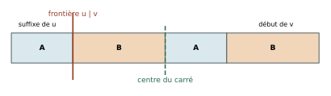
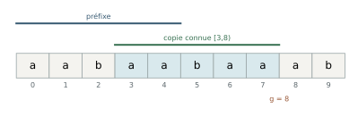

# ENS MP · Informatique-mathématiques 2017 · Corrigé brut

*Corrigé rédigé par IA, non officiel. Signalez toute erreur.*

**Rédaction** · GPT-6.2 Astra Ultra · vitesse non renseignée · 25 novembre 2026

**Révision** · GPT-6.2 Astra Ultra · vitesse non renseignée · 26 novembre 2026

Un carré est la juxtaposition de deux copies d’un même mot non vide. Les indices des lettres commencent à 0. La notation $m[a:b]$ représente les lettres d’indices $a$ à $b-1$. Les fonctions Caml s’appuient sur les primitives de tableaux données par le sujet.

## I · Existence d’un carré

### Question 1 · Exécuter le premier programme

Les quatre résultats sont **3, 2, 2 et 1**. Dans `coucou` les trois paires coïncident. Dans `coucoo`, la troisième paire oppose u à o. Dans `abababab`, aux indices 4 et 6 commencent deux copies complètes de `ab`. En partant de 5, les deux b aux indices 5 et 7 coïncident, puis l’indice 8 est hors du tableau.

### Question 2 · Spécifier le résultat

La fonction renvoie le plus grand $j\in\{0,\ldots,p\}$ tel que, pour tout $0\le k<j$, l’indice $i+p+k$ soit strictement inférieur à $|m|$ et que $m_{i+k}=m_{i+p+k}$. La quantification vide admet $j=0$ même si $i$ est hors du mot. Le résultat vaut $p$ exactement quand les deux blocs $m[i:i+p]$ et $m[i+p:i+2p]$ existent et sont égaux, donc quand un carré de période $p$ commence en $i$.

### Question 3 · Chercher une période donnée

Un carré de période $p$ occupe $2p$ lettres. On essaie chaque début possible de 0 à $n-2p$. D’après la question 2, le premier appel renvoyant $p$ fournit un carré. Si $n<2p$, la boucle est vide.

```ocaml
let carre_pe m p =
  let dernier = vect_length m - 2*p and i = ref 0 in
  while !i <= dernier && carre_pe_pos m p !i <> p do
    incr i
  done;
  !i <= dernier;;
```

### Question 4 · Essayer toutes les périodes

Il suffit de chercher $p=1,\ldots,\lfloor n/2\rfloor$ et de s’arrêter au premier succès. Si $n<2$, il n’y a aucune période à essayer et la réponse est fausse.

```ocaml
let carre_naif m =
  let p = ref 1 and n = vect_length m in
  while !p <= n/2 && not (carre_pe m !p) do incr p done;
  !p <= n/2;;
```

### Question 5 · Pire cas de la recherche naïve

Pour la période $p$, on essaie au plus $n-2p+1$ positions, avec au plus $p$ comparaisons de lettres par position. En sommant sur les périodes admissibles, le nombre de comparaisons est donc majoré par
$$
\sum_{p=1}^{\lfloor n/2\rfloor}p(n-2p+1)=O(n^3).
$$
Les contrôles de boucle ajoutent au plus $O(n^2)$ opérations. La complexité dans le pire cas est donc en $O(n^3)$, la borne demandée par le jury. Sur un mot sans carré, tous les débuts et toutes les périodes sont essayés, mais une comparaison de blocs peut finir au premier désaccord. Si la variante compare systématiquement les $p$ lettres de chaque bloc, la somme ci-dessus est atteinte sur ce mot et son pire cas est $\Theta(n^3)$.

### Question 6 · Cas de l’alphabet binaire

Un mot binaire de longueur 4 contient soit deux lettres consécutives égales (carré de période 1), soit exactement l’alternance `abab` ou `baba` (carré de période 2). Pour $n\ge4$, renvoyer vrai sans lire le reste. Pour $n<4$, seules des paires de lettres consécutives égales peuvent former un carré. Il suffit de comparer au plus deux paires. Le temps est $O(1)$ avec la longueur de tableau disponible en temps constant.

## II · Construction infinie sur quatre lettres

### Question 7 · Premiers bits du mot M

Pour $n=0,\ldots,7$, les profondeurs $p(n)$ sont $0,1,0,2,0,1,0,3$. Les valeurs $c(n)$ donnent le début **00100110**. Les deux premiers 0 sont un carré de période 1, et les six premières lettres sont $(001)(001)$, un carré de période 3.

### Question 8 · Profondeur d’un entier dans un intervalle

Tout intervalle de $2^k$ entiers consécutifs contient une fois chaque résidu modulo $2^k$. Le résidu $2^{k-1}-1$ a pour $k$ bits de poids faible un zéro en position $k-1$ puis $k-1$ uns en dessous. C’est donc le premier zéro en partant de la droite, même pour $k=1$. Ainsi $p(i(d,k))=k-1$.

### Question 9 · Effet d’une translation de longueur puissance de deux

Écrivons $i=i(d,k)$. Ajouter $2^k$ laisse fixes les bits d’indices $0,\ldots,k-1$ et change le bit $k$ en son complément, qu’il y ait ou non une retenue vers la gauche. La profondeur reste $k-1$. Comme $c(i)$ est le bit $k$, on obtient $c(i+2^k)=1-c(i)$, soit $c(i)+1\pmod2$.

### Question 10 · Exclure les périodes puissances de deux

Soit $p=2^k$, $k\ge1$. Un carré commençant en $d$ imposerait $c(j)=c(j+p)$ pour chaque $d\le j<d+p$. Le point $j=i(d,k)$ est dans cet intervalle, mais 9 impose les deux valeurs complémentaires. La contradiction exclut ce carré.

### Question 11 · Exclure toutes les périodes paires

Pour $p$ pair, écrire $p=2^k(2r+1)$ avec $k\ge1$. Dans la première moitié du carré supposé commençant en $d$, choisir $i=i(d,k)$, ce qui est possible car $2^k\le p$. En ajoutant $p$, les $k$ bits de poids faible sont conservés. Le quotient par $2^k$ augmente d’un entier impair, donc sa parité, le bit $k$, est inversée. La profondeur reste $k-1$ et $c(i+p)\ne c(i)$. L’égalité des deux moitiés est impossible.

### Question 12 · Un mot infini sans aucun carré

Prendre l’alphabet $\{0,1\}\times\{0,1\}$ et le mot $W_n=(c(n),n\bmod2)$. Un carré de période impaire est impossible car deux lettres séparées de cette période ont des secondes coordonnées opposées. Un carré de période paire projetterait sur la première coordonnée un carré pair de $M$, exclu par 11. Le mot $W$ est donc sans carré.

## III · Carrés qui traversent une coupe

### Question 13 · Tables des suffixes et préfixes communs

Les comparaisons portent sur $u=\mathtt{cabacbab}$ et $v=\mathtt{cbacbabcbab}$. Le résultat est

| $i$ | 0 | 1 | 2 | 3 | 4 | 5 | 6 | 7 | 8 | 9 | 10 |
|---|---:|---:|---:|---:|---:|---:|---:|---:|---:|---:|---:|
| $v_i$ | c | b | a | c | b | a | b | c | b | a | b |
| $\mathrm{lms}(u,v,i)$ | 0 | 1 | 0 | 0 | 1 | 0 | 6 | 0 | 1 | 0 | 4 |
| $\mathrm{lmp}(v,v,i)$ | 11 | 0 | 0 | 3 | 0 | 0 | 0 | 3 | 0 | 0 | 0 |

Par exemple, en position 6 finit le suffixe `bacbab` de $u$. En position 3 de $v$ commence le préfixe `cba` de $v$, mais la quatrième lettre ne coïncide pas.

### Question 14 · Découper le carré centré à droite

Soit $A$ le suffixe pris dans $u$, $B=v_0\cdots v_{i-p}$. Le carré est $A\mid B A B$, la barre étant la frontière entre les mots. Le dernier $B$ commence en position $p$ de $v$, donc $j=p-1$. Les deux blocs $u_{|u|-2p+i+1}\cdots u_{|u|-1}$ et $v_{i-p+1}\cdots v_j$ sont identiques, de longueur $2p-i-1$. Les deux blocs $B$ sont de longueur $i-p+1$.



### Question 15 · Critère d’un carré centré à droite

Pour un indice de fin $0\le i<|v|$, posons $x=2p-i-1$ et $y=i-p+1$. On a $x+y=p$. Le carré traverse la frontière et son centre est strictement dans $v$ exactement lorsque $x,y>0$, ce qui impose $p\le i<2p-1$ et $1\le p<|v|$. Les deux copies de $A$ coïncident si et seulement si $x\le\mathrm{lms}(u,v,p-1)$. Les deux copies de $B$ coïncident si et seulement si $y\le\mathrm{lmp}(v,v,p)$. On retrouve les deux bornes

$$
2p-\mathrm{lms}(u,v,p-1)-1\le i\le p+\mathrm{lmp}(v,v,p)-1 .
$$

Inversement, sous ces conditions, prendre le suffixe de $u$ de longueur $x$ et le préfixe de $v$ de longueur $y$. Les deux comparaisons assurent la présence exacte de $A\mid BAB$, donc d’un carré à la position voulue.

### Question 16 · Critère symétrique à gauche

Le schéma original est $A B A\mid B$, avec non seulement $A$ mais aussi $B$ non vide. Notons $s$ l’indice de début du carré dans $u$ et $i'=|u|-1-s$. Dans le mot miroir $v^Ru^R$ on obtient $B^R\mid A^RB^RA^R$, carré centré dans le facteur droit $u^R$ et se terminant en $i'$. Le critère est donc

$$
\begin{gathered}
1\le p<|u|,\qquad p\le i'<2p-1,\\
2p-\mathrm{lms}(v^R,u^R,p-1)-1\le i'
 \le p+\mathrm{lmp}(u^R,u^R,p)-1 .
\end{gathered}
$$

Ici $0\le i'<|u|$. Cette écriture fournit aussi une implémentation en renvoyant le résultat du test droit sur la paire renversée.

### Question 17 · Les carrés de période sept de l’exemple

On lit $\mathrm{lms}(u,v,6)=6$ et $\mathrm{lmp}(v,v,7)=3$. Les bornes donnent $7\le i\le9$ après intersection. En coordonnées depuis le début de $uv$, le début est $|u|+i-2p+1=i-5$. Cela donne les trois carrés suivants.

| Fin dans $v$ | Début dans $uv$ | Racine du carré, répétée deux fois |
|---:|---:|---|
| 7 | 2 | `bacbabc` |
| 8 | 3 | `acbabcb` |
| 9 | 4 | `cbabcba` |

### Question 18 · Détecter un carré centré dans v en temps linéaire

Calculer les deux tables une seule fois. La plus petite fin possible est le maximum des bornes inférieures, et la plus grande fin possible le minimum des bornes supérieures, y compris $|v|-1$. Le test ci-dessous applique 15 à chacune des $|v|-1$ périodes possibles, en temps constant par période. Avec les tables, le temps total est $O(|u|+|v|+1)$.

```ocaml
let nouveau_carre_v u v =
  let n = vect_length v in
  let s = calcul_lms u v and a = calcul_lmp v v in
  let p = ref 1 and trouve = ref false in
  while !p < n && not !trouve do
    let bas = max !p (2 * !p - s.(!p - 1) - 1) in
    let haut = min (n-1) (min (2 * !p - 2) (!p + a.(!p) - 1)) in
    trouve := bas <= haut;
    incr p
  done;
  !trouve;;
```

### Question 19 · Inclure les carrés centrés sur la frontière

Tester les deux centres stricts. Pour le troisième cas, une période $1\le p\le\min(|u|,|v|)$ convient si et seulement si $\mathrm{lms}(u,v,p-1)=p$. La valeur ne peut dépasser $p$ car il n’y a que $p$ lettres disponibles dans $v$ jusqu’à cet indice. Les deux tests stricts et la dernière table donnent encore $O(1+|u|+|v|)$. La fonction gauche peut, conformément à 16, s’écrire `nouveau_carre_v (miroir v) (miroir u)`.

```ocaml
let nouveau_carre u v =
  if nouveau_carre_u u v || nouveau_carre_v u v then true
  else
    let l = calcul_lms u v in
    let p = ref 1 and fin = min (vect_length u) (vect_length v) in
    while !p <= fin && l.(!p-1) <> !p do incr p done;
    !p <= fin;;
```

### Question 20 · Diviser le mot pour détecter un carré

Les trois tests ci-dessous sont exhaustifs par cette partition des occurrences. Un mot de longueur 0 ou 1 ne contient pas de carré. Les facteurs ont longueur strictement plus petite pour $n\ge2$, donc la récursion termine. Copies et test de traversée coûtent $O(n)$ par nœud de taille $n$. À chaque profondeur les longueurs cumulées sont au plus $n$, et il y a $O(1+\log n)$ profondeurs. Le temps est $O(n\log n)$ pour $n\ge2$.

```ocaml
let rec carre m =
  let n = vect_length m in
  if n < 2 then false
  else
    let k = n/2 in
    let u = sub_vect m 0 k and v = sub_vect m k (n-k) in
    carre u || carre v || nouveau_carre u v;;
```

## IV · Tables des préfixes et des suffixes

### Question 21 · Compléter la table de préfixes

Pour $v=\mathtt{aabaabaaab}$, voici $g$ et tous les choix de $f$ avant le traitement de chaque indice $i$.

| $i$ | 0 | 1 | 2 | 3 | 4 | 5 | 6 | 7 | 8 | 9 |
|---|---:|---:|---:|---:|---:|---:|---:|---:|---:|---:|
| $\mathrm{pref}_i$ | 10 | 1 | 0 | 5 | 1 | 0 | 2 | 3 | 1 | 0 |
| $g$ | — | — | 2 | 2 | 8 | 8 | 8 | 8 | 10 | 10 |
| $f$ | — | — | 1 | 1, 2 | 3 | 3 | 3 | 3, 6 | 7 | 7 |

Par exemple, avant $i=7$, les intervalles commençant en 3 et en 6 finissent tous deux à la frontière exclusive 8. L’indice 0 ne participe pas à la définition du maximum.

### Question 22 · Sens de la fenêtre connue

**a)** $g=f+\mathrm{pref}_f$. Le facteur $v[f:g]$ est donc exactement le préfixe $v[0:g-f]$. Si $g<|v|$, il existe un désaccord $v_g\ne v_{g-f}$, sinon on pourrait prolonger cet accord.

**b)** L’indice $i-1$ participe au maximum et $\mathrm{pref}_{i-1}\ge0$. Ainsi $g\ge i-1$. Dans le cas $g<i$ il faut $g=i-1$.

### Question 23 · Les trois cas de réutilisation d’un préfixe

Posons $k=\mathrm{pref}_{i-f}$ et $h=g-i>0$. Sur les $h$ premières positions, $v[i:g]=v[i-f:g-f]$ par 22.

- Si $k<h$, les $k$ premières comparaisons réussissent et le désaccord suivant est encore à l’intérieur de la fenêtre. Il se reproduit à l’indice $i+k$. Ainsi $\mathrm{pref}_i=k$.
- Si $k>h$, il y a accord sur $h$ lettres. La relation en position miroir dit alors $v_h=v_{i-f+h}=v_{g-f}$. Si $g<|v|$, la maximalité de la fenêtre donne $v_g\ne v_{g-f}$ et bloque l’extension à $h$. Si $g=|v|$, le mot est déjà épuisé. Ainsi $\mathrm{pref}_i=h$.
- Si $k=h$, l’accord de longueur $h$ est acquis, et le désaccord vu depuis $i-f$ ne décide pas si $v_g=v_h$. Comparer directement $v[g:]$ et $v[h:]$. Leur plus longue longueur commune $\ell$ donne $\mathrm{pref}_i=h+\ell$, y compris $\ell=0$ au bord droit.



### Question 24 · Correction, terminaison et coût de la figure 1

**a)** Pour $n\ge1$, la case 0 reçoit $n$. Le premier tour $i=1$ part avec $g=0$, fixe $f=1$ et compare directement. Pour les tours suivants, supposer la table correcte aux indices déjà traités et $[f,g)$ fenêtre de borne droite maximale. Les deux branches de recopie sont exactement les cas stricts de 23. Le nouveau bord $i+\mathrm{pref}_i$ y est au plus $g$, donc l’ancienne fenêtre demeure valable. Dans l’autre branche, si $i<g$, il reste le cas d’égalité et $g-i$ lettres sont déjà acquises. Si $i\ge g$, aucune lettre n’est acquise. Les lignes 14–15 placent $f=i$ et commencent les comparaisons à $\max(g,i)$. La boucle avance tant que la prochaine lettre prolonge l’accord. Son arrêt donne la longueur exacte $g-f$ et une fenêtre maximale, préservant l’invariant. Le code imprimé écrit en case 0 même si le mot est vide. Pour accepter aussi cette entrée, renvoyer immédiatement le tableau vide avant cette affectation.

**b)** La boucle extérieure a $n-1$ tours. La variable $g$ ne décroît jamais et reste au plus $n$. Chacun des succès de comparaison de la boucle intérieure lui ajoute 1, donc il y a au plus $n$ succès au total, et au plus un arrêt sans succès par tour extérieur. La terminaison suit et le coût est $O(n)$ en temps et $O(n)$ en espace pour la table.

### Question 25 · Calcul de lmp sur deux mots

Former $w=u\#v$, où le séparateur n’appartient pas à l’alphabet. À la position $|u|+1+i$, le plus long préfixe de $w$ coïncide exactement avec le plus long préfixe de $u$ qui débute en $v_i$. Il ne traverse pas le séparateur. Extraire donc les $|v|$ dernières cases de la table de $w$. Le mot intermédiaire a longueur $|u|+1+|v|$, son calcul et les copies sont linéaires. Le séparateur assure que la routine de la figure 1 est ici appelée sur un mot non vide.

```ocaml
let calcul_lmp u v =
  let n = vect_length u and m = vect_length v in
  let w = make_vect (n+1+m) '#' in
  for i = 0 to n-1 do w.(i) <- u.(i) done;
  for i = 0 to m-1 do w.(n+1+i) <- v.(i) done;
  sub_vect (calcul_pref w) (n+1) m;;
```

### Question 26 · Table des suffixes d’un mot

Pour $n=|v|$ et $v^R$ le miroir, $\mathrm{lms}(v,v,i)=\mathrm{lmp}(v^R,v^R,n-1-i)$. Renverser le mot, calculer sa table de préfixes puis lire les valeurs à indices renversés. Ce procédé coûte $O(n)$ et traite explicitement le tableau vide.

```ocaml
let miroir v =
  let n = vect_length v in
  let t = make_vect n '#' in
  for i = 0 to n-1 do t.(i) <- v.(n-1-i) done;
  t;;

let calcul_suff v =
  let n = vect_length v in
  if n = 0 then [||]
  else
    let a = calcul_pref (miroir v) in
    let t = make_vect n 0 in
    for i = 0 to n-1 do t.(i) <- a.(n-1-i) done;
    t;;
```

### Question 27 · Calcul de lms sur deux mots

Former $w=v\#u$. Pour $0\le i<|v|$, tout suffixe de $w$ finissant à l’indice $i$ dans sa copie de $v$ est de longueur au plus $|u|$, car une occurrence plus longue devrait contenir le séparateur. Ainsi $\mathrm{lms}(w,w,i)=\mathrm{lms}(u,v,i)$. Extraire les $|v|$ premières cases de la table des suffixes. La formation, le calcul et l’extraction ont un coût total $O(1+|u|+|v|)$.

```ocaml
let calcul_lms u v =
  let n = vect_length u and m = vect_length v in
  let w = make_vect (m+1+n) '#' in
  for i = 0 to m-1 do w.(i) <- v.(i) done;
  for i = 0 to n-1 do w.(m+1+i) <- u.(i) done;
  sub_vect (calcul_suff w) 0 m;;
```
