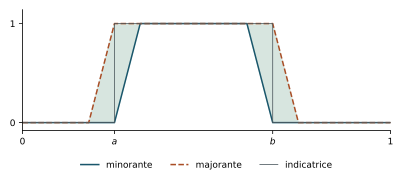

# ENS · MP · Mathématiques C 2017 · Corrigé guidé

*Corrigé rédigé par IA, non officiel. Signalez toute erreur.*

**Rédaction** · GPT-6.2 Astra Ultra · vitesse non renseignée

**Révision** · GPT-6.2 Astra Ultra · vitesse non renseignée · 26 novembre 2026

Le sujet commun aux quatre ENS démontre les critères d’équirépartition jusqu’au théorème de Weyl et à une estimation quantitative. La convergence uniforme pour toute fonction continue de la partie II concerne les moyennes de Fejér. Le rapport attire l’attention sur cette distinction et sur l’ordre des limites de van der Corput.

## I. Préliminaires

### Question I.1

> [!INDICATION]
> Traiter séparément les entiers où la partie entière saute.

#### Solution

Pour $x\in\mathbb R$, $x+1-\lfloor x+1\rfloor=x-\lfloor x\rfloor$, donc la fonction prolongée est de période un. Elle est continue entre deux entiers. À un entier $j$, la limite à gauche est $f(1)$, celle à droite $f(0)$, et sa valeur $f(0)$. Leur égalité assure la continuité en $j$.

### Question I.2

> [!INDICATION]
> Ramener deux points proches sur un même segment légèrement plus grand qu’une période.

#### Solution

Par Heine, $f$ est uniformément continue sur $[-1,2]$. Pour $\varepsilon>0$ choisissons un module $0<\delta<1$ sur ce segment. Si $|x-y|<\delta$, en retranchant $\lfloor x\rfloor$ aux deux points, on place le premier dans $[0,1[$ et le second dans $[-1,2]$ sans modifier leur distance ni leurs images. Donc $|f(x)-f(y)|<\varepsilon$ sur tout $\mathbb R$.

### Question I.3

> [!INDICATION]
> Isoler une somme initiale fixe, puis utiliser la convergence dans le reste de la moyenne.

#### Solution

Soit $\varepsilon>0$. Prenons $M$ tel que $|z_n-z|\le\varepsilon$ pour $n\ge M$. Pour $N\ge M$, $|Z_N-z|\le (N+1)^{-1}\sum_{n<M}|z_n-z|+\varepsilon$. Le premier terme tend vers zéro à $M$ fixé, donc la limite supérieure est au plus $\varepsilon$. On conclut en laissant décroître $\varepsilon$.

## II. Théorème de Fejér et applications

### Question II.1

> [!INDICATION]
> Intégrer terme à terme dans la somme finie.

#### Solution

Chaque $e_k(x)=e^{2\pi ikx}$ a une intégrale nulle sur $[0,1]$ pour $k\ne0$, et $e_0=1$. Chaque somme de $k=-n$ à $n$ a donc intégrale un. La moyenne des $N+1$ sommes a elle aussi intégrale un.

### Question II.2

> [!INDICATION]
> Compter les occurrences du même décalage dans un carré de somme géométrique.

#### Solution

Dans $(N+1)K_N$, le coefficient de $e_k$ est $N+1-|k|$ pour $|k|\le N$. On trouve les mêmes coefficients dans $|\sum_{j=0}^N e_j(x)|^2$, car il y a $N+1-|k|$ couples de différence $k$. Pour $x\notin\mathbb Z$, la somme géométrique a pour module $|\sin((N+1)\pi x)/\sin(\pi x)|$. On obtient $K_N(x)=\sin^2((N+1)\pi x)/((N+1)\sin^2(\pi x))$. Aux entiers, la formule par le carré donne $K_N=N+1$. En particulier le noyau est positif ou nul partout.

### Question II.3a

> [!INDICATION]
> Introduire l’intégrale du coefficient de Fourier dans chaque somme partielle.

#### Solution

Puisque $e_k(x)e_{-k}(y)=e_k(x-y)$, $S_n(f)(x)=\int_0^1 f(y)\sum_{k=-n}^n e_k(x-y)\,dy$. En moyennant pour $0\le n\le N$, les sommes étant finies, on obtient $\sigma_N(f)(x)=\int_0^1 f(y)K_N(x-y)dy$.

### Question II.3b

> [!INDICATION]
> Après le changement de variable, utiliser la périodicité de l’intégrande entier.

#### Solution

En posant $u=x-y$, l’intégrale devient $\int_{x-1}^x f(x-u)K_N(u)du$. Pour $x$ fixé, l’intégrande a période un, donc on peut intégrer de zéro à un. Par II.1, $f(x)=\int_0^1 f(x)K_N(u)du$. La soustraction donne $\sigma_N(f)(x)-f(x)=\int_0^1(f(x-u)-f(x))K_N(u)du$.

### Question II.4a

> [!INDICATION]
> Près de un, exploiter la même continuité uniforme que près de zéro grâce à une translation entière.

#### Solution

Par I.2, choisissons $0<\delta<1/2$ assez petit pour que $|v-w|\le\delta$ entraîne $|f(v)-f(w)|\le\varepsilon$. Si $0\le y\le\delta$ on compare $x-y$ à $x$. Si $1-\delta\le y\le1$, on compare $x-y+1$ à $x$. Sur chacun des intervalles, le produit à intégrer est au plus $\varepsilon K_N(y)$. La positivité de $K_N$ et son intégrale un donnent les deux bornes uniformes.

### Question II.4b

> [!INDICATION]
> Sur la zone intermédiaire, minorer le dénominateur de la formule trigonométrique.

#### Solution

Pour $0<\delta<1/2$ et $\delta\le y\le1-\delta$, $\sin(\pi y)\ge\sin(\pi\delta)>0$. Le noyau est donc au plus $[(N+1)\sin^2(\pi\delta)]^{-1}$. Comme l’écart de $f$ est au plus $2\|f\|_\infty$, l’intégrale demandée est majorée par $\kappa_{\delta,f}/(N+1)$ avec par exemple $\kappa_{\delta,f}=1+2\|f\|_\infty/\sin^2(\pi\delta)$. Pour $\delta\ge1/2$ l’intégrale orientée demandée est nulle ou négative, et toute constante positive convient.

### Question II.4c

> [!INDICATION]
> Choisir le voisinage des bords avant de faire croître le rang.

#### Solution

Pour $\varepsilon>0$, appliquons II.4a avec $\varepsilon/3$, puis gardons ce $\delta$ fixé. Les deux bords contribuent au total pour au plus $2\varepsilon/3$. Pour $N$ assez grand, II.4b majore le centre par $\varepsilon/3$. Par II.3b, le supremum de $|\sigma_N(f)-f|$ est au plus $\varepsilon$. La convergence uniforme établie ici porte sur les moyennes de Fejér $\sigma_N$, malgré la mention des $S_n$ dans le texte introductif de cette partie.

### Question II.5a

> [!INDICATION]
> Intégrer par parties et examiner les termes de bord à chaque ordre.

#### Solution

Pour chaque dérivée de $f$, les deux valeurs de bord coïncident par périodicité, et $e_{-k}(0)=e_{-k}(1)$. L’intégration par parties donne $c_k(f')=2\pi i k c_k(f)$, puis $c_k(f^{(n)})=(2\pi i k)^n c_k(f)$ par récurrence. Pour $n=0$ c’est l’identité et pour $n>0$, $k=0$ donne l’intégrale nulle d’une dérivée périodique.

### Question II.5b

> [!INDICATION]
> Choisir un ordre de dérivation qui permette la sommation sur tous les entiers.

#### Solution

Pour $k\ne0$, II.5a avec $n=2$ donne $|c_k(f)|\le\|f''\|_\infty/(4\pi^2 k^2)$. La série des carrés inverses est convergente dans les deux directions et le coefficient $c_0$ est fini. Donc $(c_k(f))\in\ell^1(\mathbb Z)$.

### Question II.5c

> [!INDICATION]
> Identifier la limite de la série absolument convergente à l’aide de ses moyennes.

#### Solution

Par II.5b et $\|e_k\|_\infty=1$, la série trigonométrique converge normalement, donc $S_n(f)$ converge uniformément vers une fonction $g$. En appliquant I.3 à la suite des normes $\|S_n(f)-g\|_\infty$, les moyennes $\sigma_N(f)$ convergent aussi uniformément vers $g$. Par II.4c elles convergent vers $f$, donc $g=f$.

## III. Équirépartition

### Question III.1

> [!INDICATION]
> Majorer la fréquence d’un point par celle d’un intervalle arbitrairement court.

#### Solution

Dans l’une ou l’autre convention supposée, chaque $t\in[0,1[$ est contenu dans un intervalle autorisé de longueur arbitrairement petite, en commençant à $t$ si nécessaire. La limite supérieure de la fréquence du singleton est au plus cette longueur et vaut donc zéro. Le point $1$ n’est jamais une partie fractionnaire. Les fréquences de $[a,b]$ et de $[a,b[$ diffèrent de celle du singleton $b$, ce qui établit les deux implications.

### Question III.2a

> [!INDICATION]
> Comparer chaque point à l’extrémité gauche de sa maille.

#### Solution

Dans chaque intervalle $[k+j/M,k+(j+1)/M[$, la fonction en escalier vaut $f(k+j/M)$. La distance à ce point est inférieure à $1/M$. Par I.2, prendre $M$ assez grand donne $\|f-\Phi_M(f)\|_\infty\le\varepsilon$ sur toutes les mailles simultanément.

### Question III.2b

> [!INDICATION]
> Traiter d’abord une fonction en escalier fixée et contrôler deux erreurs d’approximation.

#### Solution

Par périodicité et III.1, la moyenne empirique de chaque indicatrice de maille modulo un tend vers $1/M$. Donc, pour $M$ fixé, la moyenne de $\Phi_M(f)(x_n)$ tend vers $M^{-1}\sum_{j=0}^{M-1}f(j/M)=\int_0^1\Phi_M(f)$. Remplacer la fonction en escalier par $f$ coûte au plus $\varepsilon$ dans la moyenne et $\varepsilon$ dans l’intégrale par III.2a. La limite supérieure de l’écart est au plus $2\varepsilon$ et l’on conclut.

### Question III.3a

> [!INDICATION]
> Construire les rampes sur le cercle pour respecter la périodicité même aux extrémités de la période.

#### Solution

Si $[a,b]=[0,1]$, prenons les deux fonctions égales à un. Sinon, sur le cercle $\mathbb R/\mathbb Z$, soit $A$ l’arc fermé image de $[a,b]$ et $B$ l’arc fermé complémentaire de son intérieur. Pour la distance circulaire $d$, posons $f^+(x)=\max(0,1-d(x,A)/\delta)$ et $f^-(x)=\min(1,d(x,B)/\delta)$. Les relevés sont continus périodiques et à valeurs dans $[0,1]$. Sur les deux extrémités, la minorante vaut zéro et la majorante un, ce qui assure aussi l’encadrement aux deux représentants $0,1$ lorsque l’intervalle en contient un seul. Ailleurs l’encadrement est immédiat. Les deux fonctions coïncident en dehors des voisinages de rayon $\delta$ des extrémités, de longueur totale au plus $4\delta$. Prendre $0<\delta\le\varepsilon/4$ donne l’écart intégral voulu.

### Question III.3b

> [!INDICATION]
> Encadrer les limites supérieure et inférieure de la fréquence.

#### Solution

Par III.3a et l’hypothèse $(*)$, les limites inférieure et supérieure de la fréquence de $[a,b]$ sont comprises entre $\int f^-$ et $\int f^+$. Le nombre $b-a=\int_0^1\mathbf 1_{[a,b]}$ est dans le même intervalle, de longueur au plus $\varepsilon$. En laissant $\varepsilon\downarrow0$, on obtient la limite $b-a$.

### Question III.4

> [!INDICATION]
> Passer des caractères aux polynômes trigonométriques, puis à toutes les fonctions continues.

#### Solution

Pour $k\ne0$, la limite de la moyenne de $e_k(x_n)$ et l’intégrale de $e_k$ sont nulles. Pour $k=0$ les deux valent un. Par linéarité, $(*)$ est vraie pour tout polynôme trigonométrique. Pour $f\in C_{\mathrm{per}}$, II.4c permet d’en choisir un à distance uniforme $\varepsilon$ de $f$. Remplacer ce polynôme par $f$ dans la moyenne et l’intégrale coûte au plus $2\varepsilon$ en tout. Ainsi $(*)$ vaut pour $f$ et III.3b conclut.

### Question III.5

> [!INDICATION]
> Calculer la moyenne d’un caractère non constant comme une somme géométrique.

#### Solution

Pour $k\ne0$, posons $w=e^{2\pi i k\alpha}\ne1$ puisque $\alpha$ est irrationnel. Alors $N^{-1}\sum_{n=1}^Ne_k(\alpha n+x)=e_k(x)w(1-w^N)/(N(1-w))$, de module au plus $2/(N|1-w|)\to0$. Le critère III.4 conclut pour tout $x$.

Le calcul géométrique montre aussi où l’irrationalité intervient. Si $\alpha=p/q$ et que l’on choisit le mode $k=q$, alors $e_k(n\alpha+x)=e^{2\pi iqx}$ pour tout $n$. Sa moyenne reste de module 1, tandis que son intégrale sur une période est nulle. La conclusion précédente ne s’étend donc pas aux rotations rationnelles.

### Question III.6

> [!INDICATION]
> Dans la borne sur un caractère, regarder ce qui dépend de la translation $x$.

#### Solution

La borne de III.5 est indépendante de $x$. Par linéarité et finitude des modes, les moyennes des translations de tout polynôme trigonométrique convergent donc uniformément en $x$ vers son terme constant. Approchons $f$ uniformément à $\varepsilon$ par un tel polynôme grâce à II.4c. L’erreur sur l’intégrale et sur toutes les moyennes est au plus $2\varepsilon$. On obtient la convergence en norme uniforme.

## IV. Théorème de Weyl

### Question IV.1a

> [!INDICATION]
> Comparer une somme avec chacune de ses translatées en comptant les termes perdus et gagnés.

#### Solution

Notons $S=\sum_{n=1}^N z_n$. Pour $1\le h\le H\le N$, la différence avec $\sum_{n=1}^Nz_{n+h}$ contient au plus $h$ termes initiaux et $h$ termes terminaux, tous de module au plus un. Sa norme est au plus $2h$. En faisant la moyenne des différences, l’inégalité triangulaire donne la borne $H^{-1}\sum_{h=1}^H2h=H+1$.

### Question IV.1b

> [!INDICATION]
> Appliquer Cauchy–Schwarz à la somme sur $n$ après le décalage.

#### Solution

Avec $W_n=\sum_{h=1}^H z_{n+h}$, IV.1a donne $|S|/N\le|\sum_n W_n|/(NH)+(H+1)/N$. Cauchy–Schwarz donne $|\sum_nW_n|\le\sqrt{N}(\sum_n|W_n|^2)^{1/2}$, d’où la formule.

### Question IV.1c

> [!INDICATION]
> Regrouper les termes par différence des deux décalages et chiffrer le coût de chaque translation.

#### Solution

Les termes diagonaux dans le développement de $\sum_n|W_n|^2$ contribuent au plus $NH$. Pour $1\le j<h\le H$, mettons $d=h-j$. Dans le terme croisé, poser $s=n+j$ donne $\sum_{s=1+j}^{N+j} z_{s+d}\overline z_s$. Il diffère de $T_d=\sum_{s=1}^N z_{s+d}\overline z_s$ d’au plus $2j$ en module. En comptant aussi le terme conjugué, la contribution hors diagonale est donc au plus
$$2\sum_{d=1}^{H-1}(H-d)|T_d|+4\sum_{j=1}^{H-1}j(H-j).$$
Ici $H-d\le H-1$, et la dernière somme avant multiplication par quatre vaut $H(H^2-1)/6$. Avec la diagonale, on retrouve le majorant $NH+2(H-1)\sum_{d=1}^{H-1}|T_d|+2H(H^2-1)/3$.

### Question IV.1d

> [!INDICATION]
> Insérer le majorant quadratique et séparer ses trois contributions.

#### Solution

Dans IV.1b, divisons la borne de IV.1c par $NH^2$ sous la racine. Les termes sont respectivement $1/H$, au plus $(2/H)\sum_{d=1}^{H-1}|T_d/N|$ et au plus $2H/(3N)$. Par sous-additivité de la racine carrée, on obtient
$$\frac{|S|}{N}\le\sqrt2\left(\frac1H\sum_{d=1}^{H-1}\left|\frac{T_d}{N}\right|\right)^{1/2}+\frac1{\sqrt H}+\sqrt{\frac{2H}{3N}}+\frac{H+1}{N}.$$

### Question IV.2

> [!INDICATION]
> Maintenir le nombre de décalages fixé tant que l’on prend la première limite.

#### Solution

Pour $k\in\mathbb Z\setminus\{0\}$, prenons $z_n=e_k(x_n)$. À $d\ge1$ fixé, $T_d/N$ est la moyenne de $e_k(x_{n+d}-x_n)$, qui tend vers zéro par III.2b et l’hypothèse d’équirépartition des différences. Dans IV.1d, fixons d’abord $H$, puis faisons tendre $N$ vers l’infini. La limite supérieure de $|S|/N$ est au plus $1/\sqrt H$. Ensuite $H\to\infty$ donne zéro. Par III.4, la suite est équirépartie.

### Question IV.3

> [!INDICATION]
> Examiner le coefficient dominant de chaque polynôme de différence.

#### Solution

Pour le degré un, III.5 s’applique avec $x$ égal au terme constant. Supposons la propriété au degré $d-1\ge1$. Pour tout entier $h\ge1$, le polynôme $P(X+h)-P(X)$ a degré $d-1$ et coefficient dominant $dh\alpha_d$, irrationnel puisque $dh$ est entier non nul. La récurrence donne l’équirépartition de chaque suite de différences, puis IV.2 celle de $(P(n))$. Cela traite tous les degrés.

## V. Approximation rationnelle et équirépartition quantitative

### Question V.1

> [!INDICATION]
> Exploiter l’écart minimal entre deux rationnels distincts dont l’un est fixé.

#### Solution

Si $\alpha=A/B$ avec $B\ge1$, toute fraction distincte $p/q$ vérifie $|A/B-p/q|\ge1/(Bq)$. Les approximations strictes de Liouville avec $q\ge2$ imposeraient $q^{n-1}<B$ pour tout $n$ et un $q$ dépendant de $n$. Or $q^{n-1}\ge2^{n-1}\to\infty$. Contradiction.

### Question V.2a

> [!INDICATION]
> Transformer la valeur rationnelle du polynôme en un entier non nul, puis borner sa dérivée localement.

#### Solution

Après multiplication par un dénominateur commun, prenons $P\in\mathbb Z[X]$. L’irréductibilité et $d\ge2$ excluent une racine rationnelle. Ainsi $q^dP(p/q)$ est un entier non nul et $|P(p/q)|\ge q^{-d}$. Si $|p/q-\alpha|\le1$, le théorème des accroissements finis donne $|P(p/q)|\le L|p/q-\alpha|$, où $L=\max_{|t-\alpha|\le1}|P'(t)|>0$. Sinon l’écart dépasse un. La constante $c_\alpha=\min(1,1/L)>0$ convient dans les deux cas.

### Question V.2b

> [!INDICATION]
> Traiter les rationnels par V.1 et choisir ensuite l’exposant assez grand.

#### Solution

Un algébrique irrationnel admet un polynôme minimal irréductible de degré $d\ge2$. Par V.2a, les approximations strictes $|\alpha-p/q|<q^{-n}$, $q\ge2$, imposeraient $c_\alpha<q^{d-n}\le2^{d-n}$ pour $n>d$. C’est impossible pour $n$ assez grand. Pour un algébrique rationnel, V.1 suffit.

### Question V.2c

> [!INDICATION]
> Tronquer juste avant un grand saut de la factorielle dans les décimales.

#### Solution

Posons $q=10^{m!}$ et écrivons la somme des $m$ premiers termes sous la forme $p/q$. Le reste est strictement positif et au plus $\sum_{j\ge(m+1)!}10^{-j}=(10/9)q^{-(m+1)}$. Pour tout exposant fixé $n\ge1$, en prenant $m\ge n$, ceci est strictement inférieur à $q^{-n}$. La somme infinie est donc de Liouville et V.2b prouve qu’elle n’est pas algébrique.

### Question V.3

> [!INDICATION]
> Combiner la borne géométrique exacte pour un caractère avec la décroissance rapide des coefficients de Fourier.

#### Solution

Comme $\alpha$ est irrationnel et non de Liouville, il existe $s\ge1$ tel que $|\alpha-p/q|\ge q^{-s}$ pour tous $p\in\mathbb Z$, $q\ge2$. Ainsi $d(k\alpha,\mathbb Z)\ge |k|^{1-s}$ pour $|k|\ge2$. Pour $|k|=1$ la distance est aussi strictement positive, ce qui permet une minoration commune $c|k|^{1-s}$ avec $c>0$. Par concavité du sinus sur $[0,\pi/2]$, $|1-e^{2\pi ik\alpha}|=2|\sin(\pi k\alpha)|\ge4d(k\alpha,\mathbb Z)$. La borne de III.5 pour la moyenne du mode $k$ est donc $|k|^{s-1}/(2cN)$ uniformément en $x$. Par II.5a, $|c_k(f)|\le\|f^{(s+1)}\|_\infty/(2\pi |k|)^{s+1}$, si bien que $\sum_{k\ne0}|c_k(f)||k|^{s-1}<\infty$. La série de Fourier converge normalement vers $f$ par II.5. On peut moyenner terme à terme, retirer $c_0(f)=\int_0^1f$ puis sommer les bornes. Cela donne la majoration demandée avec $C_{\alpha,f}=1+(2c)^{-1}\sum_{k\ne0}|c_k(f)||k|^{s-1}$.
