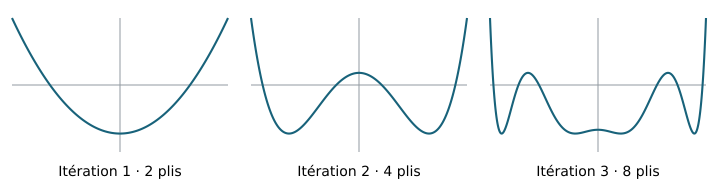
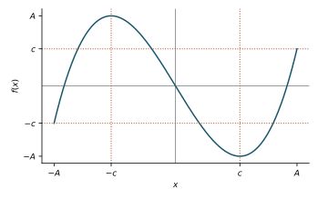

# ENS Ulm · Filière MPI du concours 2017 · Mathématiques D · Corrigé brut

*Corrigé rédigé par IA, non officiel. Signalez toute erreur.*

**Rédaction** · GPT-6.2 Astra Ultra · vitesse non renseignée

**Révision (tour 1)** · GPT-6.2 Astra Ultra · vitesse non renseignée · 26 novembre 2026

L’épreuve de six heures étudie les itérées d’applications de l’intervalle et le nombre de leurs branches de monotonie. Le titre « MPI » est celui de l’original de 2017. La question préliminaire conserve l’hypothèse imprimée, qui autorise les sauts. Les deux corrections de notation signalées par le jury en III.2c et IV.2 sont explicitées.

## Préliminaire · Composition des applications monotones par morceaux

### Question Préliminaire

Soient $g,h$ monotones par morceaux avec des ensembles finis de découpe. Sur chaque intervalle ouvert de stricte monotonie de $g$, l’image réciproque de chacun des intervalles de stricte monotonie de $h$ est un intervalle, éventuellement vide, car $g$ est monotone. L’image réciproque de chaque point de découpe de $h$ y a au plus un élément par stricte monotonie. Ces ensembles forment un découpage fini une fois leurs extrémités ajoutées. Sur chaque intervalle ouvert restant, $h\circ g$ est strictement monotone comme composée de deux applications strictement monotones. Ce raisonnement couvre aussi les sauts de $g$ qui franchissent une valeur de découpe sans l’atteindre. Une récurrence à partir de l’identité donne le résultat pour $f^n$.

L’illustration de la page 2 peut être contrôlée sans compter à vue. Pour $f(x)=x^2-5/4$, les zéros des dérivées successives viennent de $(f^k)'(x)=2^k\prod_{j=0}^{k-1}f^j(x)$. Pour $k=3$, ce sont $0$, les deux racines de $x^2=5/4$, puis les quatre racines de $x^2=5/4\pm\sqrt{5/4}$. Elles sont distinctes et simples. On obtient ainsi deux, quatre, puis huit intervalles de stricte monotonie. Le dessin utilise l’intervalle stable $[-\beta,\beta]$, où $\beta=(1+\sqrt6)/2$.

## I. Orbites bornées des polynômes quadratiques

### Question I.1

Pour $c=0$ une récurrence donne $x_n=x_0^{2^n}$. Si $|x_0|<1$, la limite est zéro. Pour $x_0=\pm1$ la suite vaut un dès le rang un, et si $|x_0|>1$ elle tend vers $+\infty$. Donc $K_0=[-1,1]$.

### Question I.2

L’équation $x=x^2+c$ a discriminant $1-4c$. Aucun point fixe réel si $c>1/4$, un seul $1/2$ si $c=1/4$, et deux, $(1\pm\sqrt{1-4c})/2$, si $c<1/4$. On notera $\beta$ la plus grande racine lorsqu’elle existe.

### Question I.3

Si $c>1/4$, $f_c(x)-x=(x-1/2)^2+c-1/4>0$. Toute orbite est strictement croissante. Si elle était bornée, sa limite serait un point fixe par continuité, impossible par I.2. Elle tend donc vers $+\infty$ et $K_c$ est vide.

### Question I.4

Pour $x>\beta$, $f_c(x)>x$ et l’orbite croît vers $+\infty$, faute de point fixe au-dessus de $x$. Si $x<-\beta$, son image $f_c(x)=f_c(-x)>\beta$ s’échappe aussi. Sur $[-\beta,\beta]$, l’image est $[c,\beta]$. Or $c=\beta-\beta^2$ implique $c+\beta=\beta(2-\beta)\ge0$ car $1/2\le\beta\le2$ pour $-2\le c\le1/4$. Le segment est donc stable. Cela donne exactement $K_c=[-\beta,\beta]$.

### Question I.5a

Pour $c<-2$, l’argument d’échappement extérieur de I.4 vaut toujours. Rester dans $[-\beta,\beta]$ à tous les rangs est donc nécessaire et suffisant pour être borné. Ainsi $K_c=\bigcap_{n\ge0}f_c^{-n}([-\beta,\beta])$. L’intersection est fermée par continuité des itérées, bornée par son terme $n=0$ et non vide car $\beta$ y appartient. C’est un compact.

### Question I.5b

On a $\beta>2$, donc $c+\beta=\beta(2-\beta)<0$. Ainsi $f_c(0)=c<-\beta$ et $0\notin K_c$. Toute image de $[a,b]\subset K_c$ par une itérée est un intervalle contenu dans $K_c$ et évite zéro. Par récurrence, elle est exactement le segment d’extrémités $a_n,b_n$, car $f_c$ est strictement monotone sur chaque demi-axe. En particulier $f_c$ est strictement monotone sur chaque segment de la question.

### Question I.5c

On a $\beta<|c|$ d’après $c<-\beta$, donc le poids $w(x)=1/\sqrt{1-x^2/c^2}$ est continu et positif sur $[-\beta,\beta]$. Sur le segment $J_n$ d’extrémités $a_n,b_n$, I.5b permet le changement de variable $u=x^2+c$ sous la valeur absolue de l’intégrale. Ainsi $L_{n+1}=\int_{J_n}2|x|w(x^2+c)dx$, l’intervalle étant intégré dans l’ordre croissant. Sur ce segment $|x|w(x^2+c)\ge w(x)$ car, après élévation au carré et multiplication par les dénominateurs positifs, il reste $x^2(1+2/c)\ge0$. Donc $L_{n+1}\ge2L_n$. Toutes les longueurs sont pourtant au plus $\int_{-\beta}^{\beta}w$, et par suite $L_0=0$. Comme $w>0$, cela impose $a=b$. Aucun intervalle non réduit n’est contenu dans $K_c$.

## II. Points périodiques d’une famille rationnelle

### Question II.1

Le dénominateur $2ax^2+1-a\ge1-a>0$. Comme fonction de $u=x^2$, le quotient a pour dérivée $2(1-a^2)/(2au+1-a)^2>0$. En $u=0$ il vaut $-1$, en $u=1$ il vaut $1$. Par continuité l’image de $[-1,1]$ est donc tout cet intervalle.

### Question II.2

Les deux plis $]-1,0[$ et $]0,1[$ de $f_a$ sont envoyés bijectivement sur $]-1,1[$. Si un pli de $f_a^n$ est plein, un unique point intérieur y a image zéro. Ce point coupe le pli en deux intervalles sur lesquels $f_a^{n+1}$ parcourt tout $]-1,1[$ de façon strictement monotone. Les deux nouvelles branches ont des orientations opposées. Les anciens points séparateurs persistent aussi comme extrema, puisque $f_a^n$ y atteint un bord $\pm1$ et $f_a$ est strictement monotone du côté intérieur de ce bord. Les nouveaux intervalles sont donc exactement les plis. Leur nombre double à chaque étape et vaut $2^n$.

### Question II.3a

Pour $a=0$, $f_0(x)=2x^2-1$. Ainsi $f_0(\cos t)=\cos(2t)$ et par récurrence $x_n=\cos(2^nt_0)$.

### Question II.3b

Pour chaque $p\ge1$ et tout entier $j$, l’angle $t=2\pi j/(2^p-1)$ satisfait $2^pt=t+2\pi j$. Donc $\cos t$ est périodique pour $f_0$. Les mailles de ces angles tendent vers zéro et leur réunion est dense dans $[0,2\pi]$. Le cosinus envoie donc cet ensemble sur un ensemble dense dans $[-1,1]$.

### Question II.4

Posons $b=\sqrt{(1-a)/(1+a)}>0$ et $z(t)=\cos t+ib\sin t$, qui ne s’annule pas. Définissons $U(t)=\int_0^t b/(\cos^2s+b^2\sin^2s)\,ds$. C’est l’argument continu de $z$ nul en zéro, car $\operatorname{Im}(z'/z)=U'$ et $z(0)=1$. De plus $U$ est impair et $U(t+\pi)=U(t)+\pi$ car l’intégrale sur une période vaut $2\int_0^{\pi/2}b/(\cos^2s+b^2\sin^2s)ds=\pi$ par $v=b\tan s$. Prenons $F_a=2U$, $h_a=2U-2t$. Cette dernière est impaire, $\pi$-périodique et lisse, de dérivée $2\sqrt{1-a^2}/(1+a\cos2t)-2$. Elle est unique puisque la dérivée est imposée et que l’imparité force $h_a(0)=0$. Enfin la partie réelle de $(z/|z|)^2$ donne $\cos F_a(t)=(\cos2t+a)/(1+a\cos2t)=f_a(\cos t)$.

### Question II.5

Écrivons $F=F_a$. On a $\Phi_{n+1}-\Phi_n=2^{-(n+1)}h_a(F^n(t))$. Les normes uniformes de ces termes sont majorées par $2^{-(n+1)}\|h_a\|_\infty$ et leur série converge. Comme $\Phi_0(t)=t$, la suite converge uniformément sur la droite vers une fonction continue $\Phi$, avec $|\Phi(t)-t|\le\|h_a\|_\infty$. Puisque $F'>0$, chaque $\Phi_n$ est croissante, donc $\Phi$ est croissante au sens large.

### Question II.6

En passant à la limite dans $\Phi_n(F(t))=2\Phi_{n+1}(t)$ on obtient $\Phi(F(t))=2\Phi(t)$. L’imparité de $F$ et la relation $F(t+\pi)=F(t)+2\pi$ donnent par récurrence $F^n(t+\pi)=F^n(t)+2^n\pi$, donc $\Phi$ est impaire et $\Phi(t+\pi)=\Phi(t)+\pi$. Ainsi $\Phi(0)=0$ et $\Phi(\pi)=\pi$. Posons $\varphi(x)=\cos\Phi(\arccos x)$. Cette fonction continue croissante est surjective sur $[-1,1]$. Les symétries assurent $\varphi(\cos t)=\cos\Phi(t)$ pour tout $t$. Par II.4, $\varphi(f_a(\cos t))=\cos\Phi(F(t))=\cos(2\Phi(t))=f_0(\varphi(\cos t))$.

### Question II.7a

La dérivée donnée en II.4 vérifie $F'(t)\ge2\sqrt{1-a^2}/(1+a)=2\sqrt{(1-a)/(1+a)}=k$. On a $k>1$ si et seulement si $a<3/5$.

### Question II.7b

Si $s<t$ vérifiaient $\Phi(s)=\Phi(t)$, II.6 donnerait $\Phi(F^n(s))=\Phi(F^n(t))$. D’après II.5 on aurait $F^n(t)-F^n(s)\le2\|h_a\|_\infty$. Mais par II.7a et les accroissements finis, cet écart est au moins $k^n(t-s)\to\infty$. Ainsi $\Phi$ est strictement croissante. Comme $\Phi(t)-t$ est bornée, elle est bijective de la droite sur elle-même et possède un inverse continu $\Psi$. Sa restriction à $[0,\pi]$ est un homéomorphisme de cet intervalle. Par conjugaison avec le cosinus, $\varphi$ possède l’inverse continu $\psi(x)=\cos\Psi(\arccos x)$.

### Question II.7c

On a $f_a=\psi\circ f_0\circ\varphi$. Pour tout point périodique $x$ de $f_0$, le point $\psi(x)$ est donc périodique de même période pour $f_a$. L’homéomorphisme $\psi$ envoie l’ensemble dense de II.3b sur un ensemble dense, d’où le résultat.

### Question II.8

On a $f_a(1)=1$ et $f_a'(1)=4(1-a)/(1+a)<1$ si $a>3/5$. Par continuité de la dérivée et stricte croissance près de un, il existe $r<1$ et $q<1$ tels que $0\le1-f_a(x)\le q(1-x)$ pour $r\le x\le1$. L’intervalle est invariant et toutes ses orbites convergent vers un. Un point $x\in]r,1[$ n’y est jamais périodique, car $f_a(x)>x$ et la même comparaison se répète. L’ensemble périodique n’est donc pas dense.

## III. Entropie et nombre de plis

### Question III.1a

Pour tout $n\ge1$, $\lambda(f^n)\ge1$, donc $h_n(f)=\ln(\lambda(f^n))/n\ge0$. L’infimum $h(f)$ existe et appartient à $[0,h_1(f)]$.

### Question III.1b

Sur un pli de $g$, chaque pli de $f$ a pour préimage un intervalle éventuellement vide. La composition est strictement monotone sur ces intervalles et il y en a au plus $\lambda(f)$. Les valeurs critiques intermédiaires n’ajoutent que des points de séparation et des extrémités. Ainsi le nombre de plis de la composée est au plus $\lambda(f)\lambda(g)$.

### Question III.1c

Écrivons $n=qk+r$ avec $0\le r<k$. Alors $\lambda(f^n)\le\lambda(f^k)^q\lambda(f)^r$, en utilisant l’identité si $r=0$. En prenant le logarithme puis en divisant par $n$ on obtient $h_n\le(n-r)h_k/n+rh_1/n$.

### Question III.1d

À $k$ fixé le reste vérifie $r/n\to0$. Par III.1c, $\limsup_n h_n\le h_k$. En prenant l’infimum sur $k$, $\limsup h_n\le h(f)$. Or tous les $h_n\ge h(f)$, donc la limite existe et vaut $h(f)$.

### Question III.1e

Pour $k\ge1$, $h_k(f^n)=k^{-1}\ln\lambda(f^{nk})=n h_{nk}(f)$. En laissant $k\to\infty$ de chaque côté, on obtient $h(f^n)=nh(f)$.

### Question III.2a

Comme $f(c)=-2c^3$, la condition $f^2(c)=-c$ donne $-8c^9+6c^5=-c$. Pour $c>0$, elle équivaut à $8u^2-6u-1=0$ avec $u=c^4$. L’unique racine positive est $(3+\sqrt{17})/8$. Il existe donc un unique $c=((3+\sqrt{17})/8)^{1/4}$.

### Question III.2b

Notons $A=2c^3$. Comme $c^4>1/4$, $A>c$. On a $f(c)=-A$, $f(-c)=A$ et, par l’hypothèse et l’imparité, $f(-A)=-c$, $f(A)=c$. Les seuls extrema locaux sont aux abscisses $\pm c$ car $f'(x)=3(x^2-c^2)$. Sur $I=[-A,A]$ le maximum et le minimum sont donc $A,-A$ et la continuité donne $f(I)=I$.

### Question III.2c

Les quatre extrémités $-A,-c,c,A$ forment un ensemble stable. Sur chaque $J_i$, $f$ est strictement monotone et $f(J_i)$ est une réunion de $J_j$ entiers. Les plis de $f^{n+1}$ dans $J_i$ s’obtiennent en tirant par cette branche de $f$ les plis de $f^n$ situés dans $f(J_i)$. Les extrema séparateurs persistent après les compositions puisqu’au voisinage d’une valeur critique $f$ est strictement monotone de chaque côté. Ainsi $v_{n+1,i}=\sum_{j:J_j\subset f(J_i)}v_{n,j}$. Avec l’ordre des indices imprimé, cette formule donne $M^tv_n$. La matrice calculée en III.2d étant symétrique, c’est également $Mv_n$, comme demandé. Le rapport précise ce point de transcription.

### Question III.2d

Les images sont $J_2\cup J_3$, $J_1\cup J_2\cup J_3$, $J_1\cup J_2$, dans cet ordre. Donc
$$M=\begin{pmatrix}0&1&1\\1&1&1\\1&1&0\end{pmatrix}.$$
Le vecteur $(1,0,-1)$ est propre de valeur $-1$. Sur les vecteurs $(x,y,x)$, la transformation des deux coordonnées est $(x+y,2x+y)$, de valeurs propres $1+\sqrt2$ et $1-\sqrt2$. Ces trois valeurs épuisent le spectre.

### Question III.2e

On a $v_1=(1,1,1)$ et $v_n=M^{n-1}v_1$. La plus grande valeur propre $\rho=1+\sqrt2$ a pour vecteur propre $(1,\sqrt2,1)$ strictement positif. $M$ étant symétrique, la projection de $v_1$ sur ce vecteur est non nulle et positive. Les deux autres valeurs propres sont de module strictement inférieur à $\rho$. Ainsi $\lambda(f^n)=(1,1,1)\cdot v_n\sim C\rho^{n-1}$ avec $C>0$. Par III.1d, $h(f)=\ln\rho$.

Voici le comptage sans calcul de vecteurs propres. Par symétrie, $v_n=(a_n,b_n,a_n)$. La matrice réduite donne $a_{n+1}=a_n+b_n$ et $b_{n+1}=2a_n+b_n$. Son polynôme caractéristique est $X^2-2X-1$. La suite $L_n=2a_n+b_n$ satisfait donc $L_{n+2}=2L_{n+1}+L_n$, avec $L_1=3$ et $L_2=7$. La composante devant $(1+\sqrt2)^{n-1}$ vaut $(3+2\sqrt2)/2>0$, ce qui vérifie directement la limite logarithmique.

### Question III.3a

En dehors des préimages, jusqu’au rang $n-1$, des points de changement de pente, la dérivée de $f^n$ est un produit de $n$ facteurs de module $p$ et vaut $\pm p^n$. Sur un pli le signe est constant. Les éventuels raccords qui ne changent pas le sens ont donc la même pente et la fonction y est affine sur le pli entier. Son image étant contenue dans $[a,b]$, toute longueur de pli est au plus $(b-a)/p^n$. Les plis couvrent l’intervalle à un ensemble fini près, donc $\lambda(f^n)\ge p^n$ et $h(f)\ge\ln p$.

### Question III.3b

Soient $L_i>0$ les longueurs des intervalles successifs déterminés par les points critiques et les bords. Choisissons $s>0$ avec $s/\min L_i\le\varepsilon$. Découpons le $i$-ième en $\lceil L_i/s\rceil$ morceaux égaux. Leur longueur est au plus $s$ et au moins $s/(1+s/L_i)\ge s/(1+\varepsilon)$. Tous les points critiques sont bien des points du maillage et le quotient de deux longueurs est au plus $1+\varepsilon$.

### Question III.3c

Notons $d$ la longueur minimale d’une maille. L’image d’une maille a longueur au plus $p(1+\varepsilon)d$. Si elle rencontre $k$ mailles consécutives, elle contient au moins les $k-2$ mailles intermédiaires, donc $k\le p(1+\varepsilon)+2=B$. Pour un itinéraire de $n$ mailles prescrites, l’ensemble des points qui les visitent est un intervalle (par récurrence en tirant en arrière sur des branches monotones). Sur son intérieur, $f^n$ est monotone. Les points dont un itéré tombe exactement sur un bord forment un ensemble fini, et les itinéraires à intérieur non vide couvrent leurs intervalles complémentaires. Il y a au plus $mB^{n-1}$ itinéraires non vides. Donc $\lambda(f^n)\le mB^{n-1}$ et $h(f)\le\ln B$.

### Question III.3d

L’application $f^k$ est encore affine par morceaux à pentes de module $p^k$. Par III.3c et III.1e, $h(f)\le k^{-1}\ln((1+\varepsilon)p^k+2)$. En gardant $\varepsilon>0$ fixé et en faisant tendre $k$ vers l’infini, on obtient $h(f)\le\ln p$. Avec III.3a il vient $h(f)=\ln p$.

## IV. Séries de signes et entropie d’une application à deux plis

### Question IV.1a

Par définition $|\theta_n(x)|\le1$, donc pour $|z|<1$, $\sum_{n\ge0}|\theta_n(x)z^n|\le(1-|z|)^{-1}$. Le rayon est au moins un.

### Question IV.1b

L’orbite de $b$ reste en $b>c_0$, donc $\theta_n(b)=1$ pour tout $n$. L’orbite de $a<c_0$ commence avec le signe moins et se poursuit en $b$, donc $\theta_n(a)=-1$ pour tout $n$. Ainsi $\Theta_b=1/(1-z)$ et $\Theta_a=-1/(1-z)$ pour $|z|<1$.

### Question IV.1c

Supposons $x<y$. Au départ, l’égalité de $\theta_0$ aux deux bords place $[x,y]$ dans la même branche, avec orientation $\theta_0$. Par récurrence, si $f^j$ est strictement monotone sur $[x,y]$ d’orientation $\theta_{j-1}$, les deux images extrêmes sont distinctes. L’égalité des produits $\theta_j$ impose le même signe de position aux deux images, nécessairement non nul, donc l’image entière reste dans une branche de $f$. La composition a pour orientation $\theta_j$. Jusqu’au rang $n$, on obtient le sens $s=\theta_{n-1}$. Comme $\varepsilon$ est croissante, les deux nombres $s\varepsilon(f^n(x))$ et $s\varepsilon(f^n(y))$ sont dans cet ordre, que $f^n$ croisse ou décroisse. Ce sont $\theta_n(x),\theta_n(y)$. Pour $x=y$, la comparaison est immédiate et le segment réduit admet les deux sens de monotonie.

### Question IV.1d

Pour $x<y$, si toutes les suites de signes coïncident, les séries sont égales. Sinon soit $k$ le premier indice différent. Pour $k=0$, la croissance de $\varepsilon$ s’applique, et pour $k\ge1$, IV.1c donne $d=\theta_k(y)-\theta_k(x)>0$. Si $d=2$, chaque différence ultérieure est au moins $-2$. Si $d=1$, l’un des deux coefficients est nul et tous ses successeurs sont nuls, donc chaque différence ultérieure est au moins $-1$. Dans les deux cas, $\Theta_y-\Theta_x\ge dz^k(1-z/(1-z))\ge0$ pour $0\le z\le1/2$.

### Question IV.2a

Dans la définition imprimée des limites, on lit $\theta_n(y)$ sous le signe limite, comme le requiert le rapport. Pour $n$ fixé, les fonctions de signe sont constantes sur les composantes séparées par les préimages de $c_0$ d’ordres au plus $n$, en nombre fini. Leurs limites de chaque côté existent. Aux deux bornes on prolonge par la valeur intérieure, qui y coïncide avec la valeur exacte coefficient par coefficient puisque leurs orbites évitent $c_0$.

Si l’orbite de $x$ ne rencontre pas $c_0$ avant le rang $n$ inclus, les signes sont localement constants et $\theta_n^-=\theta_n=\theta_n^+$. Sinon, au premier passage au rang $j$, $f^j$ est strictement monotone près de $x$ (identité si $j=0$). Les deux côtés donnent des signes opposés pour $\varepsilon(f^j)$, tandis que les facteurs antérieurs sont identiques. Après ce passage, les deux côtés sont envoyés par $f^{j+1}$ du même côté de $f(c_0)$ puisque $f$ a un minimum strict en $c_0$. Tous les facteurs ultérieurs jusqu’au rang fixé ont donc les mêmes signes latéraux des deux côtés, même si l’orbite revient en $c_0$. Une branche unilatérale suffisamment petite garde chaque image du même côté à chaque étape finie. Ainsi $\theta_n^-=-\theta_n^+$ et $\theta_n(x)=0$. Coefficient par coefficient, $\Theta_x=(\Theta_x^-+\Theta_x^+)/2$.

### Question IV.2b

En l’absence de passage par $c_0$, tous les coefficients sont continus en $x$. Au premier passage $j=n_0$, le coefficient d’ordre $j$ saute de deux, car la branche $f^j$ a pour orientation le produit $s=\theta_{j-1}(x)$ des signes précédents (prendre $s=1$ si $j=0$). Pour tout $l\ge0$, le coefficient d’ordre $j+l$ près de $x$ est ce même préfixe $s$ multiplié par la valeur latérale de $\theta_l$ près de $c_0$. Si $s=1$ les côtés sont conservés. Si $s=-1$, les côtés sont échangés, et le facteur $-1$ compense cet échange dans la différence droite moins gauche. Donc $\theta_{j+l}^+(x)-\theta_{j+l}^-(x)=\theta_l^+(c_0)-\theta_l^-(c_0)$. Aux indices plus petits le saut est nul. En sommant on obtient $\Theta_x^+-\Theta_x^-=z^{n_0}(\Theta_{c_0}^+-\Theta_{c_0}^-)$, série non nulle puisque son premier coefficient non nul vaut deux.

### Question IV.3a

Par IV.2a, $\delta_n=\theta_n^+(c_0)$ et $\delta_0=1$. Si $f^n(c_0)\ne c_0$, la continuité donne le dernier facteur $\varepsilon(f^n(c_0))$, donc $\delta_n=\delta_{n-1}$ au-dessus de $c_0$ et $-\delta_{n-1}$ en dessous. Si $f^n(c_0)=c_0$ avec $n\ge1$, en un intervalle suffisamment petit immédiatement à droite de $c_0$, $f^n$ est monotone d’orientation $\delta_{n-1}$. Son image part de $c_0$ dans ce sens, donc le dernier facteur vaut aussi $\delta_{n-1}$. Leur produit vaut un, ce qui donne la valeur prescrite au retour.

### Question IV.3b

Sur chaque pli de $f^n$, il y a au plus une traversée du niveau $c_0$. À une extrémité intérieure de pli il y a un extremum local, qui ne traverse pas un niveau qu’il atteint là. Pour $n\ge1$, III.1b donne donc $\gamma_n\le\lambda(f^n)\le2^n$. Pour $n=0$, l’identité traverse le niveau une fois et $\gamma_0=1$.

### Question IV.3c

Pour $|z|<1/2$, $\sum_n\gamma_n|z|^n\le\sum_n(2|z|)^n<\infty$. Le rayon de $\Gamma_f$ est donc au moins $1/2$.

### Question IV.3d

Un premier passage par $c_0$ au rang $j$ est exactement un point où $f^j-c_0$ change de signe. En effet, avant le premier passage la branche est strictement monotone des deux côtés. Après un passage antérieur, la première application suivante forme un extremum et les deux côtés arrivent ensuite du même côté de la valeur orbitale, même en cas de retour. Il y a donc $\gamma_j$ points de premier passage au rang $j$. Pour chaque $n$, la fonction en escalier $\theta_n$ n’a de sauts qu’en ces points de rang $j\le n$. Par IV.2b le saut y vaut $2\delta_{n-j}$. En sommant les sauts de gauche à droite, $\theta_n(b)-\theta_n(a)=2\sum_{j=0}^n\gamma_j\delta_{n-j}$. L’égalité de séries $\Theta_b-\Theta_a=2\Delta_f\Gamma_f$ s’ensuit, avec convergence absolue pour $|z|<1/2$.

### Question IV.4a

On a $\lambda(f^n)^{1/n}\to e^{h(f)}$ par III.1d. Le rayon de $\Lambda_f$ vaut donc $R_f=e^{-h(f)}$. De $1\le\lambda(f^n)\le2^n$ on obtient $1/2\le R_f\le1$.

### Question IV.4b

Passer de $f^m$ à $f^{m+1}=f\circ f^m$ conserve les anciens extrema. En effet les deux côtés d’un ancien extremum arrivent du même côté de sa valeur, où $f$ est strictement monotone à proximité. À l’intérieur d’un pli, un nouvel extremum apparaît exactement à la traversée de $c_0$ par $f^m$. Les bords de $I$ sont déjà comptés comme bords et ne sont pas des traversées. On gagne donc $\gamma_m$ plis, soit $\lambda(f^{m+1})-\lambda(f^m)=\gamma_m$. Partant de $\lambda(f^0)=1$, une sommation donne la formule demandée.

### Question IV.4c

Par IV.4b, $0\le\gamma_m\le\lambda(f^{m+1})$, donc $\Gamma_f$ converge au moins sur $|z|<R_f$. Par IV.1b et IV.3d on a $\Delta_f\Gamma_f=1/(1-z)$ coefficient par coefficient. Le produit est donc valable sur $|z|<R_f\le1$ et $\Delta_f$ ne s’y annule pas. En multipliant la relation de récurrence de IV.4b par les puissances de $z$, on obtient $(1-z)\Lambda_f=z+z\Gamma_f$. Ainsi
$$\Lambda_f(z)=\frac{z}{1-z}+\frac{z}{(1-z)^2\Delta_f(z)}.$$

### Question IV.5a

Pour $f(x)=x^2-7/4$, on peut prendre $I=[-\beta,\beta]$ de I.4 et $c_0=0$. Les inclusions du sujet montrent qu’à partir du premier rang, les signes de $f^n(0)$ se répètent par blocs $-,+,-$. Le premier intervalle image est négatif, le suivant positif, le troisième est contenu dans $[\alpha_0,0[$ lui-même inclus dans $[\alpha_0,-\alpha_0]$. Aucun retour à zéro ne se produit. Les produits de IV.3a, à partir de $\delta_0=1$, sont donc périodiques de motif $1,-1,-1$. Il vient $\Delta_f(z)=(1-z-z^2)/(1-z^3)$ pour $|z|<1$, donc sur le disque demandé.

### Question IV.5b

En remplaçant $\Delta_f$ dans IV.4c et en factorisant $1-z^3=(1-z)(1+z+z^2)$, le numérateur après réduction au même dénominateur est $z[(1-z-z^2)+(1+z+z^2)]=2z$. Ainsi $\Lambda_f(z)=2z/((1-z)(1-z-z^2))$.

### Question IV.5c

Les pôles de cette fraction sont $1$, $(\sqrt5-1)/2$ et $-(1+\sqrt5)/2$. Aucun n’annule le numérateur. Le rayon de Taylor en zéro vaut donc $R_f=(\sqrt5-1)/2$, et IV.4a donne $h(f)=-\ln R_f=\ln((1+\sqrt5)/2)$.

### Question IV.5d

Notons $F_0=0,F_1=1$, $F_{j+2}=F_{j+1}+F_j$. Alors $(1-z-z^2)^{-1}=\sum_{j\ge0}F_{j+1}z^j$. Pour $n\ge1$ le coefficient de IV.5b est $2\sum_{j=1}^nF_j=2(F_{n+2}-1)$ par télescopage. En posant $r=(1+\sqrt5)/2$, $s=(1-\sqrt5)/2$, la formule explicite est $\lambda(f^n)=2((r^{n+2}-s^{n+2})/\sqrt5-1)$.
