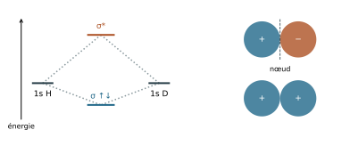
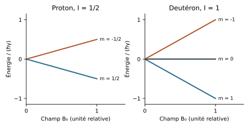
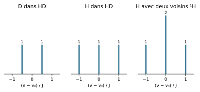
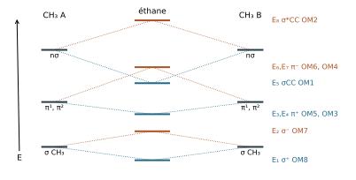
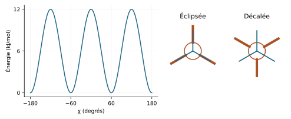
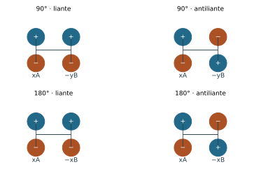
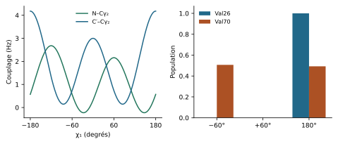
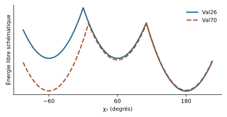
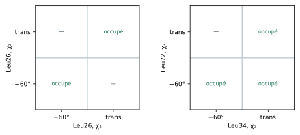

# ENS Ulm — PC, Chimie B 2017 · Corrigé guidé

*Corrigé rédigé par IA, non officiel.*

**Rédaction (tour 1)** · GPT-6.2 Astra Ultra · vitesse non renseignée

Sur les 85 questions de l’épreuve, 53 sont entièrement corrigées, dont les 45 questions de la seconde partie, du dihydrogène à la thermodynamique des protéines. Q11 traite la mesure de pureté énantiomérique et Q39 la structure et l’acidité de Lewis. Les 30 autres questions, relatives à la préparation de la gelsemine et à ses intermédiaires ou à l’attribution du spectre du produit, sont repérées hors couverture. Les figures et mesures ont été vérifiées sur les 23 pages de l’original, avec le rapport du jury de chimie Ulm 2017.

## 1.1. Stéréosélectivité et mesures indépendantes

*Question 1 hors couverture.*

*Question 2 hors couverture.*

*Question 3 hors couverture.*

*Question 4 hors couverture.*

### Question 5 — Mesurer un rapport de diastéréoisomères

> [!INDICATION]
> Pour chaque espèce, choisir un signal isolé et compter les noyaux qui lui correspondent.

#### Solution

En RMN quantitative du proton, on intègre deux signaux résolus, un pour chaque diastéréoisomère. Si leurs aires sont $I_a,I_b$ et qu’ils représentent $n_a,n_b$ protons par molécule, le rapport cherché est $(I_a/n_a)/(I_b/n_b)$. Il faut que les deux intégrales soient fiables, en particulier pour le constituant minoritaire. Les deux énantiomères de chaque paire ont le même spectre dans un milieu achiral. Leur présence en quantités égales annule le pouvoir rotatoire de chaque paire.

### Question 6 — Excès diastéréoisomérique

> [!INDICATION]
> Distinguer la fraction majoritaire de la différence des deux fractions.

#### Solution

Le tableau donne un rapport de 50 pour 1. Sur 51 parts, la différence est de 49 parts. L’excès diastéréoisomérique vaut donc **$100(50-1)/(50+1)=96{,}1\,\%$**. La proportion du majoritaire vaut, elle, $50/51=98{,}0\,\%$.

*Question 7 hors couverture.*

*Question 8 hors couverture.*

*Question 9 hors couverture.*

### Question 10 — Origine de l’énantiosélectivité

> [!INDICATION]
> Comparer les deux états de transition quand on conserve le même partenaire chiral.

#### Solution

Les deux voies qui conduiraient aux produits énantiomères dans un milieu achiral passent, en présence d’un même catalyseur chiral, par des assemblages **diastéréoisomères**. Leurs énergies libres d’activation peuvent différer. Si les produits sont sous contrôle cinétique, celui qui correspond à la barrière la plus basse se forme plus vite. La chiralité autorise cette discrimination sans imposer que l’écart de barrières soit grand.

### Question 11 — Mesure de la pureté énantiomérique (partie traitée)

> [!INDICATION]
> Une mesure doit distinguer des molécules images l’une de l’autre.

#### Solution

Une chromatographie sur phase stationnaire chirale peut séparer les deux énantiomères. Si les deux réponses du détecteur sont égales à quantité de matière égale, leurs aires donnent les fractions $x_R,x_S$ et l’excès $100\lvert x_R-x_S\rvert$. Une mesure polarimétrique demande la rotation spécifique de l’énantiomère pur dans les mêmes conditions et l’absence d’autres espèces optiquement actives. Seul le volet de mesure est traité.

## 1.2. Spectroscopie, structures de Lewis et acidités

*Question 12 hors couverture.*

### Question 13 — Triplets aromatiques apparents

> [!INDICATION]
> Construire les quatre fréquences d’un proton couplé à deux spins 1/2.

#### Solution

Deux couplages à des protons voisins donnent des décalages $(\pm J_1\pm J_2)/2$. Lorsque les deux couplages ortho valent environ $7{,}6\ \mathrm{Hz}$, les deux fréquences centrales coïncident à la résolution disponible. Le doublet de doublets apparaît comme un triplet d’intensités **1, 2, 1**. L’égalité des constantes ne rend pas les deux voisins chimiquement équivalents.

*Question 14 hors couverture.*

*Question 15 hors couverture.*

*Question 16 hors couverture.*

*Question 17 hors couverture.*

*Question 18 hors couverture.*

*Question 19 hors couverture.*

*Question 20 hors couverture.*

*Question 21 hors couverture.*

*Question 22 hors couverture.*

*Question 23 hors couverture.*

### Question 24 — Lewis d’un acide sulfonique

> [!INDICATION]
> Localiser le proton acide sur un oxygène et placer les substituants en para.

#### Solution

La formule condensée est $p$-$\mathrm{CH_3{-}C_6H_4{-}S(=O)_2{-}OH}$. Le méthyle et le groupe sulfonique occupent deux carbones opposés du cycle benzénique, représenté par trois doubles liaisons alternées. Dans cette écriture de Lewis à soufre hypervalent, chaque oxygène porte deux doublets libres, le soufre est à quatre voisins et toutes les charges formelles sont nulles.

### Question 25 — Acidités comparées

> [!INDICATION]
> Classer les valeurs données et comparer la stabilisation des anions.

#### Solution

L’acidité décroît dans l’ordre **acide paratoluènesulfonique, méthanesulfonique, benzoïque, acétique**, d’après les quatre $pK_a$ fournis. Dans un sulfonate, trois oxygènes participent à la délocalisation de la charge, contre deux dans un carboxylate. Le centre sulfonyle exerce aussi un effet inductif attracteur important. Dans les deux familles et pour les données indiquées, le dérivé aryle est plus acide que le dérivé méthyle. Un carbone aromatique $sp^2$ exerce un effet inductif plus attracteur que le carbone $sp^3$ du méthyle. Le classement expérimental suffit, ces arguments qualitatifs ne prédisent pas les écarts numériques.

*Question 26 hors couverture.*

### Question 27 — Deux formes de Lewis de l’ozone

> [!INDICATION]
> Répartir 18 électrons de valence entre trois atomes soumis à l’octet.

#### Solution

Les deux formes limites sont $\mathrm{^{-}O{-}O^{+}{=}O}\leftrightarrow\mathrm{O{=}O^{+}{-}O^{-}}$. L’oxygène central porte un doublet libre, le terminal lié par une double liaison en porte deux, l’autre en porte trois. Le système réel a deux liaisons équivalentes, d’ordre moyen 1,5 dans cette représentation.

### Question 28 — Polarité d’une molécule homonucléaire

> [!INDICATION]
> La symétrie permet-elle à deux contributions vectorielles de se compenser ?

#### Solution

La géométrie autour de l’atome central, de type $AX_2E$, est coudée. Les deux extrémités sont équivalentes, mais le centre et les extrémités portent des distributions électroniques différentes. La composante transverse des deux contributions se compense et leur composante suivant la bissectrice s’ajoute. Un moment permanent sur la bissectrice, de module mesuré $0{,}49\ \mathrm D$, est compatible avec la symétrie.

*Question 29 hors couverture.*

*Question 30 hors couverture.*

*Question 31 hors couverture.*

*Question 32 hors couverture.*

*Question 33 hors couverture.*

*Question 34 hors couverture.*

*Question 35 hors couverture.*

*Question 36 hors couverture.*

*Question 37 hors couverture.*

*Question 38 hors couverture.*

### Question 39 — Acidité de Lewis de l’aluminium (partie traitée)

> [!INDICATION]
> Compter les électrons autour de l’aluminium dans la formule monomère.

#### Solution

Dans $\mathrm{Et_2AlCl}$ monomère, Al établit trois liaisons simples, deux avec les carbones des groupes éthyle et une avec Cl. Le chlore possède trois doublets libres. L’aluminium a six électrons autour de lui et peut accepter un doublet dans une orbitale vacante. C’est un acide de Lewis. Cette réponse porte sur la structure et la propriété électronique du monomère.

*Question 40 hors couverture.*

## 2.1. Couplage scalaire dans HD

### Question 41 — Diagramme électronique de H₂ et HD

> [!INDICATION]
> Changer un proton en deutéron change sa masse. Que devient la charge vue par l’électron ?

#### Solution

À distance internucléaire fixée, H et D ont même charge nucléaire. Dans l’approximation de Born et Oppenheimer, les deux orbitales atomiques $1s$ ont la même énergie et donnent les mêmes niveaux dans les deux isotopologues. La combinaison en phase concentre la densité entre les noyaux et s’abaisse. La combinaison en opposition de phase présente un plan nodal entre les noyaux et s’élève. Les masses différentes modifient notamment les niveaux de vibration.

### Question 42 — Somme et différence des orbitales 1s

> [!INDICATION]
> Regarder si la densité au milieu des noyaux s’annule.

#### Solution

Avec des orbitales atomiques choisies positives au noyau, $\sigma=(1s_{\rm H}+1s_{\rm D})/\sqrt{2(1+S)}$ est liante. $\sigma^*=(1s_{\rm H}-1s_{\rm D})/\sqrt{2(1-S)}$ est antiliante. Les facteurs de normalisation résultent de l’intégrale du terme croisé $\pm 2S$.

### Question 43 — Énergies des orbitales

> [!INDICATION]
> Appliquer la combinaison symétrique ou antisymétrique au problème séculaire.

#### Solution

La somme des deux lignes du problème $Hc=E\mathcal S c$ conduit à $E_\sigma=E_2=(\alpha+\beta)/(1+S)$, leur différence à $E_{\sigma^*}=E_1=(\alpha-\beta)/(1-S)$. L’écart est $2(\alpha S-\beta)/(1-S^2)$, positif pour les valeurs de l’annexe. Cela place la combinaison sans nœud internucléaire au niveau inférieur.

### Question 44 — Retrouver le recouvrement et l’intégrale de résonance

> [!INDICATION]
> Additionner les équations après multiplication par leurs dénominateurs.

#### Solution

En écrivant $E(1+S)=\alpha+\beta$ et $E^*(1-S)=\alpha-\beta$, l’addition donne $S=(2\alpha-E-E^*)/(E-E^*)$. Avec les énergies de l’annexe, **$S=0{,}904$** (sans unité), puis **$\beta=E(1+S)-\alpha=-14{,}05\ \mathrm{eV}$**. Le recouvrement est positif et inférieur à un.

### Question 45 — Occupation du fondamental et du triplet

> [!INDICATION]
> Deux électrons parallèles peuvent-ils occuper la même orbitale spatiale ?

#### Solution

Le fondamental est $\sigma^2$ avec deux spins opposés et un spin total nul. Pour le triplet, la configuration est $\sigma^1(\sigma^*)^1$ et le spin total vaut 1. Deux flèches parallèles représentent par exemple sa composante $M_S=+1$.

### Question 46 — Matrice de densité dans la base atomique

> [!INDICATION]
> Une seule orbitale spatiale est doublement occupée.

#### Solution

Les deux coefficients du niveau occupé sont égaux à $[2(1+S)]^{-1/2}$. Dans l’ordre $1s_{\rm H},1s_{\rm D}$, on obtient $P=(1+S)^{-1}\begin{pmatrix}1&1\\1&1\end{pmatrix}$. Chaque case, notamment le terme interatomique, vaut environ **0,525**.

### Question 47 — Population et métrique d’une base non orthogonale

> [!INDICATION]
> Comparer la trace ordinaire à la norme totale de l’orbitale.

#### Solution

$P_{uu}$ additionne les carrés des coefficients de l’orbitale atomique $u$ avec leur occupation. On trouve $\operatorname{Tr}P=2/(1+S)=1{,}05$ ici et $\operatorname{Tr}P\to2$ pour $S\to0$. Dans une base non orthogonale la densité contient aussi des termes croisés. Avec la matrice des recouvrements $\mathcal S$ qui a pour éléments hors diagonale $S$, le compte complet est $\operatorname{Tr}(P\mathcal S)=2$.

### Question 48 — Dimension de la fonction d’onde

> [!INDICATION]
> Intégrer une probabilité sur un petit volume.

#### Solution

Pour l’atome H dans l’état $1s$, la probabilité dans $d^3r$ vaut $\lvert1s_{\rm H}(\mathbf r)\rvert^2d^3r$. La densité $\lvert1s_{\rm H}\rvert^2$ a la dimension $L^{-3}$ et l’orbitale la dimension $L^{-3/2}$. La densité au noyau est finie alors que la probabilité d’un point isolé est nulle.

### Question 49 — Dimension de la constante de McConnell

> [!INDICATION]
> Isoler la constante en tenant compte des deux densités électroniques.

#### Solution

$P$ est sans dimension et $s_A(0)^2s_B(0)^2$ a la dimension $L^{-6}$. Donc $[K_0]=[K^F_{AB}][\Delta E]L^6=(M I^{-2}T^{-2}L^{-2})(ML^2T^{-2})L^6=\mathbf{M^2L^6T^{-4}I^{-2}}$. En SI l’unité est $\mathrm{kg^2\,m^6\,s^{-4}\,A^{-2}}$.

### Question 50 — Mélange virtuel avec le triplet

> [!INDICATION]
> Un état à spin électronique total nul peut-il être polarisé par une perturbation locale ?

#### Solution

Les deux spins électroniques appariés du singulet ont une polarisation moyenne nulle. L’interaction locale avec un spin nucléaire peut cependant mélanger un peu de caractère triplet au fondamental et induire une polarisation électronique perçue par l’autre noyau. Dans le triplet les spins ne se compensent pas. À interaction fixée, plus l’état triplet intermédiaire est haut en énergie, plus son mélange virtuel est faible, d’où le facteur $1/\Delta E$.

### Question 51 — Densité au noyau

> [!INDICATION]
> Où agit l’opérateur de contact ?

#### Solution

Le terme de contact est proportionnel à une distribution $\delta(\mathbf r-\mathbf R_A)$ au noyau A, et de même en B. Sa moyenne échantillonne donc la densité électronique au noyau, d’où les facteurs $s_A(0)^2$ et $s_B(0)^2$.

### Question 52 — Orbitales pertinentes dans le diazote

> [!INDICATION]
> Séparer la valeur au noyau et la transmission entre les deux atomes.

#### Solution

Une orbitale atomique $p$ s’annule en son propre noyau et n’y apporte pas de contact direct dans ce modèle. Les orbitales $1s$ de cœur y ont une forte densité mais sont très contractées. Leur participation à une liaison de valence et la transmission entre les deux centres sont faibles. Les deux exclusions ont donc des raisons distinctes.

### Question 53 — Constante réduite de HD

> [!INDICATION]
> Mettre l’énergie en joules et le rayon de Bohr en mètres avant de calculer.

#### Solution

Au noyau, $s(0)^2=1/(\pi a_0^3)$. Dans l’approximation orbitale, $\Delta E=E^*-E=19{,}12\ \mathrm{eV}=3{,}063\times10^{-18}\ \mathrm J$. Alors $K^F_{\rm HD}=K_0/[\Delta E\,\pi^2a_0^6(1+S)^2]$. Avec $a_0=5{,}29\times10^{-11}\ \mathrm m$ on obtient **$2{,}21\times10^{20}\ \mathrm{kg\,A^{-2}\,s^{-2}\,m^{-2}}$**.

### Question 54 — Passage en hertz

> [!INDICATION]
> Les rapports gyromagnétiques fournis sont des pulsations par tesla.

#### Solution

L’équation (8) donne $J^F_{\rm HD}=h\gamma_{\rm H}\gamma_{\rm D}K^F_{\rm HD}/(4\pi^2)=\mathbf{40{,}7\ \mathrm{Hz}}$. La mesure, $42{,}9\ \mathrm{Hz}$, est supérieure d’environ 5 %. Le modèle de contact rend compte du signe dans la convention retenue et de presque toute l’amplitude. L’approximation orbitale et les autres termes du couplage limitent la comparaison.

### Question 55 — Niveaux Zeeman

> [!INDICATION]
> Écrire une droite par valeur permise de la projection du spin.

#### Solution

Les niveaux coïncident à champ nul. À champ $B_0>0$ et $\gamma>0$, la projection $m$ a l’énergie $-m\hbar\gamma B_0$. Pour $I=1/2$, les niveaux sont $\mp\hbar\gamma B_0/2$. Pour $I=1$, on a $-\hbar\gamma B_0,0,+\hbar\gamma B_0$ correspondant à $m=+1,0,-1$. L’écart entre niveaux consécutifs vaut $\hbar\gamma B_0$ pour chaque noyau.

### Question 56 — Spectre du deutérium de HD

> [!INDICATION]
> Le nombre de raies dépend du spin du partenaire observé indirectement.

#### Solution

Le proton offre deux projections également peuplées à l’approximation usuelle. En posant $
u_D=\gamma_D B_0/(2\pi)$, le deutérium donne un **doublet 1:1** aux fréquences $
u_D-J_{\rm HD}/2$ et $
u_D+J_{\rm HD}/2$. Les deux transitions permises du deutérium ont, au premier ordre, la même fréquence pour une projection protonique fixée.

### Question 57 — Spectre du proton de HD

> [!INDICATION]
> Comparer les projections d’un spin 1 à celles que peuvent porter deux spins 1/2.

#### Solution

Avec $
u_H=\gamma_HB_0/(2\pi)$, les trois projections du deutéron donnent $
u_H-J_{\rm HD},
u_H,
u_H+J_{\rm HD}$ avec les intensités **1:1:1**. Deux protons voisins magnétiquement équivalents donneraient un triplet **1:2:1**, car la projection totale nulle peut être obtenue de deux façons.

### Question 58 — Couplage entre les deux protons de H₂

> [!INDICATION]
> Conserver le couplage réduit électronique et changer un rapport gyromagnétique.

#### Solution

En négligeant les effets isotopiques de vibration, $J_{\rm HH}/J_{\rm HD}=\gamma_H/\gamma_D$. Ainsi $J_{\rm HH}=42{,}9(2{,}67\times10^8)/(4{,}11\times10^7)\simeq\mathbf{279\ \mathrm{Hz}}$. Les deux protons de $\mathrm H_2$ sont équivalents et ne se scindent pas mutuellement dans leur spectre de RMN usuel. Celui-ci ne fournit donc pas directement cet écart.

## 2.2. Orbitales et conformations de l’éthane

### Question 59 — Diagramme des huit orbitales de l’éthane

> [!INDICATION]
> D’abord repérer les doublets dégénérés, puis comparer les phases des lobes qui se font face.

#### Solution

De bas en haut, la figure 22 se lit comme suit. L et AL désignent ici le caractère par rapport à la liaison entre les carbones.

| Niveau | Orbitales des deux fragments | Combinaison | Dessin de la figure 10 | Caractère |
|---|---|---|---|---|
| $E_1$ | $\sigma_{\mathrm{CH_3}}$ | $\sigma^+$ | OM8 | L |
| $E_2$ | $\sigma_{\mathrm{CH_3}}$ | $\sigma^-$ | OM7 | AL |
| $E_3,E_4$ | paire $\pi$ de chaque fragment | $\pi^{+,x}$ et $\pi^{+,y}$ | OM5 et OM3 | L |
| $E_5$ | $n_\sigma$ | $\sigma_{\rm CC}$ | OM1 | L |
| $E_6,E_7$ | paire $\pi$ de chaque fragment | $\pi^{-,x}$ et $\pi^{-,y}$ | OM6 et OM4 | AL |
| $E_8$ | $n_\sigma$ | $\sigma_{\rm CC}^*$ | OM2 | AL |

L’ordre interne de chaque doublet dégénéré est libre. Avec les axes de la figure 9, l’orbitale $\pi^2_{\mathrm{CH_3}}$ a un lobe sur l’hydrogène supérieur et correspond à $x$, l’orbitale $\pi^1_{\mathrm{CH_3}}$ à $y$. La paire axiale $n_\sigma$ donne la liaison dirigée C–C. Les deux densités de même phase se prolongent entre les carbones dans OM1, tandis qu’OM2 présente un changement de signe.

### Question 60 — Occupation et indice de liaison C–C

> [!INDICATION]
> Séparer la contribution des paires liante/antiliante entièrement occupées.

#### Solution

L’éthane possède $2\times4+6=14$ électrons de valence. Les niveaux $E_1$ à $E_7$ sont doublement occupés et $E_8$ vide. Dans chaque système issu des fragments $\sigma_{\rm CH_3}$ ou $\pi$, l’occupation liante et l’occupation antiliante se compensent. Il reste deux électrons dans $\sigma_{\rm CC}$ et aucun dans $\sigma^*_{\rm CC}$. L’indice de liaison C–C vaut **1**.

### Question 61 — Profil de rotation et projections de Newman

> [!INDICATION]
> Faire tourner un groupe méthyle de 60° à partir de la position éclipsée.

#### Solution

Pour $\chi=0^\circ,120^\circ,240^\circ$, les trois paires C–H apparaissent superposées en projection de Newman et l’énergie est maximale. À $60^\circ,180^\circ,300^\circ$, les trois directions arrière se placent entre les directions avant, aux minima. Une interpolation de période $120^\circ$ compatible avec les extrema est $V(\chi)=6[1+\cos(3\chi)]\ \mathrm{kJ\,mol^{-1}}$. Le niveau d’énergie zéro est choisi pour les conformations décalées.

### Question 62 — Échelle de la barrière de rotation

> [!INDICATION]
> Comparer la rotation à une rupture de liaison puis à l’excitation thermique.

#### Solution

La barrière de $12\ \mathrm{kJ\,mol^{-1}}$ représente environ $4{,}8RT$ à 298 K et quelques pour cent d’une énergie de liaison simple C–C (environ $350\ \mathrm{kJ\,mol^{-1}}$). Les molécules franchissent donc fréquemment la barrière à température ambiante sans rompre la liaison. L’orbitale liante axiale conserve son recouvrement lors de la rotation. Les interactions entre liaisons C–H des deux fragments varient, avec davantage de répulsion entre orbitales occupées en position éclipsée et des interactions donneur-accepteur favorables en position décalée. Le diagramme à un seul angle ne permet pas de calculer la hauteur de la barrière.

### Question 63 — Rotation des orbitales transverses

> [!INDICATION]
> Projeter les axes du fragment mobile sur le repère fixe avant de combiner les orbitales.

#### Solution

Notons $x_B,y_B$ les deux fonctions transverses **attachées** au fragment B. À $90^\circ$, leurs directions sont devenues $+y_A$ et $-x_A$. On associe donc $x_A$ à $-y_B$ et $y_A$ à $x_B$. En phase, cela donne les combinaisons liantes $x_A-y_B$ et $y_A+x_B$. Les combinaisons de signes opposés sont antiliantes. À $180^\circ$, $x_B$ et $y_B$ pointent selon $-x_A$ et $-y_A$. Les combinaisons liantes sont alors $x_A-x_B$ et $y_A-y_B$, et les sommes sont antiliantes. Ces signes dépendent de la phase initiale des orbitales de fragment. L’invariant est le recouvrement constructif ou destructif entre les lobes alignés. À $90^\circ$, deux directions demeurées orthogonales ne s’apparient pas.

### Question 64 — Ordre de liaison entre les deux hydrogènes repérés

> [!INDICATION]
> Suivre les coefficients des orbitales 1s portées par les deux hydrogènes et leur produit.

#### Solution

Pour H1 du fragment A, c’est la composante transverse $x_A$ qui a du poids, tandis que $y_A$ a un nœud sur cette direction. Sur l’hydrogène H1 du fragment B tourné de $\chi$, la projection dans cette même direction est proportionnelle à $\cos\chi$. Dans $2\sum_i\lvert c_{i,1A}c_{i,1B}\rvert$, la part angulairement variable du système $\pi$ est donc maximale en module à $0^\circ$ et $180^\circ$ et s’annule dans l’approximation de projection à $90^\circ$ et $270^\circ$. À $90^\circ$, chacune des deux combinaisons alignées a un coefficient nul sur l’un des H1. On obtient un comportement dominant en $\lvert\cos\chi\rvert$. Des contributions $\sigma$ peu sensibles à la rotation peuvent donner un fond.

### Question 65 — Origine angulaire de la loi de couplage

> [!INDICATION]
> À quelle puissance l’ordre de liaison intervient-il dans le contact de Fermi ?

#### Solution

En tenant fixes les densités atomiques au noyau et l’énergie d’excitation, $J^F$ est proportionnel au carré de l’ordre de liaison. Si sa variation dominante est celle de Q64 et que l’on néglige le fond, **$J_{AB}\simeq A_{AB}\cos^2\chi$**. Les maxima se situent à $0^\circ$ et $180^\circ$, les minima à $90^\circ$ et $270^\circ$. C’est une justification qualitative des extrema, sans calcul absolu de $A_{AB}$.

### Question 66 — Moyenne sur les trois conformations décalées

> [!INDICATION]
> Une raie moyenne correspond-elle à la valeur du couplage au minimum trans uniquement ?

#### Solution

Les trois minima de l’éthane sont équivalents et s’échangent rapidement à l’échelle RMN. La moyenne de $\cos^2\chi$ sur $60^\circ,180^\circ,300^\circ$ est $(1/4+1+1/4)/3=1/2$. Ainsi $8\ \mathrm{Hz}=A_{AB}/2$ et **$A_{AB}\simeq16\ \mathrm{Hz}$**. Ce calcul assimile chaque puits à son minimum.

## 2.3. Relations de Karplus et populations des valines

### Question 67 — Isotopes actifs de spin 1/2

> [!INDICATION]
> Parmi les isotopes usuels, distinguer ceux dont le spin vaut précisément 1/2.

#### Solution

Le carbone 13, $^{13}\mathrm C$, et l’azote 15, $^{15}\mathrm N$, ont un spin nucléaire $1/2$. Le carbone 12 a un spin nul et l’azote 14 un spin 1.

### Question 68 — Angle de la valine 26

> [!INDICATION]
> Utiliser d’abord le couplage qui dépend directement de χ₁.

#### Solution

Pour $c=\cos\chi_1$, le couplage entre carbones donne $3{,}42c^2-0{,}59c+0{,}17=4{,}18$. Les racines sont $-1$ et environ $1{,}17$, dont seule la première est physique. Ainsi **$\chi_1\simeq180^\circ$**. Pour l’autre couplage, $\theta=300^\circ$, donc $J_N=2{,}64/4+0{,}26/2-0{,}22=0{,}57\ \mathrm{Hz}$. Cette valeur appartient à l’intervalle expérimental $[0{,}56;0{,}68]\ \mathrm{Hz}$.

### Question 69 — Trois puits conformationnels

> [!INDICATION]
> Quel mouvement est omis lorsque chaque puits est remplacé par un angle unique ?

#### Solution

La rotation autour d’une liaison simple entre carbones tétraédriques présente en première approximation trois minima décalés près de $-60^\circ,+60^\circ,180^\circ$, séparés par des régions éclipsées plus énergétiques. Dans une protéine leurs profondeurs peuvent différer. Le modèle est adapté si la probabilité se concentre près des minima et si la RMN fait une moyenne des échanges. Il omet la largeur des puits, les décalages de leurs centres et les configurations transitoires.

### Question 70 — Normalisation des probabilités

> [!INDICATION]
> Chaque molécule appartient à combien de classes au même instant ?

#### Solution

Dans ce modèle les trois rotamères forment des classes exhaustives et disjointes. Sur $N$ molécules les effectifs vérifient $n_{180}+n_{60}+n_{-60}=N$. Après division par $N$, **$P_{180}+P_{60}+P_{-60}=1$**, avec chaque population comprise entre zéro et un.

### Question 71 — Construire les deux moyennes de Karplus

> [!INDICATION]
> Calculer les cosinus dans le même ordre pour chacun des deux couplages.

#### Solution

Dans l’ordre $(180^\circ,+60^\circ,-60^\circ)$, les cosinus de $\chi_1+120^\circ$ sont $(1/2,-1,1/2)$ et ceux de $\chi_1$ sont $(-1,1/2,1/2)$. Dès lors $\langle J_N\rangle=(A/4+B/2+C)(P_{180}+P_{-60})+(A-B+C)P_{60}$. Avec les coefficients de la seconde ligne, $\langle J_{C'}\rangle=(A'-B'+C')P_{180}+(A'/4+B'/2+C')(P_{60}+P_{-60})$. Les deux expressions sont en hertz.

### Question 72 — Système numérique et contrôle par la valine 26

> [!INDICATION]
> Utiliser la normalisation pour faire apparaître une population par mesure.

#### Solution

La première moyenne est $0{,}57(P_{180}+P_{-60})+2{,}16P_{60}=0{,}57+1{,}59P_{60}$. La seconde est $4{,}18P_{180}+0{,}73(P_{60}+P_{-60})=0{,}73+3{,}45P_{180}$. Pour la valine 26, $P_{180}=1$ donne $0{,}57$ et $4{,}18\ \mathrm{Hz}$, compatibles avec les deux mesures. Inverser exactement leurs centres donnerait $P_{60}\simeq0{,}03$ et $P_{-60}\simeq-0{,}03$. Cette dernière valeur signale l’effet de l’incertitude et ne représente pas une population.

### Question 73 — Populations de la valine 70

> [!INDICATION]
> Chaque couplage isole directement l’une des trois probabilités.

#### Solution

$J_N=0{,}57\ \mathrm{Hz}$ donne $P_{60}\simeq0$. Avec $J_{C'}=2{,}43\ \mathrm{Hz}$, $P_{180}=(2{,}43-0{,}73)/3{,}45=0{,}493$ et **$P_{-60}=0{,}507$** par différence. La valine 70 peuple donc deux rotamères en proportions presque égales. La limite de détection et le modèle permettent une petite population du troisième.

### Question 74 — Énergies libres des rotamères

> [!INDICATION]
> Relier un rapport de populations à une différence d’énergie libre.

#### Solution

À l’équilibre, $G_i-G_j=-RT\ln(P_i/P_j)$ est la différence d’énergie libre entre deux bassins. Pour Val70, $G_{-60}-G_{180}\simeq-0{,}07\ \mathrm{kJ\,mol^{-1}}$ à 298 K et le bassin $+60^\circ$ est défavorisé. Pour Val26, le bassin trans domine les deux autres. La figure indique ces écarts relatifs sur les mêmes axes. L’empaquetage local, les contacts et l’exposition au solvant diffèrent aux deux sites. Les populations seules ne donnent ni les hauteurs de barrière ni une énergie finie précise aux bassins non détectés.

## 2.4. Entropie conformationnelle et trajectoires de TNfn3

### Question 75 — Dénombrer les répartitions

> [!INDICATION]
> Choisir les molécules du premier groupe, puis celles du deuxième parmi celles qui restent.

#### Solution

Posons $n_i=NP_i$ et $\sum_i n_i=N$. Le nombre de choix successifs des groupes est $\binom{N}{n_1}\binom{N-n_1}{n_2}\cdots$. Les factorielles des effectifs restant à placer se simplifient et donnent **$\Omega=N!/\prod_i n_i!$**. Les permutations de molécules à l’intérieur d’une même classe ne changent pas la répartition.

### Question 76 — Entropie et approximation de Stirling

> [!INDICATION]
> Développer le logarithme de la factorielle de chaque effectif.

#### Solution

$\ln\Omega\simeq N\ln N-N-\sum_i[n_i\ln n_i-n_i]$. Les termes linéaires s’annulent car $\sum_i n_i=N$. En remplaçant $\ln n_i$ par $\ln N+\ln P_i$, il reste $\ln\Omega\simeq-N\sum_iP_i\ln P_i$. Donc **$S=-Nk_B\sum_iP_i\ln P_i$** à l’ordre extensif. Les états de probabilité nulle apportent zéro par continuité.

### Question 77 — Entropie molaire d’une torsion

> [!INDICATION]
> Passer d’un nombre de molécules à une mole.

#### Solution

Pour une mole $N_Ak_B=R$, donc $S_{m,\chi_1}=-R[P_{180}\ln P_{180}+P_{60}\ln P_{60}+P_{-60}\ln P_{-60}]$. Cette contribution est exprimée en $\mathrm{J\,mol^{-1}\,K^{-1}}$ pour une mole de protéines contenant chacune une valine 70.

### Question 78 — Entropie de Val70 libre et liée

> [!INDICATION]
> Que devient la somme si une seule probabilité vaut un ?

#### Solution

Dans l’ubiquitine libre, $-R(0{,}493\ln0{,}493+0{,}507\ln0{,}507)=\mathbf{5{,}76\ \mathrm{J\,mol^{-1}\,K^{-1}}}$, très proche de $R\ln2$. Dans le complexe avec p62, un seul rotamère est peuplé et $-R\ln1=\mathbf{0}$. Ces valeurs concernent uniquement le choix discret du rotamère de Val70.

### Question 79 — Coût entropique d’une immobilisation

> [!INDICATION]
> Faire attention au signe de la différence lié moins libre.

#### Solution

$\Delta S_{m,\chi}=-5{,}76\ \mathrm{J\,mol^{-1}\,K^{-1}}$. À 298 K, **$-T\Delta S_{m,\chi}=+1{,}72\ \mathrm{kJ\,mol^{-1}}$**. La restriction de Val70 s’oppose à la complexation, dont le bilan libre standard est $-25{,}0\ \mathrm{kJ\,mol^{-1}}$ (rapport des modules proche de 7 %). Ce coût est du même ordre que de petits contacts de dispersion individuels, souvent inférieur à une liaison hydrogène ou à une interaction ionique favorable. Leur énergie dépend fortement du milieu et de la solvatation.

### Question 80 — Majorant pour les chaînes latérales de l’ubiquitine

> [!INDICATION]
> Préciser les rotations comptées avant de multiplier une contribution élémentaire.

#### Solution

Comptons les torsions lourdes usuelles indépendantes en excluant les rotations des méthyles et le cycle fermé de la proline. Gly, Ala, Pro en ont zéro. Val, Ser, Thr, Cys en ont une. Ile, Leu, Asp, Asn, Phe, Tyr, His et Trp en ont deux. Glu, Gln et Met en ont trois, Lys et Arg quatre. La moyenne non pondérée est $37/20=1{,}85$, soit environ $141$ angles pour 76 résidus. La séquence de l’annexe donne plus précisément **151** avec la même convention. Un angle passant de trois états équiprobables à un seul coûte au plus $RT\ln3=2{,}72\ \mathrm{kJ\,mol^{-1}}$ à 298 K. Le majorant formel est donc d’environ $3{,}8\times10^2$ à $4{,}1\times10^2\ \mathrm{kJ\,mol^{-1}}$ selon le comptage. Les hypothèses d’indépendance et d’immobilisation totale expliquent la taille de ce chiffre.

### Question 81 — Quatre régimes de fluctuation dans TNfn3

> [!INDICATION]
> À travers la coupure du graphe, +180° et −180° décrivent le même angle.

#### Solution

Sur 3 ns, **I38 δ₁** visite à plusieurs reprises les régions voisines de $+60^\circ,-60^\circ$ et trans, avec des temps de séjour variables. **I38 γ₂** présente de longs plateaux, trans au début après un bref passage initial, puis $-60^\circ$, $+60^\circ$, trans et enfin $-60^\circ$. **T66 γ₂** reste près de $+60^\circ$ pendant plus de 2 ns, passe brièvement près de $-60^\circ$ puis gagne l’état trans. **M79 ε** fluctue bien plus vite, avec des transitions répétées et des états moins nettement isolés à cette résolution. Les trois secteurs résument les positions privilégiées. Ils ignorent l’amplitude à l’intérieur des puits, la durée des séjours et les différences de cinétique. Une trajectoire finie ne fixe pas à elle seule les populations d’équilibre.

### Question 82 — Deux torsions d’une même leucine

> [!INDICATION]
> Lire les deux traces à la même abscisse avant de multiplier les nombres d’états.

#### Solution

Pour Leu26, chacun des deux angles $\chi_1$ et $\chi_2$ séjourne près de $-60^\circ$ ou de $-180^\circ$. Leurs changements de plateau sont synchronisés, notamment vers 0,9 et 2 ns. Les paires durablement occupées sont **$(-60,-60)$ et $(180,180)$** en degrés. Cela fait deux états marginaux par angle et seulement deux états conjoints observés, sur les quatre combinaisons possibles.

### Question 83 — Contact entre deux chaînes de leucine

> [!INDICATION]
> Que peuvent échanger deux groupes alkyles sans charge ni hétéroatome ?

#### Solution

Les groupes isobutyle apolaires présentent une attraction de dispersion de London. À très courte distance, le recouvrement des nuages électroniques entraîne une répulsion de Pauli, à l’origine des exclusions stériques. En milieu aqueux, l’enfouissement de surface apolaire peut en outre favoriser indirectement le contact par effet hydrophobe. Les chaînes latérales elles-mêmes n’ont ni charge entière ni groupe susceptible de former une liaison hydrogène classique entre elles.

### Question 84 — Compter les combinaisons de deux résidus en contact

> [!INDICATION]
> Identifier les plateaux durables et fusionner les valeurs −180° et +180°.

#### Solution

Leu34 présente deux rotamères $\chi_2$, trans et proche de $-60^\circ$. Leu72 en présente également deux, trans et proche de $+60^\circ$. Sur les 250 ps de la figure 16, trois paires stables apparaissent dans l’ordre (34, 72), **(trans, trans), (trans, +60°), (−60°, +60°)**. Quand 34 est près de $-60^\circ$, par exemple vers 90–110 ps ou 190–210 ps, 72 demeure dans le bassin positif proche de $+60^\circ$. La quatrième combinaison, $(-60^\circ,\mathrm{trans})$, ne forme pas de plateau identifiable.

### Question 85 — Ce que vaut le majorant entropique

> [!INDICATION]
> Revenir successivement sur l’équiprobabilité, l’indépendance et l’effet de la liaison.

#### Solution

L’entropie d’une torsion vaut au plus $R\ln3$ dans le modèle à trois puits. Des populations inégales ou un seul puits déjà dominant abaissent la contribution de cet angle à l’entropie de la protéine libre. L’entropie conjointe de deux angles corrélés est inférieure à la somme de leurs entropies marginales. Les exemples des Leu26, 34 et 72 montrent concrètement pourquoi le produit du nombre d’états surestime les combinaisons accessibles. Enfin, la liaison à un partenaire ne bloque pas toutes les torsions et peut en libérer certaines. Il faudrait comparer les distributions conjointes dans les deux états, tenir compte des fluctuations à l’intérieur des puits et vérifier l’échantillonnage des sauts lents. Les déplacements du squelette, le solvant et l’enthalpie participent eux aussi au bilan de complexation. L’estimation de Q80 borne un terme discret dans des hypothèses précises.
