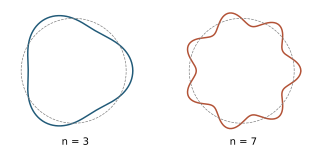
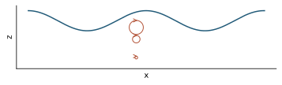
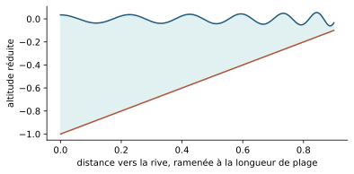
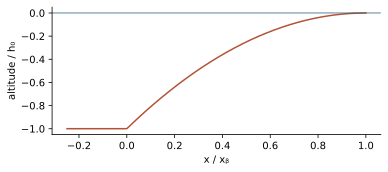
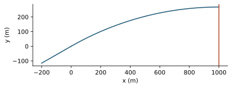
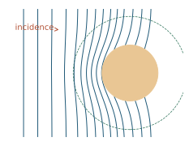
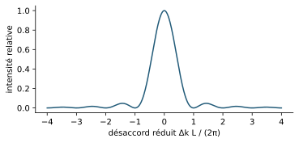
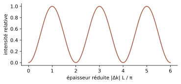
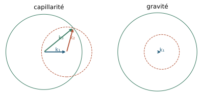

# ENS Ulm PC 2017 — Physique C · Corrigé brut

*Corrigé rédigé par IA, non officiel. Signalez toute erreur.*

**Lecture du rapport du jury** · GPT-6.2 Astra Ultra · vitesse non renseignée

**Rédaction** · GPT-6.2 Astra Ultra · vitesse non renseignée

## Ondes de surface

## Oscillations gravitaires en tube

### Question 1 — Oscillation du niveau

Si le niveau gauche est initialement plus haut, l’excès de pression hydrostatique pousse l’eau vers le bras droit. Le niveau gauche descend, dépasse l’équilibre par inertie puis remonte. Sans dissipation les oscillations conservent la même amplitude.

### Question 2 — Conservation du volume

La montée $\eta$ à gauche compense exactement la baisse $\eta$ à droite, car les deux sections valent $S$. L’incompressibilité impose un débit $S\dot\eta$ en valeur algébrique tout le long du tube. Dans le modèle unidimensionnel sans frottement, $\mathbf v=\dot\eta\mathbf e_z$ dans le bras gauche et $-\dot\eta\mathbf e_z$ à droite.

### Question 3 — Énergie cinétique du liquide entier

La norme de la vitesse est $|\dot\eta|$ dans les deux bras et le coude. Le liquide a pour masse $\rho SL$. L’intégrale de $\rho v^2/2$ sur tout le système donne donc $E_c=\rho SL\dot\eta^2/2$.

### Question 4 — Énergie de pesanteur

Par rapport à l’équilibre, le bras gauche gagne la tranche d’énergie $\rho gS\int_0^\eta z\,dz$ et l’autre perd $\rho gS\int_{-\eta}^0 z\,dz$. La différence totale vaut $E_g-E_g(0)=\rho gS\eta^2$, positive pour les deux sens de déplacement. Le fluide qui reste sous les deux niveaux de référence a une contribution constante.

### Question 5 — Équation de l’oscillateur

La dérivée de $\rho SL\dot\eta^2/2+\rho gS\eta^2$ est nulle, donc $\ddot\eta+(2g/L)\eta=0$ par continuité également aux points de rebroussement. Avec $\eta(0)=\eta_0$ et $\dot\eta(0)=0$, $\eta(t)=\eta_0\cos(\sqrt{2g/L}\,t)$.

### Question 6 — Période en secondes

On lit $\omega^2=2g/L$. Pour $L=2{,}00\,\mathrm m$, la période est $T=2\pi\sqrt{L/(2g)}=2{,}01\,\mathrm s$. C’est le temps d’un aller-retour complet du niveau.

### Question 7 — Observation réelle

Une période de deux secondes se suit à l’œil. En pratique la viscosité, les pertes dans le coude et le frottement du ménisque sur le verre amortissent l’oscillation. Pour un tube étroit, la tension superficielle et l’hystérésis de la ligne de contact peuvent également affecter le retour à l’équilibre.

### Question 8 — Pendule équivalent

À petite amplitude un pendule simple de longueur $\ell$ vérifie $\omega^2=g/\ell$. En prenant $\ell=L/2$ on retrouve exactement $2g/L$, donc les mêmes périodes pour l’eau et le pendule, conformément à la proposition de Newton.

### Question 9 — Modèle historique de la vague

Le tube fictif a $L=\lambda/2$, donc $T=\pi\sqrt{\lambda/g}$. Le passage d’une crête à un creux en A prend $T/2=(\pi/2)\sqrt{\lambda/g}$. Pendant ce temps la phase avance de $\lambda/2$, d’où $c_\phi=\lambda/T=\sqrt{g\lambda}/\pi$, proportionnelle à la racine de la longueur d’onde.

### Question 10 — Dispersion approchée

Avec $k=2\pi/\lambda$, $\omega=c_\phi k$ donne $\omega^2=(2/\pi)gk$. Le modèle reproduit la dépendance en $k$ mais sous-estime la pulsation d’un facteur $\sqrt{2/\pi}$ par rapport à la loi d’eau profonde. Le mouvement de l’eau n’y est pas contraint par un tube.

## Modes capillaires d’une goutte

### Question 11 — Sphéricité

Pour un volume imposé et une tension $\gamma>0$ uniforme, l’énergie de surface est $\gamma S$. La sphère minimise l’aire pour ce volume. Lorsque la gravité et les interactions avec un support sont négligeables, cette minimisation fixe la forme d’équilibre.

### Question 12 — Comparaison des énergies

L’aire sphérique donne $E_T=4\pi\gamma R^2$. Dans le champ uniforme, $E_g=\rho g\int z\,dV$. La sphère homogène tangente au support a son centre de masse à $z=R$ par symétrie. On obtient donc $E_g=(4\pi/3)\rho gR^4$ en prenant le point de contact pour référence.

### Question 13 — Rayon critique

Le rapport $E_g/E_T=\rho gR^2/(3\gamma)$ atteint l’unité pour $R_c=\sqrt3 L_c$, avec $L_c=\sqrt{\gamma/(\rho g)}=2{,}71\,\mathrm{mm}$ et $R_c=4{,}69\,\mathrm{mm}$ pour l’eau. Les gouttes de rayon bien inférieur à cette échelle sont dominées par la capillarité.

### Question 14 — Ajustement du rayon moyen

Le volume vaut $h\int_0^{2\pi}R^2d\theta/2=\pi h(R_1^2+a_n^2/2)=\pi hR_0^2$. Ainsi $R_1=\sqrt{R_0^2-a_n^2/2}\simeq R_0-a_n^2/(4R_0)$. L’ajustement est du second ordre, le terme moyen de $\cos(n\theta)$ étant nul.

### Question 15 — Élément d’arc

Le déplacement le long du contour est $d\mathbf r=\mathbf e_r\partial_\theta R\,d\theta+R\mathbf e_\theta\,d\theta$. Les deux composantes sont perpendiculaires. Pour $d\theta>0$, $dl=R\sqrt{1+(\partial_\theta R/R)^2}\,d\theta$.

### Question 16 — Énergie de la déformation

Au second ordre $dl\simeq[R+(\partial_\theta R)^2/(2R_0)]d\theta$. Son intégrale est $2\pi R_1+\pi n^2a_n^2/(2R_0)$. Après insertion de Q14 et soustraction du périmètre au repos, l’aire latérale augmente de $\Delta S=\pi h(n^2-1)a_n^2/(2R_0)$. L’énergie de rappel est $E_T=\gamma\Delta S$.

### Question 17 — Potentiel harmonique

L’incompressibilité impose $\nabla\cdot\mathbf v=0$. Avec la convention $\mathbf v=-\nabla\phi$ donnée par le sujet, on obtient directement $\Delta\phi=0$ dans le liquide.

### Question 18 — Profil radial

La séparation $\phi=b_n(r,t)\cos(n\theta)$ conduit à $r^2 b_n''+r b_n'-n^2 b_n=0$. Les solutions radiales sont $r^{n}$ et $r^{-n}$. La régularité au centre élimine la seconde, donc $b_n=c_n(t)r^n$.

### Question 19 — Condition cinématique au bord

Le bord est matériel. À l’ordre linéaire $v_r(R_0,\theta,t)=\partial_tR=\dot a_n\cos(n\theta)$, car le terme d’advection azimutal de la déformation est d’ordre deux. Or $v_r=-nc_nR_0^{n-1}\cos(n\theta)$. Donc $\phi=-\dot a_n r^n\cos(n\theta)/(nR_0^{n-1})$ à une constante purement temporelle près.

### Question 20 — Énergie du champ de vitesses

Par intégration de la densité massique d’énergie cinétique, $E_c=(\rho/2)\iiint_V|\nabla\phi|^2\,dV$. Le remplacement du volume légèrement déformé par le cylindre au repos suffit dans le terme quadratique en amplitude.

### Question 21 — Passage à une divergence

La règle du produit donne $\nabla\cdot(\phi\nabla\phi)=|\nabla\phi|^2+\phi\Delta\phi$. Le dernier terme est nul d’après Q17, d’où l’identité demandée.

### Question 22 — Intégration sur le cylindre fermé

Le théorème de la divergence donne $E_c=(\rho/2)\iint_{\partial V}\phi\partial_n\phi\,dS$. Le flux est nul sur les deux disques horizontaux car $\partial_z\phi=0$. Sur la paroi, $dS=hR_0d\theta$, $\phi=-R_0\dot a_n\cos(n\theta)/n$ et $\partial_r\phi=-\dot a_n\cos(n\theta)$. Puisque $\int_0^{2\pi}\cos^2(n\theta)d\theta=\pi$, $E_c=\rho\pi hR_0^2\dot a_n^2/(2n)$.

### Question 23 — Pulsations propres

La conservation de $E_c+E_T$ donne $\ddot a_n+\omega_n^2a_n=0$ avec $\omega_n^2=\gamma n(n^2-1)/(\rho R_0^3)$. L’épaisseur disparaît car le rappel capillaire et l’inertie sont tous deux proportionnels à $h$.

### Question 24 — Valeurs pour les modes trois et sept

En prenant $R_0=5{,}00\times10^{-3}\,\mathrm m$ et $\gamma=0{,}0720\,\mathrm{N/m}$, $f_n=\sqrt{\gamma n(n^2-1)/(\rho R_0^3)}/(2\pi)$. Les valeurs sont $f_3=18{,}7\,\mathrm{Hz}$ et $f_7=70{,}0\,\mathrm{Hz}$. Le mode plus fin présente la fréquence la plus élevée.

### Question 25 — Quantification le long du contour

Il y a $n$ périodes le long de $2\pi R_0$, donc $\lambda_n=2\pi R_0/n$ et $k_n=n/R_0$. La loi se réécrit $\omega_n^2=(\gamma/\rho)k_n(k_n^2-1/R_0^2)$ pour les modes entiers $n\ge2$.

### Question 26 — Courtes longueurs d’onde

Pour $\lambda_n\ll2\pi R_0$, $k_nR_0=n\gg1$. La correction de courbure devient petite et $\omega_n^2\simeq(\gamma/\rho)k_n^3$. On retrouve la dispersion capillaire locale d’une interface pratiquement plane.

## Vagues et énergie en eau profonde

### Question 27 — Décroissance avec la profondeur

Pour $\phi=bf(z)\cos(\omega t-kx+\psi)$, l’équation de Laplace donne $f''-k^2 f=0$. Le terme $e^{-kz}$ divergerait quand $z\to-\infty$ et n’est pas physique. La condition $f(0)=1$ fixe donc $f=e^{kz}$.

### Question 28 — Surface libre matérielle

La fonction $F=z-\eta(x,t)$ reste nulle sur une particule de l’interface. Sa dérivée matérielle donne $v_z=\partial_t\eta+v_x\partial_x\eta$. En remplaçant les composantes de vitesse, il vient $\partial_t\eta-\partial_x\eta\,\partial_x\phi=-\partial_z\phi$, les dérivées du potentiel étant évaluées en $z=\eta$.

### Question 29 — Linéarisation

Le facteur vertical vaut $e^{k\eta}=1+O(k\eta)$ sur la surface. Comme $\phi$ est déjà du premier ordre en amplitude, on peut évaluer $\partial_z\phi$ en zéro au même ordre. Le produit $\partial_x\eta\,\partial_x\phi$ est quadratique et la condition devient $\partial_t\eta=-\partial_z\phi(x,0,t)$ pour $ka\ll1$.

### Question 30 — Phase du potentiel

Posons $s=\omega t-kx$, de sorte que $\eta=a\cos s$ et $\partial_t\eta=-a\omega\sin s$. Il faut alors $bk\cos(s+\psi)=a\omega\sin s$. Un choix avec $b>0$ est $b=a\omega/k$, $\psi=-\pi/2$, donc $\phi=(a\omega/k)e^{kz}\sin s$.

### Question 31 — Orbites des particules

À la position moyenne $(x,z)$, $v_x=a\omega e^{kz}\cos s$ et $v_z=-a\omega e^{kz}\sin s$. À l’ordre un leur intégration donne $x_P=x+ae^{kz}\sin s$ et $z_P=z+ae^{kz}\cos s$. Le rayon de l’orbite circulaire est $ae^{kz}$. À son sommet la particule se déplace vers $+x$, donc le mouvement est horaire dans le plan dessiné avec $z$ vers le haut.

### Question 32 — Énergie cinétique surfacique

Les deux composantes en quadrature donnent $v^2=a^2\omega^2e^{2kz}$ et $e_c=\rho v^2/2$ en $\mathrm{J/m^3}$. Intégrer jusqu’à $z=0$ suffit au second ordre, car la correction de borne est d’ordre trois. De $\int_{-\infty}^0 e^{2kz}dz=1/(2k)$ il vient $\langle E_c\rangle=\rho a^2\omega^2/(4k)$ en $\mathrm{J/m^2}$.

### Question 33 — Énergie de pesanteur des vagues

Un élément a $dE_g=\rho gz\,dx\,dy\,dz$, soit $e_p=\rho gz$. L’excès par rapport à la mer au repos est par unité d’aire $\int_0^\eta\rho gz\,dz=\rho g\eta^2/2$, également positif pour un creux. Puisque $\langle\cos^2s\rangle=1/2$, $\langle E_g\rangle=\rho ga^2/4$.

### Question 34 — Aire supplémentaire

Sur une bande d’épaisseur $dy$, le profil incliné a pour longueur $\sqrt{dx^2+d\eta^2}$. En retirant l’aire horizontale, $dS=[\sqrt{1+(\partial_x\eta)^2}-1]dx\,dy$. Le signe de la pente n’intervient pas dans cet excès.

### Question 35 — Énergie capillaire moyenne

À pente faible, l’excès relatif d’aire vaut $(\partial_x\eta)^2/2$. Avec $\partial_x\eta=ak\sin s$, sa moyenne vaut $a^2k^2/4$. On trouve donc $\langle E_{\rm cap}\rangle=\gamma k^2a^2/4$.

### Question 36 — Dispersion gravité–capillarité

L’équipartition impose $\rho a^2\omega^2/(4k)=\rho ga^2/4+\gamma k^2a^2/4$. On en tire $\omega^2=gk+(\gamma/\rho)k^3$. Les grandes longueurs d’onde sont sensibles à la gravité, les petites à la tension superficielle.

### Question 37 — Quantité de mouvement transportée

En intégrant $\rho v_x$ jusqu’à la surface instantanée, $P_x=(\rho a\omega/k)\cos s\,e^{k\eta}$. Le premier terme, proportionnel à $\cos s$, a une moyenne nulle. Au second ordre, $e^{k\eta}\simeq1+ka\cos s$ donne $\langle\mathbf P\rangle=\rho a^2\omega\mathbf e_x/2=\rho c_\phi a^2k\mathbf e_x/2$. C’est le terme de borne mobile qui survit dans ce calcul.

### Question 38 — Action de l’onde

La quantité $\mathcal A=\rho c_\phi a^2/2=\langle E_m\rangle/\omega$ est l’action par unité de surface, de dimension $\mathrm{J\,s/m^2}$. Elle relie aussi $\langle\mathbf P\rangle$ à $\mathbf k$. Une fois intégrée sur une aire, l’action a la même dimension que la constante de Planck réduite $\hbar$. Le rapport du jury précise que les densités surfaciques imposent cette distinction.

## Variations de profondeur et réfraction

### Question 39 — Flux d’énergie stationnaire

Dans une bande de largeur unité entre $x$ et $x+dx$, le flux entrant est $c(x)E(x)$ et le sortant $(cE)(x+dx)$. En régime stationnaire, sans dissipation, source ni réflexion appréciable, leur différence est nulle. On obtient $d(cE)/dx=0$. Ici l’eau peu profonde est non dispersive et la vitesse de transport de l’énergie est $c=\sqrt{gh}$.

### Question 40 — Raccourcissement des vagues

Puisque $h(x)=h_0-x\tan\beta$ et $f$ reste constante, $\lambda(x)=\sqrt{g(h_0-x\tan\beta)}/f=\lambda_0\sqrt{1-x\tan\beta/h_0}$. Les fronts sont plus rapprochés à l’approche de la rive.

### Question 41 — Croissance de l’amplitude

Avec $E=\rho ga^2/2$, le flux constant impose $a^2\sqrt h=a_0^2\sqrt{h_0}$. On trouve $a(x)=a_0[h_0/(h_0-x\tan\beta)]^{1/4}$ pour une propagation normale au rivage et en l’absence de pertes.

### Question 42 — Fin de validité et déferlement

La formule finirait par prédire une amplitude divergente alors que $h$ tend vers zéro. Le rapport $a/h\propto h^{-5/4}$ cesse rapidement d’être petit. La vague se raidit, se déforme puis déferle. Une partie de l’énergie devient turbulence, mouvement moyen et chaleur et une autre peut être réfléchie. Le schéma représente la zone pré-déferlement, où amplitude et resserrement des crêtes augmentent ensemble.

### Question 43 — Réfraction sur la marche

À $x=0$, les phases doivent avoir les mêmes dépendances en $t$ et en $y$. La pulsation et la composante tangentielle sont donc conservées, $k_0\sin\alpha_0=k_1\sin\alpha_1$. Comme $k=\omega/\sqrt{gh}$, $k_1>k_0$ et $|\alpha_1|<|\alpha_0|$ lorsque l’eau devient moins profonde. C’est la loi de Snell–Descartes avec un indice effectif proportionnel à $1/c$.

### Question 44 — Invariant de la direction

Chaque interface fictive à $x$ fixé conserve la composante selon $y$ du vecteur d’onde. Par composition entre toutes les couches, $k(x)\sin\alpha(x)=k_0\sin\alpha_0=K$. Cette conservation exprime l’invariance de la bathymétrie par translation selon $y$.

### Question 45 — Pente du rayon

La tangente au rayon suit $\mathbf k$. Pour une propagation vers $+x$, $dy_R/dx=k_y/k_x=\tan\alpha=K/\sqrt{k(x)^2-K^2}$. La racine positive correspond à l’onde qui avance vers la plage.

### Question 46 — Fond parabolique

Le fond est horizontal à $-h_0$ pour $x<0$, puis $z_f=-h_0(1-x/x_b)^2$ jusqu’à la rive. Il remonte avec une tangente qui devient horizontale à $x_b$. En posant $u=1-x/x_b$, on a $c=c_0u$ et $k=k_0/u$. Alors $dy_R/dx=u\sin\alpha_0/\sqrt{1-u^2\sin^2\alpha_0}$.

### Question 47 — Variables sans dimension

Avec $\xi=1-x/x_b$ et $\eta=y_R/x_b$, $d\eta/d\xi=-dy_R/dx$. On retrouve $d\eta/d\xi=-\xi\sin\alpha_0/\sqrt{1-\xi^2\sin^2\alpha_0}$. Le signe moins vient de la coordonnée dirigée vers le large.

### Question 48 — Arc de cercle

Notons $s=\sin\alpha_0>0$. Une primitive est $\eta=C+\sqrt{1-s^2\xi^2}/s$. En remettant les unités et en élevant au carré, $(x-x_b)^2+(y_R-Cx_b)^2=x_b^2/s^2$. Le centre se trouve sur la droite du rivage et le rayon vaut $x_b/s$ (ou $x_b/|s|$ pour une incidence signée).

### Question 49 — Trajectoire pour trente degrés

Pour $y_R(0)=0$, $C=-\cot\alpha_0$. Le centre est donc $(1000,-1732)\,\mathrm m$, le rayon $2000\,\mathrm m$, et $y_R=-1732+\sqrt{2000^2-(x-1000)^2}$ en mètres sur la plage. L’arc monte de 0 à $268\,\mathrm m$ et sa tangente à la rive est horizontale. Avant $x=0$ le rayon est une droite de pente $\tan30^\circ$.

### Question 50 — Direction à la plage

À mesure que $h$ tend vers zéro, $k$ augmente alors que $K=k\sin\alpha$ reste fini. Ainsi $\alpha$ tend vers zéro. Les rayons arrivent approximativement perpendiculairement au trait de côte et les crêtes deviennent parallèles au rivage, jusqu’aux limites du modèle linéaire.

### Question 51 — Lecture de la photographie

Sur le cliché, les crêtes au large sont obliques par rapport à la côte incurvée. Plus près du sable, elles épousent la forme de la côte et se resserrent sous l’effet de la diminution de profondeur. Les bandes claires au bord correspondent à l’écume du déferlement. L’augmentation de $a/h$ explique cette rupture de la description linéaire.

### Question 52 — Contournement d’une île

En dehors du cône sous-marin la profondeur est constante et les fronts incidents sont droits. Près de l’île, la partie du front située au-dessus du haut-fond ralentit avant ses parties latérales. Le front se cintre. Il se rapproche localement des lignes de côte et les rayons se courbent vers les faibles profondeurs. Les deux branches se dévient de façon symétrique de part et d’autre de l’axe incident.

### Question 53 — Limite de la géométrie des rayons

Si $R$ est comparable à $\lambda$, les variations de profondeur et la dimension de l’obstacle ne sont plus lentes sur une période spatiale. La diffraction devient importante, élargit les directions de propagation et envoie aussi de l’énergie dans la région abritée derrière l’île.

## Addition de fréquences optiques

### Question 54 — Équation d’onde non linéaire

Dans le milieu neutre transverse, $\nabla\times\nabla\times\mathbf E=-\Delta\mathbf E$. Faraday et Maxwell–Ampère donnent $\partial_x^2E-c^{-2}\partial_t^2E=\mu_0\partial_tj$. En insérant $j=\epsilon_0\partial_t[(n^2-1)E+\chi E^2]$, il vient $\partial_x^2E-(n^2/c^2)\partial_t^2E=(\chi/c^2)\partial_t^2(E^2)$. Le terme linéaire $n(\omega)$ s’entend composante spectrale par composante spectrale.

### Question 55 — Fréquences supplémentaires

En notant $u_p=e^{i(\omega_pt-k_px)}$, la partie linéaire devient $\sum_p(A_p''-2ik_pA_p')u_p$ parce que $k_p=n_p\omega_p/c$. Le second membre contient $-(\chi/c^2)\sum_{p,q}(\omega_p+\omega_q)^2A_pA_qu_pu_q$. Le champ réel ajoute aussi les différences de fréquences via les conjugués. Doubles, sommes et différences montrent que le système à trois ondes est une troncature. Pour une échelle d’enveloppe $L_A\gg1/k_p$, $|A_p''|/|k_pA_p'|\sim1/(k_pL_A)\ll1$.

### Question 56 — Onde fille et désaccord

Les produits ordonnés $(1,2)$ et $(2,1)$ alimentent la somme $\omega_3$. Après division par $e^{i(\omega_3t-k_3x)}$, $-2ik_3 A_3'=-(2\chi\omega_3^2/c^2) A_1A_2e^{-i\Delta kx}$ avec la convention d’amplitudes du sujet. Donc $A_3'=-i\chi\omega_3^2A_1A_2e^{-i\Delta kx}/(k_3c^2)$. En général les trois indices diffèrent par dispersion et la relation en fréquences n’implique pas $\Delta k=0$.

### Question 57 — Somme cohérente dans l’épaisseur

Posons $C=\chi\omega_3^2/(k_3c^2)$ et supposons les deux amplitudes incidentes constantes. Avec $A_3(0)=0$, l’intégration donne $A_3(L)=-iCA_1A_2L e^{-i\Delta kL/2}\operatorname{sinc}(\Delta kL/2)$ où $\operatorname{sinc}u=\sin(u)/u$. À l’accord de phase, la limite est $-iCA_1A_2L$.

### Question 58 — Intensité de la somme

Le vecteur de Poynting moyen d’une onde plane fait intervenir $B=nE/c$, d’où $I_p=n_p\epsilon_0c|A_p|^2/2$. De Q57 on tire $|A_3|^2=C^2|A_1A_2|^2L^2\operatorname{sinc}^2(\Delta kL/2)$. Ainsi $I_3=H I_1I_2 L^2\operatorname{sinc}^2(\Delta kL/2)$, $H=2n_3C^2/(n_1n_2\epsilon_0c)$. L’identité $2-2\cos u=4\sin^2(u/2)$ donne la même forme.

### Question 59 — Courbe de résonance

À épaisseur fixée l’intensité a un maximum central en $\Delta k=0$, des zéros en $\Delta k=2\pi m/L$, $m\ne0$, et des lobes secondaires décroissants. Le profil en sinus cardinal carré apparaît aussi dans la diffraction de Fraunhofer par une fente rectangulaire uniformément éclairée. Dans les deux cas on additionne des contributions uniformes sur un intervalle.

### Question 60 — Variation avec l’épaisseur

À désaccord non nul, $I_3=4H I_1I_2\sin^2(\Delta kL/2)/(\Delta k)^2$. Les maxima se rencontrent pour $L=(2m+1)\pi/|\Delta k|$, $m\ge0$, et les zéros pour les multiples de $2\pi/|\Delta k|$. Les tranches successives finissent par émettre en opposition de phase.

### Question 61 — Indices et échelles numériques

La somme des fréquences donne $\lambda_3=(1/1300+1/800)^{-1}=495\,\mathrm{nm}$. Les corrections d’indice $n_p-B$ sont $0{,}00296$, $0{,}00781$ et $0{,}0204$. Avec $k_p=2\pi n_p/\lambda_p$, on trouve $k_1=7{,}26\times10^6$, $k_2=1{,}18\times10^7$, $k_3=1{,}93\times10^7\,\mathrm{m^{-1}}$. En gardant les chiffres de calcul pour la soustraction, $\Delta k=-1{,}83\times10^5\,\mathrm{m^{-1}}$. À $L=1\,\mathrm{mm}$, le maximum possible à accord de phase est $HL^2=1{,}72\times10^{-12}\,\mathrm{m^2/W}$. Avec le désaccord donné, la borne due à $\sin^2\le1$ est $2{,}06\times10^{-16}\,\mathrm{m^2/W}$ et le modèle d’indice non arrondi donne environ $2{,}95\times10^{-17}\,\mathrm{m^2/W}$ pour cette épaisseur, sensible à l’arrondi de phase. La condition générale est $(I_3/(I_1I_2))\sqrt{I_1I_2}\ll1$. Même à l’accord elle est assurée si $\sqrt{I_1I_2}\ll5{,}80\times10^{11}\,\mathrm{W/m^2}$. Le désaccord réduit encore le transfert.

## Résonances entre vagues

### Question 62 — Direction et sens des résonances

L’onde fille suit la diagonale du parallélogramme construit sur $\mathbf k_1$ et $\mathbf k_2$, entre leurs directions. Par unité d’action, Q37 et Q38 associent aux ondes la quantité de mouvement $\mathbf k$ et l’énergie $\omega$. Les deux conditions expriment donc la compatibilité des échanges de quantité de mouvement et d’énergie pour une conversion élémentaire. Elles n’imposent pas l’égalité des actions totales de trois trains arbitraires. Une faible dissipation laisse persister les ondes et leurs phases dans la zone commune. En optique, deux photons d’énergies $\hbar\omega_1,\hbar\omega_2$ donnent un photon de somme, avec l’accord des vecteurs d’onde.

### Question 63 — Pics du spectre

On trouve les deux fréquences incidentes $15$ et $18\,\mathrm{Hz}$ et leurs harmoniques $30$ et $36\,\mathrm{Hz}$. Le pic à $33\,\mathrm{Hz}$ est la somme des fréquences. Les combinaisons $2f_1+f_2=48$ et $f_1+2f_2=51\,\mathrm{Hz}$ peuvent provenir de mélanges successifs. La raie parasite à $50\,\mathrm{Hz}$ est caractéristique du secteur alimentant la chaîne de mesure.

### Question 64 — Domaine capillaire

On exige $k\gg k_c=\sqrt{\rho g/\gamma}=369\,\mathrm{m^{-1}}$. À la transition, les deux termes donnent la fréquence exacte $\sqrt{2gk_c}/(2\pi)=13{,}5\,\mathrm{Hz}$, soit une échelle de l’ordre de dix hertz. Dans le régime capillaire $k=[\rho(2\pi f)^2/\gamma]^{1/3}$. Pour les fréquences explicitées en Q65, $60$, $70$, $130\,\mathrm{Hz}$, cela donne $1{,}25\times10^3$, $1{,}39\times10^3$, $2{,}10\times10^3\,\mathrm{m^{-1}}$. Pour le spectre précédent à 15, 18 et 33 Hz, la formule pure donnerait respectivement 498, 562 et $842\,\mathrm{m^{-1}}$, avec une approximation moins bien justifiée.

### Question 65 — Construction par deux cercles

Plaçons $\mathbf k_1$ de O à A. L’extrémité B de la somme doit être à distance $k_2$ de A et $k_3$ de O. On intersecte donc les cercles de ces deux rayons. Les pulsations fixent les trois longueurs par la dispersion, donc le triangle OAB fixe l’angle entre $\mathbf k_1$ et $\mathbf k_2$, au signe d’orientation près.

### Question 66 — Angle capillaire

En prenant le carré de $\mathbf k_3=\mathbf k_1+\mathbf k_2$, $\cos\alpha=(k_3^2-k_1^2-k_2^2)/(2k_1k_2)$. Avec les valeurs non arrondies de Q64 pour 60 et 70 Hz, on trouve $\alpha=75{,}0^\circ$ à trois chiffres significatifs.

### Question 67 — Nombres d’onde gravitaires

Sous l’hypothèse $k\ll k_c$, $\omega^2=gk$. Les fréquences de 1, 2 et 3 Hz correspondent donc à $k=4\pi^2 f^2/g$, soit $4{,}02$, $16{,}1$ et $36{,}2\,\mathrm{m^{-1}}$. Ces valeurs sont bien inférieures au nombre d’onde de transition.

### Question 68 — Absence de triangle gravitaire

Quelle que soit l’orientation relative, l’extrémité de la somme est au plus à $k_1+k_2=20{,}1\,\mathrm{m^{-1}}$ de O. Or le cercle requis a un rayon $k_3=36{,}2\,\mathrm{m^{-1}}$. Les deux cercles ne se coupent pas. Aucun angle ne réalise simultanément les deux accords.

### Question 69 — Critère pour une loi de puissance

Pour $\omega=ck^\beta$ et $\omega_3=\omega_1+\omega_2$, $k_3=(k_1^\beta+k_2^\beta)^{1/\beta}$ dépasse chacun des deux nombres d’onde. La borne inférieure $|k_1-k_2|\le k_3$ est donc automatique. Il suffit et il faut $k_3\le k_1+k_2$, soit $k_1^\beta+k_2^\beta\le(k_1+k_2)^\beta$. En divisant par le membre de droite et en posant $u=k_1/(k_1+k_2)$, cette condition devient $u^\beta+(1-u)^\beta\le1$. Pour $0<u<1$, elle équivaut à $\beta\ge1$. À l’égalité les vecteurs sont colinéaires, pour $\beta>1$ un angle non nul existe. Les exposants capillaire $3/2$ et gravitaire $1/2$ expliquent les deux résultats.
