# ENS de Lyon — PC, Physique-chimie 2017 · Corrigé guidé

*Corrigé rédigé par IA, non officiel.*

**Rédaction (tour 1)** · GPT-6.2 Astra Ultra · vitesse non renseignée

## Physique. Élasticité et traction

### Question P1 — Traction transmise à la base

> [!INDICATION]
> Distinguez la force exercée sur le cube de celle qu'il transmet au matériau inférieur.

#### Solution

À l'équilibre, la force du dessous sur le cube, ajoutée à $a^2\sigma_z\vec u_z-\rho ga^3\vec u_z$, donne zéro. Par action réciproque, la contrainte que le cube transmet au matériau inférieur est $\vec\sigma_0=(\sigma_z-\rho ga)\vec u_z$. La traction reçue par le cube sur sa face inférieure est l'opposée. Pour une face supérieure libre, le cube appuie bien vers le bas.

### Question P2 — Condition de négligence du poids

> [!INDICATION]
> Comparez deux grandeurs de même dimension au niveau de la face.

#### Solution

Il faut $\rho ga\ll |\sigma_z|$ ou, en forces, $\rho ga^3\ll |F_z|$. À contrainte donnée, le rapport entre poids et force de surface décroît avec la dimension $a$ du domaine.

### Question P3 — Forces volumiques et surfaciques

> [!INDICATION]
> Imaginez isoler un sous-volume intérieur et demandez-vous où s'applique l'action.

#### Solution

La pesanteur agit sur tous les éléments de masse, même à l'intérieur. Sa résultante s'intègre sur le volume. Les tractions de contact sont exercées par la matière voisine à travers la frontière, y compris une surface de coupe fictive. La contribution élémentaire s'intègre sur cette surface et dépend en général de sa normale.

### Question P4 — Domaine linéaire

> [!INDICATION]
> Comparez l'allongement à la longueur initiale.

#### Solution

La déformation doit rester petite, $|\Delta L_n|/L_n\ll1$, et dans le domaine élastique linéaire du matériau. On peut employer la longueur et l'aire initiales, l'écart géométrique étant d'ordre supérieur.

### Question P5 — Ordre de grandeur du module de Young

> [!INDICATION]
> Reliez une grandeur élastique à la vitesse des ondes dans une tige métallique.

#### Solution

Pour une mince barre d'acier, la vitesse longitudinale a pour ordre de grandeur $c\sim5\times10^3$ m/s et la masse volumique $\rho\sim8\times10^3$ kg/m³. La relation $c\simeq\sqrt{E/\rho}$ conduit à $E\sim2\times10^{11}$ Pa, soit environ 200 GPa.

### Question P6 — Égalité des coefficients transversaux

> [!INDICATION]
> La symétrie des directions doit être celle des propriétés du matériau.

#### Solution

L'isotropie du matériau, ou au moins l'isotropie transverse dans le plan perpendiculaire à la traction, rend les directions $x$ et $y$ équivalentes pour une traction suivant $z$. On a alors $\nu_x=\nu_y=\nu$.

### Question P7 — Potentiel d'un système chargé

> [!INDICATION]
> Intégrez le travail d'une force conservant valeur et direction.

#### Solution

La force extérieure horizontale effectue le travail élémentaire $F\,dx$. Le travail interne réversible des ressorts est $-dE_p$. Pour un déplacement virtuel, la somme vaut $-d(E_p-Fx)$. À l'équilibre elle est nulle dans toute direction admissible et la stabilité exige un minimum du potentiel $\psi=E_p-Fx$.

### Question P8 — Énergie des six ressorts

> [!INDICATION]
> Les énergies sont quadratiques, il suffit de développer chaque allongement diagonal au premier ordre.

#### Solution

Les deux côtés horizontaux s'allongent de $x$ et les deux verticaux de $-2z$. Chaque diagonale passe de $a\sqrt2$ à $\sqrt{(a+x)^2+(a-2z)^2}$, soit un allongement $(x-2z)/\sqrt2$ au premier ordre. En sommant les six énergies, $\psi=kx^2+4kz^2+(k'/2)(x-2z)^2-Fx$ à l'ordre deux dans l'énergie élastique.

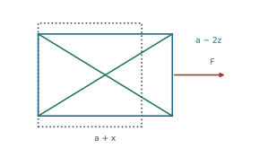

### Question P9 — Conditions de stationnarité

> [!INDICATION]
> La force impose le travail suivant $x$ mais ne fixe pas le déplacement transverse.

#### Solution

Dériver la forme quadratique donne $\partial_x\psi=2kx+k'(x-2z)-F=0$ et $\partial_z\psi=8kz-2k'(x-2z)=0$. La deuxième relation se divise par deux. Les raideurs positives rendent le minimum stable.

### Question P10 — Coefficient de Poisson du réseau

> [!INDICATION]
> La variation totale de la hauteur vaut deux fois le déplacement d'un bord, avec le signe de la contraction.

#### Solution

Comme $\Delta L_z=-2z$ et $\Delta L_x=x$, $\nu=2z/x=k'/(2k+k')$. Pour $k,k'>0$, $0<\nu<1$. Il tend vers 0 si les diagonales sont très souples, vers 1 si elles sont presque inextensibles. Pour $k=k'$, $\nu=1/3$. Les limites concernent ce réseau plan, dont l'isotropie tridimensionnelle générale n'est pas assurée.

### Question P11 — Rigidité longitudinale et taille de l'échantillon

> [!INDICATION]
> Employez $F/a^2$ comme contrainte et $x/a$ comme déformation.

#### Solution

La première équation donne $F/x=2k+k'(1-\nu)=4k(k+k')/(2k+k')$, donc $E=4k(k+k')/[a(2k+k')]$. Il passe de $2k/a$ à $4k/a$ lorsque $k'/k$ croît de zéro à l'infini. À rapport des raideurs fixé, $E$ intensif exige $k,k'\propto a$. Doubler toutes les dimensions revient à mettre deux éléments en série sur la longueur et quatre colonnes en parallèle sur la section, donc à doubler la raideur effective.

## Contraintes planes et cisaillement

### Question P12 — Traction suivant z

> [!INDICATION]
> Utilisez la loi de Hooke dans la direction chargée, puis la contraction de Poisson.

#### Solution

Dans l'ordre $(x,y,z)$, les déformations de la situation (a) sont $(-\nu\sigma_z/E,-\nu\sigma_z/E,\sigma_z/E)$. Les deux contractions sont égales dans le matériau isotrope.

### Question P13 — Traction suivant x

> [!INDICATION]
> Permutez les axes de la situation précédente.

#### Solution

Pour (b), $(\varepsilon_x,\varepsilon_y,\varepsilon_z)=(\sigma_x/E,-\nu\sigma_x/E,-\nu\sigma_x/E)$. Un signe négatif de $\sigma_x$ inverse tous ces déplacements.

### Question P14 — Superposition des deux chargements

> [!INDICATION]
> C'est la linéarité de la loi de comportement à faibles déformations qui autorise la somme.

#### Solution

Pour (c), $\varepsilon_x=(\sigma_x-\nu\sigma_z)/E$, $\varepsilon_y=-\nu(\sigma_x+\sigma_z)/E$ et $\varepsilon_z=(\sigma_z-\nu\sigma_x)/E$. La variation produite par chaque chargement s'ajoute composante par composante.

### Question P15 — Extension et compression de même amplitude

> [!INDICATION]
> Développez le produit des trois facteurs $1+\varepsilon_i$ au premier ordre.

#### Solution

Pour $\sigma_z=\sigma$, $\sigma_x=-\sigma$, on trouve $\varepsilon_z=(1+\nu)\sigma/E=-\varepsilon_x$ et $\varepsilon_y=0$. Ainsi $\Delta V/V=\varepsilon_x+\varepsilon_y+\varepsilon_z=0$ au premier ordre. La forme change, le volume reste constant à cet ordre.

### Question P16 — Module de cisaillement du caoutchouc

> [!INDICATION]
> Utilisez la pente au voisinage de l'origine en transformant le pourcentage en fraction.

#### Solution

Dans la figure 5, le début de la courbe passe approximativement par $(5\,\%,0{,}11\,\mathrm{MPa})$, ce qui donne $G\simeq0{,}11/0{,}05\simeq2\,\mathrm{MPa}$. Les points s'écartent ensuite de cette droite et, aux grandes déformations, suivent une évolution sensiblement affine de pente plus faible. L'étude linéaire utilise la tangente initiale.

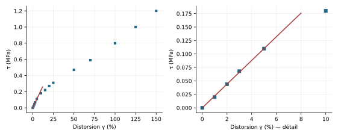

### Question P17 — Symétrie des cisaillements

> [!INDICATION]
> Calculez les moments autour du centre avant de prendre la limite d'un petit volume.

#### Solution

Les couples des tractions exercées sur les deux paires de faces ont des signes opposés et des modules $\tau a^3$ et $\tau' a^3$. Sans couple volumique et en équilibre il faut $\tau=\tau'$. En dynamique, $I\dot\omega$ est de l'ordre de $\rho a^5\dot\omega$ pour une accélération angulaire bornée. Après division par $a^3$, le terme inertiel tend vers zéro avec $a^2$. L'égalité des composantes du tenseur des contraintes subsiste localement.

### Question P18 — Module de cisaillement du réseau

> [!INDICATION]
> Exploitez la dérivée du potentiel par rapport à $x$, puis reliez le déplacement à la demi-distorsion.

#### Solution

À partir du potentiel donné, $4k'x=\sqrt2 F$ et $4(k+k')z=\sqrt2 F$. La résultante de deux forces orthogonales $\tau a^2$ vaut $F=\sqrt2\tau a^2$. Au premier ordre $\gamma/2\simeq x/a$, donc $G=\tau/\gamma=k'/a$. Les ressorts diagonaux donnent la résistance au cisaillement. Elle disparaît si $k'$ tend vers zéro.

### Question P19 — Traction sur la première diagonale

> [!INDICATION]
> Dans le bilan sur le prisme triangulaire, pondérez les contraintes par les aires des faces.

#### Solution

Les deux petites faces perpendiculaires du coin BCD sont chargées par des forces tangentielles égales. Leur résultante est dirigée suivant $\vec u_X=(\vec u_x+\vec u_z)/\sqrt2$, avec un module $\sqrt2$ fois l'une des deux forces. La face inclinée a aussi une aire $\sqrt2$ fois celle d'une petite face. L'action réciproque sur la face de normale $\vec u_X$ du carré intérieur est donc $\vec\sigma_1=\tau\vec u_X$, une traction normale.

### Question P20 — Traction sur la seconde diagonale

> [!INDICATION]
> Appliquez le même bilan sur le coin adjacent, en inversant la composante qui change de face.

#### Solution

Sur la face de normale $\vec u_Z=(-\vec u_x+\vec u_z)/\sqrt2$, la traction vaut $\vec\sigma_2=-\tau\vec u_Z$. La seconde diagonale est comprimée dans la même proportion que la première est étirée.

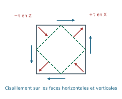

### Question P21 — Déplacement du sommet dans les axes principaux

> [!INDICATION]
> Projetez le rayon initial du point D sur les deux directions principales.

#### Solution

En prenant le centre $A$ fixe, $\overrightarrow{AD}=a\vec u_z=a(\vec u_X+\vec u_Z)/\sqrt2$. Les deux déformations normales sont $e=(1+\nu)\tau/E$ et $-e$. Dans la déformation symétrique (sans rotation rigide), $\overrightarrow{DD'}=ae(\vec u_X-\vec u_Z)/\sqrt2=ae\vec u_x$. La composante verticale est nulle.

### Question P22 — Déplacement par cisaillement

> [!INDICATION]
> Repérez le partage de la distorsion entre les deux axes dans la déformation symétrique.

#### Solution

La distorsion angulaire est $\gamma=\tau/G$. Avant la rotation rigide qui rendrait horizontal le bord du schéma de cisaillement simple, les directions initialement orthogonales tournent chacune de $\gamma/2$ en valeur absolue. À la hauteur $AD=a$, $(DD')_x=a\gamma/2=a\tau/(2G)$ au premier ordre.

### Question P23 — Lien entre les modules

> [!INDICATION]
> Les deux projections calculées décrivent le même déplacement du même point.

#### Solution

L'égalité $a\tau(1+\nu)/E=a\tau/(2G)$ conduit à $E=2G(1+\nu)$ pour un matériau élastique linéaire isotrope. La relation est homogène puisque $\nu$ est sans dimension.

### Question P24 — Rupture inclinée sous compression

> [!INDICATION]
> Projetez la traction sur un plan dont la normale est inclinée.

#### Solution

Une compression uniaxiale d'amplitude $p$ donne sur un plan incliné une contrainte tangentielle de module $p|\sin\theta\cos\theta|=(p/2)|\sin2\theta|$. Elle est maximale à 45°. Dans un matériau sensible au glissement, une fissure ou une bande de cisaillement peut donc s'orienter de cette manière.

## Viscoélasticité et modèle de Maxwell

### Question P25 — Linéarité du modèle de Maxwell

> [!INDICATION]
> Vérifiez les lois des deux éléments et les conditions à leur jonction.

#### Solution

Les lois $\sigma_e=E\varepsilon_e$ et $\sigma_v=\eta\dot\varepsilon_v$ sont linéaires à coefficients constants. En série $\sigma_e=\sigma_v$ et $\varepsilon=\varepsilon_e+\varepsilon_v$. Ces opérations préservent la linéarité.

### Question P26 — Fluide ou solide à long terme

> [!INDICATION]
> Maintenez une contrainte constante au lieu d'imposer une position constante.

#### Solution

Le ressort prend une déformation finie $\sigma/E$ tandis que l'amortisseur se déforme à vitesse constante $\sigma/\eta$. L'allongement total croît au cours du temps. Le modèle décrit donc un fluide viscoélastique, qui peut paraître élastique à temps court.

### Question P27 — Calibrage du rhéomètre

> [!INDICATION]
> Convertissez force en contrainte et déplacement en déformation relative sur la distance initiale.

#### Solution

Avec $\sigma=F/S$ et $\varepsilon=d_1/d_0$, le ressort présente $k=ES/d_0$ et l'amortisseur $\lambda=\eta S/d_0$. Il en résulte $E=kd_0/S$ en Pa et $\eta=\lambda d_0/S$ en Pa·s.

### Question P28 — Loi différentielle de Maxwell

> [!INDICATION]
> Dérivez la somme des déformations et remplacez les deux contraintes par la contrainte commune.

#### Solution

Le nœud entre les deux éléments est sans inertie. Il transmet donc la même contrainte, tandis que les déformations s'ajoutent. Il vient $\dot\varepsilon=\dot\sigma/E+\sigma/\eta$, soit $\dot\sigma+\sigma/T=E\dot\varepsilon$ avec $T=\eta/E$.

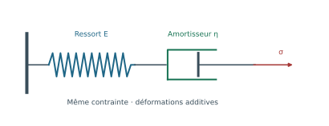

### Question P29 — Analogue électrique

> [!INDICATION]
> Choisissez quelles grandeurs mécaniques correspondent à la tension et au courant, puis vérifiez les lois de connexion.

#### Solution

Une correspondance possible est $\sigma\leftrightarrow U$ et $\dot\varepsilon\leftrightarrow I$. La tension est commune et les courants s'ajoutent, d'où un circuit parallèle. Le ressort donne $I_C=C\dot U$ avec $C\leftrightarrow1/E$ et l'amortisseur donne $I_R=U/R$ avec $R\leftrightarrow\eta$. Le temps $RC$ correspond à $T$.

### Question P30 — Modules de conservation et de perte

> [!INDICATION]
> En notation complexe, remplacez la dérivation temporelle par $i\omega$.

#### Solution

La loi donne $(i\omega+1/T)\underline\sigma=i\omega E\underline\varepsilon$. Pour $\Omega=\omega T$, le module complexe vaut $\mathcal E=E i\Omega/(1+i\Omega)$. En séparant ses parties réelle et imaginaire, $E'=E\Omega^2/(1+\Omega^2)$ et $E''=E\Omega/(1+\Omega^2)$.

### Question P31 — Diagramme logarithmique

> [!INDICATION]
> Calculez les pentes asymptotiques dans les deux limites en fréquence.

#### Solution

À basse fréquence $E'/E\sim\Omega^2$ et $E''/E\sim\Omega$ (pentes 2 et 1) et la réponse visqueuse domine. À haute fréquence $E'/E\to1$ et $E''/E\sim\Omega^{-1}$ (pentes 0 et −1) et la réponse devient élastique. Au croisement $\Omega=1$, les deux modules valent $E/2$, le déphasage contrainte-déformation est $\pi/4$ et le module de perte est maximal.

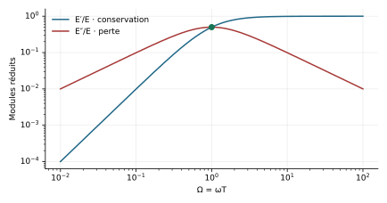

### Question P32 — Puissance volumique

> [!INDICATION]
> Divisez le travail de la force extérieure sur la plaque par le volume initial de matière.

#### Solution

La puissance réelle fournie est $F\dot d_1$. Rapportée à $Sd_0$, elle donne $P_v(t)=\sigma(t)\dot\varepsilon(t)$ en W/m³. Les grandeurs instantanées sont réelles.

### Question P33 — Dissipation par cycle

> [!INDICATION]
> Seule la composante de la contrainte en phase avec la vitesse de déformation fournit une puissance moyenne.

#### Solution

Pour $\varepsilon=\varepsilon_0\cos(\omega t)$, $\sigma=\varepsilon_0[E'\cos(\omega t)-E''\sin(\omega t)]$. La moyenne de $\sin\cos$ est nulle et celle de $\sin^2$ vaut $1/2$. Donc $\langle P_v\rangle=\omega E''\varepsilon_0^2/2$. L'énergie perdue par unité de volume et par cycle vaut $\pi E''\varepsilon_0^2$, positive pour $E''>0$.

### Question P34 — Attribution des courbes expérimentales

> [!INDICATION]
> Repérez le plateau à haute fréquence et la courbe passant par un maximum.

#### Solution

Les carrés, qui croissent puis plafonnent, représentent $E'$. Les étoiles, dont le maximum est proche du croisement avec les carrés, représentent $E''$. La figure 10 reproduit l'ordre des modules, le croisement et le plateau élastique de Maxwell. À haute pulsation $E''$ se rapproche toutefois d'un plateau d'environ 1 Pa au lieu de poursuivre une décroissance en $1/\omega$. Un temps de relaxation unique ne rend pas compte de toute la mesure.

### Question P35 — Constantes de la solution de micelles

> [!INDICATION]
> Lisez le plateau de conservation puis l'abscisse du croisement sur l'échelle logarithmique.

#### Solution

Le plateau de $E'$ se situe vers 20 Pa. Les courbes se croisent près de 10 Pa pour $\omega_c\simeq0{,}07\,\mathrm{rad\,s^{-1}}$. Ainsi $E\simeq20$ Pa, $T\simeq1/\omega_c\simeq14$ s et $\eta=ET\simeq2{,}8\times10^2$ Pa·s. Les graduations et l'écart au modèle justifient cet arrondi.

### Question P36 — Effet du résidu inertiel

> [!INDICATION]
> Mettez en regard la phase d'une accélération harmonique et celle du déplacement.

#### Solution

Pour une masse mobile mal compensée, $\delta F=\delta m\,\ddot d_1=-\delta m\,\omega^2 d_1$. Ce résidu est en opposition de phase ou en phase avec le déplacement suivant le signe de l'erreur de compensation. Il affecte donc la partie réelle $E'$, de façon croissante en $\omega^2$, sans composante en quadrature dans ce modèle inertiel.

### Question P37 — Relaxation après un échelon

> [!INDICATION]
> Pendant le saut le piston visqueux n'a pas le temps de se déplacer.

#### Solution

Le ressort absorbe instantanément la déformation et la contrainte saute de zéro à $\sigma_M=E\varepsilon_1$. Pour $t>0$, $\dot\varepsilon=0$, donc $\sigma(t)=\sigma_M\exp(-t/T)$. Le graphe décroît vers zéro. Le temps correspondant à $\sigma_M/e$ donne $T$ ; on peut aussi tracer $\ln(\sigma/\sigma_M)$ en fonction de $t$ et lire la pente $-1/T$.

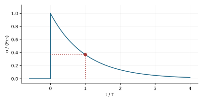

### Question P38 — Comportement sensible à la durée de sollicitation

> [!INDICATION]
> Comparez la durée du choc et la durée d'observation sous le poids au temps de relaxation.

#### Solution

Lors d'un choc beaucoup plus court que $T$, l'amortisseur se déforme peu et le ressort emmagasine de l'énergie. Le matériau peut rebondir, voire se rompre si la contrainte est forte. Sous son poids pendant un temps très supérieur à $T$, il relaxe et s'écoule. La même substance peut donc s'étaler lentement sur la table et réagir comme un solide à l'impact.

## Chimie. Monomère et polymère imidazolium

### Question C1 — Intermédiaire chloroéthylé

> [!INDICATION]
> La formule brute conserve un chlore et les deux carbones du réactif dihalogéné.

#### Solution

L'intermédiaire 1′ est le 1-(2-chloroéthyl)imidazole. La substitution de H sur l'azote du cycle par –CH₂–CH₂–Cl donne C₅H₇ClN₂. Il subsiste un azote de type pyridinique dans le cycle.

### Question C2 — Proton acide de l'imidazole

> [!INDICATION]
> Comparez les bases conjuguées possibles en examinant leur délocalisation.

#### Solution

Le proton du groupe N–H est le plus acide. Sa perte donne l'anion imidazolate, qui conserve le sextet aromatique et dont la charge se répartit sur les deux atomes d'azote. La déprotonation d'un C–H du cycle est bien moins favorable dans ces conditions.

### Question C3 — Formation du N-vinylimidazole

> [!INDICATION]
> Séparez déprotonation, alkylation et élimination de l'halogénure terminal.

#### Solution

HO⁻ capte d'abord H sur N et le doublet N–H revient à N (équilibre avec l'eau). Le doublet d'un N de l'imidazolate attaque par l'arrière un carbone primaire de Cl–CH₂–CH₂–Cl tandis que la liaison C–Cl cède son doublet à Cl. Cette substitution bimoléculaire donne 1′ et Cl⁻. Avec la deuxième charge de base, HO⁻ arrache un H du CH₂ lié à N. Le doublet C–H forme C=C et le chlorure terminal part simultanément, selon une élimination E2. On obtient N–CH=CH₂, l'eau et Cl⁻.

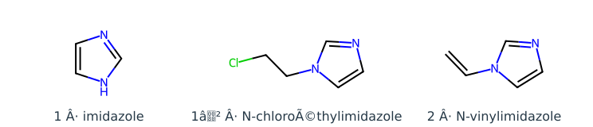

### Question C4 — Rôle des réactifs et du milieu

> [!INDICATION]
> Classez chacun selon ce qu'il apporte au produit ou à la réaction.

#### Solution

Le 1,2-dichloroéthane est le réactif électrophile qui apporte le fragment à deux carbones. L'éthanol est un solvant. KOH fournit la base hydroxyde pour la déprotonation de l'imidazole, puis l'élimination conduisant au vinyle. Le dichlorométhane mentionné dans le milieu est un cosolvant distinct du réactif dichloroéthane.

### Question C5 — Sel monomère

> [!INDICATION]
> Il reste dans 2 un azote dont le doublet peut se lier à un électrophile.

#### Solution

Le cation 3 est le 1-vinyl-3-butylimidazolium. Un azote porte –CH=CH₂ et l'autre –CH₂CH₂CH₂CH₃. La charge positive est délocalisée dans le cycle. L'anion $A^-$ est Br⁻, libéré du 1-bromobutane.

### Question C6 — Quaternisation du second azote

> [!INDICATION]
> Recherchez un mécanisme compatible avec un bromure d'alkyle primaire.

#### Solution

Le doublet libre de l'azote non substitué du N-vinylimidazole attaque le carbone lié à Br du 1-bromobutane. La liaison C–Br se rompt vers Br dans le même acte de substitution $S_\mathrm N2$. La liaison N–butyle se forme et le bromure accompagne le cation imidazolium.

### Question C7 — Attribution RMN du sel

> [!INDICATION]
> Commencez par la chaîne butyle, puis distinguez les deux H terminaux du vinyle par leurs couplages cis et trans.

#### Solution

Sur le schéma, $a$ à $d$ suivent le butyle depuis son extrémité méthyle, $e,f$ sont les H terminaux du vinyle et $g$ son CH lié à N. Les hydrogènes $h,i,j$ appartiennent au cycle.

| δ (ppm) | Proton et multiplicité | Justification |
| --- | --- | --- |
| 0,99 | a, CH₃, triplet, 3 H | Deux H voisins sur b, $J=7{,}4$ Hz. |
| 1,39 | b, CH₂, sextuplet apparent, 2 H | Les trois H de a et les deux de c ont des couplages voisins. |
| 1,95 | c, CH₂, quintuplet apparent, 2 H | Deux H de b et deux de d, $J\simeq7{,}4$ Hz. |
| 4,32 | d, N–CH₂, triplet, 2 H | Déblindage près du cycle chargé et deux H voisins sur c. |
| 5,50 | e, =CH₂, dd, 1 H | Couplage géminal 2,8 Hz, couplage cis avec g de 8,8 Hz. |
| 5,87 | f, =CH₂, dd, 1 H | Couplage géminal 2,6 Hz, couplage trans avec g de 15,4 Hz. |
| 7,23 | g, N–CH=, dd, 1 H | Couplages cis et trans de 8,8 et 15,7 Hz. |
| 7,67 et 7,85 | h et i, deux singulets apparents, chacun 1 H | Deux CH non équivalents du cycle. Leurs faibles couplages sont non résolus. L'ordre entre h et i reste ouvert d'après ces seules données. |
| 9,13 | j, N–CH–N, singulet, 1 H | Le proton entre les deux N est le plus déblindé. |

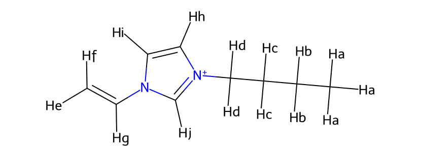

### Question C8 — Atmosphère de polymérisation

> [!INDICATION]
> Quel constituant de l'air piège les radicaux porteurs de chaîne ?

#### Solution

Le diazote remplace le dioxygène dissous et présent au-dessus du milieu. O₂ capterait les radicaux carbonés et formerait des radicaux peroxyles peu aptes à propager la chaîne vinylique. L'atmosphère inerte évite cette inhibition.

### Question C9 — Lewis du contre-ion

> [!INDICATION]
> Comptez les doublets non liants de N dans une forme où les deux liaisons N–S sont simples.

#### Solution

Une forme de Lewis du TFSI⁻ est $[\mathrm{CF_3-S(=O)_2-N^--S(=O)_2-CF_3}]$. L'azote porte deux doublets libres, chaque O doublement lié deux doublets et chaque F trois doublets. Les formes où un doublet de N forme N=S et une liaison S=O se déplace vers O⁻ traduisent la délocalisation de la charge sur les deux groupes sulfonyle.

### Question C10 — Motif du polyélectrolyte

> [!INDICATION]
> Ouvrez la double liaison vinylique et conservez les deux substituants sur les azotes.

#### Solution

Le motif est $[\!{-}\mathrm{CH_2-CH}(N\text{-imidazolium-}N'\text{-butyle}){-}\!]$. Le carbone CH de la chaîne principale est directement lié à l'azote qui portait le vinyle. À chaque charge positive fixée au polymère correspond un anion TFSI⁻ échangeable.

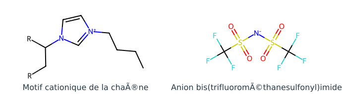

### Question C11 — Suivi infrarouge

> [!INDICATION]
> Cherchez la disparition d'une liaison du monomère puis l'apparition de l'empreinte du contre-ion.

#### Solution

La bande du vinyle à 1656 cm⁻¹ s'atténue fortement ou disparaît de (a) à (b), conformément à la consommation de C=C. Des bandes du squelette organique restent communes, notamment dans la zone 1170–1161 cm⁻¹. Après échange avec TFSI, (c) montre des bandes intenses autour de 1365, 1205 et 1046 cm⁻¹ dans les régions des vibrations des groupes sulfonyle, CF₃ et S–N–S. Leur apparition confirme le changement d'anion tout en conservant le polymère.

### Question C12 — Bande large vers 3500 cm⁻¹

> [!INDICATION]
> L'imidazolium substitué sur ses deux N ne possède plus de N–H.

#### Solution

Cette bande large est compatible avec des liaisons O–H associées par liaisons hydrogène. De l'eau adsorbée ou résiduelle et de l'éthanol résiduel sont plausibles après préparation de l'échantillon. Elle ne justifie pas de placer un OH dans le motif polymère.

## Électrode et photosensibilisateur

### Question C13 — Positions des atomes dans le rutile

> [!INDICATION]
> Séparez les couches parallèles de cotes 0, 1/2 et 1.

#### Solution

Le réseau des Ti comporte les huit sommets et le centre $(1/2,1/2,1/2)$. Sur chacune des faces $z=0$ et $z=1$, les O occupent $(0{,}3,0{,}3)$ et $(0{,}7,0{,}7)$. Dans la couche $z=1/2$ les O sont en $(0{,}8,0{,}2)$ et $(0{,}2,0{,}8)$. Les trois coupes de la figure ont les mêmes axes et la même origine dans le plan.

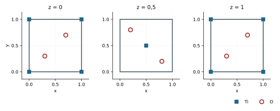

### Question C14 — Contenu et coordinences de la maille

> [!INDICATION]
> Pondérez les contributions des sommets et des faces puis comptez les voisins périodiques.

#### Solution

Les huit sommets et le centre donnent $8/8+1=2$ Ti. Les quatre O sur les faces horizontales et les deux O intérieurs donnent $4/2+2=4$ O. La maille contient deux unités TiO₂. Chaque Ti a six O en voisinage octaédrique légèrement déformé et chaque O est voisin de trois Ti. Le comptage des contacts concorde, $2\times6=4\times3$.

### Question C15 — Masse volumique du rutile

> [!INDICATION]
> Rapportez la masse des deux unités de formule au volume de la maille tétragonale.

#### Solution

Le volume vaut $a^2c=(4{,}50\times10^{-10})^2(3{,}00\times10^{-10})=6{,}075\times10^{-29}\,\mathrm{m^3}$. La masse est $2(47{,}9+32{,}0)\times10^{-3}/(6\times10^{23})=2{,}66\times10^{-25}$ kg. Ainsi $\rho\simeq4{,}38\times10^3\,\mathrm{kg\,m^{-3}}$, soit environ 3,6 % au-dessus des $4{,}230\,\mathrm{g\,cm^{-3}}$ de l'annexe. Les paramètres de maille sont arrondis.

### Question C16 — Géométrie de coordination du ruthénium

> [!INDICATION]
> Comptez les donneurs qui occupent les sites de la première sphère.

#### Solution

Les deux bipyridines sont bidentates et les deux NCS sont monodentates. Le ruthénium est donc hexacoordonné dans un environnement approximativement octaédrique. Les deux NCS occupent des sites voisins, en cis.

### Question C17 — Nature des orbitales frontières

> [!INDICATION]
> Recherchez comment les lobes se recouvrent de part et d'autre d'un axe internucléaire.

#### Solution

La HO est principalement de caractère $d_\pi$ du métal avec contribution des ligands thiocyanate. La BV a surtout le caractère $\pi^*$ des bipyridines. Sur les fragments conjugués, le recouvrement se fait latéralement et le plan contenant la liaison sépare des lobes de signe opposé. Cette symétrie π explique le caractère de transfert de charge du métal vers le ligand pour une excitation entre ces niveaux.

### Question C18 — Longueur d'onde de la transition frontière

> [!INDICATION]
> Soustrayez les énergies de la BV et de la HO figurant dans l'annexe.

#### Solution

Le diagramme donne $\Delta E=(-2{,}50)-(-4{,}44)=1{,}94$ eV. Avec $hc=1241\,\mathrm{eV\,nm}$, on trouve $\lambda=hc/\Delta E\simeq640$ nm, dans le rouge visible.

### Question C19 — Comparaison avec la bande dominante

> [!INDICATION]
> Examinez le maximum le plus intense et les bandes secondaires du spectre.

#### Solution

La figure 6 montre un maximum intense près de 310 nm et des bandes visibles vers 390 et 520 nm. L'absorbance est faible vers les 640 nm calculés. L'écart HO–BV peut se rattacher à une transition de faible intensité. D'autres excitations et leurs forces d'oscillateur déterminent le maximum du spectre.

### Question C20 — Atome coordonnant du ligand NCS

> [!INDICATION]
> Choisissez une mesure distinguant les deux extrémités d'un ligand ambidentate.

#### Solution

Le ligand de formule NCS⁻ est le thiocyanate, qui peut se lier par N ou par S. Une diffraction des rayons X sur monocristal donne la géométrie et identifie le voisin de Ru. On peut aussi comparer les bandes IR C–N et C–S à celles de complexes de liaison N et S connus. La figure et la désignation isothiocyanato indiquent ici une liaison Ru–N.

## Cinétique transitoire et circuit de la cellule

### Question C21 — Isolement du facteur cinétique associé au radical

> [!INDICATION]
> Comparez les deux concentrations initiales du document 4.

#### Solution

Le radical $B=\mathrm{Br_2^{\bullet-}}$ est formé à $2\times10^{-6}$ mol/L, devant $10^{-4}$ mol/L de Ru(II), cinquante fois plus abondant. Le Ru(II) varie donc peu. Si $v=k[B]^p[\mathrm{Ru^{II}}]^q$, on observe $-d[B]/dt=k_{\rm obs}[B]^p$, avec $k_{\rm obs}=k[\mathrm{Ru^{II}}]_0^q$. Le suivi à 340 nm porte alors sur la forme temporelle d'un seul réactif.

### Question C22 — Ordre partiel et absorbance différentielle

> [!INDICATION]
> Soustrayez le niveau final pour rendre le signal proportionnel à la quantité de radical restante.

#### Solution

Par Beer–Lambert, la combinaison linéaire des concentrations qui contribue à $\Delta A$ à une longueur d'onde donnée varie, pour cette transformation unique, proportionnellement à $[B](t)$. Ainsi $\Delta A(t)-\Delta A_\infty=C[B](t)$ (à 340 nm le niveau final est proche de zéro). Les points suivent une décroissance exponentielle. Le test est la linéarité de $\ln[(\Delta A(t)-\Delta A_\infty)/(\Delta A(0)-\Delta A_\infty)]$ en fonction de $t$, conforme à $p=1$.

### Question C23 — Estimation de la constante observée

> [!INDICATION]
> Lisez un temps de demi-décroissance en microsecondes sur le traceur à 340 nm.

#### Solution

À partir d'environ 0,030 juste après l'impulsion, le signal atteint environ 0,015 vers $2$ à $2{,}5\,\mathrm{\mu s}$. Il donne $k_{\rm obs}=\ln2/t_{1/2}\simeq(2{,}8\text{ à }3{,}5)\times10^5\,\mathrm{s^{-1}}$. La largeur de l'impulsion et le niveau final rendent cette lecture graphique approximative.

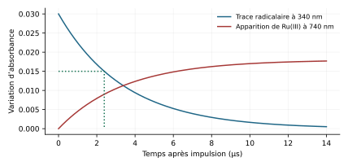

### Question C24 — Constante bimoléculaire

> [!INDICATION]
> Précisez l'ordre supposé en Ru avant de diviser par sa concentration.

#### Solution

Pour la loi bimoléculaire du document 4, $q=1$. On obtient $k=k_{\rm obs}/[\mathrm{Ru^{II}}]_0\simeq3\times10^9\,\mathrm{L\,mol^{-1}\,s^{-1}}$. La valeur publiée de $5{,}4\times10^9$ est du même ordre de grandeur et dépasse la lecture directe d'un facteur proche de deux. Un ajustement des données brutes serait nécessaire pour une comparaison précise.

### Question C25 — Ordre partiel en complexe

> [!INDICATION]
> Modifiez une concentration initiale à la fois et utilisez la pente initiale.

#### Solution

Effectuer plusieurs expériences avec la même concentration initiale $[B]_0$ et différentes concentrations initiales de Ru(II). Mesurer les vitesses initiales $v_0$ par la pente d'absorbance. Dans $\ln v_0=\ln(k[B]_0^p)+q\ln[\mathrm{Ru^{II}}]_0$, la pente par rapport à $\ln[\mathrm{Ru^{II}}]_0$ donne $q$. La température et les autres conditions doivent être conservées.

### Question C26 — Médiateur de la cellule

> [!INDICATION]
> À la contre-électrode le médiateur reçoit les électrons du circuit extérieur.

#### Solution

L'espèce 1 est la forme oxydée $\mathrm{I_3^-}$, réduite à la contre-électrode en espèce 2, $\mathrm{I^-}$. Le bilan local est $\mathrm{I_3^-+2e^-\to3I^-}$. Dans l'autre sens, l'iodure régénère Ru(II) à partir de Ru(III).

### Question C27 — Polarités et circulation des électrons

> [!INDICATION]
> Suivez un électron libéré par le colorant après l'absorption d'un photon.

#### Solution

À A, le Ru(II) excité cède un électron à TiO₂ et devient Ru(III). Les électrons passent de A au moteur puis à B. À la contre-électrode B ils réduisent I₃⁻. L'iodure diffuse et réduit le colorant oxydé selon $2\mathrm{Ru^{III}}+3\mathrm{I^-}\to2\mathrm{Ru^{II}}+\mathrm{I_3^-}$. A est la photoanode négative (borne 1), B la cathode positive (borne 4). Les bornes correspondantes du moteur sont 2 négative et 3 positive. Le courant conventionnel dans le moteur circule de 3 vers 2.

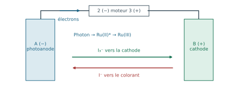

### Question C28 — Fonction de l'électrolyte

> [!INDICATION]
> Reliez transport de charge à l'intérieur de la cellule et régénération du colorant.

#### Solution

L'électrolyte assure la conduction ionique entre les électrodes, maintient l'électroneutralité locale et véhicule I⁻ et I₃⁻ entre le colorant et la contre-électrode. Il ferme le circuit interne en couplant les deux réactions d'échange électronique.

### Question C29 — Limites des solvants carbonates

> [!INDICATION]
> Reliez les propriétés du liquide aux contraintes de fabrication et d'usage.

#### Solution

Les carbonates organiques sont inflammables. Une fuite ou un échauffement peut compromettre le fonctionnement de la cellule et sa sécurité. Il faut donc maintenir le liquide confiné dans un emballage étanche et respecter la plage de température du dispositif.

### Question C30 — Apport d'une matrice polymère

> [!INDICATION]
> Comparez confinement du liquide, stabilité mécanique et mobilité ionique.

#### Solution

Une matrice polymère immobilise l'électrolyte et améliore la tenue mécanique. Un gel conserve une phase ioniquement conductrice et peut permettre un encapsulage plus souple, avec moins de risque de fuite. Un polymère complètement sec peut en revanche présenter une conductivité insuffisante à température ambiante.

### Question C31 — Élargissement de la collecte de lumière

> [!INDICATION]
> Repérez les zones où le rayonnement solaire est intense mais le colorant peu absorbant.

#### Solution

Le colorant absorbe surtout dans l'UV et par bandes dans le visible alors que le Soleil fournit un flux important sur une gamme visible et proche infrarouge beaucoup plus étendue. Une cosensibilisation par un second colorant absorbant dans le rouge, complémentaire du premier, pourrait augmenter le nombre de photons captés. Ses niveaux doivent aussi permettre injection de l'électron dans TiO₂ et régénération par le médiateur.

## Performances des électrolytes

### Question C32 — Sens de quasi-solide

> [!INDICATION]
> Interprétez ensemble la tenue visible et la présence du liquide dans la formulation.

#### Solution

Les photographies montrent une matière cohésive qui tient en place, même lorsque le support est incliné. Le réseau polymère retient un électrolyte liquide dont les ions restent mobiles. Le dispositif a donc la tenue d'un gel et conserve le transport ionique d'une phase liquide.

### Question C33 — Mesure de la conductivité

> [!INDICATION]
> Indiquez la grandeur directement mesurée et le facteur géométrique qui la convertit en conductivité.

#### Solution

On immerge deux plaques parallèles de surface $S$ séparées de $l$ et l'on applique une faible tension alternative $U$ en mesurant $I$. Dans la gamme de fréquence où la réponse est résistive, $G=I/U$ et $\kappa=(l/S)G$. On calibre la constante de cellule réelle avec une solution étalon de KCl de conductivité connue, à température fixée. Rincer entre mesures, immerger complètement, éliminer les bulles et employer une excitation alternative pour limiter polarisation et électrolyse.

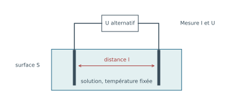

### Question C34 — Classement viscosité-conductivité

> [!INDICATION]
> Comparez les quatre formulations à température identique.

#### Solution

Du liquide au gel TFSI, au gel bromure A, puis à Poly-StAN, les viscosités passent de 39 à 4800, 27 700 et 56 500 mPa·s. Dans le même ordre, les conductivités diminuent de 5,92 à 4,08, 1,49 et 0,28 en unités de $10^{-4}$ S/cm. Le gel TFSI conduit environ 15 fois mieux que Poly-StAN.

### Question C35 — Mobilité des porteurs de charge

> [!INDICATION]
> Une charge contribue à la conductivité si elle peut se déplacer.

#### Solution

La conductivité est la somme des contributions des porteurs mobiles, $\kappa=\sum n_i|q_i|u_i$. Une matrice visqueuse freine la mobilité $u_i$ et la diffusion du médiateur. La dissociation des ions et leurs interactions avec la matrice interviennent aussi. Le classement inverse n'impose donc pas une stricte proportionnalité de $\kappa$ à $1/\eta$ pour ces compositions différentes.

### Question C36 — Rendement initial des cellules

> [!INDICATION]
> Comparez les valeurs du tableau pour la même puissance lumineuse incidente.

#### Solution

Les rendements sont 5,3 % (liquide), 4,4 % (poly-3/TFSI), 2,2 % (poly-3/A) et 1,5 % (Poly-StAN). Ce classement suit la conductivité, compatible avec des pertes de transport moindres dans les formulations les plus conductrices. Le meilleur gel atteint environ 83 % de l'efficacité initiale du liquide.

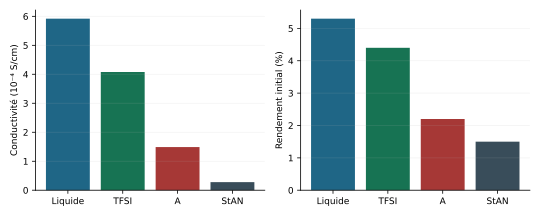

### Question C37 — Courbes courant-tension

> [!INDICATION]
> Lisez le courant en court-circuit et la tension à circuit ouvert aux deux extrémités du tracé.

#### Solution

Les densités $J_{cc}$ sont environ 11, 10,5, 7,2 et 5,3 mA/cm² pour liquide, TFSI, A et StAN. Les tensions à vide sont respectivement voisines de 0,65, 0,60 et 0,53 V pour les deux derniers. Le rectangle de puissance maximale est le plus grand pour le liquide, suivi de TFSI. La perte de courant et de facteur de forme est visible pour les formulations plus visqueuses, en accord avec les rendements.

### Question C38 — Vieillissement des quatre formulations

> [!INDICATION]
> L'ordonnée est normalisée par l'efficacité initiale de chaque cellule.

#### Solution

Après environ cinquante jours, le liquide conserve approximativement 45–50 % de sa valeur initiale. Le gel poly-3/TFSI en conserve près de 95 %. Poly-StAN et poly-3/A sont intermédiaires, proches de 70 et 80 %. Les gels peuvent d'abord gagner en efficacité. Les courbes représentent une rétention relative, à combiner aux rendements initiaux pour comparer les puissances absolues.

### Question C39 — Maximum retardé

> [!INDICATION]
> Quel changement lent améliore le contact avec l'oxyde mésoporeux ?

#### Solution

L'imprégnation des pores de TiO₂ et la redistribution du médiateur au contact du colorant peuvent demander quelques jours dans un gel visqueux. Une amélioration initiale du contact et du transport peut ainsi précéder le vieillissement. Cette interprétation est une hypothèse cohérente avec les courbes, qui ne mesurent pas directement l'imprégnation.

### Question C40 — Choix de l'électrolyte

> [!INDICATION]
> Arbitrez rendement au départ, rétention à long terme et tenue du matériau.

#### Solution

Pour une cellule durable, le poly-3/TFSI combine un bon rendement initial (4,4 %), le meilleur maintien parmi les formulations et la tenue mécanique d'un gel. Vers cinquante jours, son efficacité absolue estimée vaut $4{,}4\%\times0{,}95\simeq4{,}2\%$, contre $5{,}3\%\times0{,}45\simeq2{,}4\%$ pour le liquide. Un choix fondé sur la seule puissance initiale favoriserait le liquide.
