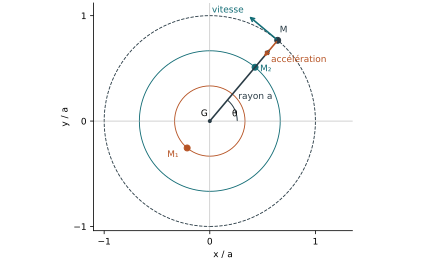
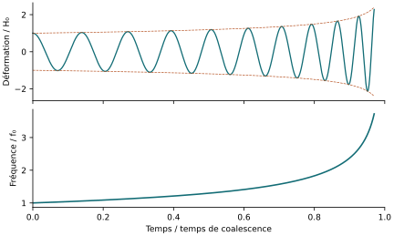
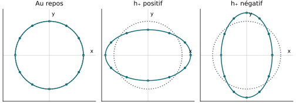
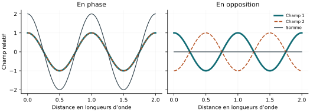

# ENS Ulm PSI 2017 — Physique U · Corrigé brut

*Corrigé rédigé par IA, non officiel. Signalez toute erreur.*

**Lecture du rapport du jury** · GPT-6.2 Astra Ultra · vitesse non renseignée

**Rédaction** · GPT-6.2 Astra Ultra · vitesse non renseignée

## Les ondes gravitationnelles et leur détection

## I. Le signal d’une binaire de trous noirs

### Question 1 — Interaction mutuelle

En notant $r=M_1M_2$ et en orientant $\mathbf u_r$ de 1 vers 2, $\mathbf F_{1\to2}=-G_N m_1m_2\mathbf u_r/r^2$. Les deux forces mutuelles sont opposées.

### Question 2 — Vitesse du barycentre

$M\mathbf v_G=m_1\mathbf v_1+m_2\mathbf v_2$, où $M=m_1+m_2$. Pour ce système isolé la quantité de mouvement totale est constante.

### Question 3 — Moment cinétique total

$\mathbf{GM}_1=-(m_2/M)\mathbf r$ et $\mathbf{GM}_2=(m_1/M)\mathbf r$. En les multipliant vectoriellement par les quantités de mouvement correspondantes dans le repère du centre de masse, on trouve $\mathbf L_G=\mu\mathbf r\times\dot{\mathbf r}$. Les forces sont centrales et colinéaires à la droite des deux corps, donc leur couple total est nul. Pour $L_G\ne0$, le mouvement est plan, perpendiculaire à $\mathbf L_G$.

### Question 4 — Réduction du problème à un corps

$\mathbf a_2=\mathbf F_{1\to2}/m_2$ et $\mathbf a_1=-\mathbf F_{1\to2}/m_1$. La différence vaut $\ddot{\mathbf r}=(1/m_1+1/m_2)\mathbf F_{1\to2}$, donc $\mu\ddot{\mathbf r}=\mathbf F_{1\to2}$.

### Question 5 — Mouvement dans un champ central

L’orbite est plane, la vitesse aréolaire $r^2\dot\theta/2$ est constante et l’énergie mécanique se conserve. Le mouvement radial se lit dans $E=\mu\dot r^2/2+V(r)+L_G^2/(2\mu r^2)$. Pour l’attraction newtonienne en inverse carré, les orbites non radiales sont des coniques de foyer au centre de force.

### Question 6 — Cinématique circulaire

Choisissons $\theta(0)=0$ et $\Omega=\dot\theta$. On a $\mathbf r=a\mathbf u_r$, $\mathbf v=a\Omega\mathbf u_\theta$ et $\mathbf a=-a\Omega^2\mathbf u_r+a\dot\Omega\mathbf u_\theta$. Le schéma montre aussi la place du point fictif dans la construction barycentrique.

### Question 7 — Vitesse et période

La force n’a pas de composante tangentielle, donc $\dot\Omega=0$. Radialement, $a\Omega^2=G_N M/a^2$. Ainsi $v=\sqrt{G_NM/a}$ et $T=2\pi\sqrt{a^3/(G_NM)}$. C’est la troisième loi de Kepler.

### Question 8 — Orbites réelles

Les relations barycentriques de la question 3 donnent $a_1=(m_2/M)a=a\mu/m_1$ et $a_2=(m_1/M)a=a\mu/m_2$. Les rayons restent opposés, tandis que les deux astres et le point relatif décrivent des cercles à la même vitesse angulaire.

### Question 9 — Moments quadratiques

Les $I_{ij}$ ont l’unité d’un moment d’inertie, $\mathrm{kg\,m^2}$. Comme $m_1a_1^2+m_2a_2^2=\mu a^2$, $I_{11}=\mu a^2\cos^2\Omega t$, $I_{22}=\mu a^2\sin^2\Omega t$ et $I_{12}=I_{21}=\mu a^2\sin(2\Omega t)/2$.

### Question 10 — Fréquence du rayonnement

Avec $u=t-R/c$ et $H=4G_N\mu a^2\Omega^2/(Rc^4)$, l’application de $2G_N\partial_t^2/(Rc^4)$ donne $h_{11}=-h_{22}=-H\cos(2\Omega u)$ et $h_{12}=h_{21}=-H\sin(2\Omega u)$. Les deux composantes sont sinusoïdales en quadrature, de fréquence $f_{\rm OG}=\Omega/\pi=2/T$. La distribution quadrupolaire se répète à chaque demi-tour.

### Question 11 — Trois échelles de la binaire

$M=1{,}20\,10^{32}\,\mathrm{kg}$, $\mu=M/4$ et $a=8G_NM/c^2=7{,}11\,10^5\,\mathrm m$. On obtient $f_{\rm OG}=47{,}5\,\mathrm{Hz}$ et $v/c=1/\sqrt8=0{,}354$. À $R=400\,\mathrm{Mpc}=1{,}24\,10^{25}\,\mathrm m$, $H=8{,}97\,10^{-22}$. Les corrections relativistes peuvent déjà affecter cette estimation newtonienne.

### Question 12 — Énergie de liaison

$E^*=\mu a^2\Omega^2/2-G_N\mu M/a$. Comme $a^3\Omega^2=G_NM$, le terme cinétique vaut la moitié de la valeur absolue du potentiel et $E^*=-G_N\mu M/(2a)$.

### Question 13 — Resserrement de l’orbite

$\dot E^*/E^*=-\dot a/a=(2/3)\dot\Omega/\Omega$. La perte d’énergie rend $E^*<0$ plus négative. Ainsi $a$ décroît, $\Omega$ augmente et les trous noirs s’enroulent l’un autour de l’autre.

### Question 14 — Puissance gravitationnelle

$Q_{11}=-Q_{22}=(\mu a^2/2)\cos(2\Omega t)$ et $Q_{12}=Q_{21}=(\mu a^2/2)\sin(2\Omega t)$. Les quatre troisièmes dérivées mises au carré ont une somme $2(\mu a^2/2)^2(2\Omega)^6=32\mu^2a^4\Omega^6$. Il vient $P=32G_N^4\mu^2M^3/(5c^5a^5)$.

### Question 15 — Décroissance de la séparation

$\dot E^*=G_N\mu M\dot a/(2a^2)=-P$ conduit à $a^3\dot a=-K$, $K=64G_N^3\mu M^2/(5c^5)$. Donc $a(t)=(a_0^4-4Kt)^{1/4}$, jusqu’à la limite du modèle. La collision formelle est à $t_c=a_0^4/(4K)$. L’amplitude $H\propto a^2\Omega^2\propto a^{-1}$ augmente.

### Question 16 — Gazouillis gravitationnel

$a=(G_N M)^{1/3}(\pi f)^{-2/3}$ et $\dot f/f=-3\dot a/(2a)$. Ainsi $\dot f=(96/5)\pi^{8/3}G_N^{5/3}\mu M^{2/3} f^{11/3}/c^5$. Le signal monte en fréquence et en amplitude, sa phase étant $2\pi\int f(t)dt$. À la fin, les hypothèses de champ faible, de vitesse petite devant $c$ et d’évolution lente pendant une révolution cessent de convenir. La fusion réelle puis l’amortissement demandent la relativité générale.

### Question 17 — Déplacement de masses libres

En retirant une position et une vitesse initiales indépendantes de l’onde, $\boldsymbol\xi=h\mathbf r_0/2$. Ainsi $\delta x=(h_+x_0+h_\times y_0)/2$, $\delta y=(h_\times x_0-h_+y_0)/2$ et $\delta z=0$. Sur un mètre, la déformation typique est seulement de l’ordre de $5\,10^{-22}\,\mathrm m$.

### Question 18 — Polarisation plus

Le cercle de rayon $r$ devient une ellipse de demi-axes $r(1+h_+/2)$ suivant $x$ et $r(1-h_+/2)$ suivant $y$. Les rôles s’échangent après une demi-période et l’aire reste inchangée au premier ordre. Les axes de la polarisation croisée sont tournés de 45 degrés.

### Question 19 — Bras court à l’échelle de l’onde

Dans le vide $2L_0/c\ll1/f_{\rm OG}$, soit $L_0\ll3\,10^6\,\mathrm m$ pour 50 Hz. Des bras terrestres kilométriques satisfont aisément ce critère. Pour des bras spatiaux beaucoup plus longs, il faut traiter la propagation retardée ou observer des fréquences plus basses.

### Question 20 — Temps de vol selon x

$d\tau_x=(n/c)(1+h_+/2)|dx|$. Si l’onde varie peu pendant le trajet, $\tau_x=2nL_{01}(1+h_+(t)/2)/c$, au premier ordre.

### Question 21 — Lecture différentielle

$d\tau_y=(n/c)(1-h_+/2)|dy|$ et $\tau_y=2nL_{02}(1-h_+/2)/c$. Alors $\tau_x-\tau_y=2n(L_{01}-L_{02})/c+nh_+(L_{01}+L_{02})/c$. Un Michelson convertit ce retard différentiel en déphasage puis en intensité. Deux cavités optiques orthogonales pourraient aussi être comparées par battement de leurs fréquences de résonance.

## II. La barre résonante Explorer

### Question 22 — Mode fondamental

Pour $p=0$, $\omega_0=\pi v_s/L=5{,}65\,10^3\,\mathrm{rad/s}$ et $f_0=v_s/(2L)=900\,\mathrm{Hz}$.

### Question 23 — Réponse mécanique forcée

Posons $b=2L/\pi^2$ et $u=\omega/\omega_0$. La transformation de l’équation du mouvement donne $G=-bu^2/(1-u^2+ju/Q)$. C’est un passe-haut du second ordre présentant une forte résonance. Le gain est une longueur.

### Question 24 — Maximum résonant

$|G|^2=b^2u^4/[(1-u^2)^2+u^2/Q^2]$. Pour $Q>1/\sqrt2$, le maximum est en $u=(1-1/(2Q^2))^{-1/2}$. Son module est $G_{\max}=bQ/\sqrt{1-1/(4Q^2)}\simeq bQ=4{,}26\,10^7\,\mathrm m$.

### Question 25 — Lecture du diagramme de Bode

À basse fréquence $G\sim-bu^2$, soit $+40$ dB/décade et une phase de $180^\circ$. À $u=1$, $G=jbQ$ et la phase vaut $90^\circ$. La largeur relative du pic est de l’ordre de $1/Q$. À haute fréquence $G\to b$, soit un plateau à $20\log_{10}(b/1\,\mathrm m)\simeq-4{,}3$ dB et une phase nulle. Le pic théorique à environ 153 dB est trop étroit pour être fidèlement reproduit par un échantillonnage grossier.

### Question 26 — Réponse à une excitation brève

Le mouvement libre amorti a pour pulsation $\omega_0\sqrt{1-1/(4Q^2)}\simeq\omega_0$ avec un temps de décroissance $2Q/\omega_0\simeq2{,}5\,10^4\,\mathrm s$. On lit $|\xi|_{\max}\lesssim b|h_+(\omega_0)|\omega_0\tau$. En adoptant l’estimation impulsionnelle proposée, $|h_+(\omega_0)|\sim10^{-21}$ et $\tau\sim1/50\,\mathrm s$ donnent $7\,10^{-20}\,\mathrm m$. Le résultat dépend en réalité du contenu du signal à 900 Hz.

### Question 27 — Accord de deux résonateurs

$K_b/M_b=k_t/m_t=\omega_0^2$. La petite masse exige un ressort proportionnellement plus souple.

### Question 28 — Amplification du déplacement

Pour chacun $E_i=m_i\dot\xi_i^2/2+k_i\xi_i^2/2$. En un maximum de déplacement, $E_i=m_i\omega_0^2(\xi_i^{\max})^2/2$. L’égalité des énergies donne $\xi_t^{\max}=\sqrt{M_b/m_t}\,\xi_b^{\max}$. Le facteur vaut 57 pour $2270$ kg et $0{,}7$ kg, soit environ $4\,10^{-18}\,\mathrm m$ avec l’estimation de Q26.

### Question 29 — Champ entre les armatures

Avec $S=\pi a^2$ et la plaque supérieure positive, chaque nappe produit $q_0/(2\epsilon_0S)$ de chaque côté. Le champ résultant est nul à l’extérieur et $\mathbf E_0=-q_0\mathbf e_z/(\epsilon_0 S)$ à l’intérieur, loin du bord.

### Question 30 — Tension aux bornes

Comme $V(0)=0$, on obtient $V(z)=q_0 z/(\epsilon_0S)$ entre les plaques. Ainsi $U(e_0)=q_0e_0/(\epsilon_0S)>0$.

### Question 31 — Capacité statique

$C_0=q_0/U=\epsilon_0\pi a^2/e_0$. Avec $a=0{,}066\,\mathrm m$ et $e_0=10^{-5}\,\mathrm m$, $C_0=1{,}21\,10^{-8}\,\mathrm F$, soit environ 12 nF.

### Question 32 — Champ variable dans l’entrefer

En l’absence de charge volumique, $\nabla\cdot\mathbf E=0$ et $\nabla\times\nabla\times\mathbf E=-\Delta\mathbf E=-c^{-2}\partial_t^2\mathbf E$. La composante harmonique axiale dépend seulement de $r$, d’où $E''+E'/r+(\omega/c)^2E=0$.

### Question 33 — Validité du champ uniforme

$E/E_1=1-(r\omega/c)^2/4+\cdots$. Si $a\omega/c\ll1$, le retard est négligeable sur toute l’armature et le champ harmonique est presque uniforme. Il faut $f\ll c/(2\pi a)\simeq7{,}2\,10^8\,\mathrm{Hz}$, très largement satisfait en bande acoustique.

### Question 34 — Champ d’induction

La symétrie de révolution et les plans méridiens imposent un champ magnétique azimutal. Pour le champ axial uniforme $E_z(t)$, $2\pi r B_\theta=\mu_0\epsilon_0\pi r^2\dot E_z$. Ainsi $B_\theta=r\dot E_z/(2c^2)=-r\omega E_1\sin\omega t/(2c^2)$, sous réserve d’absence de champ statique ajouté.

### Question 35 — Potentiel équivalent à espacement fixe

Avec $E_{0z}$ la composante algébrique du champ, l’estimation du sujet donne $V(z,t)\simeq-E_{0z}z[1+(\xi_t^{\max}/e_0)\cos\omega t]$. La modulation du potentiel est linéaire et très petite devant sa valeur statique. Cette représentation sur un domaine fixe reproduit la tension aux bornes mobiles.

### Question 36 — Condensateur à charge constante

À charge constante le champ entre grandes armatures est indépendant de l’entrefer. Donc $U(e(t))=q_0[e_0+\xi_t^{\max}\cos\omega t]/(\epsilon_0 S)$, identique au potentiel équivalent de Q35 évalué entre $\pm e_0/2$. La capacité mobile $C_t=\epsilon_0 S/e(t)\simeq C_0[1-(\xi_t^{\max}/e_0)\cos\omega t]$ diminue quand les plaques s’écartent.

### Question 37 — Gain du transducteur

$\alpha=U/e\simeq310/10^{-5}=3{,}1\,10^7\,\mathrm{V/m}$. Pour une charge fixe, $\delta U=\alpha\xi_t$, soit environ $1{,}2\,10^{-10}\,\mathrm V$ avec Q28.

### Question 38 — Condensateur de liaison

En série avec le primaire, $C_p$ bloque la polarisation continue de 310 V et atténue les perturbations lentes. Son impédance finie peut aussi réduire ou déphaser le signal près de la fréquence mécanique, et participer à une résonance avec le transformateur. Le choix dépend donc de l’impédance d’entrée et de la bande utile.

### Question 39 — Détection synchrone

Multiplier $A\cos(\omega t+\phi)$ par $2\cos\omega t$ donne un terme $A\cos\phi$ et un terme à $2\omega$. Un passe-bas conserve le premier et rejette les composantes éloignées de la fréquence de référence. Une seconde voie en quadrature donne accès au module indépendamment de la phase.

### Question 40 — Application à la barre

Après amplification, multiplier le signal par deux références en quadrature accordées à 900 Hz, puis filtrer les deux sorties. Le module des deux composantes suit l’enveloppe de la sonnerie transitoire. La bande de démodulation doit laisser passer son évolution et assez peu de bruit hors résonance.

## III. Détection interférométrique

### Question 41 — Champs issus des deux bras

Avec la convention de phase du sujet, $\mathbf E_i=-r_st_s\mathbf E_0\exp[j\omega t-jnk(L_l+L_d+2L_i)]$. Les facteurs communs disparaissent dans la différence. La phase du second champ moins celle du premier vaut $\Delta\varphi=2nk(L_1-L_2)$.

### Question 42 — Interférences extrêmes

À $\Delta\varphi=2p\pi$, deux cosinus de même amplitude sont en phase et leur somme double l’amplitude. À $(2p+1)\pi$, les champs sont opposés, leur somme s’annule. La figure représente les deux superpositions pour une même longueur d’onde.

### Question 43 — Intensité de sortie

En notant $A=|r_st_s|\,|E_0|$, la somme réelle est $2A\cos(\Delta\varphi/2)\cos(\omega t+\varphi_m)$. La moyenne du second cosinus au carré vaut $1/2$. Ainsi $I=I_0\cos^2[nk(L_1-L_2)]$ avec $I_0=2|r_st_s|^2|E_0|^2$, soit $|E_0|^2/2$ pour la séparatrice équilibrée et la définition de $I$ du sujet.

### Question 44 — Phase au repos

$nk(L_1-L_2)=nk(L_{01}-L_{02})+nk\delta x=\varphi_0/2+nk\delta x$. La puissance mesurée vaut donc $I=I_0\cos^2(\varphi_0/2+nk\delta x)$.

### Question 45 — Point de sensibilité maximale

Au premier ordre, $\delta I=-I_0nk\,\delta x\sin\varphi_0$. La pente absolue est maximale pour $\varphi_0=\pi/2+p\pi$. Le point de repos est alors à mi-intensité entre frange brillante et frange sombre.

### Question 46 — Signal différentiel en longueur

$\Delta\varphi=\omega(\tau_x-\tau_y)$ avec la convention de Q41. Les modifications valent $\delta L_1=h_+L_{01}/2$ et $\delta L_2=-h_+L_{02}/2$, d’où $\delta x=h_+(L_{01}+L_{02})/2=h_+L_0$.

### Question 47 — Taille du détecteur

Pour $L_0=3\,\mathrm{km}$ et $h_+\sim10^{-21}$, $\delta x\sim3\,10^{-18}\,\mathrm m$. Dans le vide à $\lambda=1064\,\mathrm{nm}$, $|\Delta\varphi-\varphi_0|=4\pi|\delta x|/\lambda\simeq3{,}5\,10^{-11}\,\mathrm{rad}$. Le déplacement représente trois millionièmes de millionième de la longueur d’onde et environ un trois-centième de femtomètre. Allonger les bras augmente ce déplacement à onde donnée.

### Question 48 — Champs successivement réfléchis

Notons $r=r'_1$, $t=t'_1$, $z=e^{-2jnkL_1}$. Alors $E_0=rE_{\rm inc}$ et $E_1=-t^2 z E_{\rm inc}$. Chaque tour supplémentaire multiplie l’amplitude par $(-r)(-1)z=rz$. Pour $p\ge1$, $E_p=-t^2 z(rz)^{p-1}E_{\rm inc}$.

### Question 49 — Réflexion totale de la cavité

Comme $|r|<1$, $R_1=r-t^2z/(1-rz)$. Avec $t^2=1-r^2$ et des coefficients réels selon le sujet, $R_1=(r-z)/(1-rz)$ et $E'_1=R_1 E_{\rm inc}$.

### Question 50 — Module du coefficient complexe

$|r-z|^2=r^2+1-2r\cos(2nkL_1)=|1-rz|^2$. La cavité sans pertes à miroir terminal parfait restitue toute la puissance en régime permanent. Sa phase de réflexion dépend cependant de la longueur.

### Question 51 — Cavité accordée

À l’accord $z_0=1$ et $z\simeq1-2jnk\delta L_1$. Par substitution $R_1\simeq-[1-r-2jnk\delta L_1]/[1-r+2jnkr\delta L_1]$. Pour développer ensuite la phase, il faudra aussi $2nk|\delta L_1|\ll1-r$.

### Question 52 — Amplification de la phase

Sur une branche continue au voisinage de $\pi$, $\arg R_1\simeq\pi-2nk(1+r)\delta L_1/(1-r)$. La phase constante s’annule entre cavités identiques, donc $\Delta\varphi'=\varphi_0-2nk(1+r)\delta x/(1-r)$ dans la convention de l’énoncé.

### Question 53 — Longueur effective

Pour $r=0{,}98$, $(1+r)/(1-r)=99$. L’écart de phase atteint environ $3{,}5\,10^{-9}\,\mathrm{rad}$ et chaque bras équivaut à $99\times3\,\mathrm{km}=297\,\mathrm{km}$ pour cette lecture de phase autour de l’accord.

### Question 54 — Pendule simple entraîné

Verticalement $T\simeq M_mg$. Horizontalement la force de rappel est $-T(x_1-x_0)/L_p$. L’équation est $\ddot x_1+\dot x_1/\tau+\omega_0^2x_1=\omega_0^2x_0$ avec $\omega_0^2=g/L_p$.

### Question 55 — Transmission du mouvement du sol

$(-\omega^2+j\omega/\tau+\omega_0^2)x_1=\omega_0^2x_0$. Donc $H=1/[1-(\omega/\omega_0)^2+j\omega/(\tau\omega_0^2)]$.

### Question 56 — Filtrage mécanique

Le miroir suit le bâti au-dessous de la fréquence propre. Il présente un pic à proximité de $f_0$ puis un gain décroissant comme $f^{-2}$, avec phase tendant vers $-180^\circ$. C’est un passe-bas du second ordre résonant. Au-dessus de 1 Hz, on utilise principalement son flanc atténuateur à $-40$ dB/décade.

### Question 57 — Isolation d’un seul étage

$L_p=1\,\mathrm m$ donne $f_0=\sqrt{9{,}81}/(2\pi)=0{,}498\,\mathrm{Hz}$. À 10 Hz, $|H|\simeq2{,}49\,10^{-3}$. Un déplacement du sol de $10^{-9}\,\mathrm m$ laisse donc environ $2{,}5\,10^{-12}\,\mathrm m$, près d’un million de fois le déplacement de Q47.

### Question 58 — Équations de la chaîne suspendue

$T_N=M_mg$ et $T_i=[M_m+(N-i)M_p]g$. Le miroir vérifie $\ddot x_N+\dot x_N/\tau=\omega_0^2(x_{N-1}-x_N)$. Pour $i<N$, $M_p(\ddot x_i+\dot x_i/\tau)=[T_i(x_{i-1}-x_i)+T_{i+1}(x_{i+1}-x_i)]/L_p$. Les deux câbles voisins agissent en sens opposés.

### Question 59 — Système harmonique tridiagonal

Posons $s=M_m/M_p$, $b_i=s+N-i$ et $A_0=(-\omega^2+j\omega/\tau)/\omega_0^2$. Alors $(1+A_0)x_N=x_{N-1}$. Pour $i<N$, $A_ix_i=b_ix_{i-1}+(b_i-1)x_{i+1}$, où $A_i=A_0+2b_i-1$. Le dernier étage a ainsi une équation distincte.

### Question 60 — Récurrence à haute fréquence

Si $\omega\tau\gg1$ et $(\omega/\omega_0)^2\gg2(s+N)$, $A_i\simeq A_0\simeq-(\omega/\omega_0)^2$ est réel à l’ordre dominant. $H_N=1/(1+A_0)\sim1/A_0$. En remontant, $H_i=b_i/[A_i-(b_i-1)H_{i+1}]\sim b_i/A_0$ pour $i=N-1,\ldots,1$. Le coefficient de l’étage du miroir est 1 car son poids et sa masse inertielle contiennent le même $M_m$.

### Question 61 — Atténuation cumulée

Les équations 36 donnent $H_{\rm tot}\sim A_0^{-N}\prod_{j=1}^{N-1}(s+j)$. La formule 39 imprimée contient un facteur $s$ supplémentaire et donnerait même $s/A_0$ pour un seul miroir. Pour $s=4$, $N=7$ et 10 Hz, $|A_0|\simeq402$ et le produit corrigé donne $8{,}8\,10^{-14}$, soit $|x_N|\sim9\,10^{-23}\,\mathrm m$. À la même fréquence, la récurrence complexe exacte de Q60 donne $|H_{\rm tot}|=1{,}10\,10^{-13}$, soit $1{,}10\,10^{-22}\,\mathrm m$. La formule imprimée donnerait $3{,}5\,10^{-22}\,\mathrm m$. Les deux évaluations placent cette seule source de bruit bien en dessous de $3\,10^{-18}\,\mathrm m$.

### Question 62 — Indice de l’air

Dans le visible ou le proche infrarouge, l’air ambiant a un indice proche de 1, typiquement $1{,}0003$. Fluctuations de température, de pression, de composition ou d’humidité et turbulence peuvent modifier le chemin optique sans déplacer de miroir.

### Question 63 — Linéarisation du chemin optique

À l’ordre un, $\delta(n x)=x_0\delta n+n\delta x$, où $x_0=L_{01}-L_{02}$. La dérivée de $I_0\cos^2(knx)$ donne $\delta I=-I_0\sin\varphi_0[kx_0\delta n+kn\delta x]$. Cette écriture suppose une variation identique d’indice dans les deux bras.

### Question 64 — Fluctuation d’indice admissible

Pour une variation commune, il faut $|\delta n|\ll n|\delta x|/|x_0|$. La différence statique n’étant fixée que modulo une frange, il n’existe pas de valeur universelle. Au premier point de quadrature, $x_0=\lambda/(8n)$, soit une borne de l’ordre de $2\,10^{-11}$. Une variation différentielle étendue à un bras entier est beaucoup plus gênante car elle multiplie $L_0$ au lieu de $x_0$, donnant $|\delta n|\ll |h_+|\sim10^{-21}$.

### Question 65 — Stabilité thermique à pression ambiante

Comme $\rho\propto1/T$, $\delta n=-(n_0-1)\delta T_0/T_0$. À $T_0\sim300\,\mathrm K$ avec $n_0-1\sim10^{-4}$, la borne différentielle $10^{-21}$ impose $|\delta T_0|\ll3\,10^{-15}\,\mathrm K$ sur un bras, physiquement inaccessible. Même le modèle favorable d’une perturbation commune en première quadrature exige bien moins de $7\,10^{-5}\,\mathrm K$.

### Question 66 — Intérêt du vide

À température fixée, la masse volumique et $n-1$ décroissent avec la pression. Une même variation relative de température produit donc une perturbation absolue d’indice beaucoup plus petite.

### Question 67 — Indice en ultra-vide

$\rho/\rho_0=(P/P_0)(T_0/T)$ pour le même gaz. Ainsi $n=1+(n_0-1)(P/P_0)(T_0/T)$.

### Question 68 — Pression de fonctionnement

Autour de $T_0$, $\delta n=-(n_0-1)(P/P_0)\delta T/T_0$. Pour une borne $\epsilon$ sur l’indice il faut $P\ll P_0T_0\epsilon/[(n_0-1)|\delta T|]$. Avec 1 mK et $\epsilon=10^{-21}$ on trouve $P\ll3\,10^{-7}\,\mathrm{Pa}$. La pression de Virgo $10^{-7}\,\mathrm{Pa}$ donne $|\delta n|\sim3\,10^{-22}$, sous la déformation considérée avec une marge modeste dans ce calcul conservatif. Si la modulation est commune aux deux bras de Q64, elle s’annule presque entièrement.

### Question 69 — Fluctuation du laser

À l’ordre un $\delta I=\cos^2(\varphi_0/2)\,\delta I_0-I_0nk\sin\varphi_0\,\delta x$. Le produit des perturbations est du second ordre.

### Question 70 — Réjection du bruit d’amplitude

À pente non nulle, $|\delta I_0|/I_0\ll2nk|\delta x|\,|\tan(\varphi_0/2)|$. Se placer près de la frange sombre $\varphi_0\approx\pi$ rejette les fluctuations communes de puissance. À l’extinction exacte, la pente s’annule aussi et l’on doit conserver la réponse quadratique ou ajouter une référence de lecture.

### Question 71 — Comptage poissonien

Pour un flux de puissance $P_0$, $N=P_0\tau/(h_{\rm P}\nu)$ avec $h_{\rm P}$ la constante de Planck. Comme $\sigma_N=\sqrt N$, $\sigma_P/P_0=1/\sqrt N=\sqrt{h_{\rm P}\nu/(P_0\tau)}$, sous détection idéale.

### Question 72 — Puissance nécessaire

Pour $\varphi_0=\pi/2$, le modèle des questions 69–71 donne $P_0\gg h_{\rm P}c/[\lambda\tau(2nk\delta x)^2]$. Avec $\delta x=100h_+L_0\sim3\,10^{-16}\,\mathrm m$, $\tau=1\,\mathrm{ms}$, $n\simeq1$, le seuil d’égalité vaut environ 15 W. Le laser de 20 W est proche de cette échelle, 700 W l’excède nettement. À la frange sombre exacte, la linéarisation de Q70 est inapplicable. Dans un comptage idéal sans fond, le nombre de photons de signal est alors $[P_0\tau/(h_{\rm P}\nu)](nk\delta x)^2$, dont l’ordre de grandeur unité demande environ 60 W avec ces mêmes paramètres.

## IV. Identification de GW150914

### Question 73 — Coïncidence des détecteurs

Un signal céleste doit se retrouver avec une forme compatible sur les deux instruments, moyennant l’orientation et un retard inférieur à $3000\,\mathrm{km}/c\simeq10\,\mathrm{ms}$. Une perturbation locale a beaucoup moins de chances de satisfaire cette coïncidence. Le délai contraint aussi la direction de la source.

### Question 74 — Lecture des traces de Hanford et Livingston

L’amplitude maximale est de l’ordre de $10^{-21}$. La fréquence visible monte d’environ 35 Hz à 150–250 Hz dans les derniers dixièmes de seconde. La valeur de Q11 se situe au début de cette plage. L’amplitude et la fréquence croissent ensemble avant la fusion, puis la forme s’amortit rapidement. Après ajustement de la prédiction relativiste, les résidus sont comparables au bruit.

### Question 75 — Deux voies de recherche

Un filtrage adapté corrèle les données blanchies à une famille de formes d’ondes et recherche des maxima cohérents entre les deux sites. Une recherche moins dépendante du modèle repère dans les spectrogrammes des excès de puissance suivant une même piste ascendante après correction du délai. Dans les deux approches, des décalages temporels artificiels entre les sites permettent d’estimer les coïncidences fortuites.
