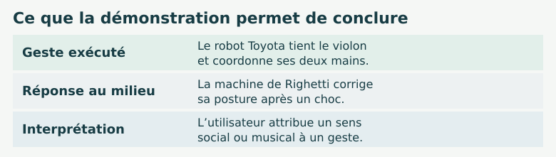

# X-ENS · MP-PC-PSI · Allemand 2017 — Corrigé brut

*Corrigé rédigé par IA, non officiel. Signalez toute erreur.*

**Rédaction** · GPT-6.2 Astra Ultra · vitesse non renseignée

Garde XEULCR, filières MP, PC et PSI. Les deux exercices se rédigent en allemand en quatre heures. A demande une synthèse des quatre documents, sans commentaire personnel, avec un titre et 600 à 675 mots. B demande un texte d’opinion de 500 à 600 mots qui répond aux arguments de l’éditorial.

## A. Synthèse de documents

**Zwischen Geigenbogen und Pflegebett: Was können Roboter übernehmen?**

Ein weißer Roboter von Toyota hält eine Geige unter dem Kopf, seine Hände führen Instrument und Bogen. Das Pressefoto legt einen Vergleich mit einem menschlichen Musiker nahe. Welche Fähigkeiten dieser Vergleich tatsächlich erfasst, bleibt zunächst offen. Drei Berichte aus Deutschland, Japan und den USA untersuchen genau diesen Abstand zwischen einer gelungenen Bewegung und dem Eindruck, ein menschliches Gegenüber vor sich zu haben. Er entscheidet mit darüber, wann Roboter nützlich sind und welche Erwartungen Nutzer an sie richten.

Schon eine körperlich einfache Aufgabe kann für eine Maschine schwierig sein. Der Tübinger Forscher Ludovic Righetti verschiebt etwa den Gegenstand, den sein Roboter greifen soll, oder bringt ihn durch einen Stoß aus dem Gleichgewicht. Eine vorgegebene Bewegungsfolge hilft wenig, sobald die Umgebung nicht mehr der Versuchsanordnung entspricht. Die Maschine muss ihre Lage erfassen, eine geeignete Bewegung bestimmen und sie rechtzeitig ausführen. Eine erfolgreiche Korrektur in Sekundenbruchteilen ist deshalb ein Fortschritt, auch wenn sie weniger eindrucksvoll aussieht als das Geigenspiel. Bei einer Katastrophe, nach der vertraute Wege versperrt und Gegenstände verschoben sind, wäre diese Anpassungsfähigkeit besonders wertvoll. Righetti hält den Abstand zwischen solchen ersten Schritten und allgemein menschlicher Intelligenz für beträchtlich.

Einen anderen Zugang wählen Forscher, die gerade die Ähnlichkeit mit dem Menschen untersuchen. Der japanische Wissenschaftler Minoru Asada hat mit Affetto ein kindlich wirkendes Gegenüber geschaffen, dessen Mimik lebensecht erscheint. Die Arbeit daran soll zum Verständnis der menschlichen Entwicklung beitragen. Auch hier geht der Schluss von der sichtbaren Leistung auf das Innenleben schnell zu weit. Das Foto des Geigers zeigt, wie genau zwei Hände koordiniert werden können. Es verrät weder, ob der Roboter hört, wie seine Musik auf das Publikum wirkt, noch ob er sich an einer bestimmten Stelle für eine eigene Deutung entschieden hat. Wie der Gesichtsausdruck von Affetto lädt eine vertraute Haltung Menschen dazu ein, ihr eine Bedeutung zu geben.

Das kann praktische Folgen haben. In einem deutschen Versuch wurden einem Roboter allein aufgrund unterschiedlicher Haarlängen verschiedene Aufgaben zugetraut. Die eine Ausführung erschien den Teilnehmern für fürsorgliche Tätigkeiten geeignet, während sie der anderen Sicherheit und Reparaturen zuschrieben. Solche Urteile sagen zunächst etwas über die Vorstellungen der Befragten aus. Ob eine Maschine tatsächlich im Alltag hilft, hängt von anderen Eigenschaften ab. In japanischen Einrichtungen transportieren Roboter beispielsweise Medikamente oder regen Bewohner zum gemeinsamen Singen an. Ein Bett, das sich in einen Rollstuhl verwandeln lässt, kann einer älteren Person mehr Selbstständigkeit ermöglichen, ohne wie ein Mensch aussehen zu müssen.

Im Familienhaushalt setzt die Amerikanerin Cynthia Breazeal dennoch bewusst auf soziale Signale. Ihr geplanter Roboter Jibo soll Stimmen und Gesichter unterscheiden, Nachrichten innerhalb der Familie übermitteln und erkennen, wann jemand für ein Foto lächelt. Gegenüber einem Bildschirm liegt der versprochene Vorteil darin, dass Menschen sich daneben weiterhin einander oder einer anderen Tätigkeit zuwenden können. In der Pflege könnte der Roboter eine ältere Angehörige zeitweise unterhalten und im Notfall jemanden benachrichtigen. Breazeal möchte damit Zeit und Kontakt innerhalb der Familie ermöglichen. Ob Technik als Entlastung oder als unerwünschter Ersatz wahrgenommen wird, richtet sich auch danach, welche andere Unterstützung den Betroffenen zur Verfügung steht.

Dabei hat auch das Wort Autonomie zwei verschiedene Bedeutungen. Beim Roboter meint es die Fähigkeit, eine Aufgabe ohne ständige Anleitung auszuführen. Für den Menschen kann es bedeuten, trotz körperlicher Einschränkungen im eigenen Zuhause leben und selbst um Hilfe bitten zu können.

Die Beispiele verbinden somit zwei Forschungsfragen, die leicht ineinander übergehen. Entwickler müssen herausfinden, wie eine Maschine unter wechselnden Bedingungen zuverlässig handeln kann. Zugleich müssen sie verstehen, wie Menschen ihre Bewegungen und Äußerungen deuten und welche Hilfe sie überhaupt wünschen. Dass ein Gerät vertraute Gesten beherrscht, kann die Zusammenarbeit erleichtern. Es kann aber auch Erwartungen wecken, die seine Fähigkeiten übersteigen. Gerade zwischen diesen beiden Möglichkeiten liegt die Bedeutung des Fotos: Die technische Leistung ist sichtbar, der Sinn, den Menschen mit dem Musizieren verbinden, lässt sich auf dem Bild allein nicht feststellen.

*629 Wörter.*

## B. Texte d’opinion

Joseph Urschitz entwirft zwei Zukunftsbilder. Zuerst könnten Maschinen uns einen Teil der Arbeit abnehmen, mit sehr unterschiedlichen Folgen für unseren Wohlstand. Später könnten sie sich womöglich so weit selbst verbessern, dass Menschen die Kontrolle verlieren. Ich finde seine erste Warnung mindestens ebenso dringlich wie die zweite. Wer ständig nach der Maschine fragt, deren Stecker sich nicht mehr ziehen lässt, übersieht leicht die Entscheidungen, die heute niemand rückgängig machen will, obwohl es technisch durchaus möglich wäre.

Nehmen wir einen Betrieb, in dem ein Programm die Einsatzpläne erstellt. Es könnte unbeliebte Schichten gerechter verteilen und den Beschäftigten früher sagen, wann sie frei haben. Ebenso könnte es alle kurzfristigen Schwankungen in der Nachfrage auf Menschen abwälzen, die sich ständig bereithalten müssen. Für beide Ergebnisse genügt dieselbe Rechenleistung. Der Unterschied liegt im Ziel, das die Leitung vorgibt, in den Rechten der Beschäftigten und in der Möglichkeit, einen falschen Plan berichtigen zu lassen. Wer die Folgen ausschließlich mit der Intelligenz der Maschine erklärt, entlässt ihre Auftraggeber zu früh aus ihrer Verantwortung.

Urschitz hat daher recht, wenn er Steuern, Sozialversicherung und die künftige Bedeutung von Arbeit ins Spiel bringt. Sparen Unternehmen Arbeitszeit, kann daraus ein freier Nachmittag ebenso werden wie eine Entlassung. Die Entscheidung sollte nicht allein bei denen liegen, denen die Maschinen gehören. Beschäftigte könnten über Weiterbildung, verkürzte Arbeitszeiten und die Verteilung von Produktivitätsgewinnen mitverhandeln. Auch müsste eine Gesellschaft anerkennen, dass die Pflege eines Angehörigen wertvolle Arbeit bleibt, selbst wenn sie selten auf einer Lohnabrechnung erscheint. So würde die Debatte über Technik zu einer Debatte über tatsächlich verfügbare Zeit.

Beim zweiten Zukunftsbild überzeugt mich der Übergang vom lernenden Programm zur allgemein überlegenen Intelligenz weniger. Aus der Fähigkeit, eine Aufgabe durch Wiederholung besser zu lösen, folgt noch nicht, dass ein System sich selbst alle Ziele setzt oder jedes Hindernis überwindet. Der Hinweis auf Stephen Hawkings Warnung zeigt, dass man ein mögliches großes Risiko ernst nehmen sollte. Er ersetzt keine Begründung dafür, wann es entsteht und woran man eine gefährliche Entwicklung erkennen könnte. Gerade wo die Folgen unsicher sind, brauchen wir Fragen, auf die Entwickler und öffentliche Stellen überprüfbare Antworten geben können.

Wer etwa eine Entscheidung mit schweren Folgen automatisieren will, sollte vorab nachweisen, dass Fehler erkannt werden und eine verantwortliche Person eingreifen kann. Ebenso wichtig ist ein Verfahren, mit dem Betroffene eine Entscheidung anfechten können. Ein Notknopf allein nützt wenig, wenn niemand weiß, wer ihn bedienen darf, oder wenn die Menschen ohne das System überhaupt nicht mehr arbeiten können. Übungen für den Ausfall und verständliche Begründungen im normalen Betrieb schützen daher schon heute, ganz unabhängig davon, wie klug Maschinen in ferner Zukunft werden.

Wo Entscheidungen über das Leben anderer getroffen werden, reicht die freiwillige Zusage eines Herstellers ohnehin nicht aus. Urschitz erinnert an die Bedeutung internationaler Vereinbarungen. Eine gemeinsam vereinbarte Grenze wäre gerade deshalb sinnvoll, weil kein einzelnes Land für alle anderen mitentscheiden kann.

Ich würde folglich weder darauf vertrauen, dass technischer Fortschritt seine Vorteile von selbst gerecht verteilt, noch aus jeder Verbesserung eine bevorstehende Entmachtung der Menschheit ableiten. Der Prüfstein ist konkreter: Wer bestimmt den Zweck, wer kann widersprechen und wer trägt einen entstandenen Schaden? Solange diese Fragen öffentlich verhandelt werden, begegnen wir der Gefahr des Kontrollverlusts an einer Stelle, an der wir tatsächlich etwas ändern können.

*532 Wörter.*

Le rapport porte sur MP et PC. La garde du sujet inclut également PSI.

[Cahier d’allemand, A1–A3 p. 2–7, photographie p. 8, B p. 9–10](https://banques-ecoles.fr/cms/wp-content/uploads/2017/11/2017_MPPC_sujet_eAll.pdf) · [Rapport de l’écrit, p. 1–2](https://banques-ecoles.fr/cms/wp-content/uploads/2017/11/17_MP-PC_rap_eAll.pdf) · [Autre publication du sujet](https://www.ens.psl.eu/sites/default/files/2017_MPPCPSI_sujet_allemand.pdf)
