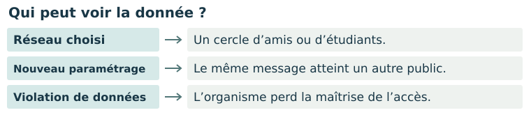
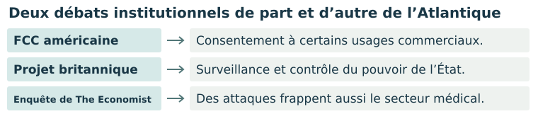
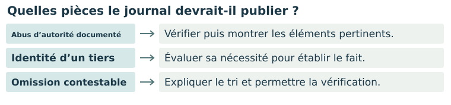

# X-ENS · MP-PC-PSI · Anglais 2017 — Corrigé brut

*Corrigé rédigé par IA, non officiel. Signalez toute erreur.*

**Rédaction** · GPT-6.2 Astra Ultra · vitesse non renseignée

Le cahier XEULCR prévoit quatre heures pour les deux parties. Aucun document autorisé. La partie A demande une synthèse en anglais de 600 à 675 mots, précédée d’un titre, qui croise les documents 1 à 4 dans leur contexte géographique, sans commentaire personnel. La partie B demande un texte d’opinion en anglais de 500 à 600 mots en réaction au document de la seconde partie. Les décomptes portent sur le corps du texte, hors titre.

## A. Synthèse de documents

**Who Sets the Terms of a Private Life Online?**

Sharing a photograph with friends, letting an advertiser follow one's movements and allowing the police to investigate a crime all involve information changing hands. They imply very different understandings of consent. Bobbie Johnson in the Guardian examines Facebook's account of changing social norms, while Brian Fung and Craig Timberg in the Washington Post describe an American attempt to protect broadband customers. Jamie Bartlett in the Telegraph considers the British surveillance debate. An Economist graphic on American data breaches supplies a further complication. Even information deliberately entrusted to one institution may end up somewhere else altogether.

Sharing has become more visible, but the reasons for that change are disputed. Mark Zuckerberg, quoted by Johnson in 2010, takes the growth of social networks as evidence that people have come to welcome greater openness. Facebook itself began as a restricted university network, however, and repeatedly altered the conditions under which information reached an audience. The resulting protests suggest a distinction between wanting to communicate and agreeing to the widest technically possible circulation. Researcher danah boyd points out that younger users can care deeply about privacy while drawing its boundaries differently from adults. A decision to speak in one setting gives little guidance about who may legitimately listen elsewhere.

Commercial incentives help explain how boundaries move. Fung and Timberg describe broadband providers seeking advertising revenue from what customers do across the internet. The Federal Communications Commission's October 2016 ruling required explicit permission for certain uses of sensitive information, including browsing histories and location data. Notification of breaches and an explanation of what is collected would give customers information on which to act. Providers countered that websites such as Facebook and Google could continue to profit under different rules. Read beside Johnson's account, the dispute concerns both the fairness of competition and the difficulty of exercising a choice when the intermediary controls the settings through which it must be expressed.

Control also depends on whether an institution can keep what it collects. The Economist's figures show US medical and business organisations prominently represented among recorded attacks by 2014. Its separate breakdown by type of incident shows hacking accounting for a growing share over the period displayed. The charts distinguish the numbers of breaches in particular sectors from percentages involving a particular method or kind of information. They give substance to Bartlett's warning that compelling organisations to retain more data creates something worth stealing. A legal entitlement to collect records does not establish the practical ability to protect them.

Britain's surveillance bill nevertheless addresses a genuine demand for effective policing. Bartlett argues that the real division concerns confidence in legal safeguards. Those supporting additional powers expect judicial scrutiny and penalties for misuse to limit their application. Critics fear that a capability, once installed, will outlast the assurances under which it was granted. The same technology can assist competing public purposes. Stronger encryption can obstruct an investigation while protecting citizens and businesses from crime. For Bartlett, weakening confidence in digital transactions may also impose economic costs that disappear from a simple contest between liberty and public safety.

Across the two countries, the identity of the institution seeking information matters as much as the information itself. In the American regulatory dispute, a provider's position in the network gives it opportunities which individual customers find difficult to avoid. In the British debate, confidence in the police need not imply confidence in every future use of their powers. Facebook's changes and the breach figures add two ways in which the original audience can expand. The future of privacy consequently depends on who can set limits on collection, enforce limits on reuse and protect people when control over the data is lost.

*611 mots hors titre.*

## B. Texte d’opinion

**Publish the Proof, Protect the Bystander**

Imagine opening a newspaper to learn that a campaign official made a promise to a donor. Now imagine finding, beneath that story, the private correspondence of the junior employee who arranged the meeting. I want the first story investigated and the second person's privacy respected. The New York Times is right that the wholesale release of John Podesta's emails deserves a different name from whistleblowing. The hardest part of defending that distinction is explaining who gets to decide what the public sees.

Whistleblowers take risks to reveal something specific that power would prefer to conceal. The relevance of their evidence is what makes publication defensible. When American newspapers published the Pentagon Papers, readers could examine the discrepancy between what successive administrations knew about Vietnam and what they told the country. Had a government clerk's intimate affairs happened to appear in the same files, knowing about them would have contributed nothing to that judgement. I would apply the same distinction to a candidate whose politics I detest. Otherwise the principle expires on election night.

The Times makes its best point when it considers people on the edge of a campaign. Political movements require volunteers willing to try out an argument, change their minds and ask foolish questions. If the price of joining is exposure of one's family or health history, participation becomes a privilege of those who can absorb humiliation. A threat to a handful of named individuals can silence many who never appear in the files. The paper's comparison with the use of compromising material against dissidents captures that effect. The information can be authentic and the publication profoundly misleading about what matters.

Yet a demand for editorial judgement raises an uncomfortable objection. Editors have loyalties and blind spots. If they keep every original document to themselves, they may simply ask the public to exchange a leaker's assertion for a newspaper's. I would have a newsroom publish the relevant passages in context, explain its omissions and invite independent scrutiny of its verification. Where several news organisations can check the evidence independently, agreement on a fact means more. Individuals being accused should have an opportunity to reply. None of this requires handing a stranger's private messages to the entire internet.

Nor would I give politicians a right to suppress a disclosure simply by labelling a conversation private. Evidence of a public official exchanging a decision for a favour would readily pass my test. In that case the subject's interest in secrecy is precisely why a reporter should persevere. The important questions are what the evidence establishes, whose actions it illuminates and what additional harm publication of each identifying detail would cause.

The Times describes a deluge in which important signals disappear. Its own industry helps decide whether that happens. Editors who lament a data dump on Monday and print the most embarrassing scrap on Tuesday have made the deluge profitable. I would rather see a front page devoted to one verified abuse, with enough evidence for a sceptical reader to judge it, than a searchable archive that punishes everyone for having been in someone's address book.

*515 mots hors titre.*

Le sujet et son rapport situent la synthèse dans les débats américain et britannique de 2010 à 2016. L’éditorial de la partie B date de la campagne présidentielle américaine de 2016.

[Sujet officiel](https://banques-ecoles.fr/cms/wp-content/uploads/2017/07/2017_MPPC_sujet_eAnglais.pdf) · [Rapport du jury](https://banques-ecoles.fr/cms/wp-content/uploads/2017/11/17_MP-PC_rap_eAng.pdf) · [Sujet publié par l’ENS](https://www.ens.psl.eu/sites/default/files/2017_MPPCPSI_sujet_anglais.pdf)
