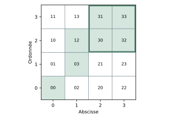
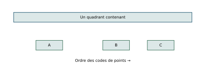

# X-ENS MP-PC-PSI · Informatique B 2017 · Corrigé guidé

*Corrigé rédigé par IA, non officiel. Signalez toute erreur.*

**Rédaction** · GPT-6.2 Astra Ultra · vitesse non renseignée · 24 novembre 2026

## Repères

Les chiffres de base quatre décrivent un chemin du quadrant racine vers un point. Le chiffre 4 indique que toutes les positions du sous-arbre sont présentes. Les comparateurs suivent la convention de signe de l’énoncé.

## I · Appartenance et intersection

### Question 1 · Appartenance d'un point

**Indication.** Un point est déterminé par ses deux coordonnées.

#### Solution

Comparer les couples composante par composante. Un retour vrai au premier témoin suffit. Le retour faux intervient seulement après examen de toute la liste, y compris lorsqu'elle est vide.

```python
def membre(p, q):
    for autre in q:
        if p[0] == autre[0] and p[1] == autre[1]:
            return True
    return False
```

### Question 2 · Intersection par appartenance

**Indication.** Filtrer la première liste à l'aide du test de la question 1.

#### Solution

Chaque point retenu appartient aux deux ensembles et tout point de l'intersection est rencontré dans la première liste. Les listes d'entrée étant sans répétition, il en est de même pour le résultat.

```python
def intersection(p, q):
    r = []
    for point in p:
        if membre(point, q):
            r.append(point)
    return r
```

### Question 3 · Nombre de comparaisons

**Indication.** Compter séparément le nombre d'appels au test et le nombre de candidats dans chaque appel.

#### Solution

Pour $a=|p|$ et $b=|q|$, on effectue au plus $2ab$ comparaisons de coordonnées. Si les ensembles sont disjoints et que toutes les abscisses sont identiques, les deux comparaisons ont lieu pour chaque paire. Le nombre de comparaisons dans le pire cas est donc $\Theta(ab)$, et le temps incluant les boucles est $O(1+a+ab)$.

## II · Requêtes SQL

### Question 4 · Ensembles contenant le point donné

**Indication.** Relier la paire de coordonnées à son identifiant avant d'interroger les appartenances.

#### Solution

La jointure sur l'identifiant ne conserve que les ensembles contenant le point demandé. Le résultat est vide si ce point n'a aucune appartenance. Les notations avec deux-points désignent des paramètres liés.

```sql
SELECT DISTINCT m.idensemble
FROM POINTS AS p JOIN MEMBRE AS m ON m.idpoint = p.id
WHERE p.x = :a AND p.y = :b;
```

### Question 5 · Coordonnées appartenant aux deux ensembles

**Indication.** Une même ligne de POINTS doit avoir un témoin d'appartenance à chacun des ensembles.

#### Solution

Les deux alias de MEMBRE vérifient les deux appartenances. La requête convient également à $i=j$. DISTINCT assure le résultat ensembliste même en présence de lignes d'appartenance répétées.

```sql
SELECT DISTINCT p.x, p.y
FROM POINTS AS p
JOIN MEMBRE AS m ON m.idpoint = p.id
JOIN MEMBRE AS n ON n.idpoint = p.id
WHERE m.idensemble = :i AND n.idensemble = :j;
```

### Question 6 · Points partageant au moins un ensemble

**Indication.** Faire deux usages distincts de la relation d'appartenance, un pour le point de départ et un pour chacun des voisins.

#### Solution

La première jointure retrouve tous les ensembles du point $(a,b)$ et la seconde tous leurs membres. Un point rencontré par plusieurs ensembles apparaît une seule fois dans le résultat. Le point de départ lui-même figure dans le résultat s'il appartient à au moins un ensemble.

```sql
SELECT DISTINCT voisin.idpoint
FROM POINTS AS p
JOIN MEMBRE AS ancre ON ancre.idpoint = p.id
JOIN MEMBRE AS voisin ON voisin.idensemble = ancre.idensemble
WHERE p.x = :a AND p.y = :b;
```

## III · Codage de Lebesgue

### Question 7 · Coder le point (1,6)

**Indication.** Écrire les deux coordonnées sur exactement trois bits.

#### Solution

Les écritures sont $001$ et $110$. De gauche à droite, les couples de bits sont $01,01,10$, donc la liste recherchée est $[1,1,2]$.

### Question 8 · Former les chiffres de Lebesgue

**Indication.** Au même rang de poids, le bit de l'abscisse porte le poids 2 dans le chiffre de base quatre.

#### Solution

On descend des bits de poids fort vers les bits de poids faible. Le chiffre correspondant est $2x_k+y_k$. On obtient $n$ chiffres, y compris d'éventuels zéros initiaux.

```python
def code(n, p):
    r = []
    for k in range(n-1, -1, -1):
        r.append(2*bits(p[0], k) + bits(p[1], k))
    return r
```

## IV · Représentation des points

### Question 9 · Trier les mots de longueur trois

**Indication.** Le premier chiffre différent décide.

#### Solution

La liste triée est $000,\ 012,\ 101,\ 233,\ 311$, les écritures étant lues en base quatre.

### Question 10 · Comparateur de points codés

**Indication.** Respecter la convention inhabituelle de signe de l'énoncé.

#### Solution

Après avoir lu un préfixe commun, le premier chiffre différent détermine l'ordre. Le résultat 1 signifie que le premier argument est le plus petit, $-1$ qu'il est le plus grand et 0 qu'ils coïncident. Au plus $n$ positions sont examinées.

```python
def compare_pcodes(n, c1, c2):
    for i in range(n):
        if c1[i] < c2[i]:
            return 1
        if c1[i] > c2[i]:
            return -1
    return 0
```

### Question 11 · Codages de l'ensemble S₁

**Indication.** Pour chaque point, trouver le quadrant principal puis le sous-quadrant.

#### Solution

Dans l'ordre de l'énoncé, les points $(0,0),(3,3),(3,2),(1,1),(1,2),(2,2),(2,3)$ portent les mots $00,33,32,03,12,30,31$. En ordre croissant, la liste de points est $[00,03,12,30,31,32,33]$. L'intitulé emploie déjà « compacté ». Dans le sens défini en partie V, son écriture compactée est $[00,03,12,34]$, détaillée en Q12.

## V · Quadrants compactés

### Question 12 · Compacter le quadrant plein

**Indication.** Reconnaître les quatre codes qui ont le même premier chiffre et les quatre derniers chiffres possibles.

#### Solution

Les mots $30,31,32,33$ couvrent ensemble le quadrant de préfixe 3. Les trois autres points restent isolés. L'AQL est donc $[[0,0],[0,3],[1,2],[3,4]]$. Le chiffre 4 final représente les quatre possibilités dans ce quadrant.



### Question 13 · Étendre un suffixe de jokers

**Indication.** Vérifier les k dernières cases avant la moindre modification.

#### Solution

Si une case du suffixe diffère de 4, le mot original est rendu intact. Sinon on copie le mot et on change la case juste avant ce suffixe. Pour $k=0$, la vérification est vide et seul le dernier chiffre de la copie devient 4.

```python
def ksuffixe(n, k, q):
    for i in range(n-k, n):
        if q[i] != 4:
            return q
    r = list(q)
    r[n-k-1] = 4
    return r
```

### Question 14 · Remonter les quadrants complets

**Indication.** Chercher quatre frères consécutifs avec même préfixe, chiffres 0 à 3 et même suffixe de k jokers.

#### Solution

À l'étape $k$, un bloc fusionnable représente exactement les quatre enfants d'un même carré de côté $2^{k+1}$. Les remplacer par leur parent conserve l'ensemble couvert et l'ordre. Les enfants d'un parent plein sont consécutifs dans la liste triée. Par induction sur $k$, chacun a déjà été compacté aux étapes précédentes, donc toute fusion possible à cette échelle est effectuée. Après les $n$ passages, la liste ne contient que des quadrants maximaux. La liste vide et les quatre enfants de la racine suivent les mêmes règles.

```python
def quatre_freres(n, k, s, i):
    pivot = n-k-1
    premier = s[i]
    for j in range(4):
        mot = s[i+j]
        for t in range(pivot):
            if mot[t] != premier[t]:
                return False
        if mot[pivot] != j:
            return False
        for t in range(pivot+1, n):
            if mot[t] != 4:
                return False
    return True

def compacte(n, s):
    courant = s
    for k in range(n):
        suivant = []
        i = 0
        while i < len(courant):
            if i+3 < len(courant) and quatre_freres(n, k, courant, i):
                suivant.append(ksuffixe(n, k, courant[i]))
                i += 4
            else:
                suivant.append(courant[i])
                i += 1
        courant = suivant
    return courant
```

### Question 15 · Classer deux quadrants

**Indication.** Suivre leurs chemins jusqu'au premier chiffre différent. Un 4 termine le chemin proprement dit.

#### Solution

Si les chiffres diffèrent avant tout joker, les deux chemins bifurquent vers des enfants disjoints, ordonnés par leurs chiffres. Si $p$ atteint 4 tandis que $q$ continue, $P$ contient strictement $Q$, et la fonction rend $-2$. Dans la situation inverse elle rend 2. Un parcours complet sans différence donne 0.

```python
def compare_ccodes(n, p, q):
    for i in range(n):
        a, b = p[i], q[i]
        if a != b:
            if a == 4:
                return -2
            if b == 4:
                return 2
            if a < b:
                return 1
            return -1
    return 0
```

### Question 16 · Intersection de deux AQL triées

**Indication.** Quand un quadrant contient l'autre, conserver le grand pour le comparer aux prochaines entrées de la seconde liste.

#### Solution

Deux quadrants dyadiques sont égaux, disjoints ou emboîtés. Dans le cas disjoint on oublie celui qui précède l'autre, car tous ses points le précèdent. Pour des quadrants emboîtés on émet le plus petit et on avance seulement son curseur. En cas d'égalité on émet un seul mot et on avance les deux. Chaque itération avance au moins un curseur et appelle le comparateur une fois, soit au plus $|p|+|q|$ appels et $O(n(|p|+|q|))$ opérations pour le parcours. Les résultats arrivent en ordre et sans recouvrement. Ils sont maximaux aussi. Si le parent d'un quadrant émis était entier dans l'intersection, ce parent serait couvert entièrement dans chacune des deux entrées. Une représentation AQL y contiendrait alors le parent ou un ancêtre, et le plus petit des deux quadrants rencontrés ne pourrait être un enfant strict. Aucune recompaction n'est donc nécessaire.

```python
def intersection2(n, p, q):
    i, j = 0, 0
    r = []
    while i < len(p) and j < len(q):
        cas = compare_ccodes(n, p[i], q[j])
        if cas == 0:
            r.append(p[i])
            i += 1
            j += 1
        elif cas == 2:
            r.append(p[i])
            i += 1
        elif cas == -2:
            r.append(q[j])
            j += 1
        elif cas == 1:
            i += 1
        else:
            j += 1
    return r
```


