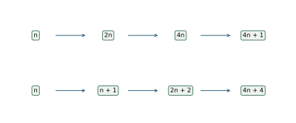
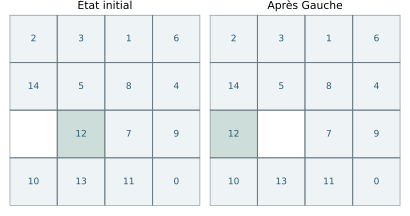

# X-ENS MP · Informatique A 2017 · Corrigé brut

*Corrigé rédigé par IA, non officiel. Signalez toute erreur.*

**Rédaction** · GPT-6.2 Astra Ultra · vitesse non renseignée · 24 novembre 2026

## I · Jeu à un joueur et parcours en largeur

### Question 1 · Atteindre 42

Un chemin de sept coups est $1,2,4,5,10,20,21,42$. En cinq coups on ne peut dépasser $2^5=32$. Pour six coups, les états après trois coups seraient dans $\{4,5,6,8\}$ et les prédécesseurs à exactement trois coups de 42 dans $\{10,19,20,39\}$. Ces deux ensembles sont disjoints.

### Question 2 · Ce que contient une couche

Avant l'itération $p$, $A$ contient exactement les extrémités des chemins de longueur $p$ depuis $e_0$. C'est vrai pour $p=0$. Prendre l'union des successeurs de tous les états de $A$ prolonge chaque chemin d'un coup et reconstitue tous ceux de longueur $p+1$ en retirant leur dernier coup. L'invariant se propage donc tant qu'aucun but n'a été renvoyé. Une réponse VRAI témoigne d'un tel chemin. Inversement, si une solution finie existe, sa couche est atteinte et un but est repéré, pour des successeurs effectivement énumérables en temps fini, comme dans l'implantation par listes. Une boucle sans solution peut durer indéfiniment.

### Question 3 · Croissance exponentielle malgré les doublons

À la profondeur $j$, il y a au plus $2^j$ chemins, donc au plus $2^j$ valeurs distinctes. Pour la minoration, depuis $n$ on peut effectuer les trois coups « doubler, doubler, ajouter 1 » ou « ajouter 1, doubler, doubler ». Ils donnent $4n+1$ et $4n+4$. Les deux images sont disjointes modulo 4 et chaque application est injective. Par induction, après $3k$ coups, au moins $2^k$ valeurs distinctes sont atteintes. Prolonger par zéro, un ou deux doublements conserve cette distinction. Ainsi $2^{\lfloor j/3\rfloor}\le |A_j|\le2^j$.

À la découverte d'un but de profondeur $p$, la couche $A_p$ a déjà été construite. Son stockage et sa construction donnent les minorations exponentielles, même si son premier élément est gagnant. Avec génération et insertion amortie en temps constant, temps et espace sont $O(2^p)$. Avec un ensemble ordonné à coût logarithmique, la majoration temporelle $O(p2^p)$ reste exponentielle. Les deux bornes n'ont pas à partager la même base.



### Question 4 · Recherche en largeur en Caml

Les listes `courant` et `prochain` représentent deux profondeurs successives. Les doublons sont autorisés. L'opération de concaténation parcourt uniquement la liste de successeurs de l'état traité. Le cas de deux couches vides choisit de lever une exception, comportement permis en l'absence de solution.

```ocaml
let bfs () =
  let rec niveau p courant prochain =
    match courant with
    | [] ->
        if prochain = [] then failwith "sans solution"
        else niveau (p + 1) prochain []
    | x :: reste ->
        if final x then p
        else niveau p reste (suivants x @ prochain)
  in niveau 0 [initial] [];;
```

### Question 5 · Optimalité du premier succès

À l'entrée de chaque couche $p$, la liste couvre toutes les extrémités à profondeur $p$ et uniquement celles-ci. Pour atteindre cette couche, les précédentes ont été intégralement testées sans succès. Le premier résultat vaut donc la profondeur minimale.

## II · Parcours en profondeur

### Question 6 · Recherche avec profondeur limite

Pour $p>m$, l'appel de la figure 2 rend FAUX. Pour $p=m$, le résultat est VRAI exactement si $e$ est un but, car tout fils est testé au-delà de la limite. Supposons le résultat acquis avec au plus $m-p-1$ coups disponibles. À profondeur $p<m$, on réussit si $e$ est final ou si l'un de ses successeurs admet une continuation de longueur au plus $m-p-1$. C'est précisément l'existence d'une solution depuis $e$ en au plus $m-p$ coups. Appliquer cette propriété à $p=0,e=e_0$.

### Question 7 · Approfondissement itératif

Le test de la finalité précède l'arrêt en $p=m$, ce qui permet de reconnaître un but exactement sur la frontière. Les appels internes ont $p\le m$. Le court-circuit de l'opérateur booléen arrête l'examen dès qu'un fils réussit.

```ocaml
let ids () =
  let rec visite m x p =
    if final x then true
    else if p = m then false
    else
      let rec essaie = function
        | [] -> false
        | y :: ys -> visite m y (p + 1) || essaie ys
      in essaie (suivants x)
  in
  let rec seuil m =
    if visite m initial 0 then m else seuil (m + 1)
  in seuil 0;;
```

### Question 8 · Profondeur renvoyée par IDS

Soit $d$ la profondeur optimale. Q6 assure un échec pour tout seuil $m<d$ et un succès pour $m=d$. Les recherches sont finies jusqu'à chaque borne car le branchement est fini. Le premier seuil rendu est donc $d$, y compris lorsque $d=0$.

### Question 9 · Temps et espace des deux recherches

Pour une solution de profondeur $p$, dans les deux structures de parcours usuelles de l'énoncé (chaîne et arbre binaire complet) et à coût constant par successeur, on obtient dans le pire cas :

| Nombre d'états par couche | BFS, temps | BFS, espace | IDS, temps | IDS, espace |
|---|---:|---:|---:|---:|
| Un seul sur une chaîne | $\Theta(p+1)$ | $\Theta(1)$ | $\Theta((p+1)^2)$ | $\Theta(p+1)$ |
| $2^j$ à profondeur $j$, arbre binaire | $\Theta(2^p)$ | $\Theta(2^p)$ | $\Theta(2^p)$ | $\Theta(p+1)$ |

Sur une chaîne, BFS ne conserve que les deux états courants. IDS répète des parcours de tailles $1,2,\dots,p+1$. Chaque DFS conserve son chemin actif. Sur l'arbre binaire, BFS accumule une dernière couche de taille $2^p$. IDS visite au plus $\sum_{m=0}^p\sum_{j=0}^m2^j=O(2^p)$ nœuds. Un but placé en dernier donne la minoration, et la pile conserve au plus un nombre constant de successeurs en attente par profondeur. Sur un graphe avec nombreuses convergences, les seuls cardinaux des couches ne déterminent pas les coûts des listes avec doublons. Il faudrait préciser les arêtes ou le nombre de chemins.

## III · Recherche à horizon

### Question 10 · IDA* générique

Le sujet utilise une référence globale `min`. Elle est ici de type `int ref`, avec $-1$ pour l'infini puisque les horizons $p+h(x)$ sont positifs ou nuls. Chaque passe remet cette référence à l'infini. La recherche rend la profondeur ou $-1$ si elle échoue. Lors d'une coupure, elle met à jour le prochain seuil avant de remonter.

```ocaml
let min = ref (-1);;

let depasse c =
  if !min = -1 || c < !min then min := c;;

let idastar () =
  let rec visite m x p =
    let c = p + h x in
    if c > m then (depasse c; -1)
    else if final x then p
    else
      let rec essaie = function
        | [] -> -1
        | y :: ys ->
            let d = visite m y (p + 1) in
            if d >= 0 then d else essaie ys
      in essaie (suivants x)
  in
  let rec seuil m =
    min := -1;
    let d = visite m initial 0 in
    if d >= 0 then d
    else if !min = -1 then failwith "sans solution"
    else seuil !min
  in seuil (h initial);;
```

### Question 11 · Une heuristique pour le jeu arithmétique

Pour $1\le n<t$, posons $h(n)=\lceil\log_2(t/n)\rceil$ et pour $n\ge t$, $h(n)=0$. Si un chemin atteint $t$ en $k$ coups, alors $t\le2^kn$ car $n+1\le2n$. Cela donne $h(n)\le k$. Pour $t>1$, $h(1)>0$ et $h(t)=0$, donc la fonction est non constante. Pour le cas particulier $t=1$, choisir $h(1)=0$ et $h(n)=1$ pour $n>1$ : ces états ne peuvent plus atteindre le but, donc cette valeur arbitraire est admissible. On peut calculer la borne sans flottants en comptant les doublements jusqu'à atteindre ou dépasser $t$.

### Question 12 · Optimalité avec des seuils espacés

Soit une solution optimale de longueur $d$. Pour son état $e_p$, l'admissibilité donne $h(e_p)\le d-p$, donc $p+h(e_p)\le d$. Le premier seuil $h(e_0)$ est au plus $d$. Si une passe de seuil $m<d$ échoue, le chemin optimal possède un premier préfixe coupé, sinon le but aurait été testé. Son coût appartient à $(m,d]$. Le prochain seuil, minimum de tous les dépassements, est donc strictement plus grand que $m$ et au plus $d$. Cette suite entière atteint $d$, au plus tard. Aux seuils inférieurs, aucun but ne peut être accepté car en un but $h=0$, donc la profondeur serait au plus $m<d$. À la passe de seuil $d$, le chemin optimal survit et toute solution rendue a profondeur $d$. La preuve fonctionne pour une heuristique admissible même si les coûts des préfixes ne sont pas monotones.

## IV · Jeu du taquin

### Question 13 · Mémoire du parcours en largeur

Il y a $16!$ permutations des quinze tuiles et du vide. L'invariant de parité du taquin répartit ces permutations en deux classes, soit $16!/2\simeq1{,}05\cdot10^{13}$ états accessibles depuis un départ. Un codage compact par cases emploie 4 bits par case, soit 8 octets par état. Stocker une classe entière ainsi demanderait environ 84 To, avant index et files. Avec une matrice d'entiers, les objets occupent davantage.

L'exemple du sujet nécessite 50 déplacements depuis le premier plateau. Une recherche en largeur doit finir la couche 49 et construire la couche 50. Dans la version à listes de Q4, chaque plateau a au moins deux successeurs et les doublons subsistent : la couche 49 contient au moins $2^{49}$ occurrences, déjà 4,5 pétaoctets à 8 octets par occurrence. Dans la figure 1, les ensembles fusionnent les doublons d'une même couche. À titre d'ordre de grandeur, même un facteur effectif de 1,7 pendant 49 niveaux donne $1{,}7^{49}\simeq2{,}0\cdot10^{11}$ positions, autour de 1,6 To à ce codage. Cette dernière estimation dépend des fusions et ne constitue pas une minoration du nombre exact d'états distincts. La profondeur de cet exemple et le stockage simultané de deux couches expliquent le recours à la recherche en profondeur.

### Question 14 · Somme des distances de Manhattan

Chaque terme est la distance de la tuile à sa position finale. Un coup déplace une seule tuile d'une case et fait varier ce terme de $+1$ ou $-1$. Tous les autres restent inchangés. Puisque $h=0$ au but, il faut au moins $h(e)$ coups pour y parvenir depuis $e$. L'heuristique est admissible.

### Question 15 · Mettre à jour le plateau et le coût

La case libre initiale est $(a,b)$ et la tuile $v$ arrive en $(a,b)$ depuis $(i,j)$. Sa destination finale est $(v\mathbin{\mathrm{div}}4,v\bmod4)$. Les autres contributions de Manhattan sont conservées. On marque la nouvelle case vide par $-1$, autorisé car son contenu est déclaré non significatif. L'opération prend un temps constant.

```ocaml
let move i j =
  let v = grid.(i).(j) in
  let a = !li and b = !lj in
  let di = v / 4 and dj = v mod 4 in
  let distance u w = abs (u - di) + abs (w - dj) in
  h := !h - distance i j + distance a b;
  grid.(a).(b) <- v;
  grid.(i).(j) <- -1;
  li := i;
  lj := j;;
```



### Question 16 · Tenter un déplacement à gauche

La tuile candidate se trouve en colonne `!lj + 1`, donc il faut `!lj < 3`. Un mouvement précédent `Droite` serait immédiatement annulé. Une liste vide ne contient aucun mouvement précédent. Un échec laisse toute la configuration intacte.

```ocaml
let tente_gauche () =
  let retour = match !solution with
    | Droite :: _ -> true
    | _ -> false
  in
  if !lj = 3 || retour then false
  else (gauche (); solution := Gauche :: !solution; true);;
```

### Question 17 · Recherche avec état mutable et retour arrière

Le test $p+h>m$ précède le test du but. La référence `min` et la fonction `depasse` sont celles de Q10. Pour chaque mouvement réussi localement, `branche` sauvegarde la liste avant l'essai. Si la récursion échoue, la fonction de mouvement inverse **sans filtrage** remet la grille, le vide et $h$ dans leur état précédent, puis la liste est restaurée. Un succès conserve le plateau final et le chemin. Les trois autres fonctions de tentative et les quatre déplacements élémentaires sont ceux fournis ou admis par l'énoncé.

```ocaml
let rec dfs m p =
  let c = p + !h in
  if c > m then (depasse c; false)
  else if !h = 0 then true
  else
    let branche tentative inverse =
      let avant = !solution in
      if not (tentative ()) then false
      else if dfs m (p + 1) then true
      else (inverse (); solution := avant; false)
    in
    branche tente_gauche droite ||
    branche tente_bas haut ||
    branche tente_droite gauche ||
    branche tente_haut bas;;
```

### Question 18 · Renvoyer la suite optimale des déplacements

Une passe infructueuse de Q17 restaure toute la configuration. La suivante prend le plus petit horizon refusé. Écarter l'inverse immédiat d'un mouvement conserve tout chemin optimal, car une telle paire se supprimerait sans changer l'état. Q12 s'applique dès lors aux chemins encore autorisés. Le succès initial renvoie la liste vide et tout autre succès rend la liste dans l'ordre chronologique.

```ocaml
let taquin () =
  solution := [];
  let rec seuil m =
    min := -1;
    if dfs m 0 then rev !solution
    else if !min = -1 then failwith "sans solution"
    else seuil !min
  in seuil !h;;
```
