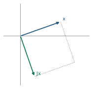
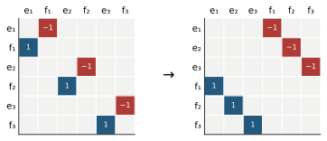
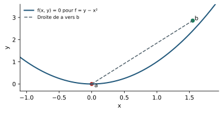
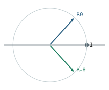
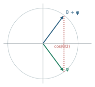
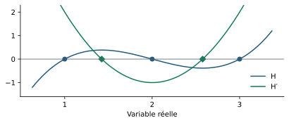
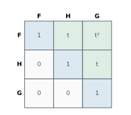

# X-ENS MP — Mathématiques A 2017 · Corrigé guidé

*Corrigé rédigé par IA, non officiel. Signalez toute erreur.*

**Rédaction** · modèle exact non renseigné (famille GPT-6) · effort non renseigné · vitesse non renseignée

**Révision** · modèle exact non renseigné (famille GPT-6) · effort non renseigné · vitesse non renseignée

**Révision (tour 2)** · GPT-6.2 Astra Ultra · vitesse non renseignée

**Révision (tour 3)** · GPT-6.2 Astra Ultra · vitesse non renseignée · 26 novembre 2026

## Présentation du sujet

En quatre heures, le sujet explore les bases symplectiques et les conditions sous lesquelles deux formes domptent une même structure complexe. Les 26 numéros correspondent à 35 questions et sous-questions. [Sujet officiel](https://banques-ecoles.fr/cms/wp-content/uploads/2017/07/2017_MP_sujet_MathA.pdf)

> [!JURY]
> Le jury signale l’importance du signe de la structure complexe en 9, des justifications sur le corps de base en 15–16 et du contrôle de la dimension des sous-espaces caractéristiques en 23. [Rapport officiel](https://banques-ecoles.fr/cms/wp-content/uploads/2017/11/17_MP_rap_eMathA.pdf)

## I — Bases symplectiques

Une forme bilinéaire antisymétrique $\omega$ est symplectique si $\varphi_\omega:x\mapsto \omega(x,\cdot)$ est un isomorphisme de $E$ vers son dual. Une structure complexe est un endomorphisme $J$ vérifiant $J^2=-I$. Elle est domptée par $\omega$ si $\omega(x,Jx)>0$ pour tout $x\ne0$.

### Question 1

> [!INDICATION]
> Combien de valeurs suffit-il de connaître pour déterminer une forme linéaire ?

> [!INDICATION]
> Considérez l’application d’évaluation sur les vecteurs d’une base.

#### Solution

Dans une base $(b_1,\ldots,b_n)$, une forme linéaire est déterminée par ses $n$ valeurs sur les vecteurs de la base. Toute famille de $n$ réels peut être prescrite en prolongeant linéairement. L’application d’évaluation sur la base est donc un isomorphisme entre $E^*$ et $\mathbb R^n$, d’où $\dim E^*=n$.

### Question 2

> [!INDICATION]
> Appliquez la définition aux deux mêmes arguments.

> [!INDICATION]
> Un réel égal à son opposé s’annule.

#### Solution

Par antisymétrie, $\omega(x,x)=-\omega(x,x)$. Le corps étant $\mathbb R$, on peut diviser par deux et obtenir $\omega(x,x)=0$.

### Question 3a

> [!INDICATION]
> Développez d’abord la forme en son premier argument, puis en son second.

> [!INDICATION]
> L’évaluation sur deux vecteurs de base donne directement une entrée de la matrice recherchée.

#### Solution

La bilinéarité donne $\omega(x,y)=\sum_{i,j}x_i y_j\omega(b_i,b_j)=X^{\mathsf T}MY$ avec $m_{ij}=\omega(b_i,b_j)$. Inversement, prendre $x=b_i$ et $y=b_j$ dans l’identité exigée impose chacune de ces entrées, d’où l’unicité.

### Question 3b

> [!INDICATION]
> Comparez les deux entrées aux positions symétriques de la diagonale.

> [!INDICATION]
> Intervertissez les deux arguments de la forme.

#### Solution

L’antisymétrie donne $m_{ji}=\omega(b_j,b_i)=-\omega(b_i,b_j)=-m_{ij}$ pour tous les indices. Ainsi $M^{\mathsf T}=-M$.

### Question 3c

> [!INDICATION]
> Combien de paramètres libres a une matrice antisymétrique de taille deux ?

> [!INDICATION]
> Vérifiez que chaque valeur de ce paramètre produit bien une forme par la formule de 3a.

#### Solution

En dimension deux, toute matrice antisymétrique est de la forme $\left(\begin{smallmatrix}0&a\\-a&0\end{smallmatrix}\right)$. Chacune définit une forme bilinéaire antisymétrique par 3a. L’application qui envoie une telle forme sur $a=\omega(b_1,b_2)$ est donc un isomorphisme avec $\mathbb R$, d’où la dimension un.

### Question 3d

> [!INDICATION]
> Interprétez (E2) en termes de noyau d’une application vers le dual.

> [!INDICATION]
> Décrivez les coordonnées de cette application dans la base duale.

#### Solution

Les dimensions de $E$ et $E^*$ étant égales, $\varphi_\omega$ est un isomorphisme si et seulement si son noyau est nul. Cela équivaut à l’existence, pour tout $x\ne0$, d’un $y$ tel que $\omega(x,y)\ne0$, donc à (E2). En coordonnées, l’identité $X^{\mathsf T}MY=0$ pour tout $Y$ équivaut à $M^{\mathsf T}X=0$. Ainsi (E2) équivaut à l’injectivité de la matrice carrée $M^{\mathsf T}$, elle-même équivalente à l’inversibilité de $M$, soit (E3).

### Question 4

> [!INDICATION]
> Comparez le déterminant de la matrice à celui de sa transposée.

> [!INDICATION]
> Le facteur extrait de chacune des colonnes doit être pris à la puissance $n$.

#### Solution

Si $M$ représente une forme symplectique, $\det M\ne0$. Or $\det M=\det M^{\mathsf T}=\det(-M)=(-1)^n\det M$. Ainsi $(-1)^n=1$ et $n$ est pair.

### Question 5

> [!INDICATION]
> Calculez la transposée puis le carré de la matrice du sujet.

> [!INDICATION]
> Utilisez la caractérisation matricielle de 3d.

#### Solution

La matrice $J_n=\left(\begin{smallmatrix}0&-I\\ I&0\end{smallmatrix}\right)$ est antisymétrique. Elle vérifie $J_n^2=-I_n$, donc est inversible. La forme bilinéaire qu’elle définit est antisymétrique et non dégénérée par 3d.

### Question 6

> [!INDICATION]
> Partez d’un vecteur non nul et trouvez un partenaire qui le couple de manière non nulle.

> [!INDICATION]
> Ajustez le signe et l’échelle du partenaire pour obtenir le coefficient supérieur droit de $J_2$.

#### Solution

Prenons $e\ne0$. Par 3d il existe $y$ tel que $c=\omega(e,y)\ne0$. Posons $f=-y/c$, de sorte que $\omega(e,f)=-1$. La relation $\omega(e,e)=0$ exclut que $f$ soit proportionnel à $e$, donc $(e,f)$ est une base en dimension deux. Sa matrice de forme est $J_2$.

Pour un sous-espace $F$, on note $F^\omega=\{x\in E:\forall y\in F,\ \omega(x,y)=0\}$ et $\psi_F(x)=\omega(x,\cdot)|_F$.

### Question 7a

> [!INDICATION]
> Complétez une base du sous-espace.

> [!INDICATION]
> Vous pouvez choisir librement les valeurs sur les vecteurs ajoutés.

#### Solution

Complétons une base de $F$ en une base de $E$. Donnons à la forme étendue les valeurs prescrites par $u$ sur la première partie de la base et la valeur zéro sur ses nouveaux vecteurs. Le prolongement par linéarité donne une forme sur $E$ dont la restriction est $u$.

### Question 7b

> [!INDICATION]
> L’espace orthogonal est défini dans $E$, mais le noyau de la restriction se calcule dans $F$.

> [!INDICATION]
> Caractérisez les vecteurs de $F$ qui annulent tous les vecteurs de $F$.

#### Solution

Le noyau de l’application de $F$ vers $F^*$ associée à la restriction est constitué des $x\in F$ qui vérifient $\omega(x,y)=0$ pour tout $y\in F$, soit $F\cap F^\omega$. La caractérisation de 3d dans $F$ donne l’équivalence.

### Question 7c

> [!INDICATION]
> Le noyau se lit directement sur la restriction de la forme.

> [!INDICATION]
> Pour atteindre une forme quelconque sur $F$, prolongez-la puis utilisez la non-dégénérescence de la forme initiale.

#### Solution

Par définition, $\ker\psi_F=F^\omega$. Pour $u\in F^*$, prolongeons $u$ en une forme $\widetilde u\in E^*$ par 7a. Comme $\varphi_\omega$ est surjective sur $E^*$, il existe $x\in E$ avec $\varphi_\omega(x)=\widetilde u$. Alors $\psi_F(x)=u$. Ainsi l’image est $F^*$.

### Question 7d

> [!INDICATION]
> Appliquez le théorème du rang à l’application de 7c.

> [!INDICATION]
> Quelle est la dimension du dual de $F$ ?

#### Solution

Le théorème du rang appliqué à $\psi_F$ donne $\dim E=\dim F^\omega+\dim F^*=\dim F^\omega+\dim F$.

### Question 7e

> [!INDICATION]
> Combinez l’intersection de 7b avec la somme des dimensions donnée par 7d.

> [!INDICATION]
> Un vecteur du radical de la deuxième restriction est alors orthogonal aux deux supplémentaires.

#### Solution

Si la restriction à $F$ est symplectique, 7b donne une intersection nulle et 7d la dimension de la somme. On obtient $E=F\oplus F^\omega$. Si $x\in F^\omega$ est orthogonal pour $\omega$ à tout $F^\omega$, il l’est aussi à tout $F$ par définition, donc à $E$ entier. La non-dégénérescence donne $x=0$ et la restriction à $F^\omega$ est symplectique.

### Question 8

> [!INDICATION]
> Faites la récurrence sur la demi-dimension.

> [!INDICATION]
> Isolez un plan symplectique à l’aide de 6, puis utilisez 7e pour traiter le supplémentaire.

#### Solution

Raisonnons sur la demi-dimension $m=n/2$. Le cas $m=1$ est 6. Pour $m>1$, choisissons $e_1,f_1$ comme en 6. Sur le plan $F$ qu’ils engendrent la matrice est $J_2$, donc la restriction est non dégénérée. Par 7e, $F^\omega$ est un supplémentaire symplectique de dimension $2(m-1)$. Appliquons-lui l’hypothèse de récurrence et concaténons les bases. Les produits croisés entre $F$ et $F^\omega$ étant nuls, la matrice est diagonale par blocs, avec $m$ blocs $J_2$.

### Question 9

> [!INDICATION]
> Distinguez le premier et le second vecteur de chacune des paires de la base obtenue.

> [!INDICATION]
> Après la permutation, choisissez le signe de la structure complexe en testant la positivité de son couplage.

#### Solution

La base construite est $(e_1,f_1,\ldots,e_m,f_m)$. Ordonnons-la en $(e_1,\ldots,e_m,f_1,\ldots,f_m)$. Comme $\omega(e_i,f_j)=-\delta_{ij}$ et que les paires de même type sont orthogonales, la nouvelle matrice est $J_n$. Dans cette base, prenons la structure complexe $J$ de matrice $-J_n$. Son carré vaut $-I_n$, et $\omega(x,Jx)=X^{\mathsf T}J_n(-J_n)X=\|X\|_2^2>0$ pour $x\ne0$.

## II — Deux outils sur les polynômes

On travaille sur les polynômes à coefficients réels, de degré borné. On cherchera à exprimer une condition de simplicité des racines par une condition polynomiale sur les coefficients.

### Question 10

> [!INDICATION]
> Comparez les dimensions de départ et d’arrivée.

> [!INDICATION]
> Étudiez une relation dans le noyau par le lemme de Gauss. Dans l’autre sens cherchez un antécédent de l’unité.

#### Solution

Les espaces de départ et d’arrivée ont la même dimension $p+q$. Si $P,Q$ sont premiers entre eux et si $VP+WQ=0$, alors $Q$ divise $VP$, donc divise $V$ par le lemme de Gauss. L’inégalité $\deg V<q$ impose $V=0$, puis $W=0$ et l’application est bijective. Réciproquement, si l’application est surjective, $1=VP+WQ$ pour un couple du domaine, ce qui impose que tout diviseur commun soit constant.

### Question 11

> [!INDICATION]
> Des racines multiples laissent une trace dans la dérivée du polynôme.

> [!INDICATION]
> Appliquez la question 10 à la paire polynôme-dérivée en utilisant le déterminant en bases monomiales. Pensez aux chutes de degré.

#### Solution

Pour $d\geq2$, considérons la matrice en bases monomiales de $(V,W)\mapsto VP+WP'$ des polynômes de degrés au plus $d-2,d-1$ vers ceux de degré au plus $2d-2$. Elle est carrée de taille $2d-1$ et ses entrées sont linéaires en les coefficients de $P$. Soit $r(P)$ son déterminant. Si $\deg P<d$, les images ont degré au plus $2d-3$, donc $r(P)=0$. Pour $\deg P=d$, la question 10 donne $r(P)\ne0$ exactement lorsque $P$ et $P'$ sont premiers entre eux. Cela équivaut à la simplicité de toutes les racines complexes, car une racine multiple est commune à $P$ et $P'$, et sa conjuguée aussi si elle est non réelle. Pour $d=1$, prendre $r(a_0+a_1X)=a_1$ a les mêmes propriétés.

### Question 12

> [!INDICATION]
> Réduisez le problème à une famille de polynômes d’une seule variable.

> [!INDICATION]
> Reliez par une droite le point considéré à un point où la fonction ne s’annule pas.

#### Solution

Comme la fonction $f$ n’est pas identiquement nulle, fixons $b$ tel que $f(b)\ne0$. Pour un point quelconque $a$, la fonction $h(t)=f(a+t(b-a))$ est un polynôme d’une variable. Il est non nul car $h(1)=f(b)\ne0$. Il a donc un nombre fini de racines et l’on peut choisir des $t$ arbitrairement proches de zéro avec $h(t)\ne0$. Les points correspondants tendent vers $a$, ce qui prouve la densité.

## III — Réduction simultanée

On se donne deux formes symplectiques $\omega,\omega_1$ sur le même espace réel. Pour 14 à 19, cet espace a dimension quatre. Pour 15 à 19, l’automorphisme associé n’a pas de valeur propre réelle.

### Question 13

> [!INDICATION]
> Voyez chaque forme comme un isomorphisme de $E$ sur $E^*$.

> [!INDICATION]
> Composez l’un des isomorphismes avec l’inverse de l’autre, puis utilisez deux fois l’antisymétrie.

#### Solution

L’égalité souhaitée équivaut à $\varphi_{\omega_1}=\varphi_\omega\circ u$. Les deux applications vers $E^*$ étant des isomorphismes, $u=\varphi_\omega^{-1}\varphi_{\omega_1}$ est l’unique solution et est inversible. Par antisymétrie des deux formes, $\omega(x,uy)=-\omega(uy,x)=-\omega_1(y,x)=\omega_1(x,y)=\omega(ux,y)$. C’est la condition définissant $S$.

### Question 14a

> [!INDICATION]
> Écrivez la relation de 13 pour toutes les paires de colonnes $X,Y$.

> [!INDICATION]
> Une identité bilinéaire pour toutes les paires détermine chaque entrée d’une matrice.

#### Solution

Pour tous vecteurs colonnes réels $X,Y$, l’égalité de 13 est $X^{\mathsf T}J_4 UY=X^{\mathsf T}U^{\mathsf T}J_4Y$. En prenant tous les vecteurs de la base canonique pour $X,Y$, on en déduit $J_4 U=U^{\mathsf T}J_4$.

### Question 14b

> [!INDICATION]
> Comparez les blocs dans l’égalité obtenue en 14a.

> [!INDICATION]
> Rappelez-vous la description des matrices antisymétriques d’ordre deux.

#### Solution

Écrivons $U=\left(\begin{smallmatrix}A&B\\C&D\end{smallmatrix}\right)$. Égaler les quatre blocs de $J_4U=U^{\mathsf T}J_4$ donne $C^{\mathsf T}=-C$, $B^{\mathsf T}=-B$ et $D=A^{\mathsf T}$. Les matrices antisymétriques d’ordre deux sont proportionnelles à $J_2$, donc $U=\left(\begin{smallmatrix}N&\alpha J_2\\\beta J_2&N^{\mathsf T}\end{smallmatrix}\right)$ avec $N=A$ et deux scalaires réels.

### Question 14c

> [!INDICATION]
> Les coefficients du polynôme dépendent du déterminant et de la trace de $N$.

> [!INDICATION]
> Dans le carré de $U$, traitez les blocs diagonaux par Cayley-Hamilton et développez les blocs hors diagonale avec $J_2$.

#### Solution

Le polynôme est $T(X)=X^2-\operatorname{tr}(N)X+\det N+\alpha\beta$. Les blocs diagonaux de $U^2$ valent $N^2-\alpha\beta I_2$ et $(N^{\mathsf T})^2-\alpha\beta I_2$, puisque $J_2^2=-I_2$. Ceux de $T(U)$ s’annulent donc par Cayley-Hamilton pour $N$ et $N^{\mathsf T}$. Le bloc supérieur droit de $U^2$ vaut $\alpha(NJ_2+J_2N^{\mathsf T})=\alpha\operatorname{tr}(N)J_2$, l’identité centrale se vérifiant en écrivant les quatre entrées de $N$. En l’appliquant à $N^{\mathsf T}$, le bloc inférieur gauche vaut aussi $\beta\operatorname{tr}(N)J_2$. Les deux blocs hors diagonale de $T(U)$ sont donc nuls.

### Question 15

> [!INDICATION]
> Le spectre d’une matrice réelle est stable par conjugaison.

> [!INDICATION]
> L’annulateur quadratique doit contenir les deux valeurs propres conjuguées.

#### Solution

La matrice réelle $U$ a sur $\mathbb C$ au moins une valeur propre $\lambda$, non réelle par hypothèse. Sa conjuguée est aussi valeur propre, et $T$ annule les deux. Le polynôme quadratique $T$ a donc exactement ces deux racines distinctes. Une matrice annulée par un polynôme scindé à racines simples est diagonalisable. La conjugaison échange bijectivement les deux espaces propres qui ont dès lors chacun dimension complexe deux. Prenons deux vecteurs indépendants $Z,Y$ dans celui associé à $\lambda$.

### Question 16

> [!INDICATION]
> Dans quels espaces propres se trouvent les conjugués des deux vecteurs donnés ?

> [!INDICATION]
> On passe de chaque paire vecteur–conjugué à ses parties réelle et imaginaire par un changement inversible.

#### Solution

Les quatre vecteurs $Z,Y,\overline Z,\overline Y$ forment une base complexe, puisque chaque paire est une base de l’un des deux espaces propres supplémentaires. Le changement entre $(Z,\overline Z)$ et $(Z_1,Z_2)$ est inversible sur $\mathbb C$ par les formules de partie réelle et imaginaire, de même pour $(Y,\overline Y)$ et $(Y_1,Y_2)$. Ainsi $(Z_1,Z_2,Y_1,-Y_2)$ est libre sur $\mathbb C$, donc aussi sur $\mathbb R$. Ces quatre vecteurs réels forment bien la base annoncée de l’espace réel de dimension quatre.

### Question 17

> [!INDICATION]
> Étendez la forme par bilinéarité complexe.

> [!INDICATION]
> Appliquez l’orthogonalité des espaces propres distincts aux trois paires formées avec des conjugués.

#### Solution

Prolongeons $\omega$ par bilinéarité complexe. Si deux vecteurs propres ont valeurs propres distinctes, la relation $\omega(uZ,W)=\omega(Z,uW)$ donne $\omega(Z,W)=0$. Cela s’applique à $(Z,\overline Z)$, $(Y,\overline Y)$ et $(Z,\overline Y)$. La première égalité s’écrit $-2i\omega(z_1,z_2)=0$ et la deuxième donne de même $\omega(y_1,y_2)=0$. Dans la troisième, les parties réelle et imaginaire donnent respectivement
$$\omega(z_1,y_1)=-\omega(z_2,y_2),\qquad \omega(z_2,y_1)=\omega(z_1,y_2).$$

### Question 18

> [!INDICATION]
> Réunissez les deux quantités à normaliser en un seul nombre complexe.

> [!INDICATION]
> Montrez sa non-nullité grâce à la base de 16 puis regardez l’effet du changement d’échelle sur $Y$.

#### Solution

Le nombre $c=\omega(z_1,y_1)+i\omega(z_1,y_2)$ est non nul. Sinon $z_1$ serait orthogonal à toute la base de 16, par 17 et alternance, alors que $z_1\ne0$. Si l’on remplace $Y$ par $\xi Y$, ce nombre devient $\xi c$ par bilinéarité complexe. Choisir $\xi=-1/c$ rend les deux produits souhaités égaux à $-1$ et à zéro. La nouvelle paire de vecteurs propres reste libre.

### Question 19

> [!INDICATION]
> Écrivez les équations propres en parties réelle et imaginaire.

> [!INDICATION]
> Vérifiez les signes de la rotation dans les deux paires après le changement de signe de $y_2$.

#### Solution

Écrivons $\lambda=a+ib=r e^{-i\theta}$ avec $r>0$ et $\theta\notin\pi\mathbb Z$. Les équations $uz_1=az_1-bz_2$ et $uz_2=bz_1+az_2$ donnent le bloc $rR_\theta$ dans la paire $(z_1,z_2)$. Les mêmes équations pour les $y$, avec changement de signe du second vecteur de base, donnent $rR_{-\theta}$ dans $(y_1,-y_2)$. Par 17 et 18, les deux seuls produits croisés non nuls entre les deux paires sont $\omega(z_1,y_1)=-1$ et $\omega(z_2,-y_2)=-1$. On a donc $\operatorname{Mat}_{\widetilde B}(\omega)=J_4$. La matrice de $\omega_1$ vaut enfin
$$J_4\operatorname{diag}(rR_\theta,rR_{-\theta})=r\begin{pmatrix}0&-R_{-\theta}\\R_\theta&0\end{pmatrix}.$$

Pour les questions 20 à 22, $P=\prod_j P_j$ est un polynôme annulateur de $u$ dont les facteurs sont deux à deux premiers entre eux, et $F_j=\ker P_j(u)$.

### Question 20

> [!INDICATION]
> Quel lemme s’applique à un produit de polynômes deux à deux premiers entre eux ?

> [!INDICATION]
> Pour la stabilité, commutez une puissance polynomiale de $u$ avec $u$.

#### Solution

Le lemme des noyaux pour des polynômes deux à deux premiers entre eux donne $\ker P(u)=\bigoplus_j \ker P_j(u)$. Le membre de gauche est $E$ puisque $P$ est annulateur. Chacun des noyaux est stable par $u$, car $u$ commute à $P_j(u)$.

### Question 21

> [!INDICATION]
> La relation de 13 permet de faire passer un polynôme en $u$ d’un argument à l’autre.

> [!INDICATION]
> Utilisez Bézout pour représenter un vecteur du premier noyau comme image d’une expression contenant le second polynôme.

#### Solution

La relation de 13 s’itère et donne $\omega(Q(u)x,y)=\omega(x,Q(u)y)$ pour tout polynôme réel $Q$. Pour $j\ne k$, Bézout donne $CP_j+DP_k=1$. Si $x\in F_j$ et $y\in F_k$, on a $x=D(u)P_k(u)x$, d’où $\omega(x,y)=\omega(x,D(u)P_k(u)y)=0$. Enfin $ux\in F_j$ par 20, donc $\omega_1(x,y)=\omega(ux,y)=0$. L’antisymétrie fournit les deux inclusions demandées, indépendamment de l’ordre des arguments.

### Question 22

> [!INDICATION]
> Dans une somme orthogonale, testez un vecteur du radical d’un bloc contre tous les autres blocs.

> [!INDICATION]
> La forme entière est non dégénérée.

#### Solution

Un vecteur de $F_j$ orthogonal à tout $F_j$ pour la restriction de $\omega$ est aussi orthogonal à tous les $F_k$, $k\ne j$, par 21. Leur somme avec $F_j$ étant $E$, il est nul. Le même raisonnement vaut pour $\omega_1$. Les restrictions bilinéaires antisymétriques sont donc non dégénérées.

### Question 23

> [!INDICATION]
> Décomposez le polynôme caractéristique en puissances de facteurs irréductibles réels.

> [!INDICATION]
> Le degré de la puissance associée à chaque bloc est sa dimension. Utilisez aussi la parité.

#### Solution

Factorisons le polynôme caractéristique réel comme produit des puissances de ses facteurs irréductibles distincts. Appliquons 20–22 à ces puissances, dont le produit annule $u$ par Cayley-Hamilton. Dans la somme directe obtenue, le polynôme caractéristique de la restriction à un bloc ne peut avoir d’autres racines que celles du facteur associé, qui annule ce bloc à une puissance près. Le produit des polynômes caractéristiques des blocs étant celui de $u$, chacun est exactement la puissance du facteur correspondant. Pour une valeur propre réelle de multiplicité au plus deux, la dimension du bloc est ainsi au plus deux, et nécessairement deux par 4 et 22. Une paire non réelle conjuguée de multiplicité identique un ou deux donne une dimension deux ou quatre. Les orthogonalités et les non-dégénérescences résultent de 21 et 22. On peut préciser que le bloc d’une paire non réelle a nécessairement dimension quatre. Sur un plan, les deux restrictions symplectiques seraient proportionnelles par 3c et la relation de 13 ferait de $u$ un scalaire réel sur ce bloc. Cela contredirait le choix de la paire non réelle.

## IV — Deux formes domptant une même structure complexe

(F1) affirme l’existence d’un $J$ dompté par $\omega$ et $\omega_1$. (F2) demande que toutes les combinaisons $(1-s)\omega+s\omega_1$ pour $s\in[0,1]$ soient symplectiques.

### Question 24

> [!INDICATION]
> Quels sont les spectres interdits par la non-dégénérescence de tout le segment ?

> [!INDICATION]
> Sur le bloc de quatre dimensions, prenez deux rotations opposées dans les blocs hors diagonale de la structure complexe. Une demi-rotation équilibre deux cosinus.

#### Solution

Une combinaison de paramètre $s$ a pour application vers le dual $\varphi_\omega((1-s)I+su)$. Ainsi (F2) équivaut à l’absence de valeur propre réelle négative de $u$, puisque $u$ est inversible et $-(1-s)/s$ parcourt les réels négatifs pour $0<s<1$.

Utilisons les blocs de 23. Sur un plan, $\omega_1=c\omega$ par 3c. Le scalaire $c$ est non nul et nécessairement positif par (F2). Le choix de 9 convient aux deux formes. Un bloc de dimension quatre provient d’une paire de valeurs propres non réelles. Prenons la base de 19. Remplaçons au besoin $\theta$ par son représentant dans $(-\pi,\pi)$ et posons $\phi=-\theta/2$. Alors $\cos\phi=\cos(\theta+\phi)>0$. Prenons
$$J=\begin{pmatrix}0&R_\phi\\-R_{-\phi}&0\end{pmatrix}.$$
Son carré est $-I_4$. En multipliant les matrices des deux formes par $J$, on obtient respectivement $\operatorname{diag}(R_{-\phi},R_\phi)$ et $r\operatorname{diag}(R_{-\theta-\phi},R_{\theta+\phi})$. Puisque $X^{\mathsf T}R_\alpha X=\cos(\alpha)\|X\|_2^2$, leurs formes quadratiques sont strictement positives. La somme directe des structures complexes ainsi choisies est simultanément domptée, par orthogonalité des blocs pour les deux formes.

### Question 25

> [!INDICATION]
> Cherchez une condition polynomiale suffisante empêchant les racines triples.

> [!INDICATION]
> Pour montrer que la condition n’est pas identiquement nulle, dupliquez une diagonale simple et étudiez la dérivée d’un carré grâce au théorème de Rolle.

#### Solution

Dans une base de 9, soit $D$ l’espace vectoriel réel des matrices vérifiant $J_nU=U^{\mathsf T}J_n$. Alors $S$ correspond à l’ouvert $D\cap\mathrm{GL}_n(\mathbb R)$. Pour $P_U=\det(XI-U)$, la fonction $U\mapsto r(P_U')$ est polynomiale en les coordonnées de $D$, par 11 avec $d=n-1$. Si elle est non nulle, $P_U'$ a toutes ses racines simples, donc $P_U$ n’a pas de racine de multiplicité supérieure à deux.

La simplicité des racines de la dérivée donne une condition suffisante. Par exemple, $P=(X^3-1)^2$ a toutes ses racines doubles, tandis que $P^{\prime}=6X^2(X^3-1)$ a une racine double en zéro. Ce phénomène se réalise dans $S$ avec $U=\operatorname{diag}(C,C^{\mathsf T})$, où $C$ est la matrice d’une permutation circulaire des trois coordonnées.

Cette fonction n’est pas identiquement nulle. Pour $m=n/2$, choisissons $C=\operatorname{diag}(1,2,\ldots,m)$ et $U=\operatorname{diag}(C,C)\in S$. Ici $P_U=H^2$ avec $H=\prod_{j=1}^m(X-j)$. Les racines de $H$ sont simples et celles de $H'$ s’intercalent strictement entre elles par Rolle et le degré de $H'$. Ainsi $P_U'=2HH'$ a seulement des racines simples, y compris pour $m=1$. Comme $P_U'$ a exactement degré $n-1$, le déterminant construit en 11 est non nul. Par 12, son ensemble de non-annulation est dense dans $D$, donc sa partie contenue dans l’ouvert $S$ est dense dans $S$.

### Question 26

> [!INDICATION]
> Une combinaison convexe de deux nombres strictement positifs reste strictement positive. La densité de 25 donne ensuite un résultat générique.

> [!INDICATION]
> Pour dépasser la densité, trouvez une droite ou un plan invariant isotrope. Une dilatation symplectique contracte les blocs triangulaires et permet de transporter une structure choisie sur la limite.

#### Solution

Si une structure complexe $J$ est domptée par les deux formes, toute combinaison convexe donne encore une valeur strictement positive sur $(x,Jx)$ pour $x\ne0$. Elle est donc non dégénérée. Ainsi (F1) implique (F2). À $\omega$ fixée, (F2) définit un ouvert en $u$, car le minimum sur $s\in[0,1]$ de $|\det((1-s)I+su)|$ est strictement positif et le déterminant dépend continûment de $(s,u)$. Les questions 24 et 25 donnent dès lors une première conclusion : dans cet ouvert, les couples satisfaisant (F1) sont denses. Pour conclure pour **chaque couple**, la positivité stricte exige un argument supplémentaire.

Montrons par récurrence sur la dimension paire que (F2) entraîne toujours (F1). La dimension zéro est immédiate et le cas d’un plan a été traité en 24. Supposons (F2). Prenons un sous-espace réel $F$ stable par $u$ provenant d’un vecteur propre réel ou des parties réelle et imaginaire d’un vecteur propre non réel. Sa dimension $k$ est un ou deux et le polynôme caractéristique de $u|_F$ est irréductible réel. La restriction de $\omega$ à $F$ est nulle. C’est automatique sur une droite. Sur un plan, si elle ne l’était pas, elle serait symplectique et $\omega(ux,y)$, alternée, en serait un multiple par 3c. Cela rendrait $u|_F$ scalaire, impossible pour la paire choisie.

Choisissons une base $(e_i)$ de $F$ et des vecteurs $f_j$ avec $\omega(e_i,f_j)=-\delta_{ij}$. Ils existent par la surjectivité de 7c et l’antisymétrie. En posant $C_{ij}=\omega(f_i,f_j)$, remplaçons $f_j$ par $f_j-\tfrac12\sum_i C_{ij} e_i$. Les produits avec les $e_i$ sont conservés et les produits entre les nouveaux $f_i$ valent zéro, par bilinéarité et $C^{\mathsf T}=-C$. Leur espace $G$ est donc isotrope et $F\oplus G$ symplectique. Posons $H=(F\oplus G)^\omega$. On a $E=F\oplus H\oplus G$ et $F^\omega=F\oplus H$. Comme $u$ est auto-adjoint pour $\omega$ au sens de 13 et conserve $F$, il conserve également $F^\omega$. Sa matrice est donc triangulaire par blocs dans cet ordre.

Pour $t>0$, la dilatation $D_t=\operatorname{diag}(t I_F,I_H,t^{-1}I_G)$ préserve $\omega$, car les seuls couplages non nuls se trouvent entre $F$ et $G$ et à l’intérieur de $H$. Dans $u_t=D_tuD_t^{-1}$, les trois blocs strictement supérieurs sont multipliés par $t,t^2,t$. Ainsi $u_t$ tend vers la partie diagonale $u_0$. Cet automorphisme conserve la relation de 13 et le spectre de $u$ (triangularité). Ses restrictions à $H$ et à $F\oplus G$ satisfont donc le critère spectral de (F2) donné en 24. Sur $H$, de dimension strictement moindre, la récurrence donne une structure commune pour $\omega$ et $\omega(u_0\cdot,\cdot)$. Sur $F\oplus G$, les blocs diagonaux sont la matrice de $u|_F$ et sa transposée, d’après leur couplage par $-I_k$. Le polynôme caractéristique y est donc le carré d’un irréductible de degré un ou deux. La question 24 s’applique. La somme des deux structures fournit une structure $J_0$ commune sur $E$ pour le couple limite.

Sur la sphère unité, $x\mapsto\omega(u_0x,J_0 x)$ admet un minimum strictement positif, et $\omega(u_tx,J_0x)$ converge uniformément vers cette fonction. Ainsi **le même** $J_0$ convient à $u_t$ lorsque $t>0$ est assez petit. Dès lors $D_t^{-1}J_0D_t$ est une structure commune pour les formes initiales, par invariance de $\omega$ sous $D_t$. La récurrence est close et les propositions (F1) et (F2) sont équivalentes.

La réduction par dilatation se vérifie sur un bloc non diagonalisable. Prenons $N=\bigl(\begin{smallmatrix}1&4\\0&1\end{smallmatrix}\bigr)$ et $U=\operatorname{diag}(N,N^{\mathsf T})$. La relation de 14a est satisfaite. Le déterminant de $(1-s)I+sU$ vaut $1$ pour tout $s$, malgré la multiplicité quatre de la valeur propre $1$. Le choix $J_0=-J_4$ dompte $\omega$ mais, pour $x=(1,-1,0,0)^{\mathsf T}$, on a $\omega_1(x,J_0x)=x^{\mathsf T}U^{\mathsf T}x=-2$.

La matrice symplectique $D=\operatorname{diag}(1/4,1,4,1)$ transforme par conjugaison les deux coefficients $4$ en $1$. La partie symétrique de $DUD^{-1}$ est constituée de deux blocs $\bigl(\begin{smallmatrix}1&1/2\\1/2&1\end{smallmatrix}\bigr)$, de valeurs propres $1/2$ et $3/2$. Pour le couple ainsi transformé, $J_0$ donne donc deux formes quadratiques strictement positives. En revenant aux coordonnées initiales, $D^{-1}J_0D$ est bien dompté par $\omega$ et $\omega_1$.

## Bilan

La normalisation d’une forme fixe les signes et les coordonnées. Pour deux formes, leur automorphisme associé organise les réductions sur les plans et les blocs de dimension quatre. Une contraction sur un drapeau isotrope permet enfin d’étendre le résultat de la situation générique à tous les couples dont le segment est symplectique.
