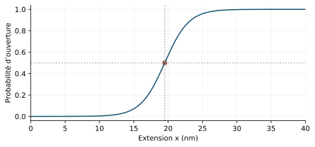
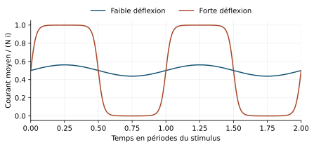
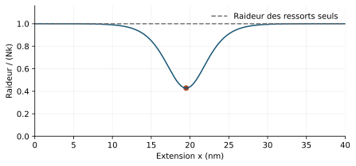
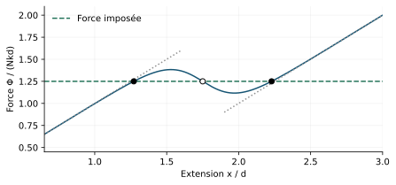
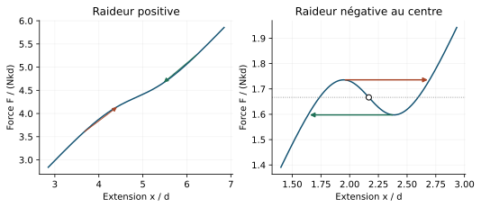
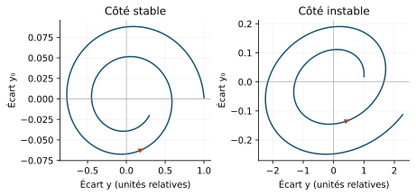
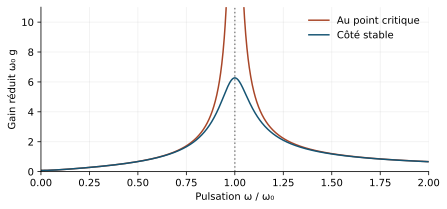

# X-ENS MP 2017 — Physique · Corrigé brut

*Corrigé rédigé par IA, non officiel. Signalez toute erreur.*

**Lecture du rapport du jury** · GPT-6.2 Astra Ultra · vitesse non renseignée

**Rédaction** · GPT-6.2 Astra Ultra · vitesse non renseignée

## Mécanismes physiques de la perception auditive

## I — Énergie thermique et énergie élastique

### Question 0 — Échelle de l’agitation thermique

Le travail réversible pour allonger le ressort de $0$ à $d$ vaut $\int_0^d kx\,dx=kd^2/2$. Avec les données de l’énoncé, il vaut $4{,}8\times10^{-21}\,\mathrm J$, soit $5\times10^{-21}\,\mathrm J$ à un chiffre significatif. À $300\,\mathrm K$, $k_BT\simeq4\times10^{-21}\,\mathrm J$. Les deux énergies sont du même ordre. Les fluctuations thermiques peuvent modifier l’état d’un élément et une description probabiliste des canaux est nécessaire.

## II.A — Ouverture des canaux à extension imposée

### Question 1 — Écart d’énergie entre les états

Le tableau et le dessin de la figure 3 donnent pour l’allongement du ressort $x$ à l’état fermé et $x-d$ à l’état ouvert. Nous suivons cette géométrie, également indiquée dans la légende de la figure 4. La phrase sous la figure 3 intervertit les extensions spatiales des deux conformations. Les énergies de l’élément entier sont donc $E_F=\epsilon_F+kx^2/2$ et $E_O=\epsilon_O+k(x-d)^2/2$. En soustrayant,
$$
E_O-E_F=\epsilon+\frac{kd^2}{2}-kdx=-\phi(x-x_0),\qquad
\phi=kd,\qquad x_0=\frac d2+\frac{\epsilon}{kd}.
$$
Un étirement accru favorise ainsi l’ouverture.

### Question 2 — Probabilité d’ouverture à l’équilibre

Les poids canoniques des deux états sont proportionnels à $e^{-\beta E_O}$ et $e^{-\beta E_F}$. La normalisation donne $p_O=1/[1+e^{\beta(E_O-E_F)}]$. On en tire
$$
p_O(x)=\frac{1}{1+\exp[-\beta kd(x-x_0)]},\qquad \Lambda=-\beta kd .
$$
Ainsi $\Lambda$ s’exprime en inverse d’une longueur. Le signe assure $p_O>1/2$ lorsque l’état ouvert est moins coûteux.

### Question 3 — Courbe d’ouverture

Posons $A=\beta kd>0$. La fonction $p_O$ croît, passe par $1/2$ en $x_0$ et tend vers $1$ pour $x-x_0\gg1/A$. Pour $0\leq x\ll x_0$ et $A(x_0-x)\gg1$, le canal est presque toujours fermé. La dérivée $A p_O(1-p_O)$ atteint son maximum $A/4$ au milieu de la transition, qui s’étend sur une échelle de longueur $1/A$.

### Question 4.a — Point de repos le plus sensible

Pour $p_O=1/2$, les deux états ont même énergie et $x_r=x_0=d/2+\epsilon/(kd)$. À $300\,\mathrm K$, $kd=2{,}4\,\mathrm{pN}$ et $\epsilon\simeq4{,}2\times10^{-20}\,\mathrm J$, d’où $x_r\simeq2\times10^{-8}\,\mathrm m$. La tension du ressort fermé est $kx_r\simeq1{,}2\times10^{-11}\,\mathrm N$. Celle du ressort ouvert vaut $k(x_r-d)$, et la tension moyenne au repos $k(x_r-d/2)\simeq1\times10^{-11}\,\mathrm N$. Les trois estimations sont du même ordre, environ dix piconewtons. À cette extension, une petite variation de déplacement produit la plus grande variation de probabilité et les deux sens de variation restent détectables.

### Question 4.b — Déflexion décelable

Au point de repos, $\delta p_O\simeq(A/4)\delta x=(\beta kd\gamma/4)\delta X$. Pour une variation absolue d’environ $0{,}1$, $X_0\simeq0{,}4k_BT/(\gamma kd)$. Avec $\gamma=0{,}1$ on trouve $X_0\simeq7\times10^{-9}\,\mathrm m$, soit quelques nanomètres. L’inversion exacte de la sigmoïde pour $p_O=0{,}6$ remplacerait $0{,}4$ par $\ln(0{,}6/0{,}4)\simeq0{,}405$.

### Question 5 — Courant produit par un déplacement sinusoïdal

Pour $X=x_r/\gamma+X_A\sin\omega t$, le courant moyen est $I(t)=Ni/[1+\exp(-A\gamma X_A\sin\omega t)]$. À faible amplitude, $I\simeq Ni[1/2+(A\gamma X_A/4)\sin\omega t]$. La variation reproduit fidèlement la forme et l’amplitude du signal mécanique. À forte amplitude, le courant alterne entre deux plateaux proches de zéro et de $Ni$, avec des transitions rapides près des passages par zéro de la déflexion relative. La période demeure perceptible, mais les crêtes sont écrêtées et l’information sur l’amplitude se dégrade. La transduction est la plus fidèle en régime de faible signal autour du repos.

## II.B — Raideur, changement de branche et hystérésis

### Question 6 — Tension moyenne d’un lien

Pour une même extension totale $x$, le ressort fermé subit $f_F=kx$, le ressort ouvert $f_O=k(x-d)$. Ces valeurs sont sélectionnées avec les probabilités $1-p_O$ et $p_O$. La moyenne est donc $\langle f\rangle=(1-p_O)kx+p_Ok(x-d)=k[x-dp_O(x)]$.

### Question 7 — Force totale et fluctuations

Si $n_O$ est le nombre de canaux ouverts, $F=Nkx-kdn_O$. L’indépendance à $x$ fixé donne $\langle n_O\rangle=Np_O$ et $\operatorname{var}(n_O)=Np_O(1-p_O)$. Il vient
$$
\Phi(x)=Nk[x-dp_O(x)],\qquad \sigma_F=kd\sqrt{Np_O(1-p_O)} .
$$
À $x$ fixé et pour une force moyenne par canal non nulle, $\sigma_F/|\Phi|$ décroît comme $N^{-1/2}$. Même lorsque la moyenne s’annule et que ce rapport perd son sens, les fluctuations de $F/N$ tendent vers zéro.

### Question 8 — Raideur différentielle

La dérivation de la loi de Boltzmann donne $dp_O/dx=A p_O(1-p_O)$ avec $A=\beta kd$. La pente de la force vaut donc
$$
K_{\rm HH}=Nk[1-\beta kd^2p_O(1-p_O)].
$$
Le premier terme est la raideur des $N$ ressorts en parallèle. Le second traduit le relâchement d’un ressort lorsqu’un canal s’ouvre en réponse à l’extension.

### Question 9 — Minimum de raideur

Le produit $p_O(1-p_O)=1/4-(p_O-1/2)^2$ est maximal en $x_{\min}=x_0$. La raideur minimale vaut $Nk(1-\beta kd^2/4)$. De part et d’autre, dans les régimes presque fermé et presque ouvert, elle retrouve la valeur $Nk$. Pour les paramètres numériques du cahier, le minimum est voisin de $0{,}43\,Nk$.

### Question 10 — Fenêtre d’amollissement

Des ressorts en parallèle de conformation figée auraient une pente constante $Nk$. Près de $x_0$, l’ouverture croissante des canaux raccourcit les ressorts et compense une partie de l’allongement imposé. Dans cette fenêtre de raideur positive réduite, une force faible provoque une déflexion $\delta x\simeq\delta F/K_{\rm HH}$ plus grande. La sensibilité du courant à cette déflexion y est également maximale près du milieu de la fenêtre.

### Question 11 — Apparition d’une branche décroissante

Le minimum s’annule lorsque $d=d_{\min}=2\sqrt{k_BT/k}$, soit environ $5\,\mathrm{nm}$ à $300\,\mathrm K$. La pente devient strictement négative pour $d>d_{\min}$ au voisinage de $x_0$. À l’égalité, la tangente est horizontale en un seul point. Si $C=\beta kd^2>4$, les deux extrema de $\Phi$ correspondent aux probabilités $p_\pm=[1\pm\sqrt{1-4/C}]/2$, donc aux extensions $x_\pm=x_0+A^{-1}\ln[p_\pm/(1-p_\pm)]$. La force croît jusqu’au maximum en $x_-$, décroît jusqu’au minimum en $x_+$ et croît de nouveau. Les deux portions presque linéaires suivent respectivement les droites $Nkx$ et $Nk(x-d)$.

### Question 12 — Bistabilité sous force imposée

L’équilibre impose $\Phi(x)=F$. Si $\Phi(x_+)<F<\Phi(x_-)$, une droite horizontale coupe la courbe de la question 11 en trois points. Autour d’un point d’intersection, la résultante mécanique varie de $-\Phi'(x)\delta x$. Une pente positive donne donc une force de rappel et un équilibre stable. Les deux branches extrêmes sont stables et celle du milieu est instable. Aux bornes, deux intersections se confondent à une tangence.

### Question 13 — Cycle sous balayage de force

Pour $d<d_{\min}$, $\Phi$ est croissante. Entre les extrémités définies par $p_O=0{,}01$ et $0{,}99$, les trajets aller et retour se superposent. Pour $d>d_{\min}$, on suit d’abord la branche de faible $x$. Au maximum $\Phi(x_-)$, elle disparaît et $x$ saute, à la même force, sur la branche supérieure en déplacement. Au retour, le saut inverse se produit au minimum $\Phi(x_+)$. Les sauts sont horizontaux dans le plan $(x,F)$ et délimitent une hystérésis. Ce tracé suppose que le balayage franchit les deux plis et que le système suit chaque branche stable jusqu’à sa disparition.

### Question 14 — Redistribution de la tension

À force constante, $F=Nkx-kdn_O$ impose $\delta x=d/N$ après l’ouverture d’un canal de plus. Chaque ressort encore associé à un canal fermé voit sa tension augmenter de $kd/N$. Cette augmentation favorise l’ouverture d’autres canaux, car $p_O$ croît avec $x$. Ainsi la réponse collective peut amplifier la perturbation initiale. À extension imposée, la diminution de tension due à ces ouvertures peut dépasser l’augmentation élastique directe et engendrer la branche de raideur négative.

## III.A — Dynamique spontanée

### Question 15 — Équilibre au milieu de la fenêtre

Pour maintenir les canaux, la force externe moyenne est $+\Phi(x)\vec e_x$. L’action opposée des ressorts est $-\Phi(x)\vec e_x$ par action-réaction. Pour $x=x_0$, $p_O=1/2$ et il faut $F_c=Nk(x_0-d/2)=N\epsilon/d$. La résultante sous déplacement infinitésimal est $-K_{\rm HH}(x_0)\delta x$. L’équilibre est instable si $K_{\rm HH}(x_0)<0$.

### Question 16 — Mouvement suramorti

Le bilan mécanique à force imposée nulle est $m\ddot x=-\lambda\dot x-\Phi(x)$. Le rapport entre terme inertiel et frottement est de l’ordre de $m/(\lambda\tau)\ll1$. Il reste
$$
\lambda\dot x=-Nk[x-dp_O(x)].
$$
Le frottement et la force des ressorts sont alors en équilibre à chaque instant à l’ordre dominant.

### Question 17 — Point fixe avec adaptation

L’équation $\dot x_0=-\alpha(x_0-x)$ impose $b=a$ à l’état stationnaire. La probabilité dépend désormais de $x-x_0$ et vaut $1/2$ quand $a=b$. L’équation mécanique stationnaire donne $a=d p_O=d/2$. Ainsi $a=b=d/2$. Le paramètre $x_0$ est dans cette partie une variable dynamique.

### Question 18 — Équations linéarisées

Autour de $a=b=d/2$, le premier ordre donne $p_O=1/2+A(y-y_0)/4+O((y-y_0)^3)$. La substitution dans les deux équations fournit
$$
\dot y=-\kappa[(1-\nu)y+\nu y_0],\qquad
\dot y_0=\alpha(y-y_0),\qquad
\kappa=Nk/\lambda,\qquad \nu=\beta kd^2/4 .
$$
$\kappa$ et $\alpha$ sont des taux et $\nu$ est sans dimension.

### Question 19 — Modes libres

Les amplitudes vérifient $[s+\kappa(1-\nu)]C+\kappa\nu C_0=0$ et $-\alpha C+(s+\alpha)C_0=0$. Une solution non nulle nécessite un déterminant nul. Le polynôme caractéristique est donc
$$
s^2+[\alpha+\kappa(1-\nu)]s+\alpha\kappa=0 .
$$
Le terme constant est positif, même si la raideur statique rend le coefficient de $s$ négatif.

### Question 20 — Deux échelles de temps

Notons $h=\alpha+\kappa(1-\nu)$. Les racines exactes sont $-h/2\pm\sqrt{h^2/4-\alpha\kappa}$. Ici $h=O(\alpha)$ et $\kappa\gg\alpha$, donc $h^2\ll\alpha\kappa$. Les modes ont pour exposants $s\simeq-h/2\pm i\sqrt{\alpha\kappa}$. Le temps d’une oscillation est $2\pi/\sqrt{\alpha\kappa}$, celui de variation de l’enveloppe $2/|h|$, beaucoup plus long. Lorsque $h=0$, l’enveloppe est constante dans le modèle linéaire.

### Question 21 — Seuil de l’instabilité oscillante

Le produit des deux racines est $\alpha\kappa>0$ et leur somme vaut $-h$. Les parties réelles sont négatives si $h>0$, soit $\nu<\nu_c=1+\alpha/\kappa$. Dans le régime oscillant proche du seuil, les trajectoires spiralent vers le point fixe. Pour $\nu>\nu_c$ mais proche de $\nu_c$, $h<0$ et les oscillations croissent en spiralant vers l’extérieur. Le modèle linéaire perd alors sa validité lorsque l’amplitude n’est plus petite. Au seuil même, il prévoit des oscillations d’amplitude constante.

### Question 22 — Pulsation spontanée

À la traversée du seuil, $h=0$ et $\omega_0=\sqrt{\alpha\kappa}=\sqrt{\alpha Nk/\lambda}$. Pour les valeurs données, $\kappa=1{,}2\times10^6\,\mathrm{s^{-1}}$, d’où $\omega_0\simeq1\times10^2\,\mathrm{rad\,s^{-1}}$ (une fréquence proche de $17\,\mathrm{Hz}$ avant arrondi). Dans ce modèle, une oscillation spontanée des cils module les canaux et le courant même sans onde sonore. Le système nerveux peut donc recevoir un signal interprété comme un son en l’absence de stimulus extérieur.

## III.B — Réponse à un stimulus périodique

### Question 23 — Force externe

La force ajoutée entre dans le bilan mécanique, donc
$$
\dot y=-\kappa[(1-\nu)y+\nu y_0]+F_a(t)/\lambda,\qquad
\dot y_0=\alpha(y-y_0).
$$
La loi d’adaptation ne comporte pas de terme de forçage direct. La force normalisée $F_a/\lambda$ a la dimension d’une vitesse.

### Question 24 — Gain fréquentiel linéaire

Posons $u=F_a/\lambda$. En dérivant la première équation et en utilisant $\dot y_0=\alpha(y-y_0)$ puis $\kappa\nu y_0=-\dot y-\kappa(1-\nu)y+u$, on trouve $\ddot y+h\dot y+\omega_0^2 y=\dot u+\alpha u$. Pour la composante à $+\omega$,
$$
\frac{y_a}{f_0}=\frac{\alpha+i\omega}{\omega_0^2-\omega^2+ih\omega},\qquad h=\kappa(\nu_c-\nu).
$$
Au point critique, $g(\omega)=\sqrt{\alpha^2+\omega^2}/|\omega_0^2-\omega^2|$. Il part de $\alpha/\omega_0^2$, diverge de part et d’autre de $\omega_0$ et décroît comme $1/\omega$ à haute fréquence. À la résonance exacte il n’existe pas de régime harmonique borné dans cette approximation. Du côté stable proche du seuil, $h>0$ arrondit l’asymptote en un pic fini, centré près de $\omega_0$.

### Question 25 — Coefficients de forçage

L’équation linéaire précédente possède la même partie gauche que l’équation (4), privée du terme cubique, puisque $h=\kappa(\nu_c-\nu)$ et $\omega_0^2=\alpha\kappa$. Sa partie droite vaut $(\alpha F_a+\dot F_a)/\lambda$. Ainsi $B_1=\alpha/\lambda$ et $B_2=1/\lambda$.

### Question 26 — Harmoniques impaires

Pour une vitesse réelle de la forme $v e^{i\omega t}+v^*e^{-i\omega t}$, le cube comporte les fréquences $\pm\omega$ et $\pm3\omega$. L’interaction avec ces nouvelles composantes engendre ensuite $\pm5\omega$, puis les autres multiples impairs. La somme de trois entiers impairs reste impaire. La solution périodique forcée de même symétrie vérifie $y(t+\pi/\omega)=-y(t)$ et admet donc la série des harmoniques impaires proposée. La réalité de $y$ impose $y_{-p}=y_p^*$.

### Question 27 — Équation cubique pour le fondamental

Près de $\omega_0$, les fréquences $3\omega,5\omega,\ldots$ restent éloignées de la résonance. Dans le régime de faible non-linéarité, elles sont à la fois peu forcées et peu amplifiées. La composante $-\omega$ est le conjugué du fondamental et a le même module. La dominance concerne donc les termes $|p|\geq3$. Écrivons $y\simeq y_1e^{i\omega t}+y_1^*e^{-i\omega t}$. Le coefficient du fondamental dans $\dot y^3$ est $3(i\omega y_1)^2(-i\omega y_1^*)=3i\omega^3|y_1|^2 y_1$. Au seuil,
$$
[\omega_0^2-\omega^2+3i\delta\omega^3|y_1|^2]y_1=(\alpha+i\omega)f_0 .
$$
Cette équation est cubique en amplitude et tient compte du déphasage.

### Question 28.a — Compression non linéaire à résonance

À $\omega=\omega_0$, $3\delta\omega_0^3|y_1|^3=\sqrt{\alpha^2+\omega_0^2}\,|f_0|$. L’amplitude varie donc comme $|f_0|^{1/3}$ et le gain comme $|f_0|^{-2/3}$. Ce dernier devient arbitrairement grand à très faible excitation dans le modèle critique, tandis que l’amplitude absolue tend vers zéro. Hors résonance, lorsque $3\delta\omega^3|y_1|^2\ll|\omega_0^2-\omega^2|$, on retrouve le gain linéaire $\sqrt{\alpha^2+\omega^2}/|\omega_0^2-\omega^2|$, indépendant du niveau de force.

### Question 28.b — Sélectivité de l’oreille

Près de son propre point critique, chaque touffe possède un gain élevé pour les sons faibles de fréquence voisine de sa fréquence propre. La compression à la résonance limite la croissance de la réponse quand le niveau sonore augmente. Comme les fréquences propres diffèrent d’une touffe à l’autre, cette combinaison de sensibilité et de sélectivité se retrouve sur une plage étendue de fréquences.

## III.C — Adaptation du point de fonctionnement

### Question 29 — Bilan de concentration

Le terme $-c/\tau$ représente une élimination proportionnelle à la concentration, par exemple une évacuation vers l’extérieur. À canaux fermés, cette loi fait relaxer $c$ en un temps $\tau$. Le terme $J_0p_O$ représente une entrée moyenne d’ions, croissante avec la fraction de canaux ouverts. Lorsque l’ouverture augmente, la concentration interne tend donc à croître.

### Question 30.a — Réponse lente et oscillation rapide

Près du seuil, la déflexion est dominée par une oscillation à $\omega_0$ d’amplitude lentement variable. Au premier ordre, $p_O(y)\simeq a_0+a_1 y$ a une partie moyenne et les composantes $\pm\omega_0$. L’équation de concentration étant linéaire en $c$, elle engendre les mêmes composantes, d’où $c\simeq c_0(t)+c_1(t)e^{i\omega_0t}+c_1^*(t)e^{-i\omega_0t}$. Les enveloppes changent peu pendant une période. À excitation d’enveloppe fixée, leurs transitoires ont l’échelle $\tau$ donnée par le terme $-c/\tau$. Si l’amplitude mécanique dérive encore plus lentement, les enveloppes suivent aussi cette dérive. Le terme oscillant de concentration est atténué par $1/\sqrt{\tau^{-2}+\omega_0^2}$ relativement à son terme source.

### Question 30.b — Extraction des enveloppes

Posons $T_0=2\pi/\omega_0$. Les fonctions $1,e^{i\omega_0t},e^{-i\omega_0t}$ sont orthogonales sur une période. En gelant les enveloppes sur cette courte durée, on obtient
$$
c_0(t)\simeq\frac1{T_0}\int_t^{t+T_0}c(s)\,ds,\qquad
c_1(t)\simeq\frac1{T_0}\int_t^{t+T_0}c(s)e^{-i\omega_0s}\,ds .
$$
La seconde moyenne ramène à la fréquence nulle la composante dont on cherche l’amplitude complexe.

### Question 31 — Boucle d’adaptation

Initialement $\nu<\nu_c$, les oscillations s’amortissent et l’entrée ionique revient près de $J_0a_0$. La concentration tend alors vers $c_{\rm repos}=\tau J_0a_0$. Si $\nu_{\rm repos}=\nu_0-\chi\tau J_0a_0>\nu_c$, cette relaxation fait franchir le seuil vers le haut. Les oscillations qui en résultent peuvent augmenter l’ouverture **moyenne**. La concentration remonte et ramène alors $\nu$ vers le seuil. Une oscillation stationnaire d’amplitude non nulle exige $\nu>\nu_c$, afin que l’apport linéaire d’énergie compense la dissipation cubique. Ces conditions sont précisées à la question 33. Si le seuil ne peut pas être franchi au repos, l’état silencieux demeure possible.

### Question 32 — Amplitude autonome à concentration donnée

$\nu=\nu_0-\chi c_0$ varie sur l’échelle lente de l’enveloppe ionique, typiquement $\tau$. Sa multiplication par $\dot y$ module le signal autour de $\pm\omega_0$ par des écarts de pulsation d’ordre $1/\tau\ll\omega_0$. On peut donc geler $\nu$ pendant un cycle et conserver les deux fondamentales. En posant $y\simeq y_a e^{i\omega_0t}+y_a^*e^{-i\omega_0t}$, les termes $\ddot y+\omega_0^2y$ s’annulent. La projection des deux termes dissipatifs donne $i\omega_0[\kappa(\nu_c-\nu)+3\delta\omega_0^2|y_a|^2]y_a=0$. Pour la solution oscillante,
$$
|y_a|^2=D(\nu_0-\chi c_0-\nu_c),\qquad D=\frac{\kappa}{3\delta\omega_0^2}>0 .
$$
L’autre solution est $y_a=0$.

### Question 33 — Point de fonctionnement permanent

En moyennant l’équation ionique en régime permanent, $\langle\dot c\rangle=0$ et $c_0=\tau J_0\langle p_O\rangle$. Avec $\langle y\rangle=0$ et $\langle y^2\rangle=2|y_a|^2$, on obtient $c_0=\tau J_0(a_0+2a_2|y_a|^2)$. Posons $J=\tau J_0$ et $\Delta\nu=\nu_0-\nu_c$. En utilisant le résultat précédent,
$$
|y_a|^2=\frac{D(\Delta\nu-\chi J a_0)}{1+2D\chi Ja_2},\qquad
c_0=\frac{J(a_0+2a_2D\Delta\nu)}{1+2D\chi Ja_2}.
$$
Le décalage résiduel au-dessus du seuil est $\nu-\nu_c=(\Delta\nu-\chi Ja_0)/(1+2D\chi Ja_2)$. Il faut un taux d’ouverture basal assez faible pour que le numérateur soit positif et une courbure $a_2>0$ pour que les oscillations augmentent la probabilité moyenne. Une rétroaction assez forte, $2D\chi Ja_2\gg1$, réduit alors le décalage. Le coefficient linéaire $a_1$ s’élimine par moyenne. Une fonction croissante seule ne garantit pas ce mécanisme. Ces résultats supposent une amplitude assez petite pour que le développement quadratique reste valable.

### Question 34 — Efficacité de la détection

La rétroaction ionique replace la touffe près d’une instabilité oscillante, où un faible signal de fréquence adaptée peut fortement moduler le mouvement et le courant. La non-linéarité limite le niveau des oscillations quand le stimulus augmente. Les touffes, accordées sur des fréquences distinctes, assurent ainsi un filtrage sélectif et un gain qui s’adapte au niveau sonore. L’efficacité décrite repose sur les conditions d’ouverture au repos et de rétroaction établies à la question 33.
