# X-ENS — PC, Chimie A 2017 · Corrigé brut

*Corrigé rédigé par IA, non officiel.*

**Rédaction** · GPT-6.2 Astra Ultra · vitesse non renseignée

Les 59 questions des deux problèmes sont traitées. Les valeurs tirées des courbes sont données à la précision de lecture. Pour les protons Ha et Ha′ de la question 2.2.5, les constantes fournies identifient la paire de doublets sans en fixer l’ordre.

## I. Anomères du glucose et polarimétrie

### Question 1.1 — Une formule historique

Le glucose, $\mathrm{C_6H_{12}O_6}$, a la composition globale $\mathrm{C_6(H_2O)_6}$. Plus généralement, les oses de cette famille vérifient $\mathrm{C_nH_{2n}O_n}$. Le nom historique « hydrate de carbone » traduit ce rapport atomique. L’eau n’est pas présente sous la forme de six molécules retenues par du carbone.

### Question 1.2 — Quatre chaises

Dans la chaise $^{4}C_1$ du D-glucose, OH₂ est en bas, OH₃ en haut, OH₄ en bas et CH₂OH₅ en haut. Ces quatre groupes sont équatoriaux. OH₁ est axial bas pour α et équatorial haut pour β. Dans la chaise $^{1}C_4$, les quatre premiers groupes deviennent axiaux, et OH₁ devient équatorial bas pour α ou axial haut pour β. Les contacts 1,3-diaxiaux, particulièrement coûteux pour CH₂OH, favorisent donc $^{4}C_1$ dans les deux cas. En solution aqueuse, β est le plus stable, car ses cinq substituants sont équatoriaux. L’effet anomère peut stabiliser en partie la forme α.

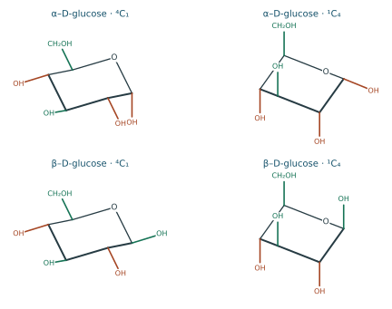

### Question 1.3 — Rotation d’un mélange

La loi de Biot s’écrit $\theta=l\sum_i[\alpha_i]^T_\lambda c_i$. La rotation observée $\theta$ se mesure en degrés, positifs pour une substance dextrogyre, négatifs pour une lévogyre. Avec la longueur de cuve $l$ en dm et les concentrations massiques $c_i$ en g·mL⁻¹, le pouvoir rotatoire spécifique s’exprime en °·mL·g⁻¹·dm⁻¹. Il dépend du solvant, de la température et de la longueur d’onde.

### Question 1.4 — Le polarimètre

Une source monochromatique émet sur la raie D du sodium. Un polariseur fixe sélectionne une polarisation rectiligne. Une cuve thermostatée de 1 dm contient successivement le solvant et la solution. On tourne l’analyseur après la cuve pour retrouver l’extinction, ou l’égalité d’éclairement des plages pour un appareil à pénombre. La différence algébrique des deux lectures donne $\theta$.

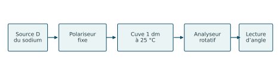

### Question 1.5 — Ouverture et refermeture de l’hémiacétal

O₅ donne un doublet à un proton du milieu. Le doublet de O₁ forme la liaison π C₁=O₁ pendant que la liaison C₁–O₅ restitue son doublet à O₅. On obtient ainsi C₅–OH et l’aldéhyde protoné en C₁. Un transfert de proton avec l’eau donne la chaîne ouverte. En sens inverse, la protonation du carbonyle active C₁. Le doublet de l’alcool de C₅ attaque le carbone trigonal de l’une ou l’autre face, et le doublet π revient sur O₁. L’oxonium cyclique cède un proton à l’eau. Les hémiacétals α et β diffèrent uniquement en C₁. L’acide est régénéré.

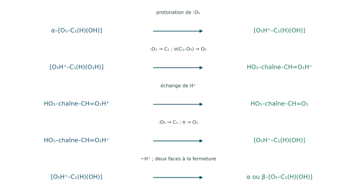

### Question 1.6 — Une rotation qui converge

Il s’agit d’une mutarotation. La rotation décroît de 112° à 52,7° depuis α et croît de 18,7° à 52,7° depuis β, à concentration, température et longueur d’onde identiques. Chaque anomère forme donc l’autre et les expériences conduisent à la même composition d’équilibre. L’acidification raccourcit la durée d’établissement de cet équilibre.

### Question 1.7 — Composition à l’équilibre

En négligeant la chaîne ouverte, $x_\alpha+x_\beta=1$. Les angles mesurés pour les solutions pures correspondent à la même concentration totale. Par additivité de Biot, $52,7=112x_\alpha+18,7(1-x_\alpha)$. Il vient $x_\alpha=34,0/93,3=0,364$ et $x_\beta=0,636$, soit environ 36 % et 64 %. La prédominance de la chaise β tout équatoriale concorde avec cette composition.

## Le glucose comme copule chirale

### Question 2.1.1 — Le triol 1

L’hydrogénation catalytique de la double liaison donne deux méthylènes C₁ et C₂. Le méthanolate réalise ensuite une transestérification des trois esters en acétate de méthyle. La reprise aqueuse restitue les alcools. Le composé 1 est le tétrahydropyrane $\mathrm{C_6H_{12}O_4}$ portant OH en C₃ vers l’avant, OH en C₄ vers l’arrière et CH₂OH en C₅ vers l’avant dans la convention du schéma.

### Question 2.1.2 — Bloquer deux alcools ensemble

Le diol C₄–OH/C₆–OH donne avec le benzaldéhyde, sous catalyse acide, un acétal benzylidène à six chaînons. La diminution de l’activité de l’eau favorise la condensation réversible. L’oxygène carbonylé est protoné. Un OH du diol attaque le carbone du carbonyle, dont la liaison π revient sur O. La déprotonation donne l’hémiacétal. Le OH issu du carbonyle est protoné puis part en eau. Le cation oxocarbenium peut s’écrire $\mathrm{Ph{-}CH^+{-}OR\leftrightarrow Ph{-}CH{=}O^+R}$. Le second OH du diol donne un doublet au carbone du cation en fermant le cycle. Après déprotonation, les O en C₄ et C₆ sont liés au même CHPh et le OH en C₃ reste libre.

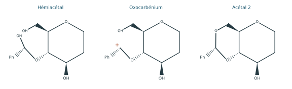

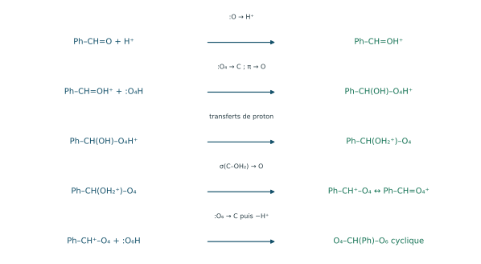

### Question 2.1.3 — Configuration de l’acétal

Les priorités CIP au carbone benzylidénique sont O₄ > O₆ > C du phényle > H. O₄ conduit en C₄ à (C,C,H), O₆ en C₆ à (C,H,H). Dans la projection du sujet, Ph est en arrière et H vers l’avant. Le trajet O₄ → O₆ → Ph est antihoraire dans le plan. On inverse la lecture puisque H pointe vers l’observateur. La configuration est **R**.

### Question 2.1.4 — Intermédiaires 3 à 6

Pour 3, le cycle benzylidène C₄/O₄/CHPh/O₆/C₆/C₅ est intact et O₃ porte CH₂Ph. Pour 4, O₃ porte toujours CH₂Ph, mais C₄ et C₆ portent chacun OH. Pour 5, ces deux alcools portent désormais $\mathrm{C(O)C(CH_3)_3}$ sur O tandis que l’éther benzyle demeure en C₃. Pour 6, les deux pivaloates sont conservés et O₃ redevient OH. Dans les quatre structures, la liaison C₃–O₃ est en avant, C₄–O₄ en arrière et C₅–C₆ en avant.

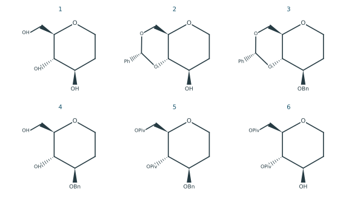

### Question 2.1.5 — Diriger l’acrylation vers un seul site

2 → 3 est une synthèse d’éther de Williamson qui protège le OH de C₃ sous forme OBn. 3 → 4 est l’hydrolyse acide de l’acétal qui libère le diol C₄/C₆. 4 → 5 transforme les deux alcools en esters pivalates par substitution nucléophile d’acyle. 5 → 6 est l’hydrogénolyse sélective de l’éther benzylique. 6 → A est l’acrylation de l’unique alcool libre par le chlorure d’acryloyle. L’ester ainsi obtenu porte le diénophile CH₂=CH–CO₂–.

### Question 2.1.6 — Créer la liaison O–benzyle

La base déprotone O₃H. Formellement un doublet de H⁻ va vers H de l’alcool et le doublet O–H retourne sur O₃, ce qui donne O₃⁻ et H₂. Le doublet de O₃⁻ attaque ensuite par l’arrière le carbone de Ph–CH₂–Br et la liaison C–Br cède simultanément son doublet à Br. Cette substitution $\mathrm{S_N2}$ livre O₃–CH₂Ph sans carbocation intermédiaire. C₃ conserve sa configuration.

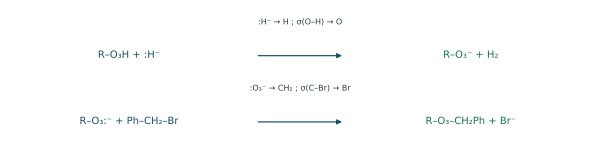

### Question 2.1.7 — Former deux esters pivalates

En notant $t=\mathrm{C(CH_3)_3}$, un doublet de la pyridine attaque $t$–C(O)Cl. La liaison π bascule vers O puis se reforme avec départ de Cl⁻. L’ion acylpyridinium $t$–C(O)–Py⁺ est attaqué par ROH. L’intermédiaire tétraédrique se referme en libérant la pyridine. La perte du proton de ROH donne $t$–CO₂R. Le même bilan s’applique à O₄ et O₆. La pyridine sert de catalyseur nucléophile et de base qui fixe l’acide formé sous forme de chlorure de pyridinium. Une attaque directe de l’alcool sur le chlorure d’acyle est également concevable.

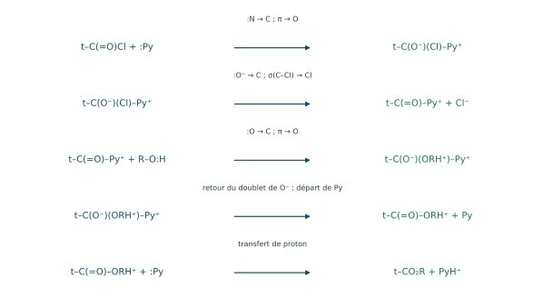

### Question 2.1.8 — Comparer les frontières orbitalaires

En eV, le couple (HO,BV) passe de (−10,5,+1,44) pour l’éthène à (−11,1,−0,014) pour l’acrylate. L’ester attire la densité électronique par effets inductif et mésomère, la conjugaison avec C=O stabilisant particulièrement la BV. Pour le butadiène (−9,33,+0,45), le remplacement d’un H par Me relève la HO à −9,03 par hyperconjugaison et effet inductif donneur, avec une BV presque inchangée (+0,42). OMe donne par conjugaison d’un doublet malgré son effet inductif attracteur. Avec (−8,67,+0,51), il relève davantage la HO.

### Question 2.1.9 — Régiosélectivité et faces d’approche

L’écart HO du pentadiène–BV de l’acrylate est de 9,02 eV, contre 11,52 eV dans le sens inverse. Le diène s-cis forme deux liaisons σ de manière concertée, supra/supra. Sa terminaison CH₂ (coefficient de HO |0,60|) rejoint le CH₂ de l’acrylate (BV |0,67|), l’autre extrémité (|0,53|) rejoint le CH portant l’ester (|0,29|). Me et CO₂R sont ainsi voisins. Une approche endo place le système carbonylé sous le diène et permet des interactions secondaires. Avec la géométrie du pentadiène donnée, Me et CO₂R du cycle final sont cis. Pour B les deux liaisons sont en coin plein dans la projection proposée. L’attaque endo de l’autre face donne B′ aux deux liaisons hachurées. Le sucre garde la même configuration dans les deux cas, d’où deux diastéréoisomères.

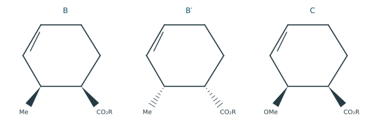

### Question 2.1.10 — Encombrement de la face du diénophile

Dans la chaise la plus stable de A, O₃–acryloyle est équatorial haut, O₄–Piv équatorial bas et C₅–CH₂OPiv équatorial haut. L’autre chaise amènerait ensemble des groupes volumineux en axial. Dans les conformations étendues de l’ester conjugué, les faces de la double liaison sont diastéréotopiques. Pour une orientation endo donnée, l’entrée du diène du côté du squelette glycosidique et des pivaloates entraîne davantage de contacts que par le côté tourné vers l’extérieur. Cette induction stérique rend compte de B majoritaire, dont les deux liaisons sortent du plan dans le dessin de la figure 2. Les rotations des liaisons simples du bras ester rendent ce modèle qualitatif.

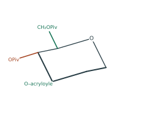

### Question 2.1.11 — Remplacer méthyle par méthoxy

Le méthoxydiène a encore le plus grand coefficient terminal de HO sur CH₂ (|0,60| contre |0,50|). L’approche majoritaire conduit à C, obtenu en conservant le squelette et la stéréochimie de B et en remplaçant Me par OMe sur le carbone voisin de celui qui porte CO₂R. L’écart pertinent tombe de 9,02 à 8,66 eV. La règle d’Alder prévoit une cycloaddition facilitée avec un diène plus riche en électrons et un diénophile déficient. Il s’agit d’un argument de réactivité.

## Du furanose au spectre de l’intermédiaire

### Question 2.2.1 — Les fonctions du composé 7

Le cycle furanosique comporte un oxygène éther. Deux acétonides (cétals cycliques) protègent les fonctions oxygénées en 1,2 et en 5,6. Au carbone anomérique C₁, les deux liaisons à O constituent aussi un motif acétal qui fixe la configuration du sucre. Le triflate en C₃ est un ester sulfonique qui transforme le mauvais nucléofuge OH en un excellent groupe partant, l’anion triflate stabilisé par délocalisation.

### Question 2.2.2 — Inversion en C₃

L’ion azoture linéaire possède 16 électrons de valence. Une forme de Lewis est $\mathrm{{}^{-}N=N^{+}=N^{-}}$ avec deux doublets libres sur chaque N terminal et aucun sur le N central. Les formes limites à une liaison triple et une simple contribuent aussi. Un doublet terminal forme la liaison C₃–N par attaque arrière de type $\mathrm{S_N2}$, avec départ de triflate. Dans 8, N₃ passe au-dessus du cycle furanosique, du côté opposé à OTf dans 7. Les autres centres et les deux acétonides sont conservés.

### Question 2.2.3 — Interpréter le méthanal et les bandes IR

L’hydrolyse de l’acétonide 5,6 expose C₅–OH/C₆–OH. Leur coupure oxydante donne HCHO à partir du C₆ terminal et un substituant –CHO sur C₄ à partir de C₅. Les bandes vers 1700 et 2800 cm⁻¹ correspondent au carbonyle et au C–H aldéhydique. Le composé 9 conserve le furanose et le cycle de l’acétonide 1,2, soit deux cycles. Dans 10 l’aldéhyde devient –CH₂OH, sans création d’un centre asymétrique. La direction de C₄–C₅ et celle de C₃–N₃ restent celles de 8 dans les deux structures.

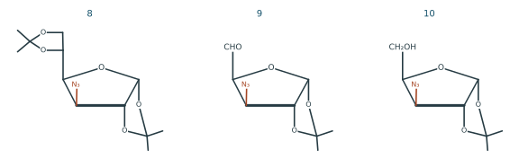

### Question 2.2.4 — Deux signatures de groupes protecteurs

CH₃ de l’éthyle donne le triplet à 1,25 ppm (3 H) et O–CH₂ le quadruplet à 4,17 ppm (2 H). Chaque ensemble est couplé à l’autre par $^3J=7,1$ Hz. L’oxygène déblinde le méthylène. Les neuf H des trois méthyles équivalents du tert-butyle du Boc donnent le singulet à 1,39 ppm. Le carbone voisin est quaternaire.

### Question 2.2.5 — Les cinq protons éthyléniques

Hf = H₇ à 5,85 ppm est un ddd par couplage avec Hg′ (trans, 17,4 Hz), Hg (cis, 10,5 Hz) et He (vicinal, 5,2 Hz). Hg = H₅ à 5,16 ppm et Hg′ = H₅′ à 5,22 ppm donnent chacun un dd comprenant aussi leur couplage géminal de 1,3 Hz. Sur l’alcène de l’ester, Ha et Ha′ forment la paire H₆/H₆′ à 5,74 et 6,23 ppm. Chacun est un doublet à 1,5 Hz, son seul partenaire résolu étant l’autre proton du CH₂. Ces constantes ne suffisent pas à attribuer individuellement les deux derniers déplacements.

### Question 2.2.6 — Lire les dièdres en Newman

Hb = H₁ (2,45 ppm) et Hb′ = H₁′ (2,74 ppm) sont diastéréotopiques. Ils se couplent entre eux à 14,5 Hz. En regardant la liaison du méthylène vers Cc, Hb est anti à Hc et donne le second couplage de 7,6 Hz. Hb′ est gauche à Hc et donne 3,0 Hz. Hd = H₂ à 3,35 ppm a deux voisins vicinaux. Il est anti à Hc (8,8 Hz) autour de Cd–Cc et gauche à He (2,0 Hz) autour de Cd–Ce. Chacun de ces trois signaux est donc un doublet de doublets.

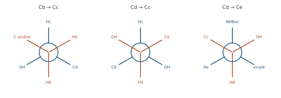

## Structure et mécanique de la cellulose

### Question 3.1 — Le motif de 324 g·mol⁻¹

Le motif de translation est constitué de deux résidus de β-D-glucopyranose tournés l’un par rapport à l’autre, liés en β(1→4). En poursuivant la chaîne de part et d’autre on a un motif cellobiosyle $\mathrm{(C_6H_{10}O_5)_2}$, de masse molaire 324 g·mol⁻¹. Le cellobiose libre porte en plus les éléments d’une molécule d’eau aux extrémités.

### Question 3.2 — Topologie du bois

La cellulose est linéaire. Le xyloglucane comprend un squelette muni de branches osidiques et est donc ramifié. La lignine représentée a de multiples connexions entre unités aromatiques et constitue un réseau réticulé.

### Question 3.3 — Mobilité segmentaire

Les cycles rigides de la cellulose et son réseau dense de liaisons hydrogène intra- et interchaînes limitent les mouvements. Sa transition vitreuse atteint 230 à 255 °C. Les branches du xyloglucane gênent l’empilement régulier, augmentent le volume libre et désorganisent les contacts, ce qui concorde avec 165 à 220 °C. Les cycles aromatiques et les ponts de la lignine restreignent aussi la mobilité, mais son réseau irrégulier comporte d’autres liaisons, des groupes méthoxy et moins de OH par unité carbonée. Sa composition et sa réticulation variables sont compatibles avec la large plage 135–235 °C. Les deux dernières plages se chevauchent.

### Question 3.4 — Eau plastifiante

La dérivée vaut $-0,131T_g$ dans les unités de la relation fournie. La valeur numérique en °C passe de 234,2 pour le papier sec à environ 122 pour Hu = 5 %. Les molécules d’eau se lient aux OH, concurrencent les liaisons hydrogène cellulose–cellulose et facilitent le glissement local. Les segments peuvent se réarranger à plus basse température. L’eau joue le rôle d’un plastifiant.

### Question 3.5 — Trois régions en traction

À 25 °C, la contrainte croît d’abord presque linéairement avec l’allongement, avec une pente initiale égale au module d’Young. Le seuil d’écoulement est voisin de 44–45 MPa pour 4–5 %. Après le maximum, la déformation plastique se propage et la contrainte nominale redescend vers 40 MPa. Un plateau d’étirage se poursuit jusqu’à environ 20 % sur la courbe. Une striction peut expliquer cette évolution. La déformation au-delà du domaine élastique n’est plus entièrement réversible.

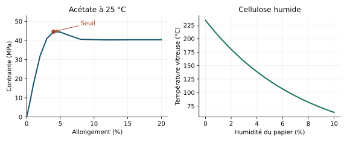

### Question 3.6 — Rigidité, résistance et ductilité

À −25 °C, la pente est forte, la contrainte atteint environ 70 MPa et l’allongement ne dépasse guère 3–4 % : matériau vitreux rigide et fragile. À 0 °C il est encore rigide et résistant (environ 70 MPa), avec écoulement perceptible et environ 12–13 % d’allongement. À 25 °C il est moins rigide, ductile, et porte encore 40 MPa sur son plateau. À 50 °C le comportement est plus souple et ductile (plateau ≈25 MPa). À 65 °C et 80 °C il s’assouplit encore (≈17 et 12–13 MPa) et atteint environ 30 % sur les tracés. La raideur initiale et la contrainte d’écoulement diminuent globalement avec la température. Les courbes de traction renseignent sur cette rigidité, la dureté d’indentation exigerait une autre mesure.

### Question 3.7 — Effet de l’acétylation

La substitution d’une partie des OH par OAc réduit les associations fortes entre chaînes et perturbe leur rangement. L’abaissement de $T_g$ de 230–255 °C vers 80 °C est cohérent. À l’approche de 80 °C, l’acétate demande moins de contrainte pour un même allongement et répond de manière plus souple. La transition concerne les mouvements segmentaires dans la fraction amorphe et se déroule sur une plage dépendant notamment de la vitesse de traction.

## II. Amphiphiles et micelles

### Question 4.1.1 — Deux affinités dans une molécule

Une molécule amphiphile juxtapose un groupe hydrophile, polaire ou chargé et bien solvaté par l’eau, et une partie hydrophobe, généralement une chaîne hydrocarbonée ayant de l’affinité pour une phase apolaire. Cette dualité permet l’adsorption aux interfaces.

### Question 4.1.2 — Six familles de têtes

Le SDS est anionique, avec un monoester sulfate $\mathrm{ROSO_3^-}$. Le stéarate de sodium est anionique, avec un carboxylate $\mathrm{RCO_2^-}$. Le Triton X-100 est non ionique, avec un noyau alkylphényle, des fonctions éther et un alcool terminal. La phosphatidylcholine est zwitterionique, avec un phosphodiester chargé négativement et un ammonium quaternaire positif. Elle possède aussi deux esters d’acides gras et, dans l’exemple, une insaturation. TTAB et CTAB sont cationiques avec un ammonium quaternaire et Br⁻ comme contre-ion. Leur chaîne principale a respectivement 14 et 16 carbones.

### Question 4.2.1 — Bilan de matière de la micellisation

Posons $C=[\mathrm{SDS}]$, $C_*=[\mathrm{CMC}]$, $s=[\mathrm{SDS_{libre}}]$ et $u=[\mathrm{MC}]$. Sous le seuil, $s=C$ et $u\simeq0$. Au-dessus, $s\simeq C_*$ et le bilan $C=s+Nu$ impose $u\simeq(C-C_*)/N$. Les concentrations sont continues dans cette représentation à seuil net. La pente au-delà du seuil vaut 1/N pour les micelles.

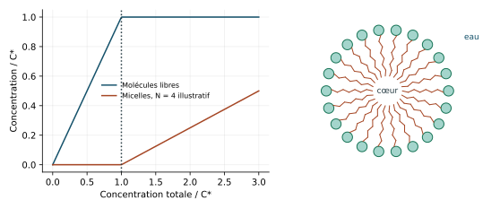

### Question 4.2.2 — Solvater une chaîne et une tête

Dans l’eau, la tête sulfate interagit avec les dipôles de l’eau par interaction ion–dipôle et accepte des liaisons hydrogène. Elle interagit aussi électrostatiquement avec les contre-ions. Autour d’une chaîne libre, des forces de dispersion et d’induction subsistent, tandis que l’eau s’organise pour garder au mieux ses propres liaisons hydrogène. Dans la micelle directe, les têtes restent hydratées et les contre-ions écrantent leur répulsion. Les chaînes se regroupent au cœur : les contacts chaîne–eau sont en grande partie remplacés par la dispersion entre chaînes et l’eau libérée retrouve des configurations plus nombreuses.

### Question 4.2.3 — Passer d’une longueur à un nombre d’agrégation

Onze liaisons C–C en zigzag tétraédrique projettent environ $11\times154\sin(109,5°/2)\simeq1380$ pm sur l’axe. Le H terminal et la jonction C–O–S–O ajoutent quelques centaines de pm, d’où $H\sim1,7$–$1,9$ nm. Pour le sulfate tétraédrique, deux centres O séparés par l’angle tétraédrique sont distants d’environ $2\times145\sin(109,5°/2)=237$ pm. À la demi-largeur géométrique (≈119 pm) s’ajoute l’extension extérieure de l’oxygène, d’ordre 130 pm. Un rayon effectif $r\sim0,25$ nm donne $H/r\sim7$. Cette dernière dimension, sensible à l’hydratation, est une estimation. Une sphère de rayon H pavée par des cônes de hauteur H et de base πr² contient $N\simeq(4\pi H^3/3)/(\pi r^2H/3)=4(H/r)^2\simeq196$. On néglige les vides, la flexibilité, la polydispersité et l’écart entre une tête réelle et un disque.

### Question 4.2.4 — Charge d’un agrégat

La micelle est $\mathrm{[Na_{N-m}(SD)_N]^{m-}}$. Dans l’écriture $\mathrm{(Na_x(SD)_y)^{z-}}$, $x=N-m$, $y=N$, $z=m$. Il reste m contre-ions libres par micelle, d’où $\alpha=m/N$ et $x=N(1-\alpha)$.

### Question 4.2.5 — Loi d’action de masse

L’équilibre est $N\,\mathrm{SD^-}+N(1-\alpha)\,\mathrm{Na^+}\rightleftharpoons\mathrm{MC}^{m-}$. En introduisant $a_i\simeq[i]/c^\circ$, avec $c^\circ=1$ mol·L⁻¹, la constante vaut $K^\circ=a_{\rm MC}/(a_{\rm SD}^N a_{\rm Na}^{N(1-\alpha)})$. Les réactifs du dénominateur sont les ions libres.

### Question 4.2.6 — Énergie libre par mole de tensioactif

Avec $\Delta_r G^\circ=-RT\ln K^\circ$, on a $\Delta_{\rm mic}G^\circ=RT[\ln a_{\rm SD}+(1-\alpha)\ln a_{\rm Na}-N^{-1}\ln a_{\rm MC}]$. Le résultat est exprimé en énergie par mole de tensioactif engagé dans des agrégats.

### Question 4.2.7 — Approximation au seuil

Au voisinage de la CMC, les molécules libres sont majoritaires et NaSD est totalement dissocié, d’où $[\mathrm{SD^-}]\simeq[\mathrm{Na^+}]\simeq C_*$. Pour N grand, la contribution $(\ln a_{\rm MC})/N$ est négligeable devant les deux autres termes dans la zone de mesure. Il vient $\Delta_{\rm mic}G^\circ\simeq(2-\alpha)RT\ln(C_*/c^\circ)$. Le modèle avait déjà assimilé les activités aux concentrations réduites.

### Question 4.2.8 — Identifier la contribution dominante

À 300 K, $\Delta_{\rm mic}S^\circ=(\Delta H^\circ-\Delta G^\circ)/T=(-7000+22000)/300=+50$ J·mol⁻¹·K⁻¹. L’agrégation est exothermique, avec une contribution de −7,0 kJ·mol⁻¹. La contribution entropique vaut −15,0 kJ·mol⁻¹. Les deux favorisent la micellisation au sens standard, l’entropie prédomine. Les chaînes perdent de la liberté en s’assemblant, mais une partie de l’eau initialement organisée autour d’elles est libérée dans le solvant.

## Déterminer la concentration micellaire critique

### Question 4.3.1 — Conductivité molaire de la micelle

Une micelle possède $m=\alpha N$ charges négatives non compensées. Le modèle donne donc $\lambda_{\rm mic}=\alpha N\lambda_{\rm SD}$. Cette relation est une hypothèse sur le transport de l’agrégat.

### Question 4.3.2 — Interpréter les deux pentes

La conductivité augmente presque linéairement dans deux domaines. À faible concentration, chaque unité de SDS apporte un Na⁺ et un SD⁻ mobiles. Au-delà de la CMC, les monomères libres plafonnent, une partie des ions s’agrège et certains Na⁺ se fixent. La concentration en porteurs efficaces croît moins vite. La pente positive diminue puis reste approximativement constante.

### Question 4.3.3 — Loi avant la cassure

Sous la CMC, $[\mathrm{Na^+}]=[\mathrm{SD^-}]=C$. La conductivité est $\gamma_1=(\lambda_{\rm Na}+\lambda_{\rm SD})C$. Les concentrations doivent être exprimées en mol·m⁻³ si les conductivités molaires sont en S·m²·mol⁻¹.

### Question 4.3.4 — Loi après la cassure

Au-dessus du seuil, $[\mathrm{SD^-}]\simeq C_*$, $[\mathrm{MC}]=(C-C_*)/N$ et $[\mathrm{Na^+}]=C_*+\alpha(C-C_*)$. En additionnant leurs contributions, $\gamma_2=(\lambda_{\rm Na}+\lambda_{\rm SD})C_*+[\alpha\lambda_{\rm Na}+\lambda_{\rm mic}/N](C-C_*)$. Avec 4.3.1, $\gamma_2=(\lambda_{\rm Na}+\lambda_{\rm SD})[\alpha C+(1-\alpha)C_*]$. Les deux lois donnent la même valeur au seuil.

### Question 4.3.5 — Extraire deux paramètres des droites

Avec C en mmol·L⁻¹ et γ en mS·cm⁻¹, les ajustements sont $0,0735C$ et $0,0257C+0,391$. Ainsi $C_*=0,391/(0,0735-0,0257)=8,18$ mmol·L⁻¹ et $\alpha=0,0257/0,0735=0,350$. Environ 35 % des contre-ions associés à la quantité de SDS micellisée restent mobiles selon ce modèle. La valeur spectroscopique du SDS donnée plus loin, 7,8 mmol·L⁻¹, est proche du seuil conductimétrique.

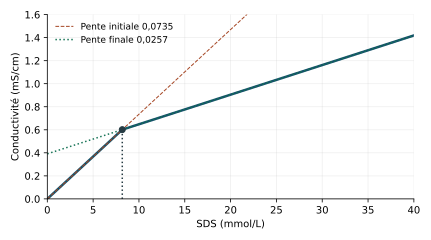

### Question 4.3.6 — Portée de la mesure électrique

Le non-ionique Triton X-100 et la phosphatidylcholine zwitterionique globalement neutre n’apportent pas les deux ions libres du modèle. Une cassure conductimétrique exploitable n’est donc pas attendue de la même manière. Des ions étrangers, les variations de température et de mobilité, ou une transition diffuse compliquent aussi la mesure. Le modèle admet un seul nombre N, une seule géométrie, une fraction α fixe, des activités idéales et une mobilité additive des charges de la micelle. Un agrégat réel peut changer de taille ou de mobilité avec C.

### Question 4.3.7 — Changer de polarité

La dicétone polaire peut accepter des liaisons hydrogène du solvant par ses deux oxygènes. L’eau la stabilise relativement bien. L’énol conjugué peut fermer un pseudo-cycle à six membres par une liaison O–H···O=C intramoléculaire. En milieu apolaire, la concurrence des liaisons avec l’eau disparaît, ce qui favorise cette forme chélatée. Le rapport [énol]/[cétone] augmente.

### Question 4.3.8 — Lire les deux bandes UV

La sonde totale est fixée à $7,0\times10^{-5}$ mol·L⁻¹. À faible [TTAB], les premiers spectres se superposent : la sonde reste principalement en milieu aqueux. Après le seuil, l’absorbance vers 250 nm passe d’environ 0,79 à 0,50 tandis que celle vers 312 nm monte d’environ 0,38 à 0,76 sur le domaine tracé. La part de forme énol augmente dans le cœur moins polaire des agrégats au détriment de la dicétone. Le resserrement des courbes vers 270 nm est compatible avec une redistribution entre deux formes. Une égalité d’absorbances aux maxima ne donnerait pas une égalité de concentrations sans les coefficients d’extinction.

### Question 4.3.9 — Seuil du TTAB

Les points restent presque constants jusqu’à environ 3 mmol·L⁻¹ et les deux absorbances commencent à varier nettement vers 4 mmol·L⁻¹. La CMC du TTAB est donc de l’ordre de 3–4 mmol·L⁻¹, soit environ $3,5\times10^{-3}$ mol·L⁻¹ à la précision du tracé.

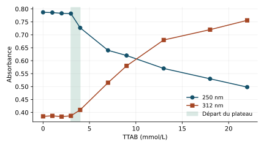

## Stabilité des émulsions

### Question 5.1 — Coût d’une dispersion en gouttes

Pour un volume dispersé $V=2,5$ cm³ en gouttes sphériques de rayon $r=5\times10^{-4}$ cm, $N_g=V/(4\pi r^3/3)\simeq4,8\times10^9$ et $A=N_g4\pi r^2=3V/r=1,5\times10^4$ cm². Avant dispersion l’interface occupe environ 1 cm². À tension $\gamma\sim10^{-5}$ J·cm⁻² supposée constante, le surcoût interfacial $\gamma(A-A_0)$ atteint environ 0,15 J pour cette petite éprouvette. La coalescence réduit fortement l’aire et donc l’énergie libre interfaciale. Le mélange sans émulsifiant tend à se décanter.

### Question 5.2 — Trois organisations de Winsor

Pour une EHL élevée, le type I présente des gouttelettes huileuses dans une phase aqueuse continue riche en tensioactif. Les têtes sont tournées vers l’extérieur et l’excès d’huile forme une phase distincte. Pour une EHL faible, le type II donne des gouttelettes aqueuses dans une phase huileuse continue, têtes vers l’intérieur, avec excès d’eau séparé. Pour une EHL intermédiaire, le type III a une phase médiane riche en tensioactif, à domaines huileux et aqueux imbriqués. Le film sépare ces domaines, avec têtes vers l’eau et queues vers l’huile, entre deux phases excédentaires.

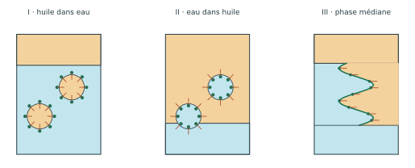

### Question 5.3 — Calcul des EHL

Le SDS donne $7+39-12(0,5)=40$. Pour le CTAB, on compte 16 groupes de la chaîne et les trois méthyles de l’ammonium, donc $7+9,4-19(0,5)=6,9$. Pour le Triton X-100, il y a dix oxygènes éther, un OH, vingt CH₂ oxyéthyléniques, quatre =CH aromatiques et six groupes CH₃ ou CH₂ dans le fragment octyle ramifié. Les carbones sans H n’ont pas de contribution dans le tableau. Il vient $7+10(1,3)+2-(20+4+6)0,5=7,0$. Le classement demandé associe SDS au type I, CTAB au type II et Triton au type III. Les deux dernières valeurs sont très proches et ce classement empirique ne remplace pas un diagramme de phases.

## Catalyse en microémulsion

### Question 6.1 — Trois étapes au palladium

À l’étape 2, une β-élimination d’hydrure du groupe hydroxyéthyle, accompagnée du départ d’un chlorure, donne l’hydrurocomplexe de l’énol coordonné. Pd reste à +II. À l’étape 3, l’insertion migratoire de l’alcène dans Pd–H, avec le sens inverse de régiosélectivité par rapport à l’élimination, conduit au groupe Pd–CH(OH)CH₃, avec coordination de Cl⁻. Pd reste à +II. L’étape 4 est la décomposition réductrice du complexe α-hydroxyalkyle, décrite globalement comme une élimination réductrice avec libération d’éthanal. Pd passe de +II à 0, soit une variation de −2.

### Question 6.2 — Bilan du procédé Wacker

Le bilan global est $\mathrm{CH_2{=}CH_2+\tfrac12 O_2\longrightarrow CH_3CHO}$. Le cycle transforme l’éthène en éthanal et O₂ est l’oxydant terminal. Ni Pd, ni Cu, ni les ions chlorure ne sont consommés dans ce bilan.

### Question 6.3 — Relais entre deux couples redox

Deux Cu²⁺ reprennent chacun un électron au palladium métallique et deviennent deux Cu⁺. En présence de chlorure, le palladium retourne en solution sous forme du complexe de Pd(II). Le dioxygène régénère ensuite Cu²⁺. Le cuivre joue le rôle de médiateur redox, avec Cu²⁺ oxydant immédiat de Pd(0).

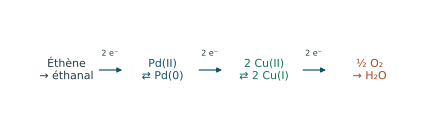

### Question 6.4 — Produit et rôle des constituants

Le cyclohexène, substrat, donne la cyclohexanone. L’eau fournit le nucléophile et l’oxygène de la fonction carbonyle. Le DMF est un cosolvant polaire aprotique améliorant la compatibilité des constituants. Le nonylphénol polyéthoxylé est le tensioactif non ionique qui stabilise la microémulsion. La benzoquinone réoxyde le palladium réduit et devient hydroquinone selon R₂. Le produit P est le produit d’oxydation du cyclohexène, à distinguer du produit de réduction dessiné dans R₂.

### Question 6.5 — Inversion de polarité de l’alcène

L’étape 1 est une addition nucléophile d’eau à l’éthène coordonné suivie d’une déprotonation, soit une hydroxypalladation. Le don de densité de la liaison π vers une orbitale vacante de Pd(II), centre électroattracteur, polarise et active l’alcène. L’eau peut donner un doublet à l’un de ses carbones. L’autre demeure lié au palladium.

### Question 6.6 — Interface et vitesse de réaction

Le cyclohexène se partage dans les régions apolaires, l’eau et les espèces ioniques dans les régions polaires. Une interface très étendue raccourcit les distances de transport et augmente leur fréquence de rencontre. Le nonylphénol polyéthoxylé associe un fragment alkylaryle hydrophobe à une chaîne polyéther hydrophile dont l’affinité est modulable. On recherche des domaines bicontinus à affinités équilibrées, comme la phase médiane du type III. Si toute la préparation constitue une seule microémulsion sans phase excédentaire, elle relève du type IV. Le texte ne fournit pas de diagramme de phases pour trancher l’état effectivement réalisé.
