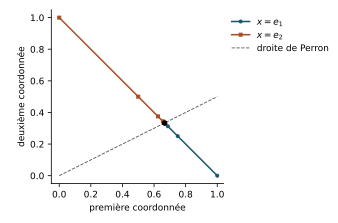

# X–ENS–ESPCI · PC · Mathématiques 2017 · Corrigé brut

*Corrigé rédigé par IA, non officiel. Signalez toute erreur.*

**Rédaction** · GPT-6.2 Astra Ultra · vitesse non renseignée

**Révision** · GPT-6.2 Astra Ultra · vitesse non renseignée

La composition établit le théorème de Perron pour une matrice dont chaque coefficient est strictement positif. Dans la dernière partie, les symboles d’ordre portent toujours sur les coefficients. Le produit avec un vecteur propre à gauche est bilinéaire sur le corps complexe.

## Première partie · Norme subordonnée et puissances

### Question 1a

Si $\|M\|\le C$, pour $x\ne0$ le vecteur $x/\|x\|_1$ est unitaire, donc $\|Mx\|_1\le C\|x\|_1$. Pour $x=0$ c’est immédiat. Réciproquement, l’inégalité sur tout vecteur donne en particulier $\|Mx\|_1\le C$ sur la sphère unité. Son supremum vérifie la même borne.

### Question 1b

La sphère unité de $\mathbb C^n$ est compacte et $x\mapsto\|Mx\|_1$ continue. Le supremum est donc fini et positif ou nul. S’il est nul, toutes les images des vecteurs de la base canonique sont nulles, donc $M=0$. Réciproquement la matrice nulle a norme nulle. L’homogénéité absolue vient de $\|\lambda Mx\|_1=|\lambda|\|Mx\|_1$. Enfin $\|(M+N)x\|_1\le\|Mx\|_1+\|Nx\|_1$ donne après supremum l’inégalité triangulaire.

### Question 2

Pour tout $x$, $\|ABx\|_1\le\|A\|\|Bx\|_1\le\|A\|\|B\|\|x\|_1$. Le supremum sur la sphère donne $\|AB\|\le\|A\|\|B\|$.

### Question 3

Par inégalité triangulaire, $\|Ax\|_1\le\sum_j|x_j|\sum_i|a_{ij}|\le(\max_j\sum_i|a_{ij}|)\|x\|_1$. Si $j$ réalise le maximum, $Ae_j$ est précisément cette colonne et $\|e_j\|_1=1$. Le majorant est donc la norme.

### Question 4

Pour toute matrice $D$, 3 donne $\max_{ij}|d_{ij}|\le\|D\|\le n\max_{ij}|d_{ij}|$. Appliquons ceci à $D=A^{(k)}-B$. La famille des $n^2$ indices étant finie, tous ses coefficients tendent vers zéro exactement quand leur maximum absolu tend vers zéro. Cela établit l’équivalence.

### Question 5a

Le coefficient $(i,j)$ de $P_b^{-1}AP_b$ vaut $b^{j-i}a_{ij}$. Sous la diagonale il est nul, sur la diagonale il est inchangé, au-dessus il tend vers zéro quand $b\downarrow0$. La limite est $D=\operatorname{diag}(a_{11},\ldots,a_{nn})$ en norme par 4.

### Question 5b

Par 3, $\|D\|=\max_i|a_{ii}|<1$. La continuité de la norme et 5a donnent $\|P_b^{-1}AP_b\|\to\|D\|$. Tout $b>0$ assez petit convient.

### Question 5c

Fixons ce $b$ et notons $D_b=P_b^{-1}AP_b$. Alors $A^k=P_b D_b^kP_b^{-1}$ et $\|A^k\|\le\|P_b\|\|P_b^{-1}\|\|D_b\|^k\to0$.

## Deuxième partie · Rayon spectral

### Question 6

Dans l’ordre donné, les trois premières matrices sont triangulaires et leurs rayons spectraux sont $1,0,1$. La quatrième a pour polynôme caractéristique $X^2+2$, donc pour rayon $\sqrt2$. La dernière a trace $5$, déterminant $4$ et spectre $\{1,4\}$, donc pour rayon $4$.

### Question 7.i

Vrai. Pour $\mu\ne0$, le spectre de $\mu A$ est $\mu\operatorname{Sp}(A)$ et les modules sont multipliés par $|\mu|$. Pour $\mu=0$ les deux membres sont nuls.

### Question 7.ii

Faux en dimension deux. Avec $A=E_{12}$ et $B=E_{21}$, les deux rayons sont nuls car $A^2=B^2=0$. Leur somme échange les deux vecteurs canoniques et a pour valeurs propres $1,-1$, donc pour rayon un.

### Question 7.iii

Faux. Pour $A=E_{12}$ et $B=E_{21}$ comme en 7.ii, $AB=E_{11}$ a rayon un, tandis que $\rho(A)\rho(B)=0$.

### Question 7.iv

Vrai. Pour $P$ inversible, $XI-P^{-1}AP=P^{-1}(XI-A)P$, donc les polynômes caractéristiques et les rayons spectraux coïncident.

### Question 7.v

Vrai. On a $\det(XI-A^t)=\det((XI-A)^t)=\det(XI-A)$. La matrice et sa transposée ont donc le même spectre.

### Question 8

Pour $Ax=\lambda x$ avec $x\ne0$, $|\lambda|\|x\|_1=\|Ax\|_1\le\|A\|\|x\|_1$. En passant au maximum sur les valeurs propres, $\rho(A)\le\|A\|$.

### Question 9

Sur $\mathbb C$, $A$ est semblable à une triangulaire supérieure $U$. Ses coefficients diagonaux sont les valeurs propres et ont tous module inférieur à un. Par 5c, $U^k\to0$. La conjugaison fixe donne $A^k\to0$.

### Question 10a

Pour $Ax=\lambda x$ avec $|\lambda|=\rho(A)$ et $\|x\|_1=1$, on a $\|A^k\|\ge\|A^kx\|_1=\rho(A)^k$.

### Question 10b

Si $\alpha>\rho(A)$, la matrice $A/\alpha$ a rayon inférieur à un et 9 donne la convergence. Si $0<\alpha\le\rho(A)$, 10a appliquée à $A/\alpha$ donne $\|(A/\alpha)^k\|\ge(\rho(A)/\alpha)^k\ge1$, ce qui exclut la convergence vers zéro. Donc $E_A=]\rho(A),+\infty[$.

### Question 11

Par 10a, la limite inférieure de $\|A^k\|^{1/k}$ est au moins $\rho(A)$. Pour tout $\alpha>\rho(A)$, la suite $\|A^k\|/\alpha^k$ tend vers zéro, donc est au plus un pour $k$ assez grand. La limite supérieure des racines est ainsi au plus $\alpha$. Laisser $\alpha\downarrow\rho(A)$ donne la formule, y compris pour un rayon nul.

### Question 12

Pour tous $B,C$, $|(BC)_{ij}|\le\sum_k |b_{ik}||c_{kj}|$. Par récurrence, les coefficients de $(A^k)^+$ sont majorés par ceux de $(A^+)^k$. La formule des colonnes donne alors $\|A^k\|\le\|(A^+)^k\|$, puis 11 appliquée aux deux matrices donne $\rho(A)\le\rho(A^+)$.

## Troisième partie · Matrices strictement positives

### Question 13

Posons $s=\sum_jz_j$. Si $s=0$, l’égalité impose $z_j=0$ pour tout $j$. Sinon écrivons $s=|s|e^{i\theta}$. On a $\sum_j\operatorname{Re}(e^{-i\theta}z_j)=|s|=\sum_j|z_j|$. Chaque terme réel est au plus $|z_j|$, donc tous atteignent cette borne. Il vient $z_j=e^{i\theta}|z_j|$ pour chaque $j$, d’où la colinéarité.

### Question 14

Sous $Ax=\lambda x$ et $A^ty=\mu y$, on a $\lambda x^ty=(Ax)^ty=x^tA^ty=\mu x^ty$. Puisque $\lambda\ne\mu$, cela force $x^ty=0$.

### Question 15a

La matrice $A$ préserve l’ordre car ses coefficients sont positifs. En appliquant $A$ à $A^kw\ge\mu^kw$ et en utilisant $Aw\ge\mu w$, on obtient l’inégalité au rang $k+1$. Le rang zéro est immédiat. Comme $w\ge0$ est non nul, $\|A^k\|\|w\|_1\ge\|A^kw\|_1\ge\mu^k\|w\|_1$. Le passage aux racines et 11 donnent $\rho(A)\ge\mu$.

### Question 15b

Si $Aw>\mu w$, le minimum sur les indices $w_i>0$ des écarts $(Aw)_i/w_i-\mu$ est strictement positif. En le notant $\eta$, on a $Aw\ge(\mu+\eta)w$ aussi aux coordonnées où $w_i=0$. D’après 15a, $\rho(A)\ge\mu+\eta>\mu$.

### Question 15c

Posons $d=Aw-\mu w$ avec $d\ge0$ et $d_k>0$. Pour $w'=w+\varepsilon e_k$, la marge $i\ne k$ devient $d_i+\varepsilon a_{ik}>0$. En $i=k$, elle devient $d_k+\varepsilon(a_{kk}-\mu)$ qui reste strictement positive pour $\varepsilon>0$ assez petit. Alors $w'\ge0$ non nul et $Aw'>\mu w'$. La question 15b donne $\rho(A)>\mu$.

On peut choisir explicitement $\varepsilon=d_k/[2(1+|a_{kk}-\mu|)]$. La marge à l’indice $k$ reste alors au moins $d_k/2$. Pour chaque autre ligne, la présence d’un coefficient $a_{ik}>0$ rend la marge strictement positive, même si elle était initialement nulle.

### Question 16a

Avec $v_0=(|x_j|)_j$, $(Av_0)_i=\sum_j a_{ij}|x_j|\ge|\sum_j a_{ij}x_j|=|\lambda||x_i|=\rho(A)(v_0)_i$. Une seule ligne stricte imposerait $\rho(A)>\rho(A)$ par 15c. Ainsi $Av_0=\rho(A)v_0$.

### Question 16b

Il existe au moins un $j$ avec $(v_0)_j>0$. Chaque ligne contient alors un terme strictement positif dans $(Av_0)_i$. Par 16a, tous les produits $\rho(A)(v_0)_i$ sont strictement positifs. Cela impose $\rho(A)>0$ et $(v_0)_i>0$ pour tout $i$.

### Question 16c

La première ligne de 16a réalise l’égalité triangulaire. Par 13, les nombres $a_{1j}x_j$ ont une phase commune. Puisque tous les $a_{1j}>0$, $x=e^{i\theta}v_0$ pour un même $\theta$. Alors $Ax=e^{i\theta}\rho(A)v_0=\rho(A)x$, donc $\lambda=\rho(A)$. Toute autre valeur propre a module strictement inférieur au rayon.

### Question 17a

La forme $\ell(x)=x^tw_0$ est linéaire non nulle et $F=\ker\ell$ a dimension $n-1$. Comme $A^tw_0=\rho(A)w_0$, $\ell(Ax)=\rho(A)\ell(x)$, ce qui donne la stabilité. De plus $\ell(v_0)>0$ par stricte positivité. Ainsi $\mathbb C^n=F\oplus\mathbb C v_0$.

### Question 17b

Si $Av=\mu v$ et $\mu\ne\rho(A)$, 14 avec $y=w_0$ donne $v^tw_0=0$, donc $v\in F$. Pour un vecteur propre positif non nul, son produit avec $w_0>0$ est strictement positif. Sa valeur propre est donc nécessairement $\rho(A)$.

### Question 18a

Toute valeur propre de $\psi=A|_F$ est valeur propre de $A$. Si son module valait $\rho(A)$, 16a–c appliquées à son vecteur propre $x\in F$ le rendraient colinéaire à un vecteur strictement positif. Son produit avec $w_0$ serait non nul, contradiction. La décomposition stable de 17a donne alors $\chi_A(X)=(X-\rho(A))\chi_\psi(X)$ avec $\chi_\psi(\rho(A))\ne0$. La racine est simple et l’espace propre vaut $\mathbb C v_0$. En dimension un, $F=\{0\}$ et le facteur complémentaire vaut un.

Dans une base de $F$ complétée par $v_0$, la matrice de $A$ est diagonale par blocs, de blocs $\psi$ et $\rho(A)$. L’absence de la valeur propre $\rho(A)$ dans $F$ exclut ainsi aussi un second facteur $X-\rho(A)$ dans le polynôme caractéristique.

### Question 18b

Pour $F\ne\{0\}$, 18a donne $\rho(\psi/\rho(A))<1$. Par 9 dans une base de $F$, ses puissances tendent vers zéro. Ainsi $A^kx/\rho(A)^k\to0$ pour $x\in F$, résultat immédiat si $F=\{0\}$.

### Question 18c

Écrivons $x=y+cv_0$ avec $y\in F$. En appliquant $\ell$, $c=x^tw_0/(v_0^tw_0)>0$ pour $x\ge0$ non nul. La première composante $A^ky/\rho(A)^k$ tend vers zéro par 18b, et la seconde vaut $cv_0$ à tous les rangs. La limite est donc $v_0(x^tw_0)/(v_0^tw_0)$. Dans l’exemple tracé, $w_0=(1,1)^t$ et $v_0=(2,1)^t$, donc les deux limites sont $(2/3,1/3)^t$.

Pour la matrice $\left(\begin{smallmatrix}3&2\\1&2\end{smallmatrix}\right)$, le projecteur limite est $P=\tfrac13\left(\begin{smallmatrix}2&2\\1&1\end{smallmatrix}\right)$. Comme $A=4P+(I-P)$, on a exactement $4^{-k}A^k=P+4^{-k}(I-P)$. Le dessin montre ce facteur géométrique, en plus de la limite commune aux deux colonnes.

