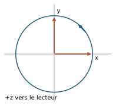
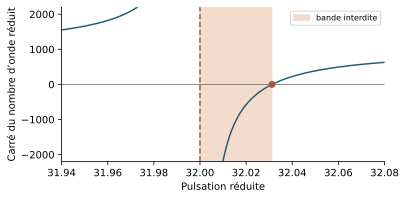
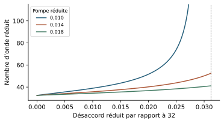
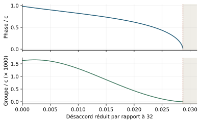

# X, ESPCI et ENS PC 2017 — Physique B · Corrigé guidé

*Corrigé rédigé par IA, non officiel. Signalez toute erreur.*

**Lecture du rapport du jury** · GPT-6.2 Astra Ultra · vitesse non renseignée

**Rédaction** · GPT-6.2 Astra Ultra · vitesse non renseignée

## Transparence électromagnétiquement induite dans un plasma froid magnétisé

## Échelles du plasma d’argon

### Question 1 — Échelles du mouvement ionique et électronique

**Indication.** Comparer l’accélération sous un même champ, puis les vitesses thermiques à température commune.

À l’équilibre thermique, $\tfrac12 M\langle v_i^2\rangle=\tfrac12 m\langle v_e^2\rangle=\tfrac32 k_BT$. Le rapport des vitesses quadratiques est $\sqrt{m/M}\simeq4\,10^{-3}$. Sous un même champ électrique, les deux charges ont le même module, mais $|a_i|/|a_e|=m/M\simeq10^{-5}$. À l’échelle d’un mouvement électronique rapide, les ions constituent donc un fond positif pratiquement immobile.

### Question 2 — Longueur de Landau

**Indication.** Utiliser l’énergie potentielle électrostatique d’une paire et la comparer à l’énergie thermique d’une particule.

En valeur absolue, l’énergie d’interaction d’une paire de charges unitaires vaut $e^2/(4\pi\varepsilon_0r)$. Égalée à l’énergie cinétique thermique moyenne $3k_BT/2$, elle donne $r_L=2e^2/(3\cdot4\pi\varepsilon_0k_BT)\simeq1\,10^{-9}\ \mathrm m$. La convention d’ordre de grandeur utilisant $k_BT$ donne $2\,10^{-9}\ \mathrm m$, à la même échelle nanométrique.

### Question 3 — Séparation moyenne et déviations individuelles

**Indication.** Associer à chaque particule une cellule de volume $l^3$, puis raisonner sur la rareté des rencontres à distance $r_L$.

Un électron occupe en moyenne un volume $1/n_0$, soit une distance typique $l\sim n_0^{-1/3}\simeq5\,10^{-6}\ \mathrm m$. Compter aussi les ions change seulement le facteur $2^{-1/3}$. À la distance $l$, le rapport énergie coulombienne sur énergie thermique est de l’ordre de $r_L/l\sim10^{-4}$. Les rencontres très rapprochées, capables d’une forte déviation, occupent une infime fraction de l’espace. Sur l’échelle rapide étudiée, on retient donc les champs collectifs et on néglige la relaxation par collisions.

### Question 4 — Agitation thermique

**Indication.** La définition demandée fait intervenir les trois composantes de la vitesse.

L’équipartition donne $u=\sqrt{\langle v^2\rangle}=\sqrt{3k_BT/m}\simeq6\,10^5\ \mathrm{m\,s^{-1}}$. Cela représente environ $2\,10^{-3}c$. Le mouvement thermique des électrons est donc non relativiste en l’absence de champ appliqué.

### Question 5 — Longueur d’onde de matière

**Indication.** Comparer la longueur de De Broglie à la séparation interparticulaire.

Avec la quantité de mouvement thermique $p\sim mu$, on trouve $\lambda_{\rm dB}=h/(mu)\simeq1\,10^{-9}\ \mathrm m$. Elle est très inférieure à la distance entre électrons, de quelques micromètres. Ainsi $n_0\lambda_{\rm dB}^3\ll1$ et les paquets d’ondes se recouvrent peu. Une description classique convient à la dynamique collective considérée.

### Question 6 — Vitesse des perturbations acoustiques

**Indication.** Comparer les temps nécessaires au son et à l’onde pour parcourir la même longueur.

La formule du gaz parfait donne $c_s=\sqrt{\gamma k_BT/m}=u\sqrt{\gamma/3}\simeq3\,10^5\ \mathrm{m\,s^{-1}}$ avec les données arrondies. Dans le modèle froid $v_\varphi\gg u$, donc également $v_\varphi\gg c_s$. Pendant qu’un motif électromagnétique parcourt une longueur d’onde, une perturbation de pression ne parcourt qu’une fraction $c_s/v_\varphi$ de cette distance.

## Polarisation et réponse du fluide électronique

### Question 7 — Champ magnétique de l’onde

**Indication.** Appliquer Faraday avant de prendre la partie réelle et garder la vitesse de phase du milieu.

Posons $\phi=\omega t-kz$. Maxwell–Faraday donne, en représentation complexe, $-ik\mathbf e_z\times\widehat{\mathbf E}=-i\omega\widehat{\mathbf B}$. Puisque $\mathbf e_z\times(\mathbf e_x-i\mathbf e_y)=i\mathbf e_x+\mathbf e_y$, on obtient, pour $k$ réel, $\mathbf B=(kE_0/\omega)(-\sin\phi\,\mathbf e_x+\cos\phi\,\mathbf e_y)$. Le rapport des modules est $k/\omega=1/v_\varphi$.

### Question 8 — Sens de rotation

**Indication.** Suivre l’extrémité du champ réel à deux instants séparés d’un quart de période.

Le champ réel est $\mathbf E=E_0(\cos\phi\,\mathbf e_x+\sin\phi\,\mathbf e_y)$. À $z$ fixé, sa norme reste égale à $E_0$. Lorsque $\phi$ croît de zéro à $\pi/2$, le champ tourne de $+x$ vers $+y$. La polarisation est circulaire, de sens direct autour de $+z$, antihoraire pour un observateur situé en $+z$ regardant l’onde arriver. Cette convention d’observation fixe le sens sans ambiguïté.

### Question 9 — Inversion de l’hélicité sans champ statique

**Indication.** Chercher une symétrie du milieu qui change le signe de la composante $y$ de l’onde.

Changer $-i$ en $+i$ inverse le sens de rotation du champ. Dans un plasma homogène non magnétisé décrit par ce modèle isotrope et sans chiralité, une réflexion dans le plan $xz$ laisse le système et la direction de propagation inchangés et échange ces polarisations. Absorption et dispersion coïncident donc pour les deux sens.

### Question 10 — Rôle du champ axial

**Indication.** Comparer le sens d’entraînement du champ tournant au sens de rotation cyclotron.

Le champ magnétique axial impose un sens à la giration électronique. Une polarisation peut tourner avec cette giration et devenir résonante, tandis que l’autre tourne en sens inverse. La réflexion de Q9 inverserait aussi le champ magnétique axial, qui est un pseudovecteur. À champ fixé, les dispersions peuvent donc différer, ainsi que les absorptions si l’on introduit des pertes.

### Question 11 — Équation du fluide froid

**Indication.** Appliquer le bilan de quantité de mouvement à une parcelle moyennée, puis diviser par sa masse.

Prenons un volume de moyenne de taille $d$ avec $l\ll d\ll\lambda_{\rm onde}$. Il contient de nombreux électrons mais résout les variations de l’onde. Une parcelle de fluide de densité massique $mn$ a l’accélération matérielle $\partial_t\mathbf v+(\mathbf v\cdot\nabla)\mathbf v$. La force de Lorentz par unité de volume est $-en[\mathbf E+\mathbf v\times(\mathbf B+\mathbf B_1)]$. La division par $mn$ fournit l’équation (2). Les collisions et le poids sont négligeables à cette échelle. Le terme de pression $-\nabla p/(mn)$ est omis dans la limite froide de Q6.

### Question 12 — Validité de la réponse linéaire

**Indication.** Comparer chaque terme négligé à un terme de la même équation et de la même dimension.

Avec une amplitude de vitesse $V$, $|(\mathbf v\cdot\nabla)\mathbf v|/|\partial_t\mathbf v|\lesssim kV/\omega=V/v_\varphi$. De même $|\mathbf v\times\mathbf B|/|\mathbf E|\lesssim VB/E=V/v_\varphi$ par Q7. La condition suffisante commune est $V\ll v_\varphi$. Le terme en $\mathbf v\times\mathbf B_1$ reste du premier ordre puisque le champ statique ne dépend pas de l’amplitude de l’onde.

### Question 13 — Réponse transverse complexe

**Indication.** Identifier dans les deux équations le même rapport de composantes que celui du champ imposé.

En posant $a=eE_0/m$ et $\Omega=-eB_1/m$, les projections donnent $i\omega V_x=-a+\Omega V_y$ et $i\omega V_y=ia-\Omega V_x$. Le forçage est proportionnel à $(1,-i)$, qui est aussi une direction propre pour la rotation transverse. En posant $V_y=-iV_x$, on obtient $i(\omega+\Omega)V_x=-a$. Le mouvement forcé hors résonance a donc $V_x=ia/(\omega+\Omega)$ et $V_y=a/(\omega+\Omega)$. Leur déphasage est un quart de période.

### Question 14 — Pulsation et accélération forcée

**Indication.** Calculer le vecteur de Poynting réel pour la polarisation circulaire avant de convertir puissance en champ.

Le champ statique fixe $\Omega\simeq-2\,10^{11}\ \mathrm{rad\,s^{-1}}$. Pour estimer $E_0$ à partir du faisceau incident, la densité de puissance dans le vide vaut $I=P/S=3\,10^7\ \mathrm{W\,m^{-2}}=\varepsilon_0 c E_0^2$. Le module du champ circulaire est constant, d’où l’absence de facteur $1/2$ pour le $E_0$ défini ici. On en déduit $E_0\simeq1\,10^5\ \mathrm{V\,m^{-1}}$ et $a\simeq2\,10^{16}\ \mathrm{m\,s^{-2}}$. C’est un ordre de grandeur du champ appliqué, sans correction de transmission à l’interface.

### Question 15 — Neutralité locale au premier ordre

**Indication.** Il n’y a qu’une dérivée spatiale dans le bilan de nombre de particules.

Le champ électrique et la force due à $\mathbf B_1$ sont transverses. Au premier ordre $\partial_t v_z=0$ et, en partant du repos longitudinal, $v_z=0$. Le bilan local $\partial_t n+\partial_z(nv_z)=0$ donne alors $\partial_t n=0$. La condition initiale uniforme impose $n(z,t)=n_0$.

### Question 16 — Résonance et limites du modèle

**Indication.** Tester la vitesse prédite contre les deux vitesses limites utilisées pour établir le modèle.

Quand $\omega\to|\Omega|$, le champ tourne en phase avec la giration et l’amplitude $V=a/|\omega+\Omega|$ croît. À résonance exacte, le modèle idéal prévoit une croissance séculaire plutôt qu’une solution harmonique bornée. Avant cette limite, le mouvement doit satisfaire $V\ll c$ et, pour la linéarisation de Q12, $V\ll v_\varphi$. Il faut donc $|\omega+\Omega|\gg a/\min(c,v_\varphi)$. La condition relativiste seule donne l’échelle minimale $a/c\sim 8\,10^7\ \mathrm{rad\,s^{-1}}$, d’ordre $10^8\ \mathrm{rad\,s^{-1}}$. Un ralentissement de la phase renforce la contrainte de linéarité.

## Dispersion et bande interdite

### Question 17 — Équation d’onde avec courant

**Indication.** Introduire le courant des électrons après avoir traité la divergence du champ.

La charge totale vaut $e(n_0-n)=0$ par Q15, donc $\nabla\cdot\mathbf E=0$. Le courant est $\mathbf j=-en_0\mathbf v$. Prenons le rotationnel de Faraday et utilisons Maxwell–Ampère. Il vient $\nabla(\nabla\cdot\mathbf E)-\Delta\mathbf E=-\mu_0\partial_t\mathbf j-c^{-2}\partial_t^2\mathbf E$. Ainsi $\Delta\mathbf E=-\mu_0en_0\partial_t\mathbf v+c^{-2}\partial_t^2\mathbf E$.

### Question 18 — Relation de dispersion réduite

**Indication.** Remplacer la vitesse complexe par un multiple du champ électrique pour que celui-ci se simplifie.

La réponse Q13 s’écrit $\widehat{\mathbf v}=i(e/m)\widehat{\mathbf E}/(\omega+\Omega)$. Substituer dans Q17 revient à remplacer $\partial_t$ par $i\omega$ et $\Delta$ par $-k^2$. Avec $\omega_{pe}^2=n_0e^2/(m\varepsilon_0)$, on trouve $c^2k^2=\omega^2-\omega\omega_{pe}^2/(\omega+\Omega)$. Définissons $x=\bar\omega=\omega/\omega_{pe}$, $\bar k=kc/\omega_{pe}$ et $\alpha=|\Omega|/(2\omega_{pe})$. Alors $\bar k^2=g(x)=x^2-x/(x-2\alpha)$.

### Question 19 — Valeurs des paramètres du plasma

**Indication.** Former le rapport avec les valeurs intermédiaires avant d’arrondir les deux pulsations.

Avec les constantes arrondies du sujet, $\omega_{pe}\simeq\sqrt{10^{16}(2\,10^{-19})^2/[(9\,10^{-31})(9\,10^{-12})]}\simeq7\,10^9\ \mathrm{rad\,s^{-1}}$. La pulsation cyclotron a un module environ trente fois supérieur. Le calcul du rapport avant arrondi donne $\alpha\simeq16$, soit environ $2\,10^1$ à un chiffre significatif. La figure utilise la valeur 16.

### Question 20 — Bords de bande

**Indication.** Repérer séparément le pôle et le zéro du carré du nombre d’onde.

Pour $0<x<2\alpha$, le dénominateur est négatif et $g(x)>0$. Au-dessus de $2\alpha$, écrivons $g=x(x^2-2\alpha x-1)/(x-2\alpha)$. Le zéro positif est $x=\alpha+\sqrt{\alpha^2+1}$. Ainsi $g<0$ entre $\bar\omega_{\inf}=2\alpha$ (pôle) et $\bar\omega_{\sup}=\alpha+\sqrt{\alpha^2+1}$ (zéro). Le nombre d’onde y est imaginaire. Pour $\alpha=16$, la figure 1 situe cette bande entre 32 et environ 32,03. Si $B_1\to0$, on retrouve $c^2k^2=\omega^2-\omega_{pe}^2$ et la coupure ordinaire à $\omega_{pe}$.

### Question 21 — Réflexion et champ évanescent

**Indication.** Choisir le signe de la partie imaginaire qui donne une amplitude décroissante du côté plasma.

Dans le vide, on observe l’onde incidente et l’onde réfléchie. Dans un plasma épais, sans dissipation, le champ décroît comme $\exp(-z/\ell_p)$, avec $\ell_p=1/|\operatorname{Im} k|=c/[\omega_{pe}\sqrt{-g(\bar\omega)}]$. Pour la convention $e^{i(\omega t-kz)}$, il faut choisir $\operatorname{Im} k<0$ dans $z>0$. L’onde évanescente porte un champ local mais aucun flux moyen normal en profondeur. L’énergie incidente est donc réfléchie. La réflexion totale à une interface diélectrique présente également un champ évanescent dans le second milieu.

### Question 22 — Approche du pôle depuis la branche inférieure

**Indication.** Suivre d’une part le dénominateur de la réponse électronique, d’autre part le nombre d’onde.

Quand $x\to(2\alpha)^-$, $g(x)\to+\infty$, donc $k\to+\infty$ alors que $\omega$ reste finie. Ainsi $v_\varphi=cx/\sqrt{g(x)}\to0$. L’hypothèse de plasma froid $v_\varphi\gg u$ et la linéarisation $V\ll v_\varphi$ échouent. Simultanément Q13 prévoit $V\to\infty$, incompatible à terme avec $V\ll c$. Le raccourcissement de la longueur d’onde finirait également par compromettre la description continue. La limite mathématique sort donc du domaine du modèle.

## Battement entre pompe et sonde

### Question 23 — Mouvement créé par la pompe seule

**Indication.** Substituer la pulsation particulière de la pompe avant de prendre les parties réelles.

La pompe vérifie $\omega_P+\Omega=-\omega_{pe}$. En reprenant Q13 avec $a_P=eE_P/m$, on trouve $V_{P,x}=-ia_P/\omega_{pe}$ et $V_{P,y}=-a_P/\omega_{pe}$. Avec $\phi_P=\omega_Pt-k_Pz$, les parties réelles donnent $\mathbf v_P=(a_P/\omega_{pe})(\sin\phi_P\,\mathbf e_x-\cos\phi_P\,\mathbf e_y)$. Le mouvement reste purement transverse, donc Q15 donne $n_P=n_0$.

### Question 24 — Compression due au mouvement longitudinal

**Indication.** C’est le gradient de vitesse, et non sa seule valeur, qui fait varier localement la densité.

Le bilan exact est $\partial_t(n_P+n_S)+\partial_z[(n_P+n_S)(v_{P,z}+v_{S,z})]=0$. Avec $n_P=n_0$, $v_{P,z}=0$ et en négligeant le produit d’ordre deux $n_Sv_{S,z}$, on obtient $\partial_t n_S=-n_0\partial_zv_{S,z}$. Une convergence longitudinale augmente donc la densité. Un déplacement uniforme de toutes les parcelles serait le cas particulier sans compression.

### Question 25 — Champ de séparation des charges

**Indication.** Écrire la densité de charge totale avec le signe de l’électron.

Les ions restant immobiles, la charge totale au premier ordre vaut $\rho=e n_0-e(n_0+n_S)=-en_S$. Les champs transverses ne contribuent pas à la divergence puisque les champs ne dépendent que de $z$ et $t$. Maxwell–Gauss impose alors $\partial_z E_L=-en_S/\varepsilon_0$.

### Question 26 — Variation temporelle du champ longitudinal

**Indication.** Identifier la constante spatiale éventuelle, puis utiliser la projection longitudinale de Maxwell–Ampère pour la fixer.

Dérivons Q25 en temps puis utilisons Q24. Il vient $\partial_z\partial_t E_L=-(e/\varepsilon_0)\partial_tn_S=(n_0e/\varepsilon_0)\partial_z v_{S,z}$. L’intégration en $z$ permet a priori une fonction uniforme du temps. Sans excitation longitudinale uniforme additionnelle, cette fonction est nulle. On peut le vérifier directement par la projection longitudinale de Maxwell–Ampère, où $(\nabla\times\mathbf B)_z=0$ et $j_z=-en_0v_{S,z}$. Ainsi $\partial_tE_L=n_0e v_{S,z}/\varepsilon_0$.

### Question 27 — Oscillateur plasma forcé

**Indication.** Examiner d’abord l’équation homogène à position fixée.

À $z$ fixé, l’équation (6) a pour membre gauche $\partial_t^2v_{S,z}+\omega_{pe}^2v_{S,z}$. C’est la forme d’un oscillateur harmonique sans amortissement, dont la variable est la vitesse longitudinale. Sa pulsation propre est $\omega_{pe}$. Le membre droit apporte une excitation et une interaction avec le mouvement transverse.

### Question 28 — Origine du rappel

**Indication.** Relier successivement compression, densité de charge, champ électrique et force sur l’électron.

Une compression électronique laisse localement un excès de charge négative, alors qu’une raréfaction découvre les ions positifs. Le champ électrostatique issu de cette séparation ramène les électrons vers leur distribution d’équilibre. Dans l’équation de vitesse la force par unité de masse est $-eE_L/m$. Sa dérivée temporelle donne, avec Q26, $-(n_0e^2/m\varepsilon_0)v_{S,z}=-\omega_{pe}^2v_{S,z}$. Le signe est bien celui du rappel.

### Question 29 — Battement, couplage et échelle de la sonde

**Indication.** Distinguer une fonction imposée du champ et un terme contenant une autre inconnue du mouvement.

Dans (6), le terme proportionnel à $a_Pa_S\cos(\Delta\omega t-\Delta k z)$ est le forçage connu au battement des deux ondes. Le terme qui contient $\partial_t(v_+e^{-i\phi_P}+v_-e^{i\phi_P})$ dépend des vitesses transverses inconnues et assure le couplage. Les faisceaux ont la même section. Ainsi $a_S/a_P=E_S/E_P=\sqrt{0,3/3000}=10^{-2}$ et $a_S\simeq2\,10^{14}\ \mathrm{m\,s^{-2}}$.

### Question 30 — Rétroaction sur le mouvement transverse

**Indication.** Ajouter la pulsation de pompe à la pulsation de battement.

Dans (7), $-a_Se^{i\phi_S}$ force directement le mouvement transverse à la pulsation de la sonde. Le terme proportionnel à $e^{i\phi_P}v_{S,z}$ fait dépendre ce même mouvement de la vitesse longitudinale et de la pompe. Une composante de $v_{S,z}$ au battement peut ainsi, multipliée par la pompe, produire une composante à $\omega_P+\Delta\omega=\omega_S$. Avec Q29, on a un couplage dans les deux sens.

## Propagation de la sonde

### Question 31 — Retrait de la pompe

**Indication.** Suivre les deux paramètres qui s’annulent avec l’amplitude de la pompe.

Lorsque $a_P\to0$, $\Omega_R\to0$ et $\delta\omega_0\to0$. À désaccord non nul fixé, la fraction de (8) tend vers $1/\delta\omega$. D’où $k_S^2c^2=\omega_S^2-\omega_S\omega_{pe}^2/(\omega_S+\Omega)$, identique à Q18. Le point exact $\delta\omega=0$ est singulier dans la relation sans pompe et doit être traité par passage à la limite.

### Question 32 — Lecture de la fenêtre de transparence

**Indication.** Choisir une même abscisse à l’intérieur de la bande et chercher une ordonnée réelle pour chacune des deux courbes.

Sans pompe, la courbe fine de la figure 2a n’a aucun $k$ réel dans l’ancienne bande interdite. Avec pompe, une branche en trait épais possède $\bar k_S$ réel et positif, donc $k_S^2>0$, pour des pulsations de cet intervalle. Par exemple, près de $\bar\omega_S=32,01$ on lit $\bar k_S$ de l’ordre de 40. La phase peut ainsi se propager dans le plasma. La branche représentée pour la pompe la plus faible tend vers un pôle avant le bord supérieur de l’ancienne bande.

### Question 33 — Vitesses de phase et de groupe

**Indication.** Prendre l’inverse des deux pentes sur le graphe de $K$ en fonction de la pulsation, et conserver le facteur $c$.

Sur la branche positive $K(x)=\bar k_S$ de la figure, $x=\bar\omega_S$. Les vitesses sont $v_{\varphi,S}/c=x/K$ et $v_{g,S}/c=1/K'(x)$. La première se lit avec la pente de la sécante à l’origine, la seconde avec celle de la tangente. Près du bord inférieur, $K\simeq x\simeq32$, donc $v_{\varphi,S}$ est proche de $c$. La pente locale est déjà très grande et $v_{g,S}\ll c$. En montant vers le pôle de la branche, $K$ et sa pente augmentent fortement, donc les deux vitesses décroissent vers zéro. Une fois la branche propagative terminée, ces vitesses de propagation ne se prolongent pas sur l’intervalle restant.

### Question 34 — Déformation d’un paquet

**Indication.** Comparer les temps de groupe $z/v_g$ des deux bords d’un spectre fini.

Pour un spectre situé dans la portion rendue transparente, le centre d’un paquet étroit se déplace approximativement à $v_g$ évaluée à sa pulsation centrale. Les composantes aux pulsations plus élevées ont un retard de groupe plus grand. Le paquet se déforme et, pour une impulsion initialement sans modulation de fréquence, s’étale au cours du trajet. Une bande très étroite limite la déformation. Si le spectre recouvre aussi une portion de l’ancienne bande où la pompe ne donne aucun $k$ réel, ces composantes subissent de surcroît un filtrage par réflexion et évanescence.

### Question 35 — Variation de l’intensité de pompe

**Indication.** À abscisse fixée, comparer séparément l’ordonnée, la pente et la courbure des différentes branches.

Sur la figure 2b, lorsque $a_P/(\omega_{pe}c)$ passe de $0,010$ à $0,018$, la branche devient moins pentue et moins courbée. À fréquence donnée au-delà de l’entrée de bande, $K$ diminue. À $x\simeq32,03$, par exemple, la courbe $0,012$ donne $K$ de l’ordre de 70, contre environ 40 pour $0,018$. La vitesse de phase augmente et la pente moindre correspond à une vitesse de groupe accrue. La forte variation des retards est repoussée vers les pulsations supérieures. La transparence s’étend sur une portion plus large de l’ancienne bande, avec un étalement réduit pour un même spectre dans la région devenue peu courbée. L’intensité varie comme $a_P^2$.
