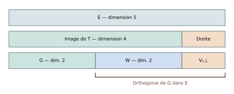
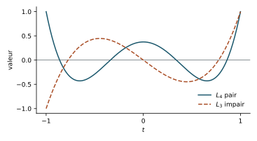

# X–ENS · PSI · Mathématiques 2017 · Corrigé guidé

*Corrigé rédigé par IA, non officiel. Signalez toute erreur.*

**Rédaction** · GPT-6.2 Astra Ultra · vitesse non renseignée

**Révision (tour 1)** · GPT-6.2 Astra Ultra · vitesse non renseignée

La composition CX7611 relie une décomposition euclidienne et un problème spectral aux polynômes de Legendre. La question 14 confond deux espaces orthogonaux de dimensions différentes. On garde la formulation exacte dans l’espace image pour poursuivre les parties II et III.

[Sujet officiel](https://www.ens.psl.eu/sites/default/files/2017_PSI_sujet_math.pdf)

Posons $V_k=\operatorname{Im}T^k$. L’espace $E$ a dimension $2m+1$. L’application $T$ est nilpotente d’indice $2m+1$ et $M$ est une involution symétrique qui anticommute avec $T$. La vérification suit les questions du sujet officiel. Le rapport écrit de mathématiques de cette session reste introuvable dans les archives consultées.

## I. Nilpotence, involution et orthogonalité

### Question 1a

> [!INDICATION]
> Appliquer l’involution aux deux combinaisons proposées.

#### Solution

Comme $M^2=I$, $M(v+Mv)=Mv+v=v^+$ et $M(v-Mv)=Mv-v=-v^-$. Donc $v^+\in F^+$ et $v^-\in F^-$.

### Question 1b

> [!INDICATION]
> Rétablir le facteur deux et employer la symétrie de $M$.

#### Solution

On a $v=(v^++v^-)/2$, donc $E=F^++F^-$. Pour $x\in F^+$ et $y\in F^-$, $\langle x,y\rangle=\langle Mx,y\rangle=\langle x,My\rangle=-\langle x,y\rangle$, d’où l’orthogonalité et la somme directe.

### Question 1c

> [!INDICATION]
> Utiliser l’anticommutation sur un vecteur de signe fixé.

#### Solution

Si $Mv=\varepsilon v$ avec $\varepsilon=\pm1$, alors $M(Tv)=-T(Mv)=-\varepsilon Tv$. L’application $T$ échange donc les deux espaces au sens des inclusions demandées. Deux applications successives de $T$ conservent chacun d’eux.

### Question 2

> [!INDICATION]
> Montrer qu’une égalité à un rang se propagerait jusqu’au dernier.

#### Solution

Notons $V_k=\operatorname{Im}T^k$. On a $V_{k+1}\subset V_k$ par factorisation. Si $V_{k+1}=V_k$ avec $k\le2m$, alors en appliquant $T$ de façon répétée tous les $V_j$, $j\ge k$, seraient égaux. Cela contredit $V_{2m}\ne0$ et $V_{2m+1}=0$.

### Question 3

> [!INDICATION]
> Compter les pertes de dimensions le long de toute la chaîne.

#### Solution

La dimension diminue strictement $2m+1$ fois entre $\dim E=2m+1$ et zéro. Chaque diminution vaut donc exactement un. Ainsi $\dim V_k=2m+1-k$ et, par le théorème du rang, $\dim\ker T^k=k$.

### Question 4

> [!INDICATION]
> Une inclusion s’obtient en composant les deux puissances et l’autre par les dimensions.

#### Solution

Puisque $T^{2m+1}=0$, $V_k\subset\ker T^{2m+1-k}$. Les deux espaces ont dimension $2m+1-k$ par 3, d’où l’égalité pour $0\le k\le2m+1$.

### Question 5

> [!INDICATION]
> Choisir un vecteur dans la différence orthogonale entre deux images consécutives.

#### Solution

La droite $D_k=V_{k-1}\cap V_k^\perp$ est de dimension un par 3 et $V_{k-1}=V_k\oplus^\perp D_k$. Si $0\ne z\in D_k$, alors $z\notin V_k=\ker T^{2m+1-k}$ par 4. Ainsi $T^{2m+1-k}z\ne0$, aussi pour le dernier rang où la puissance vaut zéro comme exposant.

Au dernier rang $k=2m+1$, on a $D_k=V_{2m}$ et l’endomorphisme qu’on applique au vecteur est $T^0=I$. Au premier rang, le vecteur peut être choisi sur la droite orthogonale à $V_1$ dans $E$.

### Question 6

> [!INDICATION]
> Multiplier la somme finie comme une série géométrique.

#### Solution

Posons $R=-\alpha T^2$. On a $R^{m+1}=0$ car $2m+2\ge2m+1$. Les produits de $I-R$ et $\sum_{k=0}^mR^k$ dans les deux ordres valent $I-R^{m+1}=I$. On obtient bien $(I+\alpha T^2)^{-1}=\sum_{k=0}^m(-1)^k\alpha^kT^{2k}$.

### Question 7

> [!INDICATION]
> Si $Tu=0$, utiliser les deux contraintes de $G$ dans la même égalité.

#### Solution

L’ensemble $G$ est l’intersection de $V_1$ avec les noyaux des formes linéaires $u\mapsto S(u,v)$ pour $v\in E$. Si $u\in G\cap\ker T$, alors $\langle u,Tv\rangle=0$ pour tout $v$ car $S(u,v)=0$ et $Tu=0$. Ainsi $u\in V_1\cap V_1^\perp=\{0\}$.

### Question 8

> [!INDICATION]
> Vérifier la positivité définie en utilisant l’injectivité sur $G$.

#### Solution

La forme $(v,w)\mapsto\langle Tv,Tw\rangle$ est bilinéaire symétrique et sa valeur en $(v,v)$ vaut $\|Tv\|^2$. Pour $v\in G$ elle s’annule seulement si $v=0$ par 7. C’est un produit scalaire sur $G$.

### Question 9a

> [!INDICATION]
> Raisonner par récurrence à partir de l’anticommutation.

#### Solution

Au rang zéro l’égalité est $M=M$. Si $MT^k=(-1)^kT^kM$, multiplier à droite par $T$ puis utiliser $MT=-TM$ donne $MT^{k+1}=(-1)^{k+1}T^{k+1}M$.

### Question 9b

> [!INDICATION]
> Appliquer la formule à une image, puis à un antécédent de zéro.

#### Solution

Pour $v=T^kx$, $Mv=(-1)^kT^kMx\in V_k$. Si $T^kx=0$, $T^kMx=(-1)^kMT^kx=0$. Images et noyaux sont donc stables par $M$.

### Question 10

> [!INDICATION]
> Restreindre $M$ à une droite stable.

#### Solution

Par 3, $\ker T$ est une droite et par 9b elle est stable par $M$. Sa restriction est une multiplication par un scalaire dont le carré vaut un. Ainsi $\ker T\subset F^+$ ou $\ker T\subset F^-$.

### Question 11a

> [!INDICATION]
> Examiner la parité de la puissance maximale sous l’hypothèse $\ker T\subset F^+$.

#### Solution

Pour $z\in F^-$, la puissance paire $T^{2m}z$ appartient encore à $F^-$. Mais $T^{2m}z\in V_{2m}=\ker T\subset F^+$. Les deux espaces étant en somme directe, $T^{2m}z=0$.

### Question 11b

> [!INDICATION]
> Les deux différences orthogonales sont des droites stables par l’involution.

#### Solution

Comme $M$ est symétrique et préserve $V_k$, il préserve $V_k^\perp$, puis $D_k$ défini en 5. Chacune de ces droites a donc un signe. Si $z\ne0$ est dans $D_1=V_1^\perp$, $T^{2m}z\ne0$ par 5. Par 11a, sa droite ne peut avoir le signe moins. Si $z\ne0$ est dans $D_2=V_1\cap V_2^\perp$, alors $T^{2m-1}z$ est non nul par 5 et appartient à $V_{2m}=\ker T\subset F^+$. La puissance impaire change le signe, donc $D_2\subset F^-$.

### Question 11c

> [!INDICATION]
> Tester la relation $S(u,z)=0$ pour $u\in G$.

#### Solution

Pour $z\in D_1$, $u\in G$, le vecteur $Tu$ appartient à $V_1$ et est orthogonal à $z$. Alors $0=S(u,z)=\langle u,Tz\rangle+\langle Tu,z\rangle$ donne $Tz\perp G$. Si $z\ne0$, $T^{2m}z\ne0$ par 5, donc $Tz\ne0$.

### Question 11d

> [!INDICATION]
> Utiliser cette fois l’appartenance de $u$ à la première image.

#### Solution

Pour $z\in D_2$, $u\in G\subset V_1$, on a $Tu\in V_2$, donc $\langle Tu,z\rangle=0$. De $S(u,z)=0$ il vient $Tz\perp G$. Comme $T^{2m-1}z\ne0$ pour $z\ne0$ et $m\ge2$, on a aussi $Tz\ne0$.

### Question 12

> [!INDICATION]
> Choisir un générateur de chacune des deux premières droites de la filtration.

#### Solution

Si $\ker T\subset F^+$, choisissons $0\ne w_1\in D_1$ et $0\ne w_2\in D_2$. Tous deux sont orthogonaux à $V_2$, et 11b–d donnent les signes, l’orthogonalité à $G$ de leurs images et la non-nullité requises. Si $\ker T\subset F^-$, appliquons le même raisonnement à $-M$ qui vérifie les mêmes hypothèses avec les signes échangés. En permutant les deux vecteurs on retrouve les étiquettes de l’énoncé.

### Question 13

> [!INDICATION]
> Compter les directions orthogonales à $G$ à l’intérieur même de la première image.

#### Solution

Les vecteurs $Tw_1,Tw_2$ sont non nuls et ont des signes opposés sous $M$. Ils sont donc indépendants, et appartiennent à $V_1\cap G^\perp$. Comme $G\subset V_1$ et $\dim V_1=2m$, cela donne $\dim G\le2m-2$.

### Question 14

> [!INDICATION]
> Vérifier la dimension de l’orthogonal dans chacun des deux espaces ambiants.

#### Solution

Sous (H5), l’orthogonal de $G$ dans $E$ a dimension $(2m+1)-(2m-2)=3$. Deux vecteurs n’en forment donc pas une base. Le résultat utilisé dans la suite est que $Tw_1,Tw_2$ forment une base de $W=V_1\cap G^\perp$, l’orthogonal dans $V_1$. En effet $W$ a dimension deux et ces vecteurs y sont indépendants par 13. Dans $E$, on a $G^\perp=W\oplus^\perp V_1^\perp$, ce qui donne la direction manquante.

Dans l’exemple polynomial de la partie III, on peut nommer la direction supplémentaire. Le polynôme $L_{2m}$ est orthogonal à tous les polynômes de degré au plus $2m-1$ et forme donc une base de $V_1^\perp$. Sa présence rend explicite la différence de dimension.

## II. Problème spectral sur G

### Question 15a

> [!INDICATION]
> Choisir la solution elle-même comme vecteur test.

#### Solution

Pour $0\ne u\in G$ solution, $\|u\|^2=\lambda\|Tu\|^2$. Le dénominateur est non nul par 7, donc $\lambda=\|u\|^2/\|Tu\|^2>0$.

### Question 15b

> [!INDICATION]
> Déplacer une dérivation en utilisant la définition de $G$ sur le vecteur test.

#### Solution

Si $v\in G$, $S(v,Tu)=0$ donne $\langle Tv,Tu\rangle=-\langle v,T^2u\rangle$. Ainsi $(P_\lambda)$ équivaut pour $u\in G$ à $(I+\lambda T^2)u\perp G$. Cette image appartient déjà à $V_1$ puisque $u\in V_1$. Elle est donc dans $W$ de 14, et vaut $\alpha Tw_1+\beta Tw_2$. L’inversion de 6 donne la formule de l’énoncé.

Réciproquement, si $u\in G$ et $(I+\lambda T^2)u$ est orthogonal à $G$, son produit scalaire avec tout $v\in G$ est nul. Remplacer $\langle T^2u,v\rangle$ par $-\langle Tu,Tv\rangle$ redonne exactement l’équation de $(P_\lambda)$. L’appartenance à $V_1$ est ce qui permet ensuite de choisir deux coefficients seulement.

### Question 15c

> [!INDICATION]
> Caractériser les combinaisons obtenues en 15b qui appartiennent effectivement à $G$.

#### Solution

Posons $h_i=(I+\lambda T^2)^{-1}Tw_i=\sum_{k=0}^{m-1}(-\lambda)^k T^{2k+1}w_i$. Le terme suivant est nul par (H1). Ces deux vecteurs indépendants sont dans $V_1$ et ont respectivement le signe de $Tw_i$, donc des signes opposés. Comme $G$ est l’orthogonal de $W$ dans $V_1$, la combinaison $u=\alpha h_1+\beta h_2$ appartient à $G$ exactement si elle est orthogonale aux deux $Tw_i$. Les termes croisés sont nuls par parité, et $\langle h_i,Tw_i\rangle=Q_i(\lambda)$. Les conditions deviennent $\alpha Q_1(\lambda)=\beta Q_2(\lambda)=0$. Toute combinaison qui y satisfait résout le problème par 15b. Il en existe une non nulle exactement quand $Q_1(\lambda)Q_2(\lambda)=0$.

### Question 15d

> [!INDICATION]
> Compter le nombre de coefficients qui restent libres.

#### Solution

Les deux vecteurs $h_i$ sont indépendants car les $Tw_i$ le sont et l’opérateur appliqué est inversible. À une racine commune, les deux coefficients sont libres et $\dim H_\lambda=2$. Si un seul $Q_i$ s’annule, seul le coefficient de $h_i$ est libre et $\dim H_\lambda=1$.

### Question 15e

> [!INDICATION]
> Développer $S$ et utiliser l’orthogonalité qui caractérise les $w_i$.

#### Solution

On a $S(w_i,T^{2k+1}w_i)=\langle w_i,T^{2k+2}w_i\rangle+\langle Tw_i,T^{2k+1}w_i\rangle$. Le premier terme est nul car $T^{2k+2}w_i\in V_2$ et $w_i\perp V_2$. La somme des seconds termes pondérés par $(-1)^kX^k$ est exactement $Q_i$.

### Question 16a

> [!INDICATION]
> Identifier deux matrices de Gram pour deux produits scalaires.

#### Solution

Par bilinéarité, $\langle u,v\rangle=U^tAV$ et $\langle Tu,Tv\rangle=U^tBV$. Les formes sont des produits scalaires sur $G$ par 8, donc pour $U\ne0$, $U^tAU$ et $U^tBU$ sont strictement positifs. Les deux matrices symétriques définies positives sont inversibles.

### Question 16b

> [!INDICATION]
> Faire varier librement les coordonnées du vecteur test.

#### Solution

La condition sur $v$ est $U^t(A-\lambda B)V=0$ pour tout $V$. Par symétrie, cela équivaut à $(A-\lambda B)U=0$. Il existe une solution non nulle si et seulement si $\det(A-\lambda B)=0$.

### Question 16c

> [!INDICATION]
> Suivre le même facteur jacobien dans les deux déterminants.

#### Solution

Lors d’un changement de base de matrice $P$, les matrices de Gram deviennent $P^tAP$ et $P^tBP$. Les déterminants de $A-tB$ et de $B$ sont alors chacun multipliés par $(\det P)^2$. Leur quotient $\psi(t)$ est invariant.

### Question 16d

> [!INDICATION]
> Orthonormaliser pour le produit scalaire qui fait intervenir $T$.

#### Solution

Le procédé de Gram–Schmidt pour $(u,v)\mapsto\langle Tu,Tv\rangle$ donne une base avec $B=I_\ell$. Alors $\psi(t)=\det(A-tI_\ell)$ est de degré $\ell=2m-2$, unitaire car $\ell$ est pair.

### Question 16e

> [!INDICATION]
> Relier la multiplicité algébrique à la dimension de l’espace des solutions.

#### Solution

Dans la base de 16d, $A$ est réelle symétrique définie positive. Le théorème spectral montre que $\psi$ est scindé à racines réelles positives et que la multiplicité de chaque racine est la dimension de son espace propre, égale à $\dim H_\lambda$. Par 15d, elle vaut un ou deux.

### Question 16f

> [!INDICATION]
> Comparer le nombre total de racines requises par les dimensions et les degrés maximaux des deux polynômes.

#### Solution

Les $Q_i$ sont non nuls car $Q_i(0)=\|Tw_i\|^2>0$ et de degrés au plus $m-1$. D’après 15c–d et 16e, chaque racine simple de $\psi$ appartient à exactement un $Q_i$ et chaque racine double aux deux. La somme des nombres de racines réelles distinctes des deux $Q_i$, comptées une fois pour chacun, vaut donc $2m-2$. Comme chaque degré est au plus $m-1$, chacun atteint cette borne et possède $m-1$ racines réelles simples. Leurs coefficients dominants sont $(-1)^{m-1}S(w_i,T^{2m-1}w_i)$ par 15e, donc ces deux valeurs sont non nulles. Les racines avec multiplicités et le caractère unitaire de $\psi$ imposent
$$\psi(X)=\frac{Q_1(X)Q_2(X)}{S(w_1,T^{2m-1}w_1)S(w_2,T^{2m-1}w_2)}.$$

Si $s$ désigne le nombre de racines simples de $\psi$ et $d$ celui de ses racines doubles, on a $s+2d=2m-2$. Le comptage répartit $s$ occurrences dans un seul des deux facteurs et $2d$ dans les deux facteurs réunis. Il épuise la somme de leurs degrés possibles. Il ne subsiste aucune place pour une racine multiple dans un facteur ni pour une racine complexe non réelle.

## III. Application aux polynômes de Legendre

### Question 17

> [!INDICATION]
> Examiner successivement nilpotence, réflexion, produit scalaire et dérivation.

#### Solution

La dérivation $T$ sur $\mathbb R_{2m}[X]$ satisfait $T^{2m+1}=0$ et $T^{2m}(X^{2m})=(2m)!\ne0$. La réflexion $MP(X)=P(-X)$ vérifie $M^2=I$. Dans l’intégrale sur $[-1,1]$, le changement $t\mapsto-t$ donne $\langle MP,Q\rangle=\langle P,MQ\rangle$. Enfin $(MP)'(X)=-P'(-X)$, donc $TM=-MT$. Voilà (H1)–(H4).

### Question 18

> [!INDICATION]
> Comparer un polynôme à son image par réflexion.

#### Solution

L’espace $F^+$ est celui des polynômes pairs de degré au plus $2m$, engendré par $1,X^2,\ldots,X^{2m}$. L’espace $F^-$ est celui des impairs, engendré par $X,X^3,\ldots,X^{2m-1}$.

### Question 19

> [!INDICATION]
> Reconnaître la dérivée d’un produit.

#### Solution

On a $S(P,Q)=\int_{-1}^1(PQ'+P'Q)=\int_{-1}^1(PQ)'=P(1)Q(1)-P(-1)Q(-1)$.

### Question 20

> [!INDICATION]
> Tester les deux valeurs au bord indépendamment.

#### Solution

On a $V_1=\mathbb R_{2m-1}[X]$. Dans 19, les couples $(Q(-1),Q(1))$ prennent toute valeur de $\mathbb R^2$ grâce aux polynômes affines. Ainsi $G$ est exactement l’espace des $P\in V_1$ nuls aux deux bords, soit $(X^2-1)\mathbb R_{2m-3}[X]=\mathbb R^0_{2m-1}[X]$. Sa dimension vaut $2m-2$, donc (H5) est satisfaite.

### Question 21a

> [!INDICATION]
> Compter les degrés et les changements de parité dans la formule de Rodrigues.

#### Solution

Le polynôme $R_n=(X^2-1)^n$ est pair de degré $2n$ et unitaire. Après $n$ dérivations, $L_n$ est de degré $n$, de coefficient dominant $(2n)!/(2^n(n!)^2)$. Chaque dérivation inverse la parité, donc $M(L_n)=(-1)^nL_n$.

### Question 21b

> [!INDICATION]
> Contrôler les termes aux bords dans $n$ intégrations par parties.

#### Solution

Comme $R_n$ a des zéros d’ordre $n$ aux deux bords, ses dérivées d’ordres $0,\ldots,n-1$ y sont nulles. En intégrant par parties $n$ fois, $\langle L_n,P\rangle=(-1)^n(2^n n!)^{-1}\int_{-1}^1R_nP^{(n)}=0$ pour $\deg P<n$.

### Question 21c

> [!INDICATION]
> Développer au voisinage de un avant de prendre la dérivée d’ordre $n+k$.

#### Solution

En posant $X=1+s$, on a $R_n(1+s)=s^n(2+s)^n$. Le coefficient de $s^{n+k}$ est $\binom nk 2^{n-k}$. En multipliant par $(n+k)!/(2^n n!)$, on trouve $L_n^{(k)}(1)=(n+k)!/((n-k)!k!2^k)$ pour $0\le k\le n$. En particulier $L_n(1)=1$.

Pour $k=0$, la formule redonne $L_n(1)=1$ pour tout $n$, y compris $n=0$. Au rang $k=n$, le résultat est la factorielle $n!$ fois le coefficient dominant obtenu en 21a.

### Question 21d

> [!INDICATION]
> Relier la parité de la dérivée impaire à celle du polynôme initial.

#### Solution

La dérivée d’ordre $2k+1$ a la parité opposée à $L_n$, donc le produit de leurs valeurs en $-1$ est l’opposé du produit en $1$. Grâce à 19 et $L_n(1)=1$, $S(L_n,L_n^{(2k+1)})=2L_n^{(2k+1)}(1)$. Si l’ordre dépasse le degré, les deux membres sont nuls.

### Question 22

> [!INDICATION]
> Tester les conditions de la paire sur les degrés et les valeurs aux bords.

#### Solution

Les parités de $L_{2m},L_{2m-1}$ sont opposées dans le bon ordre et leurs dérivées sont non nulles. Par 21b, ces deux polynômes sont orthogonaux à $V_2=\mathbb R_{2m-2}[X]$. Pour $P\in G$, $S(P,L_n)=0$ par 19 et $\langle P',L_n\rangle=0$ car $P'\in V_2$. Donc $\langle P,L_n'\rangle=0$ pour chacun des deux indices. Cela vérifie (A), (B) et (C).

### Question 23

> [!INDICATION]
> Substituer les polynômes de Legendre dans les deux facteurs du critère.

#### Solution

Le problème écrit est exactement $(P_\lambda)$ sur $G=\mathbb R^0_{2m-1}[X]$. Avec la paire de 22, 15e et 21d donnent $Q_i(X)=2\sum_{k=0}^{m-1}(-1)^kL_{n_i}^{(2k+1)}(1)X^k$, où $n_1=2m$, $n_2=2m-1$. Ainsi $Q_1Q_2=4K$, et par 15c une solution non nulle existe exactement si $K(\lambda)=0$.

### Question 24

> [!INDICATION]
> Exploiter la condition au bord gauche pour contrôler la norme de la primitive.

#### Solution

Pour $P\in G$, $P(t)=\int_{-1}^tP'(s)ds$. Cauchy–Schwarz donne $|P(t)|^2\le(t+1)\int_{-1}^1|P'|^2$. En intégrant en $t$, on trouve même $\|P\|^2\le2\|P'\|^2$. Si $P\ne0$, sa dérivée est non nulle car il s’annule aux bords. On en déduit $\|P\|^2<4\|P'\|^2$.

### Question 25

> [!INDICATION]
> Relier une racine à une solution puis à son quotient de Rayleigh.

#### Solution

Les racines des deux facteurs sont toutes réelles par 16f et 23. Pour chaque racine $\lambda$, 23 donne une solution $P\ne0$. En testant contre $P$, on trouve $\lambda=\|P\|^2/\|P'\|^2>0$. Par 24 elle est strictement inférieure à quatre.

### Question 26

> [!INDICATION]
> Prendre le terme constant du polynôme spectral normalisé, puis calculer deux rapports de dérivées.

#### Solution

Le quotient cherché est $\psi(0)$. En divisant pour chaque $n\in\{2m-1,2m\}$ le coefficient constant du facteur de 23 par son coefficient de plus haut degré, les signes se compensent dans le produit. D’après 16f et 21d,
$$\frac{\det A}{\det B}=\frac{L_{2m-1}'(1)L_{2m}'(1)}{L_{2m-1}^{(2m-1)}(1)L_{2m}^{(2m-1)}(1)}.$$
Or $L_n'(1)=n(n+1)/2$. Pour les deux dérivées d’ordre $2m-1$, les numérateurs de 21c sont respectivement $(4m-2)!$ et $(4m-1)!$, avec le même dénominateur $(2m-1)!2^{2m-1}$. D’où
$$\boxed{\frac{\det A}{\det B}=\frac{m^2(4m^2-1)\big((2m-1)!\,2^{2m-1}\big)^2}{(4m-2)!(4m-1)!}}.$$
Par exemple $m=2$ donne $4/105$.

Une vérification indépendante est possible dès $m=2$. La base $(1-X^2,\,X(1-X^2))$ sépare les parités. En intégrant directement les produits, on trouve les diagonales $(16/15,16/105)$ pour $A$ et $(8/3,8/5)$ pour $B$, avec tous les termes croisés nuls. Les deux valeurs propres généralisées sont $2/5$ et $2/21$. Leur produit redonne $4/105$.
