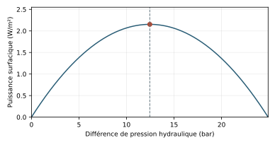
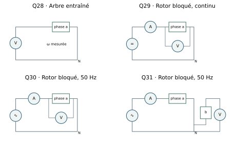
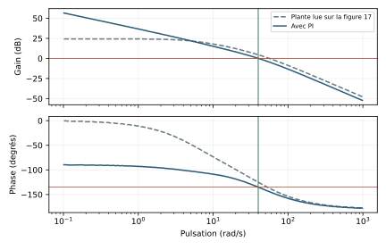
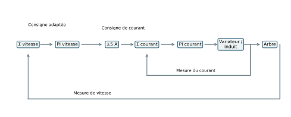
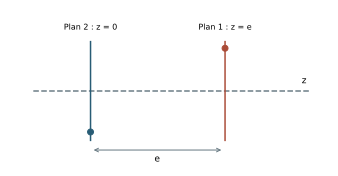

# X-ENS PSI · Modélisation 2017 · Corrigé guidé

*Corrigé rédigé par IA, non officiel. Signalez toute erreur.*

**Rédaction** · GPT-6.2 Astra Ultra · vitesse non renseignée · 24 novembre 2026

**Révision** · GPT-6.2 Astra Ultra · vitesse non renseignée · 26 novembre 2026

## Repères

Suivre les conversions entre bars, litres par heure et watts. Dans la base de Park, le courant sur l’axe q détermine le couple. Le réglage du PI se lit sur le graphe mesuré du sujet. Les masses d’usinage sont comptées positivement quand on les retire.

## A · Mise en situation

### Question 1 · Autres ressources énergétiques

**Indication.** Choisir des sources primaires répondant aux exclusions du sujet.

#### Solution

L'hydraulique gravitaire (barrage ou fil de l'eau), la géothermie et l'énergie marémotrice sont trois exemples renouvelables. Leurs ouvrages et leur implantation ont chacun des incidences environnementales propres.

## B · Puissance hydraulique

### Question 2 · Pression osmotique

**Indication.** Compter une seule fois la dissociation du chlorure de sodium et convertir les kelvins.

#### Solution

Avec une masse volumique d'eau voisine de 1 kg/L, la solution à 3 % contient environ 30 g de NaCl par litre, soit $c_{sel}=30/60=0{,}50$ mol/L. La loi de van 't Hoff donne $\pi_s=2c_{sel}RT=2\times0{,}50\times8{,}3\times300=2490$ kPa, soit **24,9 bar**. L'énoncé décrit aussi $c$ comme la concentration totale des ions : elle vaut alors 1,0 mol/L et le facteur 2 est déjà inclus.

### Question 3 · Pression hydraulique optimale

**Indication.** Écrire la densité de puissance comme un produit débit-pression, puis maximiser sur l'intervalle physique.

#### Solution

$W=J\Delta P=A\Delta P(\Delta\pi-\Delta P)$. Sa dérivée s'annule pour $\Delta P=\Delta\pi/2$ et sa dérivée seconde vaut $-2A<0$. Puisque le côté eau douce est à pression hydraulique relative nulle et que $\pi_D$ est négligeable, $P_s=12{,}45$ bar en pression relative.

### Question 4 · Densité maximale de puissance

**Indication.** La combinaison litre-bar par heure doit être convertie avant de donner la réponse en watts.

#### Solution

$W_{max}=A(\Delta\pi)^2/4=0{,}5(24{,}9)^2/4=77{,}5$ L·bar·h⁻¹·m⁻². Comme 1 L·bar vaut 100 J, cela représente **2,15 W/m²**.



### Question 5 · Augmentation du débit

**Indication.** Multiplier le flux optimal par la surface effectivement installée.

#### Solution

$\Delta Q_s=SJ=S A\Delta\pi/2=2000\times0{,}5\times12{,}45=12450$ L/h, soit environ 3,46 L/s. Ce débit provient du côté eau douce et s'ajoute au débit salé entrant.

### Question 6 · Puissance d'entrée de turbine

**Indication.** Appliquer le rendement à la puissance de la membrane entière.

#### Solution

$P_{hyd}=0{,}80\,SW_{max}=0{,}80\times2000\times2{,}15\simeq3{,}44$ kW. On retrouve ce chiffre par $0{,}80\Delta P\Delta Q_s$ en unités SI.

## C · Puissance mécanique

### Question 7 · Bilan de quantité de mouvement

**Indication.** Raisonner sur le débit de quantité de mouvement sortant moins le débit entrant.

#### Solution

Dans le modèle local de l'auget, avec pression de jet ambiante et poids de l'eau négligé, la force sur l'eau s'écrit $\mathbf F_{ext}=\rho(Q'\mathbf V'+Q''\mathbf V''-Q\mathbf V)$. L'élément de fluide occupant la partie commune aux deux instants se compense. Les masses échangées sont $\rho Q\,dt$, $\rho Q'\,dt$ et $\rho Q''\,dt$. Les trois vitesses sont mesurées relativement à l'auget. Il s'agit de l'approximation locale habituelle d'un déflecteur se déplaçant tangentiellement pendant l'échange.

### Question 8 · Force du jet sur la roue

**Indication.** Projeter les deux jets sortants sur la tangente et appliquer l'action réciproque.

#### Solution

Les modules relatifs sont égaux à $V_{auget}$ et les composantes axiales des jets de sortie valent $V_{auget}\cos\alpha$. Comme $Q'+Q''=Q$, la force sur l'eau suivant $X$ vaut $\rho Q V_{auget}(\cos\alpha-1)$. Par réaction, $\mathbf F_{fluide}=\rho Q V_{auget}(1-\cos\alpha)\mathbf X$ pour l'auget symétrique. Cette expression vectorielle utilise l’égalité des débits des deux veines, $Q'=Q''=Q/2$. En choisissant l’axe transversal vers la sortie de débit $Q'$, la réaction transversale vaut $\rho V_{auget}(Q''-Q')\sin\alpha$. La projection sur $X$ ne requiert que la conservation du débit total.

### Question 9 · Puissance mécanique et orientation

**Indication.** Le point d'application de la force est entraîné à la vitesse périphérique.

#### Solution

La composition des vitesses à l'entrée donne $V_{auget}=V_{buse}-u$, où $u=R_{Pelton}\Omega_{roue}$. La puissance vaut $P=\rho Q(1-\cos\alpha)(V_{buse}-u)u$. Pour $0<u<V_{buse}$, elle est maximale en angle lorsque le jet est retourné de $\alpha=\pi$ dans le modèle sans pertes.

### Question 10 · Vitesse optimale

**Indication.** Maximiser le produit d'une vitesse et de son complément à la vitesse du jet.

#### Solution

La parabole $u(V_{buse}-u)$ atteint son maximum en $u=V_{buse}/2$, d'où $\Omega_{opt}=V_{buse}/(2R_{Pelton})$. Avec $\alpha=\pi$, $P_{max}=\rho Q V_{buse}^2/2$. C'est la puissance cinétique du jet.

### Question 11 · Couple transmis

**Indication.** Distinguer le couple au point de puissance maximale et le couple maximal à vitesse imposée variable.

#### Solution

Au point optimal demandé par continuité avec Q10, $C_{méca}=P_{max}/\Omega_{opt}=\rho QR_{Pelton}V_{buse}$. Si le mot « maximum » qualifie littéralement le couple dans toute la plage de vitesse, alors $C(u)=2\rho QR_{Pelton}(V_{buse}-u)$ atteint $2\rho QR_{Pelton}V_{buse}$ à l'arrêt. La puissance y est nulle.

## D · Génératrice synchrone

### Question 12 · Dérivée de la rotation

**Indication.** Dériver les quatre coefficients en tenant compte de la vitesse angulaire.

#### Solution

La parité du cosinus et l'imparité du sinus donnent $R^t(\theta)=R(-\theta)$. Pour $J=\begin{pmatrix}0&-1\\1&0\end{pmatrix}=R(\pi/2)$, $\dot R=\dot\theta R(\theta)J=\omega R(\theta+\pi/2)$. En particulier $R^t\dot R=\omega J$.

### Question 13 · Flux dans le repère tournant

**Indication.** Utiliser les sommes de cosinus carrés et de produits sinus-cosinus déphasés de 120°.

#### Solution

Pour les trois angles $u\in\{\theta,\theta\pm2\pi/3\}$, $\sum\cos^2 u=3/2$ et $\sum\sin u\cos u=0$ en sommant les harmoniques d'ordre deux. Ainsi $P\phi_{abc}=(\sqrt{3/2}\,\Phi_m,0)^t$. Notons désormais $\Psi=\sqrt{3/2}\,\Phi_m$ et $\ell=L-M$.

### Question 14 · Équation électrique transformée

**Indication.** La dérivée dans la base triphasée s'applique aussi aux vecteurs de base mobiles.

#### Solution

Écrire $i_{abc}=CRi$ et $\phi_{abc}=CR\phi$ où $i=i_{dq}$, $\phi=(\Psi,0)^t$. Multiplier l'équation triphasée par $R^tC^t$. Puisque $C^tC=I$, $C^t L_{abc}C=\ell I$ et $R^t\dot R=\omega J$, on obtient $v=-Ri-\ell\dot i-\ell\omega Ji+\omega J\phi$. Ici le $R$ devant $i$ désigne la résistance de phase. En composantes, $v_d=-Ri_d-\ell\dot i_d+\ell\omega i_q$, $v_q=-Ri_q-\ell\dot i_q-\ell\omega i_d+\omega\Psi$.

### Question 15 · Énergie électrique délivrée

**Indication.** Multiplier l'équation des tensions par les courants et isoler la partie antisymétrique.

#### Solution

$\delta W_{elec}=v^ti\,dt=-R(i_d^2+i_q^2)dt-\ell(i_d\,di_d+i_q\,di_q)+\omega\Psi i_q\,dt$. Le terme de couplage inductif en $\ell\omega$ se réduit à $\ell\omega(i_d i_q-i_q i_d)=0$. Les trois termes sont la perte Joule, le stockage magnétique et l'énergie convertie (avec les signes de la convention génératrice).

### Question 16 · Premier principe

**Indication.** Prendre l'alternateur entier pour système et compter positivement l'énergie qu'il reçoit.

#### Solution

L'arbre fournit $\delta W_{méca}$. La charge reçoit $\delta W_{elec}$ et les pertes cuivre dissipent $\delta Q_{Joule}$, comptées positives vers l'extérieur. Le stockage est cinétique et magnétique. Ainsi $dU_{cin}+dU_{mag}=\delta W_{méca}-\delta W_{elec}-\delta Q_{Joule}$. Les pertes mécaniques et fer ne figurent pas dans le modèle proposé.

### Question 17 · Énergie cinétique de l'arbre

**Indication.** Dériver l'énergie d'un solide en rotation d'inertie constante.

#### Solution

$U_{cin}=J_{eq}\Omega^2/2$ donne $dU_{cin}=J_{eq}\Omega\,d\Omega$.

### Question 18 · Pertes cuivre

**Indication.** La transformation de Park utilisée préserve la norme sur le sous-espace équilibré.

#### Solution

$\delta Q_{Joule}=R\,i_{dq}^ti_{dq}\,dt=R(i_d^2+i_q^2)\,dt$. La forme normalisée de $P$ assure l'égalité avec la somme des trois pertes de phase.

### Question 19 · Travail d'arbre

**Indication.** Le couple électromagnétique s'oppose au couple fourni par la turbine en convention génératrice.

#### Solution

$\delta W_{méca}=C_{méca}\Omega\,dt$ et $J_{eq}\dot\Omega=C_{méca}-C_m$. Ainsi $\delta W_{méca}=J_{eq}\Omega\,d\Omega+C_m\Omega\,dt$, somme du stockage cinétique et du travail de conversion.

### Question 20 · Forme quadratique antisymétrique

**Indication.** Développer les deux produits croisés.

#### Solution

Le produit indiqué vaut $\ell\omega i_d i_q-\ell\omega i_q i_d=0$. Plus généralement, un scalaire $x^tAx$ est nul pour toute matrice réelle antisymétrique $A$.

### Question 21 · Énergie magnétique

**Indication.** Les deux axes ont la même inductance effective.

#### Solution

$dU_{mag}=\ell(i_d\,di_d+i_q\,di_q)=d[\ell(i_d^2+i_q^2)/2]$. L'énergie associée aux aimants à courant nul est constante ici.

### Question 22 · Couple électromagnétique

**Indication.** Identifier la puissance qui subsiste après déduction des stockages et des pertes.

#### Solution

Les relations Q15–21 donnent $C_m\Omega\,dt=\Psi\omega i_q\,dt$. Comme l'énoncé assimile $\omega$ à $\Omega$, $C_m=\Psi i_q=\sqrt{3/2}\,\Phi_m i_q$. La relation se prolonge par continuité au passage par la vitesse nulle.

### Question 23 · Équations d'état en charge

**Indication.** Remplacer les deux tensions de phase transformées par le produit de la résistance de charge et du courant.

#### Solution

Avec $v=R_ci$, Q14 et Q19 donnent
$$\dot i_d=-\tfrac{R+R_c}{\ell}i_d+i_q\omega,\qquad \dot i_q=-i_d\omega-\tfrac{R+R_c}{\ell}i_q+\tfrac{\Psi}{\ell}\omega,\qquad \dot\omega=-\tfrac{\Psi}{J_{eq}}i_q+\tfrac{1}{J_{eq}}C_{méca}.$$
Ainsi $K_{dd}=K_{qq}=-(R+R_c)/\ell$, $K_{dq}=1$, $K_{qd}=-1$, $K_{d\omega}=K_{\omega d}=K_{\omega\omega}=0$, $K_{q\omega}=\Psi/\ell$, $K_{\omega q}=-\Psi/J_{eq}$ et $H_{d\tau}=1/J_{eq}$.

### Question 24 · Choix du pas

**Indication.** Séparer erreur de troncature et amplification du bruit d'échantillonnage.

#### Solution

La dérivée par différence $(x_{k+1}-x_k)/T_e$ a une erreur de troncature en $O(T_e)$ pour un signal deux fois dérivable. Un pas réduit améliore cette approximation. Pour des échantillons perturbés par des erreurs indépendantes d'écart type $\sigma$, le bruit de la dérivée a pour écart type $\sqrt2\,\sigma/T_e$. Raccourcir le pas rend donc la dérivation mesurée plus sensible au bruit. Lors d'une simulation d'équations exactes, ce second phénomène suppose effectivement des données bruitées.

### Question 25 · Euler sur le courant

**Indication.** Utiliser uniquement les valeurs au début du pas.

#### Solution

Avec $\omega=\omega_0$ et $i_d=0$, $i_{q,k+1}=i_{q,k}+\Delta t(K_{qq}i_{q,k}+K_{q\omega}\omega_0)$. Dans le programme, `Kqw` note $K_{q\omega}$ et `w0` désigne $\omega_0$. Les variables globales sont celles de l'énoncé. Le dernier pas peut être plus court pour atteindre $T$ exactement.

```python
def Intensite():
    if Te <= 0 or T < 0:
        raise ValueError("Il faut Te > 0 et T >= 0.")
    temps = [0.0]
    courant = [I0]
    while temps[-1] < T:
        prochain = min(T, len(temps) * Te)
        pas = prochain - temps[-1]
        iq = courant[-1]
        courant.append(iq + pas * (Kqq * iq + Kqw * w0))
        temps.append(prochain)
    return temps, courant
```

### Question 26 · Limite de stabilité

**Indication.** Étudier l'amplification de l'écart de deux solutions eulériennes.

#### Solution

Un écart est multiplié par $1+T_eK_{qq}$ à chaque pas complet. Pour $K_{qq}<0$, l'amortissement asymptotique exige $|1+T_eK_{qq}|<1$, soit $0<T_e<-2/K_{qq}$. À la borne supérieure, le mode oscille sans décroître. Quand $T_e\le-1/K_{qq}$, il décroît sans alternance.

### Question 27 · Euler sur la vitesse

**Indication.** Avec une vitesse variable, mettre à jour courant et vitesse sur les mêmes anciennes valeurs.

#### Solution

$\omega_{k+1}=\omega_k+\Delta t(K_{\omega q}i_{q,k}+K_{\omega\omega}\omega_k+H_{d\tau}C_{méca})$. Le programme réévalue aussi le courant avec la vitesse courante, dans l'hypothèse imposée $i_d=0$. Les noms `Kwq, Kww, Hdt, Cmeca` reprennent les quatre coefficients de l'équation. Pour une approximation successive utilisant le courant déjà calculé en Q25, la même récurrence mécanique peut être appliquée aux couples (temps, courant) renvoyés par `Intensite()`, en gardant alors l'approximation de vitesse constante dans l'équation électrique.

```python
def Vitesse():
    if Te <= 0 or T < 0:
        raise ValueError("Il faut Te > 0 et T >= 0.")
    vitesses = [w0]
    iq = I0
    t = 0.0
    while t < T:
        prochain = min(T, len(vitesses) * Te)
        pas = prochain - t
        w = vitesses[-1]
        di = Kqq * iq + Kqw * w
        dw = Kwq * iq + Kww * w + Hdt * Cmeca
        vitesses.append(w + pas * dw)
        iq += pas * di
        t = prochain
    return vitesses
```

### Question 28 · Essai à vide

**Indication.** Mesurer la tension de phase et la vitesse sans faire débiter le stator.

#### Solution

Une machine d'entraînement fait tourner l'arbre, un tachymètre mesure $\Omega$ et un oscilloscope à grande impédance mesure $v_a$ entre la borne a et le neutre. Les phases restent ouvertes. Puisque $v_a=\dot\phi_a=-\omega\Phi_m\sin\theta_e$, l'amplitude donne $\Phi_m=V_{22}/\Omega_{22}=330/314=1{,}05$ Wb dans l'hypothèse $\omega=\Omega$ du sujet. Le dessin ci-dessous couvre les quatre essais.



### Question 29 · Résistance de phase

**Indication.** À rotor bloqué et en régime continu, les tensions inductives sont nulles.

#### Solution

Alimenter la seule phase a par une source continue, un ampèremètre en série et un voltmètre en dérivation entre a et le neutre. Les autres phases restent ouvertes. Le rapport des modules donne $R=V_{23}/I_{23}=20/1=20\,\Omega$. Le sens du courant imposé par la source est le sens récepteur de la bobine.

### Question 30 · Inductance propre

**Indication.** Utiliser la phase a seule et prendre les amplitudes des deux sinusoïdes de même fréquence.

#### Solution

À rotor bloqué, alimenter a et le neutre sous 50 Hz. Mesurer $V_{24}$ par voltmètre alternatif ou oscilloscope et $I_{24}$ en série. Les autres phases ouvertes, $|Z_a|^2=R^2+(2\pi fL)^2$. Ainsi $L=\sqrt{(120/0{,}5)^2-20^2}/(100\pi)=0{,}761$ H. Des mesures efficaces donneraient le même rapport si tension et courant sont exprimés selon la même convention.

### Question 31 · Inductance mutuelle

**Indication.** La phase de mesure est ouverte et seule la phase excitatrice porte du courant.

#### Solution

Maintenir le rotor bloqué. La source 50 Hz et l'ampèremètre sont sur a, tandis qu'un oscilloscope relie b et le neutre. $|v_b|_{max}=2\pi f|M|I_{25}$, donc $|M|=50/(100\pi\times0{,}5)=0{,}318$ H. Une mesure de phase et le sens de référence des enroulements déterminent le signe si nécessaire. Les amplitudes du tableau renseignent le module.

## E · Régulation

### Question 32 · Retour électromécanique propre

**Indication.** Identifier la grandeur comparée à la consigne.

#### Solution

La tension de retour $k_e\omega$ est la force contre-électromotrice intrinsèque. La figure 15 décrit le moteur alimenté en tension, sans comparaison de sa vitesse à une consigne de vitesse. Pour obtenir la régulation demandée il faut la mesure, la consigne et le correcteur de la figure 16.

### Question 33 · Approximation du variateur

**Indication.** Comparer sa pulsation de cassure à celles du moteur et à la coupure recherchée.

#### Solution

$\tau_v=50\,\mu$s donne $1/\tau_v=20000$ rad/s, contre 5 et 50 rad/s pour le moteur. Aux fréquences d'asservissement, par exemple à 40 rad/s, $\omega\tau_v=0{,}002$. Le module est pratiquement 20 et le retard de phase environ $0{,}11°$. On peut donc employer $H_v\simeq k_v=20$ sur cette bande.

### Question 34 · Capteur analogique de vitesse

**Indication.** Chercher un capteur dont la tension de sortie est proportionnelle à la vitesse.

#### Solution

Une génératrice tachymétrique accouplée à l'arbre délivre une tension analogique $u_c=k_c\Omega$, dont la polarité indique le sens de rotation.

### Question 35 · Adaptation de la consigne

**Indication.** Exprimer en volts l'écart entre l'image de la consigne et la mesure.

#### Solution

$\varepsilon=k_a\Omega_{ref}-k_c\Omega$. Pour qu'une vitesse égale à sa consigne annule l'écart pour toutes les vitesses de fonctionnement, choisir $k_a=k_c$.

### Question 36 · Deux voies de la vitesse régulée

**Indication.** Éliminer le courant dans les deux équations physiques avant de refermer la boucle de vitesse.

#### Solution

Posons $Z=R+L_cp$, $B=f+J_{eq}p$, $D=ZB+k_tk_e$. Le moteur vérifie $D\Omega=k_tV-ZC_r$. Comme $V=k_v C(p)(k_a\Omega_{ref}-k_c\Omega)$,
$$H_1=\frac{k_a k_v k_t C(p)}{D+k_c k_v k_t C(p)},\qquad H_2=\frac{-Z}{D+k_c k_v k_t C(p)}.$$
Le signe négatif traduit le ralentissement induit par un couple résistant positif.

### Question 37 · Précision du PI

**Indication.** Évaluer les gains statiques de la boucle fermée.

#### Solution

$C(p)=C_0(1+1/(T_ip))$ a un gain infini à fréquence nulle. Sous réserve de stabilité en boucle fermée, Q36 donne $H_1(0)=k_a/k_c=1$, $H_2(0)=0$. Une consigne en échelon est donc suivie sans écart permanent et une perturbation constante en couple est rejetée, dans la plage linéaire de l'actionneur.

### Question 38 · Réglage du PI à 40 rad/s

**Indication.** À la coupure, imposer le module unité et une phase égale à −135 degrés.

#### Solution

Sur la figure 17, à $\omega_c=40\ \mathrm{rad/s}$, on lit $G_{\rm dB}\simeq+4{,}6$ dB et $\varphi\simeq-125°$, soit un module $g\simeq1{,}69$. Une marge de phase d’au moins $45°$ exige $\varphi+\arg C(j\omega_c)\ge-135°$. Le PI peut donc ajouter au plus $10°$ de retard. Comme $\arg C(j\omega)=-\arctan[1/(\omega T_i)]$, cette condition donne $T_i\gtrsim1/[40\tan(10°)]\simeq0{,}142$ s.

Pour un réglage à la limite, le gain de boucle doit aussi être un. Il vient $C_0=\cos(10°)/g\simeq0{,}58$ pour un retour normalisé. Si la figure est lue comme le rapport $\Omega/U$ avant le capteur de gain $k_c$, cette valeur est celle du produit $k_cC_0$. Avec un $T_i$ supérieur au minimum, la marge augmente à la même coupure à condition de réajuster le gain à $C_0=[g\sqrt{1+(\omega_c T_i)^{-2}}]^{-1}$ pour le retour normalisé. Dans le modèle réduit de Q33 à deux pôles et variateur assimilé à un gain pur, la phase corrigée atteint asymptotiquement $-180°$ sans croisement à pulsation finie : la marge de gain dépasse les $10$ dB demandés.



### Question 39 · Asservissement de courant en cascade

**Indication.** La boucle de vitesse doit désormais prescrire le courant demandé à la boucle interne.

#### Solution

Le correcteur de vitesse produit la consigne de la boucle interne. Le limiteur borne cette consigne en courant. La différence entre consigne et courant mesuré commande le PI de courant, puis le variateur. Le courant circule dans l’induit sous la tension nette $u-k_e\Omega$ et produit le couple $k_t i$. L’équation mécanique reçoit $k_t i-C_r$. Le capteur $k_c$ ramène la vitesse au comparateur externe.

Pour garantir l’exigence stricte $|i|<5$ A, prendre $I_{\rm lim}<5$ A avec une marge couvrant le dépassement maximal et l’incertitude de mesure. Le schéma suppose que le capteur de courant est étalonné dans les unités de la consigne interne.



### Question 40 · Séparation des temps

**Indication.** La vitesse doit voir la grandeur intérieure suivre sa consigne sur toute sa bande passante.

#### Solution

La boucle de courant doit être stable et sensiblement plus rapide que la boucle de vitesse. À titre de dimensionnement, on peut viser une bande passante interne cinq à dix fois supérieure selon les marges disponibles. Alors son gain fermé reste proche de l'unité aux fréquences utiles de la régulation de vitesse.

### Question 41 · Conséquence sur le temps de réponse

**Indication.** Distinguer la petite perturbation en régime linéaire de la commande réellement limitée au démarrage.

#### Solution

Hors limitation, la boucle interne assez rapide a peu d'effet sur le temps de réponse de la boucle externe conçue avec cette approximation. Pour la grande consigne illustrée, limiter le courant écrête le couple et borne $\dot\Omega=(k_t i-C_r-f\Omega)/J_{eq}$. La montée peut s'allonger et l'exigence de trois secondes doit être vérifiée à nouveau sur le système limité.

### Question 42 · Saturation de tension

**Indication.** Écrêter des deux côtés et conserver les valeurs intérieures.

#### Solution

Pour $V_{max}\ge0$, $u_s=\max(-V_{max},\min(u,V_{max}))$. La sortie vaut ainsi la borne signée appropriée en dépassement, ou exactement la commande dans l'intervalle, y compris à ses deux extrémités.

```python
def Saturation(u, Vmax):
    if Vmax < 0:
        raise ValueError("Vmax doit être positif ou nul.")
    return float(max(-Vmax, min(u, Vmax)))
```

## F · Équilibrage de la turbine

### Question 43 · Accélération du centre décalé

**Indication.** Dériver deux fois le vecteur radial dans le repère du bâti.

#### Solution

$OG=aX_S$ et $\dot X_S=\omega Y_S$, $\dot Y_S=-\omega X_S$. À la vitesse constante imposée, $\Gamma_G=-a\omega^2X_S$. En régime non uniforme s'ajouterait $a\dot\omega Y_S$.

### Question 44 · Moment dynamique au point fixe O

**Indication.** Dériver dans le bâti le moment cinétique en O, dont les composantes sont constantes dans la base tournante.

#### Solution

$\sigma_O=I_O\Omega=\omega(-E X_S-D Y_S+C Z_S)$. Comme $O$ est fixe et $\omega$ constant, $\delta_O=\omega Z_S\times\sigma_O=\omega^2(D X_S-E Y_S)$.

### Question 45 · Réactions du pivot

**Indication.** Soustraire les actions extérieures données aux composantes du torseur dynamique.

#### Solution

La résultante impose $X=-ma\omega^2-X_1$, $Y=-Y_1$, $Z=-Z_1$. Le moment en $O$ impose $L=D\omega^2-L_1$, $M=-E\omega^2-M_1$. Le pivot parfait ne transmet aucun couple axial. La projection restante impose $N_1=0$ dans l'hypothèse de vitesse constante.

### Question 46 · Conditions d'équilibrage

**Indication.** Annuler séparément le premier moment radial et les produits d'inertie portant l'axe de rotation.

#### Solution

Pour que les réactions soient indépendantes des termes dynamiques à toute vitesse, il faut $a=0$ (centre de masse sur l'axe) et $D=E=0$ (axe de rotation principal d'inertie). Q45 montre aussi que ces conditions suffisent pour les termes dépendant de $\omega$.

### Question 47 · Usinage en un seul point

**Indication.** Prendre la masse enlevée positive dans les équations de soustraction.

#### Solution

Avec une masse positive $m_1$ retirée en $(x_1,y_1,z_1)$, l'équilibrage statique donne $ma-m_1x_1=0$ et $-m_1y_1=0$, donc $y_1=0$. Le nouveau produit $D'=D-m_1y_1z_1$ reste alors égal à $D$. La condition $D'=0$ exige donc $D=0$. Il faut également réaliser $E'=E-m_1x_1z_1=0$ avec la géométrie disponible.

### Question 48 · Deux plans de correction

**Indication.** Résoudre d'abord les premiers moments à enlever dans chaque plan, puis passer des composantes cartésiennes aux masses et angles.

#### Solution

Notons $X_j=m_jr\cos\theta_j$, $Y_j=m_jr\sin\theta_j$, où $m_j\ge0$ désigne la masse réellement retirée, $r>0$, et utilisons les cotes écrites $z_1=e\ne0$, $z_2=0$. Les quatre conditions sont $X_1+X_2=ma$, $Y_1+Y_2=0$, $eX_1=E$, $eY_1=D$. Ainsi $(X_1,Y_1)=(E/e,D/e)$ et $(X_2,Y_2)=(ma-E/e,-D/e)$. Pour chaque plan,
$$m_j=\frac{\sqrt{X_j^2+Y_j^2}}{r},\qquad \theta_j=\operatorname{atan2}(Y_j,X_j)\pmod{2\pi}.$$
Une masse nulle rend l'angle indifférent. Le deuxième argument de l'angle assure la bonne prise en compte du quadrant. La vue de droite de la figure 21 place au contraire $m_1$ sur l’axe de cote nulle et $m_2$ à la cote $e$. Pour utiliser cette coupe, échanger les indices 1 et 2 dans les deux couples masse–angle obtenus ci-dessus. Les deux angles sont comptés depuis $+X_S$ dans le sens direct.


