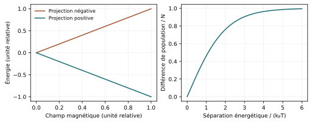
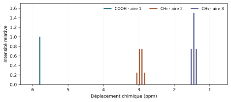

# X–ENS PSI 2017 — Physique (Banque commune X–InterENS) · Corrigé brut

*Corrigé rédigé par IA, non officiel. Signalez toute erreur.*

**Rédaction** · GPT-6.2 Astra Ultra · vitesse non renseignée

## La spectroscopie de résonance magnétique nucléaire

## I. Champ statique et cryostat

### Question 1 — Champ du solénoïde idéal

Pour un solénoïde infiniment long, d’axe $z$, portant $n$ spires par mètre et un courant $I$, la symétrie impose un champ axial uniforme de chaque côté de la nappe. Le champ extérieur est nul en l’absence de champ imposé au loin. Le contour rectangulaire de longueur axiale $l$ donne $(B_{\rm int}-B_{\rm ext})l=\mu_0nl I$. Ainsi $\mathbf B=\mu_0 nI\mathbf e_z$ pour $r<R$ et $\mathbf B=0$ pour $r>R$, avec le sens fixé par celui du courant.

### Question 2 — Ligne de champ de fuite

Le modèle infini prévoit un champ nul partout à l’extérieur et ne peut ni placer ni faire varier cette ligne. Un solénoïde réel a des extrémités et des lignes de champ qui se referment dans l’espace. La ligne indiquée est un lieu où le module atteint $5\ \mathrm G=0{,}5\ \mathrm{mT}$. Sa position dépend du champ central et de la géométrie réelle.

### Question 3 — Excitation magnétique linéique

Dans le modèle idéal, $nI=B_0/\mu_0=12/(4\pi\times10^{-7})\simeq9{,}5\times10^6\ \mathrm{A\,m^{-1}}$. Cette grandeur est le nombre d’ampères-tours par mètre.

### Question 4 — Résistance du cuivre dans le modèle

Avec longueur $l$, diamètre moyen $D$ et épaisseur d’enroulement $a$, chaque spire a une section conductrice $a/n$ dans le modèle à remplissage idéal. La longueur de cuivre est $nl\pi D$. Sa résistance est donc $R_{\rm Cu}=\rho_e\pi Dl n^2/a$, soit $2{,}1\times10^{-7}n^2\ \Omega$ pour les dimensions données, $n$ exprimé en $\mathrm{m^{-1}}$.

### Question 5 — Bilan énergétique stationnaire

Avec $S_{\rm ech}$ l’aire effectivement échangée, $R_{\rm Cu}I^2=h S_{\rm ech}(T-T_{\rm ext})$. On trouve $T=T_{\rm ext}+[\rho_e\pi Dl/(a h S_{\rm ech})](nI)^2$. À excitation donnée le choix de $n$ s’élimine dans cette modélisation.

### Question 6 — Portée de l’estimation thermique

En échangeant par les deux faces cylindriques et les deux anneaux terminaux d’une enveloppe de diamètre moyen $D$, $S_{\rm ech}=2\pi Dl+2\pi Da\simeq7{,}9\ \mathrm{m^2}$. Les pertes calculées sont d’environ $1{,}9\times10^7\ \mathrm W$ et l’excès thermique formel d’environ $2{,}5\times10^5\ \mathrm K$. Il dépasse de très loin la température de fusion du cuivre. Le modèle à coefficients constants cesse donc d’être applicable. Une résistance du cuivre croissante avec $T$ augmente encore la dissipation à courant imposé.

### Question 7 — Supraconductivité

Sous ses limites critiques de température, de courant et de champ, un supraconducteur peut porter un courant continu sans résistance électrique. Il présente aussi une réponse magnétique propre, notamment l’effet Meissner dans le régime approprié. Kamerlingh Onnes a observé la transition du mercure en 1911.

### Question 8 — Deux étages cryogéniques

L’hélium liquide maintient l’étage froid vers $4\ \mathrm K$. L’enveloppe d’azote liquide vers $77\ \mathrm K$ intercepte une partie des apports venus de l’environnement. Les fuites thermiques par rayonnement, supports et connexions apportent la chaleur latente qui vaporise les liquides.

### Question 9 — Charges thermiques déduites des volumes

L’étage azote reçoit en moyenne $(40\times0{,}808)(199\times10^3)/(7\times86400)\simeq11\ \mathrm W$. L’étage hélium reçoit $(50\times0{,}125)(21\times10^3)/(28\times86400)\simeq0{,}054\ \mathrm W$. Ces estimations décrivent la charge thermique des étages et ne mesurent pas des pertes Joule intrinsèques du fil supraconducteur.

### Question 10 — Comparaison des dissipations

Le fonctionnement en courant persistant supprime les gigantesques pertes Joule qui apparaissaient dans le cuivre. L’étage à hélium évacue ici quelques centièmes de watt de fuites, ce qui permet un champ intense stable. La réfrigération a elle-même un coût énergétique.

### Question 11 — Autre source de champ statique

Un aimant permanent produit un champ statique grâce à son aimantation rémanente. Sa production de champ ne nécessite pas un courant électrique imposé dans une bobine résistive.

### Question 12 — Ordre de grandeur d’un aimant permanent

Avec des aimants permanents usuels performants on obtient typiquement quelques dixièmes de tesla à un tesla, suivant la géométrie. C’est un ordre de grandeur inférieur aux quelque $12\ \mathrm T$ de l’appareil considéré.

## II. Précession, populations et induction

### Question 13 — Orientation de plus basse énergie

Pour $B_0>0$, l’énergie minimale est $-MB_0$ à $\theta=0$. Le dipôle est alors parallèle au champ et de même sens. Le moment antiparallèle est aussi sans couple mais correspond à un maximum instable.

### Question 14.a — Norme du dipôle

Avec $\dot{\boldsymbol\sigma}=\mathbf M\times\mathbf B_0$ et $\mathbf M=\gamma\boldsymbol\sigma$, $dM^2/dt=2\gamma\mathbf M\cdot(\mathbf M\times\mathbf B_0)=0$. La norme est constante.

### Question 14.b — Projection axiale

Le produit $\mathbf M\times B_0\mathbf e_z$ est orthogonal à $\mathbf e_z$. Par conséquent $dM_z/dt=0$.

### Question 14.c — Angle de précession

Pour un moment non nul, $\cos\theta=M_z/M$ est constant. Comme $\theta$ est choisi dans $[0,\pi]$, l’angle est constant.

### Question 14.d — Trajectoire géométrique

L’extrémité de $\mathbf M$ reste à altitude $M\cos\theta$ et distance horizontale $M\sin\theta$ de l’axe. Le couple la fait parcourir le cercle de ce rayon, qui se réduit à un point pour $\theta=0$ ou $\pi$.

### Question 15 — Vecteur de Larmor

La loi $\dot{\mathbf M}=\gamma\mathbf M\times\mathbf B_0=(-\gamma\mathbf B_0)\times\mathbf M$ identifie $\boldsymbol\omega_0=-\gamma\mathbf B_0$. Pour le proton, sa norme est $\omega_0=\gamma B_0$ et le sens de précession est opposé au champ.

### Question 16 — Force sur le dipôle

Le champ uniforme ne présente aucun gradient. Pour un moment instantané donné $\mathbf F=\nabla(\mathbf M\cdot\mathbf B_0)=0$. Le couple de précession peut cependant être non nul.

### Question 17 — Fréquence d’un spectromètre à 11,75 T

La valeur $f_0=(2{,}675\times10^8)(11{,}75)/(2\pi)\simeq5{,}0\times10^8\ \mathrm{Hz}$ correspond à un spectromètre dit « 500 MHz » pour le proton.

### Question 18 — Exemples macroscopiques

Un gyroscope de navigation fournit une référence d’orientation. L’axe de rotation terrestre précesse lentement sous les couples exercés notamment par la Lune et le Soleil sur le renflement équatorial terrestre.

### Question 19.a — Écart Zeeman

Pour $\sigma_z=\pm\hbar/2$, $E_+=-\gamma\hbar B_0/2$ et $E_-=+\gamma\hbar B_0/2$. L’écart positif vaut $\Delta E=\gamma\hbar B_0$.

### Question 19.b — Diagramme de niveaux

Les énergies sont deux droites issues de l’origine de pentes $\mp\gamma\hbar/2$. La droite descendante représente la projection positive, qui est la plus peuplée à l’équilibre.

### Question 19.c — Transition et précession

On a $hf=\Delta E=\hbar\gamma B_0$, soit $f=\gamma B_0/(2\pi)$. La fréquence de la transition quantique est exactement la fréquence de Larmor trouvée classiquement.

### Question 20.a — Rapport des populations

On trouve $N^+/N^-=\exp[-(E_+-E_-)/(k_BT)]=\exp[\gamma\hbar B_0/(k_BT)]$. L’état de plus basse énergie est le plus peuplé.

### Question 20.b — Populations normalisées

Il vient $N^+=N/(1+e^{-x'})$ et $N^-=N/(1+e^{x'})$, où $x'=\gamma\hbar B_0/(k_BT)$. Les deux valeurs somment bien à $N$.

### Question 20.c — Limites physiques

Quand $x'\to0$ (champ faible ou température élevée), $N^+\simeq N^-\simeq N/2$. Quand $x'\to\infty$ (champ accru ou température basse), $N^+\to N$ et $N^-\to0$ car l’état excité devient improbable.

### Question 21 — Direction du moment global

Les phases azimutales sont réparties sans direction privilégiée et les composantes transverses des moments se compensent statistiquement. La différence des populations laisse un moment global axial, invariant par une rotation autour de $z$.

### Question 22 — Aimantation d’équilibre

On a $M_{0z}=(\gamma\hbar/2)(N^+-N^-)$. Le rapport de la différence à la somme vaut $(e^{x'}-1)/(e^{x'}+1)=\tanh(x'/2)$. Donc $\mathbf M_0=(N\gamma\hbar/2)\tanh(x'/2)\mathbf e_z$.

### Question 23.a — Taille du paramètre thermique

Avec $T=300\ \mathrm K$ et $B_0=11{,}75\ \mathrm T$, $x'=(2{,}675\times10^8)(1{,}055\times10^{-34})(11{,}75)/(1{,}381\times10^{-23}\times300)\simeq8{,}0\times10^{-5}$.

### Question 23.b — Développement à faible polarisation

Pour $y\ll1$, $e^y-e^{-y}\simeq2y$ et $e^y+e^{-y}\simeq2$. Ainsi $\mathbf M_0\simeq(N\gamma\hbar x'/4)\mathbf e_z=[N\gamma^2\hbar^2B_0/(4k_BT)]\mathbf e_z$. La fraction de polarisation est seulement $x'/2\simeq4\times10^{-5}$.

### Question 24.a — Dépendance au champ

Au premier ordre, $M_0\propto B_0$. Une séparation accrue des niveaux favorise les spins de basse énergie. La loi exacte en tangente hyperbolique se sature lorsque la polarisation devient complète.

### Question 24.b — Dépendance à la température

Dans cette limite $M_0\propto1/T$. L’agitation thermique tend à égaliser les populations des deux niveaux et diminue l’aimantation.

### Question 24.c — Dépendance gyromagnétique

À spin $1/2$ et paramètres identiques, $M_0$ varie comme $\gamma^2$. Une fois provient du moment de chaque noyau et une autre du déséquilibre de populations.

### Question 25.a — Équation longitudinale

Le produit de précession et la relaxation transversale n’ont aucune composante axiale. Il reste $\dot M_z=(M_0-M_z)/T_1$.

### Question 25.b — Retour longitudinal

Puisque $M_z(0)=0$, l’intégration donne $M_z(t)=M_0[1-e^{-t/T_1}]$. La limite à temps long est $M_0$.

### Question 26.a — Équation transversale

La composante du couple due à $M_z$ est nulle. Il vient $\dot{\mathbf M}_\perp=\boldsymbol\omega_0\times\mathbf M_\perp-\mathbf M_\perp/T_2$.

### Question 26.b — Retrait de l’enveloppe décroissante

Le terme de dérivation de l’exponentielle annule le terme de relaxation de l’équation précédente. Avec $\mathbf M_1=e^{t/T_2}\mathbf M_\perp$, il reste $\dot{\mathbf M}_1=\boldsymbol\omega_0\times\mathbf M_1$.

### Question 26.c — Équations des deux composantes

La projection donne $\dot M_{1x}=\omega_0M_{1y}$ et $\dot M_{1y}=-\omega_0M_{1x}$. Chacune des composantes obéit à une équation harmonique de pulsation $\omega_0$.

### Question 26.d — Solution après le basculement

Avec $M_{1x}=-M_0\sin(\omega_0t)$ et $M_{1y}=-M_0\cos(\omega_0t)$, les deux dérivées satisfont le système et les composantes initiales sont $0,-M_0$. On obtient $\mathbf M_\perp=-M_0e^{-t/T_2}[\sin(\omega_0t)\mathbf e_x+\cos(\omega_0t)\mathbf e_y]$.

### Question 27 — Validité de l’approximation quasi-stationnaire

À $500\ \mathrm{MHz}$, $\lambda=c/f\simeq0{,}60\ \mathrm m$. Une dimension nettement inférieure au décimètre autorise une description localisée si $2\pi d/\lambda\ll1$. La seule borne $d<0{,}1\ \mathrm m$ implique $d/\lambda<1/6$ et ne garantit pas une grande précision juste à cette borne. Un circuit de quelques centimètres s’en rapproche davantage.

### Question 28.a — Origine de la tension induite

Le moment transversal tourne et décroît. Sa projection sur l’axe de la bobine fait donc varier le flux $\Phi=kM_x$. La loi de Faraday induit une force électromotrice $e=-d\Phi/dt$ dans le circuit fixe.

### Question 28.b — Expression exacte de la tension

De $M_x=-M_0 e^{-t/T_2}\sin\omega_0t$, on déduit $e=kM_0e^{-t/T_2}[\omega_0\cos(\omega_0t)-T_2^{-1}\sin(\omega_0t)]$. Le signe dépend de l’orientation de la bobine fixée par $k>0$.

### Question 29.a — Approximation du signal induit

Le rapport des amplitudes vaut $1/(\omega_0T_2)\sim3\times10^{-10}$ pour $T_2\sim1\ \mathrm s$. La quadrature sinus est négligeable en amplitude et $e\simeq kM_0\omega_0\cos(\omega_0t)e^{-t/T_2}$.

### Question 29.b — Signal en fonction du champ et du noyau

L’amplitude initiale vaut $e_m=kN\gamma^3\hbar^2B_0^2/(4k_BT)$ pour le proton. À géométrie, effectif et température fixés, elle varie comme $B_0^2$ et comme le cube de la valeur absolue du rapport gyromagnétique.

### Question 29.c — Intérêt d’un champ plus élevé

À nombre de spins identique le signal augmente suivant la loi précédente. À écart de déplacement chimique donné en ppm, la séparation entre raies en hertz augmente aussi avec la fréquence porteuse, ce qui peut en faciliter la distinction.

## III. Acquisition d’un signal de relaxation

### Question 30 — Nature du filtre de détection

À basse fréquence le condensateur bloque le courant et à haute fréquence l’inductance le limite. Dans les deux cas la tension de sortie aux bornes de $R$ tend vers zéro. Le dispositif est un passe-bande.

### Question 31 — Fonction de transfert

Avec $R_t=r+R$, le courant complexe vaut $U_e/[R_t+i(\omega L-1/(\omega C))]$. Comme $U_s=RI$, $H=R/[R_t+i(\omega L-1/(\omega C))]$.

### Question 32 — Écriture réduite

On a $\omega L-1/(\omega C)=\sqrt{L/C}(s-1/s)$. D’où $H=a/[1+ib(s-1/s)]$, $a=R/R_t$, $b=\sqrt{L/C}/R_t$.

### Question 33.a — Gain maximal

Le module $|H|$ est le rapport des amplitudes de sortie et d’entrée. Il vaut $a/[1+b^2(s-1/s)^2]^{1/2}$ et atteint son maximum $a$ à $s=1$, soit $\omega=1/\sqrt{LC}$.

### Question 33.b — Largeur à mi-puissance

Les racines positives sont $\omega_{2,1}=[\sqrt{(R_t/L)^2+4/(LC)}\pm R_t/L]/2$. Leur différence vaut exactement $\Delta\omega=R_t/L$.

### Question 33.c — Facteur de qualité

On obtient $Q=1/(\sqrt{LC}\,\Delta\omega)=\sqrt{L/C}/R_t=b$. Une faible résistance série accentue la sélectivité.

### Question 34.a — Diagramme de Bode

À basse fréquence le gain monte de $20\ \mathrm{dB}$ par décade et la phase tend vers $+90^\circ$. À haute fréquence il descend de $20\ \mathrm{dB}$ par décade et la phase tend vers $-90^\circ$. Le pic étroit proche de $500\ \mathrm{MHz}$ a une phase nulle et un gain maximal négatif en décibels puisque $a<1$. Le zoom place ce maximum vers $-6\ \mathrm{dB}$.

### Question 34.b — Atténuation aux pulsations de coupure

La différence de gain par rapport au sommet vaut $20\log_{10}(1/\sqrt2)=-3{,}01\ \mathrm{dB}$. C’est une perte relative au maximum du filtre.

### Question 35 — Accord sur la fréquence de précession

L’accord $LC\omega_0^2=1$ centre la bande passante sur la fréquence de Larmor. Le signal utile subit le moins d’atténuation possible et les composantes éloignées sont atténuées.

### Question 36 — Réglage de capacité

La capacité varie comme $\epsilon S/d$. Dans un condensateur variable, modifier l’aire de recouvrement des armatures ou leur écart permet de régler $C$.

### Question 37.a — Valeurs de $L$ et $C$

À résonance $Q=\omega_0L/R_t$, donc $L=QR_t/\omega_0\simeq3{,}2\times10^{-8}\ \mathrm H$. Puis $C=1/(\omega_0^2L)=1/(Q R_t\omega_0)\simeq3{,}2\times10^{-12}\ \mathrm F$ pour $R_t\sim1\ \Omega$.

### Question 37.b — Portée des valeurs obtenues

Une petite bobine et une très faible capacité conviennent à la fréquence radio élevée. Des capacités ou inductances parasites deviennent comparables aux éléments calculés. La description en composants localisés dépend donc aussi des dimensions du circuit.

### Question 38 — Écart réduit au centre du spectre

Avec $s=1+\delta\omega/\omega_0$, $s-1/s\simeq2\delta\omega/\omega_0$. Aux bords $\delta\omega=\pm3/T_2$, cela donne environ $\pm 2\times10^{-9}$ pour $T_2=1\ \mathrm s$ et $f_0=500\ \mathrm{MHz}$.

### Question 39.a — Gain sur la bande du signal

Puisque $Q=100$, la correction au dénominateur reste inférieure à quelques $10^{-7}$ en module pour ces composantes. La fonction de transfert peut être remplacée par la constante réelle $a$.

### Question 39.b — Lien temporel simple

Par linéarité de la transformation de Fourier, $u_s(t)\simeq a e(t)$ sur la durée utile du signal. Le démarrage du circuit est précisé aux questions suivantes.

### Question 40.a — Équation électrique de la sonde

Dans l’orientation de la figure, $e=L\dot i+R_t i+q/C$ avec $\dot q=i$. Le premier terme décrit la tension inductive et le dernier celle du condensateur.

### Question 40.b — Équation pour le courant seul

On obtient $\ddot i+(R_t/L)\dot i+i/(LC)=\dot e/L$. Avec l’accord et la définition de $Q$, $\ddot i+(\omega_0/Q)\dot i+\omega_0^2i=\dot e/L$.

### Question 41 — Transitoire propre

Les racines sont $-\omega_0/(2Q)\pm i\omega_0\sqrt{1-1/(4Q^2)}$. Pour $Q=100$ la correction relative est proche de $1/(8Q^2)$. Ainsi $i_h\simeq e^{-\omega_0t/(2Q)}[A\cos\omega_0t+B\sin\omega_0t]$.

### Question 42 — Conditions immédiatement après excitation

L’état antérieur donne $i(0^+)=q(0^+)=0$. La loi des mailles à droite de zéro donne donc $\dot i(0^+)=e(0^+)/L=kM_0\omega_0/L$.

### Question 43.a — Temps pour négliger le transitoire

Le quotient vaut $\exp[-t(\omega_0/(2Q)-1/T_2)]$. Il descend sous $10^{-2}$ pour $t>\ln100/[\omega_0/(2Q)-1/T_2]\simeq2{,}9\times10^{-7}\ \mathrm s$.

### Question 43.b — Signal sur un enregistrement entier

Moins d’une microseconde de transitoire est négligeable devant un enregistrement d’au moins une seconde. Sur le reste du signal on obtient $u_s\simeq akM_0\omega_0\cos(\omega_0t)e^{-t/T_2}$.

### Question 44 — Plusieurs groupes de protons

La largeur de bande vaut $f_0/Q\simeq5\ \mathrm{MHz}$, très supérieure au décalage de quelques kilohertz. À $1\ \mathrm{kHz}$ du centre, $Q|s-1/s|\sim4\times10^{-4}$. Chaque groupe subit donc pratiquement le même gain réel, et la superposition donne encore $u_s\simeq ae$.

### Question 45.a — Somme des bruits indépendants

La somme a une espérance nulle et une variance $N'\sigma_b^2$. Seuls les termes croisés d’indices distincts ont une espérance nulle. La double somme imprimée doit exclure la diagonale pour valoir zéro.

### Question 45.b — Moyenne de la somme des acquisitions

À un instant fixé, l’espérance de la somme vaut $N'u_s(t)+\sum_k\langle b_k\rangle=N'u_s(t)$. Diviser par $N'$ fournit un estimateur non biaisé de $u_s$.

### Question 45.c — Effet du nombre de répétitions

Le rapport défini est $\sqrt{N'}\,akM_0\omega_0/(\sqrt2\sigma_b)$. Il s’améliore donc comme la racine carrée du nombre de répétitions indépendantes. Le même facteur vaut pour le signal moyenné, dont le bruit est réduit.

### Question 45.d — Durée pour un gain de cinq

Le texte dit « réduire le rapport signal sur bruit ». Le cumul de mesures indépendantes l’augmente. Pour réduire le rapport bruit sur signal d’un facteur cinq, il faut $N'=25$. Pour une acquisition supposée durer $T_2\sim1\ \mathrm s$ au minimum, l’ordre de grandeur minimal est $25\ \mathrm s$. Une attente de récupération longitudinale ou une fenêtre plus longue accroît le temps total.

## IV. Spectres et informations chimiques

### Question 46 — Champ effectif

Le champ effectif vaut $\mathbf B'_0=(1-\sigma)\mathbf B_0$. Un écran plus grand réduit le champ ressenti à champ extérieur donné.

### Question 47 — Indépendance du déplacement chimique

Avec $B'_0=(1-\sigma)B_0$ et $B'_r=(1-\sigma_r)B_0$, on obtient $\delta=(\sigma_r-\sigma)/(1-\sigma_r)$. Le champ de l’appareil s’élimine. Les positions en ppm sont donc comparables entre appareils pour un même noyau et une même référence.

### Question 48 — Différentes unités d’une grandeur sans dimension

Un angle plan est le rapport d’un arc de cercle au rayon. On le donne en radians ou en degrés, avec $2\pi\ \mathrm{rad}=360^\circ$.

### Question 49 — Familles de protons de l’éthanol

Les trois protons du méthyle forment une famille et les deux du méthylène une deuxième. Le proton hydroxyle a son propre environnement. Il en résulte trois massifs pour l’éthanol, auxquels s’ajoute éventuellement le signal de la référence.

### Question 50 — États des deux voisins

Les combinaisons $++,+-,-+,--$ sont pratiquement équiprobables à température ambiante. La projection totale vaut respectivement $+1,0,0,-1$ en unités de $\hbar$. Il y a donc trois projections distinctes de probabilités $1/4,1/2,1/4$.

### Question 51 — Intensités du triplet

Les configurations donnant le déplacement central sont deux fois plus nombreuses que chacune des configurations extrêmes. Pour un couplage identique aux deux voisins, les trois raies ont donc les intensités relatives $1:2:1$.

### Question 52 — Multiplet du méthylène

Les huit combinaisons donnent quatre projections avec multiplicités $1,3,3,1$. Le méthylène forme donc un quadruplet d’intensités $1:3:3:1$. Le couplage avec le proton hydroxyle est négligé dans les conditions du sujet.

### Question 53 — Lecture de l’écart dans les massifs

Sur la figure 5, les trois intervalles du quadruplet occupent approximativement $0{,}35$ à $0{,}4\ \mathrm{ppm}$ et les deux du triplet près de $0{,}25\ \mathrm{ppm}$. Les lectures concordent sur $\Delta\delta\sim0{,}12$ à $0{,}13\ \mathrm{ppm}$, à la résolution du dessin.

### Question 54 — Conversion du couplage en hertz

À $1\ \mathrm T$, $\nu_0=\gamma B_0/(2\pi)\simeq42{,}6\ \mathrm{MHz}$. Pour $\Delta\delta\simeq0{,}12$ à $0{,}13\ \mathrm{ppm}$, $J=\nu_0\Delta\delta\simeq5$ à $6\ \mathrm{Hz}$. L’écart en hertz dû à ce couplage reste sensiblement indépendant du champ.

### Question 55 — Aires relatives des trois massifs

Les nombres de protons donnent les aires relatives $3:2:1$ pour $\mathrm{CH_3}$, $\mathrm{CH_2}$ et $\mathrm{OH}$. La hauteur d’une raie isolée dépend aussi du partage entre les composantes du multiplet.

### Question 56 — Identification de la molécule inconnue

De gauche à droite la figure 7 donne un singulet d’aire 1, un quadruplet d’aire 2 et un triplet d’aire 3. Le couple quadruplet–triplet révèle $\mathrm{CH_2CH_3}$. Le singulet d’un proton, sans couplage visible, correspond au proton d’acide dans les choix proposés. L’inconnue est $\mathrm{CH_3CH_2COOH}$, l’acide propanoïque. Le propanal aurait un proton d’aldéhyde couplé aux voisins, et la butanone un singulet d’aire 3.

### Question 57.a — Nombre minimal de spins

En inversant $e_m=kN\gamma^3\hbar^2 B_0^2/(4k_BT)$ pour $e_m=1\ \mu\mathrm V$, $B_0=12\ \mathrm T$, $T=300\ \mathrm K$ et la valeur numérique $k\sim1$ dans les unités du modèle, on obtient $N_{\min}\sim5\times10^{14}$ protons équivalents.

### Question 57.b — Concentration correspondante

Le volume est $V=\pi(0{,}25\ \mathrm{cm})^2(2\ \mathrm{cm})\simeq0{,}393\ \mathrm{mL}$. Pour un proton équivalent observé par molécule, $c=N_{\min}/(N_A V)\sim2\times10^{-6}\ \mathrm{mol\,L^{-1}}$. Pour $p$ protons équivalents par molécule contribuant à la même raie, cette concentration est divisée par $p$.

### Question 58 — Détection d’isotopes peu abondants

Les isotopes $^{13}\mathrm C$ et $^{17}\mathrm O$ ont des abondances naturelles faibles, de l’ordre de $1\,\%$ et de $0{,}04\,\%$ respectivement. Le nombre de spins et la sensibilité intrinsèque sont moindres que pour le proton. L’acquisition est donc plus difficile, particulièrement pour $^{17}\mathrm O$.

### Question 59 — Pourquoi les protons dominent en IRM

Le corps contient beaucoup d’eau, dont chaque molécule apporte deux noyaux d’hydrogène pour un oxygène, et de nombreuses molécules organiques hydrogénées. L’hydrogène est ainsi extrêmement abondant en nombre de noyaux, même si d’autres éléments représentent davantage de masse.

### Question 60 — Fréquence de résonance électronique

Avec la formule fournie, $\gamma_e=e/(2m_e)\simeq8{,}8\times10^{10}\ \mathrm{rad\,s^{-1}\,T^{-1}}$. Vers $1{,}2\ \mathrm T$, $f=\gamma_eB/(2\pi)\simeq17\ \mathrm{GHz}$, dans les micro-ondes. Pour le spin électronique réel le facteur de Landé vaut environ 2, ce qui double cette fréquence par rapport à la formule imprimée.

### Question 61 — Autres spectroscopies

La spectroscopie infrarouge renseigne sur les vibrations moléculaires, la spectroscopie UV-visible sur les transitions électroniques et la spectroscopie Raman sur les vibrations par diffusion inélastique. Chacune fournit un contraste complémentaire des environnements chimiques suivis en RMN.
