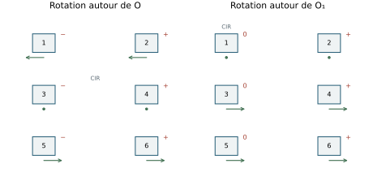
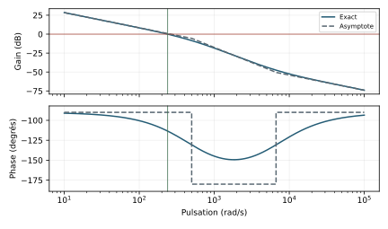
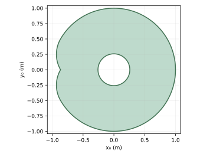
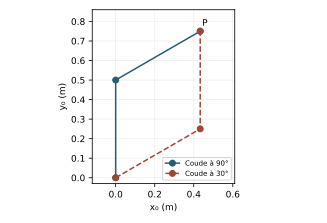
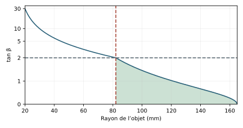

# X-ENS PSI · Sciences industrielles 2017 · Corrigé brut

*Corrigé rédigé par IA, non officiel. Signalez toute erreur.*

**Rédaction** · GPT-6.2 Astra Ultra · vitesse non renseignée · 24 novembre 2026

**Révision** · GPT-6.2 Astra Ultra · vitesse non renseignée · 26 novembre 2026

## 1 · Contexte et présentation

### Question 1.1 · Système volant

Les cendres fines abrasent et encrassent moteurs et propulseurs. Les ascendances chaudes et turbulentes rendent difficile le vol stationnaire précis nécessaire pour saisir un échantillon. Une plateforme roulante peut s'immobiliser en appui pour prélever.

### Question 1.2 · Position des batteries

Une implantation basse abaisse le centre de gravité. En pente, la projection du poids reste plus longtemps dans le polygone de sustentation, ce qui améliore la marge avant basculement.

### Question 1.3 · Phase de vie dimensionnante

Le transport et la manutention contraignent simultanément le gabarit de chargement et la masse de chaque module manipulé.

## 2 · Mobilité sur sol plan

### Question 2.1 · Nombre de Froude

Avec $l_c=1{,}9$ m et $v=0{,}5$ m/s, $Fr=v/\sqrt{gl_c}\simeq0{,}116\ll1$. Même en prenant le diamètre de roue, 0,30 m, on trouve 0,29. Le régime de déplacement lent justifie l'approximation quasi statique à l'échelle de la plateforme.

### Question 2.2 · Vitesses en ligne droite

Avec $R_w=D/2=0{,}15$ m, le roulement sans glissement impose $\omega_r=v/R_w=3{,}33$ rad/s (31,8 tr/min). Comme $r=\omega_r/\omega_m=1/236$, $\omega_m=787$ rad/s, environ 7 510 tr/min.

### Question 2.3 · Roues non directionnelles

La direction différentielle évite une tringlerie de braquage, permet de tourner sur place et conserve une commande motrice individuelle des six roues. En virage, le ripage use les pneus et dissipe de l'énergie. Il rend aussi la trajectoire dépendante du sol.

### Question 2.4 · Vitesse entraînée au contact

$OP_i=a_i x+e_i y-R_w z$. Donc $V(P_i\in S_c/S_0)=v_xx+v_yy+\omega_z z\times OP_i=(v_x-\omega_z e_i)x+(v_y+\omega_z a_i)y$.

### Question 2.5 · Composition roue et châssis

$V(P_i\in S_i/S_c)=\omega_{ri}y\times(-R_w z)=-R_w\omega_{ri}x$. En l'absence de glissement longitudinal, $V(P_i\in S_i/S_0)=v_{gi}y$. Par composition, $V(P_i\in S_c/S_0)=R_w\omega_{ri}x+v_{gi}y$.

### Question 2.6 · Vitesses des six roues

$\omega_{ri}=(v_x-\omega_z e_i)/R_w$ et $v_{gi}=v_y+\omega_z a_i$. La coordonnée longitudinale des roues centrales est $a_i=0$ sur la figure 6.

### Question 2.7 · Rotation autour de O puis de O₁

À $\omega_z>0$, le signe de $\omega_{ri}$ est celui de $-(e_i-e_{centre})$ et celui de $v_{gi}$ est celui de $a_i-a_{centre}$. Sur le DR1, les roues impaires sont à $+e$ et les roues 1 et 2 se trouvent à $+a$. Les couples d'entrées du tableau sont (rotation, glissement suivant $+y$).

| Roue | Centre O | Centre O₁ |
|---|---|---|
| 1 | (−,+) | (0,0) |
| 2 | (+,+) | (+,0) |
| 3 | (−,0) | (0,−) |
| 4 | (+,0) | (+,−) |
| 5 | (−,−) | (0,−) |
| 6 | (+,−) | (+,−) |

### Question 2.8 · Effet du glissement latéral

Le ripage entraîne usure et échauffement du pneumatique, ainsi que des efforts axiaux sur les moyeux. Utiliser des bandes de roulement remplaçables et des roulements dimensionnés pour reprendre les efforts latéraux permet de supporter ces sollicitations.

### Question 2.9 · Deux types de capteurs

Une dynamo tachymétrique transforme une vitesse mécanique continue en tension analogique signée. Elle offre une mesure directe, au prix d'ondulations et de l'usure éventuelle des balais. Un codeur incrémental transforme la rotation en impulsions numériques, deux voies en quadrature donnant le sens. Il nécessite un comptage ou une mesure de période et devient moins précis à bas régime pour une fenêtre fixe. La présence du CAN favorise la dynamo, confirmée ensuite par l'énoncé pour sa robustesse.

### Question 2.10 · Codage de la tension

En binaire décalé, le code médian $32768=\mathtt{8000}$ représente zéro et $\mathtt{A000}=40960$ représente $+2{,}5$ V avec le pas $20/65536$ V. Si l'on impose littéralement $\mathtt{0000}\mapsto-10$ V et $\mathtt{FFFF}\mapsto+10$ V, la loi affine est $-10+20u/65535$. Aucun code n'y donne zéro exactement, $\mathtt{7FFF}$ et $\mathtt{8000}$ l'encadrent à un demi-pas. $\mathtt{A000}$ donne alors +2,50019 V.

### Question 2.11 · Résolution du CAN

En supposant que l'étendue utilisée par le CAN coïncide avec celle du capteur, $\Delta U=(650-(-610))/2^{12}=0{,}3076$ mV par pas. Une pleine échelle différente modifierait ce résultat. La linéarité de ±1 bit donne une indication d'erreur distincte du pas.

### Question 2.12 · Approximation continue linéaire

La période d'acquisition et de calcul doit être petite devant les temps du procédé, afin de négliger échantillonnage, maintien et retard. Le quantum doit être petit devant les variations examinées, en fonctionnement hors saturation et près du régime linéarisé. Les paramètres doivent en outre rester constants sur la durée de l'essai.

### Question 2.13 · Identification du moteur

La figure 8 donne la valeur finale $K_m=0{,}00406$ (rad/s)/V et $0{,}0025578=0{,}630K_m$ à 0,34 ms. Un modèle est donc $H_m(p)=0{,}00406/(1+0{,}00034p)$, le temps étant exprimé en secondes.

### Question 2.14 · Transfert de vitesse de roue

Avec $K_c=1$, $K_{red}=1/236$ et $C_v=K_v$,

$$\frac{\Omega_{roue}}{\Omega_c}=\frac{K_{red}K_vK_m/(1+K_vK_m)}{1+[\tau_m/(1+K_vK_m)]p}.$$

Le gain du réducteur apparaît uniquement au numérateur. Pour exprimer la consigne directement en vitesse de roue il faut inclure le facteur de conversion dans la consigne.

### Question 2.15 · Écarts statiques

Pour un échelon unité de la consigne de vitesse moteur, l'écart permanent relatif vaut $1/(1+K_vK_m)$. Il faut $K_vK_m>99$, donc $K_v>2{,}44\cdot10^4$. Dans la terminologie classique de l'automatique, l'« erreur de position » est celle à l'échelon et l'« erreur de vitesse » celle à la rampe. L'asservissement proportionnel de classe zéro laisse diverger l'erreur à une rampe. Une intégration dans la boucle annule l'erreur à l'échelon et donne une erreur de traînage finie $1/K_{vitesse}$ à la rampe unité (inférieure à 1 % si $K_{vitesse}>100$ dans les unités retenues). Pour annuler aussi cette erreur, il faut deux intégrateurs dans la boucle ouverte et un réglage qui conserve la stabilité.

### Question 2.16 · Position du centre instantané

Quand le CIR est entre les essieux avant et arrière, les deux essieux ripent en sens opposés et le châssis pivote autour d'une zone soutenue par les roues. Un CIR longitudinalement éloigné entraîne un mouvement latéral de même sens des six roues, plus difficile à corriger par les seuls couples moteurs.

### Question 2.17 · Passage au repère fixe

En notant $R(\theta)$ la rotation plane directe, $(\dot X_O,\dot Y_O)^t=R(\theta)(v_x,v_y)^t$. Donc $\dot X_O=v_x\cos\theta-v_y\sin\theta$, $\dot Y_O=v_x\sin\theta+v_y\cos\theta$. En dérivant, $(\ddot X_O,\ddot Y_O)^t=R(\theta)(\dot v_x-\dot\theta v_y,\dot v_y+\dot\theta v_x)^t=R(\theta)(\gamma_x,\gamma_y)^t$.

### Question 2.18 · Coordonnées du CIR

$0=(v_x-\dot\theta y_I)x+(v_y+\dot\theta x_I)y$. Si $\dot\theta\ne0$, $x_I=-v_y/\dot\theta$, $y_I=v_x/\dot\theta$. En translation non nulle le CIR est rejeté à l'infini. À l'arrêt tout point a une vitesse nulle et aucun n'est distingué.

### Question 2.19 · Origine du modèle dynamique

Les deux premières lignes sont les projections de la résultante dynamique sur les axes mobiles $x,y$. La troisième est le moment dynamique autour de $Oz$. $m_0$ est la masse totale et $I_0$ son moment d'inertie de lacet. $F_{xi}$ est l'effort moteur longitudinal, $R_{xi}$ la résistance au roulement et $F_{yi}$ le terme de résistance au glissement latéral, avec les signes du sujet. $M_r$ est le moment résistant de ces deux dernières familles d'efforts autour de $Oz$.

### Question 2.20 · Lois de résistance

Le modèle suppose une résistance au roulement de module $f_rF_{zi}$ dans la direction longitudinale et un frottement de Coulomb glissant de module $\mu F_{zi}$ dans la direction latérale. Les signes des vitesses fixent les sens des efforts résistants. En adhérence à vitesse nulle, Coulomb donne une borne $|F_y|\le\mu F_z$ et le choix d'une loi à signe nul constitue une simplification supplémentaire.

### Question 2.21 · Équation globale dans le repère du sol

Soit $u=(\cos\theta,\sin\theta)^t$, $v=(-\sin\theta,\cos\theta)^t$, $t_i=2\tau_i/D$. Alors $M=\operatorname{diag}(m_0,m_0,I_0)$, la partie plane de $E$ vaut $u\sum t_i$ et $E_3=e(t_2+t_4+t_6-t_1-t_3-t_5)$. La partie plane de $C$ est $u\sum R_{xi}+v\sum F_{yi}$, $C_3=M_r$. Les vitesses dont dépendent ces termes se déduisent de $R(-\theta)(\dot X_O,\dot Y_O)^t$ et des positions des contacts. Les équations de Q2.19 deviennent $M\ddot q+C=E$. À faible nombre de Froude et pour un mouvement suffisamment lent et régulier, l'approximation quasi statique est $C\simeq E$.

### Question 2.22 · Inégalité de maintien du CIR

Pour $v_y\ge0,\dot\theta>0$, $-a<x_I\le0$ impose $v_y-a\dot\theta<0$. Comme $v_y=-\sin\theta\dot X_O+\cos\theta\dot Y_O$, on peut prendre $A=(-\sin\theta,\cos\theta,-a)^t$. Le contrôleur peut estimer l'expression $A^t\dot q$ et adapter la répartition des couples pour rester dans la zone autorisée. À $\dot\theta=0$, le test du CIR fini ne s'applique plus.

## 3 · Terrain accidenté

### Question 3.1 · Mobilité de la plateforme articulée

Avec les contacts ponctuels sans frottement, il subsiste trois mobilités de la plateforme dans le plan horizontal, six rotations propres des roues et trois mobilités internes du châssis. Ces dernières comprennent l'inclinaison de la partie centrale autour de son essieu et les rotations propres des deux bras de liaison autour de leurs directions longitudinales. Au total $m=12$. On peut aussi partir des 6 mobilités du solide central libre et des 12 mobilités de la chaîne ouverte de liaisons internes, puis imposer les six conditions de hauteur des contacts indépendants.

### Question 3.2 · Hyperstatisme de la plateforme

Il y a 11 solides mobiles. Les deux rotules à doigt transmettent 8 composantes, les huit pivots (six roues et deux articulations d'essieu) 40, et les six contacts ponctuels 6, soit 54 inconnues. Alors $h=54-6\times11+12=0$. Cette architecture permet aux six appuis de s'adapter localement aux irrégularités sans incompatibilité géométrique, tant que les débattements et le caractère unilatéral réel des contacts le permettent.

### Question 3.3 · Contacts avec adhérence

Un point matériel de contact sans vitesse relative est modélisé par une rotule instantanée au point de contact. Elle autorise les trois rotations et transmet trois efforts, dont deux tangentiels. On ajoute deux inconnues par roue, soit 12. Il y a alors 66 inconnues pour 66 équations cinétostatiques avant prise en compte des mobilités restantes. Le système admet au minimum la translation par roulement en ligne droite, donc le rang statique est inférieur à 66. Les réactions ne sont pas toutes accessibles sans hypothèses supplémentaires.

### Question 3.4 · Statique de l'ensemble plan

Les six composantes de contact sont inconnues. L'ensemble ne donne que deux équations de résultante et une équation de moment dans le plan. L'isolement global seul est donc insuffisant. Les équations des trois sous-ensembles et une loi de traction peuvent fournir des relations supplémentaires.

### Question 3.5 · Charges sur sol horizontal

Sur sol horizontal au repos sans traction, les lignes d'action des poids des parties extrêmes passent par les contacts respectifs. Le moment en leur articulation intérieure impose $(a-b)(N_{AV}-mg)=0$ et, symétriquement, $N_{AR}=mg$. La résultante verticale globale donne alors $N_C=(2m+M)g-2mg=Mg$. Avec la répartition sans précharge, il vient environ 589, 785 et 589 N.

### Question 3.6 · Basculement global en pente

La symétrie en masse place la projection selon l'axe du châssis au milieu des essieux. La hauteur normale au terrain est $H_G=h+D/2$. La projection verticale du centre se décale vers l'aval de $H_G\tan\alpha$. La limite du polygone d'appui est à $a$ ; il faut $h<a\cot\alpha-D/2$. Au maximum de pente de 40°, la donnée $\tan50°\simeq1{,}2$ donne $h_{lim}\simeq0{,}8\times1{,}2-0{,}15=0{,}81$ m. Les 0,45 m prescrits sont compatibles.

### Question 3.7 · Fermeture par la limite de frottement

Les trois isolements plans fournissent neuf équations. On a six composantes au sol et quatre composantes des deux pivots internes dans ce modèle, donc dix inconnues. HYP1 ajoute $|T_C|=\mu N_C$ avec un signe déterminé par le sens de traction. On peut alors résoudre les dix équations en configuration régulière. Le moment global en $P_C$, avec $x$ orienté vers l'amont, donne $a(N_{AV}-N_{AR})=-(2m+M)g(h+D/2)\sin\alpha$. Les charges normales diffèrent dès que la pente est non nulle, l'arrière aval étant plus chargé.

### Question 3.8 · Trois phases devant une marche

Notons $W=(2m+M)g$, $A=AV$, $C=C$, $B=AR$. Sur les roues au sol horizontal la traction est vers $+x$, la normale vers $+z$. Sur le flanc, la normale est vers $-x$ et la traction vers $+z$. Les six équations sont :

| Ensemble sur le flanc | Résultante selon x | Résultante selon z |
|---|---|---|
| Avant | $T_C+T_B-N_A=0$ | $T_A+N_C+N_B=W$ |
| Central | $T_A+T_B-N_C=0$ | $N_A+T_C+N_B=W$ |
| Arrière | $T_A+T_C-N_B=0$ | $N_A+N_C+T_B=W$ |

### Question 3.9 · Lecture des efforts de franchissement

Les trois phases correspondent respectivement à 1–2 s, 3–4 s et 5–6 s. Sur 0–1, 2–3, 4–5 et 6–7 s, les six roues sont sur des appuis horizontaux, avec des niveaux différents pour les essieux déjà montés. Les sauts proviennent du changement instantané de face de contact dans le modèle à arête vive et de l'imposition d'une nouvelle condition de traction. La colonne de droite de l'annexe 2 imprime « 0,2 » alors que le texte annonce 2. Sur la roue avant au premier franchissement, on lit environ 450 N tangentiels pour 225 N normaux, donc le rapport dessiné vaut bien 2.

### Question 3.10 · Échec à faible adhérence

Avec $\mu=0{,}5$, la paire en montée est déjà à la limite par construction. Par exemple, dans la troisième phase, l'annexe donne à la paire avant environ $T_{AV}=760$ N pour $N_{AV}=400$ N. La traction disponible y est au plus 200 N. Le roulement sans glissement des autres roues, nécessaire à cette solution statique, est impossible. HYP2 ne permet donc pas le franchissement étudié à cette adhérence.

### Question 3.11 · Couple nécessaire sur une roue

Avec les sens positifs de la figure 16, $C_m-M_r-TD/2=0$, donc $C_m=kN+(D/2)T$. La résistance au roulement et le moment de la traction doivent tous deux être fournis.

### Question 3.12 · Dimensionnement des couples

La plus grande valeur est environ 120 N·m pour l'ensemble arrière entre 3 et 4 s. Avec partage égal droite/gauche, c'est 60 N·m par roue en sortie de réduction, hors facteur de dimensionnement. Le couple à l'arbre du moteur dépend ensuite du rapport et du rendement. HYP2 force une paire à la limite de glissement sans rechercher la meilleure répartition. Le maximum dimensionne cette stratégie particulière et peut être excessif pour une commande optimisée.

### Question 3.13 · Recherche de la répartition

Pour chaque posture de la montée, établir les équations statiques des trois ensembles et les relations $C_i=kN_i+R_wT_i$. Imposer $N_i\ge0$ et $-\mu N_i\le T_i\le\mu N_i$ avec les normales locales. Chercher parmi les solutions celle qui minimise $\sum_i\max(0,C_i\omega_i)$ pour des moteurs non régénératifs, ou la puissance électrique compte tenu des rendements connus. Pour une linéarisation à vitesses fixées, introduire $s_i\ge0$, $s_i\ge C_i\omega_i$ et minimiser $\sum_i s_i$. En cas d'infaisabilité la posture ne satisfait pas les contraintes. Transmettre les couples optimaux puis réévaluer à la posture suivante. Le modèle idéal à puissance nette constante peut laisser plusieurs répartitions optimales, que l'on départage par le plus petit couple maximal.

### Question 3.14 · Approximation du moteur pour la traction

Dans $(R+Lp)(f+Jp)+K_cK_e$, négliger l'inductance nécessite $|L\omega|\ll R$ sur la bande étudiée. Les pertes visqueuses sont petites si $Rf\ll K_cK_e$ et $Lf\ll RJ$ pour le coefficient linéaire. Le transfert se ramène alors à $K_c/(K_cK_e+RJp)$, compatible avec la forme du premier ordre identifiée.

### Question 3.15 · Transfert avec PI seul

Pour $K=K_{fb}, I=I_{fb}$, la boucle ouverte vaut $L_0=0{,}265(Kp+I)/[p(0{,}4p+200)]$. La boucle fermée est

$$H=\frac{0{,}265(Kp+I)}{0{,}4p^2+(200+0{,}265K)p+0{,}265I}.$$

Son gain statique est 1 pour $I>0$.

### Question 3.16 · Contraintes de dépassement et de rapidité

$\omega_n=\sqrt{0{,}265I/0{,}4}$ et $\zeta=(200+0{,}265K)/(2\sqrt{0{,}4\cdot0{,}265I})$. Imposer $I>0$, $200+0{,}265K>0$. Quand le zéro $-I/K$ est très au-delà de la bande, la figure 19 permet d'imposer $\zeta>0{,}690$ (dépassement inférieur à 5 %) et $f_5(\zeta)/\omega_n<0{,}009$ s, où $f_5=\omega_nt_{5\%}$ est lu sur l'abaque. Ces deux inégalités portent directement sur $K,I$ après substitution. Un choix voisin de $\zeta=0{,}7$ exige une pulsation propre de l'ordre de $3/0{,}009=333$ rad/s ou plus. Si le zéro n'est pas négligeable, il faut contrôler les deux inégalités sur la réponse complète de Q3.15.

Pour contrôler directement le modèle avec son zéro, posons $b=(200+0{,}265K)/0{,}4$, $c=0{,}265I/0{,}4$. Pour un échelon unité, la transformée de l’erreur $1-C_s(t)$ est $(p+500)/(p^2+bp+c)$. Si $c>b^2/4$, elle vaut donc dans le temps $e(t)=e^{-bt/2}[\cos(\omega_d t)+(500-b/2)\sin(\omega_d t)/\omega_d]$, avec $\omega_d=\sqrt{c-b^2/4}$. On contrôle le dépassement en cherchant le minimum de $e$ et le temps de réponse par le dernier passage de $|e|$ à $0{,}05$.

### Question 3.17 · Vérification numérique du réglage

Pour $K=30$, $I=200000$, on calcule $\omega_n=364{,}0$ rad/s et $\zeta=0{,}7141$. Le modèle canonique sans zéro donne un dépassement de 4,06 % et $t_{5\%}\simeq8{,}13$ ms. La réponse avec le zéro de Q3.15 donne 4,06 % et 7,98 ms. Les deux critères sont satisfaits.

### Question 3.18 · Bode du retour seul

La boucle ouverte est $L_0(p)=265(1+p/6667)/[p(1+p/500)]$. Le gain asymptotique a les pentes successives −20, −40, −20 dB/décade, avec cassures à 500 et 6 667 rad/s. À basse fréquence il vaut $20\log_{10}(265/\omega)$. La phase est $-90°-\arctan(\omega/500)+\arctan(\omega/6667)$ avec les arcs tangentes exprimés en degrés. Le passage unité exact est à 239 rad/s et la marge de phase est voisine de 66,5°. Aucune pulsation finie ne donne −180°, donc la marge de gain du modèle est infinie.

### Question 3.19 · Transfert avec l'anticipation

La commande du moteur vaut $C_{fb}(C_c-C_s)+C_{ff}C_c$. En multipliant par $H_{mot}$ et en regroupant,

$$\frac{C_s}{C_c}=\frac{H_{mot}(C_{fb}+C_{ff})}{1+H_{mot}C_{fb}}.$$

L'anticipation n'entre pas dans le polynôme caractéristique.

### Question 3.20 · Anticipation inverse

Avec $C_{ff}=1/H_{mot}$, le numérateur devient exactement le dénominateur, donc $C_s/C_c=1$ dans le modèle idéal. L'anticipation compense la dynamique nominale. Ici l'inverse d'un premier ordre strictement propre contient une dérivation pure, qui réclame une impulsion à l'échelon et amplifie les hautes fréquences. Saturation, bruit et imprécisions de modèle limitent la réalisation.

### Question 3.21 · Effet du gain d'anticipation

Lorsque le gain passe de 10 à 100 puis 250, la première montée est plus rapide et le pic croît jusqu'à environ 5 %. Avec 500, le pic atteint environ 9,5 % et la réponse ne rentre durablement dans la bande que vers 12 ms malgré la montée la plus rapide. Le plateau final reste à 1 grâce au PI. Un gain modéré, par exemple 100, conserve sur ces tracés les deux critères. 250 est à la limite sur le dépassement.

## 4 · Bras manipulateur

### Question 4.1 · Enveloppe du bras

Avec $l_1=l_2=l=0{,}50$ m, le point complexe du plan de travail est $z=l e^{i\theta_1}(1+e^{i\theta_2})$. Sa distance à l'axe est $\rho=2l\cos(\theta_2/2)$ et son argument $\varphi=\theta_1+\theta_2/2$. Pour $\beta=\arccos(\rho/(2l))$, il faut $0\le\beta\le75°$. À rayon fixé l'union des domaines de $\theta_1\in[-150°,150°]$ pour $\theta_2=\pm2\beta$ donne $|\varphi|\le\min(180°,150°+\beta)$ en angle principal. Le rayon intérieur est 0,259 m et le rayon extérieur 1 m. La zone arrière se rétrécit pour $\rho>0{,}866$ m : la base n'est pas un disque. La translation indépendante de la tige extrude cette base entre les deux hauteurs de course.

### Question 4.2 · Position et vitesse directes

Écrivons $s=\theta_1+\theta_2$. Alors $x_P=l_1\cos\theta_1+l_2\cos s$, $y_P=l_1\sin\theta_1+l_2\sin s$, $z_P=d_1+d_2-\lambda_3$. En notant $y_i$ la direction tangentielle du bras $i$, $V_P=l_1\dot\theta_1 y_1+l_2\dot s\,y_2-\dot\lambda_3 z_0$. Pour les composantes fixes, remplacer $y_1$ par $(-\sin\theta_1,\cos\theta_1,0)$ et $y_2$ par $(-\sin s,\cos s,0)$.

### Question 4.3 · Vitesse maximale dans le plan

Pour $|\dot\theta_j|\le\omega_{max}$ aux articulations, $\|V_{P,xy}\|\le l_1\omega_{max}+2l_2\omega_{max}$. Lorsque $\theta_2=0$, les deux tangentes coïncident. En commandant les deux articulations à même vitesse maximale de même signe, on atteint $V_{max}=(l_1+2l_2)\omega_{max}$. Si la vitesse est donnée avant réducteur, la convertir d'abord à l'articulation.

### Question 4.4 · Commande de la glissière

$\lambda_3=d_1+d_2-z_P$ et $\dot\lambda_3=-V_{zP}$. Une augmentation de course abaisse la pince.

### Question 4.5 · Les deux postures du bras

Les positions compatibles de $O_2$ sont les intersections des cercles de centres $O_1,P$ et rayons $l_1,l_2$. Sauf tangence et butées, elles sont au nombre de deux. Ici la posture $(90°,-60°)$ conduit à un second segment d'angle absolu $30°$. Les bras égaux sont échangés par réflexion autour de la direction $60°$ de $O_1P$. La posture complémentaire est donc **$(30°,+60°)$** ; elle atteint le même point $P=(\sqrt3/4,3/4)$ m.

### Question 4.6 · Angle du coude

$x_P^2+y_P^2=l_1^2+l_2^2+2l_1l_2\cos\theta_2$. Donc $\theta_2=\pm\arccos[(x_P^2+y_P^2-l_1^2-l_2^2)/(2l_1l_2)]$, dans les butées. La distance détermine le cosinus et la valeur absolue de l'angle. Son signe correspond aux deux postures de Q4.5.

### Question 4.7 · Inertie d'un bras

Les trois plans médians sont des plans de symétrie du parallélépipède homogène. Les produits d'inertie sont donc nuls. L'échange des deux dimensions transversales laisse la masse inchangée, d'où $I(G_i)=\operatorname{diag}(A_i,B_i,B_i)$ dans la base du bras. On note $J_i=B_i$ son moment d'inertie autour de la verticale en $G_i$.

### Question 4.8 · Hyperstatisme du bras

Deux pivots et une glissière transmettent $3\times5=15$ composantes. Il y a trois mobiles spatiaux, trois degrés de liberté et aucune boucle. Donc $h=15-18+3=0$. Pour des mouvements imposés, des chargements connus et hors ambiguïté sur les actionneurs, les équations de la dynamique déterminent les réactions.

### Question 4.9 · Vitesses et accélérations

Posons $c_i=l_i/2$, $s=\theta_1+\theta_2$, $A_1=\ddot\theta_1 y_1-\dot\theta_1^2 x_1$, $A_2=\ddot s\,y_2-\dot s^2 x_2$. On obtient

$$V_{G_1}=c_1\dot\theta_1y_1,\quad a_{G_1}=c_1A_1,\qquad V_{G_2}=l_1\dot\theta_1y_1+c_2\dot s\,y_2,\quad a_{G_2}=l_1A_1+c_2A_2.$$

Pour la pince, $V_P=l_1\dot\theta_1y_1+l_2\dot s\,y_2-\dot\lambda_3z_0$ et $a_P=l_1A_1+l_2A_2-\ddot\lambda_3z_0$.

### Question 4.10 · Couple de la deuxième articulation

Sur cet axe, le pivot ne transmet aucun moment passif, les poids n'en créent pas et la commande en translation est interne. Sommer la dérivée de rotation propre $J_2\ddot s$ et les moments $O_2G_2\times m_2a_{G_2}$, $O_2P\times m_3a_P$. Avec $B=J_2+m_2c_2^2+m_3l_2^2$ et $H=l_1(m_2c_2+m_3l_2)$, on trouve

$$\tau_2=B(\ddot\theta_1+\ddot\theta_2)+H(\ddot\theta_1\cos\theta_2+\dot\theta_1^2\sin\theta_2).$$

L'accélération verticale de la pince ne contribue pas au moment projeté sur $z_0$.

### Question 4.11 · Modèle dynamique complet

Avec $B,H$ de Q4.10, posons $A=J_1+m_1c_1^2+(m_2+m_3)l_1^2$, $h=H\sin\theta_2$, $s=\theta_1+\theta_2$. L'énergie cinétique est $[A\dot\theta_1^2+B\dot s^2+2H\cos\theta_2\dot\theta_1\dot s+m_3\dot\lambda_3^2]/2$ et la partie variable de l'énergie de pesanteur est $-m_3g\lambda_3$. Dans $M\ddot q+C\dot q+N=(\tau_1,\tau_2,F_3)^t$, on peut prendre

$$M=\begin{pmatrix}A+B+2H\cos\theta_2&B+H\cos\theta_2&0\\B+H\cos\theta_2&B&0\\0&0&m_3\end{pmatrix},\quad C=\begin{pmatrix}-h\dot\theta_2&-h(\dot\theta_1+\dot\theta_2)&0\\h\dot\theta_1&0&0\\0&0&0\end{pmatrix},\quad N=\begin{pmatrix}0\\0\\-m_3g\end{pmatrix}.$$

Le signe de $F_3$ est celui d'une action positive dans le sens de $\lambda_3$, donc vers le bas.

### Question 4.12 · Découplage vertical

Les deux équations angulaires ne dépendent ni de $\lambda_3$ ni de ses dérivées. La troisième, $m_3\ddot\lambda_3-m_3g=F_3$, ne dépend d'aucun angle. Sous les hypothèses d'axes verticaux, de tige en translation pure et de masse constante, les évolutions horizontale et verticale sont donc découplées.

### Question 4.13 · Limites de validité

Un châssis incliné donne au poids des composantes dans le plan des rotations. Un châssis accéléré exige les termes d'entraînement d'un référentiel non galiléen. Des déformations du bras ou des jeux de transmission modifient les positions et la dynamique. Une variation de la charge exige également une nouvelle valeur de $m_3$.

### Question 4.14 · Couple de levage sur la vis

Pour une levée avec accélération maximale en module, l'effort minimal idéal est $m_3(g+\ddot\lambda_{3,max})$. Sur un tour de vis à un filet, $2\pi C=Fp$. Le couple moteur en prise directe est donc au moins $m_3(g+\ddot\lambda_{3,max})p/(2\pi)$, en négligeant les inerties tournantes et les pertes. Pour un rendement $\eta$, diviser cette valeur par $\eta$.

### Question 4.15 · Vitesses et accélérations nulles aux extrémités

La vitesse nulle permet de démarrer et de terminer à l'arrêt. Une accélération nulle à ces deux instants évite d'imposer un saut du couple inertiel au raccord et limite les vibrations et les sollicitations de l'objet saisi.

### Question 4.16 · Loi polynomiale à cinq degrés

Pour $\theta_i=A_it^5+B_it^4+C_it^3$, position, vitesse et accélération s'annulent à $t=0$. À $T=2$ s, imposer $\theta_i(T)=\theta_{i,f}$, $\dot\theta_i(T)=0$, $\ddot\theta_i(T)=0$ : ceci donne trois équations linéaires pour les trois coefficients. Explicitement $\theta_i=\theta_{i,f}(10u^3-15u^4+6u^5)$ avec $u=t/T$, ce qui permet de vérifier les conditions directement.

### Question 4.17 · Choix entre les deux trajectoires

Dans l'annexe 4, la configuration 1 demande environ 12 N·m et jusqu'à 10–11 W à l'axe le plus sollicité. La configuration 2 ramène le couple maximal à environ 11 N·m et les puissances crêtes vers 3 à 3,5 W. On retient donc **la configuration 2**, qui limite aussi la rotation du premier axe à 30°.

### Question 4.18 · Motoréducteur commun aux deux axes

La loi quintique a $\max\dot u_{profil}=1{,}875/T$ pour un déplacement unitaire. Pour le plus grand angle de la configuration 2, 60° en 2 s, le pic est 56,25°/s, soit 9,38 tr/min. Le **TRI/0169** délivre 17 N·m nominaux à 16 tr/min en charge. Le modèle précédent TRI/0093 offre 9,30 N·m, inférieur au besoin de l'axe 1. Le TRI/0169 satisfait les deux axes sur les chiffres du catalogue.

## 5 · Préhension

### Question 5.1 · Géométrie d'un doigt

Le triangle a $CE=EH=l_2$ et $CH$ vertical. Ainsi $\alpha+\beta=90°$. La distance entre la ligne de $C$ et celle de $D$ est $l_4\cos\beta$, tandis que $D$ est décalé de $l_5+l_6$ par rapport à la surface de l'objet. La géométrie donne $R=d+l_4\cos\beta-l_5-l_6$. Donc $\beta=\arccos[(R-d+l_5+l_6)/l_4]$, $\alpha=\pi/2-\beta$.

### Question 5.2 · Contact équivalent mors-objet

La rotule en $Q$ et la liaison linéaire rectiligne sans frottement en $S$ sont en série. Leur torseur transmissible commun est une force suivant $y_P$, sa droite d'action passant par $Q$ et $S$ car $QS$ est colinéaire à $y_P$. On obtient un contact ponctuel équivalent de normale $y_P$ (en $S$ par exemple).

### Question 5.3 · Hyperstatisme du modèle plan de serrage

Le doigt équivalent contient cinq mobiles. Sept liaisons planes à un degré de liberté (glissière et six pivots) donnent 14 inconnues de réaction ; le contact normal avec l'objet fixé en donne une quinzième. En configuration régulière et contact fermé, le mouvement de fermeture est bloqué, $m=0$. Avec 15 équations planes, $h=15-15=0$. Avant prise de contact, le doigt seul a une mobilité et reste isostatique.

### Question 5.4 · Directions des forces en B et E

La biellette 4 est soumise aux deux pivots $A,B$, donc la force en $B$ se porte sur la droite $AB$. La tige 2 est soumise aux forces en $H,E$, donc la force en $E$ se porte sur $HE$. Le sens dépend du chargement.

### Question 5.5 · Transmission de la poussée

Avec $x_P$ orienté vers le bas, la variation de position du vérin vaut $dx_H=2l_2\cos\beta\,d\beta$. La translation du mors donne $dx_S=l_4\cos\beta\,d\beta$ et $dy_S=l_4\sin\beta\,d\beta$. L'action de l'objet sur le mors est $F_s^x x_P-F_s^y y_P$. La somme des travaux virtuels est $F_pdx_H+F_s^x dx_S-F_s^y dy_S=0$. Ainsi

$$F_p=K(\tan\beta F_s^y-F_s^x),\qquad K=\frac{l_4}{2l_2}=0{,}75.$$

$L_5$ décale le contact d'un vecteur constant sur un mors sans rotation et disparaît donc des déplacements virtuels. On peut adapter la longueur du mors à l'objet sans changer cette loi idéale de transmission.

### Question 5.6 · Influence du rayon

Avec les longueurs en mm, $\cos\beta=(R-15)/150$. À $R=20$ mm, $\tan\beta\simeq30$, très grand et très sensible au rayon. Il décroît vers zéro pour $R=165$ mm. Pour un effort tangentiel fixé, le besoin de poussée est donc particulièrement élevé sur les petits objets ; à l'autre extrémité on approche une configuration singulière du mécanisme.

### Question 5.7 · Maintien sans poussée

Avec $F_p=0$, Q5.5 impose $F_s^x/F_s^y=\tan\beta$. L'adhérence est possible si $\tan\beta\le f$. Comme ce rapport décroît avec $R$, la limite est

$$R_{min}=d-l_5-l_6+\frac{l_4}{\sqrt{1+f^2}}.$$

Pour $f=2$, $R_{min}=15+150/\sqrt5=82{,}1$ mm. Le serrage auto-entretenu sous charge économise l'effort moteur permanent. Il peut toutefois rendre la libération plus difficile, et dépend de l'adhérence réelle du matériau.

### Question 5.8 · Poussée nécessaire sur les petits objets

Avec une prise symétrique, $F_s^x=m_{objet}g/3$. Il faut $F_s^y\ge m_{objet}g/(3f)$. Q5.5 donne $F_p=K(\tan\beta F_s^y-m_{objet}g/3)$. À la limite de glissement, $F_p=K(\tan\beta-f)F_s^y=K m_{objet}g(\tan\beta/f-1)/3$. Dans le domaine $R<R_{min}$ le maximum dimensionnant est atteint avec $R=20$ mm et $m_{objet}=2{,}5$ kg, soit environ **86 N par doigt** pour $f=2$. Si un seul vérin fournit simultanément les trois poussées identiques représentées dans le modèle d'un doigt, il doit fournir environ **257 N** au total, hors pertes.

### Question 5.9 · Intérêt d'une régulation d'effort

Une consigne de force permet de maintenir une prise suffisante face à un changement de position ou de rigidité et d'éviter d'écraser l'objet. Le capteur ferme la boucle sur la grandeur qui intervient directement dans l'adhérence.

### Question 5.10 · Fonction de transfert en effort

Soit $G=K_rK_{ve}K_\beta$, $F=F_s^y$, $\Omega$ la sortie du bloc mécanique. La figure 25 donne $F=G\Omega/p$ et, pour $P_F=0$, $J_{eq}p\Omega=K_t[C_f(F_c-F)-K_e\Omega]/R-F/G$. En éliminant $\Omega$,

$$\frac{F}{F_c}=\frac{K_t C_fG}{RJ_{eq}p^2+K_tK_ep+R+K_t C_fG}.$$

Poser $D_0=R+K_t C_fG$. Alors $K=K_t C_fG/D_0$, $A=K_tK_e/D_0$ et $B=RJ_{eq}/D_0$. En unités SI, $K_e=86/(1000\cdot2\pi/60)=0{,}821$ V·s/rad, donc $K_tK_e=0{,}673$ et $RJ_{eq}=0{,}002484$. Le schéma est utilisé avec les gains tels qu'ils y figurent.

### Question 5.11 · Gain pour 1 % d'écart

L'écart permanent relatif vaut $1-K=R/(R+K_t C_fG)$. Il faut **$C_f>99R/(K_tK_rK_{ve}K_\beta)$**. Si le bloc vis reçoit des radians et donne des mètres, le pas de 4 mm/tour correspond à $K_{ve}=0{,}004/(2\pi)$ m/rad et la substitution dans le schéma donne $C_f>3{,}79\cdot10^5$ en unités de ce modèle. Si l'on substitue directement $K_{ve}=0{,}004$ comme gain numérique du bloc, le seuil est $6{,}04\cdot10^4$. Il faut préciser la conversion de la rotation et l'étalonnage déplacement–effort, absent des caractéristiques physiques détaillées : la valeur du gain dépend de cette normalisation.

### Question 5.12 · Pourquoi l'intégrateur ne supprime pas l'écart

La sortie est renvoyée par le gain $1/G$ au sommateur des couples. Cette boucle refermée sur la position élimine le pôle à l'origine de la plante vue par le correcteur externe. Pour tenir un effort constant, le moteur doit produire un couple permanent. Le correcteur proportionnel ne le produit qu'en présence d'un écart permanent.

### Question 5.13 · Sensibilité aux perturbations

Avec les signes imprimés de la figure 25, la perturbation entre finalement en addition au couple moteur. On trouve

$$\frac{F}{P_F}=\frac{R G}{RJ_{eq}p^2+K_tK_ep+R+K_t C_fG}.$$

Un échelon de perturbation apporte un décalage permanent $RG P_F/D_0$. L'écart total dépend donc du niveau et du signe de la perturbation, et le dimensionnement de Q5.11 ne suffit pas à garantir 1 % pour toute perturbation.

### Question 5.14 · Rôle du gain géométrique

$K_\beta$ intervient dans $G$, donc dans le gain statique, la dynamique et le rejet des perturbations. À la limite d'adhérence de Q5.8, $K_\beta=1/[K(\tan\beta-f)]$ dans la plage considérée. Il dépend du rayon et du coefficient de frottement. Même à rayon fixé la loi peut changer si le chargement tangentiel ou l'état de contact change.

### Question 5.15 · Mesure indirecte

On peut mesurer le courant, estimer le couple $K_t i$, retirer les termes d'inertie et les pertes, convertir le couple de vis en poussée en tenant compte du pas, du rapport et du rendement, puis appliquer la relation géométrique du doigt. Une mesure d'ouverture renseigne le rayon et $\beta$. Cela ferme une boucle sur une estimation de la force. La précision dépend de la charge, du frottement et de l'étalonnage de la transmission.

### Question 5.16 · Détecter un début de glissement

Un capteur de rotation sur le galet ou une observation optique de la surface peut détecter le départ en glissement. À partir d'un petit déplacement relatif persistant, augmenter progressivement la consigne de serrage jusqu'à disparition du mouvement, dans les limites admissibles de l'objet et du vérin. Cette rétroaction utilise la conséquence du manque d'adhérence même lorsque $f$ est mal connu.
