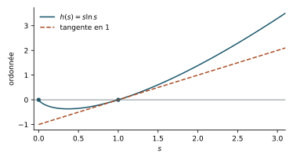

# École polytechnique · MP · Mathématiques B 2017 · Corrigé guidé

*Corrigé rédigé par IA, non officiel. Signalez toute erreur.*

**Rédaction** · GPT-6.2 Astra Ultra · vitesse non renseignée · 24 novembre 2026

**Révision** · GPT-6.2 Astra Ultra · vitesse non renseignée · 26 novembre 2026

Le sujet relie l’entropie relative, la variance et la concentration d’une mesure sur la droite. Le rapport insiste sur les justifications d’intégrabilité et sur la constante exacte dans 7c. Les arguments de domination ci-dessous précisent pour quelle mesure ils sont valables.

## Préliminaires · Variance et entropie

### Question 1

> [!INDICATION]
> Appliquer Cauchy–Schwarz pour la mesure de probabilité.

#### Solution

Écrivons $E_m u=\int_{\mathbb R}u(x)m(x)\,dx$. Comme $E_m1=1$, Cauchy–Schwarz donne $E_m|f|\le(E_m f^2)^{1/2}<\infty$. Ainsi $|E_m f|^2\le E_m f^2$, et $\operatorname{Var}_m(f)=E_m f^2-(E_m f)^2\ge0$.

### Question 2a

> [!INDICATION]
> Séparer les petites valeurs de $f^2$ et celles qui dépassent $e$.

#### Solution

Pour $s\ge e$, $s\le s\ln s=h(s)$. Pour $0\le s<e$, on a $s\le e$. D’où $0\le f^2\le e+|h(f^2)|$. Le majorant est intégrable contre $m$, donc $E_m f^2$ est fini.

### Question 2b

> [!INDICATION]
> Étudier la différence à la tangente et évaluer séparément le bord.

#### Solution

Pour $a>0$, $h'(a)=1+\ln a$. Pour $s>0$ l’écart à la tangente est $s\ln(s/a)-s+a$, de dérivée $\ln(s/a)$. Son unique minimum est zéro, atteint en $a$. Au point $s=0$, l’écart vaut $a>0$. Cela établit la stricte inégalité en tout point différent de $a$.

### Question 2c

> [!INDICATION]
> L’argument de la tangente doit être strictement positif.

#### Solution

Posons $a=E_m f^2$. Si $a=0$, $f=0$ presque partout pour $m(x)dx$ et les deux termes de l’entropie sont nuls. Si $a>0$, en intégrant 2b en $s=f^2$ on trouve $E_m h(f^2)\ge h(a)+h'(a)E_m(f^2-a)=h(a)$. L’entropie est positive ou nulle.

### Question 2d

> [!INDICATION]
> Passer de l’égalité presque partout à l’égalité partout, puis examiner le signe.

#### Solution

Pour $a>0$, l’écart de 2b appliqué à $f^2$ est continu et positif ou nul. Si son intégrale est nulle et $m$ strictement positive partout, cet écart s’annule partout, car toute valeur strictement positive persisterait sur un intervalle de masse positive. Donc $f^2=a$ partout. Pour $a=0$, le même raisonnement appliqué à $f^2$ donne $f=0$. Enfin une fonction continue sur la droite et à valeurs dans $\{-\sqrt a,\sqrt a\}$ est constante. Réciproquement, toute constante a une entropie nulle.

## I. Opérateur gaussien et rotation

### Question 3a

> [!INDICATION]
> Dériver explicitement la densité gaussienne.

#### Solution

La densité $\mu(x)=\pi^{-1/2}e^{-x^2}$ satisfait $\mu'=-2x\mu$. Ainsi $(\mu f')'/(2\mu)=f''/2-xf'=Lf$.

### Question 3b

> [!INDICATION]
> Travailler sur un intervalle borné et contrôler le terme de bord ainsi que les valeurs absolues.

#### Solution

Si $h_1,h_2\in C_b^2$, le membre de gauche est absolument intégrable puisque $|h_1 Lh_2|\le K(1+|x|)$ et la gaussienne a un premier moment absolu fini. Le produit des dérivées est borné. Par 3a, une intégration par parties sur $[-R,R]$ donne $\int h_1Lh_2\mu=\tfrac12[h_1\mu h_2']_{-R}^R-\tfrac12\int h_1'h_2'\mu$ sur cet intervalle. Le terme de bord tend vers zéro car $h_1,h_2'$ sont bornées et $\mu$ tend vers zéro. Le passage à la limite donne la formule.

### Question 4

> [!INDICATION]
> Utiliser un majorant de l’intégrande uniforme en les deux paramètres.

#### Solution

Notons $z=x\cos t+y\sin t$. Pour $f$ continue bornée, $|f(z)\mu(y)|\le\|f\|_\infty\mu(y)$, intégrable. L’intégrale qui définit $\Phi_f(t,x)$ existe. Pour chaque $y$, son intégrande dépend continûment de $(t,x)$, donc la convergence dominée donne la continuité sur $\mathbb R^2$.

### Question 5a

> [!INDICATION]
> Distinguer la domination sur les compacts en $x$ et la borne globale de la dérivée seconde.

#### Solution

Écrivons $c=\cos t$, $s=\sin t$. Les dérivées de l’intégrande avant multiplication par $\mu(y)$ sont $c f'(z)$, $(-xs+yc)f'(z)$ et $c^2 f''(z)$ pour $\partial_x,\partial_t,\partial_{xx}$. Sur $|x|\le R$ leurs modules sont dominés par une constante fois $1+R+|y|$. Ce majorant est intégrable contre $\mu$, et les intégrandes sont continues. La dérivation sous l’intégrale donne les dérivées continues annoncées, avec de plus $|\partial_{xx}\Phi_f|\le\|f''\|_\infty$ partout.

### Question 5b

> [!INDICATION]
> Sortir le facteur indépendant de la variable intégrée.

#### Solution

La première formule de 5a donne $\partial_x\Phi_f(t,x)=\cos t\,\Phi_{f'}(t,x)$, y compris lorsque $\cos t=0$.

### Question 5c

> [!INDICATION]
> Remplacer le facteur $y$ par une dérivée de la densité avant d’intégrer par parties.

#### Solution

Avec les notations de 5a, $\int yf'(z)\mu(y)dy=\tfrac s2\int f''(z)\mu(y)dy$, par $y\mu=-\mu'/2$ et disparition du terme de bord puisque $f'$ est bornée. Ainsi $\partial_t\Phi_f=-xs\Phi_{f'}+(cs/2)\Phi_{f''}$. En multipliant par $c$, puis en utilisant $\partial_{xx}\Phi_f=c^2\Phi_{f''}$ et 5b, on obtient $c\partial_t\Phi_f=sL\Phi_f$ sans jamais diviser par $c$.

### Question 5d

> [!INDICATION]
> Faire apparaître l’invariance par rotation dans l’intégrale sur le plan.

#### Solution

Le produit $\mu(x)\mu(y)=\pi^{-1}e^{-(x^2+y^2)}$ est radial. Le changement orthogonal $(u,v)=(cx+sy,-sx+cy)$ a jacobien de valeur absolue un et conserve $x^2+y^2$. Par Fubini, licite car $f$ bornée et le produit des densités intégrable, $\iint f(cx+sy)\mu(x)\mu(y)dxdy=\iint f(u)\mu(u)\mu(v)dudv=E_\mu f$.

## II. Inégalité logarithmique de Sobolev

### Question 6

> [!INDICATION]
> Borner $h$ sur l’image compacte et examiner les deux angles extrêmes.

#### Solution

Comme $0\le\Phi_f\le\|f\|_\infty$, $h(\Phi_f)$ est uniformément bornée par continuité de $h$ sur ce segment. Avec 4, la convergence dominée donne la continuité de $J$. Pour $t=0$, $\Phi_f=f(x)$ et $J(0)=E_\mu h(f)$. Pour $t=\pi/2$, $\Phi_f=E_\mu f$ est constante, d’où $J(\pi/2)=h(E_\mu f)$.

### Question 7a

> [!INDICATION]
> Dériver l’entropie et déplacer l’opérateur gaussien sur la dérivée de $h$.

#### Solution

Notons $U=\Phi_f$. On a $\delta\le U\le\|f\|_\infty$, donc $h'$ et ses deux dérivées sont bornées sur l’image de $U$. D’après 5a, $|\partial_tU|\le K(1+|x|)$. Cela justifie la dérivation continue sous l’intégrale en $t$. Par 5c, $J'(t)\cos t=\sin t\,E_\mu[h'(U)LU]$. À $t$ fixé, $U$ et $h'(U)$ appartiennent à $C_b^2$ car les deux premières dérivées spatiales de $U$ sont bornées. Par 3b et $h''(v)=1/v$, il vient $J'(t)\cos t=-(\sin t/2)E_\mu[(\partial_x U)^2/U]$.

### Question 7b

> [!INDICATION]
> Factoriser la dérivée à l’aide de la racine de $f$.

#### Solution

Écrivons $f'(z)=\sqrt{f(z)}\, f'(z)/\sqrt{f(z)}$. Les deux facteurs sont bornés car $f\ge\delta$. Cauchy–Schwarz pour $\mu(y)dy$ donne $(\Phi_{f'})^2\le\Phi_f\,\Phi_{(f')^2/f}=\Phi_f\Phi_g$.

### Question 7c

> [!INDICATION]
> Conserver le facteur trigonométrique qui apparaît à la différentiation spatiale.

#### Solution

Pour $0\le t<\pi/2$, en combinant 7a, 5b et 7b, $-J'(t)\le(\sin t\cos t/2)E_\mu\Phi_g=(\sin t\cos t/2)E_\mu g$. La dernière égalité suit de 5d pour $g$ continue bornée. On intègre jusqu’à $\pi/2$ par continuité en l’extrémité. L’intégrale de $\sin t\cos t/2$ vaut $1/4$. La différence $J(0)-J(\pi/2)$ de 6 donne l’inégalité voulue.

Pour préciser le passage à l’extrémité, intégrons d’abord jusqu’à $b<\pi/2$. Alors
$$
J(0)-J(b)\le\tfrac14\sin^2(b)\,E_\mu g.
$$
La continuité de $J$ établie en Q6 autorise ensuite $b\uparrow\pi/2$ et donne le coefficient $1/4$.

### Question 8

> [!INDICATION]
> Approcher $f^2$ par des fonctions strictement positives, en contrôlant séparément les deux membres.

#### Solution

Pour $f\in C_b^2$, $h(f^2)$ est bornée donc intégrable. Appliquons 7c à $F_\delta=\delta+f^2$ qui appartient à $C_b^2$ et est minorée par $\delta$. Le membre droit est $E_\mu[f^2(f')^2/(\delta+f^2)]\le E_\mu(f')^2$. Pour $0<\delta\le1$, les arguments de $h$ restent dans un compact fixe, si bien que par convergence dominée à gauche, $E_\mu h(F_\delta)-h(E_\mu F_\delta)\to\operatorname{Ent}_\mu(f)$. Cela donne $\operatorname{Ent}_\mu(f)\le E_\mu(f')^2$.

## III. Variance et concentration

### Question 9

> [!INDICATION]
> La nouvelle hypothèse accepte certaines fonctions non bornées.

#### Solution

La fonction $f(x)=x$ est de classe $C^1$ de dérivée bornée. L’hypothèse de cette partie assure donc son entropie finie. Par 2a, $E_m x^2<\infty$, puis par 1, $E_m|x|<\infty$. Le terme constant a intégrale un.

### Question 10a

> [!INDICATION]
> Traiter le cas de variance nulle avant de centrer et normaliser.

#### Solution

La fonction bornée $f$ et son carré sont intégrables contre $m$. Posons $a=E_m f$ et $v=E_m(f-a)^2$. Si $v=0$ la borne cherchée est immédiate. Sinon, $F=(f-a)/\sqrt v$ appartient à $C_b^1$, vérifie $E_mF=0$, $E_mF^2=1$, et $E_m(F')^2=E_m(f')^2/v$. L’inégalité normalisée entraîne celle pour $f$ par multiplication par $v$.

### Question 10b

> [!INDICATION]
> Développer l’entropie au voisinage de la fonction constante un en gardant un reste uniforme.

#### Solution

Supposons $E_m f=0$, $E_m f^2=1$. Pour $s$ proche de zéro, $h((1+s)^2)=2s+3s^2+O(|s|^3)$. Comme $f$ est bornée, en intégrant avec $s=\varepsilon f$ on obtient $3\varepsilon^2+O(\varepsilon^3)$. Par ailleurs $E_m(1+\varepsilon f)^2=1+\varepsilon^2$ et $h(1+\varepsilon^2)=\varepsilon^2+O(\varepsilon^4)$. L’entropie de $1+\varepsilon f$ vaut donc $2\varepsilon^2+O(\varepsilon^3)$. Par (1), elle est au plus $C\varepsilon^2E_m(f')^2$. Diviser par $\varepsilon^2$ puis passer à la limite donne $1\le(C/2)E_m(f')^2$.

### Question 11a

> [!INDICATION]
> Reconnaître une entropie dans l’expression de gauche.

#### Solution

Appliquons (1) à $g=e^{\lambda f/2}$, fonction de classe $C^1$ à dérivée bornée car $f,f'$ sont bornées. Avec $H=E_m e^{\lambda f}$ on a $\operatorname{Ent}_m(g)=\lambda H'-H\ln H$. De plus $E_m(g')^2=(\lambda^2/4)E_m[(f')^2e^{\lambda f}]\le\lambda^2H/4$ puisque $|f'|\le1$. Ceci donne l’inégalité pour tout réel $\lambda$.

### Question 11b

> [!INDICATION]
> Intégrer la dérivée du logarithme normalisé en établissant sa valeur limite en zéro.

#### Solution

Pour $\lambda>0$, $H>0$ et $(\ln H/\lambda)'=(\lambda H'/H-\ln H)/\lambda^2\le C/4$. Avec $H(0)=1$, on a $\lim_{\lambda\downarrow0}\ln H(\lambda)/\lambda=H'(0)=E_m f$. En intégrant puis en exponentiant, $H(\lambda)\le\exp(\lambda E_m f+C\lambda^2/4)$. À $\lambda=0$ il y a égalité.

### Question 12

> [!INDICATION]
> L’intégrabilité de l’exponentielle limite est précisément à démontrer. Employer Fatou du côté gauche.

#### Solution

Posons $f_n(x)=n\arctan(x/n)$. Chaque $f_n$ est bornée, de dérivée $1/(1+(x/n)^2)\le1$, et $f_n(x)\to x$. La borne $|f_n(x)|\le|x|$ et 9 donnent $E_m f_n\to M=E_m x$. Pour $\lambda\ge0$, le lemme de Fatou appliqué aux fonctions positives donne $E_m e^{\lambda x}\le\liminf_n E_m e^{\lambda f_n}\le\exp(\lambda M+C\lambda^2/4)$. Ce raisonnement établit à la fois l’intégrabilité et (3).

### Question 13a

> [!INDICATION]
> Appliquer une majoration exponentielle de l’indicatrice puis optimiser en un paramètre positif.

#### Solution

Pour $a\ge M$ et $\lambda\ge0$, $\mathbf 1_{[a,\infty)}(x)\le e^{\lambda(x-a)}$. Par 12, $\int_a^\infty m\le\exp(-\lambda(a-M)+C\lambda^2/4)$. Le choix $\lambda=2(a-M)/C$ donne $\exp(-(a-M)^2/C)$, y compris pour $a=M$.

### Question 13b

> [!INDICATION]
> Établir les deux queues puis intégrer le poids exponentiel en couches.

#### Solution

Pour $\alpha\le0$ le résultat est immédiat. Supposons $0<\alpha<1/C$. La réflexion $x\mapsto -x$ conserve l’hypothèse (1) en remplaçant $m(x)$ par $m(-x)$ et $f(x)$ par $f(-x)$. En appliquant 13a aux deux densités, pour $r\ge|M|$ on a $\mathbb P_m(|X|\ge r)\le2e^{-(r-|M|)^2/C}$, où $X$ désigne la variable de densité $m$. Par intégration de $2\alpha r e^{\alpha r^2}$ entre $0$ et $|X|$, puis Tonelli, $E_m e^{\alpha X^2}=1+\int_0^\infty2\alpha r e^{\alpha r^2}\mathbb P_m(|X|>r)dr$. À l’infini, le coefficient de $r^2$ dans l’exposant majorant est $\alpha-1/C<0$, donc l’intégrale converge. Sur un segment borné elle est finie.

La convergence de la queue se lit aussi sans développement asymptotique. Posons $d=1/C-\alpha>0$. En utilisant $2|M|r/C\le dr^2/2+2M^2/(dC^2)$, l’intégrande majorant est au plus une constante fois $r e^{-dr^2/2}$ pour $r\ge|M|$. Son intégrale est finie.

## IV. Transport croissant et élargissement des ensembles

### Question 14a

> [!INDICATION]
> Inverser la fonction de répartition normalisée.

#### Solution

Posons $P=\int p>0$ et $F(x)=P^{-1}\int_{-\infty}^x p$. Comme $p$ est continue strictement positive, $F$ est strictement croissante de classe $C^1$, de dérivée positive et de limites zéro et un. C’est une bijection de $\mathbb R$ sur $]0,1[$. Son inverse $u$ est de classe $C^1$ et $u'(t)=P/p(u(t))$, comme demandé. De même $v'(t)=Q/q(v(t))$ avec $Q=\int q$.

### Question 14b

> [!INDICATION]
> Comparer la dérivée moyenne de deux transports à leur moyenne géométrique.

#### Solution

Les fonctions $u,v$ croissent de $-\infty$ à $+\infty$ et leurs dérivées sont positives. Ainsi $w=(u+v)/2$ est un difféomorphisme croissant de $]0,1[$ sur $\mathbb R$. Par (4), $r(w)\ge\sqrt{p(u)q(v)}$, et $w'=(u'+v')/2\ge\sqrt{u'v'}$. Donc $r(w)w'\ge\sqrt{p(u)u' q(v)v'}=\sqrt{PQ}$. En intégrant sur $]0,1[$ par le changement de variable $x=w(t)$, puis en élevant au carré, on obtient $(\int p)(\int q)\le(\int r)^2$.

### Question 15a

> [!INDICATION]
> Comparer la distance à $A$ à une distance particulière si $y$ appartient à $A$.

#### Solution

Pour $A$ non vide, si $y\notin A$, le membre gauche est nul. Si $y\in A$, $d(x,A)\le|x-y|$. L’exposant du produit de gauche est alors au plus $(x-y)^2/2-x^2-y^2=-(x+y)^2/2$, ce qui prouve l’inégalité. Si $A$ est vide, $d(x,A)=+\infty$ en convention étendue et le produit imprimé nécessite une convention. En interprétant le membre gauche comme nul hors de $A$ en sa variable $y$, l’assertion est immédiate. La question suivante suppose $\mu(A)>0$.

### Question 15b

> [!INDICATION]
> Choisir les trois fonctions pour retrouver exactement les poids gaussiens et vérifier leur intégrabilité.

#### Solution

Prenons $p(x)=e^{d(x,A)^2/2}\mu(x)$, $q(y)=\mathbf 1_A(y)\mu(y)$ et $r(z)=\mu(z)$. Alors 15a, divisée par $\pi$, donne (4). Pour $a\in A$, $d(x,A)\le|x-a|$, donc $p$ est majorée par une constante fois $e^{-x^2/2-ax}$, intégrable. La distance est continue, $q$ est continue par morceaux et $r$ intégrable. L’extension admise de (5) donne $(\int p)\mu(A)\le(\int\mu)^2=1$. On peut diviser par $\mu(A)>0$.

### Question 16a

> [!INDICATION]
> Passer aux fermetures et élargir les extrémités des intervalles.

#### Solution

Pour un intervalle non vide $I$, l’ensemble $\{x:d(x,I)\le t\}$ est son adhérence prolongée de $t$ à gauche et à droite, les bornes infinies restant infinies. Une union finie non vide donne le minimum des distances à ses membres, donc $A_t$ est la réunion finie de ces intervalles élargis. Pour $t=0$ on obtient bien $\overline A$. Si $A=\varnothing$, $A_t=\varnothing$ à tout rayon fini.

### Question 16b

> [!INDICATION]
> Appliquer Markov à l’exponentielle du carré de la distance.

#### Solution

Sur $\mathbb R\setminus A_t$, la distance est strictement supérieure à $t$, d’où $\mathbf 1_{\mathbb R\setminus A_t}\le e^{-t^2/2}\exp(d(x,A)^2/2)$. En intégrant et en utilisant 15b on arrive à $1-\mu(A_t)\le e^{-t^2/2}/\mu(A)$ pour tout $t\ge0$.
