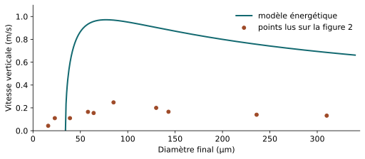

# École polytechnique et ESPCI PC 2017 — Physique A · Corrigé guidé

*Corrigé rédigé par IA, non officiel. Signalez toute erreur.*

**Lecture du rapport du jury** · GPT-6.2 Astra Ultra · vitesse non renseignée

**Rédaction** · GPT-6.2 Astra Ultra · vitesse non renseignée

## Catapultes — Coalescence de gouttes d’eau

**Couverture partielle.** Les questions 1 à 6 sur la coalescence de gouttes d’eau sont résolues, avec la lecture des données de la figure 2. Les parties 2 et 3 sont présentées par leurs principes physiques généraux. Les calculs appliqués à la dispersion de spores et au lanceur électromagnétique restent hors du corrigé.

## 1. Coalescence de deux gouttes d’eau

### Question 1 — Diminution de l’énergie de surface

**Indication.** Écrire d’abord la conservation du volume. L’aire ne se conserve pas quand deux gouttes fusionnent.

Deux sphères initiales de rayon $R$ fusionnent en une sphère de rayon $R'$. Comme $R'^3=2R^3$, $R'=2^{1/3}R$. Avec la tension de surface $\gamma$, on trouve

$$
\delta E_s=4\pi\gamma(R'^2-2R^2)=-4\pi\gamma R^2(2-2^{2/3})<0.
$$

La diminution de l’aire libère l’énergie $-\delta E_s$. Ce calcul néglige les petites surfaces de contact avec le substrat très hydrophobe.

### Question 2 — Vitesse initiale idéale

**Indication.** La masse en mouvement est la masse totale des deux gouttes. Utiliser la valeur positive de l’énergie libérée.

Si toute l’énergie libérée devient énergie cinétique de translation, $mV_0^2/2=-\delta E_s$, avec $m=8\pi\rho R^3/3$. Il vient $V_0=\sqrt{3(2-2^{2/3})\gamma/(\rho R)}$. Pour $\gamma=0,070\,\mathrm{N\,m^{-1}}$, $\rho=10^3\,\mathrm{kg\,m^{-3}}$ et $R=10^{-3}\,\mathrm m$, cela donne $0,29\,\mathrm{m\,s^{-1}}$, soit $0,3\,\mathrm{m\,s^{-1}}$. Le support fournit l’impulsion verticale pendant la coalescence.

### Question 3 — Élévation du centre de masse

**Indication.** Suivre la goutte entre l’instant où elle quitte la surface et l’instant où sa vitesse verticale s’annule.

En négligeant la traînée de l’air, $mgh=mV_0^2/2$. Le centre de masse monte de $h=V_0^2/(2g)=3(2-2^{2/3})\gamma/(2\rho gR)\simeq4,4\,\mathrm{mm}$ pour $g=9,8\,\mathrm{m\,s^{-2}}$.

### Question 4 — Temps capillaire

**Indication.** Une déformation de taille $R$ sur un temps $\tau$ met en jeu des vitesses internes de l’ordre de $R/\tau$.

L’énergie de mouvement intérieur a pour échelle $\rho R^3(R/\tau)^2$, et l’énergie de surface $\gamma R^2$. Leur comparaison donne $\tau\sim\sqrt{\rho R^3/\gamma}$. Pour 1 mm d’eau, $\tau\sim3,8\times10^{-3}\,\mathrm s$, soit quelques millisecondes.

### Question 5 — Perte visqueuse interne

**Indication.** Évaluer successivement le gradient de vitesse, la puissance volumique et l’énergie perdue dans tout le liquide.

Le gradient de vitesse varie comme $(R/\tau)/R=1/\tau$. La densité volumique de puissance dissipée est donc de l’ordre de $\eta/\tau^2$. On l’intègre sur le volume $R^3$ pendant $\tau$ et l’on obtient

$$
E_{\rm diss}\sim\frac{\eta R^3}{\tau}\sim\eta\sqrt{\frac{\gamma R^3}{\rho}}.
$$

Le résultat est positif et homogène à une énergie. À cette question d’échelle, utiliser $R'$ en place de $R$ ne change qu’un facteur constant.

### Question 6 — Rayon du maximum et comparaison à la mesure

**Indication.** Garder partout le rayon final, y compris dans l’énergie de surface. Maximiser le carré de la vitesse sur son domaine positif.

Avec $r=R'$, l’énergie libérée vaut $4\pi\gamma r^2(2^{1/3}-1)$. Le bilan corrigé est

$$
\tfrac12\tfrac{4\pi}{3}\rho r^3 V^2
=4\pi\gamma r^2(2^{1/3}-1)-36\pi\eta\sqrt{\gamma r^3/\rho}.
$$

En posant $A=6(2^{1/3}-1)\gamma/\rho$ et $B=54(\eta/\rho)\sqrt{\gamma/\rho}$, on trouve $V^2=A/r-B/r^{3/2}$. Le modèle laisse de l’énergie à la translation pour $r>r_{\min}=(B/A)^2$. En dessous, un membre de droite négatif signale que ce bilan ne prévoit pas de saut. À grand rayon $V\sim\sqrt{A/r}$ décroît. La dérivée $-A/r^2+3B/(2r^{5/2})$ s’annule au seul maximum

$$
r_{\max}=\left(\frac{3B}{2A}\right)^2=\frac94r_{\min},\qquad V_{\max}=\sqrt{\frac{A}{3r_{\max}}}.
$$

Les données de l’eau donnent $r_{\min}\simeq17\,\mathrm{\mu m}$, $r_{\max}\simeq39\,\mathrm{\mu m}$ et $V_{\max}\simeq1,0\,\mathrm{m\,s^{-1}}$. La figure 2 du sujet utilise le **diamètre** final. Le pic mesuré est vers 80 à 90 µm, proche des 77 µm prévus, avec une vitesse d’environ $0,25\,\mathrm{m\,s^{-1}}$, quatre fois plus faible. Des sauts sont même observés à des diamètres inférieurs au seuil du modèle. La conversion supposée de l’énergie restante en pure translation et l’estimation des pertes limitent donc l’accord quantitatif.

## 2. Principes de physique des interfaces et des écoulements (questions 7 à 11)

Une interface liquide-air contribue à l’énergie libre par $E_s=\gamma S$. Une diminution d’aire peut alimenter à la fois des mouvements internes et des pertes. Un bilan d’énergie détermine une limite de conversion en mouvement. En hydrodynamique, le nombre de Reynolds compare transport inertiel et diffusion visqueuse de la quantité de mouvement. À très faible Reynolds, le frottement d’une sphère isolée dans un fluide newtonien est linéaire en vitesse. Ces relations expliquent pourquoi une observation à l’échelle microscopique peut différer fortement d’une chute libre dans le vide.

## 3. Stockage et conversion de l’énergie (questions 12 à 23)

Une inductance linéaire stocke l’énergie magnétique $E_L=Li^2/2$. Dans un condensateur idéal la densité d’énergie du champ électrique s’intègre en $E_C=CU^2/2$. Dans une résistance, la puissance $Ri^2$ devient de la chaleur. Un bilan énergétique distingue ce qui est restitué par les éléments réactifs, ce qui est dissipé et ce qui est échangé avec le milieu. Les applications chiffrées des questions 7 à 23 ne sont pas traitées.
