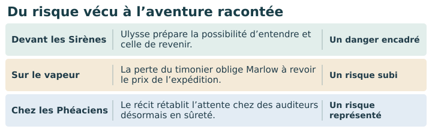

# Banque PT — Français A 2018 · Corrigé guidé

*Corrigé rédigé par IA, non officiel. Signalez toute erreur.*

**Rédaction** · GPT-6.2 Astra Ultra · vitesse non renseignée

[Énoncé officiel](https://www.banquept.fr/documents/2018/fr_a_2018_pt.pdf) · [Rapport du jury](https://www.banquept.fr/documents/ecrit/rapport/2018/rapport_fra_a_ecrit_2018.pdf) · [Programme officiel](https://www.education.gouv.fr/bo/17/Hebdo26/ESRS1700064A.htm)

Épreuve de quatre heures. Le thème « L’aventure » réunit les œuvres suivantes. Homère, L’Odyssée (traduction Philippe Jaccottet) · Conrad, Au cœur des ténèbres (traduction Jean-Jacques Mayoux) · Jankélévitch, L’Aventure, l’Ennui, le Sérieux, chapitre I, « L’aventure ».

Ernst Jünger, Approches, drogues et ivresses (1970).

## Préparer la dissertation

Analyser et commenter l’analogie établie par Ernst Jünger entre le plaisir qui vit de l’esprit et l’aventure qui vit de la proximité de la mort.

**Comment lire les deux phrases ensemble ?**

Rétablir le verbe sous-entendu dans la seconde phrase. De même que le plaisir reçoit sa vie de l’esprit, l’aventure la reçoit d’une proximité. « Elle » désigne l’aventure qui trace des cercles autour de la mort. La mort est donc un centre possible autour duquel on continue de vivre et de se mouvoir.

**Où trouver une expérience qui oblige à distinguer deux risques ?**

Dans la même scène des Sirènes, distinguer le dispositif préparé par le héros et ce qu’il entend hors du contrôle de ses compagnons. Sur le fleuve de Conrad, opposer l’expédition rêvée à la mort effectivement subie par le timonier. Demander à chaque fois qui s’est avancé vers le danger et qui a dû le subir.

**Comment réintroduire le plaisir dans la dernière étape ?**

Chez les Phéaciens, un récit qui charme l’assistance fait pleurer Ulysse. Le risque raconté sollicite le souvenir de l’un et l’imagination des autres. La distinction de Jankélévitch entre le temps ouvert du péril et l’aventure devenue objet esthétique permet de reprendre l’ensemble de l’analogie.

## Dissertation

Ulysse demande à entendre les Sirènes et ordonne à ses compagnons de le lier au mât. Si la promesse du chant suffit à l’attirer, la certitude d’en mourir suffirait-elle à faire de cet épisode une aventure ? Le nœud qui le retient importe autant que le péril qui l’appelle. Jünger rapproche deux rapports. De même que l’esprit anime le plaisir, l’aventure vivrait de la mort dont elle s’approche et s’écarte. L’image des cercles maintient une distance entre ce qui fait l’intérêt de l’expérience et ce qui y mettrait irrévocablement fin. La possibilité de mourir suffit-elle à convertir en aventure un épisode de notre vie, ou faut-il encore une certaine façon de vivre cette possibilité et de la raconter ?

Un plaisir qui n’emprunterait rien à l’attente, au souvenir ou à l’imagination serait difficile à isoler comme plaisir. Chez les Phéaciens, Ulysse écoute Démodocos célébrer la guerre de Troie. Ce qui est pour les convives une fête est pour lui une épreuve qui le fait pleurer. La même mélodie parvient aux mêmes oreilles, mais l’esprit de l’auditeur y reconnaît des morts singuliers. L’analogie de Jünger éclaire de même l’aventure. Un voyage devient aventure quand l’avenir cesse de ressembler au prolongement assuré de ce que nous avons déjà vécu. Jankélévitch situe l’événement aventureux dans le temps qui s’ouvre. La mort est la possibilité qui peut convertir tous les lendemains en un dernier instant. Une escale en apparence anodine chez le Cyclope prend pour Ulysse une autre signification à l’instant où la pierre referme l’entrée de la grotte. L’invention d’un nom, d’un plan et d’une issue répond à cette clôture.

Encore faut-il que la mort demeure proche sans devenir le but recherché. Jankélévitch décrit dans l’aventure la tension entre jeu et sérieux. Le joueur accepte de commencer. L’événement peut ensuite lui retirer le pouvoir de finir. Chez les Sirènes, Ulysse organise méthodiquement la marge dans laquelle il pourra s’exposer au chant. Avec Polyphème, il met au contraire en danger, après la fuite, le salut qu’il vient de reconquérir en clamant son nom. La vanité du défi permet de distinguer le goût du péril du désir de mourir. Le cercle tracé autour de la mort change donc de rayon. Il peut se resserrer malgré celui qui se croyait libre de le dessiner.

Mais certaines morts abolissent jusqu’au mot d’aventure. Dans *Au cœur des ténèbres*, Marlow aperçoit près du chantier des travailleurs épuisés dont la compagnie a déjà consommé les forces. Leur proximité avec la mort est extrême. Qui pourrait en faire une aventure vécue par eux, puisqu’on leur a retiré jusqu’à la conduite de leur propre déplacement ? Le timonier frappé lors de l’attaque du vapeur cesse d’être pour Marlow une simple fonction à bord. Le navigateur éprouve alors la perte d’un compagnon de travail avec lequel il avait construit, souvent sans paroles, une relation concrète. L’événement que le récit d’expédition pourrait transformer en incident palpitant fait ici vaciller l’attrait de l’expédition. Prendre toute exposition mortelle pour une aventure accorderait au spectateur le privilège de donner à la souffrance d’autrui la forme de son propre plaisir.

À l’inverse, une aventure peut reprendre vie dans une assemblée qui ne court plus le danger évoqué. Ulysse, reçu chez les Phéaciens, devient à son tour narrateur. Les gestes qui ont permis de sortir de la grotte se succèdent désormais devant des hôtes attentifs. L’art du récit rétablit pour eux un avenir incertain au sein d’un passé dont la présence d’Ulysse garantit au moins une issue. Jankélévitch distingue cette aventure esthétique, que l’on peut contempler comme un tout, du risque ouvert de l’instant vécu. De même, sur la Tamise, les auditeurs de Marlow sont en sûreté. Pourtant le souvenir du dernier jugement de Kurtz modifie la manière dont ils peuvent regarder leur propre fleuve. Ce qui circule dans l’esprit de l’auditeur dépasse la délectation. Le récit lui laisse une question morale que la disparition de Kurtz a rendue plus pressante.

Jünger saisit ainsi la nécessité d’un écart. Il faut une distance intérieure pour éprouver le plaisir et une issue encore ouverte pour que le rapport au danger prenne la forme de l’aventure. La mort lui donne une gravité limite. Mais ce sont la liberté de celui qui s’expose, l’attention portée à ceux qui en subissent le prix et le travail ultérieur du récit qui décident du sens de ses cercles.
