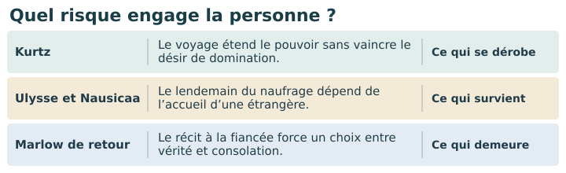

# Banque PT — Français B 2018 · Corrigé brut

*Corrigé rédigé par IA, non officiel. Signalez toute erreur.*

**Rédaction** · GPT-6.2 Astra Ultra · vitesse non renseignée

[Énoncé officiel](https://www.banquept.fr/documents/2018/fr_b_2018_pt.pdf) · [Rapport du jury](https://www.banquept.fr/documents/ecrit/rapport/2018/rapport_fra_b_ecrit_2018.pdf) · [Programme officiel](https://www.education.gouv.fr/bo/17/Hebdo26/ESRS1700064A.htm)

Épreuve de quatre heures. Le thème « L’aventure » réunit les œuvres suivantes. Homère, L’Odyssée (traduction Philippe Jaccottet) · Conrad, Au cœur des ténèbres (traduction Jean-Jacques Mayoux) · Jankélévitch, L’Aventure, l’Ennui, le Sérieux, chapitre I, « L’aventure ».

Catherine Chalier, « Le risque de la vérité », dans L’Aventure, la passion des détours (Autrement, 1996). Du premier paragraphe page 2, « Comme l’a jadis enseigné Épictète », à la dernière interrogation page 4, « à un poète ou à un mystique ? ». Les deux consignes suivent sur cette même page.

Le résumé compte pour 8 points et la dissertation pour 12. Le sujet demande 180 mots avec une tolérance de 10 %, soit de 162 à 198 mots.

## Résumé

Les événements nous échappent largement. Pour le sage stoïcien, la liberté consiste donc à gouverner ses jugements afin de recevoir avec sérénité ce qui arrive, jusque dans le péril. Qui part chercher un bonheur ailleurs emporte généralement ses anciens tourments. Sans examen de ces troubles ni souci du bien, le dépaysement procure seulement une diversion.

Lorsque tout voyage devient impossible, une autre aventure peut commencer. Une blessure condamna Joë Bousquet à demeurer dans sa chambre. Il lui fallut choisir quelle existence donner à ces jours menacés. En accueillant son sort, il découvrit dans la poésie une manière de parcourir le monde. Nommer sa beauté exigeait chaque jour de lui une audace nouvelle.

Pareille entreprise expose pourtant celui qui la poursuit à la solitude. Ceux que rassurent leurs habitudes supportent mal que des mots en ébranlent la certitude. Des visiteurs cherchaient au contraire auprès du poète la force de vivre leurs propres épreuves. Pourquoi réserver le nom de véritable aventure aux seuls départs lointains ? La pensée, la création ou la foi peuvent aussi engager une vie sans exiger le moindre déplacement.

*180 mots.*

## Dissertation

Discuter l’idée de Catherine Chalier selon laquelle aucun risque ni enjeu véritables ne subsistent dans une aventure sans exploration intérieure ni effort en faveur du bien.

Kurtz a voyagé bien plus loin que ses collègues de la Compagnie. A-t-il pour autant laissé derrière lui ce que l’Europe lui avait appris à désirer ? Dans l’interrogation de Catherine Chalier, le déplacement ne vaut comme aventure véritable que si le voyageur explore ses tourments et travaille à donner en lui une chance au bien. La formule fait dépendre la réalité même du risque d’une transformation morale. Pourtant les compagnons d’Ulysse qui périssent en mer risquaient fort réellement leur vie. Que faut-il donc entendre par un enjeu véritable pour ne méconnaître ni leur aventure ni l’exigence de Chalier ?

Quitter son pays peut tout d’abord donner à un homme les moyens de se fuir. Chez Conrad, le personnage que Marlow surnomme le briquetier se montre fort occupé de deviner quelles protections conduisent à une promotion. L’éloignement géographique n’a presque rien déplacé en lui. Quant à Kurtz, son rapport sur la mission civilisatrice porte une exhortation finale qui ruine le crédit de son éloquence humanitaire. Les désirs d’emprise qu’il pouvait dissimuler en Europe ont trouvé au poste lointain un terrain plus favorable. L’introspection souhaitée par Chalier introduirait ici un risque très précis. Elle obligerait un homme à renoncer à l’image flatteuse qu’il a de lui-même. Dans *L’Odyssée*, le besoin d’Ulysse de faire connaître son nom au Cyclope après lui avoir échappé montre, sur un autre registre, combien il est difficile de revenir sur son propre désir de gloire. Le héros expose ses compagnons à la malédiction avant même de pouvoir tirer une leçon de son imprudence.

Toutefois la sincérité morale ne constitue pas une condition d’existence du danger ou de la nouveauté. L’analyse de Jankélévitch réserve une place à l’instant où l’homme consent à commencer sans pouvoir décider d’avance comment l’aventure finira. Une découverte ou une rencontre amoureuse peut bouleverser le temps d’une vie avant que l’individu ait entrepris un examen de conscience. Ulysse, lui, ne choisit ni la tempête envoyée par Poséidon ni le pays où il abordera après le naufrage. Son premier souci, devant Nausicaa, est de trouver des habits et un abri. En faire une simple distraction sous prétexte que son objectif est pratique serait oublier qu’il dépend de la réponse imprévisible d’une personne étrangère. La rencontre porte déjà un enjeu de justice dans la manière dont l’inconnue traite celui qui ne peut rien exiger d’elle.

L’épreuve intérieure peut donc naître *de* l’événement. Elle ne le précède pas toujours. Marlow voulait enfant atteindre un point encore blanc sur les cartes. Une fois sur le fleuve, il doit apprendre à regarder son timonier, les porteurs et les travailleurs épuisés comme des hommes dont la mort ne se laisse pas justifier par les cartes ni par les discours. Il ne suffit pourtant pas de prendre conscience de ce conflit pour en sortir meilleur. Lorsqu’il retrouve la fiancée de Kurtz, il substitue son nom aux dernières paroles du mourant. Préserver cette femme d’une révélation douloureuse ou préserver le mensonge collectif qui a permis l’entreprise ? Le récit laisse vivre les deux lectures. Ce malaise distingue l’effort pour faire place au bien de la satisfaction de se croire bon. À Ithaque, Ulysse doit aussi accepter une épreuve qu’il ne conduit pas. Pénélope éprouve son identité grâce au secret du lit construit autour de l’olivier. Le voyageur redevient un époux lorsqu’il reconnaît à celle qui est restée le droit de fixer les conditions de la reconnaissance.

Les œuvres donnent ainsi raison à Chalier sur la facilité avec laquelle le voyage sert de diversion. Elles réservent cependant le mot *aventure* à une ouverture assez large pour comprendre les événements subis, les jeux et les rencontres imprévues. Le travail moral peut commencer au milieu d’eux ou après le retour. Il décide alors de ce que l’aventure aura changé et de la responsabilité que son récit accepte de porter.
