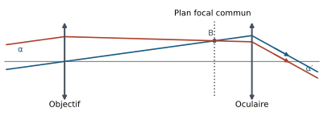
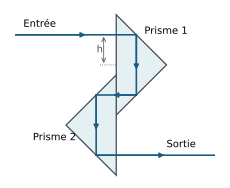
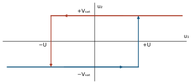

# Banque PT 2018 — Informatique et modélisation · Corrigé brut

*Corrigé rédigé par IA, non officiel. Signalez toute erreur.*

**Rédaction** · GPT-6.2 Astra Ultra · vitesse non renseignée · 26 novembre 2026

**Révision (tour 1)** · GPT-6.2 Astra Ultra · vitesse non renseignée · 26 novembre 2026

**Analyse d’un 100 m à l’aide d’un cinémomètre à effet Doppler-Fizeau.** Épreuve de quatre heures, sans calculatrice. Le feuillet donne les courbes de la course de Berlin et les résultats de certains calculs. Il ne fournit pas les listes numériques des mesures.

[Sujet officiel et annexe Matplotlib](https://www.banquept.fr/documents/2018/info_mod_2018_pt.pdf) · [Rapport du jury, pages imprimées 9 à 11](https://www.banquept.fr/documents/ecrit/rapport/2018/rapport_info_model_ecrit_2018.pdf)

## Viser le coureur

### Q1 · Un doublet afocal

**a.** Un système afocal transforme un faisceau incident parallèle en faisceau émergent parallèle. Un point objet à l’infini a ainsi son image à l’infini.

**b.** L’œil emmétrope au repos peut observer la cible lointaine à travers cette lunette sans accommoder. L’instrument modifie la direction apparente des rayons et donc l’angle sous lequel on voit la cible.

**c.** L’objectif rassemble le faisceau incliné en un point $B$ de son plan focal image. Ce plan est aussi le plan focal objet de l’oculaire. Le rayon qui joint $B$ au centre de l’oculaire donne la direction du faisceau émergent. Les angles sont comptés depuis l’axe vers le rayon, dans le sens de propagation. La figure utilise des focales schématiques pour rendre les directions lisibles.



### Q2 · Grossissement et distance entre lentilles

**a.** Dans le plan commun, la hauteur $y_B$ vérifie $y_B=f'_{\rm ob}\tan\alpha=-f'_{\rm oc}\tan\alpha'$. Dans les conditions de Gauss, le grossissement angulaire est donc $G=\alpha'/\alpha=-f'_{\rm ob}/f'_{\rm oc}$. Les deux focales sont positives. Le doublet seul renverse l’image.

**b.** L’indication « ×7,0 » désigne le module. Avec $f'_{\rm oc}=25\,\mathrm{mm}$, on trouve $f'_{\rm ob}=7\times25=175\,\mathrm{mm}$.

**c.** La coïncidence des foyers donne $O_{\rm ob}O_{\rm oc}=175+25=200\,\mathrm{mm}$. Le feuillet appelle cette grandeur « longueur focale des jumelles ». Il demande ici la distance mécanique entre centres, avant repliement du trajet.

### Q3 · Quatre réflexions pour replier le trajet

**a.** Le rayon traverse normalement l’hypoténuse, se réfléchit sur chacun des deux côtés de l’angle droit, puis ressort par l’hypoténuse en sens opposé. Le second prisme lui rend le sens longitudinal initial. À chaque face oblique, l’incidence interne vaut $45^\circ$. Pour une interface verre-air, $\sin i_c=1/n$. La valeur limite est $n_{\min}=\sqrt{2}$, et la réflexion totale stricte demande $n>\sqrt{2}$. Le verre d’indice 1,5 convient.



**b.** Appelons $A$ la longueur de l’hypoténuse et $h$ la distance du point d’entrée au milieu de cette face, avec $0<h<A/2$. Dans la coupe d’un prisme, les deux petits segments perpendiculaires à la face d’entrée mesurent chacun $A/2-h$ et le segment qui les relie mesure $2h$. Leur somme vaut $A$, quelle que soit la hauteur d’entrée.

**c.** Le verre étant homogène, le chemin optique des deux traversées vaut $\int n\,\mathrm ds=2nA$, soit $30\,\mathrm{mm}$ avec $A=10\,\mathrm{mm}$.

**d.** Le calcul de bilan de chemin optique suggéré par l’enchaînement de l’énoncé remplace $2nA$ d’air par ces trajets repliés, dont le déplacement longitudinal net est nul. Il donne l’encombrement annoncé $200-2\times1{,}5\times10=170\,\mathrm{mm}=17\,\mathrm{cm}$. Cette égalité de chemins optiques est une convention de ce calcul. Pour établir rigoureusement l’afocalité d’un montage avec verre, la translation paraxiale dans le milieu fait intervenir la longueur réduite $\ell/n$. On ne peut donc déduire à elle seule la position réelle des groupes par cette soustraction.

**e.** Les réflexions replient un trajet long dans un boîtier plus court. Une paire de Porro convenablement orientée dans l’espace renverse les deux coordonnées transversales de l’image intermédiaire et rend l’image finale droite. Le schéma en coupe illustre le repliement.

## De l’onde réfléchie à la vitesse affichée

### Q4 · Changer de référentiel dans la force de Lorentz

**a.** Dans le référentiel terrestre, $\vec F=q(\vec E+\vec v\times\vec B)$. Dans le référentiel de la cible, $\vec F'=q(\vec E'+\vec v'\times\vec B')$.

**b.** Dans le cadre de changement de référentiel imposé, $\vec F'=\vec F$ et $\vec v=\vec v'+\vec V$. L’identité doit être vraie pour toute vitesse de la particule. Le choix $\vec v'=0$ donne $\vec E'=\vec E+\vec V\times\vec B$. Les termes linéaires en $\vec v'$ donnent alors $\vec B'=\vec B$.

### Q5 · Deux sens de propagation

**a.** Pour une onde plane progressive dans le vide, de vecteur unitaire de propagation $\vec u$, on a $\vec B=\vec u\times\vec E/c$. Avec $\vec E$ suivant $y$, les champs magnétiques sont portés par $z$. La remarque « suivant y » du rapport de jury est incompatible avec le champ électrique imprimé et le trièdre direct du sujet.

**b.** Écrivons $\beta=V/c$. L’onde incidente se propage suivant $+x$, donc $\vec B_i=(E_{iy}/c)\vec u_z$. Pour l’onde de retour, $\vec B_r=-(E_{ry}/c)\vec u_z$. Comme $\vec u_x\times\vec u_z=-\vec u_y$, on obtient $\vec E'_i=(1-\beta)\vec E_i$ et $\vec E'_r=(1+\beta)\vec E_r$, au même événement.

### Q6 · Réflexion sur la surface mobile

**a.** Dans le référentiel du matériau, la puissance de Joule volumique vaut $\vec j\cdot\vec E'=\sigma|\vec E'|^2$. Un champ intérieur non nul demanderait une puissance volumique infinie lorsque $\sigma\to\infty$. La puissance reçue étant finie, le champ électrique intérieur tend vers zéro.

**b.** La surface est en $x=Vt$. Les deux champs tangentiels à cet endroit sont

$$
\begin{aligned}
\vec E'_i(Vt,t)&=(1-\beta)E_0\cos[2\pi f_i(1-\beta)t]\vec u_y,\\
\vec E'_r(Vt,t)&=(1+\beta)rE_0\cos[2\pi f_r(1+\beta)t]\vec u_y.
\end{aligned}
$$

**c.** Leur somme doit s’annuler pour tout $t$. À $t=0$, l’égalité des amplitudes opposées donne $r=-(1-\beta)/(1+\beta)$. Les cosinus doivent ensuite avoir la même fréquence positive à la surface. Ainsi $f_r=f_i(1-\beta)/(1+\beta)$ dans le modèle du sujet.

**d.** Au premier ordre, $f_r\simeq f_i(1-2\beta)$, d’où $f_i-f_r\simeq 2Vf_i/c$. Une cible qui s’éloigne renvoie une fréquence plus basse.

**e.** Au même ordre $r\simeq-1+2V/c$. Pour une cible immobile, $r=-1$, ce qui donne l’inversion du champ électrique réfléchi à la surface.

### Q7 · Écart de fréquence à 10 mètres par seconde

Avec $c=3{,}0\times10^8\,\mathrm{m\,s^{-1}}$, on obtient $f_i-f_r\simeq 2\times10\times30\times10^9/(3\times10^8)=2{,}0\times10^3\,\mathrm{Hz}$. La fréquence de battement est de 2 kHz.

### Q8 · Battement sur le photodétecteur

Le second champ complexe, étiqueté deux fois incident sur le feuillet, désigne le champ réfléchi de fréquence $f_r$. À $x=0$, la somme des amplitudes complexes vaut $E_0[\exp(2\pi\mathrm{i}f_it)+r\exp(2\pi\mathrm{i}f_rt)]$, avec $r$ réel. En multipliant par le conjugué, les termes diagonaux donnent $E_0^2(1+r^2)$. Les deux termes croisés conjugués donnent $2rE_0^2\cos[2\pi(f_i-f_r)t]$. La somme de ces deux contributions est l’intensité demandée. Le signe de $r$ règle la phase de la modulation.

### Q9 · Filtrer le courant reçu

**a.** À $\omega=2\pi(f_i-f_r)$, la tension est commune aux deux branches. L’admittance totale vaut $Y=1/R+1/(\mathrm j\omega L)$. Avec la convention de la figure, l’amplitude complexe vérifie
$$\underline{u}_{1m}=I_m\frac{\mathrm j\omega LR}{R+\mathrm j\omega L}.$$
Si l’on représente le signal complexe entier, il faut multiplier cette amplitude par $\exp(\mathrm j\omega t)$.

**b.** En régime continu établi, la bobine idéale court-circuite la résistance, d’où $u_1=0$. La transimpédance croît de zéro vers $R$ avec la fréquence et son module vaut $R/\sqrt2$ pour $\omega=R/L$. Ce passe-haut élimine l’offset et conserve une sinusoïde à la fréquence du battement.

### Q10 · Mise en forme par hystérésis

**a.** Il s’agit d’un comparateur à hystérésis non inverseur, ou trigger de Schmitt.

**b.** La sortie est rebouclée sur l’entrée positive. L’état linéaire est instable. Pour l’ALI idéal saturé, $u_2=+V_{\rm sat}$ si $\varepsilon>0$, et $u_2=-V_{\rm sat}$ si $\varepsilon<0$.

**c.** L’entrée négative est à la masse et l’entrée positive ne consomme aucun courant. La loi des nœuds donne $(u_1-\varepsilon)/R_1+(u_2-\varepsilon)/R_2=0$. Par conséquent $\varepsilon=(R_2u_1+R_1u_2)/(R_1+R_2)$.

**d.** Posons $U=R_1V_{\rm sat}/R_2$. Pour une sortie basse, $\varepsilon$ devient positif quand $u_1$ croît au-delà de $u_{1,\rm basc1}=+U$. Pour une sortie haute, il devient négatif quand $u_1$ décroît au-dessous de $u_{1,\rm basc2}=-U$.

**e.** À entrée croissante on suit la branche basse vers la droite puis on monte à $+U$. À entrée décroissante on suit la branche haute vers la gauche puis on descend à $-U$. Entre les deux seuils, la sortie garde son état précédent. Le cycle est parcouru dans le sens trigonométrique.



### Q11 · Compter sur une fenêtre de 0,2 seconde

**a.** Une impulsion correspond à une période. Idéalement $n=\tau\Delta f\simeq 2\tau V f_i/c$ pour une cible qui s’éloigne. Le nombre entier de fronts dans une fenêtre diffère de la valeur idéale de moins d’un compte, selon la phase aux limites.

**b.** Le gain de conversion est $G=c/(2\tau f_i)=0{,}025\,\mathrm{m\,s^{-1}}$ par compte. Pour 2 kHz, on compte 400 fronts en 0,2 s et on retrouve $10\,\mathrm{m\,s^{-1}}$.

**c.** Avec dix bits, $n_{\max}=2^{10}-1=1023$. La vitesse maximale affichable avant débordement vaut $1023\times0{,}025=25{,}575\,\mathrm{m\,s^{-1}}$.

**d.** Un compte représente $\Delta v=0{,}025\,\mathrm{m\,s^{-1}}$. La différence liée au comptage est strictement inférieure à cet échelon hors saturation.

## Du signal échantillonné aux phases de course

### Q12 · Intégrer des vitesses à pas variable

**a.** La relation exacte est $x_{i+1}=x_i+\int_{t_i}^{t_{i+1}}v(t)\,\mathrm dt$.

**b.** En joignant les deux vitesses par une droite, l’aire du trapèze vaut $(t_{i+1}-t_i)(v_i+v_{i+1})/2$. On l’ajoute à $x_i$ pour estimer $x_{i+1}$, en partant de $x_0=0$. Le pas est recalculé sur chaque intervalle.

**c.** Avec des instants strictement croissants et autant de vitesses que d’instants, la liste suivante contient une position par mesure.

```python
def inte(LV, LT):
    if not LT:
        return []
    positions = [0.0]
    for k in range(len(LT) - 1):
        pas = LT[k + 1] - LT[k]
        positions.append(positions[-1] + pas * (LV[k] + LV[k + 1]) / 2)
    return positions
```

### Q13 · Reproduire le tracé des positions

Après `LXexp = inte(LVexp, LT)`, la première abscisse est le temps mesuré et la première ordonnée la position estimée. La seconde série relie les deux extrémités de la ligne d’arrivée. Les formats de l’annexe distinguent les points isolés et la ligne pointillée.

```python
import matplotlib.pyplot as p
p.plot(LT, LXexp, '.')
p.plot([0, 10], [100, 100], ':')
p.xlabel('Temps (s)')
p.ylabel('Position (m)')
p.legend(['Position estimée', 'Arrivée'])
p.show()
```

### Q14 · Interpoler le passage de la ligne

**a.** Soit $j$ le premier indice tel que $x_j\ge d$. En égalant la fraction d’intervalle parcourue en position à la fraction de temps, on obtient
$$T=t_{j-1}+\frac{d-x_{j-1}}{x_j-x_{j-1}}(t_j-t_{j-1}).$$
Pour $j>0$, le dénominateur est positif puisque $x_{j-1}<d\le x_j$.

**b et c.** Si la ligne est déjà atteinte au départ, on rend le premier instant. Si la recherche s’épuise, on rend le booléen demandé. La dernière instruction affiche le résultat à 100 m avec les noms de listes employés dans la question.

```python
def arrivee(LX, LT, d):
    for k, x in enumerate(LX):
        if x >= d:
            if k == 0:
                return LT[0]
            fraction = (d - LX[k - 1]) / (x - LX[k - 1])
            return LT[k - 1] + fraction * (LT[k] - LT[k - 1])
    return False

print(arrivee(LXexp, LTexp, 100))
```

### Q15 · Identifier la différence finie

La fonction calcule $(v_{k+1}-v_k)/(t_{k+1}-t_k)$, en $\mathrm{m\,s^{-2}}$. C’est l’accélération moyenne sur un intervalle. Pour l’associer à $t_k$, on assimile la dérivée en ce point à la pente de la sécante avant. L’approximation locale de la dérivée est du premier ordre si la vitesse est assez régulière.

### Q16 · Placer les estimations sur l’axe des temps

**a.** Pour $n\ge1$ points il existe $n-1$ intervalles et donc $n-1$ résultats. **b.** En adoptant l’instant gauche de chaque intervalle, il faut écarter le dernier temps avant le tracé.

```python
p.plot(LTexp[:-1], f(LVexp, LTexp))
```

### Q17 · Repérer une entrée et la dernière sortie durable

La moyenne $m$ est celle des valeurs de `LY`. On inclut les bornes de la bande $[m-|m|/2,m+|m|/2]$. Le premier échantillon dans cette bande fixe l’instant de vitesse quasi constante. Pour la décélération, on mémorise le premier point d’une séquence passée strictement sous la borne basse et on efface ce candidat à tout retour sur cette borne ou au-dessus. Sur la figure 12, on lit respectivement 3,8 s et 9,2 s. Un ultime point dans la bande efface le second résultat.

```python
def instants(LY, LT):
    if not LY:
        return -1, -1
    moyenne = sum(LY) / len(LY)
    rayon = abs(moyenne) / 2
    bas, haut = moyenne - rayon, moyenne + rayon
    debut_cte, debut_dec = -1, -1
    for k, valeur in enumerate(LY):
        if debut_cte == -1 and bas <= valeur <= haut:
            debut_cte = LT[k]
        if valeur >= bas:
            debut_dec = -1
        elif k > 0 and LY[k - 1] >= bas:
            debut_dec = LT[k]
    return debut_cte, debut_dec
```

### Q18 · Coût du repérage

Pour $n$ valeurs de `LY`, le calcul de la moyenne lit $n$ éléments et la boucle effectue $n$ passages à coût borné. Le temps est $\Theta(n)$ dans le pire cas, même si une première entrée est détectée tôt. Les deux instants candidats et les bornes tiennent dans un espace auxiliaire $\Theta(1)$.

## Identifier les forces et leur travail

### Q19 · Ajuster l’accélération en fonction de la vitesse

La variable indépendante est la vitesse et la grandeur ajustée est l’accélération. Cette partie suppose les listes déjà alignées et de même longueur. Le degré 2 permet d’identifier les trois coefficients. La documentation range les puissances par ordre décroissant.

```python
import numpy as np
P = list(np.polyfit(LVexp, LAexp, 2))
```

On lit ainsi `P[0] = C`, `P[1] = B` et `P[2] = A` pour $a=A+Bv+Cv^2$. Les unités sont respectivement $\mathrm{m^{-1}}$, $\mathrm{s^{-1}}$ et $\mathrm{m\,s^{-2}}$.

### Q20 · Simuler le modèle dynamique par Euler explicite

**a.** On connaît $v_i$ et on évalue la pente à l’instant gauche. La récurrence est
$$v_{i+1}=v_i+(t_{i+1}-t_i)(A+Bv_i+Cv_i^2),\qquad v_0=0.$$
**b.** La vitesse ajoutée à chaque tour correspond à l’instant suivant de la liste. Le pas varie avec les mesures.

```python
def simu(LT, P):
    if not LT:
        return []
    C, B, A = P
    vitesses = [0.0]
    for k in range(len(LT) - 1):
        v = vitesses[-1]
        pas = LT[k + 1] - LT[k]
        vitesses.append(v + pas * (A + B * v + C * v**2))
    return vitesses
```

### Q21 · Interpréter le nombre affiché

Pour une série expérimentale d’énergie quadratique non nulle, le programme affiche
$$e=\sqrt{\frac{\sum_i(v_i^{\rm sim}-v_i^{\rm exp})^2}{\sum_i(v_i^{\rm exp})^2}}
=\frac{\|v^{\rm sim}-v^{\rm exp}\|_2}{\|v^{\rm exp}\|_2}.$$
Il s’agit de l’écart quadratique moyen au sens RMS, rapporté à la valeur RMS expérimentale. Les deux facteurs $1/n$ se simplifient dans le quotient. Il est sans dimension et reste défini si certains échantillons sont nuls. La valeur publiée $0{,}022=2{,}2\,\%$ est en dessous du seuil de 5 %. Le critère global valide ici le modèle sur l’acquisition, sans borner chaque erreur instantanée à 5 %.

### Q22 · Réparer la décomposition en forces massiques

Une affectation indexée telle que `LA2[k] = ...` exige que la case existe déjà. Au premier passage la liste est vide. Après correction de cette première erreur, `LA1 + b*LV[k]` tenterait encore d’ajouter une liste et un nombre. Le terme de frottement vaut simplement $Bv_k$. On peut construire chaque liste par ajouts successifs. La composante propulsive est le résidu $a_k-Bv_k-Cv_k^2$.

```python
def composantes(LV, LA, P):
    C, B = P[0], P[1]
    propulsion, frottement, forme = [], [], []
    for v, a in zip(LV, LA):
        frottement.append(B * v)
        forme.append(C * v**2)
        propulsion.append(a - frottement[-1] - forme[-1])
    return propulsion, frottement, forme
```

Dans l’ordre, on rend la propulsion, la traînée de frottement et la traînée de forme, toutes trois en $\mathrm{m\,s^{-2}}$. Leur somme à un même indice doit reconstituer exactement l’accélération d’entrée, à l’arrondi près.

### Q23 · Intégrer une puissance massique

Le produit $a_i v_i$ est une puissance par unité de masse. On calcule cette puissance aux deux extrémités de chaque intervalle puis on applique les trapèzes à la série des produits. Le dernier cumul donne le travail en $\mathrm{J\,kg^{-1}}$ sur toute la série de course.

```python
def travail(LA, LV, LT):
    puissance = [a * v for a, v in zip(LA, LV)]
    cumul = inte(puissance, LT)
    return cumul[-1] if cumul else 0.0
```

Appeler successivement `travail(LA0exp, LVexp, LTexp)`, puis la même fonction avec `LA1exp` et `LA2exp`. Les valeurs arrondies imprimées $700$, $-400$ et $-240\,\mathrm{J\,kg^{-1}}$ donnent un bilan de $60\,\mathrm{J\,kg^{-1}}$. Pour un départ au repos, cette variation d’énergie cinétique massique correspondrait à une vitesse finale d’environ $\sqrt{120}=11\,\mathrm{m\,s^{-1}}$, cohérente avec l’ordre de grandeur du graphe.

## Des résultats individuels aux dix meilleurs chronos

### Q24 · Identifier une performance

Une clé primaire identifie une ligne de manière unique et ses composantes sont renseignées. Plusieurs athlètes peuvent participer à la même épreuve et un athlète peut courir plusieurs épreuves. Dans le modèle proposé, on enregistre un seul résultat par participation. Le couple `(id_coureur, id_epreuve)` est donc unique et chacune de ses colonnes seule peut se répéter.

### Q25 · Lister les épreuves sur 100 mètres

On filtre sur la distance numérique. Interroger directement la table des épreuves inclut également celles auxquelles aucune performance n’a encore été associée.

```sql
SELECT nom, date
FROM epreuves
WHERE distance = 100;
```

### Q26 · Sélectionner les performances en douze secondes au plus

La jointure associe chaque résultat à son épreuve par l’identifiant. Pour chaque performance de 100 m réalisée en 12 s ou moins, cette requête renvoie le temps final, le début de la phase à vitesse constante, le début de la décélération et le travail massique de propulsion. Les performances de plusieurs coureurs figurent dans le résultat si elles satisfont le filtre. La requête ne spécifie aucun ordre.

```sql
SELECT p.temps, p.inst_cte, p.inst_dec, p.travail
FROM performances p
JOIN epreuves e ON e.id = p.id_epreuve
WHERE e.distance = 100 AND p.temps <= 12;
```

### Q27 · Réunir athlète, épreuve et temps

La table centrale porte les deux clés étrangères. Chaque ligne de performance retenue apporte ainsi un coureur et une épreuve, y compris lorsque deux résultats ont le même temps.

```sql
SELECT c.nom, c.prenom, e.nom, e.date, p.temps
FROM performances p
JOIN coureurs c ON c.id = p.id_coureur
JOIN epreuves e ON e.id = p.id_epreuve
WHERE e.distance = 100;
```

### Q28 · Construire les séries d’un coureur

La paire nom-prénom est supposée identifier le coureur. On met les deux côtés de la comparaison en minuscules. Pour chaque performance retenue, la date ISO est décomposée en trois entiers avant l’appel à la fonction fournie. On ajoute simultanément le nombre de jours et le chrono, dans l’ordre de lecture. Si le coureur est absent, les deux listes sont vides.

```python
def performances(nom, prenom, T):
    jours, temps = [], []
    identite = (nom.lower(), prenom.lower())
    for famille, prenom_lu, epreuve, date, chrono in T:
        if (famille.lower(), prenom_lu.lower()) == identite:
            calendrier = [int(champ) for champ in date.split('-')]
            jours.append(nb_jours([2000, 1, 1], calendrier))
            temps.append(float(chrono))
    return jours, temps
```

### Q29 · Ne sélectionner que les dix premières lignes

Avant le tour $i$, les $i$ premiers éléments sont les performances déjà sélectionnées, en ordre de temps croissants. Le minimum du suffixe occupe ensuite la place $i$. On échange des lignes entières afin de garder les noms et dates associés au temps. Après dix sélections les autres lignes peuvent rester en désordre. Le sujet garantit que le tableau contient au moins dix lignes.

```python
def top10(T):
    for i in range(10):
        meilleur = i
        for j in range(i + 1, len(T)):
            if T[j][4] < T[meilleur][4]:
                meilleur = j
        if meilleur != i:
            T[i], T[meilleur] = T[meilleur], T[i]
    return T[:10]
```

La comparaison stricte autorise les ex æquo. Si plusieurs performances ont le temps de la dixième, tout choix parmi elles qui complète les dix lignes convient. Le sujet autorise la modification de l’ordre du tableau d’entrée.

### Q30 · Comparer avec un tri complet

**a.** Au tour $i=0,\ldots,9$, il reste $N-i-1$ autres temps à comparer au minimum courant. Le total vaut $10N-55$. S’y ajoutent au plus dix échanges et une copie des dix lignes finales. Pour dix fixé, le temps est $\Theta(N)$ et l’espace auxiliaire hors résultat est constant.

**b.** Pour $N$ très grand, trier tout le tableau par fusion coûte $\Theta(N\log N)$. Le tri rapide a ce même ordre en moyenne, avec un pire cas quadratique dans sa version classique. Les dix sélections évitent de classer le suffixe et n’exigent qu’un coût linéaire.

**c.** Pour trier tout le tableau par sélection, il faudrait $N(N-1)/2$ comparaisons, soit $\Theta(N^2)$. Un tri fusion en $\Theta(N\log N)$ devient donc asymptotiquement plus rapide pour ce nouveau besoin.
