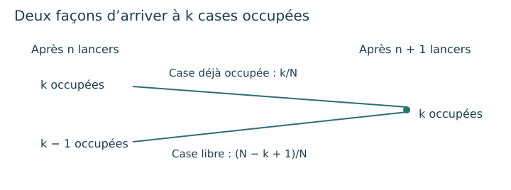

# Banque PT — Mathématiques A · 2018 · Corrigé guidé

*Corrigé rédigé par IA, non officiel. Signalez toute erreur.*

**Rédaction** · GPT-6.2 Astra Ultra · vitesse non renseignée

Le problème d’algèbre étudie le lien entre la diagonalisation d’un endomorphisme et celle de son carré, d’abord par deux exemples puis par décomposition en sous-espaces stables. Dans l’exercice de probabilités, les lancers sont indépendants et uniformes sur les $N$ cases. La lettre P repère les questions de cet exercice.

## Algèbre, partie I · Deux matrices de taille trois

### Question I.1

> [!INDICATION]
> Pour la valeur propre double de $B$, vérifier la dimension du noyau.

#### Solution

Pour la matrice $A$ de l’énoncé, on vérifie par multiplication que $(1,-1,1)^T$, $(1,1,1)^T$ et $(1,1,0)^T$ sont des vecteurs propres associés à $-1,1,2$. Ces trois valeurs distinctes donnent une base propre réelle. Pour $B$, $B-I_3$ a ses deux premières lignes égales à $(3,0,-3)$ et sa dernière ligne nulle. Son noyau est donc le plan $x=z$. Le vecteur $(1,1,0)^T$ est propre pour $4$, et complète ce plan en une somme directe. Ainsi les deux matrices sont diagonalisables sur $\mathbb R$.

### Question I.2

> [!INDICATION]
> Multiplier chaque ligne de $A$ par les trois colonnes de $A$.

#### Solution

La première ligne du produit vaut $(1+2+1,1-1,-1-1-1)$. Les suivantes valent $(2+1,2-1,-2-1)$ et $(-1+2-1,-1+1,1-1+1)$. Ainsi
$$
A^2=\begin{pmatrix}4&0&-3\\3&1&-3\\0&0&1\end{pmatrix}=B.
$$

### Question I.3

> [!INDICATION]
> Placer les vecteurs propres en colonnes et respecter le même ordre sur la diagonale.

#### Solution

Avec $P=\left(\begin{smallmatrix}1&1&1\\-1&1&1\\1&1&0\end{smallmatrix}\right)$ et $D=\operatorname{diag}(-1,1,2)$, les colonnes sont les vecteurs propres indépendants de I.1. Donc $P$ est inversible, $AP=PD$, et $A=PDP^{-1}$.

### Question I.4

> [!INDICATION]
> Élever la relation de similitude au carré.

#### Solution

On obtient $B=A^2=PD^2P^{-1}$, avec $D^2=\operatorname{diag}(1,1,4)$. Cette écriture fournit immédiatement une diagonalisation de $B$ sur $\mathbb R$.

## Algèbre, partie II · Quarts de tour

### Question II.1.a

> [!INDICATION]
> Composer les angles autour du même axe.

#### Solution

Le carré est la rotation d’angle $\pi$ autour de la droite $\mathbb Re_3$. Elle fixe la composante selon $e_3$ et change le signe des deux composantes orthogonales.

### Question II.1.b

> [!INDICATION]
> Calculer l’image des trois vecteurs de la base directe.

#### Solution

Comme $f(e_1)=e_2$, $f(e_2)=-e_1$, $f(e_3)=e_3$, les colonnes donnent $C=\left(\begin{smallmatrix}0&-1&0\\1&0&0\\0&0&1\end{smallmatrix}\right)$.

### Question II.1.c

> [!INDICATION]
> Le bloc plan a pour polynôme caractéristique $X^2+1$.

#### Solution

Le polynôme de $C$ est $(X-1)(X^2+1)$. Il n’est pas scindé sur $\mathbb R$, donc $C$ n’y est pas diagonalisable. Sur $\mathbb C$, $1,i,-i$ sont distinctes et $C$ est diagonalisable. Son carré $\operatorname{diag}(-1,-1,1)$ est déjà diagonal sur les deux corps.

### Question II.2.a

> [!INDICATION]
> Choisir un vecteur orthogonal simple et obtenir le troisième par produit vectoriel.

#### Solution

Prenons $w=(1,1,-4)^T/\sqrt{18}$ dans le sens de l’axe donné et $u=(1,-1,0)^T/\sqrt2$. Ils sont unitaires et orthogonaux. Le produit $v=w\wedge u=(-2,-2,-1)^T/3$ est unitaire, orthogonal aux deux autres, et $u\wedge v=w$. La base $(u,v,w)$ est orthonormée directe.

### Question II.2.b

> [!INDICATION]
> La matrice de passage entre ces deux bases orthonormées a pour inverse sa transposée.

#### Solution

Dans $\mathcal B'=(u,v,w)$, la matrice de $g$ est $C$ puisque $u\mapsto v$, $v\mapsto-u$, $w\mapsto w$. Posons $S=[u\ v\ w]$. Dans la base canonique, $M_{\mathcal B}=SCS^T$. En séparant la projection sur l’axe et le quart de tour dans le plan, on obtient explicitement
$$
M_{\mathcal B}=\frac1{18}\begin{pmatrix}1&1&-4\\1&1&-4\\-4&-4&16\end{pmatrix}
+\frac1{\sqrt{18}}\begin{pmatrix}0&4&1\\-4&0&-1\\-1&1&0\end{pmatrix}.
$$
Le premier terme est $ww^T$, le second envoie $z$ sur $w\wedge z$.

### Question II.2.c

> [!INDICATION]
> La similitude respecte la diagonalisation et le passage au carré.

#### Solution

$M_{\mathcal B}$ est semblable à $C$, dont le polynôme caractéristique n’est pas scindé sur $\mathbb R$. Elle n’y est donc pas diagonalisable. Son carré $SC^2S^T$ est semblable à la matrice réelle diagonale $C^2$, donc diagonalisable sur $\mathbb R$.

## Algèbre, partie III · Décomposition et racines d’un carré

### Question III.1

> [!INDICATION]
> Partir d’un élément de l’image.

#### Solution

Si $y\in\operatorname{Im}g$, il existe $x$ tel que $y=g(x)$. Alors $f(y)=(f\circ g)(x)=0$, d’où $\operatorname{Im}g\subset\ker f$.

### Question III.2.a

> [!INDICATION]
> Développer les deux compositions, avec $I$ pour l’identité.

#### Solution

Les deux expressions valent $f^2-(\alpha+\beta)f+\alpha\beta I$, puisque $I$ commute avec $f$. La diagonalisation n’est pas nécessaire pour cette identité.

### Question III.2.b

> [!INDICATION]
> L’un des facteurs annule le vecteur propre considéré.

#### Solution

Pour un vecteur propre $v$ de valeur propre $\lambda_j$, le facteur $f-\lambda_j I$ annule $v$. Par III.2.a il peut être déplacé à droite de tous les autres facteurs, donc leur produit appliqué à $v$ est nul.

### Question III.2.c

> [!INDICATION]
> La diagonalisation donne une base entière de vecteurs sur lesquels le produit est connu.

#### Solution

Tout $x$ est combinaison linéaire des vecteurs d’une base propre. L’endomorphisme produit $\prod_{j=1}^p(f-\lambda_j I)$ annule chaque vecteur de cette base par III.2.b. Par linéarité, il annule donc $x$.

### Question III.3.a

> [!INDICATION]
> Faire disparaître le terme en $f$.

#### Solution

On veut $a+b=0$ et $-a\alpha-b\beta=1$. Comme $\alpha\ne\beta$, on choisit $a=1/(\beta-\alpha)$ et $b=-1/(\beta-\alpha)$.

### Question III.3.b

> [!INDICATION]
> Appliquer l’identité de Bézout à un vecteur quelconque.

#### Solution

Chaque $x$ vaut $a(f-\alpha I)x+b(f-\beta I)x$, somme de vecteurs appartenant aux deux images. Cela donne l’inclusion de $E$ dans leur somme, l’inclusion inverse étant immédiate.

### Question III.3.c

> [!INDICATION]
> Utiliser la relation d’annulation dans ses deux ordres.

#### Solution

Comme $(f-\alpha I)(f-\beta I)=0$, III.1 donne $\operatorname{Im}(f-\beta I)\subset\ker(f-\alpha I)$. Les deux facteurs commutent par III.2.a. En échangeant leurs rôles, on obtient $\operatorname{Im}(f-\alpha I)\subset\ker(f-\beta I)$.

### Question III.3.d

> [!INDICATION]
> Inclure chaque terme de la somme des images dans le noyau correspondant.

#### Solution

D’après III.3.b et c, $E\subset\ker(f-\alpha I)+\ker(f-\beta I)$. Ces deux noyaux étant des sous-espaces de $E$, il y a égalité.

### Question III.3.e

> [!INDICATION]
> Comparer les deux valeurs de $fx$ sur l’intersection.

#### Solution

Un élément commun vérifie $\alpha x=fx=\beta x$, donc $x=0$ puisque $\alpha\ne\beta$. La somme de III.3.d est directe.

### Question III.3.f

> [!INDICATION]
> Réunir les bases des noyaux, en autorisant l’une à être vide.

#### Solution

Les vecteurs d’une base du premier noyau sont propres pour $\alpha$, ceux du second pour $\beta$. Par somme directe, leur réunion est une base de $E$. Ainsi $f$ est diagonalisable.

### Question III.4.a

> [!INDICATION]
> Comparer les compositions $f^2f$ et $ff^2$.

#### Solution

Si $x\in F_k$, $f^2(fx)=f(f^2x)=\lambda_k fx$. Cela signifie $fx\in F_k$, y compris si $fx=0$. Chaque $F_k$ est stable par $f$.

### Question III.4.b

> [!INDICATION]
> Restreindre $f^2$ au sous-espace où son action est scalaire.

#### Solution

Sur $F_k$, la restriction $f_k$ vérifie $f_k^2=\lambda_k I_{F_k}$. Comme $\mu_k=\sqrt{\lambda_k}$, le produit $(f_k+\mu_k I_{F_k})(f_k-\mu_k I_{F_k})=f_k^2-\mu_k^2I_{F_k}$ est nul.

### Question III.4.c

> [!INDICATION]
> La positivité stricte donne deux racines réelles distinctes.

#### Solution

Puisque $\mu_k>0$, les scalaires $-\mu_k$ et $+\mu_k$ sont distincts. III.3.f appliquée au produit précédent donne la diagonalisation réelle de $f_k$.

### Question III.4.d

> [!INDICATION]
> Décomposer d’abord par $f^2$, puis décomposer chaque terme par $f$.

#### Solution

Comme $f^2$ est diagonalisable, $E=\bigoplus_k F_k$. D’après III.3.e, $F_k=F_k^+\oplus F_k^-$, avec les signes de l’énoncé ($F_k^+$ correspond à la valeur $-\mu_k$). En substituant dans la première somme, on obtient $E=F_1^+\oplus F_1^-\oplus\cdots\oplus F_p^+\oplus F_p^-$. La réunion des bases de ces espaces fournit une base de vecteurs propres de $f$, donc $f$ est diagonalisable.

## Probabilités · Cases occupées

### Question P.1

> [!INDICATION]
> Chaque nouvelle boule crée au plus une case occupée et il n’existe que $N$ cases.

#### Solution

Si $n\le N$, les valeurs de $T_n$ sont $1,\ldots,n$. Si $n>N$, elles sont $1,\ldots,N$. Toute valeur $k$ indiquée est possible en mettant les $k$ premières boules dans $k$ cases distinctes puis les autres dans la première. Cette suite a une probabilité strictement positive.

### Question P.2

> [!INDICATION]
> Pour la deuxième boule, distinguer même case et nouvelle case.

#### Solution

$T_1=1$ presque sûrement, donc $\mathbb E T_1=1$. On a $\mathbb P(T_2=1)=1/N$, $\mathbb P(T_2=2)=(N-1)/N$, et $\mathbb E T_2=2-1/N$. Ces formules incluent $N=1$.

### Question P.3

> [!INDICATION]
> Les $N^n$ suites ordonnées de cases sont équiprobables.

#### Solution

Toutes les boules dans une même case donnent $N$ suites et $\mathbb P(T_n=1)=N^{1-n}$. Pour deux cases, on choisit la paire non ordonnée puis on rejette les deux suites monochromes, d’où $\mathbb P(T_n=2)=\binom N2(2^n-2)/N^n$ (zéro si $N=1$). Enfin toutes les cases tirées sont distinctes avec probabilité $N(N-1)\cdots(N-n+1)/N^n$ si $n\le N$, et zéro si $n>N$.

### Question P.4

> [!INDICATION]
> Conditionner sur le nombre de cases occupées avant le dernier lancer.

#### Solution

Pour finir à $k$, on part de $k$ et on réutilise une des $k$ cases, ou on part de $k-1$ et on utilise une des $N-k+1$ cases libres. Conditionnellement à la configuration passée, la prochaine boule est uniforme indépendamment du passé. Par probabilités totales,
$$
p_{n+1,k}=\frac{k}{N}p_{n,k}+\frac{N-k+1}{N}p_{n,k-1},
\qquad p_{n,k}=\mathbb P(T_n=k).
$$
Les valeurs hors support valent zéro, ce qui couvre aussi les bornes.

### Question P.5.a

> [!INDICATION]
> Le support étant fini, la fonction génératrice est un polynôme.

#### Solution

Par définition, $G_n(x)=\mathbb E(x^{T_n})=\sum_{k=1}^{\min(n,N)}p_{n,k}x^k$. Cette somme finie existe pour tout réel $x$.

### Question P.5.b

> [!INDICATION]
> Dériver le polynôme en un.

#### Solution

$G'_n(1)=\sum_k k p_{n,k}=\mathbb E T_n$. On a aussi $G_n(1)=1$.

### Question P.5.c

> [!INDICATION]
> Décaler d’une unité l’indice de la contribution des nouvelles cases.

#### Solution

En multipliant P.4 par $x^k$ puis en sommant, le premier terme donne $xG_n'(x)/N$. Dans le second, posons $j=k-1$. Il donne $\sum_j (N-j)p_{n,j}x^{j+1}/N=xG_n(x)-x^2G_n'(x)/N$. Donc $G_{n+1}(x)=(x-x^2)G_n'(x)/N+xG_n(x)$.

### Question P.5.d

> [!INDICATION]
> Dériver la récurrence puis centrer la suite autour de son point fixe.

#### Solution

En dérivant en $1$, le facteur $x-x^2$ annule le terme en $G_n''$, et $G_n(1)=1$. Avec $u_n=\mathbb E T_n$, on obtient $u_{n+1}=(1-1/N)u_n+1$. Par conséquent $u_{n+1}-N=(1-1/N)(u_n-N)$ et $u_1=1$. D’où $u_n=N[1-(1-1/N)^n]$.

### Question P.6.a

> [!INDICATION]
> Compter une contribution de un chaque fois que le numéro observé vaut $k$.

#### Solution

Le nombre de boules dans la case $k$ vaut $Y_k=\sum_{i=1}^n\mathbf 1_{\{X_i=k\}}$.

### Question P.6.b

> [!INDICATION]
> Pour une même case, les essais successifs sont indépendants.

#### Solution

Chaque indicatrice suit une loi de Bernoulli de paramètre $1/N$, indépendamment des autres lancers. Donc $Y_k\sim\mathcal B(n,1/N)$. Puis $Z_k=\mathbf1_{\{Y_k\ge1\}}$ suit une Bernoulli de paramètre $1-(1-1/N)^n$.

### Question P.6.c

> [!INDICATION]
> Comparer la probabilité que toutes les cases soient vides au produit des probabilités marginales.

#### Solution

Pour $N\ge2$, chaque événement $\{Z_k=0\}$ a une probabilité strictement positive. Leur intersection est impossible puisque $n\ge1$. Le produit des probabilités est alors positif et la famille n’est pas mutuellement indépendante. Si $N=1$, la famille contient la seule variable constante $Z_1=1$ et est indépendante au sens de la définition.

### Question P.6.d

> [!INDICATION]
> La linéarité de l’espérance s’applique aussi sans indépendance.

#### Solution

$T_n=\sum_{k=1}^N Z_k$ car chaque case non vide contribue exactement un. Ainsi $\mathbb E T_n=\sum_k\mathbb E Z_k=N[1-(1-1/N)^n]$, en accord avec P.5.d.

## Sources et rapport du jury

Le rapport 2018, p. 1–2, insiste sur la base dans laquelle on écrit une rotation et sur les deux facteurs du changement de base. Aux p. 3–4, il demande de justifier les dénombrements et l’identification de la loi binomiale.

[Énoncé de la Banque PT](https://www.banquept.fr/documents/2018/math_a_2018_pt.pdf) · [Rapport du jury](https://www.banquept.fr/documents/ecrit/rapport/2018/rapport_math_a_ecrit_2018.pdf)
