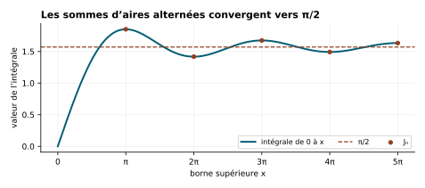
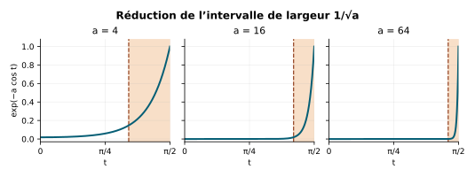

# Banque PT — Mathématiques C · Session 2018 · Corrigé brut

*Corrigé rédigé par IA, non officiel. Signalez toute erreur.*

**Rédaction** · GPT-6.2 Astra Ultra · vitesse non renseignée

Les deux parties conduisent à l’intégrale de Dirichlet. Dans la première, on compare deux intégrales oscillantes. Dans la seconde, une exponentielle complexe relie l’intégrale tronquée à une série entière.

Écrit de quatre heures, sans calculatrice. La grille d’admissibilité attribue à Math C le coefficient 6 pour l’École polytechnique et 3 pour chacune des ENS Paris-Saclay et Rennes. [Sujet](https://www.banquept.fr/documents/2018/math_c_2018_pt.pdf) · [Livret, p. 12](https://www.banquept.fr/documents/livret/2018/Livret_PT_2018.pdf#page=12)

Le rapport, pages 4–7, insiste sur le prolongement de classe C¹, la distinction entre convergence d’intégrales tronquées et convergence impropre, et les modules dans les majorations. [Rapport du jury](https://www.banquept.fr/documents/ecrit/rapport/2018/rapport_math_c_ecrit_2018.pdf)

## Préambule. Intégrales oscillantes sur un segment

### Question P.1

Puisque $f\in C^1([a,b])$, la fonction continue $|f'|$ atteint un maximum fini sur $[a,b]$. On peut prendre $M=1+\max|f'|$, strictement positif.

### Question P.2

Pour tout entier $k\ge1$,
$$
\left|\frac1k\int_a^b f'(t)e^{ikt}dt\right|\le\frac1k\int_a^b |f'(t)|dt\le\frac{M(b-a)}{k}.
$$
Le module tend vers zéro, donc l’intégrale divisée par $k$ tend vers zéro.

### Question P.3

L’intégration par parties donne
$$
\int_a^b f(t)e^{ikt}dt=\frac{f(b)e^{ikb}-f(a)e^{ika}}{ik}-\frac1{ik}\int_a^b f'(t)e^{ikt}dt .
$$
Le premier terme est $O(1/k)$, le second tend vers zéro par P.2. La limite est donc nulle.

## I. Première évaluation de l’intégrale de Dirichlet

### Question I.1.a.i

Pour $n\ge1$ fixé, $\sin(2nt)\sim2nt$ et $\tan t\sim t$ en zéro à droite. La limite demandée est $2n$.

### Question I.1.a.ii

Quand $t\to (\pi/2)^-$, $\cot t=\cos t/\sin t\to0$ et $|\sin(2nt)|\le1$. Leur produit tend vers zéro.

### Question I.1.a.iii

L’intégrande de $I_n=\int_0^{\pi/2}\sin(2nt)\cot t\,dt$ est continu à l’intérieur et possède deux limites finies par les deux réponses précédentes. Son prolongement continu sur le segment est intégrable, donc l’intégrale converge.

### Question I.1.b

Dans l’intervalle ouvert, $\sin(2t)\cot t=2\cos^2t=1+\cos(2t)$. Il vient $I_1=[t+\sin(2t)/2]_0^{\pi/2}=\pi/2$.

### Question I.1.c

L’identité $\sin u-\sin v=2\cos((u+v)/2)\sin((u-v)/2)$ donne $\sin((2n+2)t)-\sin(2nt)=2\cos((2n+1)t)\sin t$ sur tout le segment.

### Question I.1.d

Après multiplication de I.1.c par $\cot t$, la différence des intégrandes vaut $2\cos((2n+1)t)\cos t=\cos((2n+2)t)+\cos(2nt)$. Chaque cosinus d’une fréquence paire non nulle a intégrale nulle sur $[0,\pi/2]$. Donc $I_{n+1}=I_n$ et $I_n=\pi/2$ pour tout $n\ge1$.

### Question I.2

Les fonctions $\sin(2nt)/t$ et $\sin t/t$ sont continues sur $]0,\pi/2]$ et ont pour limites respectives $2n$ et $1$ en zéro. Leurs prolongements sont continus sur le segment. Les intégrales $J_n$ et $\int_0^{\pi/2}\sin t/t\,dt$ convergent.

### Question I.3

On a $\varphi(t)=(\sin t-t\cos t)/(t\sin t)$. Les séries entières du numérateur et du dénominateur donnent $\sin t-t\cos t=t^3(1/3+O(t^2))$ et $t\sin t=t^2(1+O(t^2))$. Les facteurs entre parenthèses ont des séries convergentes au voisinage de zéro, celui du dénominateur y étant non nul. Leur quotient est analytique, donc $\varphi$ se prolonge analytiquement en zéro avec $\varphi(0)=0$ et $\varphi'(0)=1/3$. À l’autre extrémité, $1/t-\cos t/\sin t$ est lisse au voisinage de $\pi/2$ et y vaut $2/\pi$. On obtient un prolongement $C^1$ sur tout le segment.

### Question I.4

On a $J_n-I_n=\int_0^{\pi/2}\varphi(t)\sin(2nt)dt$. C’est la partie imaginaire de $\int_0^{\pi/2}\varphi(t)e^{2int}dt$, où l’on prend le prolongement $C^1$ de I.3. Le préambule s’applique à la sous-suite $k=2n$. L’écart tend vers zéro et $J_n\to\pi/2$.

### Question I.5.a

Pour $B>\pi/2$, on obtient
$$
\int_{\pi/2}^B\frac{\sin t}{t}dt=\left[-\frac{\cos t}{t}\right]_{\pi/2}^B-\int_{\pi/2}^B\frac{\cos t}{t^2}dt .
$$
Le terme de bord a une limite. L’intégrale restante converge absolument par comparaison à $1/t^2$. La queue demandée converge donc.

### Question I.5.b

Avec $u=2nt$, $J_n=\int_0^{n\pi}\sin u/u\,du$. L’intégrale impropre de zéro à l’infini existe par I.2 et I.5.a. Puisque $n\pi\to+\infty$, elle est la limite de $J_n$.

### Question I.5.c

I.4 et I.5.b donnent $\int_0^\infty (\sin t)/t\,dt=\pi/2$.

## II. Série entière et seconde évaluation

### Question II.1.a

Comme en I.5.a, le terme de bord entre $\pi$ et $n\pi$ est $(-1)^{n+1}/(n\pi)-1/\pi$. Par additivité de l’intégrale restante, on trouve
$$
\int_\pi^{n\pi}\frac{\sin t}{t}dt
=\frac{(-1)^{n+1}}{n\pi}-\frac1\pi-\sum_{k=1}^{n-1}\int_{k\pi}^{(k+1)\pi}\frac{\cos t}{t^2}dt .
$$

### Question II.1.b

Le module du $k$-ième terme est majoré par $\int_{k\pi}^{(k+1)\pi}dt/t^2=1/(k\pi)-1/((k+1)\pi)$. La série de ces bornes télescope, d’où convergence absolue et convergence des sommes partielles. II.1.a implique alors que l’intégrale jusqu’à $n\pi$ a une limite. Si $n\pi\le B<(n+1)\pi$, la dernière intégrale, de $n\pi$ à $B$, a module au plus $\pi/(n\pi)=1/n$. Cela donne la convergence lorsque la borne supérieure $B$ tend continûment vers l’infini.

### Question II.2.a

Pour $a>0$ fixé et $u_n=a^{2n+1}/((2n+1)(2n+1)!)$, on a $u_{n+1}/u_n=a^2(2n+1)/((2n+3)^2(2n+2))\to0$. La série de modules converge, donc la série alternée proposée converge absolument.

### Question II.2.b

Pour $t\ne0$ la série du sinus divisée par $t$ donne $\psi(t)=\sum_{n\ge0}(-1)^n t^{2n}/(2n+1)!$. Son rayon est infini, par exemple par le quotient sur les indices pairs. En zéro le seul terme non nul vaut 1, exactement la définition du prolongement $\psi(0)$.

### Question II.2.c

La série entière de II.2.b converge uniformément sur $[0,a]$, compact intérieur à son disque de convergence. Par intégration terme à terme,
$$
\int_0^a (\sin t)/t\,dt=\sum_{n=0}^\infty\frac{(-1)^n a^{2n+1}}{(2n+1)(2n+1)!}.
$$

### Question II.3.a

Pour tout $z\in\mathbb C$, $e^z=\sum_{n=0}^\infty z^n/n!$. La série converge absolument, le quotient des modules valant $|z|/(n+1)\to0$ pour $z\ne0$. Le rayon est infini et le domaine de convergence est $\mathbb C$.

### Question II.3.b

Comme $|\operatorname{Re}(e^{-int})|=|\cos(nt)|\le1$, le module de la somme de la queue est majoré en tout $t$ par $\sum_{n>N}a^n/n!$. Ce majorant converge et assure aussi la convergence uniforme de la série de fonctions. La valeur absolue de l’intégrale sur $[0,\pi/2]$ est donc au plus $(\pi/2)\sum_{n>N}a^n/n!$, comme demandé.

### Question II.3.c

Pour chaque $t$, II.3.a en $z=-ae^{-it}$ donne $e^{-ae^{-it}}=\sum_{n\ge0}(-1)^n a^n e^{-int}/n!$. La convergence est uniforme en $t$ par comparaison à $e^a$.

### Question II.3.d

Pour $p=0$, l’intégrale de $\operatorname{Re}(1)$ sur le segment vaut $\pi/2$. Pour $n\ge1$, l’intégrale de $\cos(nt)$ vaut $\sin(n\pi/2)/n$. Elle est nulle pour $n$ pair et vaut $(-1)^k/(2k+1)$ pour $n=2k+1$, positive pour $n\equiv1\pmod4$, négative pour $n\equiv3\pmod4$.

### Question II.3.e

La convergence uniforme de II.3.c ou la borne de II.3.b permet d’intégrer terme à terme la partie réelle. Seuls restent le terme constant et les termes impairs. On a
$$
\operatorname{Re}\int_0^{\pi/2}e^{-ae^{-it}}dt
=\frac\pi2-\sum_{k=0}^\infty\frac{(-1)^k a^{2k+1}}{(2k+1)(2k+1)!}
=\frac\pi2-\int_0^a\frac{\sin t}{t}dt .
$$

### Question II.3.f.i

Sur $[0,\pi/2]$ le cosinus est positif ou nul, donc $0<e^{-x\cos t}\le1$ pour $x\ge0$. La fonction est continue en $x$ pour chaque $t$ et le majorant 1 est intégrable sur le segment. Le théorème de continuité dominée donne $F$ continue sur $[0,+\infty[$.

### Question II.3.f.ii

La dérivée de $e^{-a\cos t}$ vaut $a\sin t\,e^{-a\cos t}$. Elle est positive sur $]0,\pi/2]$ car $a>0$. La fonction est strictement croissante sur le segment, de $e^{-a}$ à 1.

### Question II.3.f.iii

Pour $a\ge4/\pi^2$, posons $\delta=1/\sqrt a$. Alors $0\le\pi/2-\delta\le\pi/2$. Sur ce segment l’intégrande est au plus 1, donc
$$
\int_{\pi/2-\delta}^{\pi/2}e^{-a\cos t}dt\le\delta=1/\sqrt a .
$$
Cette condition suffit pour la limite demandée. Le texte avait introduit tout $a>0$, mais l’inégalité n’est pas universelle. Pour $a=1/(4\pi^2)$, le segment a longueur $2\pi$. Or $e^{-a\cos t}\ge1-a\cos t$ avec inégalité stricte sauf aux zéros du cosinus. L’intégrale sur une période est donc strictement supérieure à $2\pi$.

### Question II.3.f.iv

Pour $a\ge4/\pi^2$ et $\delta=1/\sqrt a$, II.3.f.ii–iii donnent
$$
0\le F(a)\le (\pi/2)e^{-a\sin\delta}+\delta .
$$
Par concavité de $\sin$ sur $[0,\pi/2]$, $\sin\delta\ge2\delta/\pi$. Le premier terme est donc majoré par $(\pi/2)e^{-2\sqrt a/\pi}$. Les deux termes tendent vers zéro, donc $F(a)\to0$.

### Question II.3.g

L’égalité $-ae^{-it}=-a\cos t+ia\sin t$ donne le module $e^{-a\cos t}$, la partie réelle $e^{-a\cos t}\cos(a\sin t)$ et la partie imaginaire $e^{-a\cos t}\sin(a\sin t)$.

### Question II.3.h

Pour $a\ge4/\pi^2$, l’intervalle $[0,\pi/2-1/\sqrt a]$ est contenu dans $[0,\pi/2]$. Comme le module de la partie réelle est majoré par celui du complexe, on obtient
$$
\left|\int_0^{\pi/2-1/\sqrt a}\operatorname{Re}(e^{-ae^{-it}})dt\right|\le F(a).
$$
II.3.f.iv donne la limite zéro. Ici encore la borne est une assertion pour $a$ assez grand. Pour le même petit $a=1/(4\pi^2)$ que précédemment, l’autre borne est $-3\pi/2$. Sur cet intervalle la partie réelle vaut au moins $e^{-a}\cos a>1/3$, car $a<1/4$, $e^{-a}\ge1-a$ et $\cos a\ge1-a^2/2$. Le module de l’intégrale dépasse alors $\pi/2\ge F(a)$.

### Question II.3.i

Pour $a\ge4/\pi^2$, le morceau jusqu’à $\pi/2-1/\sqrt a$ tend vers zéro par II.3.h. Le morceau complémentaire a valeur absolue au plus $1/\sqrt a$ par II.3.g et II.3.f.iii. Ainsi la partie réelle de l’intégrale sur tout le segment tend vers zéro. L’identité II.3.e fournit une seconde fois
$$
\int_0^\infty\frac{\sin t}{t}dt=\lim_{a\to\infty}\int_0^a\frac{\sin t}{t}dt=\frac\pi2 .
$$
