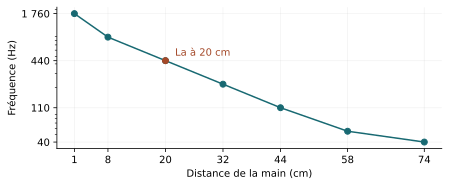
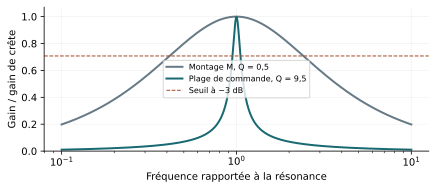
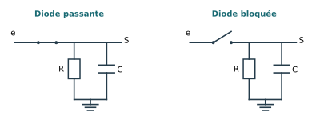
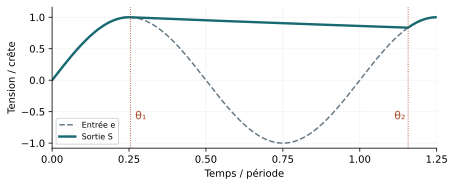
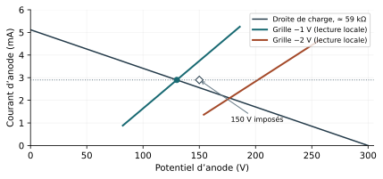
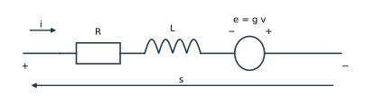
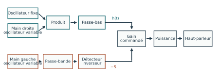
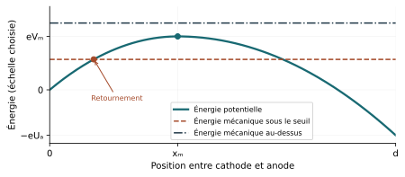

# Banque PT 2018 — Physique A · Corrigé guidé

*Corrigé rédigé par IA, non officiel. Signalez toute erreur.*

**Rédaction** · GPT-6.2 Astra Ultra · vitesse non renseignée

**Révision (tour 1)** · GPT-6.2 Astra Ultra · vitesse non renseignée

[Sujet officiel](https://www.banquept.fr/documents/2018/ph_a_2018_pt.pdf) · [Rapport du jury](https://www.banquept.fr/documents/ecrit/rapport/2018/rapport_phys_a_ecrit_2018.pdf) · [Livret de la session](https://www.banquept.fr/documents/livret/2018/Livret_PT_2018.pdf#page=12)

**Premiers instruments électroniques.** Comment deux oscillations inaudibles produisent-elles le la du diapason ? Les six parties suivent la tonalité et le volume du thérémine, le haut-parleur, les gestes du musicien et la conduction dans un tube à vide.

## I · Tonalité et mélange hétérodyne

### Question I-1-a · Deux oscillateurs hors du domaine audible

**Piste de résolution**

Convertir les deux fréquences en hertz et les comparer à la borne haute du document 3.

Les oscillations à 80 440 Hz et à 80 000 Hz dépassent toutes deux 20 000 Hz, limite supérieure conventionnelle donnée pour l’oreille humaine. Aucune des deux porteuses ne donnerait directement une note audible.

### Question I-1-b · Les raies du produit

**Piste de résolution**

Appliquer la formule du produit de deux sinus. Un signe devant un cosinus change sa phase.

Pour deux sinusoïdes d’amplitudes $A_1,A_2$, prises sans phase initiale, le produit vaut $kA_1A_2[\cos(2\pi(f_1-f_2)t)-\cos(2\pi(f_1+f_2)t)]/2$. Le spectre unilatéral comporte deux raies d’amplitude $|k|A_1A_2/2$. La différence donne **440 Hz**, le la du diapason. La somme donne **160 440 Hz**, hors de la bande audible. Des phases initiales changeraient les phases des raies.

### Question I-2 · Isoler la note

**Piste de résolution**

Repérer laquelle des deux raies est la plus basse avant de choisir le type de filtre.

Un passe-bas placé après le multiplieur laisse passer la différence et atténue la somme. Il évite ainsi d’envoyer une composante radiofréquence inutile aux étages audio. Pour une bonne séparation, la coupure se place largement au-dessus de 440 Hz et largement au-dessous de 160 440 Hz.

### Question I-3-a · Équation de la maille oscillante

**Piste de résolution**

Choisir le courant entrant par la borne positive du condensateur et parcourir la maille dans ce sens.

Posons $u=U_{C_0}$ et orientons le courant entrant par la borne choisie positive pour repérer $u$. Alors $i=C_0\dot u$. Dans la maille libre, $u+L_0\,\mathrm di/\mathrm dt=0$. D’où $\ddot u+u/(L_0C_0)=0$. Les composants idéaux échangent l’énergie électrique et magnétique.

### Question I-3-b · Solution libre et conditions initiales

**Piste de résolution**

Essayer une combinaison des deux solutions de l’équation caractéristique à racines imaginaires.

Avec $\omega_0=1/\sqrt{L_0C_0}$, la tension s’écrit $u(t)=u(0)\cos(\omega_0t)+\dot u(0)\sin(\omega_0t)/\omega_0$. Une amplitude et une phase constantes décrivent la même famille de solutions. Le courant initial fixe $\dot u(0)=i(0)/C_0$.

### Question I-3-c · Fréquence de référence

**Piste de résolution**

Relier pulsation et nombre de périodes par seconde.

La période propre vaut $T_0=2\pi\sqrt{L_0C_0}$, donc $f_2=1/(2\pi\sqrt{L_0C_0})$. Le produit d’une inductance et d’une capacité a la dimension d’une durée au carré.

### Question I-4 · Lire la chaîne hétérodyne

**Piste de résolution**

Suivre la branche de tonalité de la figure 4 jusqu’à la première tension purement audio.

L’antenne de tonalité commande l’oscillateur variable de fréquence $f_1$. Le second oscillateur fournit la référence fixe $f_2$. Le mélangeur multiplie leurs tensions. Sa sortie contient déjà la raie audible, accompagnée de la somme. Le filtre passe-bas isole la tension audio $h(t)$, disponible à l’entrée signal de l’amplificateur commandé en tension.

### Question I-5-a · Fréquence de l’oscillateur de tonalité

**Piste de résolution**

Les deux capacités ont les mêmes bornes. Additionner les charges stockées à tension donnée.

Les armatures en parallèle présentent la capacité $C_0+C_{h1}$. La bobine reste $L_0$, d’où $f_1=1/[2\pi\sqrt{L_0(C_0+C_{h1})}]$. En approchant la main, la capacité augmente et la fréquence de cet oscillateur diminue.

### Question I-5-b · Spectre en fonction de la distance

**Piste de résolution**

Calculer les deux combinaisons des fréquences propres. La fréquence mesurée est positive.

Pour la figure 6, les deux fréquences de sortie valent $f_{\rm bas}=(C_0^{-1/2}-(C_0+C_{h1})^{-1/2})/(2\pi\sqrt{L_0})$ et $f_{\rm haut}=(C_0^{-1/2}+(C_0+C_{h1})^{-1/2})/(2\pi\sqrt{L_0})$. Le terme bas est ici $f_2-f_1$ car $C_{h1}\geq0$. L’exemple numérique I-1 choisissait l’autre ordre. Dans les deux cas, on conserve $|f_1-f_2|$ en choisissant $f_{\rm bas}\ll f_c\ll f_{\rm haut}$ pour les notes jouées.

### Question I-6-a · Filtre de sortie du mélangeur

**Piste de résolution**

La tension de sortie est mesurée aux bornes du condensateur. Écrire le diviseur d’impédances.

Avec $\omega=2\pi f$ et $Z_C=1/(j\omega C)$, le rapport $T=Z_C/(R+Z_C)=1/(1+j\omega RC)$. Son module tend vers 1 à basse fréquence et vers 0 à haute fréquence. La coupure du passe-bas vérifie $|T|=1/\sqrt2$, soit $f_c=1/(2\pi RC)$.

### Question I-6-b · Choix d’une résistance

**Piste de résolution**

Choisir une fréquence de coupure intermédiaire puis revenir à la résistance en unités SI.

Avec $C=0{,}01$ µF, soit 10 nF, choisir par exemple $R=3{,}3$ kΩ. On obtient $f_c=4{,}82$ kHz, entre les deux raies. Les modules calculés sont 0,996 à 440 Hz et 0,030 à 160,44 kHz. La réjection de la somme atteint environ 30,4 dB. Cette valeur convient à la note du test et aux notes du tableau 1. Le choix d’une résistance dépend de la bande audio que l’on veut conserver.

### Question I-7 · Position du la et loi logarithmique

**Piste de résolution**

Deux positions du milieu du tableau séparées de 12 cm correspondent à des fréquences dans un rapport deux.

Le la du diapason, 440 Hz, s’obtient à **20 cm**. Dans la zone centrale, s’éloigner de 12 cm divise $f$ par deux. Ainsi $\log_{10}(f/440\,\mathrm{Hz})\simeq-(x-20\,\mathrm{cm})\log_{10}2/(12\,\mathrm{cm})$. Le logarithme de la fréquence est affine décroissant en $x$, avec une pente proche de $-0{,}025$ par centimètre.

### Question I-8 · Étendue musicale et déplacement

**Piste de résolution**

Compter le nombre de doublements entre les extrêmes. Tester le pas d’une octave aux deux bords du tableau.

Le son devient plus grave quand la main droite s’éloigne. De 40 à 1 760 Hz, le rapport est 44, soit $\log_2(44)\simeq5{,}46$ octaves. On peut jouer cinq octaves entières entre 55 et 1 760 Hz. Pour monter d’une octave, on avance d’environ 12 cm dans la zone centrale, par exemple de 32 à 20 cm. Le pas mesuré varie aux extrémités, de 14 cm pour 55 à 110 Hz à 7 cm pour 880 à 1 760 Hz.

## II-A · Filtrage du signal de volume

### Question II-A-1 · Transformer la fréquence en tension continue

**Piste de résolution**

Suivre la branche de l’antenne de volume, en distinguant l’amplitude de la fréquence.

La main gauche ajoute $C_{h2}$ en parallèle à $C_1$. L’oscillateur fournit $f'=1/[2\pi\sqrt{L_1(C_1+C_{h2})}]$. Le passe-bande fait dépendre l’amplitude de sortie de $f'$ en conservant cette fréquence. Le détecteur de crête convertit ensuite l’amplitude en une tension de commande quasi continue $S$.

### Question II-A-2-a · Reconnaître les passe-bande

**Piste de résolution**

Aux deux extrêmes remplacer les condensateurs par des circuits ouverts ou des courts-circuits et examiner la tension de sortie.

Les montages **1 et 4** sont passe-bande. À basse fréquence, le condensateur en série coupe le signal. À haute fréquence, le condensateur de rétroaction du 1 ramène le gain à zéro et le condensateur $C_1$ du 4 ramène le nœud intermédiaire à la masse. Entre ces limites la sortie peut être non nulle. Le 2 conserve un gain en continu et le 3 conserve un gain à haute fréquence, en interprétant les entrées de référence des ALI comme reliées à la masse.

### Question II-A-2-b · L’isolation de la charge par l’ALI

**Piste de résolution**

Comparer l’impédance de sortie du filtre actif et celle d’une cellule RC passive.

Le montage 1, retenu comme $M$, utilise la faible impédance de sortie de l’ALI en régime linéaire contre-réactionné. Le branchement de l’étage suivant altère peu sa réponse en tension. La sortie du montage 4 est chargée directement par cet étage. L’entrée inverseuse du montage 1 présente à la source l’impédance du réseau d’entrée.

### Question II-A-3 · Choisir le diagramme

**Piste de résolution**

Chercher un maximum à fréquence finie et une atténuation vers les deux extrêmes.

La figure **9-c** monte, passe par un maximum puis redescend. Cette allure convient au gain en décibels d’un passe-bande. La figure 9-a représente une réponse croissante et la 9-b une réponse décroissante.

### Question II-A-4-a · Paramètres canoniques du passe-bande

**Piste de résolution**

Évaluer la fonction à la fréquence qui annule la partie imaginaire de son dénominateur.

La fréquence $f_0$ est la fréquence centrale de résonance, où $|H|$ atteint son maximum. Le coefficient $H_0=H(jf_0)$ est le gain algébrique à la résonance. Le facteur de qualité $Q$ est sans dimension et mesure la sélectivité, avec $Q=f_0/\Delta f$ pour une bande mesurée à −3 dB.

### Question II-A-4-b · Largeur de bande à trois décibels

**Piste de résolution**

Passer du gain en décibels au module puis résoudre les deux équations obtenues avec les signes opposés.

Écrivons $x=f/f_0>0$. À chaque coupure, $20\log_{10}(|H|/|H_0|)=-10\log_{10}2\simeq-3$ dB. Donc $|H|=|H_0|/\sqrt2$ et $Q|x-1/x|=1$. Les racines positives sont $x_\pm=(\sqrt{4+Q^{-2}}\pm Q^{-1})/2$. On obtient $\Delta f=f_+-f_-=f_0/Q$, $\omega_\pm=2\pi f_\pm$ et $f_-f_+=f_0^2$.

### Question II-A-5 · Fonction de transfert du montage actif

**Piste de résolution**

Calculer l’impédance de rétroaction et celle de l’entrée. La borne inverseuse est à la masse virtuelle.

Le courant d’entrée traverse $Z_{\rm e}=R+1/(j\omega C)$, puis $Z_{\rm r}=R/(1+j\omega RC)$, car le courant d’entrée de l’ALI idéal est nul. Posons $y=\omega RC$. Alors $H=-Z_{\rm r}/Z_{\rm e}=-jy/(1+jy)^2=(-1/2)/[1+(j/2)(y-1/y)]$. L’identification donne $H_0=-1/2$, $Q=1/2$ et $f_0=1/(2\pi RC)$. Le signe du gain traduit l’inversion à la résonance.

### Question II-A-6 · Sélectivité requise par la plage de capacités

**Piste de résolution**

Les extrêmes de fréquence se présentent dans l’ordre inverse des capacités. Appliquer l’hypothèse de milieu donnée dans la question.

Notons $K=1/(2\pi\sqrt{L_1})$. En assimilant les fréquences extrêmes aux coupures, $f_-=K/\sqrt{C_M}$ et $f_+=K/\sqrt{C_m}$. Avec le milieu arithmétique demandé, $Q=(f_++f_-)/[2(f_+-f_-)]=(\sqrt{C_M}+\sqrt{C_m})/[2(\sqrt{C_M}-\sqrt{C_m})]$. Pour 100 et 81 pF, **$Q=9{,}5$**. La relation exacte $f_0=\sqrt{f_-f_+}$ conduirait à 9,49. Le montage à composants égaux de II-A-5 a seulement $Q=0{,}5$ et demanderait une autre sélectivité pour réaliser cette spécification.

## II-B · Détection de l’amplitude

### Question II-B-1-a · État initial du détecteur

**Piste de résolution**

Le condensateur part de zéro et la tension d’entrée commence par croître.

La diode idéale devient passante juste après la fermeture. Si elle restait ouverte, $S$ resterait nul tandis que $e$ deviendrait positif, incompatible avec son état bloqué. Dans le schéma équivalent, un fil relie l’entrée au sommet du dipôle $R\parallel C$. Les deux composants sont reliés à la masse.

### Question II-B-1-b · Courant pendant la charge

**Piste de résolution**

Appliquer la loi des nœuds en séparant le courant de la résistance et celui du condensateur.

La diode passante impose $S(t)=e(t)$. Le courant allant de la source vers la sortie vaut $i=e/R+C\,\mathrm de/\mathrm dt$. Pour $e=E_{\max}\sin\omega't$, il vaut $E_{\max}[\sin(\omega't)/R+\omega'C\cos(\omega't)]$ avec $\omega'=2\pi f'$. Au démarrage, ce courant est positif.

### Question II-B-1-c · Instant où la diode se bloque

**Piste de résolution**

Trouver le premier zéro du courant après le sommet du sinus. Choisir le bon quadrant.

Le premier blocage survient lorsque $i$ s’annule et tendrait à changer de signe. On a $\tan(\omega'\theta_1)=-\omega'RC$ pour $\pi/2<\omega'\theta_1<\pi$. Ainsi $\theta_1=[\pi-\arctan(\omega'RC)]/\omega'$. Pour $\omega'RC\gg1$, l’écart à $T'/4$ vaut $\arctan(1/(\omega'RC))/\omega'$ et devient négligeable. Le blocage a lieu un peu après le sommet.

### Question II-B-2 · Évolution pendant le blocage

**Piste de résolution**

À l’ouverture de la diode, conserver la tension du condensateur et supprimer le courant de la branche d’entrée.

Le schéma équivalent comporte une coupure en série avec la source. Le condensateur se décharge à travers la résistance parallèle. La loi des nœuds donne $C\dot S+S/R=0$, avec $S(\theta_1)=e(\theta_1)$. Tant que la diode reste ouverte, $S(t)=e(\theta_1)\exp[-(t-\theta_1)/(RC)]$. Dans l’approximation de l’énoncé, $e(\theta_1)\simeq E_{\max}$ et $\theta_1\simeq T'/4$.

### Question II-B-3 · Chronogramme du détecteur de crête

**Piste de résolution**

Chercher le second contact entre le sinus montant et la tension conservée par le condensateur.

De zéro à $\theta_1$, les deux tensions se superposent. Ensuite $S$ décroît exponentiellement, y compris lorsque $e$ devient négatif. L’instant $\theta_2$ est la première intersection sur le front montant suivant, $T'<\theta_2<5T'/4$, telle que $E_{\max}\sin(\omega'\theta_2)=e(\theta_1)\exp[-(\theta_2-\theta_1)/(RC)]$. De $\theta_2$ à $5T'/4$, la diode recharge le condensateur et $S=e$. Le tracé prend $RC=5T'$ pour rendre l’ondulation visible. Avec ce choix, le courant s’annule à $0{,}255\,T'$ et reprend à $1{,}157\,T'$.

### Question II-B-4 · Régime permanent et ondulation

**Piste de résolution**

Comparer la durée entre crêtes au temps de décharge du condensateur.

Après la première charge, le régime est périodique. Près de chaque crête la diode conduit brièvement, puis $S$ décroît jusqu’à la recharge suivante. Pour $RC\gg T'$, la chute relative pendant un intervalle d’au plus une période est inférieure à $1-\exp(-T'/RC)\simeq T'/RC$. La sortie est alors quasi continue, de valeur $S\simeq E_{\max}$ à l’ondulation près.

### Question II-B-5-a · Amplitude de sortie du passe-bande

**Piste de résolution**

Prendre le module du rapport complexe avant de multiplier par l’amplitude d’entrée.

Posons $x=f'/f_0$. Pour une entrée d’amplitude $V_{\max}$, la sortie a pour amplitude $E_{\max}=V_{\max}|H_0|/\sqrt{1+Q^2(x-1/x)^2}$. Le gain maximal en module donne une amplitude positive même quand le filtre inverse la phase.

### Question II-B-5-b · Réponse près de la résonance

**Piste de résolution**

Écrire le rapport de fréquence sous la forme $1+\varepsilon$ et développer son inverse.

Avec $\varepsilon=(f'-f_0)/f_0$, on a $x-1/x=2\varepsilon+O(\varepsilon^2)$. Près de $f_0$, $E_{\max}\simeq V_{\max}|H_0|/\sqrt{1+4Q^2\varepsilon^2}$. À la résonance, la sortie atteint exactement $V_{\max}|H_0|$. La correction locale à l’amplitude de crête commence au deuxième ordre.

### Question II-B-5-c · Tension de commande en fonction de la fréquence

**Piste de résolution**

Composer la réponse du filtre et celle du détecteur idéal de crête.

En régime établi et si $RC\gg T'$, la tension de commande est $S(f')\simeq V_{\max}|H_0|/\sqrt{1+Q^2(f'/f_0-f_0/f')^2}$. Elle croît jusqu’à $f_0$, puis décroît. La conversion fréquence-tension est monotone sur chacun des deux flancs pris séparément.

### Question II-B-6 · Adaptation du détecteur

**Piste de résolution**

Identifier les deux chargements possibles, celui qui affecte la constante de décharge et celui qui affecte la recharge.

Un ALI monté en suiveur à la sortie présente une forte impédance au détecteur et une faible impédance à la charge. Il évite de remplacer $R$ par $R\parallel R_{\rm charge}$ pendant la décharge. Un suiveur à l’entrée est utile si le générateur a une impédance notable et peine à livrer les pointes de recharge. Avec un passe-bande actif idéal en amont et une charge déjà de très grande impédance, les étages correspondants sont dispensables.

## III-A · Point de fonctionnement de la triode

### Question III-A-1-a · Point statique sur la caractéristique de grille

**Piste de résolution**

Tracer l’horizontale à 2,9 mA jusqu’à la courbe de grille −1 V de la figure 13, page 12. Reporter son abscisse.

La lecture graphique donne $U_A\simeq130$ V (environ 125 à 135 V). La droite de charge passe par ce point et par $(300\ \mathrm V,0)$. La maille donne $U_0=U_A+R_C I_A$, donc $R_C\simeq(300-130)/(2{,}9\times10^{-3})\simeq59$ kΩ. Le point à 150 V cité à la question suivante est décalé vers la droite sur cette même horizontale.

### Question III-A-1-b · Grille correspondant au point donné à 150 V

**Piste de résolution**

À abscisse constante, encadrer l’ordonnée demandée par les deux caractéristiques les plus proches.

À $U_A=150$ V, on lit environ 3,7 à 3,8 mA sur la courbe $U_G=-1$ V et 1,2 à 1,3 mA sur celle à −2 V. Pour atteindre 2,9 mA, la grille se situe **entre −2 et −1 V**, vers **−1,35 V** par interpolation approximative. Le feuillet emploie le même symbole $F_0$ pour deux points graphiquement distincts. Si l’on impose le couple $(150\ \mathrm V,2{,}9\ \mathrm{mA})$ à la droite de charge de 300 V, on trouve séparément 51,7 kΩ.

### Question III-A-2-a · Mouvement autour du point de repos

**Piste de résolution**

Garder fixe la caractéristique de grille et déplacer la droite de charge parallèlement à elle-même.

À grille fixée, $F$ oscille le long de la caractéristique $I_A(U_A)$ à −1 V, au voisinage de son intersection statique avec la droite de charge. Pour un petit signal on peut remplacer la caractéristique par sa tangente de pente $G$. Une hausse de $U$ translate la droite $I_A=(U-U_A)/R_C$ vers le haut et fait croître $I_A$ et $U_A$.

### Question III-A-2-b · Amplitude électrique sur la charge

**Piste de résolution**

Différencier simultanément la loi affine de la lampe et la loi des mailles.

On a $\delta I_A=G\delta U_A$ et $\delta U=\delta U_A+R_C\delta I_A$. Ainsi $\delta I_A=G\delta U/(1+GR_C)$. La tension $U_R=R_C I_A$ vaut $U_{0R}+U_{\max R}\sin(2\pi ft)$ avec $U_{0R}=R_C I_{A0}$ et $U_{\max R}=h_{\max}GR_C/(1+GR_C)=h_{\max}G/(G+1/R_C)$. Le rapport est sans dimension et compris entre zéro et un.

### Question III-A-3 · Action de la grille sur le niveau sonore

**Piste de résolution**

Lire la tendance de $G$ dans le tableau 2 puis examiner la variation du gain avec $G$.

La dérivée de $GR_C/(1+GR_C)$ par rapport à $G$ vaut $R_C/(1+GR_C)^2>0$. Pour amplifier davantage la partie variable, il faut augmenter $G$. D’après le tableau, $G$ passe de $2{,}8$ à $4{,}8$ en unités de $10^{-5}$ S quand la grille passe de −3 à 0 V. Il faut donc **augmenter $U_G$**, c’est-à-dire rendre sa valeur moins négative.

## III-B · Commande de l’instrument

### Question III-B-1 · Geste de la main droite

**Piste de résolution**

Relire l’ordre des positions dans le tableau du diapason.

Pour augmenter la hauteur, on rapproche la main droite de l’antenne de tonalité. Par exemple le déplacement de 32 à 20 cm fait passer de 220 à 440 Hz. Dans le modèle capacitif, cette approche abaisse $f_1$ et élargit l’écart $f_2-f_1$.

### Question III-B-2 · Geste de la main gauche

**Piste de résolution**

Tenir compte de l’inverseur de grille et déterminer sur quel flanc du passe-bande on se place.

Cette seconde question de III-B porte l’étiquette « II-B-2 » sur le feuillet. La main **gauche** commande le volume. L’augmenter demande $U_G$ plus élevé, donc $S$ plus faible puisque $U_G=-S$. Quand la main s’éloigne, $C_{h2}$ diminue et $f'$ augmente. Sur le flanc haut ($f'>f_0$), ce geste diminue $S$ et augmente le volume, conformément au geste usuel d’éloignement. Sur le flanc bas, l’effet s’inverse. Si la totalité de la plage traverse la résonance comme en II-A-6, le volume passe par un minimum et le signe du geste dépend de la position.

## IV · Du signal électrique au son

### Question IV-1 · Propagation dans la liaison audio

**Piste de résolution**

Faire la comparaison la plus défavorable, à la fréquence audible la plus élevée.

À 20 kHz, la plus petite longueur d’onde dans le câble vaut $c/f=3\times10^8/(2\times10^4)=15$ km. La longueur de 10 m n’en représente que $6{,}7\times10^{-4}$. Le temps de propagation est de 33 ns devant une période d’au moins 50 µs. La tension peut donc être considérée uniforme le long de cette liaison à l’échelle temporelle de la musique.

### Question IV-2 · Force de Laplace et induction de mouvement

**Piste de résolution**

Utiliser les sens du courant et du champ radial de la figure 14. Examiner la direction du produit vectoriel.

Une portion de spire parcourue par le courant subit $\mathrm d\vec F=i\,\mathrm d\vec\ell\times\vec B$. Dans le sens du courant positif du feuillet, $\mathrm d\vec\ell=a\,\mathrm d\theta\,\vec e_\theta$ et $\vec B=b_0\vec e_r$. Les contributions s’ajoutent selon $-\vec e_z$. Pour les $N$ spires, $\vec F=-2\pi Nab_0 i\,\vec e_z$. Le mouvement de la bobine dans ce champ exerce aussi une force magnétique sur ses porteurs de charge. La circulation de $\vec v\times\vec B$ le long du fil donne une f.é.m. de mouvement.

### Question IV-3 · Dynamique de l’ensemble mobile

**Piste de résolution**

Projeter les forces sur l’axe et mesurer la position depuis l’équilibre.

Posons $g=2\pi Nab_0$ et $v=\dot z$. La membrane et la bobine se déplacent ensemble. Les forces projetées sont $-gi$, $-hv$ et $-kz$, en mesurant $z$ depuis l’équilibre statique. Le principe fondamental de la dynamique donne $m\ddot z+h\dot z+kz=-gi$. Le poids éventuel est compensé à l’équilibre.

### Question IV-4 · Source électrique équivalente de la bobine

**Piste de résolution**

Repérer le signe de la tension interne en prenant le sens de parcours du courant.

La quantité $e=g\dot z$ est la f.é.m. induite par le déplacement. En effet $(\dot z\vec e_z)\times(b_0\vec e_r)=\dot z b_0\vec e_\theta$. La série équivalente comporte la résistance $R$, l’inductance propre $L$ et une source interne qui représente une élévation de tension $e$ dans le sens du courant. Avec la convention du sujet, $s=Ri+L\,\mathrm di/\mathrm dt-e$. Avec ces orientations, la puissance des forces de Laplace sur la membrane vaut $-giv$ et celle de la f.é.m. sur les charges vaut $ei=gvi$. Leur somme est nulle.

### Question IV-5 · Transfert entre tension et vitesse

**Piste de résolution**

Écrire deux équations complexes avec comme variables le courant et la vitesse, puis éliminer le courant.

À $\omega=2\pi f$, définissons $Z_e=R+j\omega L$ et $Z_m=h+j\omega m+k/(j\omega)$. Les équations deviennent $\underline s=Z_e\underline i-g\underline v$ et $Z_m\underline v=-g\underline i$. Il vient $\underline v/\underline s=-g/(g^2+Z_eZ_m)$. Dans la forme du feuillet, $A=B=2\pi Nab_0$ et $C=R+j2\pi fL$. Pour $2\pi fL\ll R$, $T\simeq-g/[g^2+R(h+j\omega m+k/(j\omega))]$. La vitesse tend vers zéro aux très basses fréquences, où domine le ressort.

### Question IV-6 · Compléter les deux voies du thérémine

**Piste de résolution**

Sur la figure 15, examiner d’abord la case vide derrière le multiplieur puis celle située après l’oscillateur de volume.

La case supérieure est le **filtre passe-bas** qui isole $h(t)$. La case inférieure est le **filtre passe-bande** qui convertit les déplacements de $f'$ en variations d’amplitude. La case déjà nommée « convertisseur fréquence/tension » en aval inclut la détection d’amplitude. L’ensemble passe-bande et détection réalise la conversion de fréquence en tension. Cette tension commande le gain appliqué à la note. L’étage de puissance alimente le haut-parleur.

### Question IV-7 · Comparer l’ondéa et le thérémine

**Piste de résolution**

Dans la figure 16, suivre les deux oscillateurs jusqu’au premier étage basse fréquence. Suivre aussi la commande mécanique du volume.

Dans les deux instruments, un oscillateur fixe et un oscillateur variable fournissent deux hautes fréquences dont la différence donne la note. Le « detector », symbolisé par une diode entre les oscillateurs et la chaîne audio, est le détecteur de battements. Sa non-linéarité permet le mélange, puis la chaîne basse fréquence conserve la différence. Il remplit ici la fonction de démodulation hétérodyne. Sur l’ondéa, ruban et clavier règlent la hauteur, touche et pédale d’expression agissent sur le niveau. Un sélecteur et des amplificateurs alimentent plusieurs diffuseurs de timbres distincts. Sur le thérémine, deux antennes agissent sans contact et la chaîne dessinée se termine par un haut-parleur.

## V · Capacité introduite par la main

### Question V-1 · Capacité en électrostatique

**Piste de résolution**

Définir les deux armatures et préciser entre quelles grandeurs s’établit la proportionnalité.

Un condensateur est un système de deux conducteurs, les armatures, séparés par un isolant. En influence totale, ils portent des charges opposées $+q$ et $-q$. Pour un diélectrique linéaire, la capacité est le coefficient positif $C=q/(V_1-V_2)$ lorsque $q$ désigne la charge de l’armature 1. Elle se mesure en farads et dépend de la géométrie et du milieu.

### Question V-2 · Champ et capacité des armatures planes

**Piste de résolution**

Appliquer le théorème de Gauss à une seule nappe plane puis superposer les deux champs.

Pour une nappe isolée de densité $\sigma$, les symétries imposent un champ normal et deux valeurs opposées de part et d’autre. Une boîte de Gauss à faces d’aire $A$ donne $2EA=\sigma A/\varepsilon_0$. Les deux nappes opposées ajoutent leurs champs entre les plaques et les compensent à l’extérieur. Ainsi $\vec E=(\sigma/\varepsilon_0)\vec n$ dans l’entrefer, avec $\vec n$ de la plaque positive 1 vers la négative 2. L’intégrale de 1 à 2 donne $V_1-V_2=Ed=\sigma d/\varepsilon_0$. Comme $q=\sigma S$, on obtient $C=\varepsilon_0S/d$, hors effets de bord.

### Question V-3 · Modèle de l’antenne et de la main

**Piste de résolution**

Partager la surface de l’antenne en deux zones et relever la distance au conducteur de potentiel nul en face de chaque zone.

La surface $s$ fait face à la main située à $x$. L’aire restante $S-s$ fait face au corps situé à $d$. Ces zones présentent la même différence de potentiel, et leurs charges s’ajoutent. Ainsi $C_{h1}=\varepsilon_0[(S-s)/d+s/x]$. Quand $x=d$, on retrouve la capacité plane $\varepsilon_0S/d$.

### Question V-4 · Effet d’un petit recul

**Piste de résolution**

Choisir un déplacement positif vers les grandes distances puis développer l’inverse de la distance.

Après un recul $\delta x$, $C'_{h1}=\varepsilon_0[(S-s)/d+s/(x+\delta x)]$. Pour $|\delta x|\ll x$, la variation au premier ordre est $\delta C_{h1}\simeq-\varepsilon_0s\,\delta x/x^2$. Avec $s=0{,}010$ m², $x=0{,}20$ m et $\delta x=0{,}005$ m, elle vaut $-1{,}11\times10^{-14}$ F, soit **−11 fF**. Le calcul sans développement donne −10,8 fF pour ce recul, en accord avec l’estimation différentielle. La modification est petite et de signe opposé pour une approche. La géométrie réelle de l’antenne s’écarte des plaques idéales.

### Question V-5 · Ordre de grandeur pour une antenne cylindrique

**Piste de résolution**

Diviser les deux estimations fournies avant d’introduire les dimensions. Ici le symbole $d$ est le diamètre de l’antenne.

Les facteurs communs s’éliminent et $\Delta C_{a0}/C_{a0}=\ln(2h/d)/[20\ln(2x/d)]$. Pour $h=0{,}50$ m, $d=0{,}01$ m et $x=0{,}20$ m, les arguments sont 100 et 40. Le rapport vaut environ 0,062, soit **6,2 %**. La base des logarithmes est indifférente dans ce quotient.

## VI · Électrons dans le tube à vide

### Question VI-1-a · Théorème de l’énergie cinétique

**Piste de résolution**

Énoncer le théorème pour un point matériel et préciser le référentiel.

Dans un référentiel galiléen, la variation d’énergie cinétique d’un point matériel entre deux positions est égale à la somme des travaux de toutes les forces qui s’exercent sur lui. Ainsi $E_{c,B}-E_{c,A}=\sum_k\int_A^B\vec F_k\cdot\mathrm d\vec\ell$.

### Question VI-1-b · Énergie des électrons recueillis à l’anode

**Piste de résolution**

Employer la charge algébrique de l’électron et le potentiel initial de la cathode.

Le travail de la force électrostatique est $q(V_K-V_A)=(-e)(0-U_A)=eU_A$, avec $e>0$. L’électron émis sans vitesse arrive donc avec l’énergie cinétique $m_e v_A^2/2=eU_A$ s’il atteint l’anode.

### Question VI-1-c · Condition de passage

**Piste de résolution**

Examiner le signe de l’énergie cinétique à l’arrivée et le cas de l’émission sans vitesse.

Dans ce modèle de diode sans charge d’espace, une tension $U_A>0$ attire les électrons émis au repos et permet un courant. Pour $U_A<0$, l’arrivée exigerait une énergie cinétique négative. À $U_A=0$, le modèle sans vitesse initiale et sans autre force ne lance aucun électron.

### Question VI-1-d · Sens du courant dans le vide

**Piste de résolution**

Distinguer le sens de déplacement des porteurs du sens conventionnel d’un courant électrique.

Les électrons se déplacent physiquement de la cathode vers l’anode. Leur charge étant négative, le courant conventionnel à travers le vide est dirigé de l’anode vers la cathode.

### Question VI-1-e · Action de diode

**Piste de résolution**

Relier le passage des charges à la polarité des électrodes.

La cathode chauffée émet des électrons que l’anode positive collecte. Lorsque la polarité est inversée, le courant est bloqué dans ce modèle. Le tube à deux électrodes assure donc une conduction unidirectionnelle, comme le dipôle de détection de II-B. Une diode idéale en conduction a, en outre, la chute nulle supposée dans cette partie.

### Question VI-2 · Équation de Poisson et densité de courant

**Piste de résolution**

Éliminer la densité de particules entre la densité de charge et la norme de la densité de courant.

En géométrie plane, $\mathrm d^2V/\mathrm dx^2=-\rho/\varepsilon_0$ puisque $\vec E=-\nabla V$ et $\nabla\cdot\vec E=\rho/\varepsilon_0$. Pour le faisceau incident de vitesse positive, $\rho=-en$ et $j=en v>0$, le vecteur courant étant $-j\vec e_x$. L’équation (1) est donc $V''=j/(\varepsilon_0 v)$, positive en présence de la charge d’espace électronique.

### Question VI-3 · Vitesse et franchissement d’un plan

**Piste de résolution**

Écrire l’énergie mécanique en soustrayant $eV$ et vérifier tout le parcours jusqu’au plan demandé.

À la cathode, $E_m=m_ev_0^2/2=eV_0$. À l’abscisse $x$, $m_ev(x)^2/2-eV(x)=eV_0$. L’équation (2) pour la norme de la vitesse est $v(x)=\sqrt{2e[V_0+V(x)]/m_e}$. Pour atteindre $a$ depuis la cathode il faut $V(x)\geq -V_0$ sur tout le chemin. À une première égalité la vitesse s’annule. La valeur locale en $a$ ne suffit pas si une barrière antérieure est infranchissable.

### Question VI-4-a · Barrière d’énergie potentielle

**Piste de résolution**

Multiplier l’ordonnée de la figure 20 par la charge de l’électron et conserver les abscisses.

En prenant l’origine des énergies à la cathode, $E_p(x)=-eV(x)$. La courbe part de zéro, monte jusqu’à $eV_m$ en $x_m$, puis redescend jusqu’à $-eU_A$ en $d$. Le minimum de potentiel électrique est donc le sommet de la barrière d’énergie pour l’électron. La figure ci-dessous porte également les deux niveaux d’énergie demandés aux questions suivantes.

### Question VI-4-b · Électrons réfléchis

**Piste de résolution**

Chercher où la droite d’énergie mécanique rencontre pour la première fois la barrière d’énergie potentielle.

Si $V_0<V_m$, l’horizontale $E_m=eV_0$ coupe la montée avant $x_m$. Là, $E_c=E_m-E_p$ s’annule et l’électron repart vers la cathode. La zone où $E_p>E_m$ lui est inaccessible. Aucun électron ne parvient à l’anode et le courant collecté est nul.

### Question VI-4-c · Courant de saturation

**Piste de résolution**

Compter tous les électrons émis qui peuvent franchir le sommet et intégrer leur courant sur la surface.

Si $V_0>V_m$, la droite $E_m=eV_0$ passe au-dessus de tout le profil. La vitesse reste non nulle et tous les électrons émis vers l’anode sont collectés. Le chauffage impose alors le débit maximal. La valeur du courant (en module) est $I_{\max}=j_{\max}S$ pour une émission uniforme sur l’aire $S$.

### Question VI-5-a · Point d’arrêt à l’énergie seuil

**Piste de résolution**

Identifier l’unique contact entre l’horizontale d’énergie et le sommet de la barrière.

Pour $V_0=V_m$, la vitesse s’annule là où $V=-V_0=-V_m$. Le contact se produit exactement au minimum de $V$, donc $x_0=x_m$.

### Question VI-5-b · Champ au plan critique

**Piste de résolution**

Évaluer la dérivée du potentiel électrique à son minimum intérieur.

Au minimum régulier, $V'(x_0)=0$. Le champ électrique $\vec E(x_0)=-V'(x_0)\vec e_x$ est donc nul, même si le potentiel local vaut $-V_0$.

### Question VI-5-c · Courant en aval du plan critique

**Piste de résolution**

Passé le plan critique, un seul sens de déplacement subsiste. Orienter le courant d’après le signe des porteurs.

Sur $x>x_0$, les électrons transmis vont vers l’anode. Le courant conventionnel uniforme traverse une section $S$ dans le sens négatif de l’axe. Ainsi $\vec j=-(i/S)\vec e_x$ et $j=i/S$ est sa norme.

### Question VI-6-a · Bilan des deux faisceaux

**Piste de résolution**

Au plan de séparation, répartir le flux incident entre le flux transmis et celui qui repart vers la cathode.

Avec $j^+,j^-,j$ définis comme des normes positives, la conservation du débit de charge donne $Sj^+=Sj^-+Sj$. Donc $j=j^+-j^-$. Les deux courants en amont sont algébriquement de signes contraires.

### Question VI-6-b · Densités incidente et réfléchie

**Piste de résolution**

Le chauffage fixe le courant aller. Soustraire le seul débit parvenant à l’anode.

L’émission cathodique donne $j^+=I_{\max}/S$. Le débit transmis est $i/S$. La loi précédente fournit donc $j^-=(I_{\max}-i)/S$. Quand $i$ atteint $I_{\max}$, le faisceau réfléchi disparaît.

### Question VI-6-c · Vitesse des deux populations

**Piste de résolution**

Les particules vont en sens opposés, mais passent par le même potentiel avec la même énergie à l’émission.

Les électrons réfléchis et incidents ont la même énergie mécanique $eV_0$. À une même abscisse ils ont aussi la même énergie potentielle $-eV(x)$. Leurs énergies cinétiques et donc leurs vitesses en norme sont égales à $\sqrt{2e(V_0+V(x))/m_e}$. Leurs composantes axiales sont opposées.

### Question VI-6-d · Charge d’espace en amont

**Piste de résolution**

Les deux densités de charge sont négatives. Additionner leurs contributions même lorsque les courants se compensent partiellement.

En amont, $n^\pm=j^\pm/(ev)$ donc $\rho=-e(n^++n^-) =-(j^++j^-)/v=-(2I_{\max}-i)/(S v)$. Ainsi $V''=(2I_{\max}-i)/(\varepsilon_0 S v)$. Dans l’équation (1) le numérateur équivalent est $(2I_{\max}-i)/S$. La charge élémentaire se simplifie et l’unité de $\rho$ est le coulomb par mètre cube.

### Question VI-7 · Loi en puissance trois demis

**Piste de résolution**

Évaluer la relation donnée à la plaque, puis contrôler la constante en réintégrant avec les conditions au minimum.

Posons $W=V+V_0$ et $a=(j/\varepsilon_0)\sqrt{m_e/(2e)}$. En aval, $j=i/S$. Avec la relation **imprimée** $W^{3/4}=(x-x_0)\sqrt a$ à $x=d$, on obtient $i=p_{\rm imp}(V_0+U_A)^{3/2}$ où $p_{\rm imp}=\varepsilon_0S\sqrt{2e/m_e}/(d-x_0)^2$. L’exposant demandé est donc trois demis.

Un contrôle de l’intégration révèle un facteur numérique dans la relation fournie. L’équation imprimée juste au-dessus est $W''=aW^{-1/2}$. Multiplier par $W'$ et utiliser $W(x_0)=W'(x_0)=0$ donne $(W')^2=4a\sqrt W$. Sur la branche croissante, on en déduit $W^{3/4}=(3/2)\sqrt a\,(x-x_0)$. L’intégration directe conduit ainsi à la même puissance avec $p=(4/9)p_{\rm imp}$. La dépendance en tension est donnée pour une distance effective $d-x_0$ fixée. Si le minimum de potentiel se déplace quand $U_A$ varie, le coefficient apparent varie aussi.
