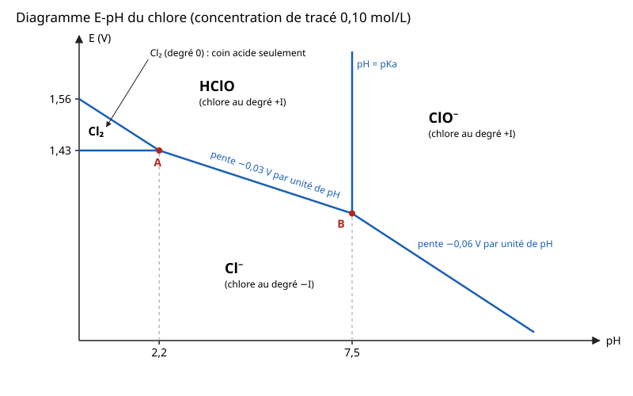
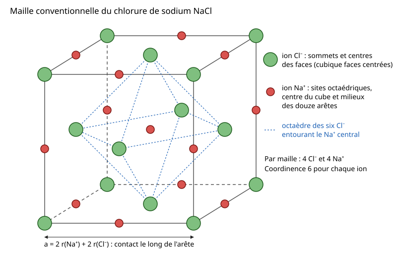
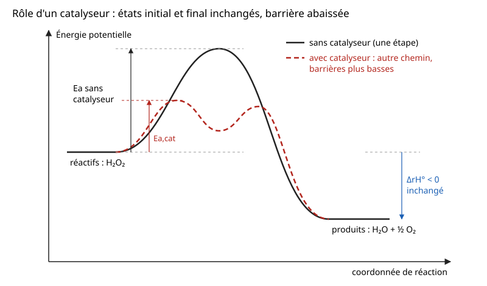
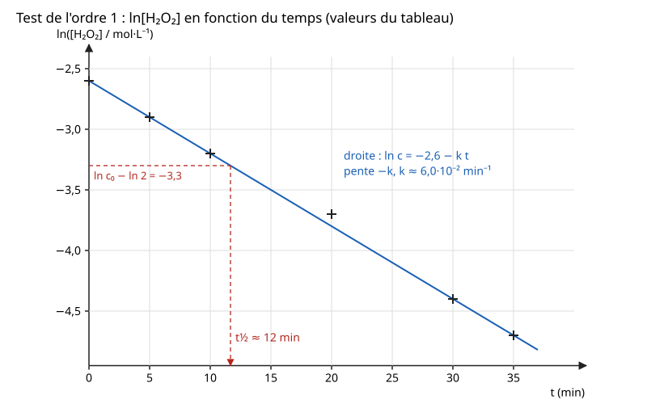

# Banque PT PT — Physique B - Chimie 2018 · Corrigé guidé

*Corrigé rédigé par IA, non officiel. Signalez toute erreur.*

**Rédaction** · modèle exact non renseigné (famille Claude) · effort non renseigné · vitesse non renseignée

**Révision (tour 2)** · modèle exact non renseigné (famille Claude) · effort non renseigné · vitesse non renseignée · 28 novembre 2026

## Présentation du sujet

**Thème.** L'eau de Javel : préparation, contrôle de son titre, vieillissement, puis étude d'une solution de remplacement, le percarbonate de sodium, qui libère de l'eau oxygénée. L'épreuve dure 2 heures, **sans calculatrice**, et comporte 40 questions réparties en trois parties indépendantes, avec un papier millimétré à rendre (annexe 3).

- *Partie 1 (questions 1 à 13)* : lecture du diagramme E-pH du chlore (domaines, dismutation, pente, p$K_a$, potentiel standard), équation de formation de l'eau de Javel, danger du mélange avec un acide ; cristal de chlorure de sodium (maille, population, coordinence, masse volumique, condition de stabilité).
- *Partie 2 (questions 14 à 23)* : dosage indirect par iodométrie, degré chlorométrique, vieillissement de l'eau de Javel et loi d'Arrhenius.
- *Partie 3, aspect thermodynamique (questions 24 à 30)* : grandeurs standard de la dismutation de l'eau oxygénée, constante d'équilibre, influence de la température et de la pression.
- *Partie 3, aspect cinétique (questions 31 à 40)* : catalyse, lois horaires des ordres 1 et 2, détermination de l'ordre et de la constante de vitesse, temps de demi-réaction.

**Notions mobilisées.** Diagrammes potentiel-pH, relation de Nernst, cristaux ioniques, titrage d'oxydoréduction indirect, gaz parfait, loi d'Arrhenius, loi de Hess, relation de Van't Hoff, quotient de réaction et déplacement d'équilibre, catalyse, méthode intégrale en cinétique.

**Difficulté.** Le sujet reste proche du cours des deux années et privilégie, selon le rapport, des notions simples. Les points se gagnent sur la lecture attentive de l'énoncé, la rigueur des justifications et les unités. Le rapport signale des difficultés aux questions 5 et 6, sur les relations de tangence (questions 11 à 13), sur l'exploitation finale du dosage (question 20), sur la justification des déplacements d'équilibre (questions 28 et 29) et sur la résolution des équations différentielles (questions 35 et 36).

**Gestion du temps.** Environ 35 minutes pour la partie 1, 30 pour la partie 2, 20 pour la thermodynamique et 35 pour la cinétique, qui comporte un tracé. Beaucoup de questions sont courtes : ne pas s'attarder sur une question bloquante, les parties étant indépendantes. Penser à rendre l'annexe 3 si elle a servi.

> [!JURY]
> Le rapport 2018 formule trois recommandations générales. Il a apprécié la qualité de la présentation (résultats numériques soulignés, expressions littérales encadrées, usage de couleurs) et encourage à la maintenir. Seule une réponse justifiée et argumentée reçoit l'intégralité des points. Les unités doivent impérativement être précisées pour que les points des applications numériques soient attribués, notamment pour les constantes de vitesse et les grandeurs de réaction. Il dit par ailleurs avoir été surpris de corriger de nombreuses copies d'un niveau plus faible que les années passées, tout en ayant lu d'excellentes copies de la part de quelques candidats.

[Sujet officiel](https://www.banquept.fr/documents/2018/ph_b_ch_2018_pt.pdf) · [Rapport du jury](https://www.banquept.fr/documents/ecrit/rapport/2018/rapport_phys_b_ecrit_2018.pdf)

*Mode d'emploi* : chercher chaque question seul, lire la première indication en cas de blocage, réessayer, puis la seconde, et seulement ensuite la solution.

## Partie 1 — Préparation de l'eau de Javel

### Question 1

> [!INDICATION]
> Classer les quatre espèces par nombre d'oxydation du chlore : plus il est élevé, plus l'espèce est haut dans le diagramme.

> [!INDICATION]
> Deux espèces ont le même nombre d'oxydation : elles forment un couple acide-base et sont séparées par une frontière verticale, la base du côté des pH élevés.

#### Solution

Nombres d'oxydation du chlore : $-\mathrm{I}$ dans $\mathrm{Cl^-}$, $0$ dans $\mathrm{Cl_2}$, $+\mathrm{I}$ dans $\mathrm{HClO}$ et dans $\mathrm{ClO^-}$.

- Le potentiel croît avec le nombre d'oxydation : $\mathrm{Cl^-}$ occupe le bas du diagramme, les espèces au degré $+\mathrm{I}$ le haut, et $\mathrm{Cl_2}$ s'intercale entre les deux.
- $\mathrm{HClO}$ et $\mathrm{ClO^-}$ forment un couple acide-base : l'acide $\mathrm{HClO}$ prédomine à gauche de la frontière verticale ($\mathrm{pH} < 7{,}5$), la base $\mathrm{ClO^-}$ à droite.
- $\mathrm{Cl_2}$ n'a de domaine que dans le petit triangle situé entre $E = 1{,}43\ \mathrm V$ et $E = 1{,}56\ \mathrm V$ à $\mathrm{pH} = 0$, et qui se ferme au point A ($\mathrm{pH}_A = 2{,}2$).

**Bilan : $\mathrm{HClO}$ en haut à gauche, $\mathrm{ClO^-}$ en haut à droite, $\mathrm{Cl_2}$ dans le triangle acide, $\mathrm{Cl^-}$ dans toute la partie basse.**

> [!METHODE]
> Pour attribuer les domaines d'un diagramme E-pH : calculer les nombres d'oxydation (classement vertical), puis, à nombre d'oxydation égal, classer par acidité (classement horizontal). Une frontière verticale sépare deux espèces de même nombre d'oxydation.

### Question 2

> [!INDICATION]
> Regarder si le dichlore possède encore un domaine pour un pH supérieur à celui du point A.

> [!INDICATION]
> Le dichlore est à la fois l'oxydant d'un couple et le réducteur d'un autre : il réagit sur lui-même.

#### Solution

Au-delà du point A, le dichlore n'a plus de domaine de stabilité : entre $\mathrm{pH}_A$ et $\mathrm{pH}_B$, les seules espèces stables sont $\mathrm{HClO}$ (degré $+\mathrm I$) et $\mathrm{Cl^-}$ (degré $-\mathrm I$). Le dichlore (degré $0$) se **dismute** :

$$\boxed{\mathrm{Cl_{2(aq)}} + \mathrm{H_2O_{(l)}} = \mathrm{HClO_{(aq)}} + \mathrm{Cl^-_{(aq)}} + \mathrm{H^+_{(aq)}}}$$

Vérification : un atome de chlore passe de $0$ à $+\mathrm I$, l'autre de $0$ à $-\mathrm I$ ; les charges sont équilibrées ($0 = -1 + 1$). Comme le pH est augmenté par ajout d'une base, on peut aussi écrire $\mathrm{Cl_2} + \mathrm{HO^-} = \mathrm{HClO} + \mathrm{Cl^-}$.

> [!PIEGE]
> Entre $\mathrm{pH}_A$ et $\mathrm{pH}_B$, l'espèce au degré $+\mathrm I$ est $\mathrm{HClO}$ et non $\mathrm{ClO^-}$ : l'ion hypochlorite n'apparaît qu'au-delà de $\mathrm{pH} = 7{,}5$ (question 6).

### Question 3

> [!INDICATION]
> Identifier le couple dont (AB) est la frontière, écrire sa demi-équation avec des ions $\mathrm{H^+}$, puis la relation de Nernst.

#### Solution

La droite (AB) sépare $\mathrm{HClO}$ et $\mathrm{Cl^-}$ :

$$\mathrm{HClO} + \mathrm{H^+} + 2\,e^- = \mathrm{Cl^-} + \mathrm{H_2O}$$

Relation de Nernst :

$$E = E^\circ_3 + \frac{0{,}06}{2}\log\frac{[\mathrm{HClO}]\,[\mathrm{H^+}]}{[\mathrm{Cl^-}]\,c^\circ}$$

Sur la frontière, $[\mathrm{HClO}] = [\mathrm{Cl^-}]$ :

$$E = E^\circ_3 - 0{,}03\,\mathrm{pH}$$

$$\boxed{\text{pente de (AB)} = -0{,}03\ \mathrm{V\ par\ unité\ de\ pH}}$$

> [!METHODE]
> Pour une demi-équation qui échange $m$ protons et $n$ électrons, la pente de la frontière vaut $-0{,}06\,m/n$ volt par unité de pH. Ici $m = 1$ et $n = 2$.

### Question 4

> [!INDICATION]
> Sur une frontière verticale, les deux espèces d'un couple acide-base ont la même concentration.

#### Solution

La frontière verticale passant par B sépare l'acide $\mathrm{HClO}$ et sa base $\mathrm{ClO^-}$. Sur cette frontière $[\mathrm{HClO}] = [\mathrm{ClO^-}]$, et la relation $\mathrm{pH} = \mathrm{p}K_a + \log\dfrac{[\mathrm{ClO^-}]}{[\mathrm{HClO}]}$ donne $\mathrm{pH} = \mathrm{p}K_a$. On lit l'abscisse de B sur l'annexe 1 :

$$\boxed{\mathrm{p}K_a(\mathrm{HClO}/\mathrm{ClO^-}) = \mathrm{pH}_B = 7{,}5}$$

### Question 5

> [!INDICATION]
> La demi-équation du couple $\mathrm{HClO}/\mathrm{Cl^-}$ est la somme de celles des deux couples dont les potentiels standard sont donnés.

> [!INDICATION]
> Ce sont les enthalpies libres standard de demi-réaction, $-nFE^\circ$, qui s'ajoutent, pas les potentiels.

#### Solution

Demi-équations des trois couples, écrites pour un atome de chlore :

$$\mathrm{HClO} + \mathrm{H^+} + e^- = \tfrac12\,\mathrm{Cl_2} + \mathrm{H_2O} \qquad (E^\circ_2,\ 1\ \text{électron})$$

$$\tfrac12\,\mathrm{Cl_2} + e^- = \mathrm{Cl^-} \qquad (E^\circ_1,\ 1\ \text{électron})$$

$$\mathrm{HClO} + \mathrm{H^+} + 2\,e^- = \mathrm{Cl^-} + \mathrm{H_2O} \qquad (E^\circ_3,\ 2\ \text{électrons})$$

La troisième est la somme des deux premières ; les enthalpies libres standard de demi-réaction $-nFE^\circ$ s'ajoutent :

$$-2FE^\circ_3 = -FE^\circ_2 - FE^\circ_1$$

$$E^\circ_3 = \frac{E^\circ_1 + E^\circ_2}{2} = \frac{1{,}4 + 1{,}6}{2}$$

$$\boxed{E^\circ_3 = 1{,}5\ \mathrm V}$$

Contrôle sur le diagramme : au point A, la frontière $\mathrm{HClO}/\mathrm{Cl^-}$ donne $E = 1{,}5 - 0{,}03\times 2{,}2 = 1{,}43\ \mathrm V$, valeur portée sur l'annexe 1.

Remarque : avec la concentration de tracé $0{,}10\ \mathrm{mol\cdot L^{-1}}$ et l'égalité des concentrations sur les frontières, les données donnent à $\mathrm{pH} = 0$ la frontière $\mathrm{Cl_2}/\mathrm{Cl^-}$ à $1{,}4 + 0{,}03\log\dfrac{0{,}10}{0{,}10^2} = 1{,}43\ \mathrm V$, comme sur l'annexe, et la frontière $\mathrm{HClO}/\mathrm{Cl_2}$ à $1{,}6 + 0{,}03\log\dfrac{0{,}10^2}{0{,}10} = 1{,}57\ \mathrm V$. L'annexe porte $1{,}56\ \mathrm V$ : écart d'arrondi de l'énoncé, sans effet sur les réponses.

> [!JURY]
> Le rapport note que de nombreux candidats, ayant mal lu l'énoncé, ne donnent pas le potentiel du couple $\mathrm{HClO}/\mathrm{Cl^-}$. Il demande de lire l'énoncé sans précipitation, puis de fournir une réponse concise, limitée à la question posée.

> [!PIEGE]
> La moyenne simple n'est valable que parce que chaque demi-équation met ici en jeu un seul électron. Dans le cas général, $E^\circ_3 = (n_1E^\circ_1 + n_2E^\circ_2)/(n_1+n_2)$.

### Question 6

> [!INDICATION]
> L'énoncé nomme les réactifs (dichlore et soude) et les produits (hypochlorite et chlorure de sodium) : il reste à équilibrer en milieu basique.

#### Solution

En milieu basique ($\mathrm{pH} > 7{,}5$), le dichlore se dismute en ion hypochlorite et en ion chlorure :

$$\boxed{\mathrm{Cl_2} + 2\,\mathrm{HO^-} = \mathrm{ClO^-} + \mathrm{Cl^-} + \mathrm{H_2O}}$$

soit, avec les ions sodium spectateurs, $\mathrm{Cl_2} + 2\,\mathrm{NaOH} = \mathrm{NaClO} + \mathrm{NaCl} + \mathrm{H_2O}$. Les ions hypochlorite et chlorure sont formés en quantités égales.

> [!JURY]
> D'après le rapport, beaucoup de candidats n'ont pas su écrire correctement cette réaction, alors qu'elle n'est que la traduction de l'énoncé ; le jury invite à prêter une attention particulière aux indications fournies par le sujet.

### Question 7

> [!INDICATION]
> Placer sur le diagramme les espèces présentes dans l'eau de Javel, puis faire baisser le pH jusqu'en dessous de celui du point A.

#### Solution

L'eau de Javel contient $\mathrm{ClO^-}$ et $\mathrm{Cl^-}$ en quantités égales. Si l'on acidifie :

- en dessous de $\mathrm{pH} = 7{,}5$, $\mathrm{ClO^-}$ est converti en $\mathrm{HClO}$ ;
- en dessous de $\mathrm{pH}_A = 2{,}2$, $\mathrm{HClO}$ et $\mathrm{Cl^-}$ ont des domaines disjoints, séparés par celui du dichlore : ils réagissent l'un sur l'autre (médiamutation, réaction inverse de la dismutation).

$$\boxed{\mathrm{ClO^-} + \mathrm{Cl^-} + 2\,\mathrm{H^+} = \mathrm{Cl_2} + \mathrm{H_2O}}$$

Le dichlore, peu soluble, se dégage : **le gaz toxique est le dichlore $\mathrm{Cl_2}$**, irritant et suffocant.

Conclusion : **il ne faut jamais mélanger l'eau de Javel avec un produit acide** (détartrant, gel pour sanitaires) ; cette mise en garde figure sur les emballages.

### Question 8

> [!INDICATION]
> Placer d'abord les anions (sommets et centres des faces), puis chercher les points de la maille équidistants de six anions.

#### Solution

Les ions chlorure occupent les sommets du cube et les centres des six faces. Les sites octaédriques d'un réseau cubique à faces centrées sont :

- le **centre du cube**, entouré par les six anions des centres des faces ;
- les **milieux des douze arêtes**, chacun entouré de six anions à la distance $a/2$ (les deux sommets de l'arête, les centres des deux faces qui la contiennent, et deux centres de faces des mailles voisines).

Les ions sodium les occupent tous.

### Question 9

> [!INDICATION]
> Un ion au sommet est partagé entre huit mailles, sur une arête entre quatre, sur une face entre deux.

#### Solution

Ions chlorure : 8 sommets comptant pour $1/8$ et 6 centres de faces comptant pour $1/2$.

$$N(\mathrm{Cl^-}) = 8\times\frac18 + 6\times\frac12 = 4$$

Ions sodium : 1 au centre, comptant pour 1, et 12 milieux d'arêtes comptant pour $1/4$.

$$N(\mathrm{Na^+}) = 1 + 12\times\frac14 = 4$$

$$\boxed{\text{4 motifs NaCl par maille}}$$

La maille est bien électriquement neutre. **Coordinence** : chaque ion sodium a pour plus proches voisins 6 ions chlorure, à la distance $a/2$, aux sommets d'un octaèdre ; par symétrie des deux sous-réseaux, chaque ion chlorure est entouré de 6 ions sodium à la distance $a/2$.

$$\boxed{\text{coordinence 6 pour } \mathrm{Na^+} \text{ et pour } \mathrm{Cl^-}\ (\text{coordinence 6/6})}$$

### Question 10

> [!INDICATION]
> Masse volumique = masse du contenu d'une maille divisée par le volume de la maille. Travailler en grammes et en centimètres pour alléger le calcul à la main.

#### Solution

La maille de volume $a^3$ contient 4 motifs NaCl de masse molaire $M = M_{\mathrm{Na}} + M_{\mathrm{Cl}} = 58\ \mathrm{g\cdot mol^{-1}}$ :

$$\rho = \frac{4\,(M_{\mathrm{Na}} + M_{\mathrm{Cl}})}{N_a\,a^3}$$

Application numérique, avec $a = 600\ \mathrm{pm} = 6{,}00\cdot 10^{-8}\ \mathrm{cm}$ :

$$a^3 = 216\cdot 10^{-24}\ \mathrm{cm^3} = 2{,}16\cdot 10^{-22}\ \mathrm{cm^3}$$

$$\rho = \frac{4\times 58}{6\cdot 10^{23}\times 2{,}16\cdot 10^{-22}} = \frac{232}{130} \approx 1{,}8\ \mathrm{g\cdot cm^{-3}}$$

$$\boxed{\rho \approx 1{,}8\cdot 10^{3}\ \mathrm{kg\cdot m^{-3}} \approx 2\cdot 10^{3}\ \mathrm{kg\cdot m^{-3}}}$$

Ordre de grandeur cohérent pour un solide ionique : environ deux fois la masse volumique de l'eau.

> [!PIEGE]
> Convertir le paramètre de maille avant de l'élever au cube : $600\ \mathrm{pm} = 6\cdot 10^{-10}\ \mathrm m$, donc $a^3 = 2{,}16\cdot 10^{-28}\ \mathrm{m^3}$. Une erreur sur la puissance de dix donne une masse volumique absurde, qu'un regard sur l'ordre de grandeur permet de repérer.

### Question 11

> [!INDICATION]
> Chercher le long de quelle direction un anion et un cation sont plus proches voisins : regarder une arête du cube.

#### Solution

Dans un cristal ionique, le contact se fait entre ions de signes opposés. Le long d'une arête se succèdent un anion (sommet), un cation (milieu de l'arête) et un anion (sommet) : l'arête contient deux rayons anioniques et un diamètre cationique.

$$\boxed{a = 2\left(r_{\mathrm{Na^+}} + r_{\mathrm{Cl^-}}\right)}$$

soit $r_{\mathrm{Na^+}} + r_{\mathrm{Cl^-}} = a/2 = 300\ \mathrm{pm}$.

> [!JURY]
> Le rapport indique que l'étude cristallographique n'a pas toujours été menée à son terme, les candidats se trompant sur les relations de tangence entre anions et cations.

### Question 12

> [!INDICATION]
> Les anions les plus proches l'un de l'autre sont un sommet et le centre d'une face : raisonner sur la diagonale d'une face.

#### Solution

Deux anions plus proches voisins sont séparés par une demi-diagonale de face, $a\sqrt2/2$. Ils ne se touchent pas si cette distance dépasse deux rayons anioniques :

$$2\,r_{\mathrm{Cl^-}} < \frac{a\sqrt2}{2}$$

$$\boxed{r_{\mathrm{Cl^-}} < \frac{a\sqrt2}{4}}$$

Avec $a = 600\ \mathrm{pm}$ : $r_{\mathrm{Cl^-}} < 212\ \mathrm{pm}$ environ.

### Question 13

> [!INDICATION]
> Remplacer $a$ dans l'inégalité de la question 12 par son expression de la question 11, puis diviser par le rayon de l'anion.

#### Solution

En reportant $a = 2\,(r_{\mathrm{Na^+}} + r_{\mathrm{Cl^-}})$ dans $4\,r_{\mathrm{Cl^-}} < a\sqrt2$ :

$$4\,r_{\mathrm{Cl^-}} < 2\sqrt2\left(r_{\mathrm{Na^+}} + r_{\mathrm{Cl^-}}\right)$$

$$\sqrt2\,r_{\mathrm{Cl^-}} < r_{\mathrm{Na^+}} + r_{\mathrm{Cl^-}}$$

$$\boxed{\frac{r_{\mathrm{Na^+}}}{r_{\mathrm{Cl^-}}} > \sqrt2 - 1 \approx 0{,}41}$$

La valeur limite est $\sqrt2 - 1 \approx 0{,}41$ : en dessous, le cation serait trop petit pour écarter les anions, qui se toucheraient, et la structure ne serait plus stable.

> [!METHODE]
> Condition de stabilité d'une structure ionique : contact entre ions de signes opposés (égalité), absence de contact entre ions de même signe (inégalité). Le rapport des deux relations élimine le paramètre de maille.

## Partie 2 — Dosage indirect de l'eau de Javel

### Question 14

> [!INDICATION]
> Que se passerait-il, d'après la question 7, si l'acide était versé sur l'eau de Javel avant les ions iodure ?

#### Solution

L'acide doit être introduit **en dernier**, quand les ions iodure en excès sont déjà au contact des ions hypochlorite. Si l'on acidifiait d'abord la solution $S_0$, les ions $\mathrm{ClO^-}$ réagiraient avec les ions $\mathrm{Cl^-}$ pour former du dichlore (question 7) :

- ce gaz est toxique (sécurité de l'opérateur) ;
- en se dégageant, il emporte une partie de l'oxydant à doser : la quantité de diiode formée ensuite serait trop faible et le titre trouvé serait sous-estimé.

En présence d'ions iodure, l'oxydant est réduit en solution par $\mathrm{I^-}$ dès l'acidification, sans perte de matière.

### Question 15

> [!INDICATION]
> Équilibrer dans l'ordre : l'élément chlore, l'oxygène avec $\mathrm{H_2O}$, l'hydrogène avec $\mathrm{H^+}$, puis les charges avec des électrons.

#### Solution

$$\boxed{\mathrm{ClO^-} + 2\,\mathrm{H^+} + 2\,e^- = \mathrm{Cl^-} + \mathrm{H_2O}}$$

$$\boxed{\mathrm{I_2} + 2\,e^- = 2\,\mathrm{I^-}}$$

Le chlore passe du degré $+\mathrm I$ au degré $-\mathrm I$ : deux électrons sont bien échangés.

> [!JURY]
> Le rapport rappelle que l'écriture des réactions d'oxydoréduction du titrage nécessitait d'établir d'abord les demi-équations.

### Question 16

> [!INDICATION]
> Les deux demi-équations échangent le même nombre d'électrons : il suffit de les combiner, l'ion hypochlorite étant l'oxydant et l'ion iodure le réducteur.

> [!INDICATION]
> Pour le caractère quasi total, comparer les potentiels standard. Celui du couple $\mathrm{ClO^-}/\mathrm{Cl^-}$ se déduit des deux couples du chlore fournis, comme à la question 5.

#### Solution

$$\boxed{\mathrm{ClO^-} + 2\,\mathrm{I^-} + 2\,\mathrm{H^+} = \mathrm{Cl^-} + \mathrm{I_2} + \mathrm{H_2O}}$$

**Caractère quasi total.** Les deux couples du chlore fournis ($E^\circ = 2{,}0\ \mathrm V$ et $1{,}4\ \mathrm V$) ont des potentiels standard très supérieurs à celui du couple $\mathrm{I_2}/\mathrm{I^-}$ ($0{,}5\ \mathrm V$) : l'oxydant $\mathrm{ClO^-}$ et le réducteur $\mathrm{I^-}$ ont des domaines largement disjoints, la réaction est très favorisée.

Quantitativement, comme à la question 5 (un électron par atome de chlore dans chacun des deux couples) :

$$E^\circ(\mathrm{ClO^-}/\mathrm{Cl^-}) = \frac{2{,}0 + 1{,}4}{2} = 1{,}7\ \mathrm V$$

La réaction échange 2 électrons ; avec $\dfrac{RT}{F}\ln 10 = 0{,}06\ \mathrm V$ à 298 K :

$$\log K^\circ = \frac{2\,\left(1{,}7 - 0{,}5\right)}{0{,}06} = 40$$

$$\boxed{K^\circ = 10^{40} \gg 1}$$

La réaction est quasi totale.

> [!JURY]
> Le rapport relève que de nombreux candidats ont compris que les réactions support d'un titrage doivent être thermodynamiquement favorisées et ont su le justifier qualitativement.

> [!PIEGE]
> Ne pas oublier les ions $\mathrm{H^+}$ dans le bilan : ils expliquent l'ajout d'acide chlorhydrique dans le protocole.

### Question 17

> [!INDICATION]
> La réaction est totale et les ions iodure sont en excès : identifier le réactif limitant et lire les nombres stœchiométriques.

#### Solution

La réaction de la question 16 est quasi totale et, d'après l'énoncé, les ions iodure (comme les ions $\mathrm{H^+}$) sont en excès : l'ion hypochlorite est le réactif limitant. Une mole de $\mathrm{ClO^-}$ donne une mole de $\mathrm{I_2}$ :

$$\boxed{n(\mathrm{I_2})_{\text{formé}} = n(\mathrm{ClO^-})_{\text{initial}}}$$

La quantité d'ions iodure introduite, $n(\mathrm{I^-}) = c_1V_1$, n'intervient pas dans le résultat ; il faut seulement que $c_1V_1 > 2\,n(\mathrm{ClO^-})$.

**Remarque sur les données.** Avec les valeurs du protocole, $c_1V_1 = 0{,}10\times 20\cdot 10^{-3} = 2{,}0\cdot 10^{-3}\ \mathrm{mol}$, alors que le résultat de la question 19 ($n(\mathrm{ClO^-}) = 1{,}5\cdot 10^{-3}\ \mathrm{mol}$) demanderait $3{,}0\cdot 10^{-3}\ \mathrm{mol}$ d'ions iodure. Les valeurs numériques de l'énoncé ne sont donc pas cohérentes avec l'excès annoncé. On suit ici l'énoncé, qui affirme que les ions iodure sont en excès ; sur une copie, signaler l'écart en une ligne et poursuivre.

### Question 18

> [!INDICATION]
> Écrire la demi-équation du couple $\mathrm{S_4O_6^{2-}}/\mathrm{S_2O_3^{2-}}$ : deux ions thiosulfate donnent un ion tétrathionate et deux électrons.

#### Solution

Demi-équations :

$$\mathrm{I_2} + 2\,e^- = 2\,\mathrm{I^-}$$

$$2\,\mathrm{S_2O_3^{2-}} = \mathrm{S_4O_6^{2-}} + 2\,e^-$$

Bilan :

$$\boxed{\mathrm{I_2} + 2\,\mathrm{S_2O_3^{2-}} = 2\,\mathrm{I^-} + \mathrm{S_4O_6^{2-}}}$$

Elle est quasi totale ($E^\circ(\mathrm{I_2}/\mathrm{I^-}) = 0{,}5\ \mathrm V$ très supérieur à $E^\circ(\mathrm{S_4O_6^{2-}}/\mathrm{S_2O_3^{2-}}) = 0{,}1\ \mathrm V$, soit $\log K^\circ = 2\times 0{,}4/0{,}06 \approx 13$) et rapide, comme l'exige une réaction de titrage. L'équivalence est repérée par la disparition de la couleur bleu-noir du complexe formé par le diiode et l'empois d'amidon.

### Question 19

> [!INDICATION]
> À l'équivalence, le thiosulfate versé et le diiode présent sont dans les proportions stœchiométriques de la réaction de dosage.

#### Solution

À l'équivalence :

$$n(\mathrm{I_2}) = \frac{n(\mathrm{S_2O_3^{2-}})_{\text{versé}}}{2} = \frac{c_2\,V_E}{2}$$

$$n(\mathrm{I_2}) = \frac{0{,}15\times 20\cdot 10^{-3}}{2}$$

$$\boxed{n(\mathrm{I_2}) = 1{,}5\cdot 10^{-3}\ \mathrm{mol}}$$

D'après la question 17 :

$$\boxed{n(\mathrm{ClO^-}) = n(\mathrm{I_2}) = 1{,}5\cdot 10^{-3}\ \mathrm{mol}}$$

dans la prise d'essai $V_0 = 10{,}0\ \mathrm{mL}$ de solution $S_0$.

> [!PIEGE]
> Le facteur $1/2$ vient des deux ions thiosulfate consommés par molécule de diiode. L'oublier double le résultat et conduit à un degré chlorométrique de 68, incompatible avec l'étiquette.

### Question 20

> [!INDICATION]
> Remonter de la prise d'essai à la solution $S_0$, puis à la solution commerciale, dix fois plus concentrée.

> [!INDICATION]
> Le degré chlorométrique est un volume de gaz : utiliser l'équation d'état du gaz parfait à 273 K et $1{,}0\cdot 10^5$ Pa, avec une mole de dichlore par mole d'ions hypochlorite.

#### Solution

**Concentrations.** Dans la solution $S_0$ :

$$[\mathrm{ClO^-}]_{S_0} = \frac{n(\mathrm{ClO^-})}{V_0} = \frac{1{,}5\cdot 10^{-3}}{10{,}0\cdot 10^{-3}} = 0{,}15\ \mathrm{mol\cdot L^{-1}}$$

La solution commerciale est dix fois plus concentrée :

$$\boxed{[\mathrm{ClO^-}]_{\text{com}} = 1{,}5\ \mathrm{mol\cdot L^{-1}}}$$

**Degré chlorométrique.** L'acidification complète d'un litre de solution commerciale libère, d'après l'équation de définition, une mole de dichlore par mole d'ions hypochlorite (les ions chlorure sont présents en quantité au moins égale, question 6) : $n(\mathrm{Cl_2}) = 1{,}5\ \mathrm{mol}$. Ce gaz, supposé parfait, occupe à $T = 273\ \mathrm K$ et $P = 1{,}0\cdot 10^{5}\ \mathrm{Pa}$ le volume

$$V = \frac{n(\mathrm{Cl_2})\,R\,T}{P}$$

$$V = \frac{1{,}5\times 8{,}3\times 273}{1{,}0\cdot 10^{5}} = 3{,}4\cdot 10^{-2}\ \mathrm{m^3} = 34\ \mathrm L$$

(calcul à la main : $8{,}3\times 273 \approx 2{,}27\cdot 10^{3}$, soit un volume molaire de $22{,}7\ \mathrm{L\cdot mol^{-1}}$, multiplié par 1,5).

$$\boxed{D \approx 34^\circ\ \text{chl}}$$

**Comparaison.** L'étiquette annonce 36° chl « au conditionnement » : l'écart relatif est de $2/36 \approx 6\ \%$. Le résultat est du bon ordre de grandeur et légèrement inférieur à la valeur annoncée, ce qui est cohérent avec la lente décomposition des ions hypochlorite depuis la fabrication (questions 21 à 23), à laquelle s'ajoutent les incertitudes du dosage.

> [!JURY]
> Le rapport signale que l'exploitation finale des résultats du dosage, pour les relier au degré « colorimétrique », a été très rarement menée à bien. Il rappelle aussi que les unités doivent impérativement être précisées pour que les points des applications numériques soient attribués.

Le mot « colorimétrique » est celui du rapport ; il s'agit vraisemblablement du degré chlorométrique de l'énoncé.

> [!PIEGE]
> Deux oublis fréquents dans ce type de calcul : le facteur de dilution 10 entre $S_0$ et la solution commerciale, et la conversion des mètres cubes en litres.

### Question 21

> [!INDICATION]
> Lire sur chaque courbe la concentration restante au bout d'environ trois mois (90 jours), et comparer les trois températures.

#### Solution

Lectures sur le graphique de l'énoncé (concentration initiale voisine de $2{,}1\ \mathrm{mol\cdot L^{-1}}$, valeurs lues à 0,05 près) :

| Température | Après 50 jours | Après 90 à 100 jours | Durée pour perdre la moitié |
|---|---|---|---|
| 20 °C | $\approx 1{,}8\ \mathrm{mol\cdot L^{-1}}$ | $\approx 1{,}5\ \mathrm{mol\cdot L^{-1}}$ | $\approx 175$ jours |
| 30 °C | $\approx 1{,}0\ \mathrm{mol\cdot L^{-1}}$ | $\approx 0{,}5\ \mathrm{mol\cdot L^{-1}}$ | $\approx 45$ jours |
| 40 °C | $\approx 0{,}35\ \mathrm{mol\cdot L^{-1}}$ | $< 0{,}1\ \mathrm{mol\cdot L^{-1}}$ | $\approx 20$ jours |

Ces courbes montrent que :

- la concentration en ions hypochlorite décroît au cours du temps, même à 20 °C : au bout de trois mois, il ne reste qu'environ 70 % du titre initial. Le produit concentré a donc une durée de vie limitée, d'où la consigne de le diluer **dans les trois mois** ;
- la décomposition est d'autant plus rapide que la température est élevée : à 30 °C il ne reste qu'un quart du titre après trois mois, à 40 °C presque rien. D'où le délai raccourci en **période chaude** et la consigne de conserver **au frais**.

Les courbes ne renseignent pas sur l'effet de la lumière, que l'étiquette mentionne aussi (décomposition photochimique).

### Question 22

> [!INDICATION]
> C'est une loi empirique qui donne la constante de vitesse en fonction de la température, sous forme exponentielle.

#### Solution

Il s'agit de la **loi d'Arrhenius** :

$$\boxed{k = A\,\exp\!\left(-\frac{E_a}{RT}\right)}$$

ou, sous forme différentielle, $\dfrac{\mathrm d\ln k}{\mathrm dT} = \dfrac{E_a}{RT^2}$, avec :

- $k$ : constante de vitesse de la réaction (son unité dépend de l'ordre) ;
- $A$ : facteur préexponentiel (ou facteur de fréquence), de même unité que $k$ ;
- $E_a$ : énergie d'activation, en $\mathrm{J\cdot mol^{-1}}$, positive ;
- $R = 8{,}3\ \mathrm{J\cdot K^{-1}\cdot mol^{-1}}$ : constante des gaz parfaits ;
- $T$ : température absolue, en kelvins.

Comme $E_a > 0$, $k$ croît avec $T$ : la réaction est plus rapide à chaud.

### Question 23

> [!INDICATION]
> La concentration des réactifs est, comme la température, un facteur cinétique.

#### Solution

**Oui, la solution diluée se conserve mieux.** La concentration du réactif est un facteur cinétique : pour une loi de vitesse $v = k\,[\mathrm{ClO^-}]^{\alpha}$ avec $\alpha > 0$, diluer diminue la vitesse de décomposition. On le voit sur les courbes : la pente (vitesse de disparition) diminue à mesure que la concentration baisse. C'est cohérent avec l'étiquette, qui impose un délai pour diluer le concentré mais non pour utiliser la solution diluée.

Précision : ce gain porte sur la vitesse absolue (en $\mathrm{mol\cdot L^{-1}}$ par jour). La fraction décomposée en un temps donné ne diminue par dilution que si l'ordre est supérieur à 1 (pour un ordre 2, le temps de demi-réaction, en $1/(k\,c_0)$, augmente quand on dilue). Or les courbes de la question 21 ont un temps de demi-réaction constant : à 30 °C, la concentration passe de 2,1 à $1{,}05\ \mathrm{mol\cdot L^{-1}}$ en 45 jours environ, puis à 0,5 en 45 jours de plus, puis à 0,25 en 45 jours encore ; à 20 °C, elle est multipliée par 0,82 environ tous les 50 jours (1,75 à 50 jours, 1,45 à 100 jours, 1,2 à 150 jours), soit une division par deux tous les 175 jours environ. Ces courbes sont donc celles d'un **ordre 1**, pour lequel le temps de demi-réaction ne dépend pas de la concentration : d'après elles, une solution diluée perd la même fraction de son titre dans le même temps, et seule la quantité décomposée par litre et par jour est plus faible.

> [!PIEGE]
> Ne pas confondre vitesse de décomposition (en $\mathrm{mol\cdot L^{-1}}$ par jour, qui diminue toujours par dilution si l'ordre est positif) et temps de demi-réaction (indépendant de la concentration pour un ordre 1, ce qui est le cas des courbes de la question 21).

## Partie 3 — Le percarbonate de sodium, aspect thermodynamique

### Question 24

> [!INDICATION]
> Faire la somme des entropies molaires standard pondérées par les nombres stœchiométriques (produits moins réactifs), sans oublier le nombre stœchiométrique $1/2$ du dioxygène.

#### Solution

Pour la réaction (1), $\mathrm{H_2O_{2(aq)}} = \mathrm{H_2O_{(l)}} + \tfrac12\,\mathrm{O_{2(g)}}$ :

$$\Delta_r S^\circ = S^\circ(\mathrm{H_2O_{(l)}}) + \tfrac12\,S^\circ(\mathrm{O_{2(g)}}) - S^\circ(\mathrm{H_2O_{2(aq)}})$$

$$\Delta_r S^\circ = 70 + \tfrac12\times 200 - 140$$

$$\boxed{\Delta_r S^\circ = +30\ \mathrm{J\cdot K^{-1}\cdot mol^{-1}}}$$

**Signe.** La réaction produit du gaz à partir d'espèces en phase condensée ($\sum \nu_{i,\text{gaz}} = +\tfrac12 > 0$) : le désordre augmente, $\Delta_r S^\circ > 0$.

> [!JURY]
> Le rapport indique que les calculs des grandeurs thermodynamiques sont généralement bien menés, et rappelle que les unités doivent impérativement accompagner les grandeurs de réaction pour que les points soient attribués.

### Question 25

> [!INDICATION]
> Revenir à la définition de la réaction de formation et de l'état standard de référence d'un élément.

#### Solution

$$\boxed{\Delta_f H^\circ(\mathrm{O_{2(g)}}) = 0}$$

Le dioxygène gazeux est le corps simple correspondant à l'**état standard de référence** de l'élément oxygène à 298 K. Sa réaction de formation, $\mathrm{O_{2(g)}} = \mathrm{O_{2(g)}}$, ne transforme rien : son enthalpie standard est nulle.

### Question 26

> [!INDICATION]
> Loi de Hess avec les enthalpies standard de formation ; le terme du dioxygène est nul.

#### Solution

$$\Delta_r H^\circ = \Delta_f H^\circ(\mathrm{H_2O_{(l)}}) + \tfrac12\,\Delta_f H^\circ(\mathrm{O_{2(g)}}) - \Delta_f H^\circ(\mathrm{H_2O_{2(aq)}})$$

$$\Delta_r H^\circ = -290 + 0 - (-190)$$

$$\boxed{\Delta_r H^\circ = -100\ \mathrm{kJ\cdot mol^{-1}}}$$

$\Delta_r H^\circ < 0$ : **la réaction est exothermique**, la décomposition de l'eau oxygénée dégage de la chaleur.

### Question 27

> [!INDICATION]
> Relier $K^\circ$ à l'enthalpie libre standard de réaction, puis celle-ci à $\Delta_r H^\circ$ et $\Delta_r S^\circ$ supposées indépendantes de la température.

#### Solution

Dans l'approximation d'Ellingham ($\Delta_r H^\circ$ et $\Delta_r S^\circ$ indépendantes de $T$) :

$$\Delta_r G^\circ(T) = \Delta_r H^\circ - T\,\Delta_r S^\circ = -RT\ln K^\circ$$

$$\boxed{K^\circ(T) = \exp\!\left(-\frac{\Delta_r H^\circ - T\,\Delta_r S^\circ}{RT}\right) = \exp\!\left(-\frac{\Delta_r H^\circ}{RT} + \frac{\Delta_r S^\circ}{R}\right)}$$

Contrôle à $T = 300\ \mathrm K$ :

$$\Delta_r G^\circ = -100\cdot 10^{3} - 300\times 30 = -109\cdot 10^{3}\ \mathrm{J\cdot mol^{-1}}$$

$$\ln K^\circ = \frac{109\cdot 10^{3}}{8{,}31\times 300} \approx 43{,}7$$

soit $K^\circ = 10^{43{,}7/2{,}3} \approx 10^{19}$, en accord avec la valeur fournie $K^\circ = 1{,}0\cdot 10^{19}$.

**Conclusion.** $K^\circ \gg 1$ : la dismutation est quasi totale à l'équilibre. **L'eau oxygénée n'est pas stable du point de vue thermodynamique.** Si elle se conserve néanmoins, c'est que la réaction est lente (blocage cinétique, état métastable), ce qu'étudie la suite.

> [!PIEGE]
> Unités : $\Delta_r H^\circ$ est en kilojoules, $\Delta_r S^\circ$ en joules. Convertir avant d'additionner.

### Question 28

> [!INDICATION]
> La température agit sur la constante d'équilibre : utiliser la relation de Van't Hoff et le signe de $\Delta_r H^\circ$.

> [!INDICATION]
> Conclure en comparant le quotient de réaction, inchangé juste après la perturbation, à la nouvelle constante d'équilibre.

#### Solution

Relation de Van't Hoff :

$$\frac{\mathrm d\ln K^\circ}{\mathrm dT} = \frac{\Delta_r H^\circ}{RT^2}$$

Ici $\Delta_r H^\circ < 0$ : $K^\circ$ est une fonction **décroissante** de la température.

Partons d'un état d'équilibre, où $Q_r = K^\circ(T)$, avec

$$Q_r = \frac{\left(P_{\mathrm{O_2}}/P^\circ\right)^{1/2}}{[\mathrm{H_2O_2}]/c^\circ}$$

(l'eau, solvant, a une activité égale à 1). On augmente $T$ à pression constante : juste après la perturbation, la composition et la pression n'ont pas changé, donc $Q_r$ est inchangé, alors que $K^\circ$ a diminué. On a désormais

$$Q_r > K^\circ(T + \mathrm dT)$$

Le système évolue dans le sens qui diminue $Q_r$, c'est-à-dire dans le **sens indirect** (sens de formation de $\mathrm{H_2O_2}$).

$$\boxed{\text{Une élévation de température déplace l'équilibre (1) dans le sens indirect, endothermique.}}$$

C'est la loi de modération de Van't Hoff. La constante reste cependant énorme : le déplacement est sans conséquence pratique.

> [!JURY]
> Le rapport constate que l'influence de la température et de la pression sur l'équilibre n'est pas rigoureusement justifiée par les candidats, et que certains mélangent notions thermodynamiques et cinétiques dans leurs raisonnements.

> [!METHODE]
> Schéma de rédaction en trois temps : (1) état initial d'équilibre, $Q_r = K^\circ$ ; (2) effet de la perturbation sur $K^\circ$ ou sur $Q_r$, l'autre restant fixe ; (3) comparaison de $Q_r$ et $K^\circ$ et sens d'évolution. Invoquer seulement « le principe de Le Chatelier » ne constitue pas la justification rigoureuse demandée.

### Question 29

> [!INDICATION]
> À température fixée, la constante d'équilibre ne change pas : c'est le quotient de réaction qui dépend de la pression, par l'intermédiaire de la pression partielle du dioxygène.

#### Solution

À température constante, $K^\circ(T)$ est inchangée. Le quotient de réaction s'écrit, avec $P_{\mathrm{O_2}} = x_{\mathrm{O_2}}\,P$ ($x_{\mathrm{O_2}}$ fraction molaire du dioxygène dans la phase gazeuse, égale à 1 s'il est le seul gaz) :

$$Q_r = \frac{c^\circ}{[\mathrm{H_2O_2}]}\left(\frac{x_{\mathrm{O_2}}\,P}{P^\circ}\right)^{1/2}$$

Partant d'un état d'équilibre ($Q_r = K^\circ$), on augmente $P$ à composition fixée : $Q_r$, proportionnel à $\sqrt P$, **augmente**, tandis que $K^\circ$ ne varie pas. Donc

$$Q_r > K^\circ$$

et le système évolue dans le **sens indirect**, celui qui consomme le gaz.

$$\boxed{\text{Une élévation de pression déplace l'équilibre (1) dans le sens indirect (diminution de la quantité de gaz).}}$$

C'est la loi de modération de Le Chatelier : $\sum \nu_{i,\text{gaz}} = +\tfrac12 > 0$ dans le sens direct.

### Question 30

> [!INDICATION]
> Rassembler les conclusions des questions 28 et 29 : dans quel sens faut-il faire varier la température et la pression pour défavoriser le sens direct ?

#### Solution

D'après l'étude thermodynamique précédente, la décomposition (sens direct) est défavorisée par :

- une **température élevée** (question 28, réaction exothermique) ;
- une **pression élevée**, en particulier une forte pression partielle de dioxygène, par exemple en récipient fermé (question 29).

$$\boxed{\text{Du point de vue thermodynamique : haute température et haute pression.}}$$

**Portée de cette réponse.** Avec $K^\circ \approx 10^{19}$ à 300 K, ces leviers sont inopérants en pratique : même à 400 K, $\ln K^\circ = \dfrac{100\cdot 10^{3}}{8{,}31\times 400} + \dfrac{30}{8{,}31} \approx 34$, soit $K^\circ \approx 10^{15}$. La conservation réelle de l'eau oxygénée relève du contrôle cinétique, et les conditions sont alors opposées pour la température : conservation **au frais** (loi d'Arrhenius), à l'abri de la lumière, dans un flacon propre, **sans catalyseur** (ions métalliques, poussières). Sur une copie, donner la réponse thermodynamique demandée, puis distinguer explicitement cet argument cinétique.

> [!JURY]
> Le rapport indique que les réponses sur l'optimisation du procédé chimique ont donné assez régulièrement satisfaction, et note que certains candidats mélangent notions thermodynamiques et cinétiques dans leurs justifications et leurs raisonnements.

> [!PIEGE]
> Thermodynamique et cinétique donnent ici des conclusions opposées sur la température. Annoncer clairement de quel point de vue on se place avant de conclure.

## Partie 3 (suite) — Le percarbonate de sodium, aspect cinétique

### Question 31

> [!INDICATION]
> Trois idées à faire figurer : effet sur la vitesse, absence du bilan, absence d'effet sur l'état d'équilibre.

#### Solution

Un **catalyseur** est une espèce chimique qui **augmente la vitesse** d'une réaction thermodynamiquement possible **sans figurer dans son équation bilan** : consommé lors d'une étape, il est régénéré lors d'une étape ultérieure, et se retrouve en fin de transformation. Il ne modifie ni l'état d'équilibre ni les grandeurs thermodynamiques de la réaction ($K^\circ$, $\Delta_r G^\circ$) ; il agit à faible dose.

### Question 32

> [!INDICATION]
> Penser à la loi d'Arrhenius : quel paramètre de cette loi dépend du chemin suivi par la réaction ?

#### Solution

Un catalyseur agit sur l'**énergie d'activation** : il remplace le mécanisme initial par un autre chemin réactionnel, souvent en plusieurs étapes, dont les barrières d'énergie sont plus basses. D'après la loi d'Arrhenius, la constante de vitesse $k$ augmente donc, à température donnée.

Les niveaux d'énergie des réactifs et des produits sont inchangés : $\Delta_r H^\circ$, $\Delta_r G^\circ$ et $K^\circ$ ne sont pas modifiés.

### Question 33

> [!INDICATION]
> Comparer l'état physique du catalyseur à celui du réactif.

#### Solution

Il s'agit d'une **catalyse hétérogène** : le platine est un solide, alors que le réactif $\mathrm{H_2O_2}$ est en solution aqueuse. Catalyseur et réactif ne sont pas dans la même phase ; la réaction a lieu à la surface du métal (d'où l'intérêt d'une grande surface de contact).

Par comparaison, la catalyse par les ions ferriques dissous est homogène, et celle par la catalase est enzymatique.

### Question 34

> [!INDICATION]
> Une réaction admettant un ordre a une vitesse proportionnelle à une puissance de la concentration du réactif.

#### Solution

En notant $\alpha$ l'ordre de la réaction par rapport au peroxyde d'hydrogène et $k$ la constante de vitesse (qui inclut ici l'effet du catalyseur, de concentration constante) :

$$\boxed{v = k\,[\mathrm{H_2O_2}]^{\alpha}}$$

Par définition de la vitesse volumique de la réaction (1), dans laquelle $\mathrm{H_2O_2}$ a le nombre stœchiométrique 1 :

$$v = -\frac{\mathrm d[\mathrm{H_2O_2}]}{\mathrm dt}$$

### Question 35

> [!INDICATION]
> Égaler les deux expressions de la vitesse, séparer les variables et intégrer entre l'instant initial et l'instant $t$.

#### Solution

On note $c(t) = [\mathrm{H_2O_2}](t)$ et $c_0 = c(0)$. Pour un ordre 1 :

$$\boxed{\frac{\mathrm dc}{\mathrm dt} = -k\,c}$$

Séparation des variables et intégration entre $0$ et $t$ :

$$\int_{c_0}^{c}\frac{\mathrm dc'}{c'} = -k\int_0^t \mathrm dt'$$

$$\ln\frac{c}{c_0} = -k\,t$$

$$\boxed{c(t) = c_0\,e^{-kt} \quad\Longleftrightarrow\quad \ln c = \ln c_0 - k\,t}$$

Contrôles : $c(0) = c_0$ ; $c \to 0$ quand $t \to \infty$ (réaction totale) ; $k$ s'exprime en $\mathrm{min^{-1}}$ ou en $\mathrm{s^{-1}}$, de sorte que $kt$ est sans dimension.

> [!JURY]
> Le rapport note que l'écriture des équations différentielles a été inégalement traitée, de nombreux candidats ne sachant pas les résoudre. Il invite à analyser les résultats obtenus : homogénéité, conditions aux limites.

### Question 36

> [!INDICATION]
> Même démarche : séparer les variables. La primitive de $-1/c^2$ est $1/c$.

#### Solution

Pour un ordre 2 :

$$\boxed{\frac{\mathrm dc}{\mathrm dt} = -k\,c^2}$$

Séparation des variables et intégration entre $0$ et $t$ :

$$-\int_{c_0}^{c}\frac{\mathrm dc'}{c'^2} = k\int_0^t \mathrm dt'$$

$$\frac1c - \frac1{c_0} = k\,t$$

$$\boxed{\frac{1}{c(t)} = \frac{1}{c_0} + k\,t \quad\Longleftrightarrow\quad c(t) = \frac{c_0}{1 + k\,c_0\,t}}$$

Contrôles : $c(0) = c_0$ ; $c \to 0$ quand $t \to \infty$ ; $k$ s'exprime ici en $\mathrm{L\cdot mol^{-1}\cdot min^{-1}}$, de sorte que $k\,c_0\,t$ est sans dimension.

### Question 37

> [!INDICATION]
> Chaque hypothèse d'ordre prédit qu'une certaine fonction de la concentration est affine en $t$ : laquelle, pour l'ordre 1 ? pour l'ordre 2 ? Le tableau fournit justement ces deux fonctions.

> [!INDICATION]
> Avant de tracer, comparer les pentes entre points successifs pour les deux séries : celle qui garde une pente constante désigne le bon ordre.

#### Solution

**Méthode (méthode intégrale).** On teste chaque hypothèse en traçant la grandeur qui doit être affine en $t$ :

- ordre 1 : $\ln c$ en fonction de $t$ doit être une droite de pente $-k$ ;
- ordre 2 : $1/c$ en fonction de $t$ doit être une droite de pente $+k$.

L'ordre retenu est celui pour lequel les points expérimentaux sont alignés.

**Mise en œuvre.** Pentes entre points successifs, calculées à partir du tableau :

| Intervalle (min) | 0 à 5 | 5 à 10 | 10 à 20 | 20 à 30 | 30 à 35 |
|---|---|---|---|---|---|
| $\Delta(\ln c)/\Delta t$ ($\mathrm{min^{-1}}$) | $-0{,}06$ | $-0{,}06$ | $-0{,}05$ | $-0{,}07$ | $-0{,}06$ |
| $\Delta(1/c)/\Delta t$ ($\mathrm{L\cdot mol^{-1}\cdot min^{-1}}$) | $1{,}0$ | $1{,}0$ | $1{,}8$ | $4{,}2$ | $5{,}6$ |

Pour $\ln c$, la pente est constante aux arrondis près du tableau (valeurs données à 0,1 près) : les points sont alignés. Pour $1/c$, la pente est multipliée par plus de cinq entre le début et la fin : les points dessinent une courbe nettement convexe. **La réaction est d'ordre 1** par rapport au peroxyde d'hydrogène.

**Constante de vitesse.** La pente de la droite, prise entre les points extrêmes, vaut

$$-k = \frac{-4{,}7 - (-2{,}6)}{35 - 0} = -\frac{2{,}1}{35}$$

$$\boxed{k \approx 6{,}0\cdot 10^{-2}\ \mathrm{min^{-1}} = 1{,}0\cdot 10^{-3}\ \mathrm{s^{-1}}}$$

(Une régression linéaire sur les six points donne la même valeur, $k = 0{,}060\ \mathrm{min^{-1}}$.)

> [!JURY]
> D'après le rapport, dans les copies où les expressions temporelles des concentrations avaient été établies, l'analyse des résultats expérimentaux a souvent été menée à bien. Le jury rappelle que l'unité est indispensable pour que les points d'une constante de vitesse soient attribués.

> [!METHODE]
> Sans calculatrice, le test le plus rapide est celui des pentes entre points successifs. Sur le papier millimétré de l'annexe 3, choisir une échelle simple (par exemple 1 cm pour 5 min et 1 cm pour 0,2 unité de $\ln c$), tracer la droite moyenne et calculer la pente à partir de deux points éloignés de cette droite.

### Question 38

> [!INDICATION]
> Écrire que la concentration du réactif a été divisée par deux dans la loi horaire de l'ordre 1.

#### Solution

**Définition.** Le temps de demi-réaction $t_{1/2}$ est la durée au bout de laquelle l'avancement atteint la moitié de sa valeur finale ; la réaction étant totale, c'est la durée au bout de laquelle la moitié du réactif limitant a été consommée : $c(t_{1/2}) = c_0/2$.

**Expression.** Pour l'ordre 1, $\ln\dfrac{c_0/2}{c_0} = -k\,t_{1/2}$ :

$$\boxed{t_{1/2} = \frac{\ln 2}{k}}$$

Il est indépendant de la concentration initiale.

**Application numérique**, avec $\ln 2 = 0{,}7$ :

$$t_{1/2} = \frac{0{,}7}{6{,}0\cdot 10^{-2}}$$

$$\boxed{t_{1/2} \approx 12\ \mathrm{min}}$$

Cohérent avec le tableau : $c_0/2 = 3{,}65\cdot 10^{-2}\ \mathrm{mol\cdot L^{-1}}$ est atteint entre 10 min ($4{,}20\cdot 10^{-2}$) et 20 min ($2{,}4\cdot 10^{-2}$).

### Question 39

> [!INDICATION]
> Sur un graphe, « la moitié du réactif a disparu » se traduit par une ordonnée particulière : laquelle, sur la courbe $c(t)$ ? sur la droite $\ln c(t)$ ?

#### Solution

Deux méthodes équivalentes :

- sur la courbe $c = f(t)$ : placer l'ordonnée $c_0/2 = 3{,}65\cdot 10^{-2}\ \mathrm{mol\cdot L^{-1}}$, tracer l'horizontale jusqu'à la courbe et lire l'abscisse du point d'intersection ;
- sur la droite $\ln c = f(t)$ de l'annexe 3 : placer l'ordonnée $\ln c_0 - \ln 2 = -2{,}6 - 0{,}7 = -3{,}3$ et lire l'abscisse correspondante sur la droite (figure 4).

On lit dans les deux cas $t_{1/2} \approx 12\ \mathrm{min}$. Pour un ordre 1, on peut contrôler que la concentration est encore divisée par deux sur l'intervalle suivant ($c_0/4$ atteint vers 24 min).

### Question 40

> [!INDICATION]
> Loi d'Arrhenius pour la constante de vitesse, puis expression du temps de demi-réaction en fonction de cette constante.

#### Solution

D'après la loi d'Arrhenius, $k = A\exp(-E_a/RT)$ avec $E_a > 0$ : **la constante de vitesse augmente** quand la température augmente. Comme $t_{1/2} = \ln 2/k$, **le temps de demi-réaction diminue** : la décomposition est plus rapide à chaud.

Ce résultat cinétique ne contredit pas la question 28 : la température agit en sens contraire sur la position de l'équilibre (thermodynamique) et sur la vitesse à laquelle il est atteint (cinétique).

## Bilan

**Ce qu'il faut retenir.**

- *Diagramme E-pH* : attribution par nombre d'oxydation (vertical) puis par acidité (horizontal) ; une frontière verticale donne un p$K_a$ ; pente $-0{,}06\,m/n$ pour $m$ protons et $n$ électrons ; une espèce sans domaine se dismute, deux espèces de domaines disjoints réagissent ; les potentiels standard se combinent par les enthalpies libres $-nFE^\circ$.
- *Cristal ionique de type NaCl* : 4 motifs par maille, coordinence 6/6, contact anion-cation sur l'arête ($a = 2(r_+ + r_-)$), non-contact des anions sur la diagonale de face, d'où $r_+/r_- > \sqrt2 - 1$.
- *Dosage indirect* : l'oxydant à doser est transformé en diiode par un excès d'iodure, puis le diiode est titré par le thiosulfate ; $n(\mathrm{ClO^-}) = n(\mathrm{I_2}) = c_2V_E/2$ ; ne pas oublier le facteur de dilution.
- *Thermodynamique* : loi de Hess, $\Delta_rG^\circ = \Delta_rH^\circ - T\Delta_rS^\circ = -RT\ln K^\circ$ ; Van't Hoff pour la température, comparaison de $Q_r$ et $K^\circ$ pour la pression.
- *Cinétique* : Arrhenius ; un catalyseur abaisse l'énergie d'activation sans modifier l'état d'équilibre ; ordre 1 : $\ln c$ affine en $t$ et $t_{1/2} = \ln 2/k$ ; ordre 2 : $1/c$ affine en $t$.

**Résultats numériques.** Pente de (AB) : $-0{,}03$ V par unité de pH ; p$K_a = 7{,}5$ ; $E^\circ_3 = 1{,}5$ V ; $\rho \approx 1{,}8\cdot 10^{3}\ \mathrm{kg\cdot m^{-3}}$ ; $r_+/r_- > 0{,}41$ ; $K^\circ = 10^{40}$ pour l'oxydation des ions iodure ; $n(\mathrm{I_2}) = n(\mathrm{ClO^-}) = 1{,}5\cdot 10^{-3}$ mol ; $[\mathrm{ClO^-}]_{\text{com}} = 1{,}5\ \mathrm{mol\cdot L^{-1}}$ ; $D \approx 34^\circ$ chl ; $\Delta_rS^\circ = +30\ \mathrm{J\cdot K^{-1}\cdot mol^{-1}}$ ; $\Delta_rH^\circ = -100\ \mathrm{kJ\cdot mol^{-1}}$ ; ordre 1, $k \approx 6{,}0\cdot 10^{-2}\ \mathrm{min^{-1}}$ ; $t_{1/2} \approx 12$ min.

**Erreurs relevées par le jury.** Ne pas répondre à la question posée (potentiel du couple $\mathrm{HClO}/\mathrm{Cl^-}$) ; ne pas traduire l'énoncé pour écrire la formation de l'eau de Javel ; se tromper sur les relations de tangence ; ne pas aller au bout de l'exploitation du dosage ; justifier sans rigueur les déplacements d'équilibre ou mêler thermodynamique et cinétique ; ne pas savoir résoudre les équations différentielles de la cinétique ; oublier les unités.

**Pour s'entraîner.** Refaire sans aide les questions 5, 13, 16 à 20, 28 et 29, puis l'enchaînement 35 à 38, en terminant chaque application numérique à la main.
