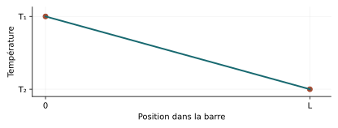
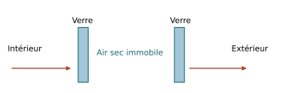
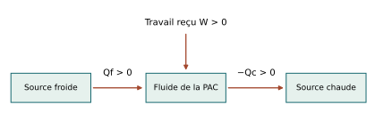
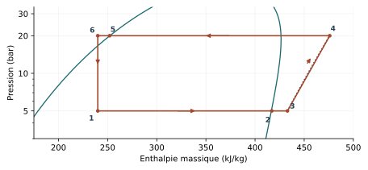

# Banque PT 2018 — Physique B · Thermodynamique · Corrigé guidé

*Corrigé rédigé par IA, non officiel. Signalez toute erreur.*

**Rédaction** · GPT-6.2 Astra Ultra · vitesse non renseignée

**Révision (tour 1)** · GPT-6.2 Astra Ultra · vitesse non renseignée

[Sujet et document réponse](https://www.banquept.fr/documents/2018/ph_b_th_2018_pt.pdf) · [Rapport du jury](https://www.banquept.fr/documents/ecrit/rapport/2018/rapport_phys_b_ecrit_2018.pdf) · [Coefficients de la session](https://www.banquept.fr/documents/livret/2018/Livret_PT_2018.pdf#page=12)

**Isolation de l’habitat, géothermie et pompe à chaleur.** Les puissances et transferts sont orientés explicitement dans les bilans. Les valeurs relevées graphiquement sont arrondies à la précision des diagrammes du sujet.

## I · Thermostats, diffusion et conduction

### Question 1 · Thermostat

**Piste de résolution**

Quelle grandeur conserve un réservoir thermique quand il reçoit une quantité finie de chaleur ?

Un thermostat est un système dont la température uniforme demeure constante lors des échanges de chaleur considérés. Il peut fournir ou recevoir de la chaleur.

### Question 2 · Exemple de source

**Piste de résolution**

Préciser par rapport à quel échange un réservoir réel peut être tenu pour idéal.

L’eau d’un grand lac bien brassé peut servir de thermostat à un petit objet immergé pendant son refroidissement. La chaleur de l’objet produit une variation négligeable de la température du lac.

### Question 3 · Capacité thermique idéale

**Piste de résolution**

Partir de la variation de température produite par un échange fini.

La capacité thermique d’un thermostat idéal est infinie. Pour un échange fini $Q$, la variation $Q/C$ tend alors vers zéro.

### Question 4 · Conduction thermique

**Piste de résolution**

Préciser le sens du vecteur densité de courant.

La loi de Fourier dans un matériau homogène isotrope s’écrit $\vec j_q=-\lambda\,\mathrm{grad}\,T$, avec $\lambda>0$ en W/(m·K). La densité de flux, en W/m², est dirigée des températures élevées vers les températures basses.

### Question 5 · Équation de la chaleur

**Piste de résolution**

Faire le bilan sur une tranche de section constante. Sa surface latérale est isolée.

**a)** L’enthalpie accumulée par unité de temps est $\rho A\,dx\,C_m\partial_t T$. La puissance conductrice nette reçue est $A[j_q(x)-j_q(x+dx)]=-A\partial_x j_q\,dx$. Sans source interne et avec $\lambda$ uniforme, la loi de Fourier donne $\rho C_m\partial_tT=\lambda\partial_x^2T$. **b)** Le coefficient de diffusion thermique est donc $D=\lambda/(\rho C_m)$.

### Question 6 · Dimension de la diffusivité

**Piste de résolution**

Comparer les dimensions de chacun des deux membres.

La dérivée temporelle est en K/s, la dérivée spatiale seconde est en K/m². Il faut donc exprimer la diffusivité en **m²/s**.

### Question 7 · Temps de diffusion dans le cuivre

**Piste de résolution**

Égaler séparément les exposants des longueurs et des temps.

**a)** Pour $L^a/D^b$, la dimension est $\mathrm{m}^{a-2b}\mathrm{s}^b$. Il faut $b=1$ et $a=2$, soit $\tau=L^2/D$. **b)** Une longueur double multiplie ce temps par quatre. Une forte conductivité raccourcit le délai, une grande capacité thermique volumique augmente l’énergie à redistribuer et le prolonge. **c)** Avec $L=1$ m, $\tau=1/(120\times10^{-6})\simeq8{,}33\times10^3$ s, soit 139 min ou 2,3 h. Même pour le cuivre, un mètre représente une grande distance pour la diffusion.

### Question 8 · Profil permanent

**Piste de résolution**

Utiliser les deux températures imposées aux extrémités pour fixer les constantes d’intégration.

En régime permanent, $T''(x)=0$. Les conditions $T(0)=T_1$ et $T(L)=T_2$ donnent $T(x)=T_1+(T_2-T_1)x/L$. Le graphe est la droite qui relie les deux températures. Le sens du courant dans la figure correspond à $T_1>T_2$.

### Question 9 · Résistance et conductance

**Piste de résolution**

Intégrer la densité de courant sur une section normale à la barre.

**a)** La puissance positive de 1 vers 2 vaut $\phi=-\lambda A\,dT/dx=(\lambda A/L)(T_1-T_2)$. **b)** Ainsi $T_1-T_2=R_{\rm th}\phi$, avec $R_{\rm th}=L/(\lambda A)$ en K/W. **c)** La conductance $G_{\rm th}=1/R_{\rm th}=\lambda A/L$, en W/K, est la puissance traversant la barre pour un kelvin d’écart entre ses extrémités.

### Question 10 · Deux lectures de chaque document

**Piste de résolution**

Le document 2 caractérise des ensembles construits et le document 3 des matériaux.

**Document 2.** À surface et écart de température égaux, le double vitrage laisse passer la moitié de la puissance du simple (3 contre 6 W/(m²·K)). À 30 cm d’épaisseur, le mur creux transmet 25 % de moins que le mur plein (1,5 contre 2).

**Document 3.** À géométrie identique, le cuivre conduit environ 400 fois plus que le verre. L’air sec et la laine de verre présentent des conductivités proches et faibles (0,03 et 0,04 W/(m·K)), ce qui explique l’intérêt d’immobiliser de l’air dans un isolant.

## I · Isolation de l’habitat

### Question 11 · Double vitrage

**Piste de résolution**

Comparer les conductivités et se demander pourquoi la lame d’air est mince et fermée.

Deux feuilles de verre encadrent une lame d’air sec emprisonnée. Les résistances à la conduction s’ajoutent. À épaisseur égale, l’air présente une résistance environ 33 fois supérieure à celle du verre. Une lame assez mince limite la convection naturelle, et l’étanchéité évite le renouvellement d’air. Le document 2 donne pour l’ensemble $U=3$ W/(m²·K), contre 6 pour le vitrage simple.

### Question 12 · Bilan annuel des fenêtres

**Piste de résolution**

Multiplier une puissance en kW par les 4 000 heures de chauffage.

**a)** Le flux de perte en valeur positive est $\Phi=UA\Delta T$ avec $A=1$ m² et $\Delta T=10$ K. **b)** Pendant la saison de chauffe, $E=(\Phi/1000)\times4000$ en kWh. Le coût annuel vaut 0,15 euro par kWh multiplié par cette énergie.

| Vitrage de 1 m² | Flux (W) | Énergie annuelle (kWh) | Coût annuel (€) |
|:--|--:|--:|--:|
| Simple | 60 | 240 | 36 |
| Double | 30 | 120 | 18 |

### Question 13 · Bilan annuel du mur

**Piste de résolution**

Le même courant traverse le mur et l’isolant. Additionner leurs résistances.

**a et b)** Pour le mur plein de 1 m², $\Phi=2\times10=20$ W, d’où 80 kWh et 12 euros. **c)** Pour les couches en série, $U_{\rm eq}=(1/U_m+1/U_i)^{-1}=(1/2+1/0{,}5)^{-1}=0{,}40$ W/(m²·K). Pour un prix $p$ par kWh, l’économie vaut $p(U_m-U_{\rm eq})A\Delta T\,\Delta t/1000$ avec $\Delta t$ en heures, soit 9,60 euros par m² et par an. Les pertes de ce mur baissent de 80 % dans le modèle du sujet. La colonne du tableau mural est libellée en kW, celle du tableau des fenêtres en W.

| Paroi de 1 m² | Flux (kW) | Énergie annuelle (kWh) | Coût annuel (€) |
|:--|--:|--:|--:|
| Mur plein de 30 cm | 0,020 | 80 | 12,00 |
| Mur et polystyrène de 2 cm | 0,004 | 16 | 2,40 |

### Question 14 · Orientation et volets

**Piste de résolution**

Tenir compte de la latitude de l’Alsace, puis distinguer hiver et été.

**a)** Les ouvertures au sud captent le soleil bas d’hiver. Au nord, réduire le vitrage diminue les déperditions pour un faible apport solaire direct. Au sud, des arbres à feuilles caduques ombragent en été et laissent entrer le soleil après la chute des feuilles. **b)** À géométrie comparable, un volet plein en bois est préférable au métal plein, beaucoup plus conducteur. La lame d’air entre volet fermé et fenêtre renforce l’isolation.

## II · Chauffage d’un appartement

### Question 15 · Volume et masse d’air du logement

**Piste de résolution**

Utiliser la hauteur sous plafond et la masse volumique indiquée.

Le volume est $V=100\times2{,}5=250$ m³. La masse d’air sec vaut $m=\rho V=1{,}2\times250=300$ kg.

### Question 16 · Durée idéale de chauffage

**Piste de résolution**

Le chauffage est isobare et la puissance est constante. Écrire le bilan d’enthalpie de l’air seul.

**a)** Avec $c_{p,a}=10^3$ J/(kg·K), on obtient $C=mc_{p,a}=3{,}0\times10^5$ J/K. **b)** L’élévation de 10 K exige $C\Delta T=3{,}0$ MJ. Avec 5 kW, $t=C\Delta T/P=600$ s, soit dix minutes. **c)** Ce délai court ne concerne que l’air. Le chauffage des parois, du mobilier, la ventilation et les pertes prolongent la montée en température d’une habitation réelle.

### Question 17 · Quatre fenêtres et puissance des convecteurs

**Piste de résolution**

Les fenêtres séparent les mêmes atmosphères intérieure et extérieure.

**a)** Une fenêtre de 2,5 m² a une conductance de $6\times2{,}5=15$ W/K en vitrage simple et de 7,5 W/K en double. **b)** Les quatre fenêtres sont en parallèle car elles subissent le même écart de température et leurs courants s’ajoutent. **c)** Leurs conductances totales sont 60 et 30 W/K. Sous 10 K, elles perdent 600 et 300 W. **d)** Si cette perte représente 20 % du total dans chaque configuration, les convecteurs doivent fournir 3,0 et 1,5 kW. Sur 4 000 h et 100 m², cela donne 120 et 60 kWh/(m²·an). L’ordre de grandeur est compatible avec les 100 kWh/(m²·an) du document 1 pour le parc récent. Ce document inclut aussi l’eau chaude sanitaire et décrit des logements de plusieurs générations.

### Question 18 · Surcoût d’un degré

**Piste de résolution**

Avec une conductance constante, le coût est proportionnel à l’écart avec l’extérieur.

Porter l’écart de 10 à 11 K multiplie les pertes et la facture de chauffage sur la même période par $11/10$. Le surcoût relatif vaut **10 %**.

## III · Géothermie et pompe à chaleur

### Question 19 · Profondeur de pénétration saisonnière

**Piste de résolution**

Combiner la diffusivité du sable et la durée d’une année.

Une longueur caractéristique annuelle est $\sqrt{D t_a}=\sqrt{0{,}2\times10^{-6}\times3\times10^7}\simeq2{,}4$ m. Les fluctuations sont donc amorties sur quelques mètres. Pour une excitation sinusoïdale, l’amplitude est multipliée par $\exp(-z/\delta)$ avec $\delta=\sqrt{Dt_a/\pi}\simeq1{,}4$ m. À 4,2 m, il reste environ 5 % de l’amplitude superficielle. Une profondeur minimum précise dépend du seuil choisi.

### Question 20 · Front de réinjection et chaleur disponible

**Piste de résolution**

Distinguer le volume du cylindre balayé et le volume d’eau contenu dans les pores.

**a et b)** Dans le modèle cylindrique simplifié suggéré par les variables demandées, $dV=2\pi rH\,dr=D_V\,dt$. Avec $r(0)=0$, $r(t)=\sqrt{D_Vt/(\pi H)}$. **c)** Pour un écart de puits $H'=1000$ m, $t=\pi H(H')^2/D_V\simeq3{,}14\times10^6$ h, soit environ 360 ans avec l’aide numérique. Si l’on suit le front d’eau dans les **seuls pores**, il faut multiplier le volume par la porosité $\varepsilon=0{,}15$. Alors $r=\sqrt{D_Vt/(\pi\varepsilon H)}$ et le temps est de 54 ans. Ces deux estimations traduisent deux conventions de volume. L’échange thermique avec la roche, la structure des écoulements et la recharge modifient le temps réel de percée.

**d)** Un mètre carré de nappe correspond à $\varepsilon H=15$ m³ d’eau. Le refroidissement de 70 à 10 °C fournit $15\times1000\times1\times60=9{,}0\times10^5$ kcal par m², soit 60 000 kcal par m³ d’eau. Cela égale les **60 Mcal/m³ donnés pour le pétrole dans l’énoncé**, puisque 1 Mcal vaut 1 000 kcal. Cette comparaison utilise strictement la valeur imprimée. **e)** L’énergie est locale et le débit disponible représente environ $100\times1000\times4{,}18\times60/3600\simeq7$ MW thermiques en continu. L’intérêt énergétique est réel. Pour conclure sur la rentabilité financière, il faut aussi le coût des deux forages, du pompage, de la distribution, l’usage effectif de la chaleur et la durée d’exploitation.

### Question 21 · Pompe à chaleur réversible

**Piste de résolution**

Adopter le point de vue du fluide et fermer son bilan sur un cycle.

**a)** Les deux thermostats gardent respectivement $T_c$ et $T_f$ constantes, avec $T_c>T_f$. En hiver, la source froide est l’air extérieur et la source chaude est l’eau de chauffage. **b)** Le fluide extrait $Q_f>0$ de l’extérieur, reçoit $W>0$ du compresseur et donne au chauffage $-Q_c>0$, donc $Q_c<0$. Sur un cycle, $W+Q_f+Q_c=0$. **c)** Pour un cycle réversible, $Q_f/T_f+Q_c/T_c=0$. En éliminant $Q_f$, on obtient $\mathrm{COP}_{\rm chauffage}=(-Q_c)/W=T_c/(T_c-T_f)$ en températures absolues.

### Question 22 · Cycle du R410A sur le document réponse

**Piste de résolution**

Repérer la rupture d’échelle à 380 kJ/kg, puis suivre l’isentrope 1900 J/(kg·K) de 5 à 20 bar.

**a et b)** Sur le diagramme du document réponse, la branche vapeur à 5 bar donne $h_2\simeq417$ kJ/kg. L’isentrope passant par 3 et 4 donne environ 433 et 476 kJ/kg. La branche liquide à 20 bar donne $h_5\simeq252$ kJ/kg. Les états 1 et 6 ont même abscisse. La légende de l’abaque exprime l’entropie en J/(kg·K). La valeur 1900 du tableau correspond donc à 1,900 kJ/(kg·K). Le schéma ci-dessous réexprime les abscisses avec une échelle uniforme. Orienter le cycle dans le sens 1→2→3→4→5→6→1.

| État | 1 | 2 | 3 | 4 | 5 | 6 |
|:--|--:|--:|--:|--:|--:|--:|
| Pression (bar) | 5 | 5 | 5 | 20 | 20 | 20 |
| Enthalpie (kJ/kg) | 240 | ≈417 | ≈433 | ≈476 | ≈252 | 240 |

**c)** La liquéfaction libère de la chaleur. Le condenseur est placé du côté de l’eau à chauffer afin de lui transférer cette chaleur. **d et e)** Le bilan permanent $h_j-h_i=w_{ij}+q_{ij}$ s’applique aux cinq étapes. Dans les échangeurs fixes, $w=0$. Le compresseur isentropique est ici adiabatique. On obtient $q_{12}=h_2-h_1\simeq+177$, $q_{23}=h_3-h_2\simeq+16$, $w_{34}=h_4-h_3\simeq+43$, $q_{45}=h_5-h_4\simeq-224$ et $q_{56}=h_6-h_5\simeq-12$, en kJ/kg. La détente conserve $h$.

**f)** Le chauffage fournit environ 236 kJ/kg, soit $\mathrm{COP}\simeq236/43\simeq5{,}5$. Les températures extrêmes **du fluide** sont proches de −14 °C et 71 °C. Le COP d’une machine de Carnot entre deux thermostats à ces extrêmes serait $344/(344-259)\simeq4{,}0$. Cette comparaison fait intervenir des thermostats fictifs. L’eau n’a pas à être chauffée partout à la température de refoulement. En prenant comme niveaux de source les paliers d’évaporation et de condensation (−14 et 32 °C), la valeur idéale correspondante serait $305/(305-259)\simeq6{,}6$. **g)** Pour une puissance chauffante de 5 kW, $\dot m=5/236\simeq0{,}021$ kg/s, soit environ 76 kg/h.

