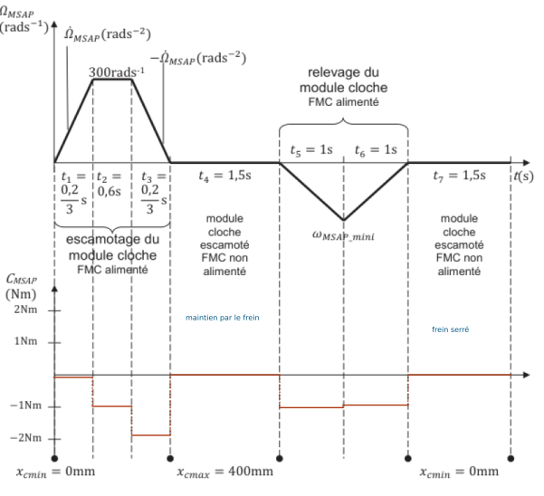
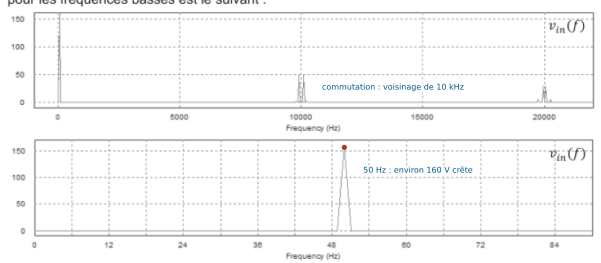
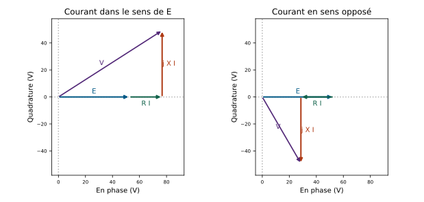
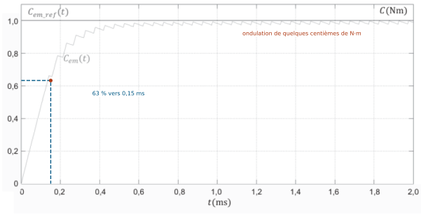
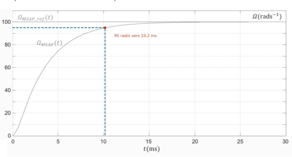
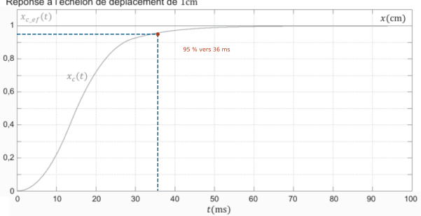
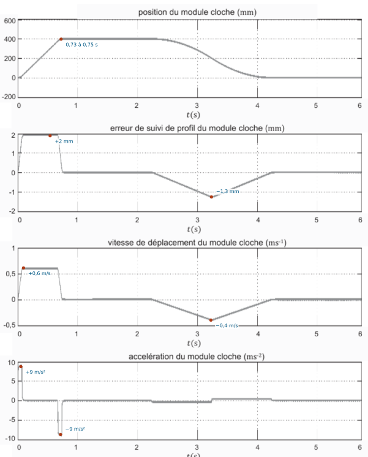

# Banque PT 2018 — Sciences industrielles A · Corrigé guidé

*Corrigé rédigé par IA, non officiel. Signalez toute erreur.*

**Rédaction** · GPT-6.2 Astra Ultra · vitesse non renseignée · 26 novembre 2026

**Révision (tour 1)** · GPT-6.2 Astra Ultra · vitesse non renseignée · 26 novembre 2026

**Vitrine sécurisée.** Épreuve de cinq heures, calculatrice interdite. Le sujet et le rapport du jury présentent quatre parties numérotées, soit 53 questions. Les extraits de catalogues et les grilles figurent dans le sujet et son cahier de réponses.

[Sujet et cahier officiels](https://www.banquept.fr/documents/2018/si_a_2018_pt.pdf) · [Rapport du jury](https://www.banquept.fr/documents/ecrit/rapport/2018/rapport_si_a_ecrit_2018.pdf)

Le jury relève des erreurs de signe sur le chronogramme de couple et les forces de guidage. Il demande de justifier chaque critère de validation séparément. Les indications précisent la convention ou la donnée à utiliser avant les calculs.

## 1. Démonstration et dimensionnement mécanique

### Question 1 — Démonstration en cinq escamotages

> [!INDICATION]
> L’incrémentation a lieu à l’entrée de l’état Escamotage ; le test de trois cycles a lieu en haut.

#### Solution

La demande initialise le compteur à zéro. La cloche est fermée et haute : depuis Attente (1), on entre en Escamotage (2), compteur 1. En bas, tant que le compteur est inférieur à 5, on entre en Relevage (3). Après les deux premiers relevages, on redescend directement. Après le troisième, la cloche s’ouvre (4), puis se ferme (5) ; le capteur de fermeture relance le quatrième escamotage. Après le quatrième relevage on redescend pour la cinquième fois. En bas, le test « compteur inférieur à 5 » échoue : retour en Attente, cloche basse et fermée. Séquence des états : $1,2,3,2,3,2,3,4,5,2,3,2,1$.

[Sujet p. 7](https://www.banquept.fr/documents/2018/si_a_2018_pt.pdf#page=7) · [Cahier p. 34 du PDF](https://www.banquept.fr/documents/2018/si_a_2018_pt.pdf#page=34)

### Question 2 — Rapport cinématique initial

> [!INDICATION]
> Convertir les tours par minute en radians par seconde.

#### Solution

Pour 0,40 m en 0,80 s, $v=0{,}50$ m/s. À 3000 tr/min, $\Omega=100\pi$ rad/s, d’où $r_{cc}=v/\Omega=1{,}59\times10^{-3}$ m/rad. Le choix 0,002 m/rad procure une vitesse de plateau plus élevée et laisse du temps pour les rampes d’accélération et de décélération.

### Question 3 — Nécessité du réducteur

> [!INDICATION]
> Sans réduction mécanique, le rapport déplacement/angle serait directement le rayon primitif.

#### Solution

Il faudrait un rayon primitif de 2 mm avec une liaison directe. Le pignon de 20 mm retenu donnerait dix fois le déplacement voulu ; un rayon dix fois plus petit limiterait fortement nombre et taille des dents ainsi que leur tenue à l’effort. Le réducteur adapte la vitesse et le couple en conservant le pignon prévu.

### Question 4 — Choix du rapport catalogue

> [!INDICATION]
> Exprimer la vitesse de crémaillère à partir de la vitesse du pignon.

#### Solution

$r_{cc}=R\Omega_p/\Omega_m$ impose $\Omega_p/\Omega_m=0{,}002/0{,}020=0{,}10$. Le « ratio » du catalogue est l’inverse, soit **10:1**. Le code 010 est proposé avec un étage dans la gamme PEII.

### Question 5 — Durées des trois phases

> [!INDICATION]
> L’aire du trapèze de vitesse est la course ; ses deux triangles ont la même aire.

#### Solution

$v_m=r_{cc}\,300=0{,}60$ m/s. À la limite d’accélération de 9 m/s² les deux rampes durent $t_1=t_3=v_m/9=1/15$ s. La distance vaut $v_m[t_2+(t_1+t_3)/2]$, donc $t_2=0{,}400/0{,}60-1/15=0{,}60$ s. Si l’inégalité « inférieur à 9 » est prise strictement, augmenter légèrement les temps de rampe et raccourcir le plateau d’autant pour conserver la course.

### Question 6 — Temps d’escamotage

> [!INDICATION]
> Additionner des durées, et non les dates de début des phases.

#### Solution

$t_e=t_1+t_2+t_3=11/15=0{,}733$ s. Le mouvement respecte 0,8 s avant même la flexibilité de 100 ms.

### Question 7 — Vitesse maximale de relevage

> [!INDICATION]
> Le relevage couvre la même course, en sens opposé, avec un profil triangulaire.

#### Solution

$-0{,}4=r_{cc}\Omega_{\min}(t_5+t_6)/2$, avec $t_5=t_6=1$ s. D’où $\Omega_{\min}=-200$ rad/s ; la vitesse verticale extrême vaut $-0{,}40$ m/s si la descente est positive.

### Question 8 — Pression et couple du frein

> [!INDICATION]
> Intégrer la traction tangentielle sur l’unique face annulaire en contact.

#### Solution

Avec $r_i,r_e$ les rayons, $p=N/[\pi(r_e^2-r_i^2)]$. Un anneau de largeur $dr$ contribue $dC=r(fp)2\pi r\,dr$. Ainsi $C_F=(2fN/3)(r_e^3-r_i^3)/(r_e^2-r_i^2)$. Aucune seconde surface de friction n’est à ajouter.

### Question 9 — Couple transmissible

> [!INDICATION]
> Employer un rayon moyen pondéré par l’aire, exprimé en mètres.

#### Solution

Pour $r_e=0{,}060$, $r_i=0{,}040$ m, $N=200$ N et $f=0{,}4$, $p=31{,}8$ kPa et le rayon de frottement vaut 50,67 mm. $C_F=4{,}05$ N·m, environ 27 % au-dessus des 3,2 N·m garantis. Répartition réelle et dispersion du frottement peuvent expliquer une garantie plus basse.

### Question 10 — Maintien du module chargé

> [!INDICATION]
> Égaler le travail du poids au travail du couple ramené sur l’arbre.

#### Solution

La charge est $M=40+10=50$ kg. En comptant la descente positivement, $C_g=Mgr_{cc}=0{,}981$ N·m. La valeur fabricant 3,2 N·m donne un rapport de maintien de 3,26 ; le frein suffit sur ce modèle statique.

### Question 11 — Inertie ramenée

> [!INDICATION]
> Conserver l’énergie cinétique entre translation et rotation.

#### Solution

$Mv^2/2=J_r\Omega^2/2$ et $v=r_{cc}\Omega$ donnent $J_r=Mr_{cc}^2=2{,}0\times10^{-4}\ \mathrm{kg\,m^2}$. Cette première estimation concerne module et objet.

### Question 12 — Chronogramme du couple

> [!INDICATION]
> Pendant les deux pauses le frein assure le maintien ; ailleurs le poids assiste le mouvement positif.

#### Solution

Quand le frein est libéré, $J_r\dot\Omega=C_m+C_g$. Les accélérations angulaires successives sont $4500,0,-4500$ rad/s² en descente puis $-200,+200$ en montée. Sur les sept durées $t_1$ à $t_7$, les couples moteur sont donc $-0{,}081$, $-0{,}981$, $-1{,}881$, $0$, $-1{,}021$, $-0{,}941$, $0$ N·m. Le premier couple est déjà légèrement négatif : le poids seul accélérerait plus vite que la consigne. Les pauses de 1,5 s ne demandent aucun couple moteur.

[Sujet p. 11](https://www.banquept.fr/documents/2018/si_a_2018_pt.pdf#page=11) · [Cahier p. 38 du PDF](https://www.banquept.fr/documents/2018/si_a_2018_pt.pdf#page=38)

### Question 13 — Couple thermique

> [!INDICATION]
> Une valeur efficace tient compte du carré du couple et de la durée de chaque palier.

#### Solution

$T=5{,}733$ s. Avec les sept couples de Q12, $C_{th1}=\sqrt{\sum_jt_j C_j^2/T}=0{,}692$ N·m. Le signe des couples disparaît dans cette somme, leurs durées restent distinctes.

### Question 14 — Choix initial du moteur

> [!INDICATION]
> Vérifier individuellement les quatre valeurs du constructeur.

#### Solution

La pointe de 1,881 N·m reste sous 4 N·m. Le couple efficace 0,692 est juste inférieur à 0,7 N·m. La pointe de 300 rad/s équivaut à 2865 tr/min, sous 6500. La constante thermique est 15 min, soit 900 s, au-dessus de $20T=114{,}7$ s. Les quatre critères sont satisfaits, avec peu de réserve thermique.

### Question 15 — Contrôle avec le modèle affiné

> [!INDICATION]
> Repérer les critères affectés par l’inertie du rotor et la saturation.

#### Solution

On a désormais 2 N·m en pointe au lieu de 1,881, sous la limite de 4. Le couple efficace 0,7 N·m atteint exactement le nominal. La vitesse maximale et la durée du cycle restent celles de Q14. Le choix est admissible selon les quatre conditions, sans réserve sur le couple nominal.

### Question 16 — Vitesse avant impact

> [!INDICATION]
> Appliquer la conservation de l’énergie sur la chute avant contact.

#### Solution

$Mgh=Mv^2/2$ donne $v=\sqrt{2g\times0{,}400}=2{,}80$ m/s vers le bas. La masse se simplifie.

### Question 17 — Travail à absorber

> [!INDICATION]
> Pendant les 25 mm de compression, le poids continue à travailler.

#### Solution

L’énergie cinétique au contact vaut $Mgh=196{,}2$ J. L’amortisseur doit aussi absorber $Mgs=12{,}26$ J pour $s=0{,}025$ m ; le total est $Mg(h+s)=208{,}5$ J.

### Question 18 — Choix catalogue de l’amortisseur

> [!INDICATION]
> Comparer simultanément la course, l’énergie et l’intervalle de vitesse.

#### Solution

Retenir **OEMXT 1.5M × 1**, course 25 mm, plage 0,3–3,5 m/s, capacité 425 J. Sa force admissible 20 kN est supérieure à la force moyenne $208{,}5/0{,}025=8{,}34$ kN. La version LR ne couvre que 0,08–1,3 m/s. Le modèle standard le plus court répond aux besoins ; aucun prix chiffré n’est fourni pour comparer des devis.

### Question 19 — Décélération en arrêt de secours

> [!INDICATION]
> Utiliser la relation vitesse–distance à accélération constante pendant la compression.

#### Solution

Sur l’axe descendant, $0=v^2+2as$, d’où $a=-v^2/(2s)=-157\ \mathrm{m\,s^{-2}}$, soit environ $16g$. Cela dépasse largement les 9 m/s² du cycle commandé. La butée permet l’arrêt d’urgence mais ne reproduit pas les conditions de préservation du cycle normal.

### Question 20 — Forces de frottement aux patins

> [!INDICATION]
> À la descente, les deux composantes tangentielles sont vers le haut ; les deux normales sont opposées.

#### Solution

Avec les axes de la figure, $X_A>0$, $X_B<0$, $Y_A>0$, $Y_B>0$. Au seuil d’une descente, $Y_A=fX_A$ et $Y_B=-fX_B$.

### Question 21 — Équilibre des moments en B

> [!INDICATION]
> Le moment du poids en B comporte le bras horizontal $c-a$.

#### Solution

La projection suivant $z_0$ élimine la réaction en B : $2aY_A-2bX_A+(c-a)F_g=0$. En remplaçant $Y_A$ on obtient $X_A=F_g(c-a)/[2(b-af)]$.

### Question 22 — Équilibre des moments en A

> [!INDICATION]
> Le poids et la force de B ont ici d’autres bras de levier.

#### Solution

$-2aY_B+2bX_B+(c+a)F_g=0$. Avec $Y_B=-fX_B$, il vient $X_B=-F_g(c+a)/[2(b+af)]$, de signe opposé à $X_A$.

### Question 23 — Résultante verticale

> [!INDICATION]
> Les seules forces extérieures verticales sont le poids et les deux frottements.

#### Solution

$Y_A+Y_B-F_g=0$, soit $f(X_A-X_B)=F_g$ au seuil.

### Question 24 — Seuil d’arc-boutement

> [!INDICATION]
> Substituer les deux réactions normales dans l’équilibre vertical avant l’application numérique.

#### Solution

On obtient $f[(c-a)/(b-af)+(c+a)/(b+af)]=2$. En réduisant au même dénominateur les termes en $f^2a^2$ disparaissent, laissant $fbc=b^2$. Ainsi $f_{\rm lim}=b/c=50/200=0{,}25$. Le coefficient téflon–acier 0,05 est inférieur ; l’équilibre bloqué sous le poids n’est pas possible dans ce modèle.

## 2. Alimentation par onduleur triphasé

### Question 25 — Tensions composées

> [!INDICATION]
> Une tension entre deux sorties de bras est la différence de leurs potentiels par rapport au rail bas.

#### Solution

$u_{ac}=V_{DC}(f_{ca}-f_{cc})$ et $u_{bc}=V_{DC}(f_{cb}-f_{cc})$. Les processeurs R1 et R2 donnent donc $m_{ac}=f_{ca}-f_{cc}$ et $m_{bc}=f_{cb}-f_{cc}$.

[Sujet p. 15](https://www.banquept.fr/documents/2018/si_a_2018_pt.pdf#page=15) · [Cahier p. 43 du PDF](https://www.banquept.fr/documents/2018/si_a_2018_pt.pdf#page=43)

### Question 26 — Tensions simples

> [!INDICATION]
> Utiliser l’absence de composante homopolaire pour déterminer le potentiel du neutre.

#### Solution

De $u_{ac}=v_{an}-v_{cn}$, $u_{bc}=v_{bn}-v_{cn}$ et $v_{an}+v_{bn}+v_{cn}=0$, on tire pour R5, R6 et R7 : $v_{an}=(2u_{ac}-u_{bc})/3$, $v_{bn}=(2u_{bc}-u_{ac})/3$, $v_{cn}=-(u_{ac}+u_{bc})/3$.

### Question 27 — Matrice de conversion

> [!INDICATION]
> La somme des lignes doit s’annuler, y compris quand les trois interrupteurs hauts sont fermés.

#### Solution

Avec $\mathbf f=(f_{ca},f_{cb},f_{cc})^T$, $\mathbf v=V_{DC}(I_3-\mathbf1\mathbf1^T/3)\mathbf f$. La matrice vaut $V_{DC}/3$ fois les lignes $(2,-1,-1)$, $(-1,2,-1)$ et $(-1,-1,2)$.

### Question 28 — Rapport cyclique par comparaison

> [!INDICATION]
> Sur une période, la porteuse triangulaire passe un temps proportionnel à la hauteur de l’intervalle considéré.

#### Solution

Pour une modulante quasi constante, l’interrupteur supérieur conduit lorsque $v_p<m_i$. Sa fraction de période est $\overline{f_{ci}}=(m_i+V_{p,\max})/(2V_{p,\max})$. Aux deux bornes de modulation on retrouve 0 et 1.

### Question 29 — Gain de l’onduleur moyenné

> [!INDICATION]
> La matrice de Q27 élimine un vecteur commun aux trois phases.

#### Solution

$\overline{\mathbf f}=\mathbf1/2+\mathbf m/(2V_{p,\max})$ et $\sum m_i=0$. La composante commune disparaît, d’où $\overline{\mathbf v}=[V_{DC}/(2V_{p,\max})]\mathbf m$. Ce facteur est le scalaire demandé.

### Question 30 — Vérification du spectre

> [!INDICATION]
> Comparer les valeurs efficaces et repérer jusqu’où s’étend la bande des vingt premiers rangs.

#### Solution

À modulation maximale, la crête du fondamental est $320/2=160$ V et sa valeur efficace est $113{,}1$ V, au-dessus de 100 V. Le rapport de modulation règle l’amplitude entre zéro et cette valeur. Dans la bande jusqu’à $20\times50=1000$ Hz, le tracé ne montre aucune raie autre que le fondamental ; les premiers paquets visibles sont voisins de 10 kHz. Le rapport parasite est négligeable dans la résolution du graphe et respecte un plafond de 0,1, avec sa tolérance. Le tableau formule ce niveau sans signe d’inégalité : pris comme cible bilatérale stricte, aucun premier harmonique mesurable dans la bande ne permet d’attribuer un ratio voisin de 0,10. L’intérêt de la MLI est de rejeter l’ondulation loin de la bande utile.

[Sujet p. 17](https://www.banquept.fr/documents/2018/si_a_2018_pt.pdf#page=17) · [Cahier p. 45 du PDF](https://www.banquept.fr/documents/2018/si_a_2018_pt.pdf#page=45)

## 3. Génération et commande du couple

### Question 31 — Couple instantané

> [!INDICATION]
> Additionner les produits f.é.m.–courant déphasés de 120° avant de diviser par la vitesse.

#### Solution

Les termes de somme des angles s’annulent par symétrie triphasée. Les trois différences d’angles valent $(p\Omega-\omega_s)t+\Psi$. Ainsi $P_{em}=3p\Omega\Phi_{f,\rm rms}I_{\rm rms}\cos[(p\Omega-\omega_s)t+\Psi]$ et $C_{em}=3p\Phi_{f,\rm rms}I_{\rm rms}\cos[(p\Omega-\omega_s)t+\Psi]$ ; cette dernière forme se prolonge au repos.

[Sujet p. 19](https://www.banquept.fr/documents/2018/si_a_2018_pt.pdf#page=19) · [Cahier p. 46 du PDF](https://www.banquept.fr/documents/2018/si_a_2018_pt.pdf#page=46)

### Question 32 — Synchronisme et couple non nul

> [!INDICATION]
> Le cosinus doit avoir un argument constant et une valeur non nulle.

#### Solution

Il faut $\omega_s=p\Omega$ et $\cos\Psi\ne0$, soit $\Psi\ne\pi/2+k\pi$, avec flux et courant non nuls. Le signe de $\cos\Psi$ fixe celui du couple pour l’amplitude de courant positive.

### Question 33 — Stabilité statique

> [!INDICATION]
> Réexprimer le couple en fonction de l’angle entre champs imposé par le feuillet.

#### Solution

Avec $\alpha=\pi/2-\Psi$, $C=C_0\sin\alpha$ et $\partial C/\partial\alpha=C_0\cos\alpha=C_0\sin\Psi$. Pour $C_0>0$ le domaine strictement stable est $0<\Psi<\pi$. Les bornes donnent une pente nulle ; à $\Psi=\pi/2$ le couple est nul.

### Question 34 — Grandeurs de commande

> [!INDICATION]
> Distinguer l’autopilotage de la pulsation et le réglage de l’amplitude du couple.

#### Solution

Mesurer la position rotorique pour imposer l’angle électrique et la pulsation $p\Omega$, contrôler la phase $\Psi$ sur la branche stable et l’amplitude des courants triphasés. À flux fixé, le couple est proportionnel à $I_{\rm rms}\cos\Psi$. Le choix $\Psi=0$ utilisé ensuite maximise le couple par ampère et se trouve à la borne du critère de stabilité statique en boucle ouverte ; le pilotage actif assure le synchronisme.

### Question 35 — Réactance au point maximal

> [!INDICATION]
> La pulsation dans la réactance est électrique.

#### Solution

$X_s=L_{sc}\omega_s=L_{sc}p\Omega$. Pour $L_{sc}=14{,}3$ mH, $p=3$ et $\Omega=300$ rad/s, $\omega_s=900$ rad/s et $X_s=12{,}87\ \Omega$.

### Question 36 — F.é.m. et courant efficaces

> [!INDICATION]
> Les constantes catalogue portent sur les crêtes ; le modèle de Fresnel utilise des valeurs efficaces.

#### Solution

$N=300\times60/(2\pi)=2865$ tr/min. La f.é.m. crête vaut $k_eN=74{,}5$ V, donc $E=52{,}7$ V efficaces. La pointe du courant est $2/0{,}37=5{,}41$ A ; $I_s=3{,}82$ A efficaces. Le point est transitoire relativement au courant nominal continu.

### Question 37 — Construction de Fresnel

> [!INDICATION]
> Poser la f.é.m. sur un axe et ajouter aux bonnes extrémités les deux chutes de tension.

#### Solution

La maille s’écrit $\underline V=\underline E+R_s\underline I+jX_s\underline I$. Avec $\Psi=0$ et l’amplitude positive, le vecteur $R_s I$ est colinéaire à $E$, le vecteur $jX_sI$ est en avance de 90°. Pour le point de couple signé négatif mentionné dans le sujet, le courant actif s’inverse et les deux chutes changent de sens. La figure représente les deux polygones pour expliciter ces conventions.

[Sujet p. 20](https://www.banquept.fr/documents/2018/si_a_2018_pt.pdf#page=20) · [Cahier p. 48 du PDF](https://www.banquept.fr/documents/2018/si_a_2018_pt.pdf#page=48)

### Question 38 — Tension requise de l’onduleur

> [!INDICATION]
> La chute résistive est en phase avec le courant, la chute inductive est en quadrature.

#### Solution

Pour les modules et la convention $\Psi=0$ de Q37, $V=\sqrt{(E+R_sI)^2+(X_sI)^2}\simeq91{,}2$ V. Pour le couple effectivement négatif à vitesse positive, $V=\sqrt{(E-R_sI)^2+(X_sI)^2}\simeq56{,}9$ V. Ces deux valeurs sont sous les 110 V efficaces disponibles.

### Question 39 — Reconstruction du courant

> [!INDICATION]
> Le moteur est couplé en étoile, sans conducteur de neutre.

#### Solution

La loi des nœuds donne $i_a+i_b+i_c=0$, d’où $i_c=-(i_a+i_b)$. Deux mesures simultanées suffisent.

### Question 40 — Bande des boucles de courant

> [!INDICATION]
> Séparer fréquence électrique, bande de la régulation et fréquence de commutation.

#### Solution

La pulsation électrique maximale est $3\times300=900$ rad/s, soit 143 Hz. La bande doit être supérieure à 143 Hz pour suivre les courants et suffisamment inférieure aux 10 kHz de la porteuse. Une bande proche de 1 kHz, environ sept fois la fréquence maximale et un dixième de la porteuse, satisfait le cahier présenté ensuite.

### Question 41 — Compensation électrique

> [!INDICATION]
> Identifier la constante de temps du premier ordre d’un enroulement.

#### Solution

Dans $1/(R_s+L_{sc}p)$ le pôle est $-R_s/L_{sc}$. Le zéro du PI le compense pour $\tau_I=L_{sc}/R_s=2{,}27$ ms.

### Question 42 — Boucle fermée de courant

> [!INDICATION]
> Conserver le gain de capteur dans la boucle ouverte ; il est aussi appliqué à la référence.

#### Solution

Après compensation, le gain de boucle vaut $K_{PI}G_{on}k_i/(L_{sc}p)$. Le transfert $I_a/I_{a,ref}=1/[1+L_{sc}p/(K_{PI}G_{on}k_i)]$ a un gain statique unitaire et un pôle réel négatif pour un gain positif.

### Question 43 — Gain proportionnel du PI

> [!INDICATION]
> La pulsation à −3 dB d’un premier ordre est l’inverse de sa constante de temps.

#### Solution

On impose $K_{PI}=2\pi f_{BFI}L_{sc}/(G_{on}k_i)$. Pour 1 kHz, $G_{on}=160$ et $k_i=1$, on trouve $K_{PI}=0{,}562$ et $\tau_{BFI}=159$ µs.

### Question 44 — Contrôle de la génération du couple

> [!INDICATION]
> Lire la moyenne et l’ondulation séparément sur la vue globale et le zoom.

#### Solution

Le point 2 N·m, 300 rad/s est compatible avec Q35–38. La réponse à l’échelon de 1 N·m monte sans dépassement notable de l’enveloppe et rejoint la référence en moyenne. Le niveau 63 % est atteint vers 0,14–0,16 ms, soit une bande de l’ordre de 1,0–1,1 kHz, cohérente avec la constante de 150 µs adoptée ensuite (1061 Hz). L’ondulation au plateau se lit à environ 0,02–0,03 N·m crête à crête, sous la tolérance de ±0,05 N·m. L’erreur statique moyenne est nulle à la précision graphique.

[Sujet p. 23](https://www.banquept.fr/documents/2018/si_a_2018_pt.pdf#page=23) · [Cahier p. 51 du PDF](https://www.banquept.fr/documents/2018/si_a_2018_pt.pdf#page=51)

## 4. Commande en vitesse et en position

### Question 45 — Transfert mécanique dominant

> [!INDICATION]
> Comparer la constante de temps mécanique à celle de la boucle de couple.

#### Solution

$\tau_m=J/f=0{,}0002/0{,}02=10$ ms est environ 67 fois la constante de couple 0,15 ms. À l’échelle de la vitesse, $C_{em}/C_{em,ref}\simeq1$. La transmittance demandée, en asservissement, vaut $\Omega/C_{em,ref}\simeq1/(f+Jp)=K_{BO\Omega}/(1+\tau_{BO\Omega}p)$, avec $K_{BO\Omega}=50$ et $\tau_{BO\Omega}=10$ ms.

[Sujet p. 25](https://www.banquept.fr/documents/2018/si_a_2018_pt.pdf#page=25) · [Cahier p. 52 du PDF](https://www.banquept.fr/documents/2018/si_a_2018_pt.pdf#page=52)

### Question 46 — Conversion des impulsions en angle

> [!INDICATION]
> Une révolution correspond à 10000 tops et à $2\pi$ radians.

#### Solution

Pour un zéro du compteur à l’origine, $\theta[k]=k_\theta n[k]$, $k_\theta=2\pi/10000=\pi/5000$ rad/top. Ajouter l’angle initial si l’origine choisie est différente.

### Question 47 — Vitesse par différence arrière

> [!INDICATION]
> Diviser la différence des angles par la période d’acquisition ; ne pas la confondre avec celle du variateur.

#### Solution

À 100 kHz, $T_e=10^{-5}$ s. On reconstruit $\Omega[k]=(\theta[k]-\theta[k-1])/T_e=20\pi(n[k]-n[k-1])$ rad/s. Le signe est porté par le comptage/décomptage ; un top d’écart représente environ 62,8 rad/s sur un seul pas de mesure.

### Question 48 — Validation du suivi de vitesse

> [!INDICATION]
> Sur la courbe 0–100 rad/s relever le premier passage durable par 95 rad/s.

#### Solution

La réponse est monotone à la résolution du tracé et se stabilise à 100 rad/s. L’erreur statique est donc nulle et le dépassement aussi. Le niveau 95 rad/s est atteint vers 10 ms ; le résultat est à la limite de l’exigence.  La lecture des graduations du PDF donne environ 10,2 ms pour le passage à 95 %. La contrainte stricte de 10 ms ne peut donc pas être déclarée acquise par cette simulation.

[Sujet p. 26](https://www.banquept.fr/documents/2018/si_a_2018_pt.pdf#page=26) · [Cahier p. 53 du PDF](https://www.banquept.fr/documents/2018/si_a_2018_pt.pdf#page=53)

### Question 49 — Choix d’une correction de position

> [!INDICATION]
> La chaîne de vitesse à position contient déjà un intégrateur cinématique.

#### Solution

Le gain de boucle diverge déjà en continu, ce qui annule l’erreur de position sur un échelon pour une boucle stable. Une deuxième intégration par PI pénaliserait la marge de phase et pourrait entraîner un dépassement des positions extrêmes ou une oscillation. L’avance de phase permet d’accélérer la réponse tout en conservant l’amortissement recherché.

### Question 50 — Transfert de position

> [!INDICATION]
> Le zéro de l’avance compense le pôle dominant de la vitesse ; le gain cinématique est compensé à l’entrée.

#### Solution

Avec $\tau=\tau_{BF\Omega}$ et $K=K_{P\theta}$, la boucle ouverte, sur l’angle, est $K/[p(1+0{,}1\tau p)]$. D’où $X_c/X_{c,ref}=1/[1+p/K+0{,}1\tau p^2/K]$. La forme canonique donne $\omega_0=\sqrt{10K/\tau}$ et $\xi=\tfrac12\sqrt{10/(K\tau)}$.

### Question 51 — Réglage apériodique le plus rapide

> [!INDICATION]
> La limite entre régime apériodique et régime pseudo-périodique correspond à une racine double.

#### Solution

La condition $\xi\geq1$ impose $K\leq 2{,}5/\tau$. La rapidité maximale sans dépassement s’obtient pour $K_{P\theta}=2{,}5/\tau_{BF\Omega}$, où les deux pôles sont égaux à $-5/\tau_{BF\Omega}$.

### Question 52 — Vérification de l’échelon de position

> [!INDICATION]
> Distinguer un essai en échelon de 1 cm et le cycle d’escamotage sur 400 mm.

#### Solution

Le tracé évolue de 0 à 1 cm sans oscillation ni dépassement visible puis rejoint la consigne : erreur statique nulle. La bande à 5 % est atteinte vers 35–40 ms. La durée du cycle, l’erreur en suivi de profil et la pointe d’accélération se vérifient sur la figure suivante.

[Sujet p. 27](https://www.banquept.fr/documents/2018/si_a_2018_pt.pdf#page=27) · [Cahier p. 54 du PDF](https://www.banquept.fr/documents/2018/si_a_2018_pt.pdf#page=54)

### Question 53 — Vérification des quatre profils du cycle

> [!INDICATION]
> Lire les deux positions extrêmes, la durée, les deux extrema d’erreur et ceux d’accélération.

#### Solution

La position passe de 0 à 400 mm en environ 0,73–0,75 s, marque un palier puis revient à zéro sans dépassement visible. Les limites de 0,8 s et de 1 s des deux extraits sont respectées. La pointe d’erreur vaut environ +2 mm à la descente et −1,3 mm à la montée. La vitesse passe par +0,60 puis −0,40 m/s ; les pointes d’accélération sont voisines de ±9 m/s². Les seuils d’erreur et d’accélération sont atteints à la résolution graphique. Les plateaux présentent un écart nul en moyenne.

[Sujet p. 28](https://www.banquept.fr/documents/2018/si_a_2018_pt.pdf#page=28) · [Cahier p. 54 du PDF](https://www.banquept.fr/documents/2018/si_a_2018_pt.pdf#page=54)
