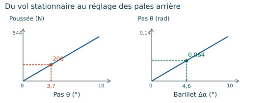
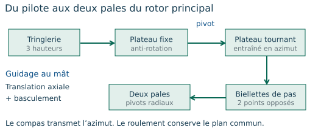
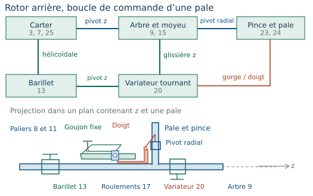
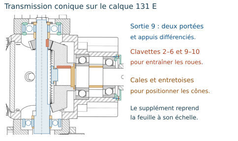
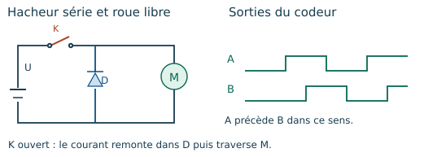
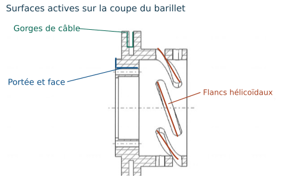
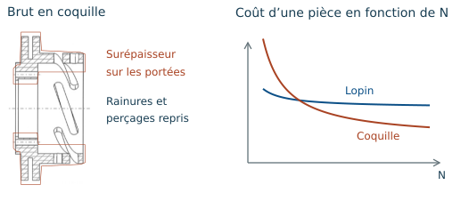

# Banque PT 2018 — Sciences industrielles C · Corrigé guidé

*Corrigé rédigé par IA, non officiel. Signalez toute erreur.*

**Rédaction** · GPT-6.2 Astra Ultra · vitesse non renseignée · 26 novembre 2026

**Révision (tour 1)** · GPT-6.2 Astra Ultra · vitesse non renseignée · 26 novembre 2026

**Hélicoptères légers Dynali et inspection civile de vignes.** Épreuve de six heures. Le jury attribue 21 %, 20 %, 17 %, 17 % et 25 % aux cinq parties. Les points individuels ne sont pas publiés. Les 40 réponses comprennent la coupe de conception, les tracés et les trois grilles GPS.

[Sujet et planches](https://www.banquept.fr/documents/2018/si_c_2018_pt.pdf) · [Rapport du jury](https://www.banquept.fr/documents/ecrit/rapport/2018/rapport_si_c_ecrit_2018.pdf)

## I. Architecture, efforts et puissance

### Q1 · Répartir les exigences entre les blocs

**Indication.** Dans chacun des deux diagrammes, suivre les liens « satisfy » puis relever le nom du bloc dans le diagramme de décomposition.

Dans le tableau du cahier, le vol vertical 1.1 est assuré par **Rotor Principal X3** chez Airbus et par **Sous Système TiltRotor** chez Bell/Agusta, avec les deux rotors orientés vers le haut. Le vol horizontal 1.2 est assuré chez Airbus par le **Sous Système Rotors Horizontaux** (poussée commune des deux hélices), chez Bell par le **Sous Système TiltRotor** basculé vers l’avant. Pour l’orientation 1.3 en lacet, le X3 commande ses deux **Rotor Horizontal** en différentiel. Le BA609 commande différentiellement ses **Rotor Gauche** et **Rotor Droit**, notamment par la direction des poussées en stationnaire. Pour l’anticouple 4, le X3 utilise le même sous-système latéral. Sur le BA609, les rotors principaux contrarotatifs compensent leurs couples à poussées équilibrées. Le diagramme BA609 ne porte aucune exigence 4 distincte. Sur le Dynali, le bloc principal assure portance et translation par inclinaison, le rotor arrière compense le couple et agit en lacet.

### Q2 · Mettre le rotor en rotation

**Indication.** Exprimer la vitesse en radians par seconde avant de calculer la variation de l’énergie cinétique.

Entre le repos et le régime nominal, le théorème de l’énergie cinétique donne $W=J\omega^2/2$. Avec $J=45\,\mathrm{kg\,m^2}$ et $\omega=530(2\pi/60)=55,50\,\mathrm{rad/s}$, le travail vaut **69 kJ** à 1 kJ près. L’approximation de l’énoncé à 55 rad/s conduit à 68 kJ. Le frottement et la traînée ont été négligés.

### Q3 · Soutenir la charge en vol stationnaire

**Indication.** Reconstituer la masse en charge. Éliminer la vitesse induite entre les deux relations du document V.

On emploie $g\simeq10\,\mathrm{m/s^2}$ pour les calculs sans calculatrice. Le plein est déjà inclus dans les 455 kg. Avec 160 kg de passagers et 25 kg de bagages, la poussée verticale équilibre $F=640g\simeq6400\,\mathrm N$. Le disque induit $v_i=\sqrt{F/(2\rho S)}\simeq8\,\mathrm{m/s}$. La puissance induite est $P_i=F^{3/2}/\sqrt{2\rho S}=51,2\,\mathrm{kW}$ pour $2\rho S\simeq100$.

### Q4 · Monter à vitesse constante

**Indication.** Lire la vitesse de montée sur le palier AB, convertir en m/s et préciser l’hypothèse sur la vitesse induite.

Sur AB, $7,2\,\mathrm{km/h}=2\,\mathrm{m/s}$. À poussée constante, le bilan de premier ordre conserve le coût induit du stationnaire et ajoute $F V_z=12,8\,\mathrm{kW}$ pour la prise d’altitude. Il donne $P_m=64\,\mathrm{kW}$ et, pour $\omega=55\,\mathrm{rad/s}$, des couples de **1 164 N·m en montée** et **931 N·m en stationnaire**. Le document V donne la loi du stationnaire seulement. Si l’on prolonge explicitement le modèle du disque idéal à la montée axiale, $F=2\rho S v_i(v_i+V_z)$, d’où $v_i=\sqrt{65}-1=7,06\,\mathrm{m/s}$, $P_m=58,0\,\mathrm{kW}$ et $C_m=1055\,\mathrm{N\,m}$. La suite indique quelle hypothèse est utilisée.

### Q5 · Équilibrer le fuselage en lacet

**Indication.** Isoler le fuselage en rotation autour de la verticale. Quel actionneur dispose d’un bras de levier par rapport à cet axe ?

Le couple exercé sur le rotor principal provoque une réaction opposée sur le fuselage. Le rotor arrière développe une poussée transversale dont le moment, avec le bras de levier de la queue, compense cette réaction. Le couple principal varie avec la phase de vol. La poussée de queue doit donc être **réglable** avec une réserve de commande de part et d’autre de l’équilibre pour faire tourner l’appareil en lacet.

### Q6 · Obtenir le même moment sur le X3

**Indication.** Introduire la somme et la différence des deux forces longitudinales. Laquelle donne un moment autour de la verticale ?

Les hélices gauche et droite du X3 ont des axes longitudinaux et sont déportées latéralement. Une différence de leurs poussées produit autour de l’axe vertical un moment proportionnel à cet écart et au demi-écartement. La somme des poussées assure la propulsion horizontale. Ces deux combinaisons permettent d’équilibrer le couple puis de commander le lacet.

### Q7 · Calculer la poussée de queue

**Indication.** Lire la distance entre les deux axes sur la vue de côté et vérifier que les unités du rapport couple/distance sont des newtons.

La cote entre les axes du rotor principal et du rotor arrière vaut $L=4650\,\mathrm{mm}$. L’équilibre autour de l’axe vertical donne $L F_T=C$. Ainsi $F_{T,s}=931/4,65\simeq200\,\mathrm N$ et $F_{T,m}=1164/4,65\simeq250\,\mathrm N$. Avec la seconde hypothèse de montée de Q4, la dernière valeur devient 227 N. Le signe de la poussée est choisi pour s’opposer à la réaction sur le fuselage.

### Q8 · Intégrer la portance des huit pales

**Indication.** Découper chaque pale en bandes radiales. La vitesse locale varie avec le rayon et le coefficient de portance avec le pas.

Une bande de corde $c(r)$ et de largeur $dr$ présente $dS=c(r)dr$ et une vitesse tangentielle $\omega r$. Avec $C_z=\lambda\theta$ et $n=8$, on obtient

$$F_z=\theta\,\frac{n\rho\lambda\omega^2}{2}\int_{r_0}^{R}c(r)r^2\,dr=K\theta.$$

L’angle est en radians, $\lambda=6$ et $R=0,40\,\mathrm m$. Pour une corde constante et une zone portante idéalisée de 0 à $R$, $K=n\rho\lambda c\omega^2R^3/6$. Une abscisse unique prise en bout de pale surestime l’intégrale.

### Q9 · Lire l’incidence au stationnaire

**Indication.** Porter la poussée stationnaire sur l’axe vertical du cahier puis revenir sur l’axe horizontal. Utiliser ensuite la polaire de la ressource V.

Sur la droite du cahier (PDF p. 42), l’horizontale à 200 N rejoint la caractéristique à **3,7° environ**, soit $0,064\,\mathrm{rad}$. La pente vaut environ 54,4 N par degré. Cette incidence est bien dans la portion presque verticale de la polaire $C_z(C_x)$, entre les repères 2° et 8°. On peut y tenir $C_x\simeq0,0062$ constant.

### Q10 · Calculer le couple de traînée

**Indication.** Multiplier la traînée de chaque bande par son rayon avant de sommer. Vérifier si le coefficient reçu comprend la surface.

Le moment élémentaire comporte un bras de levier supplémentaire. Pour les huit pales, $C_T=(n\rho C_x\omega^2/2)\int_{r_0}^R c(r)r^3\,dr$. Pour appliquer la donnée $D=\rho C_x S_p/2=8\times10^{-5}\,\mathrm{N\,s^2/m^2}$, il faut préciser la surface associée. En interprétant $S_p$ comme la surface d’une pale, uniformément répartie de 0 à $R$, $dS=S_p\,dr/R$ et $C_T=nD\omega^2R^3/4=1,64\,\mathrm{N\,m}$. Le document V définit aussi $S_p$ pour un **élément**. Si la valeur numérique concerne un seul élément, ses limites radiales et le nombre d’éléments doivent être connus pour sommer leurs moments. Si le coefficient numérique était fourni par mètre de largeur radiale, soit $D_c=\rho C_xc/2=8\times10^{-5}\,\mathrm{N\,s^2/m^3}$, la même intégrale donnerait $nD_c\omega^2R^4/4=0,66\,\mathrm{N\,m}$. Ces deux valeurs ne correspondent pas à la même unité.

### Q11 · Évaluer la puissance du moteur thermique

**Indication.** Multiplier le couple de queue par sa propre vitesse angulaire. Faire l’inventaire des termes laissés hors du premier bilan.

Avec le modèle de Q10, $P_{T,\mathrm{profil}}=C_T\omega\simeq1,64\times400=0,66\,\mathrm{kW}$. Avec la convention par mètre de bande donnée en variante à Q10, la puissance de profil serait 0,26 kW. Le bilan demandé à partir des couples retenus donne $51,2+0,66=51,9\,\mathrm{kW}$ en stationnaire. Pour y inclure aussi la puissance induite nécessaire à la poussée latérale, le disque de rayon 0,40 m donne $200\sqrt{200/(2\rho\pi R^2)}\simeq2,55\,\mathrm{kW}$ supplémentaires. La puissance utile reste dans les deux cas inférieure aux 134 kW annoncés. La puissance effectivement prélevée inclut aussi la traînée du rotor principal, les pertes de transmission et les auxiliaires. Le chiffre de 134 kW correspond au régime moteur de puissance maximale.

## II. Transmission des commandes de vol

### Q12 · Compléter les liaisons du plateau et des pales

**Indication.** Tracer d’abord les axes du mât et des pales. Déterminer ensuite quels éléments suivent l’azimut du rotor.

Chaque pale pivote sur le moyeu autour de son axe radial pour modifier son pas. Le bras de pas fait partie de la pale et reçoit la biellette à distance de cet axe. Le centre du plateau peut coulisser le long du mât et basculer autour de deux directions transversales. Une bague coulissante et une rotule concentrique modélisent ce guidage. Les deux plateaux ont en commun la position et l’inclinaison de ce centre. Une **liaison pivot** de normale au plateau autorise leur rotation relative. Le compas entraîne le plateau tournant en azimut, tandis que le dispositif antirotation rattache le plateau fixe au bâti. La planche de réponses p. 43 donne la vue d’ensemble et la vue du moyeu par-dessus.

### Q13 · Utiliser levier collectif et manche cyclique

**Indication.** Distinguer la translation de tout le plateau et les deux composantes indépendantes de son inclinaison.

En montée, le pilote relève le levier collectif et augmente ensemble les incidences par translation du plateau. Il l’abaisse pour la descente. En roulis, il déplace le manche à gauche ou à droite. La tringlerie crée une différence de hauteur des points d’appui latéraux. En tangage, il pousse ou tire le manche, qui agit sur la commande avant par rapport aux points latéraux. L’inclinaison module le pas à chaque tour. Le déphasage d’environ 90° indiqué par le sujet intervient entre la modulation de pas et l’inclinaison obtenue du disque.

### Q14 · Compter les contraintes de la tringlerie

**Indication.** Identifier les six solides isolés à droite du schéma. Regarder les deux extrémités de la fourche puis la rotation libre de la longue bielle.

La figure de la ressource VII isole six solides mobiles avant les trois biellettes de sortie. On distingue le manche, le grand cadre, le levier collectif, son petit renvoi, la longue bielle et la fourche avant. On compte trois pivots (manche/cadre, levier/bâti, levier/petit renvoi), cinq rotules (cadre/bâti, petit renvoi/cadre, les deux bouts de la longue bielle, un côté de la fourche/cadre) et une liaison linéaire annulaire de l’autre côté de la fourche. Cela donne $3(5)+5(3)+2=32$ contraintes scalaires. Trois mobilités utiles commandent les trois hauteurs. La longue bielle montée sur deux rotules a une rotation interne libre autour de la droite des centres. Donc $h=32-6(6)+3+1=0$. Remplacer la portée cylindrique ouverte de la fourche par une seconde rotule ajouterait une contrainte redondante.

### Q15 · Faire passer une commande dans le repère tournant

**Indication.** Suivre une même inclinaison entre les points de fixation non tournants de la commande et les deux biellettes de pales.

Le plateau fixe reçoit les trois hauteurs des commandes du pilote. Les roulements transmettent sa cote axiale et son inclinaison au plateau tournant. Les deux biellettes supérieures transportent cette géométrie jusqu’aux bras de pas des pales. La composante commune commande le pas collectif, et la composante variable avec l’azimut commande le pas cyclique.

### Q16 · Représenter le rotor arrière et le barillet

**Indication.** Commencer au carter et revenir vers lui par les paliers et la came. Isoler le mouvement relatif des pièces 13 et 20.

Le carter et ses chapeaux forment le bâti. Le rotor 9–15 a une pivot d’axe $z$ par rapport au carter. Chaque pince 23 pivote sur le moyeu autour d’un axe radial. Le variateur tournant 20 est guidé axialement par rapport au moyeu et entraîné en rotation avec lui. Sa gorge agit sur chacun des doigts excentrés 21. Les roulements 17 transmettent le déplacement axial du barillet 13 au variateur tout en laissant tourner le rotor. Les six goujons 12 du bâti engagés dans les rampes de 13 sont équivalents à une liaison hélicoïdale d’axe $z$. Ce schéma conserve les deux chaînes, puissance et réglage, et vaut pour chacune des huit pales.

### Q17 · Transmettre la consigne des palonniers

**Indication.** Partir du pied du pilote puis donner pour chaque organe le mouvement qu’il reçoit et celui qu’il transmet.

Le déplacement des deux pédales agit par les deux câbles sur le barillet extérieur. Sa rotation autour de $z$ se transforme en translation par les six rampes sur les goujons fixes. Les roulements transmettent cette translation au variateur tournant, puis les doigts excentrés font pivoter les pinces et les pales. Le pas collectif des huit pales de queue modifie ainsi la poussée et le couple de lacet.

### Q18 · Relier rotation de came et angle de pale

**Indication.** Développer une hélice sur un tour puis projeter le déplacement du doigt excentré. Lire les unités, différentes sur les deux axes.

La montée d’une rainure de pas $p=72\,\mathrm{mm}$ est $\Delta z=p\Delta\alpha/(2\pi)$ si $\Delta\alpha$ est en radians. Avec un doigt d’excentricité $e$, prenant le neutre comme origine et sa tangente axiale au neutre, $\Delta z=e(\sin\theta-\sin\theta_0)$. Ainsi $\Delta\alpha=(2\pi e/p)(\sin\theta-\sin\theta_0)$, au signe de la rampe près. Dans la plage tracée $\sin\theta\simeq\theta$. Le graphe du cahier p. 46 donne environ 0,14 rad à 10° de rotation de came. Pour 0,064 rad en stationnaire, lire **4,6° de rotation du barillet** par rapport au neutre. La lecture correspond à environ 0,92 mm de translation.

## III. Transmission de puissance et construction

### Q19 · Réduction vers le rotor principal

**Indication.** Identifier sur la figure VI la petite poulie motrice puis le renvoi conique du rotor principal.

La poulie motrice 2 de diamètre 100 mm entraîne la poulie 1 de 400 mm. Sans glissement, $N_q/N_m=100/400=1/4$. Le couple conique principal réduit ensuite la vitesse d’un facteur 2,43. On trouve $N_{RP}/N_m=1/(4\times2,43)=0,1029$, soit une réduction moteur/rotor de 9,72.

### Q20 · Vitesses des deux rotors

**Indication.** Compter séparément la réduction par poulies et la multiplication par engrenage dans la branche arrière.

Vers la queue, la roue 6 à 58 dents entraîne le pignon 10 à 20 dents. Donc $N_{RA}/N_m=(1/4)(58/20)=0,725$. Au point donné de 3 800 tr/min à l’arrière, $N_m=3800/0,725=5241\,\mathrm{tr/min}$ et $N_{RP}\simeq539\,\mathrm{tr/min}$. Si l’on choisit le régime arrondi de 5 300 tr/min de la fiche moteur, on trouve **545 et 3 843 tr/min**. Ces valeurs sont compatibles avec les vitesses nominales approchées de l’énoncé. Les rapports ci-dessus sont donnés en valeur absolue, les axes coniques étant orthogonaux.

### Q21 · Décrire la liaison 9–20

**Indication.** Essayer mentalement de déplacer 20 le long de 9 puis de faire tourner 20 sans 15. Identifier ce qui bloque ce second essai.

La bague lisse 16 guide le variateur rotatif 20 sur la portée cylindrique de l’arbre 9 en permettant le déplacement axial. La bague seule autoriserait aussi un mouvement angulaire. Le moyeu 15 est lié à 9 par la vis calibrée 18. Les goujons de guidage 19 conjuguent le moyeu et le variateur en rotation tout en permettant leur coulissement relatif. L’équivalent fonctionnel 9–20 est une **glissière**. La bague d’usure facilite le remplacement de la surface de frottement. Un guidage long doublé par des goujons rigides exige des jeux compatibles pour éviter l’arc-boutement.

### Q22 · Relever les défauts du couple conique et des paliers

**Indication.** Suivre successivement le chemin du couple et celui de l’effort axial dans la coupe B–B.

La coupe B–B du plan A3 montre les alésages de 6 sur 2 et de 10 sur 9 sans un entraînement positif défini sur leurs portées cylindriques. En outre les faces de moyeu et plusieurs bagues n’ont pas une chaîne complète de butées axiales. La seule coïncidence des surfaces sur la coupe ne garantit ni le passage du couple ni la position des cônes primitifs. Il manque une possibilité explicite de régler la position axiale pour le contact de denture, ainsi que la reprise des efforts axiaux opposés et le réglage des roulements 4–5. La conception doit garder un côté démontable et ne pas coincer les deux bagues extérieures de l’arbre de sortie en cas de dilatation.

### Q23 · Corriger la coupe d’ensemble

**Indication.** Choisir les épaulements avant les pièces démontables et contrôler dans quel ordre l’ensemble peut être introduit dans le carter.

Sur le calque 131 E, une clavette parallèle dans chaque portée assure la transmission de couple entre 2 et 6, et entre 9 et 10. Une épaule et une fixation axiale démontable immobilisent chaque moyeu. Le palier d’entrée utilise les deux roulements à contact oblique en opposition. Les épaulements, les entretoises et un couvercle vissé avec cales ferment la chaîne axiale et autorisent son réglage. Du côté sortie, un palier localisant reprend les efforts dans les deux sens, l’autre laisse sa bague extérieure coulisser dans son alésage. Une cale sous le chapeau permet de régler la portée de denture. La coupe colorée indique une solution de principe au 3:2 imprimé. Les valeurs de précharge et les ajustements numériques nécessiteraient les références de roulements et l’effort de service.

### Q24 · Choisir les roulements d’entrée

**Indication.** Comparer les deux côtés de chaque gorge et tracer une droite entre contacts opposés. Savoir où se trouve le centre de pression de chaque rangée.

Les épaulements asymétriques des deux chemins de billes 4 et 5 désignent des roulements à **contact oblique à une rangée de billes**, associés en opposition. La roue conique à denture droite crée une poussée axiale en plus des efforts tangentiels et radiaux. Un roulement reprend la poussée dans un sens et son partenaire dans l’autre. Sur le calque, les lignes de contact se rapprochent de l’axe entre les roulements, ce qui correspond à une disposition en X. Le jeu ou la précharge se règlent axialement. Une paire de roulements purement radiaux modélisés sans butée laisserait la poussée sans chemin de reprise.

## IV. Version électrique monoplace

### Q25 · Dimensionner la puissance continue à 1 800 tr/min

**Indication.** Repartir des quatre masses de la nouvelle configuration. Comparer trois ordonnées au même régime et sur les seules courbes S1.

La masse totale change. Elle vaut $150+100+200+80=530\,\mathrm{kg}$, structure, charge, batterie et groupe moteur compris. Pour le nouveau rotor, $v_i=8\,\mathrm{m/s}$ à ce point. Il faut donc $P_i=530\times10\times8=42,4\,\mathrm{kW}$. Le critère conduit à rechercher au moins **85 kW** à 1 800 tr/min sur la courbe **S1**. Les graphes de puissance de XIII se lisent approximativement à 60, 75–80 et 90–95 kW respectivement. On choisit le **moteur 3, MSPW 24/330-6-A1 ALKA**, qui dépasse le seuil en continu. La ressource XII citée à la fin de la question décrit la batterie, les courbes des moteurs sont en XIII.

### Q26 · Calculer le courant de batterie

**Indication.** Remonter de la puissance mécanique à la puissance électrique délivrée puis diviser par la tension du bus.

Au régime de 1 800 tr/min, pour une puissance mécanique disponible en continu de 90 à 95 kW, $I=P_{\rm méca}/(\eta U)$ vaut environ **188 à 198 A**, soit 190 A à 600 V avec $\eta=0,8$. Pour les 42,4 kW effectivement demandés en stationnaire, il suffit d’environ 88 A. Si le cahier des charges vise aussi les pointes intermittentes, la courbe S6 la plus élevée donne de l’ordre de 140 kW à ce régime, donc environ 290 A pendant la durée admise par le constructeur. Le service permanent est celui qu’impose la ressource XIII.

### Q27 · Autonomie au point de dimensionnement

**Indication.** Utiliser l’énergie spécifique et le rendement en contrôlant la cohérence entre watts, kilowatts et heures.

Les 200 kg de batterie apportent $200\times141=28\,200\,\mathrm{Wh}=28,2\,\mathrm{kWh}$. Les 3,1 kWh de la fiche correspondent à un seul module. La batterie débite $42,4/0,8=53,0\,\mathrm{kW}$ en vol stationnaire. Le temps vaut $28,2/53,0=0,532\,\mathrm h$, soit **32 minutes**. Cette durée utilise la capacité nominale entière et néglige le rotor arrière, les auxiliaires et la réserve de fin de décharge.

### Q28 · Identifier les constantes de l’autonomie

**Indication.** Faire varier la masse tout en conservant le même disque. La vitesse induite n’est donc plus une donnée constante.

Pour des batteries de masse variable et un même disque, la vitesse induite varie avec la masse. Posons $\varepsilon=141\times3600\,\mathrm{J/kg}$ et $M_s=150+100+80=330\,\mathrm{kg}$. On a $E=\varepsilon m_b$ et $P_i=[g(M_s+m_b)]^{3/2}/\sqrt{2\rho S}$. Il vient

$$A=\frac{\eta\varepsilon\sqrt{2\rho S}}{g^{3/2}}\,\frac{m_b}{(M_s+m_b)^{3/2}}.$$

Ainsi $c_1=\eta\varepsilon\sqrt{2\rho S}/g^{3/2}$ et $c_2=M_s$. Si l’on exprime l’énergie spécifique en Wh/kg, le temps sort en heures. Le disque de la partie IV a été redimensionné. On peut retrouver $2\rho S=5300/8^2\simeq82,8$ au point de référence.

### Q29 · Trouver le maximum et en apprécier la portée

**Indication.** Différencier le produit de la masse de batterie par une puissance du poids total. Tester le signe de part et d’autre du point stationnaire.

Pour $m_b>0$, $A'=c_1(M_s-m_b/2)/(M_s+m_b)^{5/2}$. L’autonomie croît jusqu’à **$m_b=2M_s=660\,\mathrm{kg}$** puis décroît vers zéro. En l’absence de batterie elle est nulle. Le maximum est donc global dans ce modèle. Avec 990 kg au total, on trouve par changement d’échelle environ 41 min au lieu de 32. Le surcroît de poussée, la puissance continue, la masse maximale admissible et le dimensionnement de structure interdisent d’adopter cette valeur sur le seul critère énergétique.

### Q30 · Moduler la tension de l’équivalent à courant continu

**Indication.** Dessiner les deux chemins parcourus par le courant inductif, interrupteur fermé puis ouvert. Calculer la tension moyenne sur une période.

En fonctionnement moteur de sens unique, un hacheur série abaisseur convient au modèle externe. Pendant $\alpha T$, l’interrupteur conduit et la tension moteur vaut $U$. Pendant $(1-\alpha)T$, le courant inductif se referme par la diode de roue libre et la tension idéale est nulle. En conduction continue, $\langle u_m\rangle=\alpha U=E+R\langle i\rangle$. L’inductance limite l’ondulation et le couple est proportionnel au courant. Pour la machine synchrone réelle, des bras commutés de l’onduleur synthétisent les tensions des phases en fonction de la position rotorique. Un pont en H serait une solution pour l’équivalent continu si inversion de tension ou freinage régénératif étaient demandés.

### Q31 · Traiter un codeur incrémental

**Indication.** Tracer A et B décalés d’un quart de période. Inverser le sens de rotation et observer l’ordre des fronts.

Un émetteur et un récepteur optiques, ou un système magnétique, délivrent des créneaux à chaque pas du disque. Une entrée numérique de compteur suffit pour la valeur absolue de la vitesse dans un sens connu. Deux entrées logiques A et B décalées d’un quart de période donnent aussi le sens par l’ordre des fronts. Une troisième entrée Z facultative fournit un index par tour. Si le disque a $N$ périodes par tour et que l’on compte $k$ fronts en $\Delta t$ avec décodage quatre fronts, $n_{\rm tr/min}=60k/(4N\Delta t)$. À basse vitesse, la mesure de l’intervalle entre fronts évite de compter trop peu d’impulsions. L’indexation ou une prise d’origine fixe la position de référence.

## V. Industrialisation du barillet

### Q32 · Fonctions et sollicitations du barillet

**Indication.** Distinguer le barillet statique, au sens du rotor, du variateur qui tourne avec les pales. Suivre l’entrée et la sortie de puissance mécanique.

Le barillet 13 reçoit le couple des câbles, tourne d’une petite fraction de tour et avance axialement sur les six goujons fixes. Il assure le déplacement du variateur tout en le laissant tourner au régime du rotor grâce aux roulements 17. Les flancs des rainures subissent pression locale de contact, frottement et usure. La partie annulaire transmet couple et effort axial, les petites sections entre lumières subissent des sollicitations de flexion et de cisaillement local. Les portées et les faces d’appui transmettent les réactions aux roulements.

### Q33 · Désigner les surfaces fonctionnelles

**Indication.** Colorer les surfaces selon l’organe voisin qui les touche. Distinguer une portée cylindrique d’un flanc de rainure.

Sur la coupe de la ressource X, repérer d’abord les **flancs des six rainures hélicoïdales** qui appuient sur les goujons, puis les **gorges périphériques** de commande par câbles. La portée coaxiale de centrage et sa face d’épaulement placent les organes de roulement et transmettent l’effort axial au variateur. Les perçages de fixation correspondent au maintien de l’assemblage. Les fonds et bouts arrondis des rainures dégagent les goujons en fin de course. La planche jointe distingue ces surfaces directement sur la coupe de la page 52.

### Q34 · Lire la cote de taille avec enveloppe

**Indication.** Écrire les deux limites de taille locale puis imaginer un calibre long de diamètre maximum.

Le diamètre extérieur local compris entre deux points opposés doit rester dans $[41,975\,;42,000]\,\mathrm{mm}$. Le modificateur d’enveloppe impose, à la limite du maximum de matière, que la portée entière puisse entrer dans un cylindre parfait de diamètre 42,000 mm. Cette limite garantit le passage dans l’organe conjugué sur la longueur engagée. Un contrôle de quelques diamètres au micromètre laisserait échapper une courbure d’axe ou une forme à plusieurs lobes. Un calibre-bague à la limite maxi complète la mesure locale.

### Q35 · Compléter les trois grilles GPS

**Indication.** Vérifier les trois cadres sur le feuillet de questions. Pour chacun, définir élément extrait, référence idéale et zone.

**Cylindricité 0,05 mm.** Spécification de forme. L’élément tolérancé est la surface cylindrique réelle de la portée extérieure repérée Ø64 sur la coupe. Aucune référence. Tous ses points extraits doivent se trouver entre deux cylindres idéaux coaxiaux dont les rayons diffèrent de 0,05 mm. Leur axe et leur rayon peuvent être ajustés librement pour enfermer la surface.

**Localisation Ø0,1 | A | B.** Spécification de position du groupe des six trous Ø4 H9. Les éléments tolérancés sont leurs lignes médianes extraites. Les références réelles sont la portée cylindrique A et la face B. Le système idéal est l’axe primaire de la portée associée et le plan secondaire associé imposé perpendiculaire à cet axe. Les six zones cylindriques de diamètre 0,1 mm ont des axes parallèles à A, répartis au pas exact de 60° sur le cercle de diamètre 48 mm. Chaque ligne médiane doit rester dans sa zone simultanément avec les autres. A et B seuls laissent libre un calage angulaire commun autour de A.

**Battement circulaire axial 0,05 | A.** La flèche simple concerne la face repérée sur la coupe, contrôlée en rotation autour de l’axe de la portée A. À chaque rayon de contrôle, le profil circulaire extrait doit tenir entre deux cercles coaxiaux de même rayon situés dans deux plans normaux à A distants de 0,05 mm. La variation totale de lecture du comparateur axial ne dépasse donc pas 0,05 mm à chaque rayon. Le cahier p. 55 répète la localisation de la page 54. Le troisième cadre de l’énoncé p. 14 et le dessin X demandent ce battement, anomalie signalée dans le rapport du jury p. 42.

### Q36 · Vérifier le matériau au contact

**Indication.** Lire la matière dans le cartouche du dessin X et comparer deux pressions exprimées dans la même unité.

Le cartouche du barillet indique **ABS**, un polymère biphasé. La table XIV donne une pression maximale admissible de 5 MPa, alors que la pression annoncée est $20\,\mathrm{N/mm^2}=20\,\mathrm{MPa}$. Elle est quatre fois trop élevée. L’emploi d’ABS à cette interface n’est donc pas vérifié par ce critère. L’Al Cu4 Mg1 de la partie suivante admet 180 MPa, neuf fois la pression calculée, avant étude de l’usure et des autres sollicitations.

### Q37 · Établir la gamme sur tour X–Z–C à outils tournants

**Indication.** Définir une prise et une butée avant chaque liste de surfaces. Distinguer broche pièce et outil tournant.

**Débit et phase 10.** Ébavurer le lopin laminé Ø110 × 50 mm. Centrer dans trois mors sur le brut et appuyer la face opposée sur une butée axiale. Dresser une première face par avance X, percer puis aléser la partie traversante et charioter les diamètres accessibles par Z, broche en rotation autour de Z. Former en une prise la portée Ø42, sa face de référence B et les épaulements accessibles par interpolation X–Z. Finir la portée de centrage, contrôler diamètre et battement. Le dressage et le chariotage de finition dans le même montage limitent le défaut d’axe.

**Phase 20.** Reprendre la pièce par un mandrin expansible dans l’alésage fini, avec appui sur la face dressée, ou par mors doux usinés et butée préservant les portées. Dresser à longueur, former les autres diamètres (dont Ø64 et Ø78), les faces de flasque et les gorges de câble avec outil à gorge en plongée X. Pour les six trous Ø4 H9 sur Ø48, décaler l’outil axial en X jusqu’au rayon 24 mm, indexer C de 60° entre positions, percer puis aléser en Z. Usiner de même les autres trous frontaux aux positions polaires tirées de leurs cotes théoriques. Un foret axial motorisé atteint ces trous hors axe.

**Fraisage des six rainures.** Monter une fraise radiale, régler la profondeur suivant X puis interpoler simultanément C et Z au pas de 72 mm par tour, soit 0,20 mm par degré, en respectant le sens de l’hélice. Les six départs sont indexés de 60°. L’extrémité R3 appelle une fraise Ø6 ou une interpolation équivalente. Limiter la course à la longueur de rainure du plan, reprendre le flanc opposé si nécessaire. Terminer par ébavurage, contrôle des portées, de la position des trous, du profil et des dépouilles fonctionnelles. La rotation de l’outil motorisé fournit la vitesse de coupe pendant fraisage et perçage hors axe.

### Q38 · Calculer le défaut de cylindricité d’un nuage

**Indication.** Faire varier l’axe candidat. Quel écart entre deux cylindres coaxiaux enfermant tous les points doit-on minimiser ?

Acquérir des points sur plusieurs sections et génératrices, étalonner le palpeur, compenser son rayon et écarter seulement les points manifestement non représentatifs suivant un protocole déclaré. Pour un axe candidat défini par un point $O$ et un vecteur unitaire $u$, calculer pour chaque point $P_i$ la distance radiale $r_i=\|(P_i-O)\times u\|$. Optimiser position et direction de l’axe pour minimiser $\max r_i-\min r_i$. Les deux rayons extrêmes définissent les cylindres coaxiaux de zone minimale. La surface A respecte la cylindricité prescrite si ce minimum est au plus **0,01 mm**, sous réserve de l’incertitude de mesure. Un cylindre des moindres carrés peut initialiser le calcul. Le diamètre nominal et une référence externe n’interviennent pas dans ce défaut de forme.

### Q39 · Tracer le brut de fonderie

**Indication.** Imaginer le retrait du noyau axial et l’ouverture de la coquille. Rechercher les formes rentrantes à reprendre par usinage.

La coupe proposée conserve un manchon creux et une collerette proche de la forme finie. Un noyau axial réserve le passage central avec surépaisseur d’alésage. Prévoir un retrait selon l’alliage, des congés aux variations de section, des dépouilles axiales sur les parois extraites et une surépaisseur limitée sur les portées et sur les faces à usiner. Le joint de coquille passe au plus grand diamètre. On usine la rainure de câble entre les flasques, les six lumières hélicoïdales et les petits trous afin de libérer le brut sans tiroirs hélicoïdaux. Les zones enlevées ensuite restent pleines de métal à la sortie du moule. Les valeurs numériques des dépouilles, surépaisseurs et retraits relèvent de la gamme du fondeur.

### Q40 · Comparer les coûts unitaires

**Indication.** Diviser le coût total de chaque gamme par le même nombre de pièces. Tester les limites pour une très grande série.

Pour une série de $N$ pièces, $c_u=v+F/N$. L’usinage dans le lopin demande peu de frais fixes $F_L$, mais enlève davantage de matière et mobilise le tour et l’opérateur plus longtemps par pièce, d’où un coût variable $v_L$ élevé. La fonderie ajoute la conception, la mise au point et l’amortissement de la coquille, soit $F_F>F_L$. Coulée, ébarbage et reprises restent à payer, avec $v_F<v_L$ si les gains d’usinage les dépassent. Les deux courbes décroissent vers leurs propres asymptotes. Le croisement vaut $N^*=(F_F-F_L)/(v_L-v_F)$. Avant ce seuil, préférer le lopin, après lui la coquille si les hypothèses de coût se réalisent. Aucune valeur de seuil n’est calculable sans devis.
