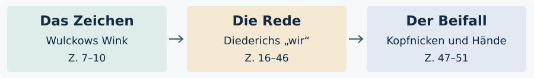

# BEL A/L — Allemand, commentaire et traduction 2018 · Corrigé brut

*Corrigé rédigé par IA, non officiel. Signalez toute erreur.*

**Rédaction** · GPT-6.2 Astra Ultra · vitesse non renseignée · 27 novembre 2026

**Révision** · GPT-6.2 Astra Ultra · vitesse non renseignée · 27 novembre 2026

Heinrich Mann, *Der Untertan*, 1919 (date indiquée par le feuillet). Le commentaire porte sur les lignes 1–56 (p. 2–3). La version porte sur les lignes 12–27 (p. 2), de « Nach einigem Schnaufen… » à « … ein beispielloser zu nennen. ». Durée de l’épreuve : six heures. Dictionnaire unilingue autorisé.

[Sujet officiel, p. 2–3](https://www.ens-lyon.fr/sites/default/files/2018-10/2018%20commentaire%20et%20traduction%20en%20LVE.pdf#page=2) · [Rapport du jury, écrit commun, p. 1–8](https://www.ens-lyon.fr/sites/default/files/2018-11/Fascicule%20ALLEMAND_2018.pdf#page=1)

## Commentaire en allemand

Bevor Diederich Heßling im vorliegenden Ausschnitt aus Heinrich Manns Roman *Der Untertan* das Wort erhält, muss ihm ein Schutzmann überhaupt erst bedeuten, dass er vortreten darf. Wenig später spricht derselbe Mann, als dürfte das Deutsche Reich über jede Entscheidung auf der Welt mitbestimmen. Wie kann dieser Wechsel des Maßstabs gelingen? Mann zeigt, wie einer, der sich genau an die Hierarchie hält, in ihrem Namen Macht ausüben kann. Die Komik entsteht aus dem Abstand zwischen dem, was der Festredner verkündet, und dem, was der Erzähler uns sehen lässt.

Schon das Aufstehen auf der Tribüne ist ein kleines Lehrstück. Die Beamten halten das Publikum dazu an, die Offiziere tun es „von selbst“ (Z. 2). Gerade ihre Spontaneität bezeugt, wie gut sie die Vorschrift verinnerlicht haben. Der Oberpräsident braucht sich nur hinzusetzen, schon hat sich erledigt, was Zillich vielleicht noch vorhatte. Rechts und links von ihm finden die Würdenträger ihren Platz. Wenn der Erzähler von Gesetzen spricht, die der Versammlung innewohnten, gibt er ihrer gesellschaftlichen Ordnung den Anschein eines Naturgesetzes. Wie viele einzelne Mittler dafür nötig sind, verrät der Weg eines Winks vom Regierungspräsidenten über zwei Polizisten bis zum Redner. Am Ende dieser feierlichen Übermittlung steht eine durchaus unfeierliche Aufforderung im Dialekt.

Als Diederich das Podium besteigt, versagen ihm beinahe die Beine. Ausgerechnet ein blattloses Bäumchen gibt ihm seine Sicherheit zurück. Seine Blüten haben die Reichsfarben und bestehen aus Papier, einem Material, das dem Fabrikanten vertraut ist. Was er später als beispiellose nationale Blüte feiert, steht im Kleinen als Dekoration vor ihm. Die Natur muss nachgeholfen bekommen, damit das Bild des Gedeihens stimmt. Ähnlich verfährt er mit der Zeit. Er verbindet den Geburtstag des alten Kaisers und ein noch nicht ganz erreichtes Thronjubiläum des Enkels zu einem einzigen Anlass für Dankbarkeit. Dass er den verlangten Rückblick tatsächlich „warf“ (Z. 22), stellt der Erzähler so knapp fest, als habe Diederich eine vorgeschriebene Turnbewegung ausgeführt.

Die Rede gewinnt an Raum, während ihre Begründungen immer dürftiger werden. Der Ozean soll selber beweisen, dass eine Entscheidung ohne Deutschland unzulässig sei. Die Wiederkehr von „Geschäft“ verrät einen Kaufmann, der sein Interesse an weltweiten Geschäften zum Maß der Weltpolitik erhebt. Schließlich fragt Diederich, wem die Deutschen ihren gegenwärtigen Zustand verdankten, und antwortet sich selbst. Sein „wir“ nimmt der Zuhörerschaft die Antwort ab. Wer widerspricht, ist in der Rede schon als Nörgler aussortiert. Gerade wo Diederich persönlich wird und sich an die Brust schlägt, macht er ein besonders verräterisches Bild ausfindig. Der Efeu kann in die Höhe wachsen, weil er sich an einen stärkeren Träger klammert. Auch die improvisierte Einladung an den Arbeiter verdankt sich einem körperlichen Reiz. Den Geruch der Menge trägt der Wind über die militärische Absperrung, die Menschen bleiben dahinter.

Wie gut die Rede ankommt, scheint zuletzt der Beifall zu beweisen. Doch der Erzähler zerlegt auch ihn in einzelne Bewegungen. Erst nickt der Oberpräsident, dann bewegt der Adjutant die Hände, dann jubeln die Tribünen. Das Echo, das Diederich beflügelt, wird durch dieselbe Rangordnung erzeugt, die ihn aufs Podium gebracht hat. Genauso leicht wie die Taschentücher wird ihm das Herz. Seine letzte Metapher dagegen ist gewichtig: Aus vergangenen Niederlagen lässt er im Schmelzofen der Geschichte die Kaiserkrone hervorgehen. Dass er nach so viel geliehenem Mut sogar den Frieden verächtlich machen kann, verleiht der komischen Szene ihren politischen Ernst. Der Titel des Romans trifft hier einen Menschen, dessen Unterordnung ihn zum Wortführer macht.

## Version française

Après avoir un moment repris son souffle, il distingua, dans cet espace dénudé, un petit arbre sans feuilles, mais tout couvert de fleurs de papier noires, blanches et rouges. À la vue du petit arbre, la mémoire et les forces lui revinrent. Il commença.

« Excellences ! Très hauts, hauts et honorables messieurs !

Il y a cent ans que le grand empereur dont le monument attend que le représentant de Sa Majesté vienne le dévoiler nous fut donné, à nous et à la patrie. Et dans le même temps, ce qui rend cette heure plus mémorable encore, une décennie s’est presque écoulée depuis que son illustre petit-fils est monté sur le trône ! Comment dès lors ne pas jeter avant tout un regard fier et reconnaissant sur la grande époque qu’il nous a été donné de vivre nous-mêmes ? »

Ce regard, Diederich le jeta. Il célébra tour à tour l’essor sans précédent de l’économie et celui de l’idée nationale. Sur l’océan il s’attarda assez longtemps. « L’océan est indispensable à la grandeur de l’Allemagne. L’océan nous démontre que, sur ses eaux comme au-delà, aucune décision ne doit plus se prendre sans l’Allemagne et sans l’empereur allemand, car aujourd’hui les affaires mondiales sont la grande affaire ! » Mais cet essor devait être qualifié de sans précédent dans le domaine des affaires et, davantage encore, dans la vie intellectuelle et morale.
