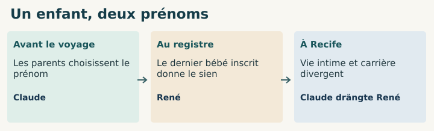

# BEL A/L — Allemand (thème Lyon) 2018 · Corrigé brut

*Corrigé rédigé par IA, non officiel. Signalez toute erreur.*

**Rédaction** · GPT-6.2 Astra Ultra · vitesse non renseignée

[Feuillet officiel, p. 8](https://www.ens-lyon.fr/sites/default/files/2018-10/2018%20%C3%A9preuves%20de%20sp%C3%A9cialit%C3%A9.pdf#page=8) · [Rapport du jury, p. 8–12](https://www.ens-lyon.fr/sites/default/files/2018-11/Fascicule%20ALLEMAND_2018.pdf#page=8)

Jean-Christophe Rufin, La Salamandre (2005). Thème de quatre heures, sans dictionnaire. Cinq paragraphes, de « À l’époque où naquit » à « que des avantages ». Le marié et le futur consul sont une seule personne.

Un oubli à l’état civil donne à un enfant deux prénoms. Le récit les fait ensuite agir l’un sur l’autre. René a des ambitions de fonctionnaire, Claude tient à la vie qui les satisfait déjà.

## Proposition de thème

Als René Chavard geboren wurde, lebten seine Eltern auf einer Kautschukplantage tief in den Wäldern von Laos. Das war 1944. Sein Vater wollte das Gut in diesen unruhigen Zeiten nicht verlassen. Dabei musste das Kind beim Standesamt in Vientiane angemeldet werden. Zum Glück hatte der Siedler vom Nachbargut gerade in jener Woche in die Hauptstadt zu fahren, um eine dringende Angelegenheit zu regeln. Er erklärte sich bereit, bei dieser Gelegenheit auch die Geburt eintragen zu lassen.

Zwei Tage lang schlug sich der Mann durch den Schlamm. Schlammbespritzt und todmüde stand er schließlich vor dem Standesbeamten, und da, gerade als er die Vornamen des Kindes nennen sollte, brachte er kein Wort heraus. Was der Vater ihm aufgetragen hatte, wollte ihm beim besten Willen nicht mehr einfallen. Der Beamte sprang ihm bei, reichte ihm eine Handvoll Michel und Jules, dann armweise Robert, Maurice, Luc, Georges und Édouard. Nein, so hatte der Name nicht gelautet.

Eine Hand an die Stirn gelegt, setzte sich der Mann und begriff das Ausmaß des Unglücks. Irgendwo auf dem Weg war der ausgesuchte Vorname heruntergefallen und nun war er verloren. Dabei brauchte dieses Kind eine Identität. Seine Registernummer, sein Geburtsdatum und seine Abstammung füllten schon eine ganze Zeile im aufgeschlagenen Register. Andere Eltern kamen herein und wurden ungeduldig. Man beschloss, diesem von seinem Vornamen im Stich gelassenen Wesen die Identität des letzten vor ihm eingetragenen Kindes zu geben. Das war ein René gewesen. So wurde er René.

Claude, der ausgesuchte und unterwegs verlorene Name, blieb der einzige, den die Eltern ihr Leben lang gelten lassen wollten. Für sie, für seine engsten Freunde und für sich selbst blieb ihr Kind Claude.

Auf dem Papier aber war es René, der ein recht mittelmäßiges Studium absolvierte und im französischen Mutterland ein Rechtsdiplom, die *capacité en droit*, erwarb. Claude heiratete 1965 eine rundliche junge Frau, die ein wenig schielte. Es zog Claude in die warmen Länder seiner Kindheit zurück, und so drängte er René, an der Aufnahmeprüfung des französischen Außenministeriums teilzunehmen. Mit fünfundvierzig, nachdem er drei der Gesundheit abträgliche afrikanische Hauptstädte überlebt hatte, war er zum französischen Konsul in Recife ernannt worden. Der Posten war bescheiden. René hoffte auf etwas Besseres. Claude dagegen konnte diesem angenehmen, sonnigen, ruhigen Leben nur Vorzüge abgewinnen.

Jean-Christophe Rufin, *Der Salamander* (2005).

