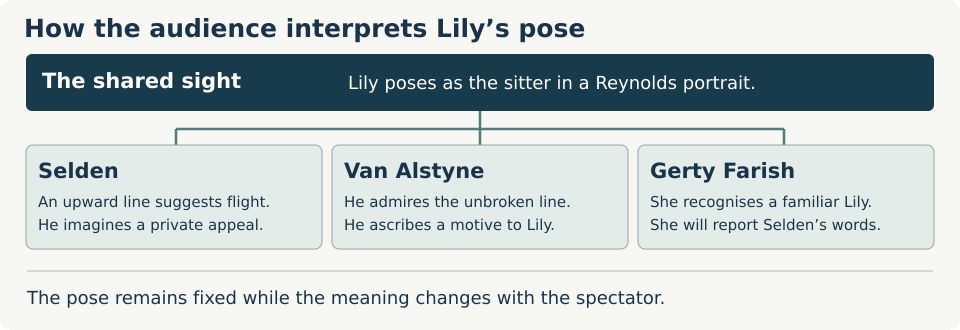

# BEL A/L — Anglais (commentaire et traduction) 2018 · Corrigé guidé

*Corrigé rédigé par IA, non officiel. Signalez toute erreur.*

**Rédaction** · GPT-6.2 Astra Ultra · vitesse non renseignée

**Lecture du rapport du jury** · GPT-6.2 Astra Ultra · vitesse non renseignée

Edith Wharton, *The House of Mirth* (1905). Une soirée de tableaux vivants dans la haute société new-yorkaise des années 1890. Le commentaire se rédige en anglais sur tout l’extrait. La version porte sur les lignes 24 à 41, depuis « Each evanescent picture… » jusqu’à « …from her poised foot to her lifted arm. ».

[Sujet officiel, pages 4 et 5](https://www.ens-lyon.fr/sites/default/files/2018-10/2018%20commentaire%20et%20traduction%20en%20LVE.pdf#page=4) · [Rapport du jury, pages 1 à 14](https://www.ens-lyon.fr/sites/default/files/2018-11/Fascicule%20Anglais_2018.pdf#page=1)

## Préparer le commentaire

À la première lecture, surlignez séparément les noms de peintres et les noms des invités. À la seconde, relevez les remarques que chaque personnage serait seul à pouvoir faire. L’admiration de Selden doit rester crédible pour que la remarque de Van Alstyne ait le pouvoir de le blesser.

| Appui dans le passage | Question à poser au brouillon | Conséquence pour l’argument |
|---|---|---|
| L’enfant sous le charme, l. 7–8 | Être sensible à la beauté donne-t-il toute autorité pour l’interpréter ? | Introduire une réserve dès la première description de Selden. |
| Le mouvement vers l’intérieur de la toile, l. 34–36 | Qui a choisi le tableau et qui décrit l’effet ? | Distinguer le travail artistique de Lily et le récit que Selden en tire. |
| Les lignes de la silhouette, l. 40–41 et 47–48 | Les deux hommes remarquent-ils un détail différent ? | Leur désaccord concerne ce que la forme leur permet de dire de Lily. |
| La substitution de « we » à « I », l. 62–66 | À qui Gerty veut-elle raconter la scène ? | Montrer le retour du spectacle dans la circulation des nouvelles. |

**Exercice.** Rédigez deux phrases en anglais sur le dernier échange. Dans la première, dites ce que Selden semble partager avec Gerty. Dans la seconde, examinez le sens que Gerty attribue à cet accord. Vous pouvez écrire *His “we” admits her to an intimacy which she promptly turns into a message for someone else*.

## Commentaire en anglais

### What has to happen before a spectator can see Lily?

When the curtain goes up at Mrs Bry’s, the reader might expect the description of a party to give way to a sequence of paintings. In fact the opening sentence also records the interruption of a conversation. Gerty Farish will go on talking while the tableaux are being shown and will have the last word when they end. The people looking are part of the picture Edith Wharton has composed. Her most persuasive illusion is the prospect of seeing Lily Bart simply as herself. How does the society that makes that revelation possible also set limits to what can be seen?

The apparently impersonal account of how to make a tableau works like a preliminary test of the reader. A lighting arrangement and layers of gauze can be inspected, but a corresponding adjustment must take place on the other side of the curtain, in the spectator’s mind. The contrast between waxworks and a glimpse of an imaginative borderland flatters the person who can tell the difference. Selden promptly qualifies. Yet the simile that accounts for his susceptibility makes him a child under a spell. The same disposition may be both a gift and a liability. Even the catalogue of pictures depends on the reader doing two things at once. The proper names of painters distinguish aesthetic types, while the married names and Brooklyn address identify individuals in a particular company. A trained spectator can see Titian’s colours in the echoes of gold running from salver to hair. A neighbour may be equally interested in which young woman is holding the dish. One kind of recognition never quite excludes the other.

Lily alters this arrangement by performing it exceptionally well. The other women have been fitted to parts. Lily is credited with having chosen her own. The reference to Cleopatra records a rejected possibility, a grander and more conspicuously costumed entrance. Her apparent simplicity thus has a history of calculation and artistic judgement. The reversal of the expected movement across the frame is exact. An animated portrait would normally step out of its canvas. Lily seems to step into Reynolds’s and displace the original sitter. Her pose traces a continuous ascending line from foot to arm, so that arrested movement appears to promise flight. Wharton gives weight to this moment of beauty without granting Selden a view from outside the theatre. The claim about seeing the real Lily is qualified by “seemed”. The poetry he perceives in her presence has repeatedly escaped him in her absence. His revelation says something precise about the conditions of his own attention.

A change of voice tests it. Van Alstyne also notices an unbroken line. His clubman’s exclamations make it an occasion to speculate about what a woman wants the men looking at her to know. The narrator places his scented moustache uncomfortably close to Selden’s shoulder. Two supposedly incompatible tastes occupy almost the same seat. Selden’s anger is more interesting because he remembers having absorbed such remarks before. His appeal to Miranda against Caliban rebukes the speaker but also casts Lily in another part devised by someone else. In his mind it is now her beauty that stretches out its hands to him. Nothing on stage establishes that Lily is asking this particular man to rescue her. The performance has aroused a genuine longing whose imagined reciprocity the narrative leaves in doubt.

At last Gerty identifies the same “real Lily”. Where Selden has experienced a private summons, Gerty hears an opportunity to signal friendship. His correction from the singular to “we” offers her a moment of intimacy, which she immediately proposes to report to Lily as evidence that he does not dislike her. A painting gave a woman the power to command a room without speaking. In the final conversation she remains absent as an interpreter of her own gesture. The movement from framed art to possible gossip leaves the reader with both the force of Lily’s appearance and the distance between appearing before others and being known by them.

## Version française

Chaque image fugitive éveillait en Selden le pouvoir de faire naître des visions. Elle l’entraînait si loin dans les perspectives ouvertes à son imagination que même les remarques dont Gerty Farish accompagnait le spectacle — « Oh, comme Lulu Melson est jolie ! » ou bien « Ce doit être Kate Croby, là, à droite, en violet » — ne rompaient pas le charme. De fait, les interprètes avaient si habilement effacé leur personnalité devant les scènes où ils figuraient que même les spectateurs les moins imaginatifs durent tressaillir à la vue du contraste lorsque le rideau s’ouvrit soudain sur un tableau qui était, tout simplement et sans déguisement, le portrait de Miss Bart.

Cette fois, la personnalité l’emportait à l’évidence. Le « Oh ! » unanime du public saluait la beauté bien vivante de Lily Bart, en chair et en os, plutôt que le coup de pinceau de Reynolds dans sa *Mrs Lloyd*. Elle avait fait preuve de discernement artistique en choisissant un modèle qui lui ressemblait assez pour qu’elle pût incarner la femme représentée tout en restant elle-même. On aurait dit qu’au lieu de sortir de la toile de Reynolds, elle y était entrée et que le rayonnement de sa grâce vivante en chassait le fantôme de la belle disparue qu’il avait peinte. L’envie de paraître dans un décor somptueux — elle avait un instant songé à incarner la Cléopâtre de Tiepolo — avait cédé devant un instinct plus sûr qui l’engageait à se fier aux seules ressources de sa beauté. Elle avait choisi à dessein un tableau où nul accessoire du costume ou du décor ne détournât l’attention. Les étoffes claires qui la drapaient et le fond de feuillage devant lequel elle se tenait faisaient simplement ressortir les longues courbes de dryade qui s’élançaient de son pied en équilibre jusqu’à son bras levé.

## Vérifier la version

- **La concession.** L’enchaînement *so … that even* mesure la puissance d’évocation des tableaux. Garder les deux remarques de Gerty à l’intérieur de la phrase, puis reprendre le sujet avec « ne rompaient pas le charme ».
- **La rupture.** Dans la première occurrence, la personnalité s’efface devant les scènes. Dans la suivante, c’est elle qui l’emporte. Rendre ce retournement avant de chercher un équivalent au terme technique *brushwork*.
- **Les plans du tableau.** Le modèle peint est Mrs Lloyd. La personne qui entre dans le tableau est Lily. Le fantôme appartient à l’ancienne beauté représentée par Reynolds. L’opposition entre les deux directions du mouvement organise la phrase.
- **Le dernier geste.** *Relieve* prend ici son sens visuel de « faire ressortir ». *Poised* évoque la maîtrise de l’équilibre. La version s’arrête au bras levé, avant la phrase qui interprète l’attitude de Lily.
